# Davlat va huquq asoslari. 10-sinf (2023)

# I bob. Jamiyat va inson huquqlari

## 1–2-dars. Jamiyatda inson huquqlarining oʻrni

Odamlarning inson huquqlarini rad etish ularning insoniyligiga qarshi chiqishdir. **Nelson Mandela**

### Siz bilib olasiz

“Jamiyat”, “shaxs” va “inson huquqlari” tushunchasi.

Inson manfaati va jamiyat manfaatining uygʻunligi.

Oʻzbekiston Respublikasi Konstitutsiyasi – inson huquqlari kafolati.

### “JAMIYAT”, “SHAXS” VA “INSON HUQUQLARI” TUSHUNCHASI

Kundalik turmushda “jamiyatimizda roʻy berayotgan voqealar”, “farovon jamiyat qurish”, “jamiyatimizning maʼnaviy ahvoli” kabi jumlalarni juda koʻp eshitgansiz. Xoʻsh, jamiyat nima oʻzi va uning mazkur bobdagi inson huquqlariga qanday aloqasi bor? “Jamiyat” tushunchasiga juda koʻplab taʼriflar berilgan. Chunki u juda ham keng va mavhum tushuncha. Shunday boʻlsa-da, hozircha jamiyat deganda “maʼlum bir hududda yashovchi, qadriyatlari, ular amal qiladigan qoidalar va anʼanalari oʻxshash boʻlgan hamda oʻzaro ehtiyoj va manfaatlari yoʻlida birlashgan insonlar guruhi” tushunilishini yodingizda saqlab qoling. Demak, taʼrifdan kelib chiqib aytish mumkinki, “jamiyat” tushunchasini tushunishda ikkita muhim belgini esdan chiqarmasligimiz lozim ekan. Birinchisi – unda “koʻplab insonlarning mavjud boʻlishi” va ikkinchisi – “insonlarning maʼlum bir umumiy xususiyatga asoslanib birlashgani va yashayotgani”. Mana shu ikki belgi jamiyat taʼrifining asosini tashkil qiladi. Lekin shuni ham unutmaslik lozimki, jamiyat shunchaki insonlar guruhi emas. Masalan, sizning oilangiz va yoningizdagi qoʻshningiz birgalikda jamiyat boʻlib qolmaysizlar.

### Yodda tuting

**“Jamiyat” tushunchasi:** maʼlum bir hududda yashovchi, qadriyatlari, ular amal qiladigan qoidalar va anʼanalari oʻxshash boʻlgan hamda oʻzaro ehtiyoj va manfaatlari yoʻlida birlashgan insonlar guruhi.

**“Jamiyat” soʻzining lugʻaviy maʼnosi:** arabcha soʻz boʻlib, jamoa, jamlangan, birlashgan degan maʼnolarni anglatadi.

Yuqoridagi taʼrifdan ham koʻrinib turibdiki, jamiyat insonlarning katta bir guruhi ekan. Demak, jamiyatni kimlar tashkil etadi, deyilsa, albatta, insonlar, deb javob beriladi. Mana shu insonlar, yaʼni jamiyatdagi shaxslar oʻzlari yashayotgan hududda turli vazifalarni bajaradilar. Masalan, kimdir shifokor, yana kimdir harbiy va yana kimdir dehqon sifatida mana shu jamiyatda oʻz funksiyasini bajaradi. Ammo shaxslarning nafaqat bajaradigan vazifalari, balki ularning tana tuzilishlari, qarashlari, tillari, malaka hamda bilimlari, dinlari va boshqa xususiyatlari turlicha boʻlishi mumkin. Masalan, Oʻzbekistonda ham turli din

vakillari, turli tillarda soʻzlashuvchi millatlar va turli bilim hamda malakaga ega boʻlgan shaxslar istiqomat qiladilar. Mana shu kichik guruhlar birgalikda yirik bir jamiyatni tashkil etadi. Bu bugun siz va biz yashab turgan jamiyat boʻlib, unda barchamiz bir-birimizga turli xildagi xizmatlarni koʻrsatamiz va birgalikda farovon jamiyat qurish uchun intilamiz.

### Jamiyatning qanday boʻlishi oʻsha jamiyatda yashovchi insonlarga bogʻliq

(Quyidagi suratlardan ham xulosa chiqarib olishingiz mumkin)

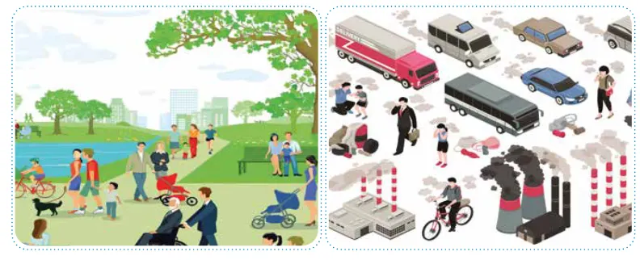

Biroq biz erkin bozor iqtisodiyotiga asoslangan jamiyatda yashar ekanmiz, bir insonlar guruhining boshqalaridan turli jabhalarda ustun boʻlib ketishi ehtimoli ham yoʻq emas. Natijada ular tomonidan boshqa insonlar turli xil qiynoqlarga solinishi yoki ularning huquqlari toptalishi mumkin. Bu oʻz-oʻzidan jamiyatni tashkil etuvchi shaxslarning oʻzlari yashayotgan jamiyatda emin-erkin yashashdan mahrum boʻlishiga olib keladi. Bu kabi notenglik hamda insonlarning ijtimoiy hayotiga salbiy taʼsir koʻrsatuvchi holatlarning oldini olish davlatning zimmasidadir. Bunday davlat “ijtimoiy davlat” deb ataladi. Oʻzbekiston ham aynan ijtimoiy davlatlar qatoriga kiradi. Mazkur asosiy va oʻzgarmas tamoyil Konstitutsiyamizning 1-moddasida oʻz aksini topgan.

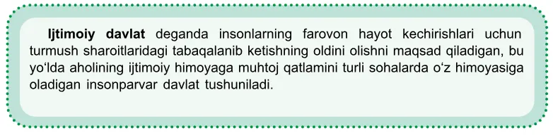

Bundan tashqari, baʼzan davlat yoki undagi hukumat oʻz fuqarolarining asosiy huquq va erkinliklariga xiyonat qiladi. Tarixdan olgan bilimlaringizdan ham maʼlum, Gitler va uning tarafdorlari oʻzlarining jamiyatdagi ustun mavqeyidan foydalanib fashizmga asoslangan qarashlari bilan kam sonli millatlarni yoki aholining jismonan va aqlan kuchsiz boʻlgan juda katta qismini qirib yuborgan, ularning mulklarini tortib olgan edi.

Mana shu kabi holatlar yuzaga kelmasligi va jamiyatda insonlar emin-erkin yashay

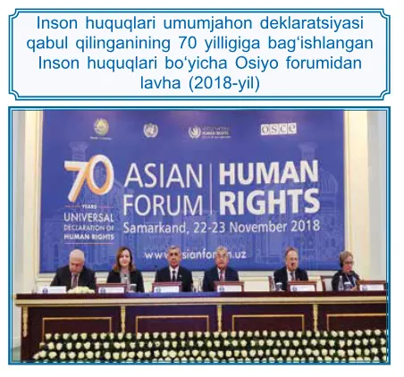

olishlari uchun inson huquqlari taʼminlanishi lozim boʻladi. Inson huquqlari muhim ekanligi haqidagi qarashlar qadimdan mavjud boʻlgan boʻlsa-da, biz yashab turgan zamonaviy davrda qaror topgan inson huquqlari asosan Ikkinchi jahon urushidan keyin shakllandi, deb aytishimiz mumkin. Xususan, 1948-yilda Birlashgan Millatlar Tashkiloti tomonidan Inson huquqlari umumjahon deklaratsiyasining qabul qilinishi bunga yaqqol misoldir. Aynan mana shu deklaratsiya inson huquqlariga oid keyinchalik qabul qilingan koʻplab xalqaro shartnomalar, mintaqaviy shartnomalar hamda mamlakatlarning ichki qonunchiliklari uchun tamal toshini qoʻyib berdi, deyish mumkin.

Xoʻsh, inson huquqlari deganda nimani tushunish kerak? Yaxshilab oʻylab qaralsa, har qanday huquq insonga tegishli boʻladi, shuning uchun barcha huquqlar ni inson huquqlari deb atayveramizmi? Inson huquqlari deganda avvalo barcha insonlarning qadr-qimmatini tan oladigan va himoya qiladigan standartlar (mezonlar) tushuniladi. Inson huquqlari insonlarning jamiyatda va bir-biri bilan qanday yashashini, shuningdek, ularning davlat bilan munosabatlarini va davlatning ular oldidagi majburiyatlarini tartibga soladi. Inson huquqlari insonlarning irqi, jinsi, millati, tili, dini yoki boshqa har qanday maqomidan qatʼi nazar, barcha insonlarga tegishli boʻlgan huquqlardir.

Ammo, yuqorida aytib oʻtganimizdek, jamiyat maʼlum bir oʻxshash qadriyat, qoida va anʼanalar ostida birlashgan insonlar guruhidan tashkil topadi. Shuning uchun bir jamiyatda yuqori oʻringa qoʻyiladigan qadriyat yana bir jamiyatda umuman qadrlanmasligi ham mumkin. Bu jamiyatlar bir-biridan farq qilar ekan, demak, ularda himoya qilinadigan inson huquqlari ham bir-biridan farq qilishi mumkin. Ammo bu yerda bir masalani yaxshilab farqlab olish zarur. Davlat tomonidan beriladigan insonlarning asosiy huquq va erkinliklari hamda butun dunyodagi insonlarga bir xilda amal qiladigan inson huquqlari bir-biridan farq qiladi. Masalan, inson huquqlari mutlaq hisoblanib, butun dunyoga bir xilda xalqaro huquq tomonidan taqdim etilsa, maʼlum bir davlat fuqarolariga tegishli boʻlgan insonlarning asosiy huquq va erkinliklari asosan oʻsha davlatning konstitutsiyasiga asoslanadi hamda ular maʼlum bir cheklovlardan xoli emas.

### Yodda tuting

> **Inson huquqlari** – bu barcha insonlarning qadr-qimmatini tan oladigan va himoya qiladigan standartlar (mezonlar) hisoblanadi. Inson huquqlari insonlarning jamiyatda va bir-biri bilan qanday yashashini, shuningdek, ularning davlat bilan munosabatlarini va davlatning ular oldidagi majburiyatlarini tartibga soladi.

### INSON MANFAATI VA JAMIYAT MANFAATINING UYGʻUNLIGI

Ushbu bobdagi inson huquqlarini oʻrganishda “inson manfaati” hamda “jamiyat manfaati” tushunchalarini anglab olish juda ham muhim. Chunki inson jamiyatdan alohida hayot kechira olmaydi. U doim biron-bir jamiyatning aʼzosi boʻladi. Ammo jamiyat aʼzosi boʻlgan shaxsning manfaatlari baʼzida jamiyat manfaatlari bilan uygʻun boʻlsa, baʼzida bir-biriga zid kelib qoladi. Yaʼni biz faqat maʼlum bir shaxsning manfaatinigina oʻylasak, jamiyatdagi boshqa insonlarning manfaatlariga putur yetib qolishi mumkin. Ammo faqatgina jamiyat manfaatini (ommaviy manfaatni) hisobga oladigan boʻlsak, maʼlum bir insonlarning manfaatlari oyoqosti boʻlishi ehtimoli bor. Bu ularning inson huquqlari yoki davlat tomonidan taʼminlangan asosiy huquq va erkinliklari buzilishi mumkin deganidir.

Albatta, kelgusi hayotingizda siz ham oʻz manfaatlaringiz jamiyat manfaatlariga zid kelib qoladigan holatlarga duch kelishingiz mumkin. Jamiyat manfaatlari bu ommaning manfaatlari deganidir. Keling, bunga bir qancha misollarni koʻrib chiqamiz. Masalan, bir kishi tamakini xohlagan joyida chekishni, yana boshqa bir kishi esa avtomobil xavfsizlik kamarini umuman taqmaslikni hamda avtomobilda oʻtirgan boshqa yoʻlovchilar ham buni soʻramasliklarini xohlashi mumkin. Bir qarashda “tamaki ham, avtomobil ham oʻsha insonlarning mulki, ulardan qanday xohlasa, shunday foydalanaversin, ularda inson huquqlaridan biri boʻlmish mulkka boʻlgan huquq bor” deb oʻylashingiz mumkin. Ammo bu jamiyat manfaatlariga zid hisoblanadi va atrofdagilarga zarari tegishi mumkin. Shu sababli

davlat mazkur holatda jamiyat manfaatlari insonning shaxsiy manfaatlaridan ustun ekanini tan oladi. Konstitutsiyaning 66-moddasida ham “Mol-mulkdan foydalanish atrof-muhitga zarar yetkazmasligi, boshqa shaxslarning, jamiyat va davlatning huquqlarini hamda qonuniy manfaatlarini buzmasligi kerak” degan qoida bejiz oʻrnatilmagan. Yana boshqa bir misol sifatida koronavirus tarqashi natijasida yuzaga kelgan pandemiya davridagi holatni keltirishimiz mumkin. Pandemiya davrida barcha insonlardan tibbiy niqob taqish talab etildi. Ammo insonlarda jamiyatda erkin yashash huquqi bor. Buni bahona qilgan baʼzi insonlar pandemiya payti boʻlishiga qaramay, “meni tibbiy niqob taqishga majbur qilish

– inson huquqlarining buzilishi”, degan gaplarni ham aytdi. Ammo pandemiya davrida tibbiy niqob taqishning talab qilinishi ham aslida jamiyat, yaʼni omma manfaatini oʻylab amalga oshirilganini inobatga oladigan boʻlsak, bu holatda ham jamiyat manfaatlari va baʼzi insonlarning shaxsiy manfaatlari oʻrtasida ziddiyat yuzaga kelganini hamda jamiyat manfaatlari ustun koʻrilganini kuzatishimiz mumkin.

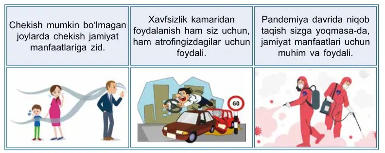

Jamiyat manfaati, ommaning manfaati deb inson huquqlarini cheklayverish ham yaxshi oqibatlarga olib kelmaydi. Masalan, natsist Germaniyasi fashistik qarashlarini oʻtkazishda aynan “jamiyat manfaatlari va uning farovonligi insonlarning shaxsiy manfaatlaridan har doim ustun turadi” degan tushunchadan foydalangan va natijada koʻplab insonlarning huquq va manfaatlari toptalganiga tarix guvoh. Shu oʻrinda “Insonlarning shaxsiy manfaat lari jamiyat yoki jamoa manfaatlaridan ustun keladigan holatlar ham bormi?” degan savol tugʻilishi tabiiy. Masalan, kamsitish bilan bogʻliq holatlarda hech qanday jamiyat yoki jamoat manfaati degan masalaga oʻrin yoʻq. Yaʼni biror shaxsning tana rangi boshqacha boʻlsa yoki millati boshqa boʻlsa, bu jamoamizning, jamiyatimizning yoki biz yashayotgan hududning anʼanalariga, manfaatlariga zid deb kamsitishga aslo yoʻl qoʻyilmaydi. Quyida inson manfaati jamiyat manfaatidan yuqori oʻringa qoʻyilgan Germaniyada yuz bergan ishni eʼtiboringizga havola etamiz. Oʻqing va xulosa chiqaring.

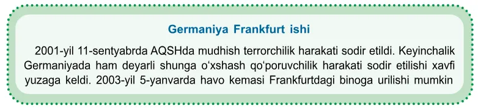

boʻlgan hodisa koʻplab nemislarni xavotirga solib qoʻydi. Ushbu hodisa AQSHdagi kabi talafotlar keltirib chiqara olmadi. Biroq Germaniyada mazkur voqea “Havo kemalari boʻyicha xavfsizlik toʻgʻrisida”gi qonunni qabul qilish boʻyicha harakatlarga turtki berdi. Mazkur qonunga koʻra, Germaniya qurolli kuchlari terroristlar tomonidan qoʻlga olingan (oʻgʻirlangan) deya ishonilgan har qanday fuqaro aviatsiyasini (siz bilgan fuqarolarga xizmat koʻrsatuvchi havo kemasi nazarda tutilmoqda), uning ichida qanday va qancha odam boʻlishidan qatʼi nazar, urib tushirish huquqiga ega edi. Masalan, birorta fuqaro aviatsiyasi terrorchilar tomonidan egallanib, Germaniyadagi biror katta binoga borib urilsa, havo kemasining ichidagilar ham, binodagilar ham halok boʻladi. Bu koʻpchilikning hayotini saqlab qolish uchun baʼzi odamlarni qurbon qilish mumkin degan mantiqqa asoslangan qonun edi. Bir qancha keskin tortishuvlardan soʻng Germaniya parlamenti mazkur qonunni tasdiqladi (2004-yil 24-sentyabr). Ammo bu qonunga qarshi boʻlgan bir qancha siyosatchilar hamda inson huquqlari jonkuyarlari, uchuvchilar uyushmalari mazkur qonunning konstitutsiyaga zidligini taʼkidlab, Germaniya Federativ Respublikasi konstitutsiyaviy sudiga daʼvo bilan chiqdilar. Konstitutsiyaviy sud ushbu qonun konstitutsiyaga zid boʻlgani bois bekor qilinishi zarurligi toʻgʻrisida qaror chiqardi. Chunki konstitutsiyada “Har bir shaxs yashash huquqiga ega” degan qoida mavjud edi. Shu sababli sud “Koʻpchilikning hayotini saqlab qolish uchun kamchilikni qurbon qilish kerak” degan mazmundagi qonun normasini konstitutsiyaga mos emas deb hisobladi.

Germaniya konstitutsiyaviy sudi raisi: “Har bir insonning insoniy qadr-qimmatiga boʻlgan huquqi mustahkam tarzda himoya qilinadi va uning buzilishiga yoʻl qoʻyilmaydi”, deya taʼkidladi.

Aziz oʻquvchilar, Germaniya konsti tutsi yaviy sudi chiqargan qaror haqida qanday fikrdasizlar?

**2001-yil 11-sentyabr kuni terroristlar qoʻlga olgan samolyotlar kelib urilishi natijasida portlagan Jahon savdo markazining egizak binolari**

Demak, baʼzida insonlarning shaxsiy manfaatlari, baʼzida esa omma hamda jamiyat manfaatlari biri ikkinchisidan yuqori oʻringa qoʻyilar ekan. Ular oʻrtasida ziddiyatlar yuzaga kelganda esa uni adolat bilan hal etishgina bizni farovon jamiyat sari yetaklashi mumkin. Ha, aynan adolat bilan hal etilgandagina biz inson manfaatlari hamda jamiyat manfaatlarining uygʻunlashuviga erishamiz. Shuning uchun ham konstitutsiyamiz muqaddimasida har birimiz adolatli jamiyatni barpo etish borasida hozirgi va kelajak avlodlar oldidagi yuksak masʼuliyatni anglashimiz muhimligi taʼkidlangan.

> **OʻZBEKISTON RESPUBLIKASI KONSTITUTSIYASI – INSON HUQUQLARI KAFOLATI**

Zamonaviy davlatlarning deyarli barchasida inson huquqlari konstitutsiyaning yuragini tashkil etadi, deb ayta olamiz. Zamonaviy konstitutsiyalarning asosiy vazifalaridan biri ham aynan inson huquqlarini himoya qilish hisoblanadi. Oʻzbekiston Respublikasining bosh qomusi hisoblanmish konstitutsiyamiz ham xalqaro hamjamiyat tomonidan tan olingan inson huquqlarini oʻzida aks ettiradi va ularni juda ham yuqori darajada himoya qiladi.

Konstitutsiyaning butun boshli II boʻlimi aynan inson va fuqarolarning asosiy huquq va erkinliklarini himoya qilishga qaratilgani ham bunga yaqqol misol boʻla oladi.

Ushbu bobda faqatgina eng asosiy moddalargagina toʻxtalib oʻtamiz. Avvalo, Konstitutsiyaning 19-moddasida Oʻzbekiston Respublikasida barcha fuqarolar bir xil huquq va erkinliklarga ega ekani, shuningdek, ular jinsi, irqi, millati, tili, dini, ijtimoiy kelib chiqishi, eʼtiqodi, shaxsi va ijtimoiy mavqeyidan qatʼi nazar, qonun oldida teng ekani taʼkidlanadi. Bu bilan Konstitutsiyamiz asosiy inson huquqlaridan biri boʻlgan tenglik va kamsitilmaslik huquqini himoya qiladi.

Inson huquqlariga doir yana bir eng muhim modda 25-modda boʻlib, unda insonning yashash huquqi haqida soʻz ketadi. Yashash huquqi insonning dunyoga kelgandan to vafot etgunga qadar ajralmas huquqi boʻlib, undan mahrum qilishga hech kimning haqqi yoʻq. Konstitutsiya insonning hayotiga suiqasd qilishni eng ogʻir jinoyat deb baholashi bilan mazkur huquqning naqadar muhim ekaniga urgʻu beradi.

Konstitutsiyaning 33-moddasi dunyo miqyosida alohida eʼtirof etiladigan va koʻplab muhokamalarga sabab boʻladigan fikrlash, soʻz va eʼtiqod erkinligi huquqini belgilab beradi. Konstitutsiya bu bilan bizga oʻz fikrlarimizni hech qanday majburlovlar yoki cheklovlarsiz erkin ifoda etishimiz mumkinligini koʻrsatadi. Bu huquqlar bizning hayotimizda naqadar

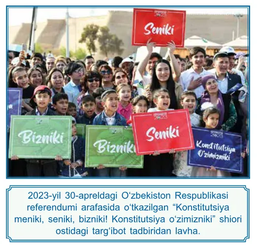

muhim ekanini ular mavjud boʻlmagan holatni tasavvur qilib koʻrib, yanada yaxshiroq tushunib yetamiz. Faraz qiling, siz oʻz uyingiz atrofidagi daraxtlarning koʻp kesilayotgani haqida gapirmoqchi boʻlsangiz va buning notoʻgʻriligini aytmoqchi boʻlsangiz-u, kimdir kelib: “Men falon joyda ishlayman, bu haqida gapirishing, fikr bildirishing mumkin emas” desa. Yoki sizni kimdir yoniga chaqirib: “Men falon mansabda ishlayman, sen mana bu ishni qilasan!” deb majburlasa. Qanday holatga tushasiz? Mana shu kabi razil holatlarning roʻy bermasligini aynan ushbu huquq taʼminlaydi. Lekin mazkur huquqqa oid baʼzi istisno holatlarni ham esdan chiqarmasligimiz lozim. Yaʼni gapirish ekan deb mamlakatimizning konstitutsiyaviy tuzumiga qarshi boʻlmagʻur gaplarni aytish, diniy adovat qoʻzgʻatuvchi soʻzlarni aytish, davlat sirlarini oshkor qilish mumkin emas. Chunki bu kabi harakatlar bilan siz mamlakatimizga va uning tinchligiga raxna solib qoʻyishingiz mumkin.

Yana bir qancha inson huquqlari Oʻzbekiston Respublikasi Konstitutsiyasi tomonidan kafolatlangan. Mazkur huquqlar buziladigan boʻlsa, davlat oʻzining turli funksiyalarini ishga solgan holda ularni himoya qiladi. Xususan, konstitutsiyamizda ham “Davlat fuqarolarning konstitutsiya va qonunlarda mustahkamlangan huquqlari va erkinliklarini taʼminlaydi” degan qoida mavjud. Bu inson huquqlari davlat tomonidan himoya qilinadi deganidir. Xoʻsh, bu qanday amalga oshirilishi mumkin? Bunga klassik misol – sudlar orqali. Yaʼni inson huquqlari buzilganda siz mamlakatimizdagi vakolatli sudga murojaat qilishingiz va sudlar orqali adolat oʻrnatilishini talab qilishingiz mumkin boʻladi. Masalan, A ismli yigit B ismli yigitni qattiq urishi natijasida B ismli yigitning koʻziga shikast yetib, u koʻrmay qoldi deb faraz qilaylik. Ushbu holatda B ismli yigit A ismli yigitning ustidan Jinoyat ishlari boʻyicha sudga murojaat qilishi mumkin. Yoki D ismli ayol istiqomat qilayotgan turarjoy hokimiyat tomonidan olib qoʻyilsa, u Maʼmuriy sudga shikoyat qilishi mumkin boʻladi. Sud esa tegishli normativ-huquqiy hujjatlarni qoʻllagan holda adolatni qaror toptirish vazifasini bajaradi. Bundan tashqari, yana bir qancha usullar orqali davlat konstitutsiyada belgilangan inson huquqlarini himoya qiladi. Bu haqida batafsil keyingi darslarimizda toʻxtalib oʻtamiz.

Yuqoridagilardan shunday xulosa chiqarishimiz mumkinki, konstitutsiyada inson huquqlari yuqori darajada himoya qilingan va bu huquqlarni taʼminlashni davlat oʻz zimmasiga olgan jamiyatda yashayotgan ekanmiz, jamiyatimizda inson huquqlarining oʻrni yuqori darajada boʻlib, ularni barcha birdek, yaʼni qanday mansabda ishlashi, boy yoki kambagʻalligidan qatʼi nazar, hurmat qilishi lozim.

### Savol va topshiriqlar

1. Sizningcha, inson jamiyatdan ajralgan holda yashay oladimi?

2. Inson huquqlari deganda qanday huquqlarni tushunasiz?

3. Biror shaxsning manfaati hamda jamiyat (omma) manfaati bir-biriga zid kelib qolganda nima qilish kerak deb hisoblaysiz?

4. Har doim jamiyatning umumiy manfaatlari insonlarning shaxsiy manfaatlaridan ustun turishi kerak degan fikrdamisiz yoki buning aksimi?

4. Oʻzbekiston Respublikasining Konstitutsiyasida inson huquqlari qanday asosiy qoidalar bilan mustahkamlab qoʻyilgan?

5. Har bir shaxs boshqa kishilarning huquqlarini nima uchun hurmat qilishi kerak?

## 3–4-dars. Jamiyatda shaxsning huquqiy maqomi

Hayotning yagona mazmuni insoniyatga xizmat qilishdir.

**Lev Tolstoy**

### Siz bilib olasiz

Shaxsning huquqiy maqomi (holati). Tenghuquqlik.

Gender tenglik.

Zoʻravonlikning oldini olish.

### SHAXSNING HUQUQIY MAQOMI (HOLATI)

Oldingi darsda insonning jamiyatdagi oʻrni va uning asosiy huquqlari haqida soʻz yuritdik. Ushbu darsimizda esa avvalgi darsdagi baʼzi muhim masalalarga chuqurroq kirib, ularni anglab olishga harakat qilamiz. Ushbu darsda shaxsning huquqiy maqomi haqida soʻz yuritiladi. Shaxsning huquqiy maqomi masalasi bugun har bir mamlakatning konstitutsiyasidan muhim oʻrin egallagan va inson huquqlari bilan uzviy bogʻliqdir. Ushbu darsda asosan “shaxs” soʻzi ishlatilsa-da, uni inson degan maʼnoda tushunsangiz boʻladi.

Shaxsning jamiyatdagi huquqiy maqomi unga taqdim etilgan huquq va erkinliklar hamda uning burchlari yigʻindisi hisoblanadi. Xoʻsh, ushbu shaxsning huquqiy maqomini bilish bizga nima uchun kerak? Biz shaxsning huquqiy maqomini bilish orqali uning qanday huquqlarga ega va yana qanday huquqlarga ega emasligini bilib olishimiz mumkin boʻladi.

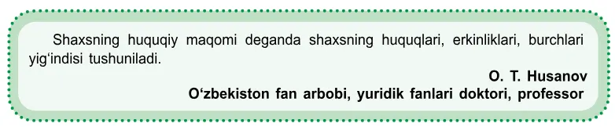

Konstitutsiyamizning shaxsning huquqiy maqomiga oid eng muhim moddasi – 19-moddasida, avvalgi darsimizda ham aytib oʻtganimizdek, barcha fuqarolar bir xil huquq va erkinliklarga ega ekani, ular jinsi, irqi, millati, tili, dini, ijtimoiy kelib chiqishi, eʼtiqodi, shaxsi va ijtimoiy mavqeyidan qatʼi nazar, qonun oldida teng ekani taʼkidlanadi. Bu yerda bir narsaga alohida eʼtibor qaratish lozim. Ushbu moddadagi “fuqarolar” soʻzini tor doirada tushunib qolmaslik lozim. Ushbu holatda fuqaroligi boʻlmagan shaxslar, chet elliklar ham nazarda tutilmoqda. Demak, bu moddadan barchamiz mamlakatimizdagi qonunlar oldida teng ekanimizni anglab olishimiz kerak. Yaʼni siz turkman boʻlasizmi, oʻzbekmi, rusmi, qoraqalpoqmi, qozoqmi, tojikmi yoki boshqa millat vakilimi – farqi yoʻq. Oʻzbekistonlikmisiz, demak, bir xil huquqlarga egasiz, deyilmoqda. Ammo ushbu moddaning istisno bandi ham mavjud boʻlib, u ijtimoiy adolat tamoyiliga asoslangan holda imtiyozlar berilishini aytadi. Ammo bu ham ijtimoiy adolat tamoyiliga asoslanilgani bois kimgadir uning tili yoki dini kabilarga qarab emas, balki iqtisodiy jihatdan zaif ekani yoki jismoniy hamda ruhiy holatlari hisobga olingan holda imtiyoz taqdim etilishi mumkin. Shu sababli, masalan, nogironligi boʻlgan qoʻshningiz siz toʻlayotgan biror soliqni toʻlamayotgan va unga davlat imtiyoz

bergan boʻlsa, siz buni tenglikning buzilishi deb tushunmasligingiz kerak. Aksincha, bu insoniylikni oʻzida mujassam etgan, adolatli qarordir.

Shaxsning huquqiy maqomiga uning fuqaroligi ham katta taʼsir etadi. Chunki shaxsda fuqarolik mavjud boʻlsa, u oʻzi yashayotgan jamiyatda fuqaroligi boʻlmagan shaxslar yoki chet el fuqarolariga nisbatan koʻproq huquqlarga ega boʻlishi mumkin. Masalan, Oʻzbekistonda siyosiy huquqlarning tarkibiga kiruvchi davlat boshqaruvida qatnashish huquqi, saylov huquqi kabilar faqatgina Oʻzbekiston fuqarolariga taqdim etilgan huquqlar hisoblanadi. Albatta, bu bir qarashda fuqaroligi yoʻq shaxslar yoki koʻpdan buyon Oʻzbekistonda yashab keladigan chet elliklarga nisbatan adolatsizlikdek koʻrinsa ham, aslida davlatning xavfsizligi masalalarini hisobga olgan holda qabul qilinganini unutmasligimiz kerak.

Davlat oʻz fuqarolariga qoʻshimcha huquqlarnigina taqdim etib qolmasdan, ulardan qoʻshimcha burchlarni ham talab qilishi mumkin. Masalan, harbiy xizmat oʻtash burchi konstitutsiyamizda belgilab qoʻyilgan boʻlib, unga koʻra, har bir Oʻzbekiston fuqarosi harbiy yoki muqobil xizmatni oʻtashga majburligi taʼkidlanadi. Bu holatda bu kabi burchni ado etish fuqaroligi yoʻq shaxslar yoki koʻp yillardan buyon mamlakatimizda yashab kelayotgan chet el fuqarolaridan talab etilmaydi.

Demak, shaxsning huquqiy maqomi u yashayotgan jamiyatda unga qanday huquqlar, erkinliklar va burchlar taqdim etilishini koʻrsatar, shuningdek, u konstitutsiya va boshqa qonunlar bilan mustahkamlab qoʻyilar ekan.

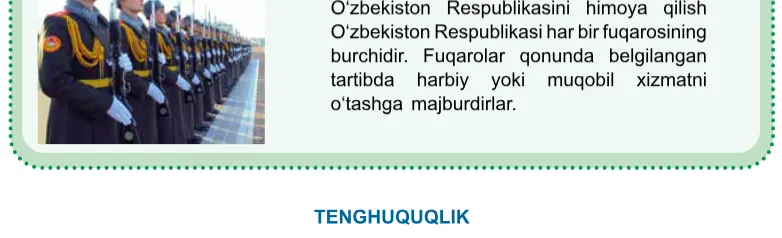

Qadim zamonlardan insonlar doim tenglik, tenghuquqlik va teng imkoniyatlarga ega boʻlish uchun kurashib kelishgan. Ammo yaqin 50 yillik oʻtmishgacha juda koʻplab mamlakatlarda notenglik turli xil koʻrinishlarda mavjud edi. Masalan, AQSHda qora tanli aholini kamsitish va ularga teng huquq hamda imkoniyatlarning berilmasligi odatiy hol boʻlgan. Yoki bugungi kungacha jamiyat orasida saqlanib qolayotgan Hindistondagi “kasta” tizimi kabilarni misol qilib keltirishimiz mumkin.

Bugungi kunga kelib dunyoning deyarli barcha mamlakatlarida tenghuquqlik asosiy insoniy huquq sifatida qaror topgan deb aytish mumkin. Xalqaro inson huquqlariga oid hujjatlarda ham bu alohida taʼkidlab oʻtiladi. Xususan, Oʻzbekiston Respublikasi ham aʼzo boʻlgan Fuqaroviy va siyosiy huquqlar toʻgʻrisidagi xalqaro pakt hamda Ijtimoiy, iqtisodiy va madaniy huquqlar toʻgʻrisidagi paktda ham tenghuquqlik eng asosiy qoida sifatida belgilanadi.

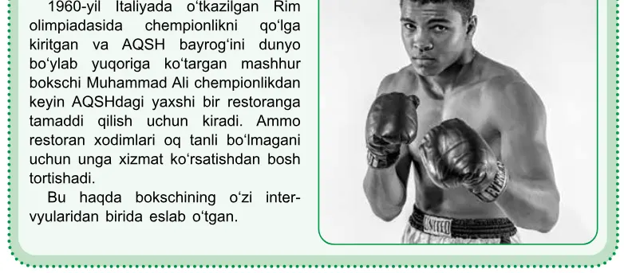

Mamlakatimizda, bundan avvalgi darsimizda ham aytib oʻtganimizdek, tenghuquqlik konstitutsiyada mustahkamlab qoʻyilgan. Tenghuquqlik ijtimoiy hayotimizning deyarli barcha jabhalarini qamrab olgan. Oilaviy hayotda, taʼlimda, ish faoliyatida tenghuquqlikka amal qilib kelinmoqda.

### Fuqaroviy va siyosiy huquqlar toʻgʻrisidagi xalqaro pakt

**2-modda.** Ushbu Paktda ishtirok etuvchi har bir davlat oʻz hududida turgan va oʻz yurisdiksiyasi ostida boʻlgan barcha shaxslarning ushbu Paktda eʼtirof etilgan huquqlarini hech bir ayirmachiliksiz, jumladan, irqi, tana rangi, jinsi, tili, dini, siyosiy yoki boshqa eʼtiqodidan, milliy yoki ijtimoiy kelib chiqishi, mulkiy ahvoli, tugʻilishi yoki oʻzga holatidan qatʼi nazar, hurmat qilish va taʼminlash majburiyatini oladi.

Tenghuquqlikni tushunishda “tenglik” soʻzini asos qilib olish lozim. Chunki konstitutsiya va qonunlar bilan kafolatlanadigan huquqlar va imkoniyatlar teng taqdim etilishi kerak. Masalan, saylov huquqiga koʻra, har bir fuqaro bitta ovozga ega boʻladi. Kimningdir ijtimoiy kelib chiqishiga qarab unga koʻproq imtiyoz berilmaydi.

Shu yerda “adolat” tushunchasiga ham oydinlik kiritib oʻtishimiz lozim. Chunki koʻpchilik “tenglik” tushunchasini “adolat” tushunchasi bilan chalkashtirib yuboradi. Biroq ular bir-biridan birmuncha farq qiluvchi tushunchalardir. Masalan, tenglik har bir shaxs oʻz hayotini qurishi va oʻz qobiliyatlaridan maksimal darajada foydalanishi uchun unga teng imkoniyatlar hamda huquqlar berilishini anglatadi. Adolat esa ijtimoiy-falsafiy va axloqqa oid tushuncha boʻlib, biror masalaga nisbatan insonning har tomonlama odilona munosabatda boʻlishidir.

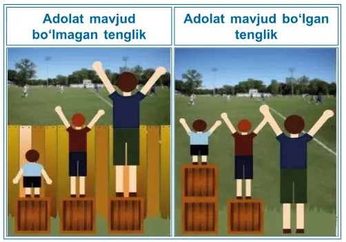

Hamma masalalarda tenglikka amal qilinsa va adolat unutib qoʻyilsa, natija salbiy boʻlishi mumkin. Masalan, davlat tomonidan qurilayotgan yangi uy-joylarni berishda iqtisodiy jihatdan qiynalgan oilalarga alohida eʼtibor qaratilmasa, daromadi yuqori boʻlgan qatlam 2–3 tadan qilib barcha uylarni sotib olishi va natijada aholining iqtisodiy zaif qatlami uysiz qolib ketishi mumkin.

Yoki daromad soligʻini undirishda “oylik maoshi qancha boʻlishidan qatʼi nazar, barcha 1.000.000 soʻmdan soliq toʻlasin, shunda tenglik boʻladi” deyish juda ham notoʻgʻri. Ushbu holatda ham tenglik mavjud boʻlsa-da, adolat mavjud emas. Bu aholining daromadi yuqori boʻlgan qatlami boyigan sari boyib, oylik maoshi kam boʻlganlar esa yanada kambagʻallashib borishiga olib keladi. Shuning uchun ham mamlakatimizda daromadi yuqori boʻlganlar koʻproq daromad soligʻi, daromadi kam boʻlgan insonlar esa kamroq daromad soligʻi toʻlaydilar va bu adolatdandir.

Keling, oddiy maktab hayotidan misol olaylik. 10-sinf oʻquvchilari 11 kishidan boʻlib ikki jamoaga boʻlinishdi. Ammo barcha futbolni yaxshi oʻynaydigan va kuchli oʻquvchilar bir jamoa boʻlib olishdi. Bu yerda oʻquvchilarning soni teng, yoshi teng, ammo oʻyin adolatli boʻlmasligi aniq. Shu sababli tenghuquqlik haqida gap ketganda faqatgina tenglikning oʻzigagina emas, balki adolatga ham asoslanish lozim. Zero, tenglik va adolat bir-biri bilan chambarchaslikda boʻlmas ekan, erishiladigan natija insonlar uchun foydali boʻlmasligi ehtimoli yuqori.

### GENDER TENGLIK

Darsimizning avvalgi qismida tenghuquqlik hamda uning asosida yotuvchi tenglik gʻoyasi haqida tushuntirib oʻtgan edik. Ushbu qismda mamlakatimizda katta eʼtibor qaratilayotgan tenglikning eng asosiy turi – gender tenglik haqida soʻz yuritamiz. Gender tenglik deganda insonlarga jinsidan qatʼi nazar, bir xil huquq, erkinlik va imkoniyatlarning taqdim etilishi, iqtisodiy faoliyatda hamda qarorlar qabul qilishda tenglikning yaratilishi kabilar tushuniladi. Bir soʻz bilan aytganda, jamiyatda erkaklar hamda ayollarning teng boʻlishidir.

“Gender tenglik masalasiga alohida eʼtibor qaratishning nima keragi bor?” degan savol paydo boʻlishi mumkin. Bugungi bozor iqtisodiyotiga asoslangan jamiyatda gender tenglikka alohida eʼtibor qaratilmasa, bundan yarim asr avval bozor iqtisodiyotida boʻlgan mamlakatlardagi baʼzi salbiy holatlar yuzaga kelishi mumkin. Masalan, oʻtgan asrda Gʻarb mamlakatlarida ishga olishda ayol kishining isteʼdodi yuqori boʻlsa-da, erkaklarni ustun koʻrish yoki ular bir xil soat ishlasalar ham, erkaklarga koʻproq maosh toʻlash hollari mavjud boʻlgan. Shuning uchun ham nafaqat Oʻzbekistonda, balki butun dunyoda ayollar va erkaklarning tenghuquqliligi masalasiga alohida eʼtibor qaratiladi.

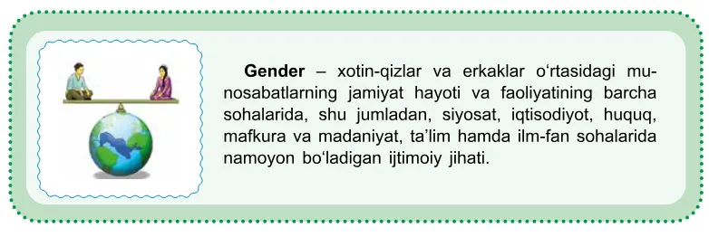

Inson huquqlari umumjahon deklaratsiyasida “Hamma odamlar oʻz qadr-qimmati hamda huquqlarida erkin va teng boʻlib tugʻiladilar” deb belgilangani bunga yaqqol misoldir. Demak, insonlar qaysi jinsda tugʻilishidan qatʼi nazar, teng boʻlib tugʻiladilar, shuning uchun ularga teng huquq va imkoniyatlar berilishi lozim.

Mamlakatimiz konstitutsiyasining 58-moddasida ham gender tenglik mustahkamlangan. Bundan tashqari, Oila kodeksi va “Xotin-qizlar va erkaklar uchun teng huquq hamda imkoniyatlar kafolatlari toʻgʻrisida”gi qonun kabilarda ham erkak va ayollarning tenghuquqligi, ushbu tenghuquqlik oilaviy munosabatlarda ham, ijtimoiy hayotda ham taʼminlanishi nazarda tutilgan. Ammo gender tenglik ham jamiyat va davlatlardagi urf-odatlar hamda qadriyatlarga qarab mazmunan farq qiladi. Yaʼni bu qoidaning ham oʻziga xos istisnolari mavjud. Baʼzi masalalar borki, unda ayollarning jismoniy holati va boshqa jihatlar hisobga olinishi kerak boʻladi. Masalan, Oʻzbekistonda muddatli harbiy xizmatni oʻtash, xotin-qizlar va erkaklar mehnatini muhofaza qilish yoki xotin-qizlar reproduktiv salomatligini saqlash kabi masalalarda notenglik mavjudga oʻxshab koʻrinsa-da, aslida bu erkaklar va ayollarning jismoniy holatlariga qarab amalga kiritilgan tizimlardir. Bu kabilarning mavjud boʻlishi bizning jamiyatimizda notenglik, yaʼni kamsitish (diskriminatsiya) hisoblanmaydi. Ammo boshqa mamlakatlarda, masalan, Norvegiya va Isroilda ayollar ham muddatli harbiy xizmatni oʻtashga majbur. Chunki ushbu davlatlardagi jamiyatlarda muddatli harbiy xizmatni ayollar ham, erkaklar ham oʻtashi gender tenglikning bir qismi sanaladi.

Xulosa qilib aytadigan boʻlsak, gender tenglik inson huquqlarining erkaklar va ayollarga teng imkoniyatlar beruvchi, jamiyatda ulardan birining kamsitilishiga yoʻl qoʻymaslikni taʼminlovchi hamda jamiyatlardagi urf-odat, qadriyatlarga qarab mazmunan farq qiluvchi ajralmas tamoyili ekan.

### ZOʻRAVONLIKNING OLDINI OLISH

Birinchi va ikkinchi darslarimizda guvohi boʻldikki, inson huquqlari va uning tarkibiga kiruvchi tenghuquqlik, gender tenglik kabi tamoyillar xalqaro miqyosda ham, mamlakatimizda ham yuqori darajada hurmat qilinar va davlat tomonidan himoyasi taʼminlangan ekan. Shunga qaramasdan, jamiyatimizda “zoʻravonlik” deya atalmish illat hali-hanuzgacha koʻzga tashlanib turibdi. Bu illatni biz oilalarda, maktablarda va koʻchakoʻyda tez-tez uchratishimiz mumkin. Xoʻsh, zoʻravonlik oʻzi nima va u inson huquqlariga qanchalik yomon taʼsir qiladi? Jahon sogʻliqni saqlash tashkiloti zoʻravonlik jismoniy kuch ishlatish yoki tahdid qilish orqali amalga oshirilishi va buning natijasida shaxs oʻziga yoki boshqalarga ham jismoniy, ham ruhiy zarar yetkazishi mumkinligini aytadi. Demak, u biz

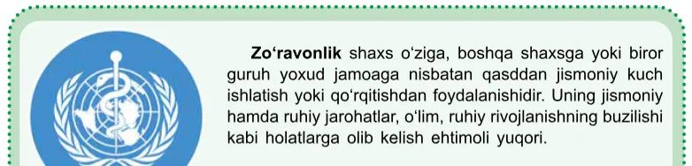

### Jahon sogʻliqni saqlash tashkiloti

inson huquqlari sifatida hurmat qiladigan yashash huquqidan yoki erkin hayot kechirish kabi bir qancha huquqlardan insonlarni mahrum qilishi mumkin.

Shunday qilib, zoʻravonlikni inson oʻziga, boshqa insonga yoki jamoalarga nisbatan amalga oshirishi mumkin ekan. Insonning oʻziga nisbatan amalga oshiradigan zoʻravonligi, biroz gʻalati eshitilsa-da, bu u oʻzini tinmay ayblashi, har narsaga aybdorman, deb qarashida namoyon boʻladi. Bu ham juda yomon oqibatlarga olib keladi. Xususan, Yaponiyada aynan mana shu kabi sabablarga koʻra oʻz joniga qasd qilish hollari koʻp uchraydi va bu muammo jamiyatni oʻylantirib kelmoqda. Boshqa insonga nisbatan zoʻravonlikka misol qilib maktablarda uchrab turadigan yoki oilalardagi er-xotinlarning oʻzaro bir-birlariga nisbatan zoʻravonliklarini keltirishimiz mumkin. Masalan, oʻquvchilarning jismoniy jihatdan kuchsizroq oʻquvchiga jismoniy kuch ishlatishi yoki uni turli xil soʻzlar bilan kalaka qilishi, yaʼni ruhiy jihatdan zoʻravonlik qilishidir. Har bir bola hech qanday qoʻrquvsiz va emin-erkin maktabga borish hamda taʼlim olish huquqiga ega ekanini hisobga olsak, bu kabi zoʻravonlikka qoʻl uradigan oʻquvchilar inson huquqlari, insoniylik, qadriyat hamda etikani oyoqosti qiluvchi kimsalardir. Shuningdek, ular qanday kiyimda boʻlmasin, oʻzini qanday tutmasin, boshqa oʻquvchilarga nisbatan zoʻravonlik qilyaptimi, demak, ularda na madaniyat va na oliyjanoblik xislati mavjud.

Bir shaxsning boshqa shaxsga nisbatan zoʻravonlik qilishiga er-xotinning bir-biriga zoʻravonlik qilishini ham misol keltirishimiz mumkin. Jamiyatimizda erkaklarning ayollarga zoʻravonligi tez-tez uchrab turadi. Baʼzi boshqa jamiyatlarda esa buning teskarisiga guvoh boʻlish mumkin. Ammo har qaysisi ham jamiyatning asosiy ildizi hisoblanmish oilaga nisbatan jiddiy zarar yetkazishi aniq.

Zoʻravonlikka uchraganda yoki unga guvoh boʻlganda jamiyatning aʼzosi va mamlakat fuqarosi sifatida huquqni muhofaza qiluvchi organlarga xabar berish eng maʼqul yoʻldir. Ushbu yoʻl eng madaniy va sivilizatsiyalashgan jamiyatning aʼzosi tanlaydigan usuldir. Baʼzilar mana shu kabi holatlarda barcha narsani oʻzi hal qilishga urinadi. Albatta, baʼzida bu samara berishi ham mumkin, ammo muammoni yanada kattalashtirib yuborish ehtimoli ham yuqori. Shuning uchun huquqni muhofaza qiluvchi organlarga murojaat qilish ham samarali, ham davlat idoralari xizmatidan yetarli darajada foydalanish madaniyatini oshiradi. Zero, “xalq davlat idoralariga emas, balki davlat idoralari xalqqa xizmat qilishi zarur”ligini mamlakatimiz Prezidenti ham bot-bot taʼkidlab kelmoqdalar. Demak, zoʻravonlik holatlarini bartaraf etish uchun huquqni muhofaza qiluvchi organlar madadiga tayanish eng oqilona qaror boʻlar ekan.

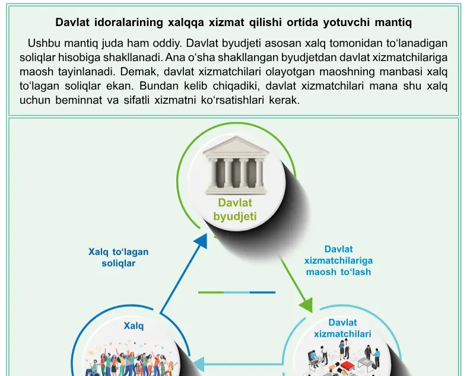

**Davlat xizmatchilari oladigan maoshlari evaziga xalqqa xizmat koʻrsatadi**

### Savol va topshiriqlar

1. Shaxsning jamiyatdagi huquqiy maqomi uning hayotiga qanday taʼsir etadi?

2. “Tenglik” va “adolat” tushunchalarining oʻxshash va bir-biridan farq qiluvchi jihatlari haqida fikr yuriting.

3. Zamonaviy jamiyatdagi gender tengligi fuqarolar ijtimoiy farovonligining asosi hisoblanadi. Fikringizni asoslang, misollar keltiring va umumlashtiring.

4. Xotin-qizlarning jamiyatdagi ijtimoiy mavqeyini mustahkamlashga doir olib borilayotgan ishlar haqida nimalarni bilasiz?

5. Siz zoʻravonlik qurboniga aylanmasligingiz uchun nimalarni bilishingiz kerak?

## 5-dars. Inson huquqlari va huquq ustuvorligi

Haqiqat havoga oʻxshaydi. Rangini koʻrmaysiz. Ovozini eshitmaysiz. Hidini bilmaysiz... Ammo bir lahza havosiz qolsangiz, boʻgʻilib ketasiz.

**Jaloliddin Rumiy**

### Siz bilib olasiz

“Huquq ustuvorligi” tushunchasi.

Huquq ustuvorligi – inson huquqlarini taʼminlashning garovi. Inson huquqlari madaniyati.

### “HUQUQ USTUVORLIGI” TUSHUNCHASI

Mamlakat taraqqiyoti va aholi farovonligining muhim kafolatlaridan biri jamiyatda huquq ustuvorligining taʼminlangani hisoblanadi. Shu oʻrinda “huquq ustuvorligi” va “qonun ustuvorligi” tushunchalarining mazmunini aniqlashtirib olishimiz lozim.

Qonun ustuvorligi deganda barcha qonunosti va huquqni qoʻllash hujjatlari qonunga muvofiq boʻlishi va unga zid boʻlmasligi nazarda tutiladi. Masalan, tuman yoki viloyat hokimi chiqargan qaror mamlakat konstitutsiyasi va qonunlari talablariga zid boʻlmasligi lozimligi qonunning ustuvorligini namoyon qiladi. Huquq ustuvorligi esa barcha normativ-huquqiy hujjatlar (shu jumladan, konstitutsiya va qonunlar) va davlat hokimiyatining (qonun chiqaruvchi, ijro etuvchi va sud) barcha faoliyati inson huquqlari, uning qadr-qimmati va erkinliklarini himoya qilishga qaratilgan boʻlishi lozimligini talab qiladi. Bundan koʻrishimiz mumkinki, qonun ustuvorligi huquq ustuvorligining muhim tarkibiy qismi hisoblanadi.

Qonun ustuvorligi haqida mulohaza yuritganda davlat har qanday qonunni qabul qilishi mumkinligini eʼtiborga olish kerak. Baʼzida bunday qonunlar osonlik bilan oʻzgartirilishi, baʼzida esa mazkur qonunlarning normalari bir-biriga zid kelib qolishi mumkin. Huquq ustuvorligi esa qonundan ustun boʻlgan tamoyillarning amalda boʻlishini talab qiladi va davlat organlari yoki mansabdor shaxslarining oʻzboshimchaligidan insonlarni himoya qilgan holda davlatning irodasini cheklashi mumkin.

Bugungi kunda huquq ustuvorligi gʻoyasi alohida bir davlat organi yoki mansabdor shaxs qonundan ustun boʻlmasligini, nihoyatda keng vakolatlarga ega boʻlmasligini va oʻzboshimchalikka yoʻl qoʻyilmasligini nazarda tutadi. Huquq ustuvorligi mamlakatda qabul qilinayotgan qonun-qoidalar rasman eʼlon qilinishini va qoʻllashda barqaror boʻlishini, shuningdek, sud tizimining ochiqligini hamda sudyalar oʻz qarorlarini faqat dalillar va qonunga asoslanib chiqarishi uchun qonun chiqaruvchi va ijro hokimiyatidan mustaqil boʻlishini talab qiladi. Yana bir muhim jihati, jamiyat aʼzolari oʻzlarining xatti-harakatlarini tartibga soluvchi qonunlarni ishlab chiqish va ularga oʻzgartirish kiritishda ishtirok etish imkoniga ega boʻlishi lozim.

### Huquq ustuvorligi – barcha

fuqarolarning qonun oldida tengligini qoʻllab-quvvatlaydigan, davlat boshqaruvi oʻzboshimchalik bilan amalga oshirilmasligini kafolatlaydigan, umuman olganda, hokimiyatdan oʻzboshimchalik bilan foydalanilishining oldini oluvchi me xanizm, jarayon, institut, amaliyot yoki norma hisoblanadi.

BMT Bosh kotibining 2004-yilgi maʼruzasida huquq ustuvorligiga quyidagicha taʼrif beriladi: “Huquq ustuvorligi boshqaruvning shunday tamoyiliki, unga koʻra barcha shaxslar, muassasalar va tuzilmalar (davlatga tegishli va xususiy), shu jumladan, davlatning oʻzi ham ommaviy ravishda qabul qilingan, teng darajada ijro qilinadigan, sud organlari tomonidan mustaqil amalga oshiriladigan va inson huquqlari sohasidagi xalqaro normalar va standartlarga muvofiq boʻlgan qonunlarga boʻysungan holda harakat qiladi”.

Huquq ustuvorligi qonunlarning yaratilishi, ularning qoʻllanishi va huquqiy normalar oʻrtasidagi munosabatlarning oʻzi ham qonun bilan tartibga solinar ekan, demak, hech kim, shu jumladan, eng yuqori mansabdagi shaxs ham qonundan ustun boʻlmasligi lozimligini nazarda tutadi.

Hukmdorlikning yuridik jihatdan cheklanishi shuni anglatadiki, hukumat oddiy fuqarolar singari amaldagi qonunlarga boʻysunadi. Shunday qilib, qonun oldidagi tenglik gʻoyasiga koʻra, hech bir shaxs – u xoh davlat rahbari, xoh yuqori mansabdagi shaxs boʻlsin – mutlaq daxlsizlik va imtiyozlardan foydalanmasligi hamda sodir etgan xatti-harakatlari uchun huquqiy sanksiyalar (javobgarlik)dan ozod qilinmasligi kerak.

Shuningdek, turli mansabdor shaxslar tomonidan huquqiy normalarning qoʻllanishi va koʻrib chiqilishi nizo tomonlarining darajasi, mavqeyi yoki hokimiyat vakolatlariga egaligidan qatʼi nazar, xolis va izchil boʻlishi shart.

Huquq ustuvorligi qonunlarning qabul qilinishi, qoʻllanishi, jamiyatda qanday amalda boʻlishi kabi muhim talablardan tashqari qonunning oʻzi ham maʼlum sifatlarga, mazmunga va xususiyatlarga ega boʻlishini nazarda tutadi. Xususan, qonunlar ochiq eʼlon qilinishi, aniq, bir xilda tushunilishi, qoʻllashda barcha uchun bir xil va tushunarli boʻlishi lozim.

**HUQUQ USTUVORLIGI** Barcha odamlar quyidagi tamoyillarga rioya qilgan holda adolatli qonunlar bilan boshqarilishi kerak:

**Qonunning ochiq eʼlon qilinishi va undan foydalanish imkoniyatining mavjudligi**

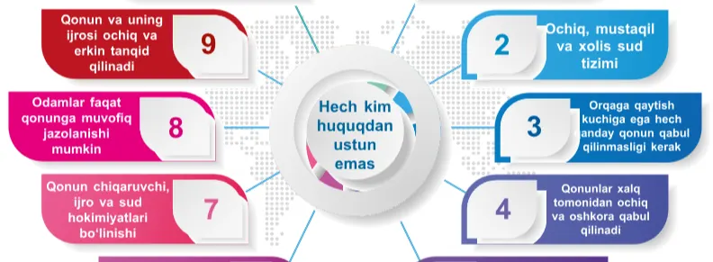

### Adolatli va tezkor

Huquq ustuvorligini xabardor va faol fuqarolar qoʻllab-quvvatlashi kerak.

### HUQUQ USTUVORLIGI – INSON HUQUQLARINI TAʼMINLASHNING GAROVI

Jamiyatda inson huquqlarining himoyasi taʼminlanmasa, huquq ustuvorligini taʼminlash imkonsiz, inson huquqlarini samarali himoya qilishni huquq ustuvorligisiz taʼminlab boʻlmaydi. Huquq ustuvorligi inson huquqlari tamoyilini hayotga joriy qilishga koʻmaklashuvchi mexanizmdir. Inson huquq va erkinliklari qonunlar vositasida hayotga joriy etiladi, aslida qonunlarning pirovard maqsadi ham inson, uning huquq va erkinliklarini himoya qilishdan iborat. Huquq ustuvorligini taʼminlash iqtisodiy, ijtimoiy va madaniy huquqlarni milliy konstitutsiyalar, qonunlar va qoidalarda mustahkamlash boʻyicha ishlarning ajralmas elementi hisoblanadi. Agar huquqlar qonun bilan muhofaza qilinsa yoki boshqa huquqiy himoya vositalari bilan taʼminlansa, huquq ustuvorligi bunday huquqlarga rioya qilinmayotgan hollarda huquqiy yordam vositalarini taqdim qiladi.

Huquq ustuvorligi va inson huquqlari insonning munosib sharoitlarda yashash erkinligi tamoyilining ikki jihatini aks ettiradi. Shunga koʻra, huquq ustuvorligi va inson huquqlari bir-biri bilan chambarchas bogʻliqdir. Bunday bogʻliqlik davlatlar tomonidan Inson huquqlari umumjahon deklaratsiyasi qabul qilinayotgandayoq tan olingan boʻlib, mazkur hujjatda “inson oxirgi chora sifatida zulm va istibdodga qarshi isyon koʻtarishga majbur boʻlishining oldini olish maqsadida inson huquqlari qonun kuchi bilan himoya etilishi zarur” ekanligi qayd etilgan.

Oʻzbekistonda huquq ustuvorligini taʼminlash, xususan, davlat organlari faoliyatining ochiqligi, davlat xizmatlaridan foydalanish sifatini oshirish, korrupsiyaga qarshi kurashish tizimidagi oʻzgarishlar birinchi navbatda inson huquqlarini himoya qilishda sifat oʻzgarishlariga erishishga yoʻnaltirilgandir.

Jahon odil sudlov loyihasi (World Justice Project) eʼlon qilgan Huquq ustuvorligi indeksining 2021-yilgi natijalariga koʻra, Oʻzbekiston ushbu indeksda 14 pogʻonaga koʻtarilib, eng yaxshi natija koʻrsatgan mamlakatdan biriga aylandi.

**2015–2022-yillarda huquq ustuvorligi boʻyicha foizlardagi oʻzgarishlar**

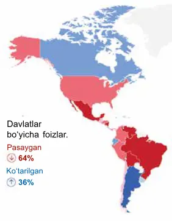

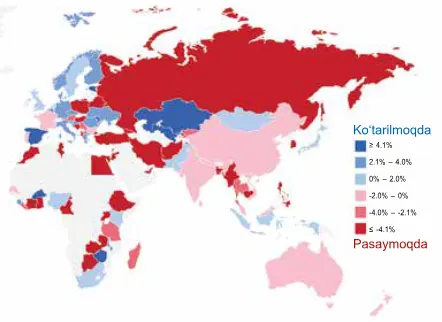

Oʻzbekiston Respublikasi Prezidentining 2021-yil 14-yanvardagi “Oʻzbekiston Respublikasida huquq ustuvorligini taʼminlash holatini aniqlashning samarali mexanizmini joriy etish chora-tadbirlari toʻgʻrisida”gi PQ-4951-son qarori bilan hududlarning huquq ustuvorligi indeksi aniqlanishi belgilandi.

**Hududlarning huquq ustuvorligi indeksi aniqlanadigan asosiy yoʻnalishlar**

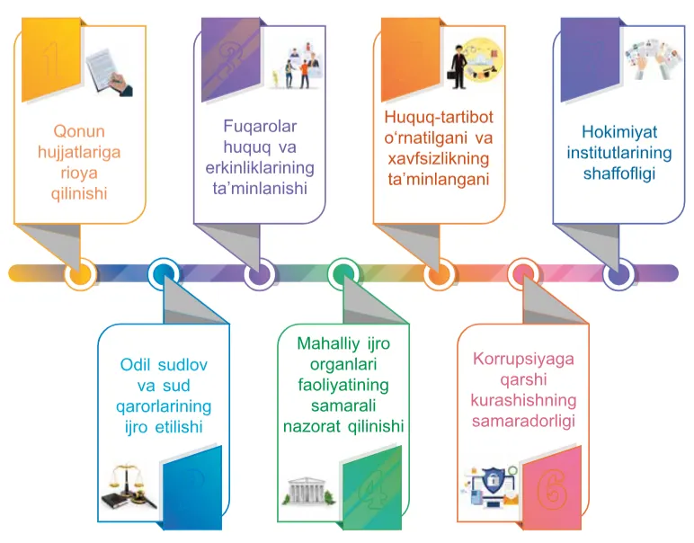

### INSON HUQUQLARI MADANIYATI

Mamlakatda qabul qilinadigan qonun va boshqa normativ-huquqiy hujjatlarda insonning turli tuman huquqlarini taʼminlashga qaratilgan koʻplab qoidalarning mustahkamlab qoʻyilishi har doim ham uni kafolatli taʼminlash garovi boʻlolmaydi. Huquqiy qoidalarning samarali ijro qilinishi avvalambor har bir shaxsning mazkur qoidalar mazmunini bilishi, jamiyatdagi boshqa shaxslarning huquq va erkinliklarini hurmat qilishi, shuningdek, inson huquq va erkinliklarini himoya qilish sohasida koʻnikma va tajribaga ega boʻlishiga bogʻliqdir.

Insonning oʻz huquq va majburiyatlarini bilishi, shubhasiz, inson huquqlari madaniyatining muhim elementi hisoblanadi. Аmmo mamlakat qonunchiligi va xalqaro hujjatlar mazmunini bilishning oʻzi yetarli emas.

Shaxsning oʻzining buzilgan huquq va erkinliklarini himoya qilish va tiklash borasidagi bilimi va koʻnikmalari ham inson huquqlari madaniyatining shakllanishida muhim ahamiyat kasb etadi.

Shubhasiz, faqat inson huquqlari borasida yetarli bilim va koʻnikmalarga, yaʼni inson huquqlari madaniyatiga ega shaxsgina oʻzining, shuningdek, boshqalarning huquq va erkinliklarini himoya qilish va tiklashda amaldagi huquqni himoya qilish mexanizmlaridan samarali foydalana oladi. Demak, inson huquqlari madaniyati shaxsdan ham oʻzining huquqlarini bilishni, ham ularni amalda qoʻllay olishni talab qilar ekan.

Inson huquqlari madaniyatining yuqori darajasini shakllantirish har doim uzoq davom etadigan va murakkab jarayon hisoblanadi. Bunda aholini, birinchi navbatda yoshlarni bagʻrikenglik, inson huquqlari va uning qadr-qimmatini hurmat qilish ruhida tarbiyalash hamda bu borada zarur bilimlarni berish katta ahamiyatga egadir.

### Yodda tuting

> **Inson huquqlari madaniyati –** inson shaʼni, uning huquq va erkinliklarini tan olish va hurmat qilishga qaratilgan bilimlar, shuningdek ularni amalga oshirish va himoya qilish boʻyicha amaliy koʻnikma va tajribalarni nazarda tutuvchi madaniyatning tarkibiy qismidir.

### Savol va topshiriqlar

1. “Huquq ustuvorligi” va “qonun ustuvorligi” tushunchalarining oʻxshash va farqli jihatlarini tushuntiring.

2. Mamlakatda huquq ustuvorligini taʼminlash uchun nafaqat qonunlarga rioya qilish, balki ularning adolatli boʻlishi ham muhim ahamiyatga ega degan fikrni izohlang. Fikringizni misollar bilan asoslashga harakat qiling!

3. Oʻzbekistonda davlat organlari faoliyatining ochiqligini taʼminlash va davlat xizmatlari sifatini oshirish borasida olib borilayotgan ishlar haqida nimalarni bilasiz?

4. Jamiyatda inson huquqlari madaniyatini oshirish uchun qanday ustuvor vazifalarni bajarish zarur deb hisoblaysiz?

### Mustaqil ish uchun topshiriq

Jahon odil sudlov loyihasi (World Justice Project)ning internetdagi rasmiy sahifasi orqali Global huquq ustuvorligi indeksidan Oʻzbekistonga oid maʼlumotlarni oʻrganing va 2019–2021-yillar davomida qaysi omillar boʻyicha mamlakat koʻrsatkichlari oʻsishga erishganini hamda qaysi omillar boʻyicha pasayish kuzatilganini tahlil qiling.

## 6-dars. Inson huquqlari va ijtimoiy himoya

Bu dunyoda abadiy qolmoq mumkin emas, biroq yaxshi nom qoldirmoq katta saodatdir.

**Alisher Navoiy**

### Siz bilib olasiz

“Ijtimoy himoya” tushunchasi.

Aholini ijtimoiy himoyalash.

Ijtimoiy himoyalashda insonparvarlik tamoyilining oʻrni.

### “IJTIMOIY HIMOYA” TUSHUNCHASI

Kishilarning butun hayoti davomida daromadga ega boʻlishini kafolatlash va asosiy tibbiy xizmatlar bilan taʼminlash orqali ijtimoiy himoya qilish mamlakatda kambagʻallik darajasini kamaytirish va uning oldini olishda katta ahamiyatga ega. Davlatlar inson kapitalini rivojlantirish, ijtimoiy jipslikni kuchaytirish, mehnat resurslari sonini oshirish va iqtisodiy oʻsishga koʻmaklashish maqsadida ijtimoiy himoyaga mablag‘ ajratadi.

Ijtimoiy himoya insonning ijtimoiy taʼminot olish huquqi asosida yotadigan eng muhim huquqlardan biri boʻlib, mazkur huquq inson huquqlari sohasiga oid asosiy xalqaro shartnomalarda, Inson huquqlari umumjahon deklaratsiyasi (1948-yil), Ijtimoiy, iqtisodiy va madaniy huquqlar toʻgʻrisidagi xalqaro pakt (1966-yil)da mustahkamlangan va munosib turmushni kafolatlash uchun muhim ahamiyatga egadir. Oʻzbekiston Respublikasi Konstitutsiyasining 46-moddasida ham mazkur huquq kafolatlangan.

Ijtimoiy himoya koʻrsatiladigan **asosiy yoʻnalishlar** quyidagilar hisoblanadi:

### IJTIMOIY HIMOYANING YOʻNALISHLARI

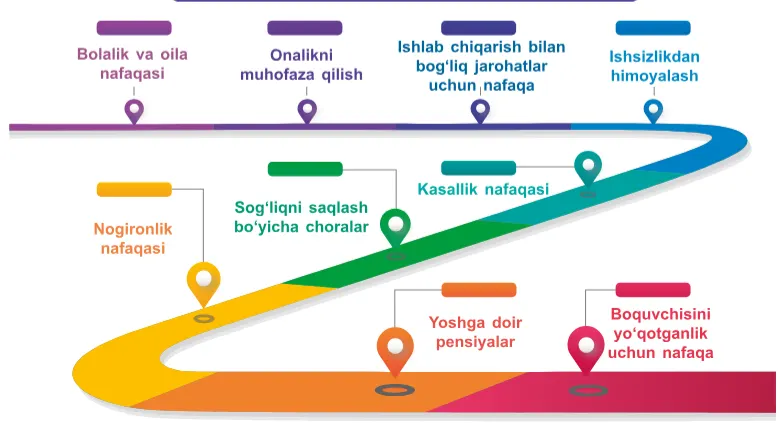

Xususan, har kim qariganda, mehnat qobiliyatini yoʻqotganda, ishsizlikda, shuningdek, boquvchisini yoʻqotganda va qonunda nazarda tutilgan boshqa hollarda ijtimoiy taʼminot huquqiga egaligi belgilab qoʻyilgan.

Ijtimoiy himoya insonning bir qator boshqa huquqlari, xususan, munosib turmush darajasiga ega boʻlish, taʼlim olish va malakali tibbiy xizmatdan foydalanish kabi huquqlarni amalga oshirishga ham koʻmaklashadi.

Xoʻsh, ijtimoiy himoyaning oʻzi nima, degan savolga qisqacha javob bersak.

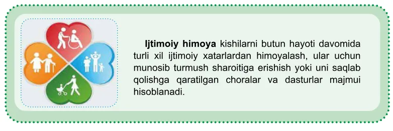

### AHOLINI IJTIMOIY HIMOYALASH

Aholini ijtimoiy himoyalash tizimi bunday himoyani ijtimoiy sugʻurta va ijtimoiy yordamning uygʻunlikdagi

### IJTIMOIY HIMOYA

Ijtimoiy sugʻurta – mehnat qobiliyatini va daromadlarni yoʻqotish bilan bogʻliq ijtimoiy xatarlarning oqibatlaridan aholini kompensatsiyalash tizimi.

U ish beruvchilar va xodimlarning sugʻurta badallari hisobidan shakllantiriladi. Davlat ijtimoiy sugʻurtasi hisobidan vaqtincha mehnatga layoqatsizlik, homiladorlik va tugʻish, bola tugʻilganda beriladigan nafaqalar, yoshga doir, nogironlik va boquvchisini yoʻqotganlik

pensiyalari toʻlov bilan taʼminlanadi.

Ijtimoiy yordam – aholining yordamga muhtoj qatlamining minimal ehtiyojlarini qondirishga qaratilgan, davlat tomonidan moliyalashtiriladigan ijtimoiy himoya turi.

Ijtimoiy yordam manzilli va maqsadli xususiyatga ega boʻlib, ijtimoiy sugʻurtadan farqli ravishda sugʻurta badallarini toʻlash-toʻlamaslikdan qatʼi nazar, pul koʻrinishida yoki natural shaklda (oziq-ovqat, dori vositalari bilan taʼminlash kabi) taqdim etiladi.

Shaxs ijtimoiy sugʻurtalanmagan boʻlsa, daromadi vaqtinchalik kam boʻlgan taqdirda davlat uni ijtimoiy yordam orqali himoya qiladi.

Ijtimoiy himoya inson kapitaliga kiritiladigan sarmoya ham boʻlib, iqtisodiy oʻsishning

omillaridan biri hisoblanadi, chunki muvaffaqiyatli iqtisodiyot ishchi kuchining sifatiga bogʻliqdir. Ijtimoiy himoya ishchi-xodimlarning salomatligi yaxshilanishini qoʻllab-quvvatlaydi, u oʻz navbatida ishlab chiqarish quvvati oshishiga, daromad olish uchun imkoniyatlarning kengayishiga va iqtisodiyotga mablagʻlarni jalb qilishga olib keladi.

### Ijtimoiy himoya

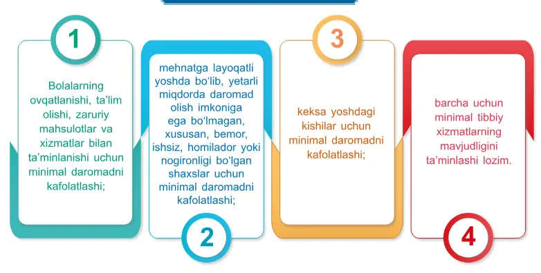

Davlatlar mehnat bozorida munosib oʻrnini egallash, kasbga tayyorlash bilan bogʻliq tadbirlar doirasida bolalar va yoshlarning qobiliyatlari hamda koʻnikmalarini rivojlantirishga yetarlicha sarmoya kiritishi lozim.

### IJTIMOIY HIMOYALASHDA INSONPARVARLIK TAMOYILINING OʻRNI

Huquqshunoslik olamida insonparvarlik tamoyili koʻpincha jinoyat huquqi sohasida tilga olinsa-da, aholini ijtimoiy himoya qilishda, ayniqsa, aholining ijtimoiy yordamga muhtoj qatlamini himoyalashda va moddiy boyliklarning adolatli taqsimotida uning oʻrni beqiyosdir. Ushbu tamoyil shaxsning qadr-qimmati, obroʻsi, huquq va erkinliklari, qonuniy manfaatlarini uning ijtimoiy, moddiy va boshqa holatidan qatʼi nazar hurmat qilishni koʻzda tutadi. Oʻzbekiston Respublikasi Konstitutsiyasining 13-moddasida ham insonning hayoti, erkinliklari, shaʼni, qadr-qimmati va boshqa daxlsiz huquqlari oliy qadriyat ekani mustahkamlangan.

Shu sababli himoya qilish dasturlari insonparvarlik, ijtimoiy adolat, manzillilik, profilaktik yoʻnaltirilganlik kabi muhim tamoyillarga asoslanadi. Bundan tashqari, Oʻzbekiston Konstitutsiyada oʻzini ijtimoiy davlat deb eʼlon qilar ekan, insonparvarlik tamoyili davlat siyosatining asosiy ustuniga aylanadi.

Bugun mamlakatimizda kambagʻallikni qisqartirish borasida amalga oshirilayotgan ishlar, xususan,

### Yodda tuting

**Insonparvarlik** “insonni sevish” degan maʼnoni bildirib, insonga oliy qadriyat sifatida yondashishni anglatadi.

“Ayollar daftari”, “Temir daftar” kabi tizimlar orqali aholining ehtiyojmand qatlamini qoʻllab-quvvatlash ortida ham aynan insonparvarlik tamoyili yotadi.

Insonparvarlik tamoyilining amaliy ifodasi sifatida “Ijtimoiy himoya yagona reyestri” axborot tizimi orqali aniqlanadigan va koʻrsatiladigan ijtimoiy xizmatlar hamda yordamlarni keltirish mumkin. Masalan, 18 yoshgacha bolalari boʻlgan oilalarga nafaqa, bola 3 yoshga toʻlguniga qadar uni parvarish qilish nafaqasi, kam taʼminlangan oilalarga moddiy yordam uchun har oylik pulli kompensatsiyani tayinlash ushbu tizim orqali aniqlanadi.

### Savol va topshiriqlar

1. Hech oʻylab koʻrganmisiz, aholini ijtimoiy himoyalash nima uchun davlatning asosiy vazifalaridan biri hisoblanadi?

2. Bozor iqtisodiyoti sharoitida har kim oʻz ijtimoiy himoyasi borasida oʻzi qaygʻurishi kerak degan fikrga qanday qaraysiz?

3. Nima deb oʻylaysiz, nima uchun kam taʼminlangan oilalarga oylik moddiy yordam tayinlash va uning miqdorini belgilash qarori mahalla fuqarolari vakillarining yigʻilishida qabul qilinadi?

4. Aholining yana qanday qatlamini ijtimoiy himoyalash kerak deb hisoblaysiz? Fikringizni asoslang, misollar keltiring va umumlashtiring.

### Mustaqil ish uchun topshiriq

Amir Temur davrida katta-katta yerlarni masjid, madrasa va mozorlarga vaqf qilib berish keng tarqalgan edi. Oʻsha davr odatiga koʻra, yer va suvdan tashqari doʻkonlar, tegirmonlar, ustaxonalar, bozor, objuvoz va karvonsaroylar ham vaqf qilib berilgan. Vaqf mulkidan tushgan daromadlar masjid, maqbara, madrasalar, musofirxona va bemorxonalar ehtiyoji uchun sarflangan.

Topshiriq:

Yuqorida keltirilgan maʼlumotlar va tarix fanidan egallagan bilimlaringiz asosida buyuk davlat arbobi Amir Temurning oʻz davrida olib borgan ijtimoiy himoya borasidagi faoliyati xususida loyiha ishi tayyorlang.

## 7-dars. Inson huquqlari boʻyicha milliy qonunchilik

Inson huquqlari hech qaysi madaniyatga begona emas va barcha xalqlarga tegishlidir. Inson huquqlari umuminsoniy qadriyat hisoblanadi. **Kofi Annan, BMT Bosh kotibi (1997–2006-yillar)**

### Siz bilib olasiz

Milliy qonunchilik tizimi.

Inson huquqlari boʻyicha xalqaro mezonlarning milliy qonunchilikda aks etishi. Axborot davrida inson huquqlari himoyasi.

### MILLIY QONUNCHILIK TIZIMI

Dunyodagi har bir davlat oʻzining inson huquqlariga oid qonunchilik tizimiga ega boʻlib, uning negizini mamlakat konstitutsiyasi, shuningdek, inson huquqlari boʻyicha xalqaro standartlar tashkil qiladi. Konstitutsiyalarda inson huquq va erkinliklari, fuqarolarning burchlariga oid eng muhim qoidalar mustahkamlangan boʻlib, mazkur qoidalar alohida qonunlar va boshqa qonunchilik hujjatlarida yanada aniqlashtiriladi.

Oʻzbekiston Respublikasining inson huquqlariga oid qonunchilik tizimi quyidagi asosiy tarkibiy qismlardan tashkil topgan:

• **Shaxsiy huquqlarga oid –** yashash huquqi, soʻz va eʼtiqod erkinligi huquqi, shaxsiy daxlsizlik huquqi, turarjoy daxlsizligi huquqi va boshqa huquqlarni taʼminlashga qaratilgan qonunchilik hujjatlari (masalan, “Vijdon erkinligi va diniy tashkilotlar toʻgʻrisida”gi qonun).

• **Siyosiy huquqlarga oid –** saylash va saylanish huquqi, turli jamoat birlashmalariga uyushish huquqi, davlat organlariga murojaat qilish huquqiga oid qonunchilik hujjatlari (masalan, “Jismoniy va yuridik shaxslarning murojaatlari toʻgʻrisida”gi qonun).

• **Iqtisodiy va ijtimoiy huquqlarga oid –** mulk huquqi, erkin kasb tanlash va mehnat qilish huquqi, taʼlim olish huquqi, malakali tibbiy xizmatdan foydalanish huquqi va boshqa huquqlarga oid qonunchilik hujjatlari (masalan, “Fuqarolar sogʻligʻini saqlash toʻgʻrisida”gi qonun).

• **Madaniy huquqlar –** ijodiy faoliyat erkinligi, madaniy meros boyliklarini himoya qilishga oid qonunchilik hujjatlari (masalan, “Madaniy faoliyat va madaniyat tashkilotlari toʻgʻrisida”gi qonun).

• **Ekologik huquqlar –** qulay atrof-muhitga boʻlgan huquq, atrof-muhitning holati haqida ishonchli axborotga ega boʻlish huquqi, ekologik huquqbuzarlik natijasida shaxsning salomatligiga yetkazilgan zararni undirish huquqi va atrof-muhitni asrash bilan bogʻliq boshqa qonunchilik hujjatlari (masalan, “Tabiatni muhofaza qilish toʻgʻrisida”gi qonun).

• **Inson huquqlariga oid xalqaro hujjatlar –** Oʻzbekiston Respublikasining inson huquqlariga oid ikki va koʻp tomonlama shartnomalari.

**INSON HUQUQLARI BOʻYICHA XALQARO MEZONLARNING MILLIY QONUNCHILIKDA AKS ETISHI**

Yuqorida taʼkidlanganidek, milliy qonunchilik jahon hamjamiyati tomonidan ishlab chiqilgan va davlatlar tomonidan tan olingan xalqaro huquqiy standartlarga asoslanadi.

**Inson huquqlari boʻyicha xalqaro standartlar (mezonlar)** xalqaro hujjatlarda mustahkamlangan va inson huquqlariga oid minimal talablarni koʻzda tutuvchi qoidalar boʻlib, davlatlar ushbu qoidalarni implementatsiya qilish orqali milliy huquq tizimining tarkibiy qismiga aylantiradi.

Agar xalqaro huquqiy majburiyatlar davlat miqyosida milliy qonunchilikka tatbiq etilmasa, tegishli shartnomalar qoidalari falaj holatda qolib, ularni hayotga joriy qilish imkonsiz va samarasiz boʻlib qolaveradi.

Har bir davlatning milliy qonunchilik tizimi mamlakatda shakllangan anʼanaviy huquqiy qoidalar bilan birgalikda xalqaro huquqiy standartlar talablari bilan uygʻunlashsagina, samarali, adolatli va insonparvar xususiyat kasb etishi mumkin.

Masalan, Xalqaro mehnat tashkilotining Ishga qabul qilish uchun eng kichik yosh toʻgʻrisidagi 138-son konvensiyasida bolalarning mehnat qilishi yoki yollanib ishlashiga ruxsat etilgan eng kichik yosh majburiy maktab taʼlimini tugallash uchun zarur boʻlgan yoshdan kam boʻlmasligi kerakligi va har qanday holda oʻn besh yoshdan kichik boʻlmasligi zarurligi belgilangan. Oʻzbekiston ushbu Konvensiyani 2008-yilda ratifikatsiya qilgan. Ushbu xalqaro majburiyat Oʻzbekiston Respublikasi Mehnat kodeksining qoidalarida oʻz aksini topgan va hozirgi vaqtda ishga qabul qilish uchun oʻn olti yoshdan (ayrim talablarga rioya qilingan holda oʻn besh yoshga toʻlgandan keyin) ruxsat berilishi belgilangan.

Mazkur holatda ham mamlakatimiz xalqaro hujjatlarga asosan olgan majburiyatidan kelib chiqib, shuningdek, bolaning sogʻligʻiga hamda maʼnaviy va axloqiy kamol topishiga ziyon yetkazmaydigan, taʼlim olish jarayonini buzmaydigan shartlar asosida adolatli va insonparvar qoidalarni joriy qilgan.

**BMTning Oʻzbekiston ratifikatsiya qilgan inson huquqlari boʻyicha asosiy xalqaro shartnomalari**

**Fuqarolik va siyosiy huquqlar toʻgʻrisidagi xalqaro pakt (1966-yil)**

**Iqtisodiy, ijtimoiy va madaniy huquqlar toʻgʻrisida xalqaro pakt (1966-yil)**

**Irqiy kamsitishlarning barcha shakllariga barham berish toʻgʻrisidagi xalqaro konvensiya (1965-yil)**

**Xotin-qizlarni kamsitishning barcha shakllariga barham berish toʻgʻrisidagi xalqaro konvensiya (1979-yil)**

**Qiynoqlarga hamda muomala va jazolashning boshqa shafqatsiz, gʻayriinsoniy yoki qadr-qimmatni**

Hozir Oʻzbekiston Respublikasi inson huquqlari boʻyicha 80 dan ortiq xalqaro hujjatlarga, jumladan, Inson huquqlari umumjahon deklaratsiyasi, Birlashgan Millatlar Tashkilotining 7 ta asosiy shartnomasi va 4 ta fakultativ protokoliga qoʻshilgan.

Mazkur xalqaro shartnomlar normalari Oʻzbekiston Respublikasining koʻplab qonunchilik hujjatlari qoidalarida oʻz aksini topgan va mamlakat qonunchilik tizimining tarkibiy qismiga aylangan.

### AXBOROT DAVRIDA INSON HUQUQLARI HIMOYASI

Raqamli texnologiyalar insoniyatning taraqqiyotida muhim vosita boʻlib, inson huquqlarini qoʻllab-quvvatlash va himoya qilishda oʻzining munosib hissasini qoʻshishi mumkin.

Zamonaviy ijtimoiy munosabatlar rivojlanishining muhim xususiyati ularning jadallik bilan raqamlashib borayotganidir. Bu esa raqamli axborotni yaratish, olish va undan foydalanish huquqi, aloqa va axborot tarmoqlari (jumladan, internet)dan foydalanish huquqi, shaxsiy maʼlumotlarning maxfiyligiga boʻlgan huquq, shaxsiy axborot makonining daxlsizligi huquqi kabi inson huquqlarining yangi turlari paydo boʻlishiga olib keldi.

BMT Inson huquqlari kengashi shaxsning internetdan foydalanish huquqini insonning ajralmas huquqlaridan biri sifatida tan oldi. Shunga koʻra, maʼlum bir hududlarning butunjahon internet tarmogʻidan uzilishi inson huquqlarining buzilishi hisoblanadi. Internet tarmogʻida axborotni tarqatish maksimal darajada erkin boʻlishi lozimligi, uni faqat biror-bir shaxsning huquqlari buzilishiga olib kelgandagina cheklash mumkinligi belgilandi. Bunga misol sifatida kiber hujumlar natijasida maʼlumotlarning sizib chiqishi va tarqalib ketishi mumkinligi holatini keltirib oʻtish mumkin. Konstitutsiyamizning 33-moddasida ham bugungi davr internet bilan nechogʻlik aloqador ekani hisobga olinib, davlat internet jahon axborot tarmogʻidan foydalanishni taʼminlash uchun shart-sharoitlar yaratishi belgilab qoʻyilgan.

Agar samarali kafolatlar mavjud boʻlmasa, bunday texnologiyalarni joriy qilish insonning qadr-qimmati, shaxsiy hayoti daxlsizligi va mustaqilligiga, umuman olganda, inson huquqlarini taʼminlashga jiddiy xavf tugʻdirishi ham mumkin. Xususan, BMTning Bola huquqlari boʻyicha qoʻmitasi bu borada xatarlar mavjudligini eʼtirof etib, raqamli qurilmalardan foydalanish bolalarga zarar yetkazmasligi, bolalar va ota-onalar oʻrtasidagi muloqot oʻrnini egallamasligi lozimligini qayd etadi.

Axborot texnologiyalaridan hayotning barcha sohalarida foydalanish insonning shaxsiy hayot daxlsizligi huquqini taʼminlashga salbiy taʼsir qiladi. Mazkur huquqni himoya qilish qamrovi shaxsning turarjoyi, avtomashinasi, yozishmalari kabi shaxsiy muhiti bilan cheklanmasdan, bozor, aeroport, vokzal, taʼlim muassasalari binolari kabi jamoat joylari va bu makonlarda toʻplanadigan ochiq maʼlumotlarga ham taalluqli boʻladi. Masalan, taʼlim muassasasi binosidagi kuzatuv vositalarida yozib olingan videomateriallardan taʼlim oluvchilar yoki oʻqituvchilarning shaxsiy hayoti daxlsizligiga zid ravishda, ularni obroʻsizlantirish maqsadida foydalanish taqiqlanadi.

Axborot texnologiyalari vositasida shaxsiy hayot daxlsizligi huquqining buzilishi mamlakatimizda maʼmuriy va jinoy javobgarlikka sabab boʻlishi mumkin. Masalan, fuqarolarning shaxsiy hayoti toʻgʻrisidagi maʼlumotlarni ularning roziligisiz, qonunga xilof ravishda yigʻish, tarqatish, oshkor qilish harakatlari uchun tegishlicha javobgarlik belgilangan.

Shuningdek, axborot texnologiyalari va aloqa vositalaridan foydalangan holda oʻzgalar-

### Yodda tuting

> Shaxsga doir maʼlumotlar – muayyan jismoniy shaxsga taalluqli boʻlgan yoki uni identifikatsiya qilish imkonini beradigan, elektron tarzda, qogʻozda va (yoki) boshqa moddiy jismda qayd etilgan axborot.

ning mablagʻlarini noqonuniy oʻzlashtirish, firibgarlik harakatlarini sodir etganlik uchun ham jinoiy javobgarlik belgilangan.

### Yodda tuting

Kartangizning amal qilish muddatini koʻrsatish va SMS orqali kelgan tasdiqlash kodini yuborish haqidagi soʻrov shubha uygʻotish uchun asos boʻladi. Plastik kartangizda pul boʻlmasa ham, maxfiy maʼlumotlarni kiritish firibgarlarga kelajakda kartangizdan gʻarazli niyatlarda foydalanib, hisobingizdagi barcha pullarni yechib olish imkonini beradi. Internet tarmogʻi orqali sizga kelayotgan har qanday xabarlardan ogoh boʻling!

### Savol va topshiriqlar

1. Agar mamlakat qonunchilik tizimi faqat ushbu mamlakatda shakllangan axloqiy qarashlar, urf-odatlarga asoslanib rivojlansa, bunday qonunchilik mamlakatda inson huquqlarini taʼminlashda qanchalik samarali boʻlishi mumkinligi haqida fikr yuriting. Ushbu holatning ijobiy va salbiy jihatlarini tahlil qiling.

2. Sizningcha, inson huquqlari boʻyicha xalqaro standartlarning shakllanishida milliy huquqiy tizimlarning roli va ahamiyati qanday boʻlgan?

3. Raqamli texnologiyalarning rivojlanishi insonning shaxsiy daxlsizlik huquqi buzilishi holatlarining koʻpayishiga olib keladi degan farazga qanday munosabat bildirasiz?

4. Sizningcha, internet aloqasidan foydalanishning, masalan, qimor va tavakkalchilikka asoslangan (totalizator) oʻyinlarni oʻynashning cheklanishi shaxsning internetdan foydalanish huquqini buzish hisoblanadimi? Bunday huquqning buzilishini misollar keltirgan holda tushuntiring.

### Mustaqil ish uchun topshiriq

1. Taʼlim-tarbiya jarayonini tashkil etish samaradorligiga erishish va yoshlar oʻrtasida sogʻlom turmush tarzini qaror toptirish uchun taʼlim muassasalarida (umumiy oʻrta, oʻrta maxsus, kasb-hunar va oliy taʼlim) mobil telefonlardan foydalanish cheklangan. Bu borada Vazirlar Mahkamasining 2012-yildagi 139-son qarori mavjud boʻlib, unga “Oʻzbekiston Respublikasi taʼlim muassasalarida mobil telefonlardan foydalanish tartibi toʻgʻrisidagi nizom” ilova qilingan. Mazkur Nizom bilan tanishib chiqing va unda belgilangan qoidalarni sinfdoshlaringiz bilan muhokama qiling.

2. 10-sinf oʻquvchilari K. va S. sinfxonada, dars jarayonida bildirmasdan oʻqituvchilari va sinfdosh qizlarini rasmga olib, telegram guruhlarda masxaralab tarqatishdi. Bu vaziyatda oʻqituvchi va oʻquvchi qizlarning qanday huquqlari poymol etildi? K. va S.ning bu harakatlarini huquqbuzarlik sifatida baholash mumkinmi? Ularga qanday chora koʻriladi? K. va S.ning bu qilmishiga kim javobgar? Ushbu savollarga yuqoridagi Nizomga asoslangan holda javob bering.

## 8-dars. Inson huquqlarini himoya qiluvchi organlar

Xalq davlat idoralariga emas, davlat idoralari xalqqa xizmat qilishi kerak.

### Siz bilib olasiz

Inson huquqlarini himoya qilish boʻyicha davlat organlari tizimi. Inson huquqlari boʻyicha milliy institutlarning ahamiyati. Inson huquqlarini himoya qilishda nodavlat tashkilotlarning oʻrni.

**INSON HUQUQLARINI HIMOYA QILISH BOʻYICHA DAVLAT ORGANLARI TIZIMI**

Mamlakatimizda inson huquqlarining himoyasi bilan shugʻullanuvchi davlat organlari, milliy institutlar va nodavlat tashkilotlardan iborat tizim shakllangan. Ayrim adabiyotlarda ular “inson huquqlari boʻyicha sudlov va nosudlov organlari” deb ham ataladi.

Inson huquqlarini himoya qilish bilan shugʻullanuvchi davlat organlari tizimida sud, prokuratura, ichki ishlar, adliya organlari muhim oʻringa ega.

**Sud organlari** inson huquq va erkinliklarini himoya qilish mexanizmining eng muhim qismi hisoblanadi. Chunki aynan sudlov tizimi shaxsning buzilgan huquqlarini tiklagan holda jamiyatda adolat va qonun ustuvorligini taʼminlaydi.

Har kim oʻz huquq va erkinliklarini qonunda taqiqlanmagan barcha usullar bilan himoya qilishga haqli.

Har kimga oʻz huquq va erkinliklarini sud orqali himoya qilish, davlat organlarining hamda boshqa tashkilotlarning, ularning mansabdor shaxslarining qonunga xilof qarorlari, harakatlari va harakatsizligi ustidan sudga shikoyat qilish huquqi kafolatlanadi.

Har kimga buzilgan huquq va erkinliklarini tiklash uchun uning ishi qonunda belgilangan muddatlarda vakolatli, mustaqil hamda xolis sud tomonidan koʻrib chiqilishi huquqi kafolatlanadi.

**Oʻzbekiston Respublikasining Konstitutsiyasi, 55-modda**

**Prokuratura organlari**ning asosiy vazifalaridan biri fuqarolarning huquq hamda erkinliklarini, jamiyat va davlatning qonun bilan qoʻriqlanadigan manfaatlarini himoya qilish hisoblanadi. Prokuratura organlari fuqarolarning huquqlari hamda erkinliklariga rioya etilishi ustidan nazorat faoliyatini olib borib, fuqaroning huquq va erkinliklari buzilganligi toʻgʻrisidagi arizalar, shikoyatlar hamda boshqa maʼlumotlarni koʻrib chiqadi va tekshiradi, huquq va erkinliklarini himoya qilish tartibini tushuntiradi, fuqaroning huquq va erkinliklari buzilishining oldini olish va bartaraf etish, qonunni buzgan shaxslarni javobgarlikka tortish hamda yetkazilgan zararni qoplash chora-tadbirlarini koʻradi.

**Ichki ishlar organlari** ham inson huquqlarini himoya qilishni oʻzining asosiy maqsadi etib belgilaydi. Xususan, Oʻzbekiston Respublikasining 2016-yilda qabul qilingan “Ich-

ki ishlar organlari toʻgʻrisida”gi qonuniga muvofiq, fuqarolarning huquqlari, erkinliklari va qonuniy manfaatlarini, jismoniy va yuridik shaxslarning mulkini himoya qilish **ichki ishlar organlari**ning asosiy vazifalari sifatida belgilangan.

**Adliya organlari**ning asosiy vazifalari qatorida fuqarolarning huquqlari, erkinliklari va qonuniy manfaatlarini huquqiy himoya qilish boʻyicha choralarni amalga oshirish muhim oʻringa ega. Bu boradagi vazifalarni amalga oshirish davomida adliya organlari davlat organlari va davlat ishtirokidagi tashkilotlar tomonidan inson huquqlari sohasidagi qonunchilik hujjatlariga rioya etilishi ustidan nazoratni amalga oshiradi, fuqarolarning davlat organlari va davlat ishtirokidagi tashkilotlarda buzilgan huquqlarini tiklash boʻyicha choralar koʻradi.

### INSON HUQUQLARI BOʻYICHA MILLIY INSTITUTLARNING AHAMIYATI

Inson huquqlari boʻyicha milliy institutlar inson huquq va erkinliklarini himoya qilishning milliy tizimida muhim ahamiyat kasb etib, ularning faoliyati nosudlov xususiyatga ega.

### Inson huquqlari

**boʻyicha milliy institutlarning asosiy vazifalari**

### Inson huquqlari

**masalalari yuzasidan hukumat va parlamentga taklif va tavsiyalar kiritish**

**Milliy qonunchilikning**

### inson huquqlari

**boʻyicha xalqaro standartlarga mos boʻlishini targʻib etish**

**Davlatning inson huquqlariga oid xalqaro shartnomalardan kelib chiqadigan majburiyatlari yuzasidan milliy maʼruzalarni tayyorlashda ishtirok etish**

**Inson huquqlarining buzilishlariga taalluqli ariza, shikoyat va murojaatlarni qabul qilish va koʻrib chiqish**

**Inson huquqlarini targʻib qilish, unga oid axborotlarni tarqatish va inson huquqlari taʼlimiga koʻmaklashish**

Oʻzbekistonda inson huquqlari boʻyicha milliy institutlar tizimiga Inson huquqlari boʻyicha Oʻzbekiston Oʻzbekiston Respublikasi Oliy Majlisining Inson huquqlari boʻyicha vakili (ombudsman), Oʻzbekiston Respublikasi Oliy Majlisining Bola huquqlari boʻyicha vakili (bolalar ombudsmani), Oʻzbekiston Respublikasi Prezidenti huzuridagi Tadbirkorlik subyektlarining huquqlari va qonuniy manfaatlarini himoya qilish boʻyicha vakil (biznes-ombudsman) kiradi.

### Yodda tuting

> **Inson milliy institut –** inson huquq va erkinliklarini himoya qilish, qoʻllab-quvvatlash va ularga rioya qilinishini taʼminlash maqsadida konstitutsiya yoki qonun bilan taʼsis etiladigan mustaqil organ.

### Inson huquqlari boʻyicha milliy institutlar

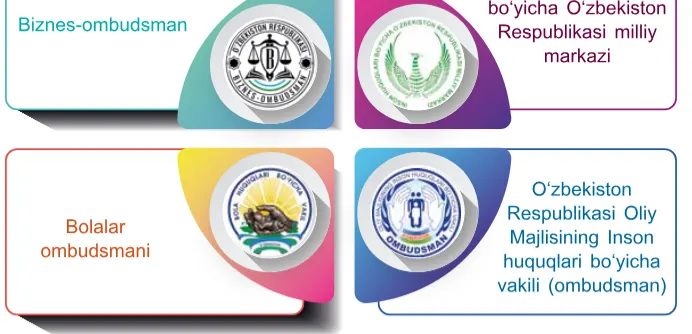

### Inson huquqlari boʻyicha vakil (ombudsman) tashkilotlar va mansabdor shaxslar

tomonidan inson huquqlari hamda erkinliklari toʻgʻrisidagi qonunchilikka rioya etilishi ustidan parlament nazoratini taʼminlash vazifasini amalga oshiradi. Ombudsman fuqarolarning ariza, taklif va shikoyat tarzidagi murojaatlarini koʻrib chiqadi va tekshiradi, bu boradagi qonunchilik buzilishi holatlari aniqlanganda ularni bartaraf etish yuzasidan davlat organlari va tashkilotlar rahbarlariga taqdimnomalar, shuningdek, inson huquqlarining jiddiy buzilishiga yoʻl qoʻygan shaxslarni javobgarlikka tortish yuzasidan tegishli organlarga iltimosnomalar kiritadi.

**Inson huquqlari boʻyicha Oʻzbekiston Respublikasi milliy markazi** inson huquqlari sohasidagi Oʻzbekiston Respublikasining xalqaro majburiyatlarini bajarish boʻyicha davlat organlari va boshqa tashkilotlarning oʻzaro hamkorligini, milliy maʼruzalar tayyorlanishini, inson huquqlarini himoya qilish boʻyicha xalqaro tashkilotlar bilan hamkorlikni kengaytirishni taʼminlovchi davlat organi hisoblanadi.

**Bolalar ombudsmani** bola huquqlariga oid qonunchilik hujjatlarini ishlab chiqish va amalga oshirishda ishtirok etadi, bola huquqlarining kafolatlari toʻgʻrisidagi qonun hujjatlari ijrosini oʻrganadi, bolalar va ularning qonuniy vakillari oʻrtasida bolaning huquqlari, erkinliklari va qonuniy manfaatlarini tushuntiradi, imkoniyati cheklangan, shuningdek, yetim va ota-ona qaramogʻidan mahrum boʻlgan bolalarning ijtimoiy moslashuviga koʻmaklashadi.

**Biznes-ombudsmanning** asosiy vazifasi tadbirkorlik subyektlarining huquqlari va qonuniy manfaatlarini himoya qilish, mazkur huquqlar va qonuniy manfaatlarga davlat organlari, shu jumladan, huquqni muhofaza qiluvchi va nazorat qiluvchi organlar tomonidan rioya etilishini taʼminlashdan iborat.

**INSON HUQUQLARINI HIMOYA QILISHDA NODAVLAT TASHKILOTLARNING OʻRNI**

Inson huquqlarini himoya qilish tizimida davlat organlari, milliy institutlar bilan birga nodavlat tashkilotlarning ahamiyati ham oshib bormoqda. Hozir mamlakatimizda 9 800 dan ortiq nodavlat notijorat tashkilotlar, 10 mingga yaqin mahallalar faoliyat yuritadi.

Kasaba uyushmalari, fuqarolar yigʻinlari, isteʼmolchilar huquqlarini himoya qilish jamiyatlari, turli xayriya va jamoat fondlarini, aholining turli qatlamlari (bolalar, yoshlar, nogironlar, ayollar) huquqlarini himoya qilish, ularga ijtimoiy koʻmak koʻrsatish maqsadida tashkil etilgan koʻplab jamoat tashkilotlarini nodavlat tashkilotlar sirasiga kiritish mumkin.

Nodavlat tashkilotlar inson huquqlarini taʼminlash, shaxsning buzilgan huquqlarini tiklash, ijtimoiy himoyaga muhtoj aholi qatlamiga koʻmaklashish, inson huquqlarini targʻib qilish kabi yoʻnalishlarda samarali faoliyat koʻrsatishi mumkin. Davlat organlari ijtimoiy sheriklik asosida jamiyatdagi ahamiyatga molik masalalarni hal qilishda nodavlat tashkilotlar bilan hamkorlik qiladi. Mamlakatimizda nafaqat mahalliy, balki chet el nodavlat notijorat tashkilotlari ham faoliyat yuritishi mumkin. Barcha shu kabi tashkilotlarning faoliyati “Nodavlat notijorat tashkilotlar toʻgʻrisida”gi qonun bilan tartibga solinadi.

### Yodda tuting

> **Nodavlat notijorat tashkiloti –** jismoniy va yuridik shaxslar tomonidan ixtiyoriylik asosida tashkil etilgan, daromad olishni oʻz faoliyatining asosiy maqsadi qilib olmagan hamda olingan daromadlarni oʻz qatnashchilari oʻrtasida taqsimlamaydigan oʻzini oʻzi boshqarish tashkiloti.

### Savol va topshiriqlar

1. Inson huquqlarini himoya qilish bilan shugʻullanuvchi davlat organlari tizimini tavsiflab bering.

2. Inson huquqlari boʻyicha milliy institutlarning asosiy vazifalari mazmunini tushuntiring.

3. Inson huquqlarini taʼminlashda prokuratura va ichki ishlar organlarining vakolatlaridagi asosiy farqli jihatlar nimalardan iborat.

4. Inson huquqlari boʻyicha vakil (ombudsman) tomonidan davlat organlari va tashkilotlarning mansabdor shaxslariga taqdimnomalar nima maqsadda kiritiladi?

5. Ombudsman tomonidan kiritiladigan taqdimnoma bilan iltimosnomaning farqi nimada?

### Mustaqil ish uchun topshiriq

Fuqaro A. ichki ishlar idoralari xodimlari tomonidan uning huquqlari buzilganligi yuzasidan Inson huquqlari boʻyicha vakil (ombudsman) nomiga shikoyat bilan murojaat qildi. Ombudsman kotibiyati xodimi mazkur shikoyatni qabul qila olmasligini, sababi huquqni muhofaza qiluvchi organlar faoliyati yuzasidan murojaatlarni koʻrib chiqish ombudsmanning vakolatlariga kirmasligini maʼlum qildi.

Ushbu vaziyatni tahlil qiling va ombudsman kotibiyati xodimining harakatlariga huquqiy baho bering.

## 9-dars. Ijodiy faoliyat

Muvaffaqiyatsizlikka uchrash ogʻir, biroq eng yomoni muvaffaqiyatga erishish uchun sira harakat qilmaslikdir.

**Teador Ruzvelt**

### IJODIY FAOLIYAT UCHUN

1. Oʻzbekiston Respublikasining Konstitutsiyasida insonning asosiy huquq va erkinliklari mustahkamlangan normalar bilan oʻxshash boʻlgan Inson huquqlari umumjahon deklaratsiyasi qoidalarining solishtirma qiyosiy jadvalini tuzing. Masalan, Deklaratsiyaning 3-moddasida “Har bir inson yashash, erkin boʻlish va shaxsiy daxlsizlik huquqlariga egadir”, deyilgan. Shunga oʻxshash qoida Konstitutsiyamizning 25-moddasida mustahkamlangan boʻlib, unda “Yashash huquqi har bir insonning ajralmas huquqidir va u qonun bilan muhofaza qilinadi. Inson hayotiga suiqasd qilish eng ogʻir jinoyatdir”, deb belgilangan.

Solishtirma jadvalingizda taqdim etilgan oʻxshash normalarning farqli jihatlarini tushuntiring.

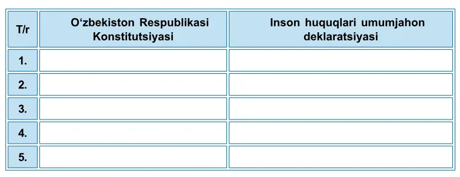

2. Bugun Oʻzbekistonda gender tenglik eng muhim masalalardan hisoblanadi. Tasavvur qiling, mana shu muhim masala yuzasidan Oʻzbekiston Respublikasining “Gender tenglik toʻgʻrisida”gi qonuni loyihasi tayyorlanmoqda. Oʻzbekiston fuqarosi sifatida sizning fikringiz juda ham muhim. Quyidagi jadvalga oʻzingizning gender tenglik borasidagi tushunchalaringizga asoslangan holda mazkur qonun loyihasida aks ettirish lozim deb hisoblagan qoidalaringizni kiriting.

### Siz taklif etayotgan qoida

### NAZORAT ISHI

Aql tarozisida tortib koʻrilmagan har qanday bilim asossizdir.

**Abu Ibn Sino**

Maʼlum bir hududda yashovchi, qadriyatlari, ular amal qiladigan qoidalar va anʼanalari oʻxshash boʻlgan hamda oʻzaro ehtiyoj va manfaatlari yoʻlida birlashgan insonlar guruhi.

### Inson huquqlari

Barcha insonlarning qadr-qimmatini tan oladigan va himoya qiladigan standartlar (mezonlar) hisoblanadi.

Shaxsning huquqlari, erkinliklari, burchlari yigʻindisi.

Insonlar oʻzlarining irqi, tana rangi, jinsi, tili, dini, siyosiy yoki boshqa eʼtiqodidan, milliy yoki ijtimoiy kelib chiqishi yoki oʻzga holatidan qatʼi nazar, bir xil huquqlarga ega boʻlishi.

Insonlarning jinsidan qatʼi nazar, ularga bir xil huquq, erkinlik va imkoniyatlarning taqdim etilishi, iqtisodiy faoliyatda hamda qarorlarni qabul qilishda tenglikning yaratilishi.

“Insonni sevish” degan maʼnoni bildirib, insonga oliy qadriyat sifatida yondashishni anglatadi.

Faqatgina bir davlatning fuqaroligiga ega boʻlish hisoblanib,

amal qiladi.

Shaxsning buzilgan huquqlarini tiklagan holda jamiyatda adolat va qonun ustuvorligini taʼminlovchi davlat organi. Xalqaro hujjatlarda mustahkamlangan va inson huquqlariga oid minimal talablarni koʻzda tutuvchi qoidalar. Mehnat qobiliyatini va daromadlarni yoʻqotish bilan bogʻliq

tizimi.

Tashkilotlar va mansabdor shaxslar tomonidan inson huquqlari hamda erkinliklari toʻgʻrisidagi qonunchilikka rioya etilishi ustidan parlament nazoratini taʼminlash vazifasini amalga oshiruvchi vakil.

Oʻzbekiston Respublikasining fuqarosi boʻlmagan va

### II BOB. OILAVIY HUQUQIY MUNOSABATLAR

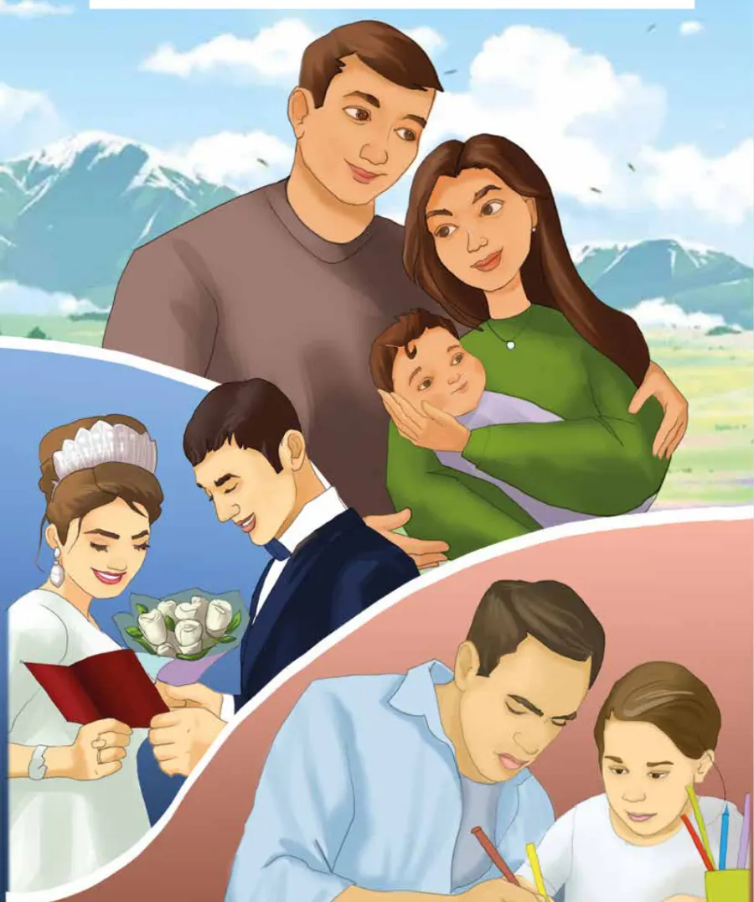

# II bob. Oilaviy-huquqiy munosabatlar

## 10-dars. Jamiyatda oilaning oʻrni

Agar oilaning baxtini boylik belgilaganda edi, bironta boy xonadonda oilaviy janjal koʻtarilmas edi.

**Tohir Malik**

### Siz bilib olasiz

Oila – jamiyat tayanchi.

Jamiyatda oilaviy munosabatlarni tartibga solish. Oilaning davlat tomonidan muhofaza qilinishi.

### OILA – JAMIYAT TAYANCHI

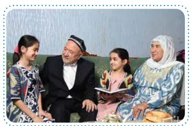

Inson dunyoga kelib, oila degan jamoada yashaydi. U ota-ona, buvi va bobo, aka va opa, amaki va xola, togʻa va amma kabi qon-qarindoshlar qurshovida boʻladi va kamol topadi. Ana shu qarindoshlik rishtasi asosida oila aʼzolari oʻzaro bir-birlariga yordam beradilar. Oiladagi ushbu rishtalar esa hurmat, sadoqat, gʻamxoʻrlik, insonparvarlik kabi insoniy fazilatlar hisoblanib, ular tarbiyaviy, diniy, maʼnaviy, maʼrifiy, ijtimoiy, iqtisodiy, huquqiy asoslarni keltirib chiqaradi. Aynan shu xususiyatlar oilaning mustahkam boʻlishiga olib keladi.

Har bir oila urf-odatlar, rasm-rusumlar, anʼanalar va milliy qadriyatlarga ega. Ana shu urf-odat, rasm-rusum, anʼanalar va milliy qadriyatlar asosida oila oʻziga xos xususiyatlarga ega boʻladi va oila aʼzolari oʻzaro inoqlikda, bir-biriga ishonchda, sadoqat va hurmatda boʻladilar. Oilada ijobiy muhitning barqarorligi jamiyatning tinch va xotirjam ekanligidan dalolat beradi.

Oilaning mustahkamligi jamiyatda hayotning, tiriklikning abadiyligini taʼminlaydi, farzandlar avlodni davom ettiradi. Shuningdek, oila kelajakda farzandlar qanday inson boʻlib yetishishiga taʼsir koʻrsatadigan, ularni tarbiya qiladigan maskan vazifasini bajaradi.

Davlatimiz tomonidan qabul qilinayotgan qonun va boshqa normativ-huquqiy hujjatlar oilalarni qoʻllab-quvvatlash, farzandlarni jismonan sogʻlom, aqlan yetuk qilib dunyoga keltirish, kam taʼminlangan oilalarga koʻmak berish maqsadini koʻzlaydi.

### Yodda tuting

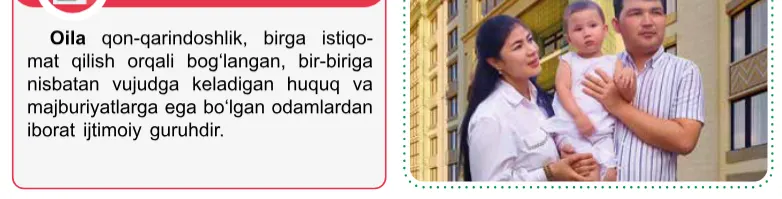

Jamiyat oilaning tinchligi, osoyishtaligi, bolalarning sogʻlomligidan manfaatdor. Jamiyat va davlat oilaning huquqlari, shaʼni, qadr-qimmati va or-nomusini himoya qiladi, oila uchun kerakli sharoitlarni yaratadi.

Oʻzbekiston Respublikasining Konstitutsiyasida “Oila jamiyatning asosiy boʻgʻinidir hamda u jamiyat va davlat muhofazasidadir” degan meʼyorning belgilanishi oila jamiyat bilan uzviy bogʻliq ekanidan dalolat beradi. Oila sogʻlom ekan – jamiyat mustahkam boʻladi, jamiyat mustahkam ekan – mamlakatimizda tinchlik, farovonlik, toʻkinlik barqarordir. Chunki oila butun bir jamiyatning kichik koʻrinishidir. Jamiyat esa oilalar birlashuvidan tashkil topadi.

Oilada muayyan turmush tarzi shakllanib, hayotiy tajriba orttirilib borishi, farzandlarning odobli, maʼnaviy yetuk boʻlib kamol topishida keksa avlod vakillari hamda ota-onaning roli katta. Chunki katta avlod vakillari boʻlgan buvi va bobolar oʻzlarining oʻgitlari, nasihatlari asosida kichik avlodga umuminsoniy qadriyatlarni singdirib, ularni jamiyat uchun barkamol inson qilib yetkazadi. Oilaviy munosabatlar jamiyatdagi mavjud qoidalar bilan belgilanadi va ular taʼsirida oʻzgarib boradi.

Oila nafaqat davlat tomonidan, balki xalqaro miqyosda ham muhofaza qilinadi. Birlashgan Millatlar Tashkiloti Bosh Assambleyasi 15-mayni Xalqaro oila kuni (International Day of Families) deb belgilagan. 1994-yilning 15-mayidan butun dunyoda, jumladan, Oʻzbekistonda ham Xalqaro oila kuni keng nishonlab kelinadi.

Oʻzbekiston Respublikasi Prezidentining “Oila va xotin-qizlarni tizimli qoʻllab-quvvatlashga doir ishlarni yanada jadallashtirish chora-tadbirlari toʻgʻrisida”gi farmoniga koʻra, farovon va barqaror oilalarning hayotiy tajribalarini ommalashtirish maqsadida oilani mustahkamlash, oilaviy qadriyatlarni saqlash va rivojlantirishga munosib hissa qoʻshgan oilalarga beriladigan “Ibratli oila” koʻkrak nishoni taʼsis etilishi va uni 15-may – Xalqaro oila kunida topshirish tartibi belgilandi.

### JAMIYATDA OILAVIY MUNOSABATLARNI TARTIBGA SOLISH

Jamiyatda oila, nikoh kabi tushunchalar mavjud. Oila nikohga qaraganda koʻproq kishilarni oʻz ichiga oladi. Oilaviy munosabatlar qarindoshlik aloqalarining keng koʻlamida namoyon boʻladi. Oila nikoh singari qatʼiy ravishda tuzilish va tugatilish sanasiga ega emas. Oila aʼzolarining soni koʻpayishi yoki kamayishi sababli uning tarkibi oʻzgarishi mumkin.

Oiladagi barcha munosabatlar axloq qoidalari va huquq normalari bilan tartibga solinadi. Masalan, oiladagi salom-alik, kattalarni hurmat qilish, kichiklarga izzatda boʻlish, mehr-oqibat, eʼtibor, oila aʼzolariga “siz” yoki “sen” deb murojaat qilish, bir-birlariga yordam berish, yolgʻon gapirmaslik, yuklatilgan yumushlarni bajarish kabi xatti-harakatlar axloq va urf-odat qoidalari bilan tartibga solinadi.

Nikohni rasmiylashtirish, er-xotinning shaxsiy, mulkiy huquq va majburiyatlari, farzandlarning huquq va erkinliklari kabi munosabatlar huquq normalari bilan tartibga solinadi.

Oilada odob-axloq qoidalariga rioya etilmaganda buvi yoki buva, ota-ona yoki oilaning katta aʼzolari tomonidan koyish, tanbeh beriladi, huquq qoidalari buzilganda esa huquqiy javobgarlikka tortiladi.

Odob-axloq qoidalari bilan tartibga solinadigan oilaviy munosabatlar oiladagi axloqiy munosabatlar hisoblanadi, huquq qoidalari bilan tartibga solinadigan oilaviy munosabatlar esa oiladagi huquqiy munosabatlar hisoblanadi. Oiladagi huquqiy munosabatlar nikoh, uni tuzish, nikoh asosida vujudga kelgan er-xotin, ota-ona va farzandlarning huquq va erkinliklari, majburiyatlariga asoslanadi.

Nikoh tuzish yoshi, nikohni qayd etish tartibi, ayol va erkakning ixtiyoriy roziligi, kelinkuyov, er-xotin, ota-ona, farzandlarning huquqiy maqomi kabi holatlar tegishli huquq normalari bilan belgilanadi.

Oʻzbekiston Respublikasida oilaviy huquqiy munosabatlarni tartibga soladigan qonunchilik tizimi yaratilgan.

Oʻzbekiston Respublikasining Konstitutsiyasi, Oʻzbekiston Respublikasining Oila kodeksi, Oʻzbekiston Respublikasi Prezidenti, Oʻzbekiston Respublikasi Vazirlar Mahkamasi va tegishli boshqaruv organlari tomonidan qabul qilingan normativ-huquqiy hujjatlar oilaviy huquqiy munosabatlarni tartibga soladigan asosiy manbalar hisoblanadi. Shuningdek, oilaviy huquqiy munosabatlar xalqaro normalar bilan ham tartibga solinadi.

Oʻzbekiston Konstitutsiyasining “Oila, bolalar va yoshlar” bobida oila jamiyat va davlat muhofazasida ekani, davlat oilaning toʻlaqonli rivojlanishi uchun ijtimoiy, iqtisodiy, huquqiy va boshqa shart-sharoitlar yaratishi, oila aʼzolarining huquq va majburiyatlari mavjudligi umumiy asosda belgilangan.

Oʻzbekiston Respublikasining Oila kodeksi (1998-yil 30-aprelda qabul qilingan va 1998- yil 1-sentyabrdan kuchga kirgan) oilaviy huquqiy munosabatlarni tartibga soladi va oilaviy munosabatlarni mustahkamlash, oilaviy munosabatlarni oʻzaro muhabbat, ishonch va hurmat, hamjihatlik, bir-biriga yordam berish asosida qurishni taʼminlash, oila aʼzolarining masʼulligini belgilash hamda oila aʼzolarining huquqlarini himoya qilish qoidalarini belgilab beradi. Ushbu kodeks 8 ta boʻlim, 238 ta moddadan iborat.

Oila kodeksida nikohni tuzish tartibi va shartlari, er-xotinning shaxsiy, mulkiy huquq va majburiyatlari, mol-mulkning shartnomaviy tartibi, nikohning tugatilishi kabi meʼyorlar belgilangan. Shuningdek, qon-qarindoshlik va bolalarning nasl-nasabini belgilash, ota-ona hamda voyaga yetmagan bolalarning huquq va majburiyatlari, ularning aliment majburiyatlari, ota-ona qaramogʻidan mahrum boʻlgan bolalarni himoyalash, fuqarolik holati dalolatnomalarini yozish tartibi hamda chet el fuqarolari va fuqaroligi boʻlmagan shaxslar ishtirokidagi oilaviy munosabatlarni tartibga solish meʼyorlari belgilangan.

### Yodda tuting

Huquq qoidalari bilan tartibga solinadigan oilaviy munosabatlar “oiladagi huquqiy munosabatlar” deb ataladi.

### OILANING DAVLAT TOMONIDAN MUHOFAZA QILINISHI

Oʻzbekiston Respublikasining Konstitutsiyasida oila davlat tomonidan muhofaza qilinishi belgilangan boʻlib, davlat oilani mustahkamlashga, oila aʼzolarining masʼulligini oshirishga katta eʼtibor qaratadi. Bugun oilani mustahkamlash maqsadida “Sogʻlom oila – sogʻlom jamiyat” gʻoyasi asosida islohotlar olib borilmoqda.

Soʻnggi yillarda oilalar ga, ayollarga, koʻp bolali va kam taʼminlangan oilalarga, maktab oʻquvchilariga va talabalarga berilayot gan imtiyozlar, moddiy va maʼnaviy koʻmaklar oilaviy muhitni yaxshilash, sogʻlom avlodni tarbiyalashda muhim oʻrin tutmoqda.

Xususan, Oʻzbekiston Respublikasi Konstitutsiyasida nikoh oilaviy qadriyatlarga asoslanishi, u erkak va ayolning ixtiyoriy roziligi asosida tuzilishi, ularning tenghuquqliligi, oilada bolalarni tarbiyalash va ularga gʻamxoʻrlik qilish kabi tamoyillar belgilab berilgan.

2022–2026-yillarga moʻljallangan Yangi Oʻzbekiston Taraqqiyot strategiyasining 70-maqsadida yosh oilalarni qoʻllab-quvvatlash 71-maqsadida oila, taʼlim muassasalari va mahallada tarbiyaning uzviyligini taʼminlash kabi vazifalar belgilab qoʻyilgan.

Oilaning jamiyat taraqqiyotdagi oʻrni va ishtirokini yanada oshirish, oilalarning huquqiy, ijtimoiy, iqtisodiy, maʼnaviy-axloqiy manfaatlarini va farovonligini yaxshilashni davlat tomonidan qoʻllab-quvvatlashni kuchaytirish maqsadida koʻplab qonun va qonunosti hujjatlari qabul qilinmoqda.

Masalan, Oʻzbekiston Respublikasi Prezidentining 2022-yil 7-martdagi farmonida mamlakatda xotin-qizlarning huquq va qonuniy manfaatlarini himoya qilish, xotin-qizlarning iqtisodiy, ijtimoiy va siyosiy faolligini oshirish, xotin-qizlarning sogʻligʻini saqlash, ularni kasbga oʻqitish va bandligini taʼminlash, xotin-qizlarni tadbirkorlikka keng jalb etish, ehtiyojmand xotin-qizlarni ijtimoiy qoʻllab-quvvatlash, gender tenglikni taʼminlash kabi masalalarni amalga oshirish chora-tadbirlari belgilab berildi.

Oʻzbekiston Respublikasi Konstitutsiyasida taʼkidlanganidek, oila, onalik, otalik va bolalik ham davlat himoyasidadir. Zero, onalik va otalik izzat-ikromga hamda hurmatga sazovordir. Avloddan avlodga oʻtib kelayotgan qadriyatlar asosida ota-onani hurmat qilish, ularga mehr-oqibatli, gʻamxoʻr boʻlish kabi fazilatlar har bir insonning oldida turgan majburiyat hisoblanadi. Ona va bola manfaatlarini muhofaza qilish ayollarning mehnati va sogʻligʻini saqlash, mehnat jarayonida ayollarga sharoit yaratish, onalik va bolalikni moddiy va maʼnaviy jihatdan qoʻllab-quvvatlash yoʻli bilan taʼminlanadi.

Davlat koʻp bolali oilalarga qonunchilikka muvofiq imtiyozlar va ijtimoiy kafolatlar beradi. Oila va xotin-qizlar qoʻmitasi tomonidan “Ayollar daftari” bilan ishlash elektron tizimi ishlab chiqildi. Ushbu tizim yordamida ijtimoiy-himoyaga muhtoj xotin-qizning “Ayollar daftari”ga kiritish haqidagi murojaati qabul qilinadi va ushbu murojaatni koʻrib chiqish natijalari beriladi. Shuningdek, “Ayollar daftari”ga kiritilgan xotin-qizlarga koʻrsatiladigan yordam turlari hamda “Ayollar daftari” orqali yordam koʻrsatilayotgan xotin-qizlar roʻyxatga olinadi.

### Yodda tuting

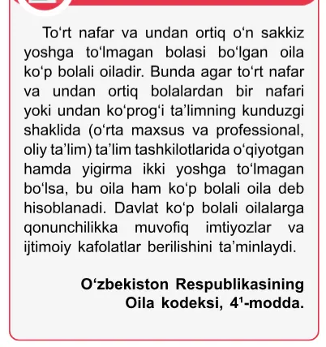

Oila jamiyatning asosiy boʻgʻinidir hamda u jamiyat va davlat muhofazasidadir.

Onalik, otalik va bolalik davlat tomonidan muhofaza qilinadi.

Ota-onalar va ularning oʻrnini bosuvchi shaxslar oʻz farzandlarini voyaga yetguniga qadar boqishi, ularning tarbiyasi, taʼlim olishi, sogʻlom, toʻlaqonli va har tomonlama kamol topishi xususida gʻamxoʻrlik qilishga majburdirlar.

### Savol va topshiriqlar

1. Oila deganda nimani tushunasiz?

2. Nima uchun oila jamiyatning tayanchi hisoblanadi?

3. Jamiyatda oiladagi munosabatlar qanday tartibga solinadi?

4. Odob-axloq qoidalari bilan tartibga solinadigan oilaviy munosabatlarga misollar keltiring.

5. Oiladagi huquqiy munosabatlar qanday manbalar bilan tartibga solinadi?

### Mustaqil ish uchun topshiriq

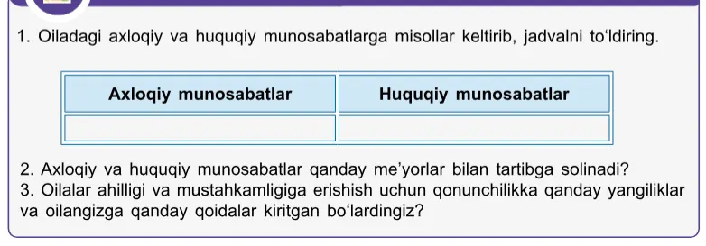

## 11–12-dars. Nikoh, uni tuzish va tugatish asoslari

Baxtli oila qurishning ikki sharti bordir: yaxshi turmush oʻrtoqni tanlay bilmoq va yaxshi turmush oʻrtoq boʻlmoq. **Jaloliddin Rumiy**

### Siz bilib olasiz

“Nikoh” tushunchasi va uning huquqiy asoslari. Nikoh tuzishning ixtiyoriyligi, nikoh tuzish tartibi. Nikohni tuzishga monelik qiladigan holatlar. Nikoh tugatilishining oqibatlari.

### “NIKOH” TUSHUNCHASI VA UNING HUQUQIY ASOSLARI

Avvalgi mavzuda taʼkidlaganimizdek, nikohni rasmiylashtirish, er-xotinning shaxsiy, mulkiy huquq va majburiyatlari, aliment majburiyatlari, bola huquqi, farzandlarning huquq va erkinliklari kabi munosabatlar huquqiy qoidalar bilan tartibga solinadi. Oʻzbekiston Respublikasining Oila kodeksiga koʻra, nikoh tuzishda nikohlanuvchilarning jinsi, irqi, millati, tili, dini, ijtimoiy kelib chiqishi, eʼtiqodi, shaxsiy va ijtimoiy mavqeyiga qarab ularning huquqlari cheklanmaydi. Oilada oilaviy munosabatlar qanchalik toʻgʻri yoʻlga qoʻyilgan boʻlsa, u shunchalik mustahkam boʻladi. Shuning uchun ham davlatimiz nikoh, uni tuzish tartibi va shartlari, nikohdan ajralish, nikohni haqiqiy emas deb topish bilan bogʻliq munosabatlarga befarq boʻlmay, ularni tartibga soluvchi huquqiy asoslarni belgilab qoʻygan.

Nikoh oilaning vujudga kelishida birdan-bir asos boʻlgani bois u axloq normalari bilan birga davlat tomonidan qabul qilingan huquqiy hujjatlar orqali tartibga solinadi. Bu esa oila davlat himoyasida boʻlishini huquqiy taʼminlaydi. Nikoh ota-onadan zurriyot qolishi, naslning davom etishi mezoni hisoblanadi. Nikoh erkak va ayolga masʼuliyat yuklaydi.

### Yodda tuting

> **Nikoh** (arabchadan olingan boʻlib, birlashish, kelishish, ittifoq degan maʼnoni anglatadi) – erkak va ayolning fuqarolik holati dalolatnomalarini yozish organlarida tuziladigan, oʻzaro hurmat, muhabbat va ishonchga asoslangan ixtiyoriy kelishuvidir.

### Yodda tuting

### NIKOH TUZISHNING IXTIYORIYLIGI. NIKOH TUZISH TARTIBI

Oilaviy huquqiy munosabatlar nikohni rasmiylashtirishdan boshlanadi. Nikoh ikki jins vakili, yaʼni erkak va ayolning roziligi va tenghuquqliligi asosida tuzilgan ittifoqdir. Agar erkak yoki ayoldan biri nikoh tuzishga rozi boʻlmasa, nikoh tuzilmaydi. Demak, qiz bolalarni majburlab turmushga berish va yigitlarni majburlab uylantirish qonunga zid hisoblanadi. Oʻzbekiston Respublikasi Jinoyat kodeksining 136-moddasiga koʻra, ayolni erga tegishga majbur qilish yoki uning erga tegishiga toʻsqinlik qilish jinoyat hisoblanib, jinoiy javobgarlikka tortiladi.

Nikoh fuqarolik holati dalolatnomalarini yozish (FHDY) organlarida tuziladi. Nikoh nikohlanuvchilar FHDY organlariga ariza berganlaridan keyin bir oy oʻtgach, erkak va ayol ishtirokida tuziladi.

Nikohlanuvchilar FHDY organlariga ariza topshirganidan soʻng beriladigan bir oy muddat nikohdan oʻtuvchilar bir-birlari bilan yaxshi tanishib olishlari uchun imkoniyat yaratadi. Bu esa yoshlarning yengiltaklik qilib, shoshma-shosharlik bilan nikohdan oʻtishlarining oldini oladi. Bir oylik muddatda nikohga kiruvchilar nikoh tuzishga boʻlgan oʻz xohishlarini yana tekshirish imkoniyatiga ega boʻladilar.

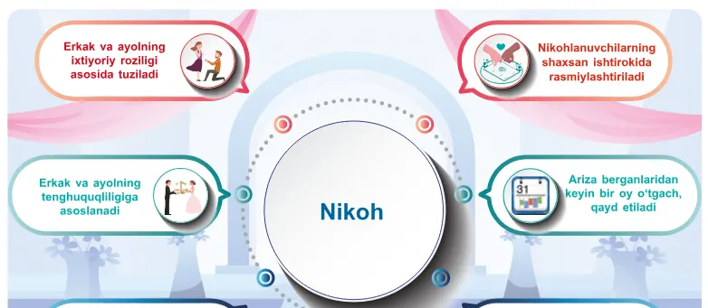

**Fuqarolik holati dalolatnomalarini yozish idoralarida roʻyxatga olinadi**

Nikohni tuzish toʻgʻrisidagi ariza belgilangan shaklga ega. Ariza nikohlanuvchilarning shaxsini tasdiqlovchi hujjatlar asosida toʻldirilib, barcha savollarga aniq javob beriladi. Ariza aniq, tushunarli yozuvda toʻldiriladi. Nikohni qayd etishda guvohlarning soni ikki kishidan kam boʻlmasligi kerak. Nikohlanuvchilarning istaklariga binoan nikoh ularning qarindoshlari, tanishlari va guvohlar ishtirokida qayd etiladi.

Nikoh tuzilgandan keyin yagona nusxada guvohnoma beriladi.

Nikohlanuvchi shaxslar qonun doirasida belgilangan yoshga yetgan boʻlishlari shart. Nikoh yoshi erkaklar va ayollar uchun oʻn sakkiz yosh etib belgilangan.

Ariza berilgandan soʻng nikohlanuvchi shaxslar davlat sogʻliqni saqlash muassasalarida bepul tibbiy koʻrikdan oʻtadilar. Nikohlanuvchi shaxslarni tibbiy koʻrikdan oʻtkazishning maqsadi sogʻlom oilani shakllantirish uchun shart-sharoitlar yaratish, irsiyat bilan bogʻliq va

tugʻma kasalliklarga chalingan bolalar tugʻilishining oldini olishdan iborat.

Nikohlanuvchi shaxslar psixik, narkologik, tanosil kasalliklari, sil kasalligi va OIV/OITS boʻyicha tibbiy koʻrikdan oʻtadi. Tibbiy koʻrikdan oʻtkazish uchun yoʻllanmalar FHDY organlarida beriladi. Bu esa nikoh tuzish toʻgʻrisidagi arizalarni roʻyxatdan oʻtkazish daftarida qayd etiladi. Nikohlanuvchi shaxslarning tibbiy koʻrigi ularning yashash joyidagi psixiatr vrachlar, narkologlar, teri-tanosil kasalliklari vrachlari, ftiziatrlar (dispanser va tuman kabinetlari) tomonidan bepul oʻtkaziladi. Tibbiy koʻrikdan oʻtish ikki haftadan oshmasligi kerak. Tibbiy koʻrik natijalari tibbiyot kartasida toʻliq aks ettiriladi.

### NIKOHNI TUZISHGA MONELIK QILADIGAN HOLATLAR

Yuqorida biz siz bilan nikoh, uni tuzish tartibi haqidagi masalalarni koʻrib chiqdik. Endi nikoh tuzishga monelik qiladigan holatlarni koʻrib chiqamiz. Oʻzbekiston Respulikasi Oila kodeksida nikoh tuzishga monelik qiladigan holatlar belgilangan. Jumladan, nikoh tuzilayotganda nikohlanuvchilar boshqa nikohda turgan boʻlishi mumkin emas. Boshqa nikohda turgan shaxslar oʻrtasida nikoh tuzishga yoʻl qoʻyilmaydi. Bundan tashqari, nasl-nasab shajarasi toʻgʻri tutashgan qarindoshlar, tugʻishgan va oʻgay aka-ukalar bilan opa-singillar oʻrtasida, shuningdek, farzandlikka oluvchilar bilan farzandlikka olinganlar oʻrtasida ham nikoh tuzishga yoʻl qoʻyilmaydi. Yaʼni Oila kodeksining 57-moddasida belgilangan meʼyor asosida bolalar ota-onasiga nisbatan toʻgʻri shajaradagi birinchi, nevara bobosiga, buvisiga nisbatan – ikkinchi, evara katta bobosiga, katta buvisiga nisbatan – uchinchi darajadagi qarindosh hisoblanadi.

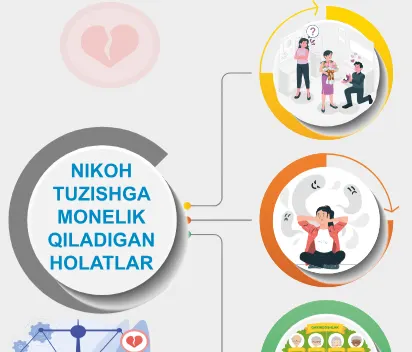

**Loaqal bittasi roʻyxatga olingan boshqa nikohda turgan shaxslar oʻrtasida nikoh tuzish man etiladi**

**Loaqal bittasi ruhiyat buzillishi sababli sud tomonidan muomalaga layoqatsiz deb topilgan shaxslar oʻrtasida nikoh tuzish man etiladi**

**Nasl-nasab shajarasi boʻyicha toʻgʻri tutashgan qarindoshlar oʻrtasida, tugʻishgan va oʻgay aka-ukalar bilan opa-singillar oʻrtasida, farzandlikka olinganlar oʻrtasida nikoh tuzish man etiladi**

Aka-uka, opa-singil, ularning bolalari, ota-onaning aka-uka va opa-singillari hamda ularning bolalari, bobo va buvilarning aka-uka hamda opa-singillari hamda ularning bolalari va shunga oʻxshashlar yon shajara boʻyicha qarindoshlar hisoblanadi. Bundan tashqari, nikohlanuvchilarning loaqal bittasi ruhiyat buzilishi (ruhiy kasalligi yoki aqli zaifligi) sababli sud tomonidan muomalaga layoqatsiz deb topilgan boʻlsa, bunday shaxslar oʻrtasida ham nikoh tuzishga yoʻl qoʻyilmaydi.

### NIKOH TUGATILISHINING OQIBATLARI

Jamiyatda ayrim holatlarda turli sabablarga koʻra nikoh tugatilishi holatlari uchraydi. Qonunchilikka koʻra, nikohni tugatish va nikohdan ajratish degan tushunchalar mavjud. Nikohni tugatish deganda, masalan, er-xotindan birining vafoti yoki sud ulardan birini vafot etgan deb eʼlon qilishi oqibatida nikohning bekor boʻlishi tushuniladi. Nikohdan ajratish deganda er-xotindan biri yoki ikkalasining arizasiga binoan nikohni sud tomonidan ajratish tushuniladi. Nikohdan ajratish sud tartibida va fuqarolik holati dalolatnomalarini yozish (qayd etish) organlarida amalga oshiriladi.

Agar sud er va xotinning bundan buyon birgalikda yashashiga va oilani saqlab qolishga imkoniyat yoʻq deb topsa, ularni nikohdan ajratadi.

Agar bolalar borasida, er-xotinning birgalikdagi umumiy mol-mulkini boʻlish borasida yoki yordamga muhtoj, mehnatga layoqatsiz er (xotin)ga taʼminot berish uchun mablag‘ toʻlash borasida nizo mavjud boʻlsa, ular nikohdan sud tartibida ajratiladi.

Agar er-xotinning voyaga yetmagan bolalari boʻlmasa, er-xotin nikohdan ajrashishga oʻzaro rozi boʻlsalar va oʻrtada mulkiy nizo boʻlmasa, nikoh FHDY organida ajratiladi.

Sud ishning koʻrilishini keyinga qoldirib, er-xotinga yarashish uchun olti oygacha muhlat tayinlaydi. Sud er-xotinga yarashish uchun muhlat tayinlab, ishning koʻrilishini keyinga qoldirgan taqdirda, er-xotinning birga yashash joyidagi fuqarolar yigʻinining yarashtirish komissiyasini, agar ular birga yashamayotgan boʻlsa, har birining yashash joyidagi fuqarolar yigʻinining yarashtirish komissiyasini er-xotinni yarashtirish boʻyicha tegishli choralar koʻrish uchun xabardor qiladi.

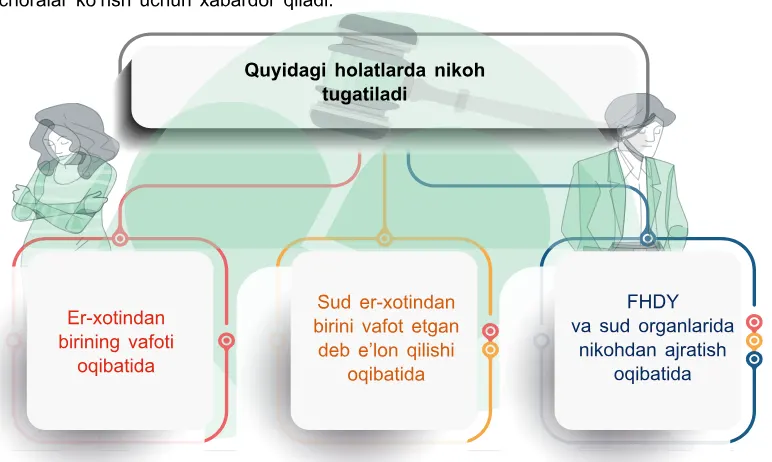

Xotinining homiladorlik vaqtida va bola tugʻilganidan keyin bir yil mobaynida er xotinining roziligisiz nikohdan ajratish toʻgʻrisida daʼvo qilolmaydi.

Arizada nikohdan ajralish uchun nima sabab boʻlganini asoslab koʻrsatish kerak. Sud organi nikohdan ajralish ishlarini koʻrishda eʼtiborni er-xotinni yarashtirishga, oilaviy vaziyatni sogʻlomlashtirishga qaratadi va ularga yarashish uchun muddat beradi.

Nikoh ajratilayotganda sud organlari voyaga yetmagan bolalar kim bilan yashashi, ularga ota-ona tomonidan taʼminot berilishi, mulkiy masalalarni hal etadi.

Nikohdan ajratish toʻgʻrisidagi ish koʻrib chiqilayotganida toʻyni oʻtkazishga ketgan sarfxarajatlarni undirish haqidagi talablar qanoatlantirilmaydi.

### Savol va topshiriqlar

1. Oʻzbekiston Respublikasi Oila kodeksidan nikohni rasmiylashtirishga oid huquqiy meʼyorlarni toping va mazmunini bayon eting.

2. Nikohni tuzishga qanday holatlar monelik qilishi mumkin?

3. “Nikoh ixtiyoriy asosda va tenghuquqlikda tuziladi” degan qoidani siz qanday tushunasiz?

4. Nikohning tugatilishi qanday oqibatlarni keltirib chiqaradi?

### Mustaqil ish uchun topshiriq

1. FHDY organi xodimi ariza bergan kelin boʻlajak kuyovning jiyani ekanini bilib qolgach, nikohni rasmiylashtirishga eʼtiroz bildirdi. Ushbu vaziyatda FHDY xodimining eʼtirozi toʻgʻri deb oʻylaysizmi? Sizningcha, nikohlanuvchilar qanday yoʻl tutishlari lozim?

2. FHDY organida nikohdan oʻtishda **S**. soxta hujjatlardan foydalangan holda boshqa nikohdaligi va bolasi borligini boʻlajak xotini **M**.dan yashirgan edi. Bu nikoh qonuniy deb hisoblanadimi? Agar qonuniy kuchga ega boʻlmasa, **M**. sudga murojaat qilish huquqiga egami?

3. Nikohni rasmiylashtirishdan oldin nega tibbiy koʻrikdan oʻtiladi? Uning huquqiy asosini toping.

## 13-dars. Oilada er-xotin va ota-onaning huquqiy maqomi

Oilada ota-onalar oʻz farzandlarining haqiqiy inson boʻlib kamol topishiga alohida eʼtibor berishlari lozim. **Mirzo Ulugʻbek**

### Siz bilib olasiz

Er-xotin huquqiy maqomining vujudga kelishi. Er-xotinning huquq va majburiyatlari.

Oilada ota-onaning huquq va majburiyatlari.

### ER-XOTIN HUQUQIY MAQOMINING VUJUDGA KELISHI

Yangilanayotgan Oʻzbekiston sharoitida tinchlik, osoyishtalik va farovonlikni yanada mustahkamlashning muhim jihati oilani har tomonlama rivojlantirishdir. Davlat onalik, otalik va bolalikni muhofaza qilish, har bir oilani, undagi sogʻlom maʼnaviy muhitni asrab-avaylash, er-xotin, ota-onalar bilan farzandlar oʻrtasidagi mehr-oqibat hissini shakllantirishga jiddiy eʼtibor qaratar ekan, bolalar hamda yoshlarda milliy va umuminsoniy qadriyatlarga sodiqlik, mamlakatidan hamda xalqning boy madaniy merosidan faxrlanish, vatanparvarlik va Vatanga boʻlgan mehr-muhabbat tuygʻularini shakllantirish toʻgʻrisida gʻamxoʻrlik qiladi. Nikoh rasmiylashtirilishi bilan er-xotinning huquqiy maqomi vujudga keladi. Lekin oilalarda ayrim sabablarga koʻra tinchlik, totuvlik buzilishi hollari uchrab turadi. Ayrim hollarda er va xotinning shoshqaloqligi, jahlning tez chiqishi, qanoatsizlik, manmanlik ularning munosabatlariga putur yetkazadi. Maʼnaviy jihatdan bir-biriga sabr qilish lozim boʻlganiday, moddiy jihatdan ham qanoatli va sabrli boʻlish juda muhimdir.

Abdurauf Fitrat oila toʻgʻrisida shunday degan edi: “Har bir oilaning saodati va izzati shu xalqning ichki intizomi va totuvligiga bogʻliq. Tinchlik va totuvlik esa millat oilalarining intizomiga tayanadi, mamlakat va millatlar ham shuncha kuchli boʻladi. Agar bir mamlakatning aholisi axloqsizlik va johillik bilan oilaviy munosabatlarni zaiflashtirib yuborsa va intizomsizlikka yoʻl qoʻysa, shunda bu millatning saodati va hayoti shubha ostida qoladi”.

Oʻzbekistonda xalqaro standartlarga mos ravishda oilani mustahkamlash, unda er-xotin, ota-ona va farzandlar haq-huquqlarini himoya qilishga oid yangicha boshqaruv tizimi yaratildi. Bolaning ota-onasi tomonidan tarbiyalanishi, kamol topishi, jismonan va maʼnan sogʻlom ulgʻayishi mustaqil hayotga toʻla layoqatli boʻlishiga zamin yaratadi. Oʻzbekiston Respublikasining Oila kodeksi oilaviy tarbiyaning muhim yoʻnalishlaridan biri – bola tarbiyasiga oid meʼyorlarni belgilab bergan. Bunda er-xotinning shaxsiy huquq va majburiyatlari katta ahamiyat kasb etadi.

Maʼlumki, nikoh fuqarolik holati dalolatnomalarini yozish organlarida roʻyxatga olingan paytdan boshlab nikohni tuzgan erkak va ayol er-xotin deb hisoblanadilar va shu paytdan eʼtiboran ular oʻrtasida er-xotinlik huquq va majburiyatlari vujudga keladi.

Er-xotinning huquq va majburiyatlari 2 ga boʻlinadi:

1) shaxsiy huquq va majburiyatlar.

2) mulkiy huquq va majburiyatlar.

Er-xotinning oʻz huquq va majburiyatlarini bajarishi oilaning boshqa aʼzolari va oʻzga shaxslarning huquqlari, erkinliklari va qonuniy manfaatlarini buzmasligi kerak.

### ER-XOTINNING HUQUQ VA MAJBURIYATLARI

Er-xotinning shaxsiy huquq va majburiyatlari deganda er-xotin sifatida hayot kechirish, bir-biriga boʻlgan masʼuliyatini belgilovchi huquqiy maqomi tushuniladi. Yaʼni er-xotinning shaxsiy huquq va majburiyatlari mulk bilan bogʻliq boʻlmaydi. Bu huquq va majburiyatlar birovga oʻtkazilishi mumkin emas.

Er-xotin Oʻzbekiston Respublikasi Konstitutsi yasida belgilangan har bir inson va fuqaroga tegishli huquq va erkinliklar hamda burchlar bilan bir qatorda oila sharoitida, bola tarbiyasida er-xotinlik huquq va majburiyatlariga ham ega boʻladilar. Er-xotinning shaxsiy huquq va majburiyatlarini amalga oshirish Oʻzbekiston Respublikasi Oila kodeksi bilan tartibga solinadi.

Unga koʻra, er va xotin oilada teng huquqlardan foydalanadilar va ular teng majburiyatlarga ega boʻladilar. Masalan, er va xotinning familiya tanlash huquqi, er-xotinning bolalar tarbiyasi va oila turmushi masalalarini hal qilish huquqi, er va xotinning mashgʻulot turi tanlash, kasb tanlash va turarjoy tanlash huquqlari, er-xotinning bir-biriga taʼminot berish majburiyatlari shular jumlasidandir.

Nikoh tuzish vaqtida er va xotin oʻz xohishi bilan eri yoki xotinining familiyasini umumiy familiya qilib tanlashi mumkin. Shuningdek, ularning har biri nikohgacha boʻlgan oʻz familiyasida qolishi ham mumkin.

### ER-XOTINNIG HUQUQ VA MAJBURIYATLARI

Oiladagi munosabatlarni oʻzaro yordam asosida qurish Farzandlarini voyaga yetgunga qadar boqish, ularning tarbiyasi, taʼlim olishi borasida gʻamxoʻrlik qilish Oʻz farzandlarining farovonligi va kelajagi haqida qaygʻurish Oilaning farovon va mustahkam boʻlishiga harakat qilish Voyaga yetmagan farzandlari yetkazgan zararni qoplash

Mashgʻulotlar turini erkin tanlash Nikoh shartnomasini tuzish Turarjoyni tanlash Nikoh tuzish yoki ajrashish vaqtida familiya tanlash Mol-mulkka egalik qilish, undan foydalanish Kasb tanlash

Er-xotin bolalar tarbiyasi va oilaviy turmushning boshqa masalalarini birgalikda hal qilish huquqiga ega. Yaʼni er-xotin bolalari qaysi bogʻchaga, maktabga, toʻgaraklarga borishi, sportning qaysi turi bilan shugʻullanishi kabi masalalarni birgalikda hal qiladilar. Ichki oilaviy masalalar er-xotinning oʻzaro kelishuvi bilan hal qilinadi.

Er va xotin konstitutsiyaviy huquq hisoblangan erkin kasb tanlash huquqidan teng foydalanadilar. Ular xohlagan kasb turini tanlashlari mumkin. Kasbni egallash uchun ular bilim olish huquqiga ham ega. Er-xotinning har biri mashgʻulot turini va yashash joyini tanlashda ham teng huquqqa ega.

Er-xotin shaxsiy huquqlar bilan birga majburiyatlarga ham egadirlar. Er-xotin farzandlarini voyaga yetgunlariga qadar boqish va tarbiyalashga majbur. Oilada bolalar tarbiyasi, ularning farovon hayot kechirishi va kamoloti borasida gʻamxoʻrlik qilish ham shular jumlasidandir. Bola tarbiyasida er-xotin birday majburiyatni bajaradi. Bolaning erishgan yutuqlari er-xotinning birgalikda olib borgan faoliyati natijasidir, bolaning nojoʻya ishlari yoki qilmishlari esa er-xotinning tarbiyadagi salbiy jihatlari hisoblanadi.

Er-xotinlarning mulkiy huquq va majburiyatlari shaxsiy huquq va majburiyatlari bilan bir vaqtning oʻzida vujudga keladi. Er-xotinning nikohgacha mavjud boʻlgan mulki ularning shaxsiy mulki, nikoh davrida orttirilgan mulklari esa umumiy mulki hisoblanadi.

Jumladan, er va xotinning nikoh davomida orttirgan mol-mulklari, boʻlajak er-xotinning umumiy mablagʻlari hisobiga olingan mol-mulklari ularning birgalikdagi umumiy mulki hisoblanadi. Masalan, nikoh rasmiylashtirilguncha ahdlashgan boʻlajak er-xotin birga biror-bir buyum sotib olgan boʻlsa, bu mulk ularning birgalikdagi umumiy mulki hisoblanadi.

Ayrim oilalarda ayol uy-roʻzgʻor ishlarini yuritib, bolalarni parvarish qilish bilan band boʻladi va mustaqil ish haqi va boshqa daromadga ega boʻlmaydi. Shunday paytlarda xotin erining daromadiga nisbatan teng huquqqa ega boʻladi. Shuningdek, er va xotin birgalikdagi umumiy mulki boʻlgan mol-mulkka egalik qilish, undan foydalanish va uni tasarruf etishda teng huquqlarga ega boʻladilar.

Nikohgacha er va xotinning oʻziga tegishli boʻlgan mol-mulki, nikoh davomida hadya yoki meros tariqasida olgan mol-mulki ularning oʻz mulki hisoblanadi.

Nikohlanuvchi shaxslarning, shuningdek, er va xotinning mulkiy huquq hamda majburiyatlarini belgilovchi kelishuvi ham boʻlishi mumkin. Bu kelishuv “nikoh shartnomasi” deb ataladi. Nikoh shartnomasi nikoh rasmiylashtirilguncha yoki nikoh davrida ham tuzilishi mumkin. Nikoh shartnomasi yozma shaklda tuziladi va notarial tartibda tasdiqlanadi.

Nikoh shartnomasi er va xotinning mavjud mol-mulkiga nisbatan ham, boʻlgʻusi mol-mulkiga nisbatan ham tuzilishi mumkin. Er va xotin nikoh shartnomasida oʻzaro mod-

diy taʼminot berish, oila xarajatlarini koʻtarish, bir-birining daromadida ishtirok etish, boshqa shaxslar bilan mulkiy shartnomalar tuzish, birgalikda tadbirkorlik faoliyati bilan shugʻullanish boʻyicha oʻz huquq va majburiyatlarini belgilab oladi. Shuningdek, nikoh shartnomasi nikoh tugatilganda er va xotindan har biriga beriladigan mulk aniqlab olinadi. Nikoh shartnomasida nazarda tutilgan huquq va majburiyatlar muayyan muddat bilan cheklanishi mumkin. Shuni ham esda tutish kerakki, er va xotindan birini oʻta noqulay holatga solib qoʻyuvchi holatlarda nikoh shartnomasi haqiqiy emas deb topilishi mumkin.

### OILADA OTA-ONANING HUQUQ VA MAJBURIYATLARI

Oilada farzand dunyoga kelgandan soʻng er-xotin “ota-ona” degan maqomga ega boʻladi. Bu maqom ota-onaga juda katta masʼuliyat yuklaydi. Uning huquqiy asoslari Oʻzbekiston Respublikasi Konstitutsiyasi, Oila kodeksida oʻz aksini topgan.

Jumladan, ota-onalar oʻz farzandlarini voyaga yetgunlariga qadar boqish va tarbiyalashga majburdirlar, degan huquqiy meʼyor konstitutsiyaviy asosga ega.

Har bir ota-ona farzandini boqib, tarbiyalab, odob-axloqli, iqtidorli, jamiyat uchun foydali shaxs etib kamolga yetkazishni oʻz oldiga maqsad qilib qoʻyadi. Chunki Abdulla Avloniy bobomiz aytib oʻtganlaridek, “Tarbiya biz uchun yo hayot – yo mamot, yo najot – yo halokat, yo saodat – yo falokat masalasidir”. Farzandga toʻgʻri tarbiya berish esa oiladan boshlanadi. Bunday masʼuliyat ota-ona zimmasida boʻladi.

Darhaqiqat, bola shaxsining mehnat tarbiyasiga alohida eʼtibor berish, bolaning izzatini joyiga qoʻyish, oilada qatʼiy rejim va kun tartibini oʻrnatish, bolaning yosh va shaxsiy xususiyatlarini hisobga olish, boladagi oʻzgarishlarni kuzatib borish, undagi mustaqillikka intilish va tashabbuskorlik sifatlarini qoʻllab-quvvatlashda ota-onaning oʻrni kattadir. Chunki ular bola tarbiyasi uchun javobgardir.

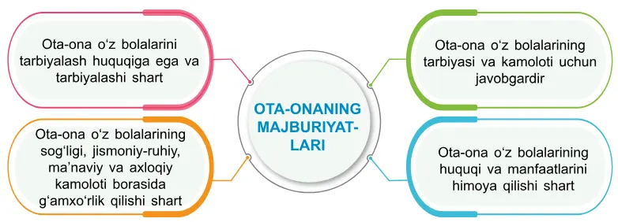

Ota-ona bolalarining sogʻligʻi, jismoniy, ruhiy, maʼnaviy va axloqiy kamoloti borasida gʻamxoʻrlik qiladi. Farzand tarbiyasida boshqa shaxslarga nisbatan ustun huquqqa ega. Ota-ona bolalarining taʼlim olishini taʼminlaydi. Farzandlari voyaga yetgunlariga qadar boqish va tarbiyalash majburiyati bilan birga ularning huquq va manfaatlarini himoya qilish ham ota-onaning zimmasiga yuklatilgan.

Ota-ona oʻz bolalarining qonuniy vakillari hisoblanib, ular oʻz farzandlarining huquq va manfaatlarini himoya qiladi. Ota-ona oʻz bolalarining qonuniy vakillari sifatida har qanday jismoniy va yuridik shaxs bilan munosabatlarda, sudda ularning huquq va manfaatlarini himoya qiladi.

### Savol va topshiriqlar

1. Er-xotinning shaxsiy huquq va majburiyatlari deganda nima tushuniladi?

2. Er-xotinning mulkiy huquq va majburiyatlarini qanday tushunasiz?

3. Er-xotin va ota-onaning huquqiy maqomi qanday vujudga keladi? Ularning farqi nimada?

4. Ota-onaning huquq va majburiyatlari deganda nima tushuniladi?

5. Ota-ona farzandining huquq va manfaatlarini qanday himoya qiladi? Uning huquqiy asosini Oʻzbekiston Respublikasi Oila kodeksidan toping.

### Mustaqil ish uchun topshiriq

1. A. toʻrt yil S. bilan er-xotin boʻlib yashadi. Birgalikda turarjoy olishdi. A. uyni S.ning nomiga rasmiylashtirdi. A. ajralish maqsadida sudga murojaat qilib, turarjoyni boʻlib berishni soʻradi. S. esa A.ning daʼvolarini rad etib, turarjoy faqat unga tegishli ekanligini aytdi.

Savol.

S.ning xatti-harakati toʻgʻrimi? Sizningcha, sud qanday qaror qabul qiladi? Javobingizni Oila kodeksidagi meʼyorlar bilan asoslab bering.

2. Oila tarqalib ketdi, ota kasalmand bolali onaga yordam berishdan bosh tortdi. Ayol bir necha marta iltimos qilishiga qaramay, ota bunga eʼtibor bermadi, baʼzida hatto qoʻpollik bilan: “Menga sen ham, bola ham kerak emas!” deb javob berdi.

Savol. Ona va farzand huquqlarini himoya qilishning qanday huquqiy meʼyorlari mavjud?

## 14-dars. Oilada bolalarning huquq va majburiyatlari

Odamlar! Eng avvalo ezgu axloqqa ega boʻlishga harakat qiling, zero, axloq qonunning asosidir. **Pifagor**

### Siz bilib olasiz

Bolalarning oilada yashash va tarbiyalanish huquqi. Bola huquqlari va uning kafolatlari.

Farzandlarning ota-ona oldidagi majburiyatlari.

### BOLALARNING OILADA YASHASH VA TARBIYALANISH HUQUQI

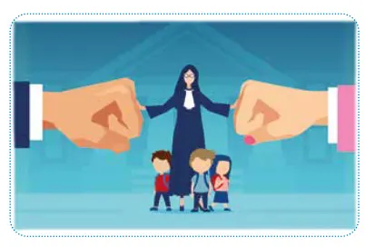

Farzand dunyoga kelgach, ota-ona oldida juda katta masʼuliyat vujudga keladi.

Avvalo, “farzand” va “bola” tushunchalariga eʼtibor qaratsak. Farzandni “oilaning chirogʻi, suyanchigʻi, kelajagi” kabi iboralar bilan taʼriflash mumkin.

BMTning 1989-yil 20-noyabrda qabul qilingan Bola huquqlari toʻgʻrisidagi konvensiyasida “bola” tushunchasi huquq sub yekti sifatida tan olingan.

Oʻzbekiston Respublikasining “Bola huquqlarining kafolatlari toʻgʻrisida”gi qonunida “bola” tushunchasiga shunday taʼrif berilgan: “Bola – oʻn sakkiz yoshga toʻlgunga qadar boʻlgan shaxs”dir. Demak, 18 yoshga toʻlmagan, voyaga yetmagan shaxslar bola hisoblanar ekan.

Farzandlarga tegishli huquqlar “bola huquqi” tushunchasiga taalluqli hisoblanadi. Oʻzbekiston Respublikasining Oila kodeksiga koʻra, har bir bola oilada yashash va tarbiyalanish, oʻz ota-onasini bilish, ularning gʻamxoʻrligidan foydalanish, ular bilan birga yashash huquqiga ega. Bolani oʻz ota-onasi tarbiyalaydi. Bola oʻz manfaatlarining taʼminlanishi, har taraflama kamol topishi, insoniy qadr-qimmatlari hurmat qilinishi huquqiga ega.

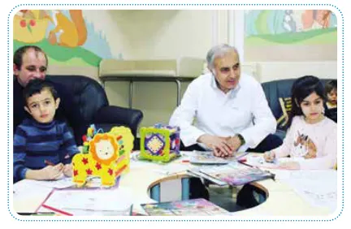

Shuningdek, bola ota-onasi va boshqa qarindoshlari bilan koʻrishish, oʻzini himoya qilish, oʻz fikrini erkin ifoda etish, ism, otaism va familiya olish huquqlariga ham ega. Bolalarning taʼlim-tarbiyasiga taalluqli barcha masalalar bolalar manfaatidan kelib chiqqan va ularning fikrini hisobga olgan holda ota-ona tomonidan oʻzaro kelishuv asosida hal etiladi.

### BOLA HUQUQLARI VA UNING KAFOLATLARI

Mamlakatimizda bolalarni ijtimoiy, iqtisodiy va maʼnaviy jihatdan himoya qilish borasida keng koʻlamli ishlar amalga oshirilmoqda. Oʻzbekiston Respublikasi Prezidentining 2021-yil 9-avgustdagi “Bola huquqlarining kafolatlarini taʼminlash tizimini yanada takomillashtirish chora-tadbirlari toʻgʻrisida”gi PF-6275-sonli farmoniga koʻra, Oliy Majlisning Bola huquqlari boʻyicha vakili – Bolalar ombudsmani instituti taʼsis etildi. Endi bolalar bilan bogʻliq barcha masalalar vakil ishtirokida amalga oshiriladi. Jumladan, bolalar ombudsmani Birlashgan Millatlar Tashkilotining Bola huquqlari toʻgʻrisidagi konvensiyasini bajarish strategiyasini va bola huquqlari masalalari boʻyicha boshqa hujjatlarni ishlab chiqish hamda amalga oshirishda ishtirok etadi.

Bolalar hamda ularning qonuniy vakillarining bola huquqlari va qonuniy manfaatlari buzilishi toʻgʻrisidagi murojaatlarini koʻrib chiqish orqali bolaning huquqlari, erkinliklari va qonuniy manfaatlarini himoya qilish kafolatlarini taʼminlaydi. Oʻzbekiston Respublikasi Oila kodeksiga koʻra, bola

– bobo, buvi, aka-uka, opa-singil va boshqa yaqin qarindoshlari bilan koʻrishib turish huquqiga, voyaga yetmagan bola ota-onadan taʼminot olish huquqiga ega. Ota-onasining nikohdan ajralishi yoki ota-onaning boshqa-boshqa yashashi bolaning huquqlariga taʼsir qilmaydi.

Oʻzbekiston Respublikasi Oila kodeksiga koʻra, bola oʻz huquqi va qonuniy manfaatlarini himoya qilish, oilada oʻzining manfaatlariga taalluqli masala hal qilinayotganda oʻz fikrini ifoda etish, ism, otaism va familiya olish huquqiga ega. Bolaning familiyasi ota-onaning familiyasiga qarab belgilanadi.

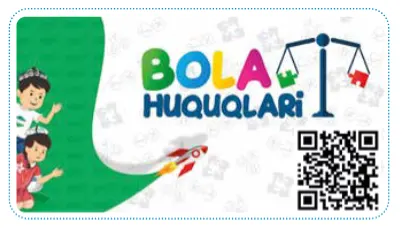

### FARZANDLARNING OTA-ONA OLDIDAGI MAJBURIYATLARI

Bola yuqoridagi huquq va erkinliklar bilan bir qatorda farzand sifatida muayyan majburiyatlarga ham ega. Darhaqiqat, har bir farzand zimmasiga oʻz ota-onalariga nisbatan behisob burch va vazifalar yuklanadi. Bu esa farzandlarning ota-onalari gaplariga quloq tutishlari, ota-onalar buyurgan uy yumushlarini bajarishlari asosida amalga oshiriladi. Chunki ota-onalar farzandlarini mehr-muhabbat va shafqat, kuch-gʻayrat va mablagʻlarini ayamay kamolga yetkazadilar.

Oʻzbekiston Respublikasi Konstitutsiyasida belgilanganidek, farzandlar ota-onalarining nasl-nasabidan va fuqarolik holatidan qatʼi nazar, qonun oldida tengdirlar.

Voyaga yetgan, mehnatga layoqatli bolalar mehnatga layoqatsiz, yordamga muhtoj ota-onasiga taʼminot berishlari va ularga gʻamxoʻrlik qilishlari shart.

Ota-onasining davlat va nodavlat muassasalari qaramogʻida ekanligi voyaga yetgan mehnatga layoqatli bolalarni ota-onaga gʻamxoʻrlik qilish va ularga moddiy yordam koʻrsatish majburiyatidan ozod qilmaydi. Voyaga yetgan, mehnatga layoqatli bolalar oʻz ota-onasiga ixtiyoriy ravishda moddiy yordam berishdan boʻyin tovlasalar, taʼminot miqdori bolalarning oilaviy va moddiy ahvolini hisobga olgan holda sudning hal qiluv qaroriga asosan belgilanadi. Voyaga yetgan, mehnatga layoqatli bolalar ota-onasining kasalligiga va boshqa uzrli sabablarga koʻra qilinadigan qoʻshimcha xarajatlarda ishtirok

etishlari shart. Voyaga yetgan, mehnatga layoqatli bolalar tomonidan qoʻshimcha xarajatlar ixtiyoriy ravishda qoplanmasa, talab qilinayotgan summa sud tartibida undiriladi. Ota-onasiga moddiy yordam berish toʻgʻrisidagi sudning hal qiluv qarorlarini bajarmaslik jinoiy javobgarlikka sabab boʻladi.

Har bir farzand ota-onasining koʻnglini olish, duolariga sazovor boʻlish, xizmatlarida kamarbasta turish, yaxshi ishlari va hadyalari bilan ularni xursand qilish harakatida boʻlishi lozim.

### Yodda tuting

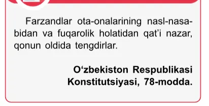

### Savol va topshiriqlar

1. Oilada bola qanday huquqlardan foydalanadi?

2. Bolaning tarbiyalanish huquqi deganda nima tushuniladi?

3. Oʻzbekiston Respublikasida bola huquqlarining kafolatlariga oid qanday meʼyorlar oʻrnatilgan?

4. Farzandning ota-ona oldidagi majburiyatlariga nimalar kiradi, ularning qisqacha mazmunini bayon eting.

5. Siz bola huquqlariga yana qanday huquqlarni kiritgan boʻlar edingiz?

### Mustaqil ish uchun topshiriq

Oʻzbekiston Respublikasining “Bola huquqlarining kafolatlari toʻgʻrisida”gi qonunining 10-moddasida belgilangan quyidagi huquq meʼyorlaridan kundalik hayotda foydalanyapsizmi? Asoslab bering.

Har bir bola erkinlik, shaxsiy daxlsizlik, turarjoy daxlsizligi va xat-xabarlarini sir tutish huquqiga ega.

Har bir bola oʻz shaʼni va qadr-qimmatiga qilingan tajovuzlardan, shaxsiy hayotiga gʻayriqonuniy aralashuvlardan himoyalanish huquqiga ega. Bola qonunga asoslanmagan holda ushlab turilishi, hibsga olinishi mumkin emas...

## 15-dars. Ota-ona hamda bolalarning aliment huquqi va majburiyatlari

Agar bir mamlakat aholisi axloqsizlik va johillik bilan oilaviy munosabatlarni zaiflashtirib yuborsa va intizomsizlikka yoʻl qoʻysa, shunda bu millatning saodati va hayoti shubha ostida qoladi. **Abdurauf Fitrat**

### Siz bilib olasiz

“Aliment” tushunchasi.

Aliment turlari.

Bolalarga va ota-onalarga beriladigan taʼminot.

### “ALIMENT” TUSHUNCHASI

Oiladagi huquqiy munosabatlarni tartibga solishda oila aʼzolarini moddiy taʼminlash uchun ularga toʻlanadigan nafaqa sifatida aliment joriy qilingan. Bu oila aʼzolariga gʻamxoʻrlik qilishning yana bir shakli hisoblanadi.

“Aliment” tushunchasini quyidagicha izohlash mumkin. Aliment (lot. alumentum – qaramogʻidagi, boqimidagi) bir shaxsning boshqa shaxsga majburan yoki ixtiyoriy ravishda toʻlaydigan nafaqasi hisoblanadi. Aliment majburiyati nikoh, qarindoshlik, ota-ona, farzandlik, farzandlikka olish, bolalarni tarbiyaga olish natijasida kelib chiqadi. Alimentlar har oyda toʻlab boriladi.

Alimentni toʻlash ota-onaning oʻzaro kelishuvi bilan ixtiyoriy toʻlanishi mumkin. Buning uchun aliment toʻlash toʻgʻrisida kelishuv tuziladi.

Bu kelishuv aliment toʻlaydigan shaxs bilan aliment oluvchi shaxs oʻrtasida yozma shaklda tuziladi, notariusda tasdiqlanadi. Ushbu kelishuv aliment toʻlaydigan shaxs bilan aliment oluvchi shaxsning oʻzaro roziligi bilan oʻzgartirilishi yoki bekor qilinishi mumkin. Ota-ona oʻrtasidagi kelishuv bolaning manfaatlariga zid boʻlmasligi kerak.

Agar ota-onaning kelishuvi boʻlmasa, aliment ixtiyoriy toʻlanmasa, bu masala sud tomonidan hal qilinadi. Buning uchun sudga daʼvo arizasi bilan murojaat qilinadi. Aliment sudga murojaat etilgan paytdan boshlab undiriladi.

Alimentlarning miqdori aliment toʻlash toʻgʻrisidagi kelishuvda va sud tomonidan belgilanadi. Aliment miqdorini belgilashda taraflarning, yaʼni aliment toʻlaydigan shaxs bilan aliment oluvchi shaxsning moddiy va oilaviy sharoitlari eʼtiborga olinadi.

Oʻzbekiston Respublikasi Prezidentining 2022-yil 7-martdagi “Oila va xotin-qizlarni tizimli qoʻllab-quvvatlashga doir ishlarni yanada jadallashtirish chora-tadbirlari toʻgʻrisida”gi farmoniga koʻra, aliment boʻyicha qarzdorlik mavjud boʻlganda qarzdorlik toʻliq bartaraf etilguniga qadar qarzdorning transport vositasini boshqarish huquqi vaqtincha cheklanadi, aliment boʻyicha qarzdorlik mavjudligi nikoh tuzishga monelik qiladigan holat sifatida belgilanadi.

Shuningdek, “Aliment toʻlovlari” jamgʻarmasi tashkil etiladi. Aliment toʻlaydigan shaxs alimentni uch oy ichida toʻlay olmagan hollarda ushbu jamgʻarmadan qarzdorlik toʻlanadi va keyinchalik aliment toʻlash majburiyati yuklatilgan qarzdordan majburiy tartibda undirib olinadi.

### ALIMENT TURLARI

Aliment turli shakllarda toʻlanadi. Oila kodeksida buning huquqiy asoslari belgilab berilgan. Voyaga yetmagan bolalar va mehnatga layoqatsiz hamda yordamga muhtoj boʻlgan voyaga yetgan bolalar aliment olish huquqiga egadirlar. Bundan tashqari, yordamga muhtoj, mehnatga layoqatsiz er yoki xotin ham bunday alimentni sud tartibida olish huquqiga ega.

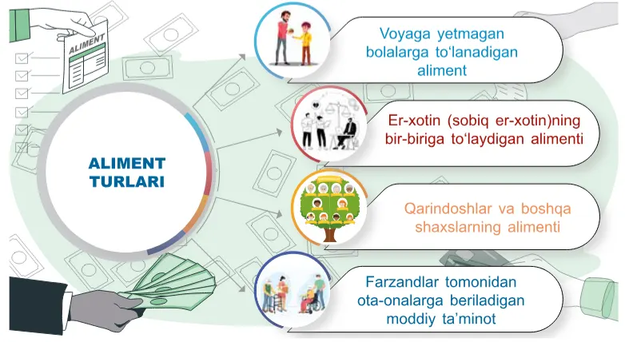

Agar voyaga yetmagan bolalarga aliment toʻlash haqida ota-ona oʻrtasida kelishuv boʻlmasa, aliment ixtiyoriy ravishda toʻlanmasa, ota-onadan birortasi ham aliment undirish toʻgʻrisida sudga daʼvo bilan murojaat qilmasa, vasiylik va homiylik organlari aliment undirish toʻgʻrisida daʼvo qoʻzgʻata oladi.

Er-xotin oʻrtasida aliment toʻlash toʻgʻrisida kelishuv boʻlmasa, er yoki xotinga sud tomonidan beriladigan aliment miqdori har oyda pul bilan toʻlanadigan summada belgilanadi.

Er-xotinning bir-biriga taʼminot berish majburiyati qonuniy nikohdan oʻtgan shaxslarga yuklatiladi.

Er-xotinning bir-biridan taʼminot olish huquqi nikohdan ajralgan, yordamga muhtoj, mehnatga layoqatsiz er yoki xotin yangi nikohga kirganda tugaydi. Voyaga yetmagan, shuningdek, voyaga yetgan mehnatga layoqatsiz, yordamga muhtoj shaxslarga taʼminot berish majburiyati sud tomonidan ularning qarindoshlari: bobo, buvi, nevara, aka-uka, opa-singil, shuningdek, oʻgay ota va oʻgay ona, oʻgay oʻgʻil va oʻgay qizlari zimmasiga yuklatilishi mumkin.

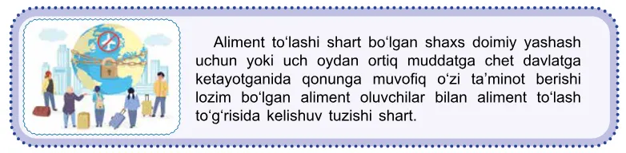

### BOLALARGA VA OTA-ONALARGA BERILADIGAN TAʼMINOT

Yuqorida aliment bir necha turlarga boʻlinishini taʼkidlab oʻtdik. Endi ushbu aliment turlaridan bolalarga beriladigan aliment va ota-onalarga beriladigan moddiy taʼminotga toʻxtalamiz. Yosh avlodni jismonan sogʻlom va maʼnaviy jihatdan barkamol inson qilib voyaga yetkazish muhim hisoblanadi. Oila kodeksiga koʻra, ota-ona voyaga yetmagan bolalariga taʼminot berishi shart deb belgilangan. Bunda ota-onaning aliment toʻlash majburiyatlari teng boʻladi. Ota-ona alimentni ixtiyoriy yoki majburiy toʻlaydi. Ixtiyoriy aliment toʻlash deganda ota-onaning oʻzaro kelishuvi asosida toʻlanadigan aliment tushuniladi. Majburiy aliment toʻlash deganda ota-ona alimentni ixtiyoriy toʻlamaganda sud tomonidan majburiy belgilangan va toʻlash talab etiladigan aliment tushuniladi. Aliment sud tomonidan ota-onaning har oydagi ish haqi va (yoki) boshqa daromadi hisobidan toʻlanadi.

Aliment bir bola uchun – toʻrtdan bir qismi; ikki bola uchun – uchdan bir qismi; uch va undan ortiq bola uchun – yarmi miqdorida undiriladi. Aliment undirishda bolaning ota-onasi oʻzaro nikohda ekani yoki ular oʻrtasidagi nikoh tugatilgani ahamiyatli emas. Voyaga yetgan mehnatga layoqatsiz, yordamga muhtoj bolalariga taʼminot boʻyicha ham ota-onaning kelishuvi asosida yoki sud tartibida belgilanadi.

Voyaga yetmagan bolani davlat yoki nodavlat muassasalari toʻliq taʼminlashi ham mumkin.

Ota-onasi vafot etganligi oqibatida yetim qolgan voyaga yetmagan bolalarga taʼminot berish, ularni tarbiyalash va ularga taʼlim berish davlat tomonidan toʻliq amalga oshiriladi. Mehnatga layoqatsiz, yordamga muhtoj voyaga yetgan bolalar oʻz taʼminoti uchun aliment talab qila oladi.

Ayrim hollarda voyaga yetgan, mehnatga layoqatli farzandlar oʻz ota-onalariga qaramay, eʼtibordan chetda qoldiradilar. Bunda, birinchidan, farzandlar konstitutsiyaviy maj-

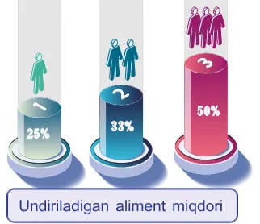

buriyatni bajarmagan hisoblanib, huquqbuzarlik sodir etgan boʻladilar. Ikkinchidan, Oila kodeksidagi meʼyorlarga rioya qilmay, qonunni buzadilar. Uchinchidan, farzand sifatida ota-onalariga mehr-oqibatni unutib, insoniy fazilatlarga befarq boʻladilar. Oila kodeksining 109-moddasiga koʻra, voyaga yetgan, mehnatga layoqatli bolalar yordamga muhtoj oʻz ota-onasiga moddiy taʼminot berishlari va ularga gʻamxoʻrlik qilishlari shart. Bu esa ota-ona uchun gʻamxoʻrlik qilish majburiyatining qonuniy asosi hisoblanadi va ota-onaning huquqlarini kafolatlaydi.

Farzandlar oʻz ota-onasiga ixtiyoriy ravishda moddiy yordam berishdan boʻyin tovlasalar, taʼminot berish masalasini sud hal qiladi. Sudning ushbu qarorini bajarmagan shaxs javobgarlikka tortiladi.

Ota-ona aliment undirish boʻyicha talabni oʻz bolalarining biriga yoki bir nechtasiga nisbatan qoʻyganidan qatʼi nazar, aliment miqdorini belgilashda sud voyaga yetgan, mehnatga layoqatli bolalarning barchasini hisobga oladi.

Voyaga yetgan, mehnatga layoqatli bolalardan aliment undirish nizosi uzil-kesil hal boʻlgunga qadar vaqtincha toʻlab turilishi lozim boʻlgan summa belgilanadi.

Voyaga yetgan, mehnatga layoqatli bolalardan undirilayotgan aliment miqdori qonun hujjatlarida belgilangan mehnatga haq toʻlash eng kam miqdorining 11,75 foizidan kam boʻlmasligi kerak.

### Savol va topshiriqlar

1. Ota-ona oʻz farzandi oldida qanday majburiyatlarni bajaradi?

2. Aliment majburiyati deganda nima tushunasiz?

3. Ota yoki onadan qanday tartibda aliment undiriladi?

4. Bolalarga beriladigan alimentning miqdori qancha?

5. Farzandlarga oʻz ota-onasiga moddiy taʼminot berish majburiyati yuklatilganmi? Oila kodeksi asosida izoh bering.

### Mustaqil ish uchun topshiriq

Fuqaro A. fuqaro B. bilan 2020-yil turmush qurdi. 2021-yilda ularning egizak farzandlari dunyoga keldi. Ammo oradan bir yil oʻtgach, er-xotin oʻrtasida kelishmovchilik yuzaga keldi va oila ajradi. Eri ikkala farzandini oʻzida qoldirdi va farzandlari uchun barcha sharoitni yaratib berdi. Xotini farzandlari erida qolishiga eʼtiroz bildirmadi. Bolalarning otasi farzandlarini boqib, ularga taʼlim-tarbiya berdi. Xotini bu davrgacha eri bilan yashamayotgani sababli bolalaridan xabar ham olmadi.

2023-yilda eri aliment undirish masalasi boʻyicha sudga daʼvo arizasi bilan murojaat qildi. Sudda bolalarning onasi “Men aliment bermayman, erim oʻzining xohishi bilan bolalarimni olib qolgan” deb aliment berishdan boʻyin tovladi.

Savol. Farzandlarning otasi onadan aliment undirishi mumkinmi? Aliment toʻlamaslik uchun farzandlarning onasi keltirgan vajlar toʻgʻrimi? Oila kodeksi asosida fikrlaringizni asoslab bering.

## 16-dars. Ijodiy faoliyat

Muammolar aqlli insonlarni chora koʻrishga, nodonlarni esa tushkunlikka tushishga undaydi.

**Yuliy Sezar**

**1-topshiriq.** Quyidagi vaziyatni oʻrganing va savollarga javob bering.

Maktabni tugatish arafasida turgan 16 yoshli qizning uyiga sovchilar kela boshlagan. Qizning oilasidagi 80 yoshli buvisi har safar sovchi kelganida “Menga sening toʻying nasib qilarmikan?” deb koʻziga yosh olib, qizning otasiga umidvor boʻlib qarab qoʻyar edi. Bu holatni koʻrgan qizning otasi “Siqilmang, onajon, yozga chiqib toʻy qilamiz”, deb onasini yupatadi. Qizning onasi esa “Hali qizimiz yosh, oila qurishga tayyor emas”, deb sovchilarga rad javobini berib yuboraveradi.

**Savollarga javob bering.**

1. Sizningcha, “Hali qizimiz yosh, oila qurishga tayyor emas” deganda qizning onasi nimani nazarda tutgan?

2. Mazkur vaziyatda otaning qaroriga sizning munosabatingiz qanday?

3. Nikoh va oila munosabatlarining huquqiy asoslarini yoritib bering.

4. Nikohni rasmiylashtirish tartibini bayon eting.

**2-topshiriq.** Oilaviy huquqiy munosabatlardagi ayrim muammolarni tahlil qiling va jadvalni toʻldiring.

### Oiladagi mulkiy nizolar

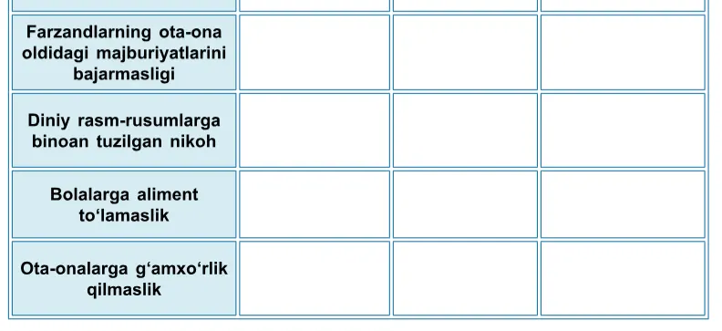

### NAZORAT ISHI

Eng katta boylik bu – aql-zakovat va ilm, eng katta meros bu – yaxshi tarbiya, eng katta qashshoqlik bu – bilimsizlikdir!

### Bob yuzasidan test savollari

**1. Nikoh bu –...**

a) ikki yoshning FHDYda ixtiyoriy bitim rasmiylashtirishi b) erkak va ayolning bitimi c) erkak va ayolning birga yashashi, umumiy roʻzgʻorga ega boʻlishi d) erkak va ayol FHDYda ixtiyoriy kelishuv rasmiylashtirishi

**2. Er-xotinning huquq va majburiyatlari vujudga kelish vaqtini aniqlang.** a) nikoh FHDYda qayd etilgan vaqtdan b) FHDYga ariza berilgan kundan c) toʻy marosimlari oʻtgan kundan d) unashtirilgan kundan

### 3. Er-xotinning familiyasi nikoh tuzishda oʻzgaradimi?

a) oʻz familiyasida qolishi, er yoki xotinning familiyasiga oʻtishi mumkin b) erining yoki xotinining familiyasiga oʻtishi mumkin c) faqat erining familiyasiga oʻtishi kerak d) har biri oʻz familiyasida qoladi

**4. Er-xotinning birgalikdagi umumiy mulkini aniqlang.** a) nikohdan oʻtgan kundan boshlab orttirilgan mulk b) ota-onadan meros boʻlib qolgan mulk c) er-xotinning nikohdan oldingi va keyingi mulklari d) turarjoy, mashina va shularga teng keladigan mulklar

### 5. Ota-onalik huquqidan mahrum qilinganlar farzandlariga taʼminot beradilarmi?

a) bermaydi b) beradi c) berish-bermaslik ularning xohishi d) imkoniyati boʻlsa, beradi

**6. Nikohni bekor qilish tartibini koʻrsating.** a) FHDY yoki sudda b) faqat FHDYda c) sud va hokimlikda d) faqat sudda

### 7. FHDYga ariza bergandan keyin nikohni qayd etish muddati qancha?

a) 1 oy b) 2 hafta c) 20 kun d) 10 kun

**8. Nikoh tuzishga monelik qilmaydigan holatlarni aniqlang.**

a) loaqal bittasi roʻyxatga olingan boshqa nikohda boʻlsa b) nasl-nasab shajarasi boʻyicha toʻgʻri tutashgan qarindoshlar oʻrtasida boʻlsa c) loaqal bittasi ruhiyat buzilishi (ruhiy kasalligi yoki aqli zaifligi) sababli sud tomonidan muomalaga layoqatsiz deb topilgan boʻlsa d) ota-onalarining oʻzaro kelishuvi boʻlmasa

**9. Bolaning ota-onasi boʻlmaganda yoki bola ota-ona qaramogʻidan mahrum boʻlgan hollarda uning oilada tarbiyalanish huquqi kim tomonidan amalga oshiriladi?**

a) vasiylik b) homiylik c) qarindoshlar d) buvisi va bobosi

**10. “Farzandlar ota-onalarning nasl-nasabidan va fuqarolik holatidan qatʼi nazar, qonun oldida tengdirlar” degan qoida qaysi huquqiy hujjatda belgilangan?**

a) Oʻzbekiston Respublikasining Konstitutsiyasida b) Fuqarolik kodeksida c) Oila kodeksida d) Mehnat kodeksida

**Topshiriq.** Qanday hollarda ajrim holatlari FHDYda yoki sudda koʻriladi? 3–4-ustunga “+” belgisini qoʻyish orqali qaysi organga tegishli ekanini aniqlang.

### FHDY organlarida

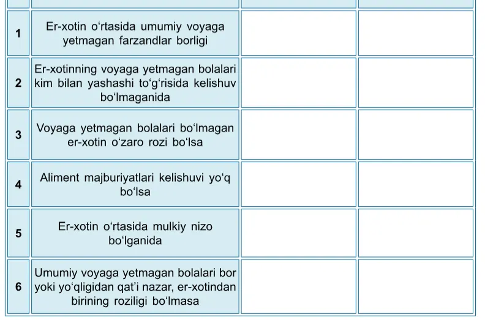

### III BOB. FUQAROLIK-HUQUQIY MUNOSABATLAR@edurtm_uz

# III bob. Fuqarolik-huquqiy munosabatlar

## 17-dars. Fuqarolik huquqi asoslari

Vijdoningga teskari yurma va haqiqatga zid narsani gapirma.

Shu muhim nasihatga rioya qilsang, hayotingda oʻz oldingga qoʻygan vazifalarni toʻla ado etasan.

**Mark Avreliy**

### Siz bilib olasiz

Fuqarolik-huquqiy munosabatlar.

Fuqarolik-huquqiy munosabatlarning vujudga kelishi. “Bitimlar” tushunchasi.

### FUQAROLIK-HUQUQIY MUNOSABATLAR

Jamiyatdagi ijtimoiy munosabatlar konstitutsiyaviy, oilaviy, maʼmuriy, mehnat, fuqarolik, ekologik, xalqaro kabi huquq sohalari bilan tartibga solinadi.

Fuqarolarning mehnat qilish, erkin kasb tanlash, bilim olish, tibbiy xizmatdan foydalanish, saylash, saylanish, murojaat qilish, mulkdor boʻlish kabi shaxsiy, siyosiy, iqtisodiy, ijtimoiy, madaniy va ekologik huquqlari siz quyi sinfda tanishgan konstitutsiyaviy huquq bilan tartibga solinadi.

Kundalik hayotda har bir shaxs Oʻzbekiston Respublikasi Konstitutsiyasida belgilangan huquq va erkinliklardan foydalanish bilan birga boshqa huquq sohalariga tegishli huquqiy munosabatlarda (masalan, kundalik ehtiyojlaridan kelib chiqib, doʻkondan mahsulot sotib olish, transportdan foydalanganlik uchun haq toʻlash, mulkka egalik qilish kabi munosabatlarda) ham ishtirok etadi.

Ushbu huquqiy munosabatlar iqtisodiy, yaʼni mulkiy xarakterga ega. Chunki oldi-sotdi, yoki chipta olish jarayonida oʻrtada pul boʻladi. Pul esa mulkiy xarakterga ega.

Bu munosabatlarda bir taraf oʻz ehtiyojidan kelib chiqib, oʻziga kerakli narsa yoki buyumni sotib olish uchun ikkinchi tarafga pul beradi, ikkinchi taraf esa berilgan pul evaziga birinchi tarafga u xohlagan narsa yoki buyumni berishga majbur boʻladi.

Koʻrinib turibdiki, bu ikki taraf ishtirok etadigan munosabat mulkiy xarakterga ega. Mulkiy xarakterga ega boʻlgan munosabatlarni, ayrim hollarda nomulkiy munosabatlarni ham fuqarolik huquqi tartibga soladi.

Fuqarolik-huquqiy munosabatlarda ishtirok etadigan taraflarda oʻziga xos boʻlgan majburiyat va huquq kelib chiqadi.

Yaʼni mahsulot sotib olgan taraf (xaridor) pul toʻlash majburiyatini olsa, pulni olgan taraf (sotuvchi) xaridorga mahsulotni berish majburiyatini oladi. Oʻz navbatida, pul toʻlagan taraf (xaridor) toʻlagan puli evaziga mahsulotni olish huquqiga ega boʻlsa, (sotuvchi) mahsulotni xaridorga bergani uchun pul talab qilish huquqiga ega boʻladi.

### FUQAROLIK-HUQUQIY MUNOSABATLARNING VUJUDGA KELISHI

Yuqorida taʼkidlab oʻtganimizdek, fuqarolik huquqi tartibga soladigan munosabatlarning asosi mulkiy xarakterga ega ekan, ushbu fuqarolik-huquqiy munosabat taraflarning mulkiy xarakterga ega boʻlgan xatti-harakati (oldi-sotdi, qarz, bankka pul qoʻyish, kredit olish kabilar) natijasida kelib chiqadi.

Fuqarolik-huquqiy munosabatlar inson shaʼni, qadr-qimmati, obro‘-eʼtibori, mualliflik huquqi kabi huquqiy munosabatlarni ham tartibga soladi. Bu munosabatlar “nomulkiy munosabatlar” deb ataladi.

Shaxsiy nomulkiy munosabatlar mulkiy munosabatlardan farq qiladi, shaxsiy nomulkiy munosabatlar pul bilan ifodalanmaydi, balki shaxsning oʻzi bilan bogʻliq boʻladi.

Masalan, muallifning shaʼni, qadr-qimmati shular jumlasidandir.

Fuqarolik-huquqiy munosabatlar shu munosabatda ishtirok etuvchi shaxslarning erki (xohishi) asosida vujudga keladi.

Fuqarolik-huquqiy munosabatlar ishtirok etuvchilarga teng huquq beradi, ularga imkon boricha erkinlik, mustaqillik va tashabbuskorlik beradi. Demak, shunday xulosaga kelish mumkinki, fuqarolik huquqi sohasi shaxslar oʻrtasidagi mulkiy va nomulkiy munosabatlarni tartibga soladi.

Fuqarolik huquq va burchlar mulkiy va nomulkiy munosabatlarda ishtirok etayotgan shaxslarning harakatlari asosida vujudga keladi hamda ular shartnomalar va bitimlarda aks etadi.

Fuqarolik huquqlarini amalga oshirish boshqa shaxslarning huquqlarini hamda qonun bilan qoʻriqlanadigan manfaatlarini buzmasligi shart. Bunda fuqarolik-huquqiy munosabatlar ishtirokchilarining halol, oqilona va adolat bilan harakat qilishi nazarda tutiladi.

Fuqarolik-huquqiy munosabatlarda taraflarning xohish-irodasi ham katta ahamiyatga ega boʻladi. Chunki shaxslar fuqarolik-huquqiy munosabatlarda oʻz xohishlari bilan yoki kelishuv asosida ishtirok etadilar. Shaxslar oʻzlariga tegishli boʻlgan fuqarolik huquqlarini, jumladan, ularni himoya qilish huquqini ham oʻz xohishlariga koʻra tasarruf etadilar. Shaxsning oʻzi ham fuqarolik huquqini himoya qilishi mumkin.

### “BITIMLAR” TUSHUNCHASI

Yuqorida taʼkidlanganidek, bitimlar fuqarolar va yuridik shaxslarning fuqarolik huquq va burchlarini belgilash, oʻzgartirish yoki bekor qilishga qaratilgan harakatlardir. Bitimlar shaxslarning fuqarolik huquq va burchlarini keltirib chiqaradigan kelishuvdir. Aynan bitim fuqarolik-huquqiy munosabatni vujudga keltiradi. Bitimlar bir taraflama, ikki taraflama yoki koʻp taraflama (shartnomalar) boʻlishi mumkin.

Agar bitim bir tarafning xohishi bilan tuzilgan boʻlsa, bunday bitim “bir taraflama bitim” deb ataladi. Bir taraflama bitim tuzilganda uni tuzgan shaxs uchun burchlar paydo boʻladi. Agar bitim ikki tarafning xohishi bilan tuzilgan boʻlsa, ikki taraflama bitim hisoblanadi. Agar bitim uch va undan koʻp taraf kelishgan holda xohish bildirib tuzilgan boʻlsa, “koʻp taraflama bitim” deyiladi. Bitimlar ogʻzaki va yozma shaklda tuziladi va u oddiy yoʻl bilan yoki notarial tasdiqlanadi. Qonunchilikda yoki taraflarning kelishuv ida yozma shakl belgilab qoʻyilmagan, jumladan, u tuzilayotgan vaqtning oʻzidayoq bajariladigan boʻlsa, bunday bitim ogʻzaki tuzilishi mumkin. Masalan, xaridor oʻz ehtiyojiga kerak boʻlgan mahsulotni tanlaydi va uning haqini (pulini) sotuvchiga oʻz xohishi bilan toʻlaydi. Bunda shaxsning xatti-harakatidan uning bitim tuzishga boʻlgan xohish-irodasi aniq boʻladi. Yozma shaklda

tuzilgan bitim taraflarning xohish-irodasi bilan imzolanadi.

Bitim vakil tomonidan ham tuzilishi mumkin. Vakillik vakilni vakolat beruvchi shaxs bilan bogʻlaydigan huquqiy munosabatdir. U bitimni amalga oshiradi. Chunki unga maʼlum bir vakolatlar beriladi.

Oʻn toʻrt yoshga toʻlmagan shaxs hamda oʻn toʻrt yoshdan oʻn sakkiz yoshgacha boʻlgan voyaga yetmagan shaxs, shuningdek, muomalaga layoqatsiz shaxs tomonidan tuzilgan bitim haqiqiy hisoblanmaydi.

### Yodda tuting

**Notariat** jismoniy va yuridik shaxslarning huquqlari hamda qonuniy manfaatlarini himoya qilishni taʼminlashga daʼvat etilgan huquqiy institutdir. Notarial harakatlar Oʻzbekiston Respublikasining “Notariat toʻgʻrisida”gi qonuni bilan tartibga solinadi. Davlat notarial idoralari Oʻzbekiston Respublikasi Adliya vazirligi tomonidan tashkil etiladi va tugatiladi.

### Savol va topshiriqlar

1. Fuqarolarning huquqlari deganda nima tushuniladi?

2. Fuqarolik-huquqiy munosabatlar konstitutsiyaviy-huquqiy munosabatlardan qanday farq qiladi?

3. Shaxslar oʻrtasidagi mulkiy munosabatlarga va shaxsiy nomulkiy munosabatlarga misollar keltiring.

4. Fuqarolik-huquqiy munosabatlar qanday vujudga keladi?

5. “Bitimlar” tushunchasiga izoh bering.

6. Fuqarolik kodeksi yordamida bitimlar, ularning turlari va shakllarini izohlang.

### Mustaqil ish uchun topshiriq

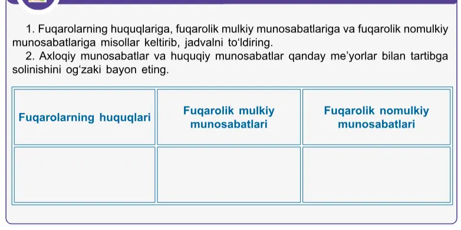

## 18–19-dars. Fuqarolik-huquqiy munosabat subyektlari va obyektlari

Bir soʻz sening fikringni oʻzgartirishi mumkin, bir tuygʻu sening hayotingni oʻzgartirishi mumkin, bir inson seni oʻzgartirishi mumkin. **Konfutsiy**

### Siz bilib olasiz

Fuqarolik huquqida “shaxslar” tushunchasi. Fuqarolik-huquqiy munosabat subyektlari. Fuqarolik-huquqiy munosabat obyektlari.

### FUQAROLIK HUQUQIDA “SHAXSLAR” TUSHUNCHASI

“Odam”, “kishi”, “inson”, “fuqaro”, “shaxs” kabi soʻzlarga duch kelgansiz. Bu tushunchalar bir maʼnoda tushunilsa-da, ularning oʻziga xos jihatlari mavjud. Odam barcha jonzotlarning eng yuqori pogʻonasida turadigan mavjudot boʻlib, u ijtimoiy jarayonlar subyekti hisoblanadi, yaʼni odam tirik mavjudotning fiziologik, tibbiy, anatomik mazmuniga ega. Odam atrof-muhitga faol taʼsir koʻrsata olishi bilan boshqa tirik mavjudotlardan farq qiladi.

Kishi – jins nuqtayi nazaridan odamning ayol kishi yoki erkak kishi ekanini bildiradi, bu tushuncha koʻproq ijtimoiy mazmunga ega.

“Inson”, “fuqaro”, “shaxs” tushunchalari huquqiy nuqtayi nazardan odamning huquqiy maqomini ochib beradi. Masalan, inson va fuqaroning huquq va erkinliklari, burchlari va hokazolar.

“Shaxs” tushunchasi falsafiy, ijtimoiy, axloqiy tushuncha boʻlib, u oʻzida inson mohiyatini, uning mavjudot sifatidagi qadriyatini mujassam etadi. Shaxsning hayot tarzi jamiyat hayotiga daxldor va “hayot” neʼmatlaridan toʻla foydalanishga haqli. “Shaxs” tushunchasi “inson” tushunchasining yuksak koʻrinishi, huquqiy maqomidir.

Huquqshunoslikda shaxs ikki turga boʻlinadi: jismoniy shaxs va yuridik shaxs. Jismoniy shaxs siz bilgan “inson” maʼnosiga mos keladi. Yuridik shaxs korxona yoki tashkilot boʻlishi mumkin. Yaʼni ular faqatgina yuridik jihatdan qonunchilikdagi baʼzi hujjatlardagina shaxs sifatida mavjud boʻlgani uchun “yuridik shaxs” degan atamadan foydalaniladi.

Baʼzilar yuridik shaxs deganda yuridik sohada ishlovchi sudya, prokuror yoki advokat kabilarni tushunadi. Ularni mutaxassisliklaridan kelib chiqqan holda umumiy tarzda “yuristlar” deb atash mumkin.

Fuqarolik-huquqiy munosabatlarda aynan ushbu shaxslar ishtirok etadi. Shuningdek, davlat ham fuqarolik qonunchiligi bilan tartibga solinadigan munosabatlarda ularning boshqa ishtirokchilari bilan baravar asoslarda ishtirok etadi.

### FUQAROLIK-HUQUQIY MUNOSABAT SUBYEKTLARI

Fuqarolik munosabatlarida ishtirok etuvchi jismoniy shaxslar, yuridik shaxslar va davlat “fuqarolik-huquqiy munosabat subyektlari” deb ataladi. Jismoniy shaxslar deganda Oʻzbekiston Respublikasining fuqarolari, boshqa davlatlarning fuqarolari, fuqaroligi boʻlmagan shaxslar tushuniladi. Jismoniy shaxslarning fuqarolik-huquqiy munosabatlarda ishti rok etishlari ularning huquq layoqati va muomala layoqatiga bogʻliq boʻladi.

Barcha fuqarolarning fuqarolik huquq va burchlariga ega boʻlish layoqati “huquq layoqati” deb ataladi. Fuqaroning huquq layoqati u tugʻilgan paytdan vujudga keladi va vafot etishi bilan tugaydi. Masalan, fuqarolarning mol-mulkka ega boʻlishlari, mol-mulkni meros qilib olishlari va vasiyat qilib qoldirishlari, bankda jamgʻarmalarga ega boʻlishlari, tadbirkorlik bilan shugʻullanishlari, bitimlar tuzishlari, yetkazilgan zararning toʻlanishini talab qilishlari, intellektual faoliyat yuritib, mualliflik huquqiga ega boʻlishlari shular jumlasidandir.

Fuqaroning oʻz harakatlari bilan fuqarolik huquqlariga ega boʻlish va ularni amalga oshirish layoqati “muomala layoqati” deb ataladi. Bunda muomala layoqatiga ega boʻlgan shaxs, masalan, bitim yoki shartnoma tuzish, mahsulotlar xarid qilib olish, tadbirkorlik va mualliflik huquqini amalga oshirish kabi munosabatlarda ishtirok etadi. Fuqaro voyaga yetganida, yaʼni oʻn sakkiz yoshga toʻlganida toʻla muomala layoqati vujudga keladi.

Qonunga koʻra, hech kimning huquq va muomala layoqati (qonunda koʻzda tutilgan hollardan tashqari) cheklanishi mumkin emas.

Oʻn toʻrt yoshdan oʻn sakkiz yoshgacha boʻlgan voyaga yetmaganlar ota-onalarining roziligisiz oʻzining ish haqi, stipendiyasi va boshqa daromadlarini ishlatishi, mualliflik huquqini amalga oshirishi mumkin.

Oʻn toʻrt yoshdan oʻn sakkiz yoshgacha boʻlgan voyaga yetmaganlar oʻzlari tuzgan bitimlar boʻyicha mustaqil ravishda mulkiy javobgar boʻladilar va ular oʻzlari yetkazgan zarar uchun ham javobgar hisoblanadi. Chunki ular bitimda kelishilgan shartlarni bajaradilar.

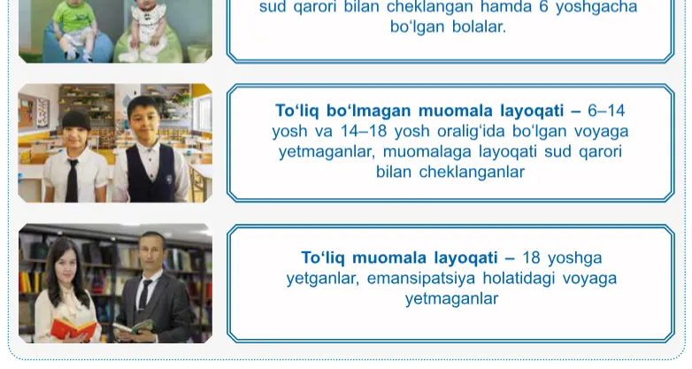

Voyaga yetmagan shaxsni toʻla muomalaga layoqatli deb eʼlon qilish emansipatsiya hisoblanadi. Yaʼni 18 yoshga toʻlmasdan ham emansipatsiya holatida shaxs toʻliq muomala layoqatiga ega boʻladi.

Mulkiy munosabatlarda hatto oʻn toʻrt yoshgacha boʻlgan kichik yoshdagi bolalar ham mayda maishiy bitimlarda ishtirok etishlari mumkin. Masalan, ota-ona pul bersa, bola doʻkondan non, sut, qalam, ruchka kabi kundalik zaruriy mahsulotlarni mustaqil sotib olishi mumkin. Kichik yoshdagi bolaning bitimlari boʻyicha uning ota-onasi mulkiy javobgar boʻladi. Ular yetkazgan zarar uchun ota-ona javobgardir.

Ruhiy kasalligi yoki aqli zaifligi oqibatida oʻz harakatlarining ahamiyatini tushuna olmaydigan, ularni boshqara olmaydigan fuqaroni sud qonunchilikda belgilangan tartibda muomalaga layoqatsiz deb topishi mumkin va bunday fuqaroga vasiylik belgilanadi. Vasiy muomalaga layoqatsiz fuqaro nomidan bitimlarni amalga oshiradi.

Vasiylik va homiylik muomalaga layoqatsiz yoki muomalaga toʻliq layoqatli boʻlmagan fuqarolarning huquq va manfaatlarini himoya qilish uchun hamda voyaga yetmaganlarni tarbiyalash maqsadida ham belgilanadi. Vasiylar va homiylar oʻz himoyalaridagi shaxslarning huquq va manfaatlarini har qanday shaxslar bilan munosabatlarda, shu jumladan, sudlarda ham maxsus vakolatsiz himoya qiladilar.

Fuqarolik-huquqiy munosabatlarda jismoniy shaxslardan tashqari yuridik shaxslar ham ishtirok etadi. Davlat fuqarolik-huquqiy munosabatlarda boshqa ishtirokchilar kabi qatnashadi. Davlat nomidan davlat hokimiyati va boshqaruvi organlari ishtirok etadilar. Davlat oʻzining fuqarolik-huquqiy majburiyatlari boʻyicha oʻz mulki boʻlgan mablagʻlari bilan javob beradi.

Yuridik shaxslar oʻzining mulkiga va mustaqil balans yoki smetasiga ega boʻlgan, majburiyatlarni bajara oladigan tashkilotlardir. Yuridik shaxslar tashkilotlar oʻrtasida oldi-sotdi, mahsulot yetkazish, kredit berish kabi munosabatlarda qatnashadi. Yuridik shaxslar tarkibiga xoʻjalik birlashmalari, tashkilotlar, muassasa va idoralar kiradi. Ushbu tashkilotlarning huquq layoqati va muomala layoqati, tashkil etilishi kabi meʼyorlar Oʻzbekiston Respublikasi Fuqarolik kodeksida berilgan.

### FUQAROLIK-HUQUQIY MUNOSABAT OBYEKTLARI

Fuqarolik-huquqiy munosabat ishtirokchilarining xatti-harakati nimaga qaratilgan boʻlsa, ana shu narsa fuqarolik-huquqiy munosabatning obyekti hisoblanadi. Fuqarolik-huquqiy munosabatlar obyekti moddiy va nomoddiy neʼmatlar shaklida boʻladi. Fuqarolik-huquqiy munosabatlarining obyekti ashyo hisoblanadi. Ashyo deganda insonning muayyan ehtiyojlarini taʼminlaydigan va uning egaligida boʻlishi mumkin boʻlgan barcha moddiy neʼmatlar tushuniladi. Ashyolar muayyan moddiy qiymatga ega hamda iqtisodiy munosabatning predmeti boʻla oladigan narsalargina boʻlishi mumkin. Masalan, jonli ashyolarga uy hayvonlari, jonsiz ashyolarga uy-joylar, ishlab chiqarish qurollari, asbob-uskunalar, kiyim-kechaklar misol boʻla oladi. Ashyolar xususiy, boʻlinadigan va boʻlinmaydigan, isteʼmol qilinadigan va isteʼmol qilinmaydigan hamda murakkab ashyolar guruhiga boʻlinadi. Mol-mulk deganda biror-bir shaxsga egalik huquqi bilan tegishli boʻlgan ashyolar tushuniladi. Mol-mulk fuqarolik huquqlari obyekti sifatida koʻchmas mulkka va koʻchar mulkka boʻlinadi. Shuningdek, moddiy neʼmatlarga pul, valyuta qimmatliklari, qimmatli qogʻozlar kiradi. Pul (valyuta) deganda naqd pul bilan va naqd pulsiz hisobkitob qilish asosidagi qonuniy toʻlov vositasi tushuniladi. Qimmatli qogʻozlarga obligatsiya, chek, depozit va jamgʻarma sertifikatlari, aksiya kabilar kiradi.

Nomoddiy neʼmatlar deganda shaxsning hayoti, sogʻligʻi, shaʼni, shaxsiy daxlsizligi,

qadr-qimmati va pok nomi, kasb-kor nufuzi, hayot daxlsizligi, shaxsiy va ommaviy sirlari, erkin koʻchib yurish, turish va yashash joyini tanlash, mualliflik va boshqa shaxsiy mulkiy huquqlari tushuniladi.

Ashyolar, pul va qimmatli qogʻozlar, mol-mulk, ixtirolar va hk.

Mulkiy va shaxsiy nomulkiy huquqlar, intellektual faoliyat natijalari va hk.

### Savol va topshiriqlar

1. Fuqarolik huquqida “shaxslar” qanday tushuniladi?

2. Fuqarolik-huquqiy munosabatlarning subyektlari deganda nima tushuniladi? Jismoniy shaxslarning turlarini va ularning oʻziga xos xususiyatlarini bayon eting.

3. Yuridik shaxslarning huquqiy asoslarini sharhlab bering.

4. Fuqarolik-huquqiy munosabatlarning obyektlariga nimalar kiradi? Ularning mazmunini tushuntiring.

### Mustaqil ish uchun topshiriq

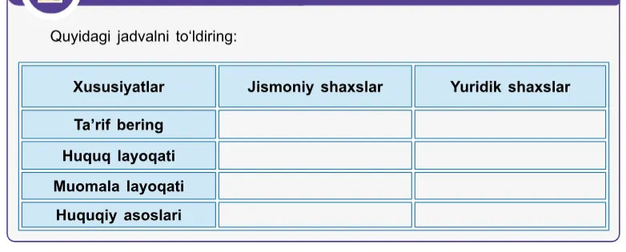

## 20-dars. Mulkiy va nomulkiy munosabatlar

Har bir insonga ikkita katta sovgʻa beriladi: miya va vaqt.

Ularni qanday maqsadda ishlatish esa oʻz qoʻlingizda! **Robert Kiyosaki**

### Siz bilib olasiz

“Mulkiy munosabatlar” tushunchasi.

Mulk shakllari.

Nomulkiy munosabatlar va ularning huquqiy asoslari.

### “MULKIY MUNOSABATLAR” TUSHUNCHASI

Fuqarolik huquqi tartibga soladigan mulkiy munosabatlar deganda muayyan moddiyiqtisodiy mazmunga ega boʻlgan munosabatlar tushuniladi. Masalan, sizga sovgʻa qilingan velosipedga egalik qilishingiz, oldi-sotdi, tayyor mahsulotga buyurtma berish, kiyim-boshni tozalatish, poyabzalni taʼmirlash kabi munosabatlar shular jumlasidandir.

**Mulk huquqining vujudga kelish asoslari sifatida quyidagilarni misol qilib keltirish mumkin**

Bunda bir shaxs ikkinchi shaxs bilan bogʻliq huquqiy munosabatlarga kirishadi. Bu munosabatlar maʼlum bir xizmat natijasi boʻlishi ham mumkin. Masalan, uyga biror mahsulotni buyurtma sifatida olib kelib berish. Shuningdek, mulkiy huquqiy munosabatlar ashyolar yoki mol-mulklarni egallash, ulardan foydalanish va ularni tasarruf etishga qaratiladi. Natijada ular bilan bogʻliq mulkiy huquqlar amalga oshiriladi. Mulkiy huquqlar mulk asosida vujudga keladi. Masalan, shaxsga tegishli boʻlgan, uning ixtiyoridagi uy-joy, zeb-u ziynat, kiyim-kechak, ehtiyojni qondiradigan buyumlar mulk huquqini keltirib chiqaradi. Bundan tashqari, yer, yerosti boyliklari, suv, oʻsimlik va

hayvonot dunyosi hamda boshqa tabiiy zaxiralar umummilliy boylik hisoblanadi. Tashkilot, korxona va muassasalarga tegishli mulklar ham boʻladi. Mehnat faoliyati, mol-mulkdan foydalanish sohasidagi tadbirkorlik va boshqa xoʻjalik faoliyati, shu jumladan, mol-mulkni yaratish, koʻpaytirish, bitimlar asosida qoʻlga kiritish, davlat mol-mulkini xususiylashtirish, meros qilib olish, egalik qilish huquqini vujudga keltiruvchi muddat kabilar mulk huquqining vujudga kelishi uchun asos hisoblanadi.

### MULK SHAKLLARI

Inson narsa, buyum va neʼmatlarni sotib olish yoʻli bilan oʻziniki qilib olsagina, uni oʻzlashtirishi mumkin. Birovga tegishli boʻlgan mulkni oʻzlashtirib boʻlmaydi. Oʻzbekiston Respublikasi Konstitutsiyasida taʼkidlanganidek, fuqarolar farovonligini oshirishga qaratilgan Oʻzbekiston iqtisodiyotining negizini xilma-xil shakllardagi mulk tashkil etadi. Mulkdor oʻziga tegishli boʻlgan mol-mulkka oʻz xohishicha egalik qiladi, undan foydalanadi va uni tasarruf etadi. Oʻzbekiston Respublikasida barcha mulk shakllarining tenghuquqliligi va huquqiy jihatdan himoya qilinishi taʼminlanadi. Fuqarolik kodeksiga koʻra, mulk xususiy, ommaviy va umumiy shakllarga boʻlinadi.

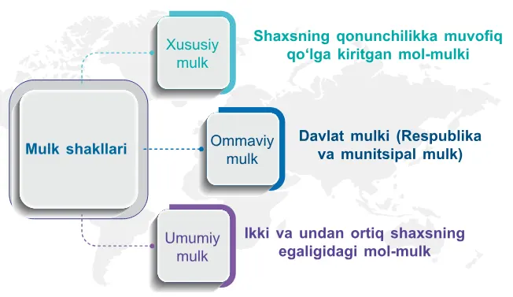

Xususiy mulk deganda shaxsning qonunchilikka muvofiq tarzda qoʻlga kiritgan mol-mulki tushuniladi va u mol-mulkka egalik qilish, undan foydalanish va uni tasarruf etish huquqiga ega boʻladi. Xususiy mulk boʻlgan mol-mulkning miqdori va qiymati cheklanmaydi. Xususiy mulk daxlsizdir.

Ommaviy mulk deganda davlat mulki hisoblangan, respublika mulki va maʼmuriy-hududiy tuzilmalar mulki (munitsipal mulk) tushuniladi.

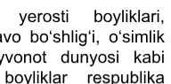

Yer, suv, havo boʻshligʻi, oʻsimlik va hayvonot dunyosi kabi tabiiy mulki hisoblanadi. Shuningdek, moddiy madaniy meros obyektlari, respublika byudjetining

zaxirasi, davlatning valyuta fondi va boshqa fondlari ham respublika mulki sanaladi.

Respublika mulki obyektlari qonunchilikda belgilab qoʻyilgan tartibda va shartlar asosida xususiy mulk qilib berilishi mumkin.

Mahalliy davlat organlarining mol-mulki, oʻzining mahalliy byudjet mablagʻlari, uy-joy munitsipal mulk hisoblanadi. Bundan tashqari, maktab, bogʻcha, teatr, kutubxona, kasalxona, poliklinikalar ham munitsipal mulkdir.

Xususiy, ommaviy mulk shakllaridan tashqari umumiy mulklar ham mavjud. Umumiy mulk ikki va undan ortiq shaxslarning egaligida boʻlgan mol-mulk hisoblanadi. Umumiy mulk shaxslarning kelishuviga asoslanadi.

### NOMULKIY MUNOSABATLAR VA ULARNING HUQUQIY ASOSLARI

Yuqorida eslatib oʻtganimizdek, fuqarolik huquqi mulkiy munosabatlar bilan bir qatorda nomulkiy munosabatlarni ham tartibga soladi. Nomulkiy munosabatlar mulkiy xarakterda boʻlmagan shaxsiy huquqiy munosabatlar hisoblanadi. Nomulkiy munosabatlarda qiymat moddiy (pul) xarakterda ifodalanmaydi. Yaʼni nomulkiy munosabatlar shaxsning oʻzi bilan bevosita bogʻliq boʻladi. Masalan, shaxsning hayoti va sogʻligʻi, shaʼni va qadr-qimmati, shaxsiy daxlsizligi, obroʻsi, shaxsiy hayotining daxlsizligi, xususiy va oilaviy siri, mualliflik huquqi kabi shaxsiy manfaatlari va huquqlari shular jumlasidandir.

Fuqarolik kodeksiga koʻra, oʻzganing shaʼni, qadr-qimmati yoki ishchanlik obroʻsiga putur yetkazuvchi maʼlumotlarni tarqatgan shaxs ularning haqiqatga toʻgʻri kelishini isbotlay olmasa, bu hol sud yoʻli bilan hal qilinadi. Manfaatdor shaxslarning talabiga koʻra, fuqaroning shaʼni va qadr-qimmatini uning vafotidan keyin ham himoya qilishga yoʻl qoʻyiladi.

Agar fuqaroning shaʼni, qadr-qimmati yoki ishchanlik obroʻsiga putur yetkazuvchi maʼlumotlar ommaviy-axborot vositalarida tarqatilgan boʻlsa, ayni shu ommaviy-axborot vositalarida raddiya berilishi lozim.

### Savol va topshiriqlar

1. Mulkiy munosabatlar deganda nima tushuniladi va mulkiy munosabatlarda kimlar ishtirok eta oladi?

2. Mulk shakllari qanday turlarga boʻlinadi? Ularning mazmunini bayon eting.

3. Qanday tartibda respublika mulki obyektlari xususiy mulk qilib berilishi mumkin?

4. Nomulkiy va mulkiy munosabatlarning farqi nimada?

### Mustaqil ish uchun topshiriq

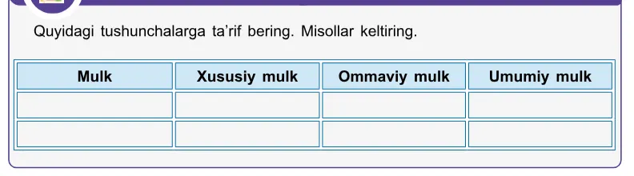

## 21-dars. Majburiyatlar

Hayotda muvaffaqiyatga erishish uchun uch narsa kerak: diqqat, intizom va harakat. Yoʻqligingda seni himoya qiladigan eng yaxshi himoyaching axloqingdir. **Jaloliddin Rumiy**

### Siz bilib olasiz

“Majburiyat” tushunchasi.

Majburiyatning taraflari.

Majburiyatning vujudga kelishi va bajarilishi.

### “MAJBURIYAT” TUSHUNCHASI

“Majburiyat” tushunchasini turli maʼnolarda ishlatish mumkin. Ijtimoiy maʼnoda majburiyat inson zimmasiga yuklangan vazifa, masʼuliyatni ifodalaydi. Majburiyat “burch” tushunchasi bilan bogʻliqdir.

Huquqiy maʼnoda majburiyat fuqarolik-huquqiy munosabat hisoblanadi. Fuqarolik huquqida majburiyatlar deganda bir shaxs (qarzdor) boshqa shaxs (kreditor) foydasiga muayyan harakatni amalga oshirishi, kreditor esa qarzdordan oʻzining majburiyatlarini bajarishni talab qilish huquqiga ega boʻlishi tushuniladi. Masalan, bir shaxs ikkinchi shaxsdan qarz olgan boʻlsa, qarz olgan shaxs qarzga olgan pulni oʻz vaqtida berish majburiyatini oladi. Kreditor, yaʼni qarz bergan shaxs oʻz vaqtida qarz toʻlanishini talab qilishga haqli boʻladi.

Majburiyat kelib chiqish asoslariga koʻra 2 guruhga boʻlinadi. Shartnomaga asoslangan majburiyat va shartnomaga asoslanmagan majburiyat. Shartnomaga asoslangan majburiyatda (oldi-sotdi, mahsulot yetkazib berish, qarz, mulk ijarasi kabi) taraflar muayyan huquqlarga ega boʻladilar va zimmalariga majburiyat oladilar. Shartnomaga asoslangan majburiyat taraflarning erki asosidagi kelishuv bilan vujudga keladi.

Shartnomaga asoslanmagan majburiyatda esa majburiyat zarar yetkazishdan kelib chiqadi. Bunda majburiyat taraflarning erki, xohishidan tashqari vujudga keladi, yaʼni taraflar zarar yetkazilgandan keyin majburiyatni gʻayriixtiyoriy bajaradi. Fuqarolik kodeksiga koʻra, maʼnaviy zarar pul bilan qoplanadi.

### Yodda tuting

Qarzdor majburiyatni bajarmagan yoki lozim darajada bajarmagan taqdirda kreditorga toʻlashi shart boʻlgan pul summasi neustoyka hisoblanadi. Bir shaxsning boshqa shaxsga mol-mulkni, unga boʻlgan huquqni majburiyatlarni taʼminlash uchun berishi garov hisoblanadi.

### MAJBURIYATNING TARAFLARI

Majburiyatning taraflari deganda kreditor va qarzdor tushuniladi. Ushbu taraflar bir yoki bir necha shaxs boʻlishi mumkin. Majburiyatlar tuzilgan shartnomada belgilanganidek, majburiyat shartlariga muvofiq bajarilishi kerak. Ayrim hollarda majburiyat shartlari bajarilmay qolishi mumkin.

Majburiyatni bajarishdan bir tomonlama bosh tortish va shartnoma shartlarini bir tomonlama oʻzgartirishga yoʻl qoʻyilmaydi.

### MAJBURIYATNING BAJARILISHI

Majburiyatlarni oʻz vaqtida va talab darajasida bajarish taraflarning fuqarolik-huquqiy munosabatlarida muhim ahamiyatga ega. Majburiyatlarni bajarish deganda majburiyatda ishtirok etadigan qarzdor tomonidan kreditor talabiga muvofiq maʼlum bir harakatning amalga oshirilishi yoki maʼlum bir harakatdan saqlanish tushuniladi. Majburiyatning bajarilishi neustoyka, garov, qarzdorning mol-mulkini ushlab qolish, kafillik, kafolat, zakalat hamda shartnomada nazarda tutilgan boshqacha usullar bilan taʼminlanishi mumkin. Shularning ayrimlarini koʻrib chiqamiz.

Neustoyka deganda qarzdor majburiyatni bajarmaganda kreditorga toʻlaydigan pul summasi tushuniladi. Neustoyka majburiyatni taʼminlashning eng koʻp tarqalgan usulidir. Neustoyka jarima yoki penya shaklida boʻladi.

Bir shaxsning boshqa shaxsga mol-mulkni yoki unga boʻlgan huquqni majburiyatlarini taʼminlash uchun berishi garov hisoblanadi. Zakalat, ipoteka kabi garov turlari mavjud. Mulkni garovga bergan shaxs garovga qoʻyuvchi, mulkni olgan shaxs esa garovga oluvchi hisoblanadi.

Kafillik deganda qarzdor majburiyatlarining bajarilishi uchun uchinchi shaxs, yaʼni kafil javobgar boʻladigan fuqarolik-huquqiy munosabat tushuniladi. Bunda kafil majburiyatni bajarish uchun kreditor oldida javob berishni oʻz zimmasiga oladi. Bu kafillik shartnomasida ifodalanadi.

Qarzdor majburiyatni bajarmaganligi tufayli kreditorga yetkazilgan zararni toʻlashi shart. Majburiyat, qoida tariqasida, uning lozim darajada bajarilishi bilan bekor boʻladi. Fuqarolik-huquqiy munosabatlar shartnomalar asosida ham vujudga keladi. Bugungi kunda shartnomalarga alohida ahamiyat berilmoqda. Shartnomada taraflarning erk-irodasi toʻla ifodalanadi.

### Savol va topshiriqlar

1. Majburiyat va burch deganda nima tushuniladi?

2. Majburiyat qanday vujudga keladi?

3. Neustoyka va garovning qanday ahamiyati bor?

4. Garov qanday vazifani oʻtaydi?

## 22-dars. Majburiyatlarning turlari

Agar keraksiz narsani sotib olsangiz, tez orada kerakli narsani sotasiz. Topganingizdan kamroq mablag‘ sarflang. Vaqt bu – pul.

**Benjamin Franklin**

### Siz bilib olasiz

Shartnomada majburiyatlarning ifodalanishi. Shartnomalarning ayrim turlari.

### SHARTNOMADA MAJBURIYATLARNING IFODALANISHI

Fuqarolik huquq va burchlarining vujudga kelishi, oʻzgartirilishi va bekor boʻlishi haqidagi kelishuv “shartnoma” deb ataladi. Shartnoma tuzayotgan shaxslar barcha holatlarni oʻzlari mustaqil hal qiladilar. Shartnoma erkin tuziladi. Shartnoma tuzishga majburlash mumkin emas.

Majburiyatlar taraflar tomonidan tuzilgan shartnomalarda oʻz aksini topadi. Shartnomada tomonlarga yuklatilgan majburiyatlar asosida hujjat tuziladi. Majburiyatlar shartnoma shartlariga koʻra belgilangan talablarga muvofiq bajariladi. Bugun elektron shartnomalardan keng foydalanilmoqda va elektron oldi-sotdilar ham ommalashib bormoqda. Sizning hayotingizda ham bunday oldi-sotdi munosabatlari juda koʻp uchrab turishiga shubhamiz yoʻq. Xususan, juda koʻpchiligingiz turli taomlarni olib kelishlari uchun restoran yoki kafelarga elektron tarzda buyurtma bergansiz. Bular ham elektron shartnomaning bir turidir.

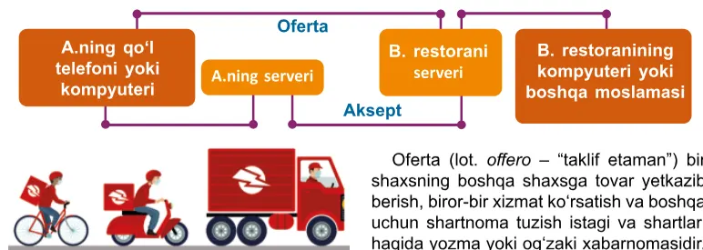

Oferta (lot. offero – “taklif etaman”) bir shaxsning boshqa shaxsga tovar yetkazib berish, biror-bir xizmat koʻrsatish va boshqa uchun shartnoma tuzish istagi va shartlari haqida yozma yoki ogʻzaki xabarnomasidir. Shunday xabar yuborgan jismoniy yoki yuridik shaxs “offerent”, xabarnoma olgan shaxs “akseptant” deb ataladi.

Aksept (lot. acceptus – “qabul qilingan”) fuqarolik huquqida taklifda (ofertada) koʻrsatilgan shartlarga koʻra shartnoma tuzishga rozilik bildirishni anglatadi.

### SHARTNOMALARNING AYRIM TURLARI

Fuqarolik-huquqiy munosabatlar subyektlarining faoliyatida shartnoma munosabatlari alohida oʻrin egallaydi. Shartnomalar taraflar oʻrtasidagi fuqarolik huquqlari va burchlar vujudga kelishining asoslaridan biri hisoblanadi. Shartnomalar asosan mulkiy munosa-

batlarni rasmiylashtirish uchun tuziladi. Shartnomalarning ayrimlarini koʻrib chiqamiz. Oldi-sotdi shartnomasida bir taraf (sotuvchi) tovarni boshqa taraf (sotib oluvchi)ga mulk qilib topshirish majburiyatini oladi. Sotib oluvchi esa bu tovarni qabul qilish va uning uchun belgilangan pul summasini toʻlash majburiyatini oladi. Ayirboshlash shartnomasida shaxs boshqa tarafga bir tovarni boshqa tovarga almashtirish yoʻli bilan mulk qilib topshirish majburiyatini oladi. Masalan, bir shaxs mashinasini sotmoqchi, sotib oluvchi unga avtoulovini almashtiradi va oʻrtadagi farqni pul shaklida toʻlaydi. Bunda tovar topshirish majburiyatini olgan shaxs sotuvchi, qabul qilish majburiyatini olgan shaxs esa sotib oluvchi hisoblanadi.

Hadya shartnomasida shaxs (hadya qiluvchi) boshqa shaxsga (hadya oluvchi)ga ashyoni tekinga mulk qilib beradi. Masalan, buvisi oʻz nevarasiga musiqa asbobi (royal)ni hadya qiladi.

Bundan tashqari, umumfoydali maqsadlarda xayr-ehson qilinadi. Xayr-ehson fuqarolarga, davolash, tarbiya, ijtimoiy himoya muassasalariga, madaniyat muassasalariga, jamoat birlashmalari va diniy tashkilotlarga, shuningdek, davlatga va boshqa fuqarolik huquqi subyektlariga qilinishi mumkin.

Xayr-ehsonni qabul qilishda biror kimsaning ruxsati yoki roziligi talab qilinmaydi. Mol-mulkni fuqaroga xayr-ehson qilish oddiy hadya deb hisoblanadi.

Kredit shartnomasida bir taraf – bank yoki boshqa kredit tashkiloti (kreditor) ikkinchi tarafga (qarz oluvchiga) shartnomada nazarda tutilgan miqdorda pul mablagʻlari (kredit) berish, qarz oluvchi esa olingan pul summasini qaytarish va uning uchun foizlar toʻlash majburiyatini oladi.

### Davlat krediti

Uy-joyni ijaraga berish shartnomasida bir taraf – uy-joyning mulkdori (ijaraga beruvchi) boshqa taraf (ijaraga oluvchi)ga uy-joyda yashash uchun uni haq evaziga egalik qilish va foydalanishga topshirish majburiyatini oladi. Aniq maqsadga qaratilgan kommunal uy-joy fondidagi uy-joylar fuqarolarga uy-joyni ijaraga berish shartnomasiga binoan beriladi. Ijaraga oluvchi bilan birga yashaydigan uning oila aʼzolari uy-joyni ijaraga berish shartnomasiga asosan barcha huquqlardan teng foydalanadi va barcha majburiyatlarni bajaradi. Ijaraga oluvchi va uning oila aʼzolari talabiga binoan shartnoma oila aʼzolarining bittasi bilan tuzilishi mumkin.

Pudrat shartnomasida bir taraf (pudratchi) ikkinchi taraf (buyurtmachi)ning topshirigʻiga binoan maʼlum bir ishni bajarish majburiyatini oladi, buyurtmachi esa ish natijasini qabul qilib olish va buning uchun haq toʻlash majburiyatini oladi. Bugungi tadbirkorlik rivojlanayotgan sharoitda bunday shartnomalarning ahamiyati oshmoqda.

Qarz shartnomasida bir shaxs (qarz beruvchi) ikkinchi shaxsga (qarz oluvchiga) ashyo yoki pul beradi, qarz oluvchi esa qarz beruvchiga biryoʻla yoki boʻlib-boʻlib pulni yoki qarzga olingan ashyolarni (qarz summasini) qaytarib berish majburiyatini oladi.

Fuqarolar oʻrtasida qarz shartnomasi, agar bu qarzning summasi bazaviy hisoblash miqdorining oʻn baravaridan ortiq boʻlsa, oddiy yozma shaklda tuziladi.

Bank omonati shartnomasida bank omonatchidan olingan pul summasini qabul qilib oladi va omonatchi murojaat qilganda unga omonat summasini qaytarish hamda unga foizlar toʻlash majburiyatini oladi.

Bank omonati shartnomasi omonat summasi bankka kelib tushgan kundan boshlab tuzilgan hisoblanadi.

### Savol va topshiriqlar

1. Shartnoma va majburiyatlarning bir-biriga qanday bogʻliqligi bor?

2. Oldi-sotdi va ayirboshlash shartnomasi qanday majburiyatlarni keltirib chiqaradi?

3. Siz qanday shartnomalarda ishtirok etgansiz yoki qanday shartnomalarda ishtirok etishni xohlaysiz?

4. Kelajakda tadbirkorlik bilan shugʻullansangiz, qanday shartnomalarni tuza olasiz?

### Mustaqil ish uchun topshiriq

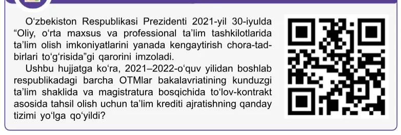

## 23-dars. Isteʼmolchilar huquqlari

Dunyo har qanday insonning ehtiyojlarini qondirish uchun yetarlicha katta, lekin insonning ochkoʻzligini qondirish uchun juda kichik. **Mahatma Gandi**

### Siz bilib olasiz

“Isteʼmolchilar” tushunchasi.

Isteʼmolchilar huquqlarini himoya qilish.

Isteʼmolchiga nuqsonli tovar sotilganda uning huquqlari.

### “ISTEʼMOLCHILAR” TUSHUNCHASI

Har bir inson kundalik ehtiyojidan kelib chiqib, doʻkondan, bozordan mahsulotlar (kiyim-bosh, non, sut, ruchka, daftar va hk.) xarid qiladi, turli xil xizmatlardan (poyabzal, televizor, telefon, soyabon tuzattirish, kiyim-boshni kimyoviy tozalatish, atelyeda kiyim tiktirish va hk.) foydalanadi. Bu fuqarolik-huquqiy munosabatda siz isteʼmolchi sifatida ishtirok etasiz, sizga xizmat qiluvchi esa ijrochi, ishlab chiqaruvchi, sotuvchi sifatida qatnashadi. Sotib olingan mahsulotni siz isteʼmol qilasiz, tikib berilgan kiyimni kiyasiz.

“Isteʼmolchilarning huquqlarini himoya qilish toʻgʻrisida”gi qonunga koʻra, isteʼmolchi deganda foyda chiqarib olish bilan bogʻliq boʻlmagan holda shaxsiy isteʼmol yoki boshqa maqsadlarda tovar sotib oluvchi, ish, xizmatga buyurtma beruvchi fuqaro tushuniladi. Isteʼmolchining huquqlari buzilgan taqdirda, u sudga murojaat qilish huquqiga ega. Isteʼmolchi ishlab chiqaruvchining korxonasi haqida xabardor boʻlishi shart.

Ushbu huquqiy munosabatlar Oʻzbekiston Respublikasi Konstitutsiyasi, “Isteʼmolchilarning huquqlarini himoya qilish toʻgʻrisida”gi qonun, Fuqarolik kodeksi va boshqa huquqiy hujjatlar bilan tartibga solinadi.

### Yodda tuting

> **Sotuvchi –** oldi-sotdi shartnomasi boʻyicha isteʼmolchiga tovar realizatsiya qiladigan korxona, tashkilot, muassasa yoki yakka tartibda faoliyat koʻrsatuvchi tadbirkor.

### ISTEʼMOLCHILAR HUQUQLARINI HIMOYA QILISH

Oʻzbekiston Respublikasi Konstitutsiyasida belgilanganidek, davlat isteʼmolchilarning huquqi ustunligini hisobga olib, iqtisodiy faoliyat, tadbirkorlik va mehnat qilish erkinligini, barcha mulk shakllarining tenghuquqliligini va huquqiy jihatdan bab-baravar muhofaza etilishini kafolatlaydi. Isteʼmolchilar huquqlarini himoya qilish agentligi isteʼmolchilarning

tovarlar (ishlar, xizmatlar), ularning ishlab chiqaruvchisi, ijrochisi va sotuvchisi toʻgʻrisidagi haqqoniy va toʻliq maʼlumotlarni olishni taʼminlaydi. Shuningdek, isteʼmolchilarga ularning huquq va manfaatlarini himoya qilishda yordam koʻrsatadi, isteʼmolchilar huquqi buzilishi sabablarini tahlil qiladi.

Tovar (ish, xizmat)lar uchun haq toʻlash shakli hamda tartibi isteʼmolchi bilan sotuvchi (ishlab chiqaruvchi, ijrochi) oʻrtasidagi kelishuv asosida belgilanadi. Oldi-sotdi amalga oshirilganda isteʼmolchiga kassa yoki tovar cheki beriladi. Tovarni kassa yoki tovar chekini bermasdan sotish taqiqlanadi.

Uzoq muddat foydalaniladigan barcha turdagi tovarlar va xizmatlarga ishlab chiqaruvchi (ijrochi) kafolat muddati belgilashi lozim. Kafolat muddati tovar isteʼmolchiga sotilgan yoki xizmat koʻrsatilgan kundan boshlab hisoblanadi. Kafolat muddati tovar (xizmat)ning pasportida yoki tovarni sotish yoxud xizmat koʻrsatish paytida tovar bilan birgalikda isteʼmolchiga beriladigan hujjatda koʻrsatiladi.

Dori vositalari va tibbiy buyumlarda, oziq-ovqat va maishiy kimyo tovarlarida ularning ishlab chiqarilgan sanasi, yaroqlilik muddati, saqlash shartlari koʻrsatilgan boʻladi. Sotuvchilar ishlab chiqarilgan sanasi va yaroqlilik muddati koʻrsatilmagan tovarlarni qabul qilishi taqiqlanadi.

### ISTEʼMOLCHIGA NUQSONLI TOVAR SOTILGANDA UNING HUQUQLARI

Isteʼmolchi oʻzi sotib olgan tovar (ish, xizmat) sanitariya-gigiyena, shu jumladan, radiologiya, epidemiyaga qarshi talablarga va amaldagi boshqa normalar hamda qoidalarga rioya etgan holda ishlab chiqarilgan yoki bajarilgan boʻlishiga va uning hayoti, sogʻligʻi, atrof-muhit uchun xavfsiz boʻlishiga, shuningdek, uning mol-mulkiga zarar yetkazmasligiga kafolat berilishini talab qilish huquqiga ega. Isteʼmolchiga nuqsonli tovar sotilganda, tovarni ayni shunday markali sifatli tovarga almashtirib berish kerak.

Isteʼmolchi kassa yoki tovar chekini, ras miylashtirilgan texnik pasportini taqdim etganda talablari koʻrib chiqiladi. Isteʼmolchining huquqlari buzilishi tufayli unga yetkazilgan maʼnaviy zarar uchun zarar yetkazgan shaxs haq toʻlaydi. Maʼnaviy zarar uchun toʻlanadigan haq miqdorini sud belgilaydi.

Har bir shaxs hayotda ehtiyojini qondirish maqsadida oʻziga kerakli mahsulotni xarid qiladi, pul topadi, pulini ishlatadi, jamgʻaradi va hk. Soʻnggi yillarda mamlakatimizda moli-

yaviy savodxonlik darajasini oshirishga katta eʼtibor qaratilmoqda. Aholining moli yaviy savodxonligi darajasini baholash orqali uy xoʻjaliklari, oila va shaxsning oʻziga tegishli moliyaviy resurslarini boshqara olishi va ularni toʻgʻri yoʻnaltirishdagi samarali qarorlarini baholash mumkin.

Moliyaviy savodxonlik shaxsiy moliyaviy xavfsizlikni taʼminlashga, pulni samarali boshqarishga, shaxsiy byudjet mablagʻlarini boshqarish haqidagi bilimlar va tushunchalarga asoslanadi.

Hamma pul nima ekanligini biladi. Baʼzan pul muomalasini bilmay qiynaladi. Baʼzilar pul boʻlsa boʻldi, uni sarf qilish juda oson deb oʻylaydi. Natijada xaridlarni amalga oshirish qiyinlashadi yoki puli hech narsaga yetmaydi.

Moliyaviy savodxonlik nafaqat moliyaviy bilimlarni egallashga yordam beradi, balki mamlakatimizda amalga oshirilayotgan iqtisodiy islohotlarning ustuvor yoʻnalishini rivojlantiradi.

Moliyaviy savodxon shaxs oʻzining shaxsiy moliyaviy holatini nazorat qilishni, 1 oyda qan cha pul topishi-yu qanchasini xarajat qilishini rejalashtiradi, oʻzining moliyaviy majburiyatlarini bajaradi, firibgarning qoʻliga tushmaydi, hech qachon kimdandir qarzdor boʻlib qolmaydi.

Siz ham kelajakda biznes bilan shugʻullanish, mablagʻlaringizni toʻgʻri boshqarish uchun moliyaga oid bilim, koʻnikma va maʼlumotlarga ega boʻlishingiz zarur. Shunda tadbirkorlik faoliyatingiz rivojlanadi, moliyaviy holatingiz yaxshilanib boradi.

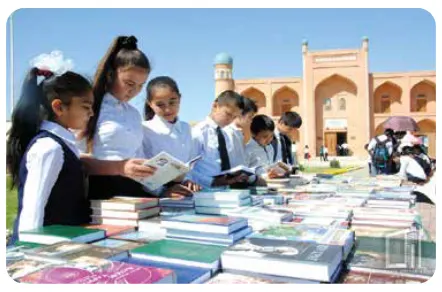

### Mustaqil ish uchun topshiriq

1. Isteʼmolchi deganda kimni tushunasiz?

2. Isteʼmolchilarning huquqlari buzilganda qaysi idoralarga murojaat qilishlari mumkin?

3. Siz isteʼmolchi sifatida sotib olgan tovaringizning qaysi jihatlariga eʼtibor berasiz?

4. Xarid qilgan qaysi tovarlaringizni qaytarib yoki almashtirib ololmaysiz?

5. Doʻkonga kirib, hech narsa xarid qilmagan taqdirda ham siz isteʼmolchi hisoblanasizmi?

6. Moliyaviy savodxonlikning ahamiyati nimada?

### Mustaqil ish uchun topshiriq

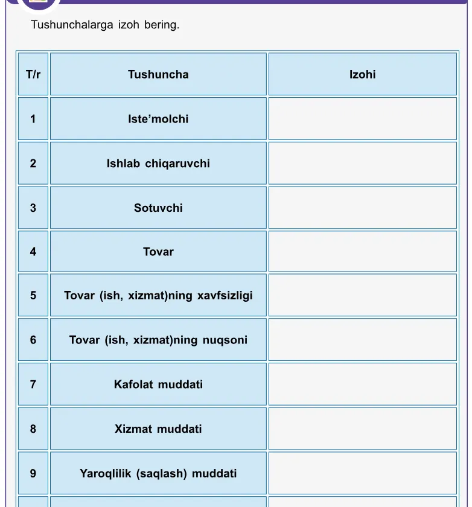

## 24-dars. Intellektual mulk

Gʻoyalar arzon mahsulotlardir. Gʻoyalardan koʻra ularni roʻyobga chiqarish qimmatliroqdir.

**Maykl Dell**

### Siz bilib olasiz

“Intellektual mulk” tushunchasi. Intellektual mulk obyektlari. Mualliflik huquqi.

### “INTELLEKTUAL MULK” TUSHUNCHASI

Inson dunyoga kelgandan soʻng olamni bilishga, tushunishga, idrok qilishga harakat qiladi. Atrof-muhitni ongda aynan aks ettirish, fikrlash, oʻqish-oʻrganish, dunyoni bilish va ijtimoiy tajribani qabul qilish qobiliyati shakllanadi.

Inson yaratadigan ijodiy aqliy faoliyat mahsuli intellektual mulk hisoblanadi. Masalan, bugun yoshlarimiz maktabda oʻqib yurgan paytlaridayoq asarlar, sheʼriy toʻplamlar chop etmoqda, turli xil ixtirolar, foydali modellar yaratmoqda. Oʻzbekiston Respublikasi Konstitutsiyasida belgilanganidek, ilmiy, texnik va badiiy ijod erkinligi, madaniyat yutuqlaridan foydalanish huquqi kafolatlanadi. Intellektual mulk qonun bilan muhofaza qilinadi. Intellektual mulk har bir mamlakat iqtisodiyotining rivojlanishiga ijobiy taʼsir etadi. Oʻzbekistonda ham intellektual mulkni rivojlantirish, uni huquqiy himoya qilish sohasida bir qator ishlar amalga oshirilmoqda. Oʻzbekiston Respublikasi 1991-yil 25-dekabrda Jahon intellektual mulk tashkilotiga aʼzo boʻldi, 1993-yildan Sanoat mulkini muhofaza qilish Parij konvensiyasiga qoʻshildi.

Oʻzbekiston Respublikasi Prezidentining 2019-yil 8-fevraldagi “Intellektual mulk sohasida davlat boshqaruvini takomillashtirish chora-tadbirlari toʻgʻrisida”gi, 2019-yil 1-iyuldagi “Oʻzbekiston Respublikasi Adliya vazirligi huzuridagi Intellektual mulk agentligi faoliyatini tashkil etish chora-tadbirlari toʻgʻrisida”gi, 2022-yil 26-apreldagi “Intellektual mulk sohasini yanada rivojlantirishga oid qoʻshimcha chora-tadbirlar toʻgʻrisida”gi qarorlari shular jumlasidandir. Bugun fuqarolik huquqi tarkibida ilmiy-texnika taraqqiyoti, inson ijodiy faoliyati va uning mahsullaridan foydalanish masalalarini tartibga soluvchi intellektual mulk huquqi sohasi jadal surʼatlar bilan rivojlanmoqda.

Intellektual mulk huquqi deganda insonning ijodiy faoliyati natijalariga boʻlgan huquqi tushuniladi.

### INTELLEKTUAL MULK OBYEKTLARI

Intellektual mulk obyektlari fuqarolik huquqining oʻziga xos obyektidir. Ushbu intellektual mulk obyektlari roʻyxati Fuqarolik kodeksining 1031-moddasida berilgan.

Intellektual obyektni yaratgan muallif shaxsiy nomulkiy va mulkiy huquqlarga ega boʻladi.

Shaxsiy nomulkiy huquqlar muallifga uning mulkiy huquqlaridan qatʼi nazar tegishli boʻladi va uning intellektual faoliyat natijalariga boʻlgan mulkiy huquqlari boshqa shaxsga oʻtgan taqdirda, uning nomulkiy huquqlari oʻzida saqlanib qoladi.

Misol uchun, muallif yaratgan sheʼrlar toʻplami muallifga tegishli boʻladi. Agar sheʼriy toʻplam boshqa shaxsga oʻtgan taqdirda (sotilganda) muallifning nomulkiy huquqlari saqlanib qoladi, lekin sheʼriy toʻplamdan olingan daromadga daʼvo qilolmaydi.

Intellektual mulk obyektlariga intellektual faoliyat natijalari boʻlgan fan, adabiyot va sanʼat asarlari, ijrolar, fonogrammalar, ixtirolar, foydali modellar kabilar kiradi. Intellektual mulk obyektlariga nisbatan shaxsiy nomulkiy huquqlar muddatsiz amal qiladi. Intellektual mulk sohasini rivojlantirish mamlakatimizning jahon integratsiyasidagi asosiy omili ekanidan kelib chiqib, intellektual mulk obyektlarini muhofaza qilish tizimini takomillashtirish maqsadida Fuqarolik kodeksi, 2022–2026-yillarda Oʻzbekiston Respublikasida intellektual mulk sohasini rivojlantirish strategiyasi, “Mualliflik huquqi va turdosh huquqlar toʻgʻrisida”gi qonun, “Patent vakillari toʻgʻrisida”gi nizom kabi huquqiy hujjatlar qabul qilingan.

### MUALLIFLIK HUQUQI

Mualliflik huquqi shaxsiy nomulkiy huquq hisoblanadi va ijodiy mehnat bilan intellektual faoliyat natijasini yaratgan shaxsgagina tegishli boʻladi. Mualliflik huquqi boshqa shaxsga oʻtkazilmaydi va berilmaydi.

Agar ikki yoki undan ortiq shaxsning birgalikdagi ijodiy mehnati bilan biror-bir narsa yaratilgan boʻlsa, ular hammuallif hisoblanadilar.

### MUALLIFLIK HUQUQI

**Huquqiy vositalar yordamida ilmiy va badiiy asarlarni yaratish uchun eng maʼqul sharoitlar yaratadi**

**Mualliflik mulkiy, shaxsiy nomulkiy va qonuniy manfaatlarini muhofaza qiladi**

Mualliflik huquqi ijodiy faoliyat natijasi boʻlmish fan, adabiyot va sanʼat asarlariga nisbatan, ularning maqsadi va qadr-qimmati, shuningdek, ifodalanish usulidan qatʼi nazar, tatbiq etiladi.

Asar kimning ijodiy mehnati bilan yaratilgan boʻlsa, ana shu fuqaro asar muallifi deb eʼtirof etiladi.

Ayrim hollarda mualliflik huquqlari buzilishiga ham duch kelish mumkin. Bularga muallif nomi koʻrsatilmasdan nusxa olish (kitoblar, maqolalardan), asarni tarqatish, asarlarni konsert zallari, teatr sahnasida omma uchun namoyish qilish, radio, televideniye orqali efirga uzatish, asarni boshqa tillarga tarjima qilish kabilar kiradi.

Inson tafakkuri natijasi boʻlgan mulk obyektiga nisbatan mualliflik huquqini oʻzlashtirib olish, hammualliflikka majburlash, tafakkur mulk obyektlari toʻgʻrisidagi maʼlumotlarni ular rasman roʻyxatdan oʻtkazilgunga qadar muallifning roziligisiz oshkor etish jinoiy javobgarlikka asos boʻladi (Qarang: Oʻzbekiston Respublikasi Jinoyat kodeksi, 149-modda.)

### Yodda tuting

Muallif deganda ijodiy mehnati bilan asar yaratgan jismoniy shaxs tushuniladi.

Muallifning mulkiy huquqlari boshqa shaxsga oʻtkazilishi mumkin. Bunda mualliflik shartnomasida asardan muayyan usulda va shartnomada belgilangan doirada foydalanishga ruxsat beriladi. Mualliflik shartnomasida asardan foydalanish usullari, asardan foydalanishning har bir usuli uchun toʻlanadigan haq miqdori, toʻlash tartibi, muddatlari nazarda tutiladi.

### Yodda tuting

> **Mualliflik huquqi –** fan, adabiyot va sanʼat asarlarini yaratish va ulardan foydalanishda vujudga keladigan munosabatlarni tartibga soladigan fuqarolik huquqi meʼyorlari majmuasi.

### Savol va topshiriqlar

### Mustaqil ish uchun topshiriq

Quyidagi vaziyatni huquqiy tahlil qiling.

Maktabning 10-sinf oʻquvchisi sheʼriy toʻplam tayyorlab, nashriyotga topshirish uchun bordi. Nashriyot mutasaddilari uning mualliflik ishini “Sen hali voyaga yetmagan shaxssan”, deb qabul qilmadi.

## 25-dars. Vorislik

Farzandlar, qarindoshlar, oshna-ogʻayni, qoʻshnilar va men bilan bir vaqtlar doʻstlik qilgan barcha odamlarni davlat-u neʼmat martabasiga erishganimda unutmadim, haqlarini ado etdim.

**Amir Temur**

### Siz bilib olasiz

“Vorislik” tushunchasi va vorislik huquqi. “Meros” va “merosxoʻrlik” tushunchasi. Vasiyatnomaning huquqiy asoslari.

### “VORISLIK” TUSHUNCHASI VA VORISLIK HUQUQI

Yuqorida taʼkidlab oʻtganimizdek, fuqarolik huquqi mulkiy munosabatlarni tartibga solar ekan, vorislik, meros, merosxoʻrlik kabi mulkiy munosabatlar hisoblanadi. Vorislik deganda vafot etgan shaxsning mulkini (masalan, koʻchmas mulk, mulkni) olish tushuniladi. Mulkni oluvchi shaxslar esa “vorislar” deb ataladi. Ushbu munosabatlarni tartibga soladigan huquqiy qoidalar yigʻindisi fuqarolik huquqining tarkibiy qismi boʻlgan vorislik huquqi hisoblanadi. Vorislik huquqi vafot etgan shaxsning mulkiy huquq va majburiyatlari boshqa shaxslarga, merosxoʻrlarga

belgilangan tartibda taʼminlaydi.

Vafot etgan shaxsning mulki uning avlodlariga vasiyatnoma asosida va qonuniy asosda oʻtadi. Vasiyat boʻyicha vorislik meros qoldiruvchining erki bilan vujudga keladi. Masalan, ota vasiyatnoma asosida oʻziga tegishli boʻlgan mulkni oʻzining xohishiga koʻra merosxoʻrga yoki merosxoʻrlarga qoldiradi.

Qonuniy vorislik esa meros qoldiruvchining merosxoʻrlariga navbat tartibida taqsimlanadi.

Meros ochilgan paytda hayot boʻlgan fuqarolar, shuningdek, meros qoldiruvchining hayotlik paytida homila holida boʻlgan va meros ochilgandan keyin tirik tugʻilgan bolalari vasiyat va qonun boʻyicha merosxoʻr boʻlishlari mumkin.

### Yodda tuting

keyin unga xususiy mulk asosida tegishli boʻlgan mol-mulkning, shuningdek, meros qoldiruvchining shaxsi bilan chambarchas bogʻliq boʻlgan baʼzi huquq va majburiyatlarning merosxoʻrlarga oʻtishidir.

### “MEROS” VA “MEROSXOʻRLIK” TUSHUNCHASI

Oʻzbekiston Konstitutsiyasining 41-moddasiga koʻra, meros huquqi qonun bilan kafolatlanadi.

Meros fuqaroning oʻlimi yoki uning sud tomonidan vafot etgan deb eʼlon qilinishi oqibatida vujudga keladi.

Meros deganda vafot etgan shaxsdan vorislarga qolgan mulk tushuniladi. Merosxoʻr esa vafot etgan shaxsdan qolgan mulkka huquqi mavjud boʻlgan shaxsdir.

Fuqarolarning qonun bilan taqiqlanmagan barcha mulki va mulkka boʻlgan huquq va majburiyatlari xususiy mulk sifatida meros tarkibiga kiradi. Meros olish huquqi mulk egasining vafot etishi bilan paydo boʻladi.

Qonun boʻyicha vorislikda farzandlikka olingan shaxs va uning avlodlari farzandlikka oluvchi shaxs va uning qarindoshlari, tugʻishgan qarindoshlar bilan tenglashtiriladi. Qonun boʻyicha vorislar birinchi, ikkinchi, uchinchi, toʻrtinchi, beshinchi navbatdagi tartibda taqsimlanadi. Vorislarning har bir navbati avvalgi navbatdagi merosxoʻrlar boʻlmaganda, ular merosdan chetlashtirilganda, merosxoʻr merosni qabul qilmaganda vorislik huquqiga ega boʻladi.

### Qonun boʻyicha vorislik

Meros ochilgan kundan eʼtiboran istalgan vaqtda merosxoʻr merosdan voz kechishi mumkin. Merosdan voz kechish merosxoʻr tomonidan notariusga ariza berish orqali amalga oshiriladi. Agar merosxoʻr merosdan voz kechgan boʻlsa, unga qayta daʼvogarlik qilolmaydi.

### VASIYATNOMANING HUQUQIY ASOSLARI

Vasiyat fuqaroning vafot etgan taqdirda oʻziga tegishli boʻlgan mol-mulkni tasarruf etish xususidagi xohish-irodasidir. Vasiyatnoma shaxsan tuziladi. Vakil orqali tuzilishi mumkin emas.

Meros qoldiruvchi tiriklik paytida mol-mulki toʻgʻrisida vasiyatnoma tuza oladi. Vasiyatnoma tuzib boʻlganidan keyin meros qoldiruvchi vasiyatnomani istagan paytida bekor qilishi va oʻzgartirishi mumkin.

Meros qoldiruvchi vasiyatnoma tuzgan boʻlsa, meros shu vasiyatnomaga asosan taqsimlanadi. Ammo meros qoldiruvchining voyaga yetmagan yoki mehnatga qobiliyatsiz bolalari, shuningdek, eri (xotini) va ota-onasi, shu jumladan, uni farzandlikka olganlar ulushi koʻrib chiqiladi.

Vasiyat qiluvchi qarindoshlik yoki oilaviy aloqalaridan qatʼi nazar, merosni tayinlash huquqiga ega. Shuningdek, mulkni yuridik shaxslarga, davlat organlariga vasiyat qilish, merosxoʻrni merosdan mahrum etish kabi huquqlarga ega.

### Savol va topshiriqlar

### Mustaqil ish uchun topshiriq

Quyidagi vaziyatni huquqiy tahlil qiling.

Ota uy-joyini ikki farzandidan kichigiga qoldirish haqida vasiyatnoma yozib, notariusdan guvohlantirib qoldirdi. Ammo hali hayotlik paytida vasiyatnomani qaytarib oldi. Kenja farzandi: “Bunga haqqingiz yoʻq deb!” otaga eʼtiroz bildirdi.

## 26-dars. Ijodiy faoliyat

Agar oʻqisang-u oʻylamasang – chalkashib qolasan. Agar oʻylasang-u oʻqimasang – shubha-gumonlar tagida qolib ketasan.

**Konfutsiy**

**1-topshiriq.**

Quyidagi vaziyatni oʻrganing va savollarga javob bering.

Avtobus Oʻzbekistonning qadimiy maskanlari boʻylab uyushtirilgan sayohat payti Buxoroga kelganda buzilib qoldi. Natijada Xiva shahrini tomosha qilishga vaqt qolmadi. Safardan soʻng sayyohlar sayyohlik firmasiga eʼtiroz bildirdi, ammo hech qanday natijaga erishilmadi.

Savollarga javob bering.

Bu vaziyatda sayyohlik firmasi toʻgʻri harakat qilganmi?

Sayyohlarning talabi toʻgʻrimi?

Bu vaziyatni qanday huquqiy meʼyorlar bilan hal etsa boʻladi?

Sayyohlik munosabatlari qaysi davlat organiga tegishli? Ushbu savolga internetdan foydalangan holda javob tayyorlang.

**2-topshiriq.** Berilgan tushunchalarni tahlil qilib jadvalni toʻldiring!

### Jismoniy shaxs

### NAZORAT ISHI

Hech qachon unutmang, kelajakda sizni yanada ulkan va masʼuliyatli marralar kutmoqda.

Oldingizga aniq maqsad qoʻyib, bor kuch-gʻayratingiz, bilim va salohiyatingiz bilan harakat qilsangiz, koʻzlangan choʻqqilarga albatta erishasiz.

### Shavkat Mirziyoyev

**“Madaniyatli isteʼmolchi”** mavzusida **ESSE** yozing. Esse yozish jarayonida quyidagi talablarga rioya eting! – – – xulosalang.

Berilgan mavzuga nisbatan oʻz nuqtayi nazaringizni bayon eting.

Hayotiy misollar bilan asoslang.

Mavjud muammolar va ularni bartaraf etish yuzasidan oʻz fikr va takliflaringizni

**Esse yozish jarayonida quyidagi tavsiyalardan foydalaning.**

“Isteʼmolchi” atamasiga oid nazariy maʼlumotlarni bayon eting.

Mavzuga oid hayotiy voqea yoki hodisani eslang.

Voqelikka munosabatingizni aniqlab oling.

Oʻzbekiston Respublikasida isteʼmolchi huquqlarini himoyalash mavzusiga toʻxtaling. Madaniyatli isteʼmolchi borasidagi tasavvurlaringizni ifodalang.

Sifati past yoki nuqsoni boʻlgan tovar xarid qilgan isteʼmolchiga munosabatingizni bildiring.

Kundalik ehtiyojlar sababli har kuni isteʼmolchiga aylanamiz. Biroq barchani ham madaniyatli isteʼmolchi deb boʻlmaydi. Mening fikrimcha, madaniyatli isteʼmolchi belgilangan qonun-qoidalarga amal qilishi, oʻz huquq va majburiyatlarini anglashi…

### IV BOB. OʻZBEKISTON VA XALQARO HAMJAMIYAT@edurtm_uz

# IV bob. Oʻzbekiston va xalqaro hamjamiyat

## 27-dars. Xalqaro hamjamiyatning vujudga kelishi

Agar biz butun dunyoda tinchlik oʻrnatishni istasak, ishni bolalar tarbiyasidan boshlashimiz zarur. Dunyoni oʻzgartirish istagidagi inson avvalo oʻzi oʻzgarmogʻi lozim.

**Mahatma Gandi**

### Siz bilib olasiz

Xalqaro hamjamiyatning oʻziga xosligi.

Xalqaro hamjamiyatning tuzilishi.

Xalqaro munosabatlarni vujudga keltiruvchi omillar.

### XALQARO HAMJAMIYATNING OʻZIGA XOSLIGI

**Gellap (Gallup) Xalqaro tadqiqot markazining xavfsizlik boʻyicha**

Bugun dunyoda 200 dan ortiq davlat mavjud boʻlib, ularda yetti milliarddan ziyod aholi yashaydi. Bir qarashda xalqaro

### 2017-yilgi reytingi (142 ta

hamjamiyatda roʻy berayotgan voqealar sizga aloqador emasdek koʻrinadi, biroq unday emas, chunki siz ham ushbu

yetti milliardning birisiz.

Xalqaro hayotda roʻy berayotgan voqealar Oʻzbekistonga ham, bevosita sizga ham oʻz taʼsirini koʻrsatishi tabiiy. Masalan, Oʻzbekistonga sitrus mevalar eksport qiladigan mamlakatda urush yuz bersa yoki ushbu mevalar olib kelinadigan yoʻlda joylashgan davlatlarda toʻpolonlar boshlansa, bozorlardan oʻzingiz yoqtirgan banan, mandarin, apelsin kabi mevalarni topa olmay qolishingiz mumkin. Albatta, siz yashab turgan Oʻzbekiston dunyodagi eng tinch davlatlardan biri boʻlgani uchun qolgan davlatlarda ham barcha tinch va osoyishta yashamoqda deb oʻylashingiz mumkin. Ammo hamma davlatlarda ham bu kabi tinchlik mavjud emas.

Xalqaro hamjamiyat tarkibidagi bir mamlakatda roʻy berayotgan voqealar ikkinchisiga taʼsir etsa-da, uni boshqarib turuvchi yagona tuzilma yoʻq. Jarayon faqatgina davlatlar va xalqaro tashkilotlarning hamkorligi bilan izga solinishi mumkin xolos.

### Yodda tuting

> **Xalqaro hamjamiyat** – jahonda mavjud davlatlar va ularda yashovchi insonlarning insoniyat oldida turgan global muammolarni hamkorlikda hal qilishda, umumiy maqsad yoʻlida faoliyat koʻrsatish birligini anglatuvchi tushuncha. Xalqaro hamjamiyat barcha davlatlarning suveren tengligi, hududlarining daxlsizligi kabi xalqaro huquq tamoyillariga asoslanadi.

Unutmang, xalqaro hamjamiyat xalqaro tashkilot emas.

### XALQARO HAMJAMIYATNING TUZILISHI

Xoʻsh, asosan davlatlardan tashkil topuvchi va siz bilan biz yashayotgan bugungi xalqaro hamjamiyat qachon vujudga keldi? U qanday rivojlanib bormoqda? Barchasi Vestfaliya sulhidan boshlandi. Oʻttiz yillik urush (1618–1648) dan soʻng, Yevropadagi har bir davlatning hududi va suverenitetini belgilab beruvchi Vestfaliya sulhi imzolandi. Ushbu sulhni imzolagan mamlakatlar bir-birlarining suveren huquqlarini tan oldilar. Shunday qilib, oʻzining suverenitetiga va boshqa davlatlar tomonidan tan olingan hududiga ega boʻlgan xalqaro hamjamiyat vujudga keldi.

Toʻgʻri, “Bundan oldin ham davlatlar boʻlgan-ku!” degan savol tugʻilishi tabiiy. Ammo xalqaro huquqqa asosan, davlatlar suvereniteti hamda ularning hududlari tan olinadigan bugungi hamjamiyat aynan Vestfaliya sulhidan keyin vujudga kelgan. Shu sababli oʻsha davrda xalqaro hamjamiyat faqatgina Yevropaning mutlaq suveren davlatlaridan tashkil topgan degan qarash mavjud boʻlgan. Ammo keyinchalik roʻy bergan inqiloblar natijasida AQSH, Turkiya va Yaponiya kabi demokratik davlatlar vujudga keldi. Ikkinchi jahon urushidan keyin esa Osiyo va Afrika qitʼalarida oʻzining suverenitetiga ega boʻlgan va hududlari boshqa davlatlar tomonidan tan olingan yangi davlatlar yuzaga keldi. Shunday qilib, yangi demokratik davlatlar hisobiga xalqaro hamjamiyat turfaxillik kasb eta boshladi. Xususan, Oʻzbekiston Respublikasi ham 1991-yilda suveren maqomdagi demokratik davlat sifatida xalqaro hamjamiyatning teng huquqli aʼzosiga aylandi. Konstitutsiyamizning 1-moddasida ham bu oʻz aksini topgan.

Bugun xalqaro hamjamiyatning tuzilishi yuqorida biz koʻrib oʻtgan, faqatgina suveren davlatlardan tashkil topgan hamjamiyatdan farq qiladi. Albatta, hozir ham xalqaro hamjamiyatni tashkil etuvchi asosiy subyektlar davlatlardir. Ammo Birlashgan Millatlar Tashkiloti, Jahon Savdo Tashkiloti kabi xalqaro tashkilotlar va transmilliy korporatsiyalar ham bugungi xalqaro hamjamiyatda katta ahamiyat kasb etadi. Shuningdek, nohukumat tashkilotlar va shaxslar ham zamonaviy xalqaro hamjamiyatga bevosita aloqador boʻlib qolmoqda. Demak, xalqaro hamjamiyat faqatgina davlatlardan emas, balki xalqaro tashkilotlar, nohukumat tashkilotlar, transmilliy korporatsiyalar hamda shaxslar kabi xalqaro munosabatlarning ishtirokchilaridan tashkil topgan ekan.

### Yodda tuting

> **Suverenitet** – davlatning ichki ishlarda va tashqi ishlarda mustaqil ekanini anglatuvchi tushuncha. Suverenitetga ega davlatlar qisqacha “suveren davlatlar” deb ataladi.

### XALQARO MUNOSABATLARNI VUJUDGA KELTIRUVCHI OMILLAR

Davlatlar tinchlik va hamkorlik oʻrnatish maqsadida boshqa davlatlar bilan siyosiy, iqtisodiy, madaniy, huquqiy, diplomatik, harbiy va boshqa aloqalarni oʻrnatgan holda xalqaro munosabatlarga kirishadi. Quyida xalqaro munosabatlarni vujudga keltiruvchi bir nechta omillarni koʻrib chiqamiz.

**Xalqaro munosabatlarning siyosiy omili.** Suveren davlatlar tenglik tamoyiliga asos-

lanib xalqaro munosabatlarga kirishadi. Ammo biron-bir davlat oʻzining suvereniteti cheklanmagani va unga asoslanib xohlagan ishini qilishi mumkinligini aytib chiqsa, biz yashayotgan xalqaro hamjamiyat tartibsiz dunyoga aylanib qolishi mumkin. Shu sababli davlatlar xalqaro munosabatlarga kirishganda bir-birlarining hurmat qilib, boshqa davlatlarga bergan vaʼdalarini bajarishga intiladilar. Bu orqali milliy manfaatlar himoya qilinadi. Davlatlar tinchlikni saqlagan holda, oʻzaro bir-birlarini tushunib hamkorlik qilish yoʻli hisoblangan internatsionalizm tamoyiliga asoslanadi.

**Boshqa suveren davlatlar bilan xalqaro munosabatlarga kirisha olish**

### Xalqaro munosabatlarning iqtisodiy

**omili.** Davlatning asosiy maqsadlaridan biri oʻz xalqining manfaatlarini xalqaro maydonda ham himoya qilish hisoblanadi. Xalqaro munosabatlarga kirishilganda esa juda koʻp hollarda uning ortida iqtisodiy foyda koʻrish yotgan boʻladi. Masalan, XX asrning oʻrtalarigacha davlatlar oʻz xalqlarini boyitish uchun boshqa davlatlar va qabilalarni bosib olgan. Bugungi kunda bir davlat boshqa davlatni bosib olishi, yaʼni urush qilish taqiqlangan. Shu sababli hozir davlatlar oʻz aholisi tomonidan ishlab chiqarilayotgan mahsulotlar eksportini koʻpaytirish va dunyo bozorlarini egallash boʻyicha raqobatlashmoqda. Oʻzbekiston ham mamlakat ichidagi tadbirkorlarni himoyalash maqsadida oʻz bozorlarini tashqi taʼsirdan himoya qilib kelayotgan edi. Endi esa jahon bozoriga chiqish va bu orqali aholini boyitishni koʻzlab, mamlakatlar oʻrtasidagi savdo qoidalarini tartibga soluvchi yagona global tashkilot hisoblanmish Jahon savdo tashkilotiga aʼzo boʻlish yoʻlida.

**Xalqaro munosabatlarning madaniy omili.** Koʻp millatli davlatlarda aholi orasida oʻzaro kelishmovchiliklar yuzaga kelishi mumkin. Shuning uchun davlat xalq birligi gʻoyasiga tayanib bunday millatchilik yoki diniy qarashlarga asoslangan nizolarni bartaraf etib boradi. Bunday gʻoya Oʻzbekiston Respublikasi Konstitutsiyasining muqaddimasida ham aks etgan boʻlib, muqaddima “Biz, Oʻzbekistonning yagona xalqi” deb boshlanadi. Bu – juda ham toʻgʻri gʻoya. Chunki u xalq tinchligini taʼminlab beradi.

### Yodda tuting

Xalqaro munosabatlarda aynan mafkura va diniy qarashlardagi ziddiyatlar sababli katta nizolar kelib chiqishi mumkin. Masalan, arab davlatlari va Isroil oʻrtasidagi, Hindiston va Pokiston oʻrtasidagi nizolar ortida aynan diniy qarashlar yotadi. Shuningdek, mafkuradagi ziddiyatlar ham katta mojarolarni yuzaga keltirishi mumkin. Xususan, Sovet Ittifoqi va AQSH oʻrtasidagi ziddiyatlar avvalo sotsializm va kapitalizm mafkuralari oʻrtasidagi ziddiyatga borib taqalar edi. Shunday qilib, maʼlum bir davlatlarda yuz berayotgan urushlarni bartaraf etish, dunyoda inson huquqlariga amal qilinishini taʼminlash uchun davlatlar oʻzaro hamkorlikni amalga oshiradi. Shuningdek, davlatlar siz va biz yashab turgan dunyoda barcha davlatlar amal qilishi lozim boʻlgan qoidalarni yaratadi va bu qoidalarga amal qilishni bir-birlaridan talab qiladi. Agar bunday qilinmasa, yana Ikkinchi jahon urushi kabi achchiq tarix qaytalanishi mumkin.

Xalqaro hamjamiyat deganda davlatlar insonlar tinch va farovon yashashlari uchun bir-birlarini qoʻllab-quvvatlashi hamda oʻzaro hamkorlik qilishi tushunilishini yodda tuting.

### Savol va topshiriqlar

1. Oʻzbekiston Respublikasi xalqaro hamjamiyatning teng huquqli aʼzosi ekanligi nimani anglatadi?

2. Xalqaro hamjamiyatda roʻy berayotgan voqealar Oʻzbekistonga qanday taʼsir koʻrsatishi mumkin?

3. Suveren davlatlar tenglik tamoyiliga amal qilmasa, qanday salbiy oqibatlar yuz berishi mumkin?

4. Nima uchun davlatlar oʻz hududlarini himoya qilishlari kerak?

### Mustaqil ish uchun topshiriq

Oʻzbekistondan tashqarida, yaʼni boshqa davlatlarda roʻy berayotgan voqealar mamlakatimiz bozoriga qanday taʼsir etishi haqida mulohaza yuritamiz!

Vazifa. Istalgan 10 ta davlatni tanlab oling va ushbu davlatlarda iqtisodiy inqiroz, urush, ichki kelishmovchiliklar yoki boshqa voqealar roʻy bersa, bu mamlakatimiz bozorlariga qanday taʼsir qilishi mumkinligini bayon eting. Ushbu vazifani bajarishni uddalay olsangiz, Oʻzbekiston xalqaro hamjamiyat bilan uzviy bogʻlanganini tasavvur qila olasiz.

Masalan, Venesuela yoki Ekvadorda ichki kelishmovchiliklar roʻy bersa, mamlakatimizga bananning kirib kelishi kamayishi mumkin. Buning natijasida banan narxi keskin oshib ketadi.

## 28-dars. Xalqaro huquq

Buyuklik yoʻlida mashaqqatlarni yengishda donolikdan foydalaning.

Jamiki buyuk narsalar oddiy. Ularni yaxlit soʻzlar bilan ham ifodalash mumkin: ozodlik, adolat, gʻurur, burch, saxovat, umid. **Uinston Cherchill**

### Siz bilib olasiz

Xalqaro huquqning vujudga kelishi va oʻziga xos jihatlari. Xalqaro huquqning maqsadi.

Xalqaro huquqning manbalari.

Xalqaro huquq va milliy huquq.

### XALQARO HUQUQNING VUJUDGA KELISHI VA OʻZIGA XOS JIHATLARI

Davlat oʻzining ichki va tashqi siyosatida toʻla mustaqil boʻlsa-da, u ham boʻysunishi lozim boʻlgan huquq mavjud. Bu xalqaro huquqdir. Xalqaro huquq XVII asrda Yevropada vujudga keldi. Xalqaro hamjamiyatda insonning mantigʻiga asoslangan huquqiy tartibot boʻlishi lozim degan qarash yuzaga kela boshladi. Bunday qarashni ilk bor Xalqaro huquq otasi nomi bilan mashhur boʻlgan Hyugo Grotiyus ilgari surdi. U xalqaro huquqiy tartibot suveren davlatlar oʻrtasidagi nizolarni hal etadi va ular oʻrtasidagi munosabatlarni tartibga soladi deb hisoblagan. Ushbu qarashlar natijasida astasekinlik munosabatlarnigina tartibga solgan xalqaro huquqiy qoidalar rivojlandi. Bugungi xalqaro huquq esa urush va kuch ishlatishni taqiqlovchi, xalqaro yaratuvchi, jismoniy shaxslarning huquqlarini

### Hyugo Grotiyus (1583–1645)

Niderlandiyalik huquqshunos olim. ‘‘Urush va tinchlik huquqi’’ asari muallifi.

himoya qiluvchi hamda xalqaro hamjamiyatning umumiy manfaatlarini himoya qilish uchun davlatlardan faol hamkorlikni talab qiluvchi qoidalarni oʻz ichida jamladi. Natijada siz va biz yashab turgan xalqaro hamjamiyatni tartibga solib turgan zamonaviy xalqaro huquq paydo boʻldi.

### Yodda tuting

> **Xalqaro huquq –** tinchlik va hamkorlikni taʼminlash maqsadida xalqaro munosabatlarni tartibga soluvchi xalqaro shartnomalar, odat normalari hamda umum tan olingan tamoyillar yigʻindisi.

### XALQARO HUQUQNING MAQSADI

Birinchi va Ikkinchi jahon urushlarining dahshatlaridan keyin davlatlar oʻrtasida oʻzaro bogʻliqlik va tinchlikka boʻlgan intilish yanada kuchaydi. Buning natijasida davlatlar butun insoniyatning umumiy manfaatlarini yuqori oʻringa qoʻyuvchi, tenglik va adolatni taʼminlovchi xalqaro huquq qoidalarini yarata boshladi. Zamonaviy xalqaro huquq faqatgina kuchlilar manfaatini himoya qilgan eski “anʼanaviy xalqaro huquq”dan farqli ravishda insoniyatning umumiy manfaatlarini himoya qilishni, urushlarning oldini olish va tinchlikni saqlashni maqsad qiladi. Bundan tashqari, xalqaro huquq davlatlar oʻrtasidagi nizolarni urushlarsiz, tinch yoʻl bilan hal etishni koʻzlaydi. Ushbu maqsadni amalga oshirish uchun Birlashgan Millatlar Tashkilotining Xalqaro sudi faoliyat koʻrsatmoqda.

### XALQARO HUQUQNING MANBALARI

Xalqaro huquq sohasi asosan yuridik kuchi teng boʻlgan ikki manba – xalqaro shartnomalar (yozma xalqaro huquq) va xalqaro odat huquqi (odatga aylangan xalqaro huquq) qoidalaridan tashkil topadi. Xalqaro shartnomalar davlatlarning maʼlum bir masala boʻyicha bildirgan roziliklarini shartnoma koʻrinishiga keltirish bilan vujudga keladi. Ushbu rozilik davlatning vakolatli vakili imzolashi yoki vakolatli organi ratifikatsiya qilishi kabi usullar orqali ifoda etiladi.

### Koʻp tomonlama shartnomalar

Uch va undan ortiq davlatlar oʻrtasida tuziladigan va ular uchun majburiy boʻlgan xalqaro shartnomalar.

Davlatlar oʻrtasida amal qilib kelgan odatlar yuridik kuchga ega boʻlgan huquq sifatida tan olinishi natijasida vujudga kelgan huquq

Misol:

diplomatlarning daxlsizligi, egasiz yerlarni egallash, ochiq dengiz erkinligi kabilar.

Oʻzbekistonning xalqaro shartnomalar tuzishi, ularga qoʻshilishi yoki bajarishi kabi munosabatlar “Oʻzbekiston Respublikasining xalqaro shartnomalari toʻgʻrisida”gi qonun bilan tartibga solinadi. Xalqaro odat huquqi koʻplab davlatlar tomonidan bir qancha muddat davomida amal qilib kelingan qoidalar odatga aylanishi natijasida vujudga keladi. Masalan, elchilar oʻzlari elchi sifatida tashrif buyurgan mamlakatda daxlsizlik huquqiga ega boʻlishi xalqaro odat huquqiga yorqin misoldir.

Mazkur daxlsizlik huquqiga koʻra, elchilarning turgan uylari, ular ishlaydigan elchixona hududiga ularning ruxsatisiz hech kim kirishi mumkin emas. Shuningdek, ularning avtomobillari yoki xat-hujjatlari ham oʻzboshimchalik bilan tekshirilishi taqiqlanadi.

### Xalqaro shartnoma

### XALQARO HUQUQ VA MILLIY HUQUQ

Xalqaro hamjamiyatda davlatdan-da yuqorida turuvchi tashkilot yoki qandaydir hukumat mavjud emas. Shuningdek, “Xalqaro huquq qoidalari mana shu va unga hamma boʻysunishga majbur!” deb davlatlarni unga boʻysundiradigan tashkilot ham yoʻq. Davlatlar oʻzlari rozi boʻlib xalqaro huquq qoidalariga amal qiladi. Masalan, davlatlarning suveren tengligi, boshqa davlatlarning ichki ishlariga aralashmaslik kabi tamoyillarni ham davlatlar oʻzlari tan oladi va hurmat qiladi.

Xalqaro huquq tizimi siz bilgan milliy huquq tizimidan birmuncha farq qiladi. Masalan, xalqaro huquq qoidalarini tashkil etuvchi xalqaro shartnomalar yoki xalqaro odat huquqi milliy huquqdagi kabi parlament (qonun chiqaruvchi organ) tomonidan yaratilmaydi. Aksincha, davlatlar amaliyoti yoki davlatlar oʻrtasidagi hamkorlik natijasida vujudga keladi.

Shuningdek, milliy huquqdan farq qilib, xalqaro huquq qoidalarini majburiy tarzda ijro ettirish biroz murakkab.

Masalan, Oʻzbekistonda Oliy Majlis tomonidan chiqarilgan qonunlar yoki sud tomonidan chiqarilgan qarorlar Ichki ishlar vazirligi, Majburiy ijro byurosi kabi ijro organlari tomonidan ogʻishmasdan ijro etiladi. Xalqaro huquqda esa bunday ijro organlari mavjud emas. Shu sababli davlatlar koʻpchilik boʻlib xalqaro huquq qoidalarini buzayotgan davlatga nisbatan sanksiyalar qoʻllashi mumkin. “Xalqaro huquq milliy huquqdan umuman boshqa narsa va ularning oʻzaro aloqasi yoʻq” degan fikr umuman notoʻgʻri. Xalqaro huquq har doim milliy huquq bilan aloqadorlikda boʻladi. Masalan, mamlakatimizda xalqaro huquq normalari hamda Oʻzbekiston Respublikasining xalqaro shartnomalari ichki huquq bilan birgalikda milliy huquq tizimimizni tashkil etadi. Bu Oʻzbekiston Respublikasi Konstitutsiyasining 15-moddasida ham aks etgan. Shuningdek, xalqaro shartnoma ichki normativ-huquqiy hujjatlarga nisbatan ustunlikka ega.

### Milliy huquq tizimida xalqaro huquqning ahamiyati

“Oʻzbekiston Respublikasining xalqaro shartnomalari toʻgʻrisida”gi qonunda

Oʻzbekiston Respublikasining xalqaro shartnomalari xalqaro huquqning umumeʼtirof etilgan prinsiplari va normalari bilan bir qatorda Oʻzbekiston Respublikasi huquqiy tizimining tarkibiy qismidir.

Agar xalqaro shartnomada yoki bitimda fuqarolik qonunchiligidagiga qaraganda boshqacha qoidalar belgilangan boʻlsa, xalqaro shartnoma yoki bitim qoidalari qoʻllanadi.

### Yodda tuting

> **Ratifikatsiya –** xalqaro shartnomaning vakolatli davlat organi tomonidan tasdiqlanishi. Odatda koʻplab demokratik mamlakatlarda, xususan, Oʻzbekistonda ham xalqaro shartnomalarni ratifikatsiya qilish qonun chiqaruvchi organ tomonidan qonun chiqarish orqali amalga oshiriladi. Bu oʻsha xalqaro shartnoma davlat uchun majburiy ekanini anglatadi.

### Savol va topshiriqlar

1. Davlatlar oʻzining ichki va tashqi faoliyatida toʻla mustaqil boʻlsa-da, u ham boʻysunishi lozim boʻlgan huquq qanday ataladi?

2. Xalqaro huquq davlatlar oʻrtasidagi nizolarni qanday yoʻl bilan hal etishni koʻzlashi kerak?

3. Davlatlar xalqaro huquq qoidalarini buzayotgan davlatga nisbatan koʻpchilik boʻlib sanksiyalar qoʻllashi qanchalik oʻrinli deb oʻylaysiz?

4. Sizningcha, xalqaro shartnomalar nima uchun kerak?

### Mustaqil ish uchun topshiriq

A. ismli yoʻl-patrul xizmati xodimi soatiga 60 km tezlikda harakatlanish lozim boʻlgan yoʻlda soatiga 75 km tezlikda harakatlanib kelayotgan B. davlati elchixonasiga tegishli avtomobilni toʻxtatdi. Uni elchining oʻzi boshqarib kelayotganini aniqlagach, elchidan avtomobilning yukxonasini ochishni talab qildi. Elchi buni rad etdi va tekshiruv oʻtkazishining asosini soʻradi. Shunda yoʻl-patrul xizmati xodimi elchiga u belgilanganidan koʻra katta tezlikda harakatlangani va avtomobilda shubhali narsalar boʻlishi mumkin degan taxmini borligi uchun tekshiruv oʻtkazishini aytdi.

Ushbu vaziyat boʻyicha oʻz fikrlaringizni bildiring.

Oʻzbekistonda diplomatik avtomobillarga quyidagi indeksdagi raqamlar taqdim etiladi.

Chet davlatlar diplomatik vakolatxonalari, elchixonalar rahbarlarining transportlariga beriladigan davlat raqamlari (namuna).

Xorijiy davlatlar elchixonalari, konsullik idoralari xodimlarining transport vositalariga beriladigan davlat raqamlari (namuna).

BMT va uning tuzilmalarining Oʻzbekistondagi vakolatxonasi xodimlariga tegishli transport vositalariga beriladigan davlat raqamlari (namuna).

## 29-dars. Birlashgan Millatlar Tashkiloti bilan hamkorlik

Qushlar kabi havoda uchishni oʻrgandik. Baliqlar kabi dengizlarda suzishni oʻrgandik.

Lekin hozirgacha yer yuzida aka-ukadek yashashni oʻrganmadik. **Martin Lyuter King**

### Siz bilib olasiz

Birlashgan Millatlar Tashkilotining paydo boʻlishi.

Xalqaro hamjamiyatda tinchlik va xavfsizlikni saqlash. Oʻzbekistonning Birlashgan Millatlar Tashkiloti bilan hamkorligi.

### BIRLASHGAN MILLATLAR TASHKILOTINING PAYDO BOʻLISHI

Ikkinchi jahon urushi tugaganidan keyin dunyodagi barcha insonlar tinchlikning naqadar buyuk neʼmat ekanini tushunib yetdilar. Shu sababli urush yakunlanishi bilanoq dunyoda tinchlikni saqlab turishga xizmat qiladigan tashkilot tuzish gʻoyasi oʻrtaga tashlandi. Shunda 51 ta davlat San Fransiskoda yigʻilib, Birlashgan Millatlar Tashkiloti nizomi qabul qilindi. Ushbu Nizomga asosan, 1945-yilning 24-oktyabrida Birlashgan Millatlar Tashkiloti (BMT) deb atalmish xalqaro tashkilot dunyoga keldi.

**BMT bayrogʻi.** Bayroqda dunyo xaritasi va uni oʻrab turgan ikki zaytun novdasi aks etgan. Zaytun novdasi tinchlik ramzidir. Jahon xaritasi esa tashkilot dunyoda tinchlik oʻrnatish yoʻlida ekanini ifodalaydi.

Ushbu tashkilot oʻzining oldiga xalqaro tinchlik va xavfsizlikni taʼminlash; davlatlar oʻrtasida doʻstona munosabatlarni targʻib qilish; iqtisodiy, madaniy va inson huquqlari bilan bogʻliq muammolarni hal etish; inson huquqlari va erkinliklari dunyo boʻylab taʼminlanishi uchun davlatlar oʻrtasida xalqaro hamkorlikni kuchaytirish; mazkur ishlarni amalga oshirish uchun davlatlarning harakatlarini muvofiqlashtirish kabi bir qancha muhim maqsadlarni qoʻydi. Xususan, BMT nizomi davlatlarga nizolarni tinchlik yoʻli bilan hal etish majburiyatini yuklab, oʻzini himoya qilish kabi istisno holatlarni hisobga olmaganda, kuch ishlatishni taqiqladi.

### Yodda tuting

Kuch ishlatmaslik tamoyili. Ushbu tamoyildagi “kuch” soʻzi faqatgina qurolli kuchlar, yaʼni armiyani ishga solishni nazarda tutadi. Masalan, bir davlatga nisbatan iqtisodiy sanksiya qoʻllash yoki siyosiy bosim oʻtkazish kuch ishlatish hisoblanmaydi. Siyosiy bosim oʻtkazish boshqa davlatlarning ichki ishlariga aralashmaslik tamoyiliga zid kelishi mumkin.

BMT nizomining 51-moddasiga koʻra, davlat oʻzini himoya qilish uchun kuch ishlatishi mumkin. Bu kuch ishlatmaslik tamoyiliga istisno hisoblanadi.

Aynan mana shunday ezgu maqsadlarni oʻz oldiga qoʻygani uchun ham koʻplab davlatlar bu tashkilotga qoʻshildi. Natijada aʼzolar soni keskin darajada oshdi. Bugun ularning

soni 193 tani tashkil etadi va bu dastlabki aʼzolar sonidan toʻrt barobar koʻp deganidir. Bugun baʼzilar BMTni turli masalalarda tanqid qilsa-da, tan olish kerak, davlatlarni bu darajada keng miqyosda va keng koʻlamda birlashtira oladigan hamda ularning hukumatlarini bir joyga yigʻa oladigan boshqa tashkilot mavjud emas.

### XALQARO HAMJAMIYATDA TINCHLIK VA XAVFSIZLIKNI SAQLASH

BMTning yuqorida keltirilgan maqsadlari ichida eng oliysi xalqaro hamjamiyatning tinchligi va xavfsizligini taʼminlash hamda xalqaro hamjamiyatda yuzaga keladigan ixtiloflarni yumshatish hisoblanadi. Tashkilot tinchlik va xavfsizlikni taʼminlashda **jamoaviy xavfsizlik** qoidasiga amal qiladi. Ushbu qoidaga koʻra, manfaatlari turli xil boʻlgan davlatlar ham bir jamoaga birlashadi. Masalan, A. davlat F. davlatga hujum qilsa, boshqa davlatlar barchasi birgalikda BMT orqali A. davlatga nisbatan sanksiyalar joriy etadi. Yaʼni boshqa davlat hududiga xalqaro huquq qoidalarini buzib, hujum qilgan davlat yakkalab qoʻyiladi. Bu esa kelib chiqishi mumkin boʻlgan urushlarning oldini olishda yuqori samara beradi. Mazkur qoidaning mavjudligi davlatlarning turli guruhlarga ajralib olib, kuchlar taqsimotini muvozanatda saqlash orqali tinchlikni taʼminlashga urinishidan koʻra ancha samaraliroq.

**OʻZBEKISTONNING BIRLASHGAN MILLATLAR TASHKILOTI BILAN HAMKORLIGI**

Oʻzbekiston Respublikasi mustaqil boʻlgach, 1992-yil 2-martda Birlashgan Millatlar Tashkilotiga qoʻshildi. Bugun BMTning 25 ta tuzilmasi (Jahon sogʻliqni saqlash tashkiloti, Xalqaro mehnat tashkiloti, BMT Taraqqiyot dasturi kabilar) vakolatxonalari Oʻzbekistonda oʻz faoliyatini olib bormoqda. Hozirga qadar mamlakatimiz va BMT koʻplab masalalar, xususan, Oʻrta Osiyoni yadroviy qurollardan xoli hududga aylantirish, Afgʻonistonda tinchlik

oʻrnatish, inson huquqlarini himoya qilish kabi masalalarda hamkorlik qilib kelmoqda.

**Oʻzbekiston va BMT hamkorligiga oid muhim sanalar va voqealar**

• 1992-yil 2-martda Oʻzbekiston BMTga aʼzo boʻldi.

• 1993-yilda vakolatxonasini ochdi.

• 1993-yil sentyabr oyida birinchi prezident Islom Karimov BMT Bosh Assambleyasida mustaqil soʻzladi.

• Oʻzbekiston tashabbusi bilan Markaziy Osiyoda yadroviy quroldan xoli boʻlgan hudud yaratildi.

• 1999-yilda Oʻzbekiston tomonidan ilgari surilgan “Terrorizmga qarshi kurash boʻyicha xalqaro markazni tashkil etish gʻoyasi” BMT tomonidan qabul qilindi va 2001-yildan mana shunday qoʻmita BMT tarkibida faoliyatini boshladi.

• BMT Bosh kotibi Pan Gi Mun 2010- va 2015-yillarda Oʻzbekistonga tashrif buyurdi.

• 2017-yili Shavkat Mirziyoyev BMT Bosh Assambleyasining 72-sessiyasida Oʻzbekiston prezidenti sifatida ilk bor nutq soʻzladi.

### Savol va topshiriqlar

### Mustaqil ish uchun topshiriq

B. davlat A. davlatga hujum qildi. Boshqa davlatlar barchasi birgalikda BMT orqali B. davlatga nisbatan sanksiyalar joriy etdi. Yaʼni xalqaro huquq qoidalarini buzib boshqa davlat hududiga hujum qilgan B. davlat yakkalab qoʻyildi.

B. davlatga nisbatan sanksiyalar qoʻllanishi asoslimi? Berilgan vaziyat haqida mavzu doirasida olgan bilimlaringizga asoslanib oʻz fikringizni bildiring.

Sizningcha, bu kabi sanksiyalarni qoʻllash kelib chiqishi mumkin boʻlgan urushlarning oldini olishda yuqori samara beradimi?

## 30-dars. Birlashgan Millatlar Tashkilotining organlari

Biz qatʼiy ishonamiz, Birlashgan Millatlar Tashkiloti bundan keyin ham xalqaro munosabatlarda hal qiluvchi oʻrin tutadi.

### Siz bilib olasiz

Birlashgan Millatlar Tashkilotining organlari.

Birlashgan Millatlar Tashkilotining ixtisoslashgan tashkilotlari. Bola huquqlarini himoya qilishda BMTning faoliyati.

Birlashgan Millatlar Tashkiloti oʻz maqsadlarini amalga oshirishida uning asosiy organlari katta ahamiyat kasb etadi. BMTning Bosh assambleya, Xavfsizlik kengashi, Ijtimoiy va iqtisodiy kengash, Vasiylik kengashi, Xalqaro adolat sudi hamda Kotibiyat deb nomlanadigan 6 ta asosiy organi mavjud. BMT ushbu asosiy organlari va ularning qoshidagi boshqa ixtisoslashgan tashkilotlar orqali faoliyatini tashkil etadi.

**Bosh assambleya.** BMTga aʼzo boʻlgan barcha davlatlarning umumiy yigʻilishi hisoblanadi. Unda davlatlar turli masalalar yuzasidan muzokaralar va muhokamalar oʻtkazadi. Qaysidir masalada qaror chiqarish lozim boʻlsa, ovozga qoʻyiladi. Ovoz berishda barcha davlatlarning vakillari teng huquqqa ega. Yaʼni har biri bir ovozga ega boʻladi. Ushbu qarorlar BMTning Xavfsizlik kengashi hamda aʼzo davlatlarga bajarish uchun tavsiya etiladi. Bundan tashqari, u BMTning boshqa organlari faoliyatini ham kuzatib boradi.

**Xavfsizlik kengashi.** BMTning eng asosiy maqsadi boʻlgan xalqaro tinchlik va xavfsizlikni saqlashda eng muhim vazifani bajaradi. U oʻn beshta aʼzodan tashkil topadi. Shulardan beshtasi doimiy aʼzolardir. Ushbu doimiy aʼzolar oʻzgarmas boʻlib, ular AQSH, Rossiya, Xitoy, Buyuk Britaniya hamda Fransiya davlatlaridir. Qolgan oʻnta davlat Bosh assambleya tomonidan ikki yilga adolatli geografik taqsimot tamoyiliga rioya etilgan holda saylanadi.

**Iqtisodiy va ijtimoiy kengash.** BMTning 54 ta aʼzosidan tashkil topadi va ular Bosh assambleya tomonidan uch yilga saylanadi. Ushbu organ iqtisodiy, ijtimoiy, taʼlim, sogʻliqni saqlash, ekologiya va madaniyat bilan aloqador xalqaro masalalarni oʻrganish, ular boʻyicha hisobot va tavsiyalar tayyorlash kabilarni amalga oshiradi. Shuningdek, BMTning koʻplab muhim ixtisoslashtirilgan organlari faoliyatini muvofiqlashtiradi.

**Vasiylik kengashi.** Vasiylikdagi hududlarning mustaqillikka erishishi, ushbu hududlar da oʻz-oʻzini boshqarishga doir choralar koʻrish uchun tashkil etilgan. Hozir ushbu organning faoliyati toʻxtatilgan.

### Yodda tuting

**Veto huquqi.** Xavfsizlik kengashining doimiy aʼzolaridan birining maʼlum masala yuzasidan chiqarilishi mumkin boʻlgan qarorga qarshi ovoz berishi “veto huquqi” hisoblanadi. Aynan mana shu veto huquqi mavjud boʻlgani bois butun dunyo uchun muhim ahamiyatga ega boʻlgan tinchlik va xavfsizlikka oid masalalar ushbu beshta davlatning umumiy roziligisiz hal etilmay qoladi.

**Xalqaro adolat sudi.** BMTning sud organi hisoblanadi. U Bosh assambleya hamda Xavfsizlik kengashi tomonidan saylanadigan 15 nafar sudyadan tashkil topadi va doimiy faoliyat olib boradi. Ushbu sudga jismoniy hamda yuridik shaxslar murojaat qila olmaydilar. Faqatgina xalqaro huquq subyekti boʻlgan davlatlar va xalqaro tashkilotlar murojaat qilishlari mumkin. Biroq, masalan, A. degan davlat boshqa B. degan davlatni xalqaro huquq qoidalarini buzayotgani uchun BMTning Xalqaro adolat sudiga bermoqchi boʻlsa ham, B. davlatning roziligi boʻlmasa, Xalqaro adolat sudi ushbu nizoni koʻrib chiqa olmaydi.

**Kotibiyat.** Birlashgan Millatlar Tashkilotning maʼmuriy va hujjatlar bilan bogʻliq ishlarida Kotibiyatning oʻrni juda ham yuqori. Kotibiyatga Bosh kotib boshchilik qiladi. U BMTga aloqador tezkor hamda maʼmuriy ishlarni bajaradigan organdir. Masalan, deyarli barcha xalqaro shartnomalar BMT kotibiyati tomonidan roʻyxatdan oʻtkaziladi.

### Tarixga nazar

**BIRLASHGAN MILLATLAR TASHKILOTINING IXTISOSLASHGAN TASHKILOTLARI**

BMT iqtisodiy va madaniy, inson huquqlari, sogʻliqni saqlash, ekologiya kabi turli sohalarda oʻzining ixtisoslashgan tashkilotlari orqali davlatlar oʻrtasidagi hamkorlikni yanada rivojlantirmoqda. Shuningdek, davlatlar oʻrtasidagi ziddiyatlar va urushlarning yuzaga kelish sabablarini bartaraf etish bilan ham shugʻullanmoqda. Bu yoʻlda Xalqaro valyuta jamgʻarmasi (IMF), Xalqaro fuqarolik aviatsiyasi tashkiloti (ICAO), Fan va madaniyat masalalari boʻyicha tashkilot (UNESCO), Xalqaro mehnat tashkiloti (ILO), Jahon sogʻliqni saqlash tashkiloti (WHO) kabi ixtisoslashgan tashkilotlarning oʻrni kattadir. Bugungi kunda BMTning jami 17 ta ixtisoslashgan tashkiloti faoliyat yuritib kelmoqda. Ularning har biri muayyan bir sohada xalqaro hamkorlikni rivojlantirishga ixtisoslashgan.

**BMTning Oziq-ovqat va qishloq xoʻjaligi tashkiloti (FAO) logotipi. Unda bugʻdoy boshogʻi va lotin tilidagi shiori “Fiat panis” aks etgan. “Fiat panis” jumlasi “Non boʻlsin” degan maʼnoni anglatadi. Yaʼni yer yuzidagi barcha xalqlar uchun tinchlik, ozodlik, toʻkinchilik va farovonlik boʻlsin, deganidir.**

### BOLA HUQUQLARINI HIMOYA QILISHDA BMTNING FAOLIYATI

Bola huquqlarini himoya qilishda ham Birlashgan Millatlar Tashkilotining hissasi ulkandir. Bolalar huquqlarini himoya qilish BMTning eng oliy maqsadlaridan biri hisoblanadi. Bolalar huquqlarini himoya qilishda BMT dunyodagi barcha davlatlarga koʻmak berib kelmoqda. Bu oʻrinda BMTning Bola huquqlari toʻgʻrisidagi konvensiyasining oʻrni beqiyosdir. Ushbu xalqaro shartnoma 1989-yil 20-noyabrda Birlashgan Millatlar Tashkiloti Bosh assambleyasining 44-sessiyasida qabul qilingan boʻlib, uni Oʻzbekiston 1992-yilda ratifikatsiya qilgan. Mamlakatimiz mustaqillikning dastlabki yillaridanoq bola huquqlarini himoyalashni asosiy oʻringa qoʻygan va bu yoʻlda BMT bilan hamkorlik qilib kelmoqda.

Mazkur Konvensiyada bolalarning huquqlari bilan bogʻliq juda muhim jihatlar oʻz aksini topgan. Xususan, ushbu hujjat 18 yoshgacha boʻlgan shaxslarni bolalar deb belgilaydi va dunyodagi barcha bolalar oʻz huquqlarining subyekti ekanini taʼkidlaydi. Ushbu xalqaro shartnoma qabul qilingandan keyin dunyo boʻylab bolalarning ahvoli yaxshilandi. Koʻplab mamlakatlar bolalarning huquqlariga oid oʻzlarining ichki qonunlari va amalga oshirayotgan siyosatini qayta koʻrib chiqdi. Ularning himoyasi uchun davlat byudjeti koʻpaytirildi va ushbu Konvensiyada nazarda tutilgan bolalar huquqlarini amalda taʼminlash hamda bolalar duch keladigan muammolarni hal qilishga eʼtibor qaratila boshladi. Aynan BMT tomonidan ushbu Konvensiya qoidalariga asoslanib yoʻlga qoʻyilgan keng qamrovli mexanizm tufayli koʻplab bolalar maktabga borish imkoniyatini qoʻlga kiritdi va ularning koʻplari bolalar mehnatidan ozod boʻldi. Shu sababli ular boshqa bolalar kabi yashash, oʻz imkoniyatlari va qobiliyatlarini yuqori darajada namoyon etish huquqiga ega boʻldi. Shuningdek, bu Konvensiya bolalar savdosiga qarshi kurashishda ham katta ahamiyat kasb etadi.

Statistik maʼlumotlarga koʻra, har toʻrt boladan bittasi mojarolar tus olgan va favqulodda holatlar tez-tez roʻy beradigan hududlarda yashaydi. Ularning huquqlari yetarli darajada taʼminlangan deb aytish qiyin. Sizlar esa maktabga erkin bora olishingiz, tengdoshlaringiz bilan birgalikda qobiliyatlaringizni namoyon etish imkoniyatiga

### Yodda tuting

Bolalar mehnati deganda bolalarni bolalikdan mahrum qiladigan, ularning maktabga borishiga toʻsqinlik qiladigan hamda ular uchun aqliy, jismoniy, ijtimoiy va axloqiy jihatdan zararli boʻlgan har qanday mehnat shakllari orqali bolalarni ekspluatatsiya qilish tushuniladi. Hozir bolalar mehnati butun dunyoda taqiqlangan.

egasiz. Bunda Bola huquqlari toʻgʻrisidagi konvensiyaning hissasi katta. Chunki davlatimiz ham ushbu Konvensiya qoidalarini ichki qonunchilikka kiritish orqali sizlarning huquqlaringizni himoya qilib keladi. Xususan, Oʻzbekiston Respublikasining “Bola huquqlari kafolatlari toʻgʻrisida”gi qonunida ushbu Konvensiyadagi barcha bola huquqlari oʻz aksini topgan.

**Bola huquqlari toʻgʻrisidagi konvensiyada belgilab berilgan bolalarning asosiy huquqlarini quyidagi sodda turkumlarga ajratishimiz mumkin**

### Yashash huquqi

Yashash huquqi har bir bolaning ajralmas huquqi ekani va bolalarning esonomon yashashi hamda sogʻlom rivojlanishi uchun tibbiy xizmatning taqdim etilishi.

**Oʻsib-ulgʻayish huquqi** Taʼlim olish, oʻynash, tugʻma qobiliyatlarini yetarli darajada namoyon qilish.

**Himoya qilinish huquqi** Ota-onasi yoki davlat parvarishida boʻlish, doʻpposlanish, qiynoqqa solish yoki kamsitilishlardan himoya qilinish, majburiy mehnatga jalb qilinmaslik.

**Ishtirok etish huquqi** Oʻzining fikrlarini erkin tarzda ifodalash, din va vijdon erkinligi, assotsiatsiya va tinch yigʻilish erkinligi kabilar.

### UNICEF TASHKILOTI

Birlashgan Millatlar Tashkilotining yana bir muhim ixtisoslashgan tashkiloti UNICEF hisoblanadi. UNICEF Birlashgan Millatlar Tashkiloti Bosh assambleyasining rezolyutsiyasiga asosan Ikkinchi jahon urushidan keyin bolalarga moddiy yordam va koʻmak koʻrsatish maqsadida tashkil etilgan. U dunyodagi deyarli barcha davlatlarda bolalar hayotini saqlab qolish, ularning huquqlarini himoya qilish va bolalar kichik yoshdan boshlab to oʻsmirlik davrlarigacha oʻz salohiyatlarini roʻyobga chiqarishiga koʻmak berishni maqsad qiladi. UNICEF oʻz faoliyati jarayonida barcha bolalar teng imkoniyatlarga ega boʻlishiga intiladi. Shu sababli davlatlar hukumatlari bilan olib boriladigan hamkorlikda ham ushbu tashkilot asosiy eʼtiborni har bir bolaning xavfsiz va yaxshi muhitda oʻsish huquqini taʼminlashga qaratadi.

Mana shu tarzda sizlarning huquqlaringiz himoya qilinadi. Biroq texnologiyalar va internetning keng koʻlamda rivojlanishi natijasida bola huquqlarini himoya qilishga doir yangi muammolar ham paydo boʻlmoqda. Xususan, internetdagi bezoriliklar, ijtimoiy tarmoqlardagi kamsitishlardan bolalarni qanday qilib himoya qilish bugunning dolzarb muammolaridan boʻlib turibdi.

### Tarixga nazar

UNICEF oʻz faoliyatini amalga oshirishda ustuvorlik beradigan yoʻnalishlariga qarab oʻz belgisini va undagi shiorni oʻzgartirib turadi. Quyida ulardan bir nechta misollar keltiramiz.

1953-yil. “Sut ichayotgan bola” ramzi

Bu davrda tashkilotning asosiy faoliyati bolalarga sut yetkazib berish boʻlgan.

Bu davrga kelib tashkilot faoliyatining asosiy yoʻnalishi ota-onalar va farzandlariga umid hamda quvonch ulashish, bolalar xavfsizligi va huquqlari himoyasi boʻlgan.

Bu davrdagi asosiy yoʻnalish ramz tagiga yozib faoliyatining ustuvor qoʻyilgan. U barcha bolalarga sogʻliq, taʼlim, tenglik, himoyani taqdim etishni anglatgan.

yoʻnalishi qayerda yashashidan qatʼi nazar, barcha bolalarning huquqlarini himoya qilishdir.

### Savol va topshiriqlar

1. BMTning asosiy organlari va ular bajaradigan vazifalarning bir-biridan farqi nimada?

2. BMTning asosiy organlarini sanab oʻting.

3. Sizningcha, veto huquqi faqatgina beshta davlatga berib qoʻyilishi toʻgʻrimi?

4. BMTning Xavfsizlik kengashiga yana qaysi davlatlarni doimiy aʼzo sifatida kiritgan boʻlar edingiz?

5. BMTning Xalqaro adolat sudiga yuridik va jismoniy shaxslar murojaat qila olmasligining sababi nimada deb oʻylaysiz?

### Mustaqil ish uchun topshiriq

BMTning 17 ta ixtisoslashgan tashkiloti roʻyxati keltirilgan jadval yarating. Jadvalning chap tomoniga ularning nomlarini, oʻng tomoniga esa bajaradigan vazifalarini yozing. Shundan soʻng oʻzingiz yana qanday ixtisoslashgan tashkilotlarni qoʻshishni istashingizni va buning sabablarini jadvalning quyi qismida keltiring.

## 31-dars. Oʻzbekistonning xalqaro hamjamiyatdagi oʻrni

Agar temir ishlatilmasa, zanglaydi. Agar suv harakatlanib turmasa, ayniydi. Agar kishi fikrlamasa, aqlda ham shunday holat yuz beradi.

**Leonardo da Vinchi**

### Siz bilib olasiz

Oʻzbekistonning tashqi siyosati. Oʻzbekistonning xalqaro hamkorligi.

### OʻZBEKISTONNING TASHQI SIYOSATI

Oʻzbekiston Respublikasining tashqi siyosati dunyodagi tinchlik va osoyishtalikni saqlashga, boshqa davlatlarning suvereniteti hamda siyosatini hurmat qilishga qaratilgan. Oʻzbekistonning tashqi siyosati avvalo mamlakatimiz Konstitutsiyasida oʻzining asosini topgan. Xususan, IV bob “Tashqi siyosat” deb nomlanib, 17-moddada mamlakatimiz olib boradigan tashqi siyosatning asosiy tamoyillari belgilab berilgan. Ular quyidagilar hisoblanadi:

• **Davlatlarning suveren tengligi:** barcha davlatlarning teng ekani va hech bir davlat boshqa davlatlardan ustun yoki past koʻrilmasligini nazarda tutadi.

• **Kuch ishlatmaslik yoki kuch bilan tahdid qilmaslik:** bir davlat boshqa davlatga nisbatan oʻz qurolli kuchlarini ishga solgan holda hujum qilishi yoki shu kabi harakatni amalga oshirishini aytib tahdid qilishini taqiqlaydi.

• **Chegaralarning daxlsizligi:** davlatning asosiy belgisi boʻlgan hududini buzmaslikni nazarda tutadi.

• **Nizolarni tinch yoʻl bilan hal etish tamoyili:** davlatlar oʻrtasida nizolar yuzaga kelganda harbiy kuchlarni ishga solmasdan, xalqaro huquq qoidalariga amal qilgan holda sud, muzokara yoki boshqa vositalar orqali muammoni hal etishni targʻib qiladi.

• **Boshqa davlatlarning ichki ishlariga aralashmaslik:** har bir davlat oʻzining ichki ishlarini mustaqil hal etishini hurmat qilishni talab etadi. Bundan tashqari, xalqaro huquqda nazarda tutilgan boshqa tamoyillar ham tashqi siyosatning asosini tashkil etishi mumkin.

### OʻZBEKISTONNING XALQARO HAMKORLIGI

Mamlakatimiz dunyo hamjamiyatida oʻz oʻrniga ega davlatdir. Shu sababli xalqaro hamjamiyat aʼzosi boʻlgan deyarli barcha davlatlar bilan iqisodiy, madaniy, harbiy va boshqa sohalarda xalqaro hamkorlikni amalga oshirib kelmoqda. Buning asosi Konstitutsiyaning 18-moddasida aks etgan. Mamlakatimiz bir qator mintaqaviy xalqaro tashkilotlar doirasida koʻplab davlatlar bilan hamkorlik qilib kelmoqda. Oʻzbekiston xavfsizlikni taʼminlash va inson huquqlarini himoya qilish yoʻlida Yevropa xavfsizlik va hamkorlik tashkiloti qatnashchisi. Bundan tashqari, mintaqaviy xavfsizlik va iqtisodiy hamkorlik yoʻlida 2001-yildan buyon Oʻzbekiston Shanxay hamkorlik tashkilotining muhim aʼzolaridan hisoblanadi. Islom davlatlari va aholisining katta qismini musulmonlar tashkil etadigan davlatlar bilan hamkorlikni esa Islom hamkorlik tashkiloti doirasida amalga oshirmoqda. Xulosa qilib aytganda, mamlakatimiz dunyoning barcha davlatlari bilan hamkorlik ishlarini yoʻlga qoʻygan.

Oʻzbekiston xavfsizlikni taʼminlash, inson huquqlarini himoya qilish va boshqa bir qancha sohalarda xalqaro hamjamiyat rivoji uchun oʻz hissasini qoʻshib kelmoqda. Masalan, atrof-muhitni himoya qilish sohasida hozir dunyoning eng katta globalekologik halokatlaridan biri boʻlgan Orol dengizi muammosini hal etish maqsadida xalqaro hamjamiyat eʼtiborini Orolga qaratish va uni qutqarish boʻyicha jamgʻarmalar tuzishda tashabbus koʻrsatmoqda. Bu nafaqat Oʻzbekiston va Qoraqalpogʻistonga, balki Orol qurishi natijasida boshqa davlatlarga yetkaziladigan zararning oldini oladi. Shuningdek, qoʻshni Afgʻonistonda boʻlayotgan voqealarga ham befarq qaramasdan, u yerda tinchlik oʻrnatilishi uchun 2018-yilda Oʻzbekiston tashabbusi bilan “Tinchlik jarayoni, xavfsizlik sohasida hamkorlik va mintaqaviy sherik-

### Tarixga nazar

lik” mavzusida Toshkent xalqaro konferensiyasi boʻlib oʻtdi. Oʻzbekiston bu orqali xalqaro hamjamiyatning xavfsizligiga oʻz hissasini qoʻshmoqda. Shu bilan birgalikda, inson huquqlari, xususan, yoshlar huquqlarini himoya qilish maqsadida 2017-yil sentyabr oyida Oʻzbekiston Respublikasi Prezidenti Shavkat Mirziyoyev tomonidan BMT Bosh assambleyasining 72-sessiyasida “Yoshlar huquqlari toʻgʻrisidagi xalqaro konvensiya”ni qabul qilish gʻoyasi ilgari surildi. Bu mamlakatimiz xalqaro huquq normalarining yaratilishiga ham oʻz hissasini qoʻshayotganini anglatadi.

### SHHTga aʼzo davlatlar xaritasi

### Savol va topshiriqlar

1. Tashqi siyosatni yuritish nima uchun davlatning asosiy vazifalaridan biri hisoblanadi?

2. Nizolarni tinch yoʻl bilan hal qilishning ahamiyati nimada deb oʻylaysiz?

3. BMT nizomida belgilab qoʻyilgan tashqi siyosat tamoyillari davlatlar rivojlanishiga qanday taʼsir koʻrsatmoqda?

4. Davlatimiz tashqi siyosiy faoliyatini qaysi sohalarda koʻproq yoʻlga qoʻyishi lozim deb hisoblaysiz?

### Mustaqil ish uchun topshiriq

Shartli davlat tuzing va uni nomlang. Davlatingizning tashqi siyosat tamoyillarini ishlab chiqing. Oʻzbekistonning tashqi siyosat tamoyillaridan qaysilarini oʻz davlatingiz tashqi siyosatiga kiritgan boʻlardingiz va yana qanday tamoyillarni qoʻshardingiz? Shuningdek, davlatingizni qanday xalqaro tashkilotlarga aʼzo qilgan boʻlar edingiz? Nima uchun?

## 32-dars. Oʻzbekiston Respublikasi fuqaroligi

Hech kim hech qachon unutmasligi kerak: qanchalik qiyin boʻlmasin, qancha mablagʻ va imkoniyat talab etilmasin, Oʻzbekistonning birorta fuqarosi oʻz holiga tashlab qoʻyilmaydi.

### Siz bilib olasiz

Oʻzbekiston Respublikasi fuqaroligiga ega boʻlish. Fuqarolikni yoʻqotishning huquqiy asoslari. Fuqaroligi boʻlmagan shaxslarning huquqlari.

### OʻZBEKISTON RESPUBLIKASI FUQAROLIGIGA EGA BOʻLISH

Xalqaro hamjamiyatda fuqarolik masalasi juda katta ahamiyat kasb etadi. Chunki bir davlat aholisi va chet elliklar oʻrtasidagi farq aynan ularning qaysi davlat fuqarosi ekaniga bogʻliq. Jismoniy shaxslar qayerda boʻlmasin, deyarli har doim oʻz fuqaroliklari mansub boʻlgan davlat bilan uzviy aloqadordir.

Albatta, biror davlatning fuqaroligiga ega boʻlish shu davlatda yashash hamda bu yerdagi siyosiy huquqlardan foydalanish kabi imkoniyatlarni taqdim etadi. Shuning uchun biror shaxsga fuqarolikni taqdim etish yoki taqdim etmaslik toʻliq davlatning vakolatiga kiradi. Davlat oʻz ichki normativ-huquqiy hujjatlariga asosan shaxslarga fuqarolik taqdim etish yoki taqdim etmaslik masalasini hal qiladi. Davlat shaxslar qanday holatlarda uning fuqaroligiga ega boʻlishi borasidagi talablarni ham oʻrnatadi. Turli davlatlar oʻzlarining ichki holatidan kelib chiqib, turli xil qoidalarni belgilaydi.

**Tugʻilganlik haqidagi guvohnoma (16 yoshga toʻlmaganlar uchun)**

Mamlakatimizda Oʻzbekiston fuqaroligini olish va tugatishga doir munosabatlar “Oʻzbekiston Respublikasining fuqaroligi toʻgʻrisida”gi qonunga asosan tartibga solinadi. Masalan, ushbu qonunga koʻra, tugʻilganlik boʻyicha, bola farzandlikka olinganda hamda fuqarolikka qabul qilish bilan shaxslar mamlakatimiz fuqaroligini olishlari mumkin boʻladi. Albatta, bunda ixtiyoriylik tamoyiliga amal qilinadi. Yaʼni hech kim majburan fuqarolikka qabul qilinmaydi. Yaʼni kim mamlakatimiz fuqaroligini olmoqchi boʻlsa, oʻzi buni ixtiyor qilishi kerak. Masalan, Tojikiston fuqarosi Oʻzbekiston fuqaroligiga oʻtmoqchi boʻlsa, oʻz ixtiyoriga koʻra, ariza bilan vakolatli idoralarga murojaat qiladi va yakunda uni Oʻzbekiston fuqaroligiga qabul qilish yoki qabul qilmaslik Oʻzbekiston Respublikasi Prezidenti tomonidan hal etiladi.

Ammo bu yerda yana bir muhim masala mavjud boʻlib, bu chet el fuqarosining oʻz fuqaroligidan chiqishi lozimligidir. Chunki Oʻzbekiston faqat yagona fuqarolikni tan oladi. Ikki yoki koʻp fuqarolik bizning mamlakatimizda tan olinmaydi. Biror shaxs Oʻzbekiston fuqaroligiga qabul qilinsa, u Oʻzbekistonda tugʻilganmi yoki boshqa mamlakatda – buning ahamiyati yoʻq. Mazkur fuqaro ham barcha Oʻzbekiston fuqarolari bilan bir xil huquq va majburiyatlarga ega boʻladi.

Demak, yuqoridagilardan kelib chiqib aytish mumkinki, Oʻzbekiston Respublikasi fuqarosi irqi, dini, ijtimoiy kelib chiqishi va boshqa xususiyatlariga qarab farqlanmaydi. Yaʼni

Oʻzbekiston hududida doimiy yashab kelayotgan va tegishli qonunlarga koʻra Oʻzbekiston fuqaroligiga ega boʻlgan kishilarni rus, qozoq, oʻzbek, qirgʻiz, tojik yoki boshqa millatga mansubligiga qarab ajratmasligimiz lozim. Ular qaysi dinda ekanliklari ham ahamiyatli emas. Ushbu mamlakatda yashayotgan barcha fuqarolar bir-birlarini hurmat qilishi zarur.

### FUQAROLIKNI YOʻQOTISHNING HUQUQIY ASOSLARI

Oʻzbekiston Respublikasida fuqarolikni tugatish, yaʼni Oʻzbekiston fuqarosi boʻlgan biror shaxsni endi mamlakatimiz fuqarosi deb hisoblamaslikning ikki asosi mavjud. Birinchisi fuqarolikdan chiqish boʻlsa, ikkinchisi fuqarolikni yoʻqotish hisoblanadi. Fuqarolikdan chiqish shaxsning oʻz ixtiyori bilan tegishli davlat organlariga murojaat etishi orqali amalga oshiriladi va murakkab jarayon emas. Shu sababli darsimizning mazkur qismida asosan fuqarolikni yoʻqotish bilan bogʻliq masalalarga toʻxtalamiz.

Fuqarolikni yoʻqotish borasidagi qonun mamlakatimiz xavfsizligi taʼminlash hamda yagona fuqarolik tamoyilidan kelib chiqib, bir qancha shartlarni qoʻyadi. Masalan, Oʻzbekiston fuqarolaridan biri chet davlatning qurolli kuchlariga harbiy boʻlib ishga kirdi, deb faraz qilaylik. Bunday holatda mazkur shaxsning mamlakatimiz fuqarosi sifatida maqomini saqlab qolishi davlat tomonidan taqdim etiladigan barcha huquqlar ushbu shaxsga ham taqdim etilishini anglatadi. Natijada bu shaxs ushbu huquqlardan foydalanib Oʻzbekiston qurolli kuchlari tarkibiga kirib olishi va mamlakatimiz sirlarini boshqa davlatlarga xufiyona yetkazib turishi uchun imkoniyat paydo boʻlib qoladi. Shu sababli davlat va jamiyat hayoti uchun muhim boʻlgan sohalar, xususan, chet davlatning harbiy xizmatiga, xavfsizlik organlariga, huquqni muhofaza qiluvchi organlariga, davlat hokimiyati va boshqaruvi organlariga xizmatga kirganligi oqibatida shaxs Oʻzbekiston fuqaroligini yoʻqotadi.

Bundan tashqari, mamlakatimiz fuqarosi xorijda doimiy yashashiga qaramasdan, yetti yil mobaynida uzrli sabablarsiz doimiy konsullik hisobida turmasa ham fuqaroligini yoʻqotishi mumkin. Shuningdek, biror shaxs soxta hujjatlar taqdim etish bilan Oʻzbekiston fuqaroligiga qabul qilingan boʻlsa yoki shaxs boshqa davlat fuqaroligini ixtiyoriy qabul qilgan hollarda Oʻzbekiston fuqaroligini yoʻqotadi. Qisqa qilib aytganda, davlat va jamiyat manfaatlarini hisobga olgan holda fuqarolikni yoʻqotish bilan bogʻliq holatlar aniq belgilab berilgan. Yana bir muhim qoidani unutmaslik lozim, biror fuqaro Oʻzbekiston fuqaroligini yoʻqotganda bu uning turmush oʻrtogʻi yoki farzandlarining fuqaroligiga taʼsir etmaydi.

### FUQAROLIGI BOʻLMAGAN SHAXSLARNING HUQUQLARI

Mamlakatimizda Oʻzbekiston fuqarolaridan tashqari, fuqaroligi boʻlmagan shaxslarni ham uchratamiz. Fuqaroligi boʻlmagan shaxslarning huquqlari mamlakatimiz tomonidan xalqaro huquq qoidalariga binoan himoya qilinadi. Bu qoida Konstitutsiyamizning 24-moddasida

mustahkamlab qoʻyilgan (chet elliklarning huquqlari haqida 4-bobda batafsil maʼlumot beriladi).

Oʻzbekistonda doimiy yashovchi fuqaroligi boʻlmagan shaxslar, baʼzi huquqlarni hisobga olmaganda, Oʻzbekiston fuqarolari bilan teng huquq va majburiyatlarga ega. Masalan, ijtimoiy taʼminot, taʼlim olish, sogʻliqni saqlash, mulkiy, mamlakatimiz hududida erkin harakatlanish kabi masalalarda fuqaroligi boʻlmagan shaxslar Oʻzbekiston fuqarolari bilan deyarli bir xil teng huquqlarga ega.

Ammo baʼzi bir sohalarda bunday emas. Xoʻsh, ularga nisbatan qanday cheklovlar mavjud? Masalan, fuqaroligi boʻlmagan shaxslarga siyosiy huquqlar bilan bogʻliq jiddiy cheklovlar oʻrnatilgan. Xususan, fuqaroligi boʻlmagan shaxslar Oʻzbekiston Respublikasi Prezidenti, davlat hokimiyati vakillik organlari saylovlarida saylovchilar sifatida ishtirok eta olmaydilar. Shuningdek, ular davlat hokimiyati organlariga saylanishi (tayinlanishi) mumkin emas. Mamlakatimizda oʻtkaziladigan referendumlar, fuqarolarning oʻzini oʻzi boshqarish organlariga boʻladigan saylovlarda ham qatnasha olmaydilar. Yuqoridagilardan tashqari, mehnat faoliyatida ham baʼzi huquqlari cheklanishi mumkin. Xususan, maʼlum bir lavozimlarga tayinlanish yoki muayyan mehnat faoliyati turi bilan shugʻullanish Oʻzbekiston Respublikasi fuqaroligiga mansublik bilan bogʻliq boʻlsa, fuqaroligi boʻlmagan shaxslar ushbu lavozimlarga tayinlanishi, saylanishi yoki muayyan mehnat faoliyati turi bilan shugʻullanishi mumkin emas. Masalan, Oʻzbekistonda respublikamiz fuqarolarigina advokat yoki sudya boʻla oladi.

Albatta, huquqlardan tashqari majburiyatlar masalasida ham bir qancha farqlar koʻzga tashlanadi. Masalan, umumiy harbiy majburiyat Oʻzbekiston Respublikasi fuqarolariga tegishli, mamlakatimizda doimiy yoki vaqtincha yashovchi fuqaroligi boʻlmagan shaxslarga nisbatan tatbiq etilmaydi. Yaʼni Oʻzbekistonda yashovchi 18 yoshga toʻlgan fuqaroligi boʻlmagan yigit armiyaga borib harbiy xizmatni oʻtash majburiyatiga ega emas.

Yuqoridagilar kabi bir qancha huquqlarning fuqaroligi boʻlmagan shaxslarga taqdim etilmasligi ularga oʻz orzu-istaklarini amalga oshirishda toʻsqinlik qilishi tabiiy hol. Shu sababli soʻnggi yillarda yurtimizda fuqarosizlikka barham berishga katta eʼtibor qaratilmoqda. Koʻp yillardan buyon Oʻzbekistonda yashab kelayotganlar va ularning oilalariga Oʻzbekiston fuqaroligi taqdim etilmoqda. Ushbu siyosat nafaqat Oʻzbekiston Respublikasining insonparvar, ichki normativ-huquqiy hujjatlarining maqsadlariga, balki Birlashgan Millatlar Tashkilotining 1961-yilgi Fuqarosizlikni qisqartirish toʻgʻrisidagi konvensiyasi maqsadlariga ham toʻla mos keladi.

### Savol va topshiriqlar

1. Nima deb oʻylaysiz, insonga fuqarolik nima uchun kerak?

2. Sizningcha, fuqarolar huquqlarini roʻyobga chiqarishi uchun zarur shart-sharoitlarni kim taʼminlashi lozim?

3. Fuqaro va davlat oʻrtasida qanday oʻzaro bogʻliqlik vujudga keladi?

4. Oʻzbekistonda fuqarolikka doir qanday tamoyillar amal qiladi?

5. Oʻzbekistonda fuqarolikka ega boʻlish uchun qanday qonuniy asoslar nazarda tutilgan?

6. Qanday holatlarda Oʻzbekiston fuqarolari oʻz fuqaroligini yoʻqotishlari mumkin?

## 33-dars. Oʻzbekistonda mahalliy aholi va chet elliklar

Insonlarning dard-u tashvishlarini oʻylab yashash odamiylikning eng oliy mezonidir.

### Siz bilib olasiz

Oʻzbekiston oʻz fuqarolarini chet elda himoya qilishi. Chet el fuqarolarining huquqlari.

Xalqaro huquqda jismoniy shaxslarning himoyalanishi.

### OʻZBEKISTON OʻZ FUQAROLARINI CHET ELDA HIMOYA QILISHI

Birinchi bobda asosan Oʻzbekiston fuqarolari va mamlakatimizda doimiy yashovchi fuqaroligi boʻlmagan shaxslar haqida maʼlumot berib oʻtgan edik. Ushbu darsda esa chet elliklar va Oʻzbekiston fuqarolarining chet elda himoya qilinishi haqida soʻz yuritamiz. Xalqaro hamjamiyatda fuqarolik masalasi katta ahamiyat kasb etadi. Chunki bir davlat aholisi va chet elliklar oʻrtasidagi farq aynan ularning qaysi davlat fuqarosi ekaniga bogʻliq. Jismoniy shaxslar qayerda boʻlmasin, deyarli har doim oʻz fuqaroliklari mansub boʻlgan davlat bilan uzviy aloqadorlikda boʻladilar. Oʻzbekiston oʻz fuqarolarini nafaqat Oʻzbekiston hududida, balki undan tashqarida ham himoya qiladi. Mazkur qoida Konstitutsiyaning 23-moddasida mustahkamlab qoʻyilgan. Shuningdek, mazkur moddada Oʻzbekiston Respublikasi fuqarosi Oʻzbekistondan tashqariga majburiy chiqarib yuborilishi yoki boshqa davlatga berib yuborilishi mumkin emasligi ham belgilab qoʻyilgan. Albatta, bu qoida davlatning oʻz fuqarolariga nisbatan yuqori darajada qaygʻurishini namoyon etadi. Bundan tashqari, globallashib borayotgan va bir mamlakatdan ikkinchi bir mamlakatga turli yumushlar bilan chiqish muammo boʻlmagan bugungi davr talabini hisobga olgan holda, xorijda yashayotgan vatandoshlar bilan aloqalarni saqlab qolish hamda rivojlantirishga konstitutsiya darajasida eʼtibor qaratilgan.

Chunki kim qayerda boʻlmasin, asli oʻzbekistonlik ekan, vatandagilar ular bilan, ular esa vatandagilar bilan uzilmas aloqada boʻladi va barcha birgalikda Oʻzbekiston hamda uning rivoji yoʻlida qaygʻuradi. Demak, mamlakatimiz siz va bizning huquqlarimizni xorijiy mamlakatlarda ham himoya qilar ekan. Bu qoida fuqarolarimizning pasportlarida ham oʻz aksini topgan. Masalan, xorijga chiqish pasportlarining eng oxirgi betida “Pasport Oʻzbekiston Respublikasi mulkidir. Ushbu pasport egasi Oʻzbekiston Respublikasi himoyasidadir” deb yozib qoʻyilgan. Davlat sizni xorijiy

mamlakatlarda ham himoya qilishni kafolatlamoqda. Demak, xorijda boʻlganingizda sizning huquq va manfaatlaringiz buzilsa, oʻsha davlatda joylashgan Oʻzbekistonning elchixonasi yoki konsullik idoralariga murojaat qilishingiz kerak. Ammo zamonaviy xalqaro hamjamiyatda globallashuv jarayoni shu darajada tezlik bilan davom etmoqdaki, bir davlatdan boshqa davlatga koʻchib oʻtayotganlar, ishga yoki sayohatga kelayotganlarning son-sanogʻi yoʻq. Mana shunday paytda “Davlat meni nima boʻlsa ham himoya qilib olar ekan” degan qarashda boʻlmaslik kerak. Aksincha, siz borayotgan davlatda qanday qonun-qoidalar mavjudligini oʻrganish va oʻzingizga shubhali tuyulgan xatti-harakatlardan tiyilish maqsadga muvofiq.

Xorijga chiqqaningizda oʻzingiz borgan davlat uchun chet ellikka aylanasiz. Oʻzbekistonda chet elliklar mamlakatimizdagi qoidalarni hurmat qilishlari talab etilganidek, siz ham u yerdagi qoidalarga boʻysunishingiz oʻsha davlat tomonidan talab etiladi. Shu sababli xorijiy mamlakatlarga chiqqaningizda oʻsha davlatlardagi urf-odatlar bilan birgalikda ularning ichki huquqdagi asosiy qoidalarini ham bilib oling. Bu sizni koʻplab koʻngilsizliklardan saqlaydi. Bundan tashqari, sizning har qanday harakatingiz oʻsha davlat fuqarolarida yurtimiz imijini shakllantiradi.

Yuqoridagilardan tashqari, davlat oʻz fuqarolarini chet davlatning xalqaro huquqqa zid boʻlgan xatti-harakatlaridan ham himoya qiladi. Bunday himoya “Diplomatik himoya” deb ataladi va xalqaro odat huquqi sifatida juda ham mashhur. Bunda davlat chet elda huquqlari buzilayotgan fuqarosining huquqlarini oʻzining elchi yoki konsul kabi vakillari, umuman diplomatik yoʻllar orqali oʻsha davlatdan himoya qilishga urinadi. Ammo bu qoidani diplomatlarning daxlsizligiga oid qoidalar bilan adashtirib yubormang.

### Yodda tuting

**Diplomatik himoya** davlat oʻz fuqarolarining huquqlarini buzgan davlatga nisbatan diplomatik yoki boshqa choralarni qoʻllagan holda oʻz fuqarolarining huquq va manfaatlarini himoya qilishidir.

### Tarixga nazar

2017-yilda **A.** va **B.** ismli ikki ayol Pokistonga boradi. Ammo ularning pasportlarini olib qoʻyib, oʻsha yerlik bir shaxsga sotib yuborishadi. Yaxshiyamki, ushbu ikki Oʻzbekiston fuqarosi Pokiston poytaxti Islomoboddagi elchixonamizga borishning uddasidan chiqadi. Elchixona ularga yordam beradi va Oʻzbekistonga yuboradi. Albatta, mazkur vaziyatda ular Pokistonga kirish va chiqish yoki u yerda boʻlish qoidalarini buzganliklari uchun javobgarlikka tortilishi mumkin edi, lekin elchixonaning yordami sababli muqarrar jazodan qutulib qolgan.

Xorijiy mamlakatlarga sayohatga borish yoki u yerda oʻqish va ishlashning oʻziga xos maʼsuliyati bor. Biroq xorijda oʻzingiz tanimagan va bilmagan insonlarga ishonish yomon oqibatlarga olib kelishi mumkin. Shu sababli pasportingizni hech qachon oʻzgalarga berib qoʻymang.

### CHET EL FUQAROLARINING HUQUQLARI

Mamlakatimizda Oʻzbekiston fuqarolaridan tashqari chet elliklar ham yashaydi. Chet elliklarning huquqlari mamlakatimiz tomonidan xalqaro huquq qoidalariga binoan himoya qilinadi. Bu qoida Konstitutsiyamizning 24-moddasida mustahkamlab qoʻyilgan. Bundan tashqari, “Oʻzbekiston Respublikasida chet el fuqarolarining va fuqaroligi boʻlmagan shaxslarning huquqiy holati toʻgʻrisida”gi qonunda ham chet el fuqarolarining huquq va erkinliklari xalqaro huquq normalariga muvofiq taʼminlanishi belgilangan. Shuningdek, ular Oʻzbekiston Respublikasining Konstitutsiyasi, qonunlari va xalqaro shartnomalari bilan belgilangan majburiyatlarni oʻz zimmasiga olishi taʼkidlab oʻtilgan.

Oʻzbekiston Respublikasi hududidagi chet el fuqarolari va fuqaroligi boʻlmagan shaxslar jinsi, irqi, millati, tili, dini, ijtimoiy kelib chiqishi, eʼtiqodi, shaxsiy va ijtimoiy mavqeyidan qatʼi nazar, qonun oldida tengligi oʻrnatilgan. Shuning uchun chet elliklar mamlakatimizda immigrant, turist, tadbirkor yoki boshqa kasb egasi sifatida boʻlib turgan vaqtda ular bilan yaxshi munosabatda boʻlish lozim. Oʻz navbatida, ular ham Oʻzbekistondagi qonun-qoidalarni hurmat qilishlari talab etiladi.

Huquqshunoslikda yana shunday bir soha borki, unga koʻra, chet ellik jismoniy va yuridik shaxslar bilan bogʻliq baʼzi xususiy masalalarda Oʻzbekistonda chet el qonunchilik normalari qoʻllanishi yoki xorijiy mamlakatda Oʻzbekiston qonunchilik normalari qoʻllanishi ham mumkin. Bu soha “Xalqaro xususiy huquq” deb ataladi. Sudlar ham huquqiy xatti-harakatlar chet elda yoki Oʻzbekistonda yuz berganiga qarab ishni koʻrib chiqish yoki koʻrib chiqmaslik masalasini hal etishi, chet elda chiqarilgan qarorlarni tan olishi yoki olmasligi ham aynan shu soha yordamida tartibga solinadi. Unutmang, bu soha “Xalqaro xususiy huquq” deb nomlansa-da, u xalqaro huquqning emas, balki davlatning ichki huquq tarmogʻi hisoblanadi.

### XALQARO HUQUQDA JISMONIY SHAXSLARNING HIMOYALANISHI

Insonlarning huquqlari va manfaatlari davlat tomonidan himoya qilinadi. Xoʻsh, agar shaxsning huquqi oʻz davlati tomonidan buzilsa yoki davlati uni himoya qilmasa, kim shaxslarning huquq va manfaatlarini himoya qiladi? Bunday paytda xalqaro huquq himoyaga keladi. Yaʼni inson huquqlarini himoya qilishga oid xalqaro shartnomalar va inson huquqlarini himoya qilishga ixtisoslashgan xalqaro tashkilotlar orqali shaxslarning huquqlari himoya qilinadi.

Lekin bu shaxsning huquqlari buzilganda u darhol xalqaro inson huquqlarini himoya qiladigan tashkilotlarga murojaat qilishi zarur degani emas. Avvalo, shaxsning huquqlari buzilgan davlatdagi sud kabi vakolatli davlat organlariga murojaat qilinishi kerak.

### Yodda tuting

> **BMT Inson huquqlari qoʻmitasi –** Fuqarolik va siyosiy huquqlar toʻgʻrisidagi xalqaro pakt qoidalari oʻz ishtirokchi davlatlari tomonidan bajarilishini nazorat qiluvchi mustaqil ekspertlar guruhidan tashkil topuvchi tuzilma. U davlatlarning davriy hisoboti yuzasidan oʻzining tavsiya va yakuniy xulosalarini taqdim etib boradi. Buning natijasida davlatlarning ichki qonunchiliklari, siyosat va amaliyotlarida koʻplab ijobiy oʻzgarishlar sodir boʻladi va bu insonlarga oʻzlarining fuqarolik va siyosiy huquqlaridan foydalanishga yordam beradi.

U barcha bosqichlarda chiqarilgan qarorlardan qoniqmasa, undan keyin xalqaro darajada inson huquqlarini himoya qiladigan institutlarga murojaat qiladi. Bunday institutlarga misol qilib global miqyosda fuqarolik va siyosiy huquqlarni himoya qiluvchi va jismoniy shaxslar ham shikoyat bilan murojaat qilish imkoniyatiga ega boʻlgan BMTning Inson huquqlari qoʻmitasi yoki mintaqaviy doirada inson huquqlari himoyasini taʼminlovchi Inson huquqlari boʻyicha Yevropa sudi kabilarni keltirishimiz mumkin.

### Tarixga nazar

Oʻzbekiston Respublikasining fuqa rolari ham xorijiy mamlakatlar tomonidan huquqlari buzilganda xalqaro huquqdan najot izlaganlar. Xususan, Turkiya, Rossiya hamda boshqa Yevropa davlatlari ustidan Inson huquqlari boʻyicha Yevropa sudiga murojaat qilgan fuqarolarimizning soni talaygina.

**Fransiyaning Strasburg shahrida joylashgan Inson huquqlari boʻyicha Yevropa sudi binosi**

### Savol va topshiriqlar

### Mustaqil ish uchun topshiriq

A. ismli shaxs B. davlatining fuqarosi. U hozir D. davlatida istiqomat qiladi. Uning inson huquqlari, xususan, mulk huquqi D. davlati tomonidan qoʻpol tarzda buzildi. Yaʼni D. davlati hukumati A. ismli shaxsning D. davlatida joylashgan barcha mulklarini huquqiy asoslarsiz tortib oldi. Ushbu vaziyatda A. ismli shaxs oʻzi fuqarosi boʻlgan B. davlatdan uning huquqlarini xalqaro miqyosda himoya qilishini soʻrab murojaat qilishi mumkinmi?

Egallagan bilimlaringiz asosida fikringizni bayon eting.

## 34-dars. Ijodiy faoliyat

Ish meni charchatgan vaqtni eslolmayman.

Lekin bekorchilik meni charchatadi. **Artur Konan Doyl**

### XORIJGA CHIQISH PASPORTINI OLAMIZ

S. va A. 11-sinfni bitirdi. Ikkisi ham 18 yoshga toʻlgani uchun kelgusidagi ishlarini rejalashtira boshladi. Xususan, S. oilasiga moddiy jihatdan yordam bermoqchi. Shuning uchun 10-sinfdan boshlab koreys tilini oʻrgandi va endi Koreya Respublikasidagi bir firmaga ishga kirish niyatida. Bir oy oldin imtihon ham topshirdi va sinovlardan muvaffaqiyatli oʻtdi. Endi Koreya Respublikasiga borib, oʻsha yerda ish boshlaydi. Lekin S. viza olishi uchun firma S. ga xat yuborishi kerak. Ushbu xatda S.ning xorijga chiqish pasporti seriyasi va raqami aniq koʻrsatilishi zarur. S. xorijga chiqish pasportini qanday olishni bilmaydi. Unga yordam bering.

A. – S.ning sinfdoshi. U 18 yoshga toʻlishiga yana 5 oy bor. A. juda ham zehni oʻtkir qizlardan va nemis tilini yuqori darajada oʻzlashtirgan. U 11-sinfni bitirgach, Germaniyaning Bonn universitetiga bakalavr bosqichiga oʻqishga qabul qilindi. Universitetdan zarur hujjatlarni topshirishi kerakligi haqida unga elektron pochta orqali xabar keldi. Talablar ichida xorijga chiqish pasportini skaner qilib joʻnatish ham bor. U 2 oydan keyin Germaniyaga uchib ketishi kerak. A. ham xorijga chiqish pasportini qanday qilib olaman deb oʻyga botgan. Siz unga masalahat bera olasiz degan umiddamiz.

**Vazifa**. Demak, sizning vazifangiz avvalo xorijga chiqish pasporti hamda viza nima ekanligini S. va A.ga birma-bir tushuntirishdir. Bunda quyida taqdim etilgan tushunchalardan foydalanishingiz mumkin. Bir narsaga eʼtibor qaratishingizni soʻraymiz. Odamlarga bir nechta bosqichlarni oʻz ichiga oladigan jarayonlarni tushuntirganda maʼlumotlarni aralash-quralash qilib aytish kutilgan natijani bermaydi. Ularni ketma-ketlikda va maʼlum bir chizma asosida tushuntirish juda samarali boʻladi. Bu xuddi manzilni xarita orqali tushuntirishga oʻxshaydi. Siz ham unumli usuldan foydalaning. Chizma chizing va dastlab bu ikki bitiruvchiga xorijga chiqish pasportini qanday olishni, undan keyin viza olish uchun qayerga murojaat qilishlari kerakligini koʻrsatib bering.

**Viza** – turli davlatlar fuqarolarining boshqa biron-bir davlatga kirishi, undan chiqishi, qisqa muddat yashashi yoki davlat hududidan oʻtishi uchun hukumat masʼul organlari tomonidan fuqaro pasportiga qoʻyiladigan maxsus rasmiy ruxsat belgisi.

Yuqoridagi masalalarga javob topishda lex.uz saytidаn foydalanishingiz mumkin.

### Yodda tuting

> **Oʻzbekiston Respublikasi fuqarosining xorijga chiqish biometrik pasporti –** xorijga chiqish hamda Oʻzbekiston Respublikasi hududiga kirish, shuningdek, xorijda turish vaqtida egasining shaxsini va Oʻzbekiston Respublikasining fuqaroligini tasdiqlaydigan, pasport egasining shaxsiy biografik maʼlumotlari va biometrik parametrlari saqlangan elektron axborot tashuvchiga (chipga) ega boʻlgan hujjat.

### NAZORAT ISHI

Vaqtni “essiz”, “qaniydi”, “koshkiydi”lar bilan oʻtkazgan kishining umri eng qisqa umr ekan.

**Najmiddin Kubro**

### ATAMALARDAN FOYDALANGAN HOLDA MATNNI TOʻLDIRING

Jahonda mavjud davlatlar va ularda yashovchi insonlar dunyo oldida turgan global muammolarni hamkorlikda hal qilishda umumiy maqsad yoʻlida faoliyat koʻrsatish birligini anglatuvchi................... tushunchasi tobora katta ahamiyat kasb etib bormoqda. Bugun u faqatgina suveren davlatlardangina emas, balki................... ning hisobiga ham boyigan.

Suveren davlatlar oʻzining ichki va tashqi siyosatida toʻla mustaqil boʻlsa-da, ular ham boʻysunishi lozim boʻlgan huquq mavjud boʻlib, mazkur huquq sohasi................... deb ataladi. U faqatgina kuchlilar manfaatini himoya qilmaydi, balki insoniyatning umumiy manfaatlarini himoya qilishni, urushlarning oldini olish va tinchlikni saqlashni maqsad qiladi. Shu maqsad yoʻlida asosan yuridik kuchi teng boʻlgan ikki manba................... va................... qoidalariga tayanib ish koʻrishni talab etadi. Davlatlar oʻzlari rozi boʻlib xalqaro huquq qoidalariga amal qiladi. Yana shuni ham unutmaslik lozimki, mazkur qoidalar faqatgina xalqaro munosabatlarni tartibga solmasdan, milliy huquq bilan ham uzviy aloqadorlikda boʻladi. Masalan, Oʻzbekistonda xalqaro huquq normalari hamda mamlakatimizning xalqaro shartnomalari ichki huquq bilan birgalikda................... ni tashkil etadi.

Ammo xalqaro aloqalarda davlatlar bilan birgalikda xalqaro tashkilotlar ham muhim rol oʻynashini unutmaslik lozim. Ayniqsa, Ikkinchi jahon urushi tugaganidan keyin dunyodagi barcha insonlar tinchlikning naqadar buyuk neʼmat ekanini tushunib yetdi. Shu sababli urush yakunlanishi bilanoq dunyoda tinchlikni saqlab turishga xizmat qiladigan................... tashkil etildi. 1992-yil 2-martda Oʻzbekiston ham mazkur tashkilotga qoʻshildi va koʻplab masalalarda, xususan, Oʻrta Osiyoni................... dan xoli hududga aylantirish, Afgʻonistonda tinchlik oʻrnatish, inson huquqlarini himoya qilish kabilarda u bilan hamkorlik qilib kelmoqda. Mamlakatimiz nafaqat bu kabi universal xalqaro tashkilotlar, balki mintaqaviy xalqaro tashkilotlar bilan ham xavfsizlik va iqtisodiy masalalarda hamkorlikni yoʻlga qoʻygan. Xususan, 2001-yildan buyon Oʻzbekiston................... ning muhim aʼzolaridan hisoblanadi. 2021–2022-yillarda ushbu tashkilotga Oʻzbekiston Respublikasi raislik qildi.

Bundan tashqari,................... yuqoridagi davlat hamda xalqaro tashkilotlar kabi xalqaro huquqning subyekti hisoblanmasa-da, uning ishtirokchisi boʻlgani uchun ularni xalqaro maydonda himoya qilish dolzarb masala hisoblanadi. Masalan, Oʻzbekiston oʻz fuqarolarini xorijiy mamlakatlarda ham himoya qilishni kafolatlaydi. Shuningdek, davlatlar oʻz fuqarolarini chet davlatning xalqaro huquqqa zid boʻlgan xatti-harakatlaridan ham himoya qiladi. Bunday himoya................... deb ataladi va xalqaro odat huquqi sifatida juda ham mashhur.

# Lugʻat

## Ayrim yuridik atamalarning izohli lugʻati

> **Ayb** – shaxsning sodir etgan jinoyatiga oʻzining munosabati. Masalan, siz oʻrtogʻingizning ruchkasini unga bildirmasdan olib qoʻydingiz va sizda shu ishni qilganingizdan soʻng “Bekor qildim-da” degan tuygʻu paydo boʻldi. Mana shu “ayb” deyiladi.

> **Advokat** – sizning huquqlaringizni himoya qiladigan shaxs. Masalan, kimdir uyingizni noqonuniy olib qoʻygan boʻlsa, siz advokatga murojaat qilib, uning yordami bilan uyingizni qaytarib olishingiz mumkin.

> **Bezorilik** – jamiyatdagi yurish-turish qoidalarini buzish va mensimaslik. Bunday bezori shaxslar taqiqlangan joylarda alkogol ichimliklar ichadi, boshqa insonlarni haqoratli gaplar bilan soʻkadi. Yaʼni jamoat joylarida nomaqbul ishlarni qiladi.

> **Bitim** – fuqaro va yuridik shaxslarning oʻzaro kelishuvga olib keladigan harakatlari. Masalan, sizning doʻkonga borib, muzqaymoq sotib olishingiz bitim boʻladi.

> **Blog** inglizcha “web log” soʻzidan qisqartirib yasalgan boʻlib, “internet kundalik”, “internet qaydnoma”, “onlayn bitik” kabi maʼnolarni anglatadi.

> **Bloger –** oʻz sayti yoki ijtimoiy tarmoqlardagi sahifasi orqali fikr-mulohazalarini, munosabatlarini beruvchi, blog yurituvchi kishi.

> **Burch** – bajarishimiz kerak boʻlgan ishlar. Masalan, vatanimizni himoya qilishimiz, harbiy xizmatga borishimiz, Konstitutsiya va qonunlarga itoat etishimiz, ota-bobolarimizdan qolgan tarixiy, madaniy va maʼnaviy merosni asrab-avaylashimiz hamda bizni oʻrab turgan tabiatni ehtiyot qilishimiz bizning burchimiz hisoblanadi.

> **Buyruq –** bajarilishi majburiy boʻlgan, bir kishi tomonidan chiqariladigan huquqiy hujjat. Masalan, maktab direktori tomonidan maktab hududini obodonlashtirish uchun chiqariladigan hujjat buyruq boʻladi va bu buyruqni maktab jamoasi va oʻquvchilar bajarishi shart.

> **Davlat mulki** – davlat ixtiyorida boʻlgan va davlat hokimiyati organlari tomonidan tasarruf etiladigan mulk.

> **Davlat tili –** davlat yoki xalqaro tashkilotda ustuvor mavqega ega boʻlgan tildir. Oʻzbekiston Respublikasida davlat tili oʻzbek tili hisoblanadi.

> **Firibgarlik** – birovning ishonchiga kirib, aldab mol-mulkini oʻzlashtirib olish. **Fuqarolarning tenghuquqliligini buzish –** odamlarni tili, dini, millati, irqi va ijtimoiy kelib chiqishiga qarab ajratish. Baʼzilarga huquqlarni koʻproq berib, boshqalarning huquqlarini cheklab qoʻyish.

> **Guvohnoma** – yuridik faktlarni tasdiqlovchi hujjat. Masalan A. qachon tugʻilganini uning tugʻilganlik haqidagi guvohnomasiga qarab bilib olishimiz mumkin. Yoki dadangizning haydovchilik guvohnomasi bunday hujjatga misol boʻladi.

> **Hadya** – oʻziga tegishli mol-mulkni birovga tekinga berish, sovgʻa qilish. **Ijtimoiy munosabatlar** – turmushning turli sohalarida ishlatiladigan munosabatlar. **Imtiyoz** – turli xil afzalliklar, yengilliklar berish. Masalan, sinfda eng yaxshi oʻqiydigan oʻquvchilarning imtihonlarni topshirmasdan turib sinfdan sinfga oʻtishi.

> **Islohot** – yangilanish, oʻzgarish, tuzatish. Masalan, bolalarni oʻqitishni yaxshilash uchun maktabga zamonaviy asbob-uskunalar, yangi darsliklar, katta tajribaga ega oʻqituvchilar olib kelinadi. Shu yangilanish islohot hisoblanadi.

> **Jahon hamjamiyati –** jahonda mavjud davlatlarning hozir insoniyat oldida turgan global muammolarni hamkorlikda hal qilishda, umumiy maqsad yoʻlida faoliyat koʻrsatishda birligini anglatuvchi tushuncha.

> **Jismoniy shaxs** – Oʻzbekiston Respublikasi fuqarolari, chet el fuqarolari va fuqaroligi boʻlmagan shaxslar.

> **Kodeks** – bir soha boʻyicha bir tizimga solingan huquqiy qoidalar yigʻindisi. Masalan, Fuqarolik kodeksi, Jinoyat kodeksi va boshqalar.

> **Konferensiya** – biron-bir masalani hal etish uchun tashkil etiladigan majlis, yigʻilish. **Korrupsiya** – shaxsning shaxsiy manfaatlarini yoxud oʻzga shaxslarning manfaatlarini koʻzlab oʻz mansab yoki xizmat mavqeyidan moddiy yoki nomoddiy naf olish maqsadida qonunga xilof ravishda foydalanishi, bunday nafni qonunga xilof ravishda taqdim etishidir.

> **Memorandum** – diplomatik yozishmalar hujjati. Yaʼni ikki yoki undan ortiq davlatning biror masalani hal etish boʻyicha imzolagan diplomatik hujjati.

> **Migratsiya** – koʻchish. Aholining bir joydan ikkinchi joyga koʻchishi.

> **Nafaqa** – aholini moddiy taʼminlash shakllaridan biri. Nafaqa kasal boʻlganda, jarohat olganda, homiladorlik va bola tugʻilganda, ishsiz boʻlib qolganda va boshqa holatlarda tayinlanadi.

> **Nikoh** – erkak va ayolning oʻzaro ixtiyoriy roziligi bilan tuzilgan ittifoq. Oʻzbekiston Respublikasi Oila kodeksiga koʻra, erkak yoki ayoldan biri rozi boʻlmasa, nikoh tuzilmaydi.

> **Nikoh yoshi** – oila qurish mumkin boʻlgan yosh. Oʻzbekistonda nikoh yoshi 18 yosh. **Oila** – nikoh yoki tugʻishganlikka asoslangan kichik guruh. Ota-ona, farzandlar va boshqa yaqin qarindoshlarning birlashmasi “oila” deyiladi.

> **Oldi-sotdi** – biror mol-mulkni kimgadir sotish yoki sotib olish.

> **Oliy Majlis –** davlatning oliy vakillik organi. Oʻzbekiston Respublikasi Oliy Majlisi ikki palatadan – Qonunchilik palatasi (quyi palata) va Senatdan (yuqori palata) iborat. Qonunchilik palatasi va Senatning vakolat muddati besh yil.

> **Pasport** – shaxs qaysi davlat fuqarosi ekanini belgilaydigan hujjat.

> **Pensiya** – fuqarolar maʼlum bir yoshga yetganida davlat tomonidan tayinlanadigan doimiy toʻlov. Pensiya bir umrga tayinlanadi.

> **Pora berish** – mansabdor shaxsga biror xizmati evaziga noqonuniy pul mablagʻi berish. **Prokuror** – prokuratura organlarining masʼul mansabdor shaxsi. Bu soʻz fransuzchada “qoralovchi” degan maʼnoni bildirsa, lotinchada “gʻamxoʻrlik qilish” degan maʼnoni anglatadi.

> **Qonun** – davlat oliy vakillik organining yuqori kuchga ega boʻlgan hujjati. **Ratifikatsiya** – (lot. ratus – “hal qilingan”, “tasdiqlangan” va facere – “qilmoq”) – xalqaro shartnomaning davlat hokimiyati oliy organi tomonidan tasdiqlanishi. Masalan, Oʻzbekistonda xalqaro shartnomalarni ratifikatsiya qilish toʻgʻrisida Oliy Majlis Qonunchilik palatasi va Senati birgalikda qaror qabul qiladi.

> **Soliq** – davlat tomonidan undiriladigan va byudjetga oʻtkaziladigan majburiy toʻlov. Soliqlarni toʻlashdan bosh tortish maʼmuriy va jinoiy javobgarlikka sabab boʻladi.

> **Sud** – odil sudlovni amalga oshiruvchi mustaqil organ.

> **Suverenitet** – davlatning boshqa davlatlardan ichki va tashqi siyosatda mustaqilligi. **Valyuta** – muayyan mamlakatning pul birligi. Masalan, Oʻzbekiston Respublikasida – soʻm, Rossiya Federatsiyasida – rubl, AQSHda – dollar va boshqalar.

> **Vasiyat –** fuqaroning vafot etgan taqdirda oʻziga tegishli boʻlgan mol-mulkni tasarruf etish xususidagi xohish-irodasi.

> **Vasiylik** – 14 yoshga toʻlmagan bolalarga va sud tomonidan muomalaga layoqatsiz deb topilgan shaxslarga nisbatan belgilanadigan huquqiy shakl.

> **Voyaga yetmaganlar** – Oʻzbekiston Respublikasining amaldagi qonunchiligiga koʻra, 18 yoshga yetmagan fuqarolar.

> **Xalqaro huquq –** xalqaro muloqotdagi davlatlararo va boshqa qatnashuvchilar (subyektlar) oʻrtasidagi munosabatlarni tartibga soluvchi ommaviy yuridik prinsiplar va normalar majmui.

> **Xususiy mulk** – mulkni oʻzlashtirishning xususiy usuliga asoslangan shakli.

> Davlat va huquq asoslari [Matn]: 10-sinf uchun darslik / H. Tuychieva, A. Hakimov, O. Abdugʻaniyev, O. Shernayev, M. Ahmedova Toshkent: Respublika taʼlim markazi, 2023. – 128 b.

> H. Tuychieva, A. Hakimov, O. Abdugʻaniyev, O. Shernayev, M. Ahmedova

> **Muharrir** Orifjon Madvaliyev **Texnik muharrir** Akmal Sulaymonov **Badiiy muharrir** Sarvar Farmonov **Rassom** Mirkomil Jurayev **Dizayner** Ashurov Mirjalol **Sahifalovchi** Yuldoshev Farrux **Musahhih** Xurshid Ibrohimov

> Bosishga 00.00.2023-yilda ruxsat etildi. Bichimi 60X84⅛.

> Arial garniturasi. Kegli 12. Ofset bosma. Shartli bosma tabogʻi 0,00. Nashriyot-hisob tabogʻi 0,00.

> Adadi ____ nusxa. Buyurtma № ____.

> **Darslik ijaraga berilib, oʻquv yili yakunida qaytarib olinganda yuqoridagi jadval sinf rahbarlari tomonidan quyidagi baholash mezonlariga asosan toʻldiriladi:**

> Darslikning birinchi marta foydalanishga berilgandagi holati. Muqova butun, darslikning asosiy qismidan ajralmagan. Barcha varaqlari bor, yirtilmagan, koʻchmagan, betlarida yozuv va chiziqlar yoʻq.

> Muqova ezilgan, birmuncha chizilib, chetlari yedirilgan, darslikning asosiy qismidan ajralish holati bor, lekin qoniqarli taʼmirlangan. Koʻchgan varaqlari qayta joylangan, ayrim betlariga chizilgan. Muqova yirtilgan, ustiga chizilgan, asosiy qismidan ajralgan yoki butunlay yoʻq, qoniqarsiz taʼmirlangan. Betlari yirtilgan, varaqlari yetishmaydi, chizib, boʻyab tashlangan. Darslikni tiklab boʻlmaydi.
