# Davlat va huquq asoslari. 11-sinf (2025)

# I bob. Mehnat huquqi

## 1-dars. Mehnatga oid huquqiy munosabatlar

### Faollashtiruvchi savollar

Rasmlarga eʼtibor qarating va quyidagi savollarga javob bering.

1. Qaysi rasmda mehnatga oid huquqiy munosabatlar aks ettirilgan, deb oʻylaysiz?

2. Mehnat huquqiy munosabatlarini boshqa huquqiy munosabatlardan qanday farqlab olish mumkin?

3. Qanday shaxslar mehnat munosabatlarida ishtirok etadi?

4. Qaysi rasmda ish beruvchi tasvirlangan, deb hisoblaysiz? Nima uchun?

5. Qaysi rasmda xodimlar tasvirlangan, deb hisoblaysiz? Nima uchun?

6. 4-rasmda tasvirlangan mijozlar uchun veb-sahifa yaratib berish kabi onlayn xizmatlarni ham mehnat munosabatlariga misol keltirish mumkinmi? Nima uchun?

### Asosiy tushunchalar

> Mehnatga oid huquqiy munosabatlar — bu ish beruvchi va xodim oʻrtasida mehnat shartnomasiga asosan yuzaga keladigan huquqiy munosabatlardir. Bunday munosabatlarni tartibga solishdan koʻzlangan asosiy maqsad ish beruvchi va xodim oʻrtasidagi mehnat jarayonini tartibga solish, har ikki tomonning huquq hamda majburiyatlarini belgilash, shuningdek himoya qilish hisoblanadi.

### Qonun belgilaydi

Har kim munosib mehnat qilish, kasb va faoliyat turini erkin tanlash, xavfsizlik va gigiyena talablariga javob beradigan qulay mehnat sharoitlarida ishlash, mehnati uchun hech qanday kamsitishlarsiz hamda mehnatga haq toʻlashning belgilangan eng kam miqdoridan kam boʻlmagan tarzda adolatli haq olish, shuningdek ishsizlikdan qonunda belgilangan tartibda himoyalanish huquqiga ega.

### Yodda tuting

Ish beruvchi xodimlar uchun xavfsiz va qulay mehnat sharoitlarini yaratib berishiga oid munosabatlar

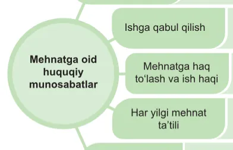

Ish beruvchi va xodim oʻrtasidagi mehnat shartnomasini tuzishga oid munosabatlar

Mehnatga haq toʻlash, xodimga uning mehnati uchun toʻlovlar belgilash va ularni amalga oshirishga oid munosabatlar

Mehnat qobiliyatini tiklash uchun ish oʻrni hamda oʻrtacha ish haqi saqlab qolingan holda xodim ishdan ozod etiladigan davrdagi munosabatlar

Ish beruvchi va xodim oʻrtasida yuzaga keladigan turli huquqiy kelishmovchiliklar

### Asosiy tushunchalar

> Mehnat huquqi — mehnat faoliyati jarayonida vujudga keladigan ish beruvchi va xodim oʻrtasidagi munosabatlarni tartibga soluvchi huquq sohasi hisoblanadi.

Bu huquq sohasi xodimlarning huquqlari va qonuniy manfaatlarini himoya qilish, adolatli va xavfsiz mehnat sharoitlarini taʼminlashga xizmat qiladi. Mehnat huquqi orqali ishga qabul qilish va boʻshatish tartibi, taʼtil berish shartlari, mehnat intizomi va javobgarlik masalalari aniqlanadi. Shu bilan birga, ish beruvchining majburiyatlari va xodimning huquqlari muvozanatda boʻlishi taʼminlanadi.

> Mehnat qonunchiligi manbalari — bu mehnatga oid huquqiy munosabatlarni tartibga soluvchi normativ-huquqiy hujjatlardir.

### Tarixga nazar

Quyidagi tarixiy manbadan keltirilgan parcha bilan tanishib chiqing. Uning mohiyatini muhokama qiling.

"Agar kishi har qancha oliy nasab va asl boʻlsa, ammo hunari boʻlmasa, xaloyiqning izzat va hurmatidin noumid boʻlur. Agar kishida ham nasab gavhari va ham hunar zevari (ziynati) boʻlmasa, undan battarroqdur.

Jahd qilgʻil, agar gavharing har nechakim asl boʻlsa, unga gʻarra boʻlmagʻil, nedinkim tan gavhari hunar zevari bila muzayyan (ziynatlangan) boʻlmasa, u hech narsaga arzimagusidur.

Andoqkim debdurlar: "Ulugʻlik aql va donishlik biladur, gavhar va nasab bila

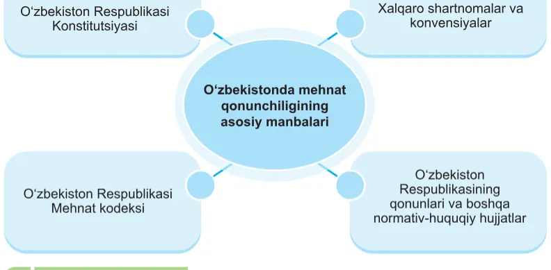

### Yodda tuting

Bolalar mehnatining ogʻir shakllarini taqiqlash va yoʻq qilishga doir shoshilinch choralar toʻgʻrisidagi Konvensiya — Xalqaro Mehnat tashkiloti tomonidan 1999-yil 17-iyunda qabul qilingan. Mazkur Konvensiya 18 yoshgacha boʻlgan bolalar uchun eng yomon mehnat shakllarini cheklaydi. Masalan, bolalarni majburiy mehnatga, noqonuniy faoliyatlar va xavfli ishlarga jalb etishni taqiqlaydi.

Mehnatga oid munosabatlarni tartibga solishning asosiy prinsiplari Mehnat huquqlarining tengligi, mehnat va mashgʻulotlar sohasida kamsitishni taqiqlash — har bir shaxs mehnat qilish huquqiga ega va hech kim ishga qabul qilishda yoki mehnat qilish jarayonida kamsitilmasligini anglatadi.

Mehnat erkinligi va majburiy mehnatni taqiqlash — har bir inson oʻz xohishiga koʻra ish joyini tanlash huquqiga ega va hech kim majburiy ishlarga jalb etilishi mumkin emas.

Mehnat sohasidagi ijtimoiy sheriklik — mehnat munosabatlarini rivojlantirishda jamoat birlashmalari bilan hamkorlik yoʻlga qoʻyiladi. Xodimlarning huquq va qonuniy manfaatlarini ifoda etuvchi tashkilotlar bilan hamkorlik yoʻlga qoʻyiladi.

Masalan, davlat organlari xodimlarning huquqlarini himoya qilishda kasaba uyushmalarining faoliyatini doimo qoʻllab-quvvatlaydi.

Mehnat huquqlari taʼminlanishining va mehnat majburiyatlari bajarilishining kafolatlanganligi — xodimlarning mehnat huquqlari himoya qilinadi va ish beruvchi ham, xodim ham oʻz majburiyatlarini bajarishi shart.

Xodimning huquqiy holati yomonlashishiga yoʻl qoʻyilmasligi — hech bir ichki hujjat, ish beruvchining yakka tartibdagi hujjati xodimning huquqiy holatini normativ-huquqiy hujjatlarga nisbatan yomonlashtirishi mumkin emas.

### Izlanishda davom eting

Quyidagi vaziyatlarda mehnatga oid munosabatlarni huquqiy jihatdan tartibga solishning qaysi prinsiplari buzilgan deb oʻylaysiz?

1-vaziyat. Korxona direktori umumxalq bayrami munosabati bilan kasaba uyushmasining taklifiga asosan mukofot puli beriladigan xodimlarning roʻyxatini shakllantirdi. Ushbu roʻyxatga birinchilardan boʻlib, oʻziga yaqin xodimlarni kiritdi. Mukofot puli olmagan xodimlar eʼtiroz bildirganda, direktor xodimlar tomonidan asossiz norozilik bildirganliklari uchun "jazo" sifatida qoʻshimcha haq toʻlanmaydigan ishlarni bajarishni yukladi.

2-vaziyat. Malika doʻkonda sotuvchi boʻlib ishlaydi va uning ish vaqti kuniga 8 soat qilib belgilangan. Doʻkon mudiri ish hajmi oshgani uchun Malikaga har kuni IO soat ishlashi kerakligini, lekin buning uchun qoʻshimcha ish haqi toʻlanmasligini bildirdi. 3-vaziyat. Aziz xususiy firmada ishlaydi, lekin boshqa joydan yaxshiroq ish taklifini oldi. U direktorga ariza yozib, shartnomaga koʻra oʻz xohishiga binoan ishdan ketmoqchi ekanligini bildirdi. Direktor ish beruvchi sifatida firmaning kelajagi uchun Aziz yaxshi xodim ekanligini vaj qilib, mehnat shartnomasini bekor qilishga rozi boʻlmadi.

4-vaziyat. Qurilish kompaniyasidagi xodimlar xavfsizlik vositalari yetarli emasligidan shikoyat qilishdi. Kasaba uyushmasi kompaniya rahbariyati bilan masalani muhokama qilib, barcha xodimlarga zarur himoya kiyimlari berilishini talab qildi. Ammo qurilish kompaniyasining boshligʻi hozirda mablagʻlar yetarli emasligidan kelib chiqib, xodimlar oʻz hisobidan xavfsizlik vositalarini sotib olishini buyurdi.

## 2-dars. Aholini ishga joylashtirish

1. Ish izlab topishning qanday usullarini bilasiz? Ularga misol keltiring?

2. Ishga joylashishda qanday hujjatlar kerak boʻladi, deb oʻylaysiz?

3. 18 yoshga toʻlmagan shaxslar ishga kirish uchun ota-onasidan rozilik olishi talab etiladimi? Nima uchun?

4. Ishga joylashish uchun sizda qanday bilim va malaka boʻlishi kerak, deb oʻylaysiz?

5. Shaxslar necha yoshdan mehnat faoliyatiga oid huquqiy munosabatlarning ishtirokchisi boʻla oladi?

6. 3-rasmda ishga joylashishga oid qanday jarayon tasvirlangan?

### Yodda tuting

Davlat ishsizlikni kamaytirish, mehnat bozorini tartibga solish va fuqarolarga munosib ish topishda yordam berish uchun turli choralarni amalga oshiradi.

Masalan, davlat mehnat organlari orqali ish qidirayotgan fuqarolarni roʻyxatga oladi va ularni boʻsh ish oʻrinlari bilan taʼminlashga harakat qiladi. Shuningdek, davlat organlari aholining bandligini oshirish maqsadida kasbga qayta tayyorlash va malaka oshirish dasturlarini ishlab chiqadi. Ayniqsa, yoshlar, nogironligi boʻlgan shaxslar va boshqa ijtimoiy himoyaga muhtoj shaxslar uchun maxsus dasturlar mavjud.

### Qonun belgilaydi

Davlat fuqarolarning bandligini taʼminlash, ularni ishsizlikdan himoya qilish, shuningdek kambagʻallikni qisqartirish choralarini koʻradi.

Davlat fuqarolarning kasbiy tayyorgarligini va qayta tayyorlanishini tashkil etadi hamda ragʻbatlantiradi.

Ish bilan taʼminlash sohasida davlat tomonidan taqdim etiladigan kafolatlarga quyidagi misollarni keltirish mumkin:

Minimal ish haqi kafolati davlat mehnatga haq toʻlashning eng kam miqdorini belgilaydi.

Ish beruvchilar oʻz xodimlariga mazkur summadan kam ish haqi berishi mumkin emas

Mehnat yarmarkalari Ish izlayotgan shaxslar uchun ish beruvchilar bilan hamkorlikda uchrashuvlar tashkil qilinadi

Yangi korxonalar ochish davlat tashabbusi bilan yirik sanoat zonalari tashkil etilib, ish oʻrinlari koʻpaytiriladi

Ishsizlik nafaqasi Agar shaxs ishsiz qolsa, davlat unga vaqtinchalik moddiy yordam koʻrsatadi

Malaka oshirish kurslari Ish topa olmaganlar uchun davlat bepul kasb-hunar kurslarini tashkil qiladi. Ularning malakasini oshiradi

Mehnat qonunchiligi talablariga rioya qilish Ish beruvchilar xodimlar uchun talablarga javob beradigan mehnat qilish sharoitini yaratib berishga majburdirlar

Davlat dasturlari turli ijtimoiy davlat dasturlari orqali ehtiyojmand aholi qatlamlariga ish topishda yordam beriladi

Ishga joylashish markazlari Har bir hududda bandlikka koʻmaklashuvchi markazlar yaratilgan boʻlib, ular orqali fuqarolar ish topishi mumkin

### Asosiy tushunchalar

> Kasbiy koʻnikmalar markazlari — bu Oʻzbekistonda fuqarolarni kasb-hunarga oʻrgatish va ishga joylashishlariga yordam beradigan maxsus markazlar boʻlib, ular tegishli davlat organi tomonidan boshqariladi.

Bunday markazlar fuqarolarni bepul kasb-hunarga oʻrgatish, ishga joylashishda yordam berish, chet tillari va zamonaviy koʻnikmalarni oʻrgatishga koʻmaklashadi.

Qanday holatda siz ishsiz hisoblanasiz?

Ishsizlar — oʻn olti yoshdan to pensiya bilan taʼminlanish huquqini olishgacha boʻlgan yoshdagi, haq toʻlanadigan ishga yoki daromad keltiradigan mashgʻulotga ega boʻlmagan, tegishli mahalliy mehnat organlari tomonidan roʻyxatdan oʻtkazilgan shaxslardir.

Bunda taʼlim muassasalarida oʻqiyotganlar ishsiz hisoblanmaydi.

Davlat ishsiz shaxslarga quyidagi kafolatlarni belgilaydi:

ishsizlik nafaqasi toʻlanishi;

mehnat organlarining yoʻllanmasi boʻyicha kasbga tayyorlash, qayta tayyorlash yoki malaka oshirish davrida stipendiya toʻlanishini va shu davr umumiy mehnat stajiga qoʻshilishini;

mahalliy mehnat organlarining yoʻllanmasiga koʻra bepul, shu jumladan, grantlar hisobidan kasbga tayyorlash, qayta tayyorlash va malaka oshirishni;

haq toʻlanadigan jamoat ishlariga jalb etish imkoniyatini;

tadbirkorlik faoliyatiga jalb etishga hamda shaxsiy tomorqa yer uchastkalarini rivojlantirishga qaratilgan subsidiyalarni olish imkoniyatini;

mahalliy mehnat organlarining taklifiga koʻra ishlash uchun ixtiyoriy ravishda boshqa yerga koʻchib oʻtish bilan bogʻliq xarajatlar kompensatsiya qilinishini.

### Yodda tuting

Belgilangan tartibda ishsiz deb eʼtirof etilgan shaxslar ishsizlik nafaqasini olish huquqiga ega.

Ishsizlik nafaqasini toʻlash ishsiz shaxsning yashash joyi boʻyicha davlat jamgʻarmasi mablagʻlari hisobidan amalga oshiriladi.

Ishsizlik nafaqasiga soliq solinmaydi.

Ishsizlik nafaqasi ishsiz deb tan olingan shaxsga u mahalliy mehnat organida ish qidirayotgan shaxs sifatida roʻyxatga olingan birinchi kundan eʼtiboran hisoblanadi va toʻlanadi. Ishsizlik nafaqasi oʻn ikki oylik davr ichida koʻpi bilan yigirma olti kalendar hafta davomida toʻlanadi.

Ishsizlik nafaqasining miqdori qancha?

Ishsizlik nafaqasining miqdori turlicha boʻlishi mumkin. Masalan, ishdan va ish haqidan (mehnat daromadidan) soʻnggi oʻn ikki oylik davr ichida mahrum boʻlgan shaxslarga — avvalgi ish joyidagi oʻrtacha oylik ish haqining ellik foizi miqdorida belgilanadi.

Lekin ilgari ishlamagan va birinchi marta ish qidirayotgan shaxslarga mehnatga haq toʻlash eng kam miqdorining kamida yetmish besh foizida boʻladi.

### Tarixga nazar

"Temur tuzuklari"dagi "Vazir tutish tuzugi" bobidan olingan quyidagi parcha bilan tanishib chiqing. Zamonaviy davrda ishga qabul qilishda qoʻllaniladigan talablarni muhokama eting.

"Amr qildimki, vazirlar ushbu toʻrt sifatga ega boʻlgan kishilardan boʻlishlari lozim;

birinchisi — asillik, toza nasllilik;

ikkinchisi — aql-farosatlilik;

uchinchisi — sipoh-u raiyat ahvolidan xabardorlik, ularga nisbatan yaxshi muomalada boʻlishlik;

toʻrtinchisi — sabr-chidamlilik va tinchliksevarlik.

Kimki shu toʻrt sifatga ega boʻlsa, unday odamni vazirlik martabasiga loyiq kishi deb bilsinlar. Uni vazir yoki maslahatchi etib tayinlasinlar. Mamlakat ishlarini, sipoh va raiyat ixtiyorini unga topshirsinlar. Bunday vazirga toʻrt imtiyoz: ishonch, eʼtibor, ixtiyor va iqtidor berilsin. Kamolotga erishgan vazir ulkim, davlat muomalalarini tartibga keltirib, mulkiy va moliyaviy ishlarni toʻgʻrilik bilan, asli-nasli tozaligini koʻrsatib, ajoyib tarzda bajaradi".

### Izlanishda davom eting

Oʻzbekiston Respublikasi Mehnat kodeksining 118-moddasi bilan tanishib chiqing. Ishga qabul qilishga yoʻl qoʻyiladigan yosh masalasini muhokama qiling. Quyida keltirilgan vaziyatlarni mazkur norma asosida tahlil eting.

1-vaziyat. Ahrorjon oʻn toʻrt yoshda. U juda yosh boʻlishiga qaramasdan, karate sport turi boʻyicha jahon chempioni boʻlib ulgurgan. "Humo" karate sport jamoasi Ahrorjonni murabbiy yordamchisi sifatida ishga qabul qilishni rejalashtirmoqda. Ahrorjonning ota-onasi bunga rozi boʻlishdi

2-vaziyat. Farzona oʻn ikki yoshda. Yoshiga nisbatan uning suxandonlik iqtidori ancha yuqori. Ozining blogerlik faoliyatini ota-onasining koʻmagi bilan olib boradi. Farzonani "Bolajon" televideniyesiga boshlovchi sifatida ishga taklif etishdi. Farzonaning onasi juda xursand boʻldi. Biroq uning otasi qizining mehnat faoliyatini boshlashiga hali juda erta ekanligini taʼkidladi.

3-vaziyat. Aʼzamjon oʻn sakkiz yoshga toʻlishi bilan ota-onasiga koʻmaklashish maqsadida maktabdan boʻsh vaqtida "Dunyo" mehmonxonasida menejerlik faoliyatini boshlab yubordi. Uning ota-onasi mehnat qilish uchun hali "vaqtli" ekanligini aytib, Aʼzamjon faqat taʼlim olishga diqqat qilishini bildirishdi.

## 3-dars. Mehnat shartnomasi

### Faollashtiruvchi savollar

Quyida keltirilgan mehnat shartnomasida belgilanishi lozim boʻlgan maʼlumotlarni oʻzaro moslashtiring. Soʻngra quyidagi savollarga javob bering.

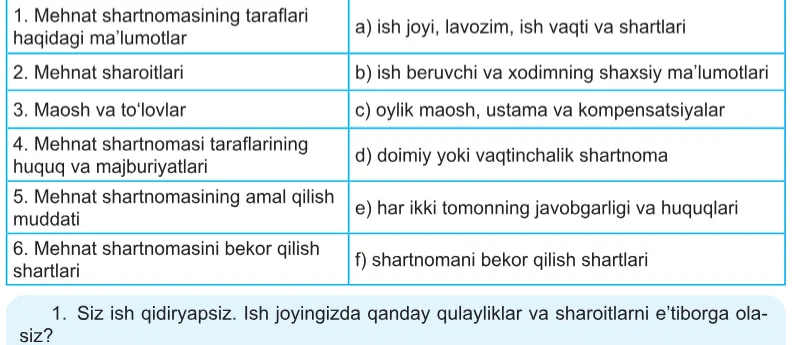

2. Siz ish beruvchisiz. Korxonangizdagi xodimlar bilan mehnat shartnomasi tuzishingiz kerak, qanday qoidalarga amal qilasiz?

3. Korxonangizda ish boshqaruvchilik uchun boʻsh ish oʻrnini eʼlon qildingiz. Eʼlon boʻyicha bir nafar oʻn yetti yoshli maktab oʻquvchisi, bir nafar homilador ayol va bir nafar pensioner ish soʻrab keldi. Siz qaysi biri bilan mehnat shartnomasini imzolaysiz? Nima uchun?

4. Mehnat shartnomasining huquqiy asosi nima, deb oʻylaysiz?

### Asosiy tushunchalar

> Mehnat shartnomasi — bu ish beruvchi va xodim oʻrtasida tuziladigan huquqiy hujjat boʻlib, unda mehnat munosabatlarining asosiy shartlari belgilab qoʻyiladi.

Xodim va ish beruvchi mehnat shartnomasining taraflaridir. Mehnat shartnomasi xodim va ish beruvchi oʻrtasida yozma shaklda tuziladigan kelishuv boʻlib, unga koʻra xodim muayyan ishni bajarishni zimmasiga oladi. Ish beruvchi esa mehnat sharoitlarini yaratish, ish haqi toʻlash va qonunchilikda nazarda tutilgan boshqa majburiyatlarni bajarishi lozim.

Mehnat shartnomasi ish beruvchi va xodim tomonidan imzolangan kundan eʼtiboran kuchga kiradi. Xodim mehnat shartnomasida belgilangan sanadan eʼtiboran mehnat vazifalarini bajarishga kirishishi shart.

### Yodda tuting

Mehnat shartnomasini tuzish va bekor qilish, shuningdek unga oʻzgartish va qoʻshimchalar kiritish qonunchilikda belgilangan tartibda "Yagona milliy mehnat tizimi" idoralararo dasturiy-apparat kompleksida roʻyxatdan oʻtkazilishi shart.

"Yagona milliy mehnat tizimi" idoralararo dasturiy-apparat kompleksidan foydalanish barcha shaxslar uchun bepuldir. Mehnat munosabatlariga oid hujjatlarni rasmiylashtirishda mazkur tizimdan foydalanish barcha shaxslar uchun majburiydir. my.mehnat.uz sayti orqali mehnatga oid koʻplab huquqiy harakatlarni amalga oshirish mumkin.

### Qonun belgilaydi

Mehnat shartnomasi bir xil kuchga ega boʻlgan kamida ikki nusxada yozma (qogʻozda yoki elektron) shaklda tuzilib, ularning har biri taraflar tomonidan imzolanadi.

Elektron shakldagi mehnat shartnomasi qonunchilikda belgilangan tartibda "Yagona milliy mehnat tizimi" idoralararo dasturiy-apparat majmuyida rasmiylashtiriladi.

Oʻzbekiston Respublikasining Mehnat kodeksi, 106-modda

Ishga joylashishda quyidagi hujjatlar talab etiladi:

pasport yoki identifikatsiyalovchi ID-karta, oin olti yoshgacha boʻlgan shaxslar uchun tugʻilganlik toʻgʻrisidagi guvohnoma;

oxirgi ish joyi boʻyicha tasdiqlangan qogʻoz shaklidagi mehnat daftarchasi yoki elektron mehnat daftarchasidan koʻchirma (bundan birinchi marta ishga kirayotgan shaxslar mustasno);

harbiy xizmatga majburlar yoki chaqiriluvchilar uchun tegishliligiga koʻra harbiy guvohnoma yoki harbiy hisobda turganlik haqidagi guvohnoma;

Oliy yoki oʻrta maxsus, professional taʼlim tashkilotini tamomlaganligi toʻgʻrisidagi diplom, yoki ishga oid guvohnoma (sertifikat) yoxud boshqa tegishli hujjat;

jismoniy shaxsning shaxsiy identifikatsiya raqami (JShShlR).

### Yodda tuting

Mehnat shartnomasiga qonunchilikka zid shartlar kiritilishi shartnomaning toʻliq yoki qisman haqiqiy emas deb topilishiga sabab boʻladi. Mehnat shartnomasining mazmunida xodimning holatini mehnat toʻgʻrisidagi qonunchilikka va mehnat haqidagi boshqa normativ-huquqiy hujjatlarga nisbatan yomonlashtiradigan shartlar kiritilsa, mehnat shartnomasining mazkur qismi haqiqiy emas deb topiladi.

Ammo unutmaslik lozimki, mehnat shartnomasi ayrim shartlarining haqiqiy emas deb topilishi mehnat shartnomasining umumiy yuridik kuchiga taʼsir etmaydi. Bu mehnat shartnomasining qisman haqiqiy emas deb topilishiga misol boʻla oladi. Umuman olganda, bunday holatlar yuz bermasligi uchun xodimlar mehnat shartnomasini imzolashdan avval uning shartlari bilan yaqindan tanishib chiqishlari lozim. Aks holda, xodimlarning huquqlari ish beruvchilar tomonidan buzilishi kabi holatlarni keltirib chiqarishi mumkin.

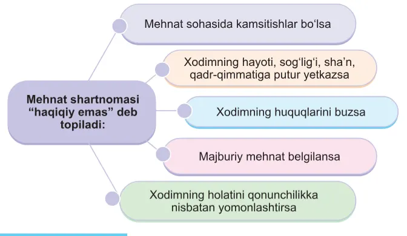

### Xulosa qiling

Xodimni boshqa ishga doimiy oʻtkazishga faqat uning roziligi bilan yoʻl qoʻyiladi. Bu borada mehnat shartnomasini oʻzgartirish ish beruvchining buyrugʻi bilan rasmiylashtiriladi. Xodimni vaqtincha boshqa ishga oʻtkazishda esa aniq muddat belgilanishi kerak.

Mehnat shartnomasi oʻzgartirilganligini qonunga xilof deb hisoblovchi xodim oʻzi bilan tuzilgan mehnat shartnomasi oʻzgartirilganligi ustidan shikoyat qilishga haqli.

Agar mehnat sharoitlarining qonunga xilof deb eʼtirof etilgan oʻzgarishlari xodimning mehnatga haq toʻlash miqdori kamayishiga olib kelgan boʻlsa, xodimning oʻziga yetkazilgan moddiy zararning oʻrnini qoplash haqidagi talablari sud tomonidan qanoatlantiriladi.

Agar mehnat shartnomasi qonunga xilof ravishda oʻzgartirilganligi munosabati bilan xodimga maʼnaviy yoki jismoniy zarar yetkazilgan boʻlsa, xodimning oʻziga yetkazilgan maʼnaviy ziyonni kompensatsiya qilish haqidagi talablarini sud qanoatlantirishi mumkin.

### Fikrimizni tasdiqlaymiz

Demak, xodim mehnat shartlarini oʻzgartirishni talab qilishga haqlidir va bunday ariza uch kundan kechiktirmay ish beruvchi tomonidan koʻrib chiqilishi shart.

Mehnat shartlarini oʻzgartirish haqidagi talab rad etilgan taqdirda, rad etish sababi yozma shaklda maʼlum qilinishi shart.

Mehnat shartlarini rad etganlik ustidan tegishli organlarga shikoyat qilish mumkin.

### Izlanishda davom eting

Quyida keltirilgan sud ishi bilan tanishib chiqing. Holatni muhokama qiling.

Shaxsiy xulosalaringizni ishlab chiqing.

1997-yilda mehnat munosabatlariga oid "Vizcaino Microsoft korporatsiyasiga qarshi sud ishi" boʻlib oʻtgan. Unda "Microsoft" korporatsiyasi magʻlub boʻlib, Donna Vizcainoning daʼvosi qanoatlantirilgan.

Nizo qanday kelib chiqqan edi?

"Microsoft" korporatsiyasi Vizcaino va uning jamoasi bilan xizmat koʻrsatish shartnomasi tuzadi. Biroq shartnoma shartlarini bajarishda "Microsoft" korporatsiyasi Vizcaino va uning jamoasiga mehnat shartnomasida belgilanadigan talablarni qoʻyadi. Misol uchun ish vaqti, dam olish vaqti, mehnat majburiyatlari yuklanadi. Bajarilgan ishlar uchun toʻlovlar esa xizmat koʻrsatish shartnomasidan kelib chiqadi.

Vizcaino va uning jamoasi bu holatdan norozi boʻlib, sudga murojaat qiladi. Sud "Microsoft" kompaniyasi tomonidan Vizcaino va uning jamoasini mustaqil xizmat koʻrsatuvchi sifatida tasniflashini qonunchilikka zid deb topadi. Ular kompaniya xodimlarining maqomiga tenglashtiriladi. Kompaniya Vizcaino va uning jamoasi aʼzolariga xodimlarga taalluqli boʻlgan imtiyozlar, ragʻbat va qoʻshimcha toʻlovlarni amalga oshirish majburiyatini oladi. Shu sababli, mehnat shartnomasi va xizmat koʻrsatish shartnomalarini oʻzaro farqlab olish talab etiladi.

## 4-dars. Ish vaqti va dam olish vaqti

### Faollashtiruvchi savollar

1. Rasmlarga eʼtibor bering. Ularning qay birida har kungi ishning davomiyligi aks ettirilgan?

2. Olti kunlik ish haftasida xodim bir kunda necha soat ishlashi kerak? Qaysi rasmda olti kunlik ish haftasida har kungi ishning (smenaning) davomiyligi keltirilgan?

3. Tungi vaqtdagi ishning davomiyligi qaysi vaqt oraligʻida deb oʻylaysiz?

4. Rasmlarning qay birida tungi vaqtdagi ishning davomiyligi koʻrsatilgan?

5. Besh kunlik ish haftasida xodim bir kunda necha soat ishlaydi? Qaysi rasmda besh kunlik ish haftasida har kungi ishning (smenaning) davomiyligi keltirilgan?

6. Bayram kunlari arafasida xodimlar uchun ish vaqti kamida necha soatga qisqartirilishini bilasizmi?

### Asosiy tushunchalar

> Ish vaqti — bu xodim mehnat shartnomasi yoki qonunchilik bilan belgilangan tartibda oʻz xizmat vazifalarini bajarishi lozim boʻlgan vaqt davridir.

Xodim ichki mehnat tartib-qoidalariga, smenalarga boʻlinib ishlash jadvallariga, boshqa ichki hujjatlarga yoki mehnat shartnomasi shartlariga muvofiq mehnat majburiyatlarini qaysi vaqt mobaynida bajarishi kerak boʻlsa, oʻsha vaqt ish vaqtidir.

### Yodda tuting

Ish beruvchi tomonidan xodimni belgilangan ish vaqti davomiyligidan tashqari ishga jalb etishi ish vaqtidan tashqari ish deb hisoblanadi.

Ish vaqtidan tashqari ishning davomiyligi xodim uchun surunkasiga ikki kun davomida toʻrt soatdan (mehnat sharoitlari noqulay boʻlgan ishlarda — bir kunda ikki soatdan) va yiliga bir yuz yigirma soatdan oshmasligi kerak.

Ish beruvchi xodimning ish vaqtidan tashqari ishining davomiyligi aniq hisobga olinishini taʼminlashi shart. Ish vaqtidan tashqari ishning soatlari miqdorini aniqlash tartibi ish vaqtini hisobga olish turiga bogʻliqdir. Xodimning xohishiga koʻra ish vaqtidan tashqari ish uchun oshirilgan haq toʻlash oʻrniga ish vaqtidan tashqari ishlab berilgan vaqtning davomiyligiga muvofiq keladigan qoʻshimcha dam olish vaqtini berish bilan kompensatsiya qilinishi mumkin.

Soat 22:00 dan to soat 6:00 gacha boʻlgan vaqt tungi vaqt hisoblanadi.

Tungi vaqtdagi, shuningdek koʻp smenali rejimdagi ish uchun ish haqiga doir qoʻshimcha toʻlovning aniq miqdori ichki hujjatlarda yoxud mehnat shartnomasida belgilanadi.

Ayrim toifadagi xodimlar uchun ularning yoshi, sogʻligʻining holati, mehnat shartlari, mehnat vazifalarining oʻziga xos xususiyatlari va boshqa holatlar hisobga olingan holda qonunchilikka muvofiq mehnatga toʻlanadigan haqni kamaytirmasdan ish vaqtining qisqartirilgan davomiyligi belgilanadi.

Mehnat shartnomasi taraflarining kelishuviga koʻra xodimga ishga qabul qilish chogʻida toʻliqsiz ish vaqti belgilanishi mumkin. Toʻliqsiz ish vaqti ham muddati cheklanmagan holda, ham mehnat shartnomasi taraflari kelishgan har qanday muddatga belgilanishi mumkin.

Xodim uchun ish vaqtining normal davomiyligi besh kunlik yoki olti kunlik ish haftasiga qirq soatdan ortiq boʻlishi mumkin emas.

### Har kungi ishning (smenaning) davomiyligi qanday?

Olti kunlik ish haftasida — yetti soatdan oshishi mumkin emas. Besh kunlik ish haftasida — sakkiz soatdan oshishi mumkin emas. 15—16 yoshgacha boʻlgan xodimlar uchun — olti kunlik ish haftasida — toʻrt soatdan, besh kunlik ish haftasida — besh soatdan oshishi mumkin emas.

16—18 yoshgacha boʻlgan xodimlar uchun esa olti kunlik ish haftasida — olti soatdan, besh kunlik ish haftasida — yetti soatu oʻttiz daqiqadan oshishi mumkin emas.

I va II guruh nogironligi boʻlgan xodimlar yoki noqulay mehnat sharoitlaridagi ishlarda band boʻlgan xodimlar uchun kunlik ishning (smenaning) davomiyligi olti kunlik ish haftasida — olti soatdan, besh kunlik ish haftasida — yetti soatu oʻttiz daqiqadan ortib ketmasligi kerak.

Har yilgi asosiy eng kam mehnat taʼtilining davomiyligi yigirma bir kalendar kunni tashkil etadi.

Xodimlarga onalik, bolalarni parvarishlash, taʼlim olish uchun qulay shart-sharoitlar yaratish maqsadida, shuningdek boshqa ijtimoiy maqsadlarda beriladigan taʼtillar.

Mehnat shartnomasi yoki boshqa mehnatga oid ichki hujjatlarda ish haqi qisman saqlanadigan taʼtil nazarda tutilishi mumkin. Bunday taʼtilning davomiyligi toʻgʻrisidagi masala taraflarining kelishuviga koʻra hal etiladi.

Xodimning yozma arizasiga koʻra unga ish haqi saqlanmaydigan taʼtil berilishi mumkin boʻlib, uning davomiyligi xodim va ish beruvchi oʻrtasidagi kelishuvga koʻra belgilanadi, lekin u oʻn ikki oylik davr mobaynida jami uch oydan ortiq boʻlmasligi kerak.

Dam olish vaqti — xodim mehnat majburiyatlarini bajarishdan ozod boʻlgan va oʻz ixtiyoriga koʻra foydalanishi mumkin boʻlgan vaqtdir.

Dam olish vaqtining qanday turlari mavjud?

ish kuni davomidagi tanaffuslar;

har kungi (smenalar oraligʻidagi) dam olish;

dam olish kunlari (har haftalik uzluksiz dam olish);

ishlanmaydigan bayram kunlari;

har yilgi asosiy va qoʻshimcha mehnat taʼtillari.

### Tarixga nazar

Milodiy 321-yilda Rim imperatori Konstantin I tomonidan chiqarilgan farmon asosida yakshanba kuni dam olish kuni sifatida rasman belgilangan. Bu tarixiy qaror Rim imperiyasida diniy va ijtimoiy hayotda muhim burilish yasagan edi.

Farmonga koʻra, "Quyosh kuni" (ingliz tilida "Sun day") sharafiga shaharlardagi sudlar, hukumat idoralari va korxonalar ishlamasligi belgilab berilgan.

Qishloqlarda esa zarurat boʻlsa, ishlashga ruxsat berilgan edi.

### Izlanishda davom eting

Pandemiya boshida IT-kompaniya xodimasini Zoom orqali 2 daqiqada ishdan boʻshatishgan. U sudga murojaat qilib, ishdan boʻshatish tartibi va sabablari tushuntirilmaganini daʼvo qilgan.

Sud uning tarafini oldi, chunki raqamli format ish beruvchining barcha qonuniy kafolatlarni saqlash majburiyatini bekor qilmaydi.

Nima deb oʻylaysiz, yangi texnologiyalar tufayli mehnat qonunchiligi oʻzgarishi kerakmi?

## 5-dars. Mehnatga haq toʻlash

### Faollashtiruvchi savollar

Quyidagi vaziyatlarga eʼtibor qiling va savollarga javob bering.

1. Ahrorjon oʻz korxonasida faoliyat olib borayotgan xodimlarga oylik maoshini oʻz vaqtida bera olmadi. Shunda xodimlar davlat mehnat inspeksiyasiga murojaat etishdi. Nima deb oʻylaysiz, bu holatda xodimlar yana qanday choralar koʻrishi mumkin?

2. Aziza yuz parvarishi vositalari savdosi bilan shugʻullanuvchi xususiy tashkilotda ishlaydi. Uning oylik maoshi sotuvdan tushgan foyda bilan belgilanar edi. Biroq tashkilot direktori kelasi oydan oylik maosh oʻrniga Azizaga oʻzi sotayotgan mahsulotlardan berilishini aytdi.

Mazkur vaziyatda qanday qonun buzilish holatlari mavjud? Fikringizni asoslang.

3. Aʼzamjon mehmonxonada ish boshqaruvchi boʻlib ishlaydi. Uning oylik maoshi yigirma million soʻm. Oʻzbekiston qonunchiligi boʻyicha jismoniy shaxslardan quyidagi soliq va majburiy toʻlovlar ushlab qolinadi:

daromad soligʻi (12.0 %);

kasaba uyushmasi uchun toʻlov (1.0 %);

Soliq va majburiy toʻlovlarni chegirib qolganda Aʼzamjonning qoʻlida qancha miqdordagi pul qoladi? Hisoblab chiqing.

### Asosiy tushunchalar

Mehnatga haq toʻlash — ish beruvchi tomonidan xodimga uning mehnati uchun toʻlovlar belgilash va ularni amalga oshirishga oid boʻlgan munosabatlar tizimidir.

Ish haqi milliy valyutada toʻlanadi. Mehnatga natura shaklida haq toʻlash cheklanadi. Ish haqini qarz majburiyatlari va tilxatlar tarzida toʻlash taqiqlanadi.

Mehnat shartnomasida belgilangan mehnatga haq toʻlash shartlari mehnat toʻgʻrisidagi qonunchilikda va mehnat haqidagi boshqa huquqiy hujjatlarda belgilanganiga nisbatan yomonlashtirilishi mumkin emas.

Mehnatga haq toʻlash miqdori biror-bir eng koʻp miqdor bilan cheklanmaydi.

Xodimlarning mehnatiga haq toʻlash sohasidagi asosiy kafolatlar:

mehnatga haq toʻlash sohasida kamsitishni taqiqlash, teng qiymatli mehnat uchun erkaklar va ayollarga teng miqdorda haq toʻlanish; mehnatga haq toʻlashning eng kam miqdorini belgilash;

ish beruvchining oʻz moliyaviy ahvolidan qatʼi nazar, xodimlar tomonidan bajarilgan ish uchun haq toʻlashni amalga oshirish majburiyatini mustahkamlab qoʻyish, mehnatga natura shaklida haq toʻlanishini cheklash;

ish haqini toʻlash tartibi va muddatlariga doir talablarni tartibga solish;

ish vaqtidan tashqari, dam olish va ishlanmaydigan bayram kunlari, tungi vaqtda ishlash uchun mehnatga haq toʻlash;

budjet tashkilotlari xodimlari uchun mehnatga haq toʻlashning davlat tariflarini belgilash; xodimning ish haqidan ushlab qolish miqdorini cheklash;

xodimning ishlab topilgan mablagʻlarni erkin tasarruf etishini cheklashni taqiqlash, bundan qonunda nazarda tutilgan hollar mustasno;

xodimlarga ish haqi oʻz vaqtida toʻlanishini taʼminlash.

### Qonun belgilaydi

Mehnatga haq toʻlashning eng kam miqdori insonning munosib turmush darajasini taʼminlash zarurati hisobga olingan holda belgilanadi.

Mehnat kodeksiga koʻra mehnatga haq toʻlashning eng kam miqdori Oʻzbekiston Respublikasining butun hududida bir vaqtning oʻzida belgilanadi hamda tashkiliy-huquqiy shakllaridan, mulkchilik shakllaridan va idoraviy boʻysunuvidan qatʼi nazar, barcha ish beruvchilar uchun majburiydir.

### Yodda tuting

Mehnat haqining miqdori ish beruvchi va xodimning oʻzaro kelishuvi boʻyicha belgilanadi. Xodimlarga ish haqi, qoida tariqasida, ular ishlayotgan joyda toʻlanadi.

Ish haqini taqiqlangan shakllarda toʻlaganlik uchun mansabdor shaxslarga maʼmuriy jarima belgilangan.

Xodimlarga ish haqi toʻlash muddatlari ichki hujjatda yoki mehnat shartnomasida shart qilib koʻrsatilgan muddatlarda belgilanadi. Ish haqi toʻlash muddatlari har yarim oyda bir martadan kam boʻlishi mumkin emas.

Ish beruvchi ish haqini, taʼtil toʻlovlarini va xodimga toʻlanishi lozim boʻlgan boshqa toʻlovlarni toʻlash muddatini buzgan taqdirda, ularni toʻlov muddatidan keyingi kundan eʼtiboran har bir kechiktirilgan kun uchun Oʻzbekiston Respublikasi markaziy bankining oʻsha vaqtda amalda boʻlgan qayta moliyalashtirish stavkasidan kelib chiqqan holda foizlar (pullik kompensatsiya) bilan birga toʻlashi shart.

### Ijodiy faoliyat

Quyidagi vaziyatni muhokama qiling. Fikringizni asoslab bering.

Siz ish beruvchisiz.

KPI (ingliz tilida "key performance indicators" — samaradorlikning asosiy koʻrsatkichlari) tizimini oʻrnatish orqali oʻz xodimlaringizning ish haqini oshirishni maqsad qilgansiz. Masalan, ish boshqaruvchilarga har bir jalb etgan mijozi uchun ish haqining besh foizi miqdorida qoʻshimcha ustamalar belgilashni reja qilmoqdasiz.

Ish beruvchi sifatida xodimlarning qanday samaradorlik koʻrsatkichlari uchun qoʻshimcha ustamalar belgilagan boʻlar edingiz?

### Qonun belgilaydi

Xoʻjalik yurituvchi subyektlarga va boshqa tashkilotlarga ish haqi, pensiyalar, nafaqalar, stipendiyalar va ularga tenglashtirilgan oʻzga toʻlovlarni toʻlash uchun pul mablagʻlari berishni bankning mansabdor shaxsi yoki xizmatchisi tomonidan asossiz ravishda kechiktirish, — bazaviy hisoblash miqdorining yigirma baravaridan qirq baravarigacha miqdorda jarima solishga sabab boʻladi.

### Hamkorlikda bajaramiz

Kichik guruhlarga boʻlining. Quyidagi jadvalni muhokama qiling. Siz ish beruvchi boʻlganingizda xodimlarga haq toʻlashning qaysi shaklidan foydalangan boʻlar edingiz?

Izoh. Ishbay — xodimga bajargan ish miqdoriga qarab haq toʻlanishini anglatadi. Vaqtbay — xodimga ish haqi ishlagan vaqti (soat, kun, oy) uchun toʻlanadi.

### Izlanishda davom eting

Quyida keltirilgan vaziyat bilan tanishib chiqing. Holatni muhokama qiling.

Shaxsiy xulosalaringizni ishlab chiqing.

AQSH ayollar futbol jamoasi ularning ish haqi miqdori erkak futbolchilardan keskin farq qilishi gender tengligi prinsiplariga toʻgʻri kelmasligini daʼvo qilib, 2019-yilda sudga murojaat qilishdi.

Ayollar jamoasi erkaklar jamoasidan koʻra koʻproq yutuqlarga erishgan boʻlsa-da, kamroq maosh va mukofot puli olishayotganligidan shikoyat qilishdi.

Maʼlumki, AQSH ayollar futbol jamoasi FIFA ayollar jahon chempionatida eng koʻp gʻolib boʻlgan jamoa hisoblanadi. Sudning qaroriga koʻra, AQSH ayollar futbol jamoasi 24 million dollar kompensatsiya olishgan. Shuningdek, sport qonunchiligida erkak va ayol futbolchilarga bir xil ish haqi va mukofotlar berish tartibi belgilandi.

### Ijodiy faoliyat

Siz mehnat huquqi boʻyicha xalqaro ekspertsiz. Toshkentdagi mehmonxona maʼmuriyati sizni alohida vazifa bilan chaqirib olgan. Sizga mehmonxonada xizmat koʻrsatish sifatini oshirish vazifasi yuklatilgan. Siz vazifani ado etishni xodimlarni qoʻllab-quvvatlashdan boshlamoqchisiz. Quyidagi savollarga javob bering:

Xodimlarni moddiy qoʻllab-quvvatlash uchun qanday ragʻbatlantirish choralarini taklif etasiz? Nima uchun?

Qoʻshimcha ish haqini belgilashda adolatni taʼminlash uchun qanday tavsiya berasiz? Qoʻshimcha ish haqini belgilash tartibi qanday hal etiladi? Nima uchun?

## 6-dars. Intizomiy va moddiy javobgarlik

Quyidagi vaziyatlarga eʼtibor qiling va savollarga javob bering.

1. Quyidagi holatlarda qaysi shaxs javobgarlikka tortilishi boʻyicha fikr yuriting: xodimning ish joyiga sababsiz kech kelishi;

bank jamgʻarmasini oʻgʻirlash uchun bostirib kirish;

xodim ish joyida uxlab qolishi oqibatida korxonaga moddiy zarar yetishi;

belgilanmagan hududlarga chiqindi tashlash.

2. Sizningcha, rasmlarning qay birida mehnat munosabatlariga oid intizomiy qilmish holatlari keltirilgan?

3. Javobgarlikning turlari (jinoiy, maʼmuriy, fuqaroviy, intizomiy) boʻyicha rasmlardagi holatlarni moslashtiring.

4. Rasmlardagi holatlar boʻyicha moddiy zarar kelib chiqadimi yoki maʼnaviy ziyon? Nima uchun? Fikringizni asoslang.

### Yodda tuting

Xodim tomonidan oʻz mehnat majburiyatlarini qasddan yoki ehtiyotsizlik oqibatida gʻayriqonuniy ravishda bajarmaganligi yoki lozim darajada bajarmaganligi intizomiy javobgarlikni keltirib chiqaradi.

Agar biror kishi oʻz tashkiloti yoki oʻquv muassasasidagi ichki tartib-qoidalarni buzsa, unga nisbatan intizomiy choralar qoʻllaniladi.

Har bir intizomiy qilmish uchun faqat bitta intizomiy jazo chorasi qoʻllanilishi mumkin. Intizomiy jazo chorasini tanlash huquqi ish beruvchiga tegishlidir. Intizomiy jazo chorasini qoʻllashda sodir etilgan qilmishning ogʻir-yengilligi, uning sodir etilishi holatlari, xodimning avvalgi ishi va xulq-atvori hisobga olinadi.

Xodimga intizomiy jazo chorasini qoʻllash ish beruvchining buyrugʻi bilan rasmiylashtiriladi. Xodim buyruq bilan tanishib chiqish huquqiga ega.

Oʻziga nisbatan intizomiy jazo chorasini qoʻllash haqidagi buyruq bilan tanishtirilmagan xodim intizomiy jazosi boʻlmagan deb hisoblanadi.

> Intizomiy javobgarlik — bu xodim tomonidan ichki tartib-qoidalarga rioya qilmaganligi uchun qoʻllaniladigan huquqiy javobgarlik turi.

Agar xodim mehnat intizomi qoidalarini buzsa, ish beruvchi xodimga nisbatan intizomiy jazo qoʻllashi mumkin. Umumiy intizomiy javobgarlikda intizomiy jazolarning bir nechta turlari mavjud boʻlib, ish beruvchi holatdan kelib chiqib xodimga jazo choralarini belgilaydi.

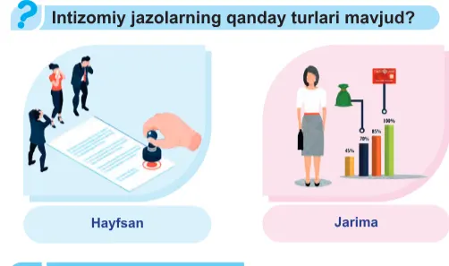

### Xulosa qiling

Nima uchun qonunchilikda quyidagi qoida oʻrnatilgan? Shaxsiy xulosalaringizni ishlab chiqing.

Intizomiy jazoning amal qilish muddati u qoʻllanilgan kundan eʼtiboran bir yildan oshmasligi kerak. Agar intizomiy jazo qoʻllanilgan kundan eʼtiboran bir Yil ichida xodimga yangi intizomiy jazo qoʻllanilmasa, u intizomiy jazoga tortilmagan deb hisoblanadi.

Ish beruvchi intizomiy jazoni oʻz tashabbusiga koʻra, xodimning bevosita rahbari, kasaba uyushmasi qoʻmitasining iltimosnomasiga, shuningdek xodimning iltimosiga koʻra, bir Yil oʻtguniga qadar muddatidan oldin olib tashlash huquqiga ega. Intizomiy jazoni muddatidan oldin olib tashlash ish beruvchining buyrugʻi bilan rasmiylashtiriladi.

### Qonun belgilaydi

Intizomiy jazo intizomiy qilmish aniqlanganidan keyin darhol, biroq aniqlangan kundan eʼtiboran bir oydan kechiktirmay qoʻllaniladi, bunda xodim vaqtincha ishga layoqatsiz boʻlgan yoki taʼtilda boʻlgan davr hisobga olinmaydi. Xizmat tekshiruvi natijalari toʻgʻrisidagi dalolatnoma komissiya tomonidan imzolangan kun xizmat tekshiruvi natijalari boʻyicha aniqlangan intizomiy qilmish aniqlangan kun deb hisoblanadi.

Intizomiy jazo intizomiy qilmish sodir etilgan kundan eʼtiboran olti oydan kechiktirmay, taftish yoki moliya-xoʻjalik faoliyatini tekshirish yoxud auditorlik tekshiruvi natijalariga koʻra esa, u sodir etilgan kundan e 'tiboran ikki yildan kechiktirmay qoʻllanilishi mumkin. Ushbu muddatlarga jinoyat ishini yuritish vaqti kiritilmaydi.

### Asosiy tushunchalar

> Moddiy javobgarlik — bu shaxs tomonidan yetkazilgan moddiy zarar uchun javob berish majburiyatidir. Agar xodim oʻz harakati yoki beparvoligi tufayli tashkilot yoki ish beruvchiga zarar yetkazsa, u bu zarar uchun moddiy javobgar boʻladi. Xodim ish beruvchiga toʻgʻridan-toʻgʻri yetkazilgan haqiqiy zararning oʻrnini qoplashi shart.

Ish beruvchi ham oʻz navbatida xodimga yetkazilgan ziyonning oʻrnini qoplashi shart. Bu holatlar qonunchilikda belgilangan. Agar ish beruvchining qonunga xilof harakatlari bilan xodimga jismoniy yoki maʼnaviy ziyon yetkazilgan boʻlsa, xodimga majburiy toʻlovlar amalga oshiriladi.

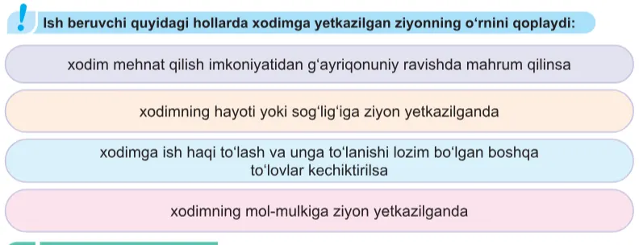

### Tarixga nazar

Quyida tarixga aloqador maʼlumot bilan tanishib chiqing.

Qadimgi Rimda xodimlarga jarima jazosini qoʻllash haqida oʻylab koʻring. "Salarium" atamasi qadimgi Rim davriga borib taqaladi va bu soʻz lotincha "sal" — yaʼni tuz soʻzidan olingan. Rimda tuz juda qimmat va muhim mahsulot hisoblangan. Ayniqsa, askarlar va davlat xizmatchilariga xizmatlari evaziga beriladigan mukofot, yoki ish haqi sifatida "salarium" taqdim etilgan.

Dastlab, bu mukofot toʻgʻridan-toʻgʻri tuz shaklida boʻlgan yoki tuzning narxiga muvofiqlashtirilgan. Vaqt oʻtishi bilan "salarium" tushunchasi kengayib, har qanday xizmat yoki mehnat evaziga toʻlanadigan haq maʼnosini ola boshladi. Aynan shu soʻz hozirgi ingliz tilidagi "salary" — yaʼni oylik ish haqi atamasining ildizidir.

Rim imperiyasi davrida salarium orqali ish haqi olish mehnat munosabatlarini huquqiylashtirishga zamin yaratdi. Bu tizim keyinchalik Yevropa davlatlari orqali butun dunyoga tarqaldi va ish haqi toʻlashning muhim tarixiy bosqichi sifatida eʼtirof etildi. Shunday qilib, salarium tushunchasi nafaqat iqtisodiy, balki huquqiy jihatdan ham mehnat munosabatlarining shakllanishida asosiy omillardan biri boʻlgan.

Quyida keltirilgan vaziyat bilan tanishib chiqing.

Ushbu holatda qanday javobgarlik kelib chiqishini yoningizdagi sinfdoshingiz bilan muhokama qiling.

2013-yilda gʻaroyib sud ishi boʻlib oʻtgan. Bir bank xodimi ish joyida ish vaqtidagi charchoq sababli kompyuter qarshisida qisqa vaqtga uxlab qolgan.

Shu vaqt ichida u kompyuter klaviaturasida tasodifan notoʻgʻri tugmalarni bosib, bank mijozlaridan birining hisobiga 222 million yevro miqdorida pul oʻtkazib yuborgan.

Odatda, bank tizimlari bunday katta miqdordagi pul oʻtkazmalarini tasdiqlash uchun qoʻshimcha xavfsizlik choralariga ega boʻlishi kerak. Biroq, ushbu holatda xatolik darhol aniqlanmagan va tizim avtomatik ravishda pulni mijoz hisobiga oʻtkazgan.

Xodimning xatosi keyinchalik ichki tekshiruv orqali aniqlangan. Bank rahbariyati tezkor harakat qilib, notoʻgʻri oʻtkazilgan mablagʻni qaytarishga muvaffaq boʻlgan. Bank xodimni sudga berib undan moddiy zararni undirib olishga harakat qilgan.

Sud jarayonida asosiy eʼtibor xodimning beparvoligi sababli ish beruvchiga yetkazilgan moddiy zararni undirishga qaratilgan. Ammo sud xodimni aybsiz deb topadi.

Aksincha, sud bank rahbariga nisbatan jazo choralarini qoʻllash boʻyicha qaror chiqaradi. Sud qarorida qayd etilishicha, bank rahbari tegishli xavfsizlik choralarini bank tizimiga joriy etmagan. Bu voqeadan soʻng banklar faoliyatida toʻlov va oʻtkazmalar tizimidagi tekshiruv choralari kuchaytirilgan.

### Hamkorlikda bajaramiz

Kichik guruhlarga boʻlining.

Quyidagi jadvalni daftaringizga koʻchiring. Keltirilgan vaziyatlar roʻy berganda qanday javobgarlik choralari vujudga kelishini tahlil eting.

Ish joyida ehtiyotsizlik tufayli zarar yetkazish Ish vaqtida shaxsiy ishlarga vaqt ajratish xodimga topshirilgan mulkka qasddan zarar yetkazish

## 7-dars. Ayrim toifadagi xodimlar mehnatini tartibga solish

### Faollashtiruvchi savollar

1. Qanday shaxslarga mehnat qonunchiligida imtiyoz va qoʻshimcha kafolatlar berilishi kerak deb hisoblaysiz?

2. Ayollarga nisbatan mehnat qonunchiligida qanday qoʻshimcha imtiyozlar berilgan? Voyaga yetmagan shaxslargachi?

3. Rasmlarga eʼtibor bering. Ularning qay birida milliy qonunchilik talablari buzilgan deb oʻylaysiz?

4. Voyaga yetmagan bolalar qanday ishlarga jalb etilishi mumkin emas?

5. Nogironligi boʻlgan shaxslar qanday ishlarda mehnat faoliyati olib borishi mumkin?

6. Ayollar, voyaga yetmagan yoki nogironligi boʻlgan shaxslarga berilgan qoʻshimcha imtiyozlarni taqdim etmaslik qanday javobgarlikni keltirib chiqarishi mumkin?

### Yodda tuting

Ayrim shaxslar hamda baʼzi kasb egalari uchun mehnat qonunchiligida biroz farqli qoidalar belgilangan. Yaʼni ular uchun odatdagi mehnat qoidalari toʻliq qoʻllanilmasligi yoki qoʻshimcha imtiyoz va kafolatlar qoʻllanilishi mumkin.

Masalan, konchilarning mehnat sharoiti xavfli boʻlgani uchun ularga qoʻshimcha dam olish vaqti yoki qisqartirilgan ish vaqti taqdim etiladi. Shuningdek, voyaga yetmagan yoki nogironligi boʻlgan shaxslar uchun ham alohida mehnat qonunchiligi qoʻllaniladi.

Alohida toifadagi xodimlar mehnatini tartibga solishda bir qator muhim masalalar mavjud. Eng avvalo, bunday xodimlar uchun maxsus mehnat sharoitlari belgilanadi. Masalan, voyaga yetmaganlar tungi vaqtlarda ishlashi, ogʻir yoki xavfli ishlarga jalb etilishi mumkin emas. Nogironligi boʻlgan shaxslar va homilador ayollar uchun esa yengillashtirilgan ish sharoitlari, qoʻshimcha dam olish va tibbiy koʻrikdan oʻtish kabi imkoniyatlar beriladi.

Homilador ayollarga nisbatan koʻplab kafolatlar ham mavjud. Masalan, ayollarni homiladorlik yoki oʻn toʻrt yoshga toʻlmagan farzandi bor davrida tungi smenaga yoki xizmat safariga yuborish qonun bilan cheklangan.

Ayrim toifadagi xodimlar mehnatini huquqiy jihatdan tartibga solishning oʻziga xos xususiyatlari tasnifi

Mehnat sharoitlarining ogʻirligi yoki zararliligi boʻyicha (konchilik yoki yerosti ishlari)

Mehnat faoliyatining sohalari boʻyicha (pedagoglar va tibbiyot xodimlari, transport xodimlari)

Tabiiy-iqlim sharoitlariga koʻra (togʻli yoki choʻl hududlaridagi xodimlar)

Ayrim toifadagi shaxslar boʻyicha (ayollar, nogironligi boʻlgan shaxslar, voyaga yetmaganlar)

Xodim va ish beruvchi oʻrtasidagi oʻziga xos munosabatlar (masofadan turib ishlash)

### Qonun belgilaydi

Nogironligi boʻlgan shaxslar faqat dastlabki majburiy tibbiy koʻrikdan oʻtganidan keyin ishga qabul qilinadi va keyinchalik har Yili majburiy tibbiy koʻrikdan oʻtkazib turilishi lozim.

### Hamkorlikda bajaramiz

Kichik guruhlarga boʻlingan holda quyidagi maʼlumotni muhokama qiling.

Shvetsiyada oilada farzand dunyoga kelganda 480 kunlik "ota-ona taʼtili" beriladi. Ota-onaning har biri taʼtilni teng boʻlib olishi va navbat bilan bola parvarishida ishtirok etishi mumkin. Bu shuni anglatadiki, erkaklar ham oʻz farzandlarini parvarish qilish vaqti uchun maxsus huquqqa ega. Ularning Ota sifatidagi roli qonunchilik bilan mustahkamlangan.

Nima deb oʻylaysiz, Oʻzbekistonda ham otalarga bola parvarishi uchun taʼtil beriladimi? Fikringizni Oʻzbekiston Respublikasi Mehnat kodeksining 405-moddasi bilan asoslang.

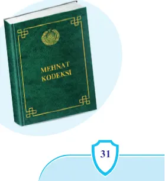

### Tarixga nazar

Mustaqil Oʻzbekiston Respublikasining ilk Mehnat kodeksi 1995-yilda qabul qilinib, 1996-yilda kuchga kirgan.

Ammo yillar oʻtishi bilan jamiyat hayotida mehnat sohasi rivojlanib bordi. Shuningdek, mehnat huquqiga oid xalqaro shartnoma normalarini Oʻzbekiston qonunchiligiga joriy etish maqsadida yangi Mehnat kodeksi ishlab chiqildi.

Amaldagi Mehnat kodeksi 2022-yilda qabul qilindi. 2023-yilda esa kuchga kirdi.

Homiladorligi yoki farzandlari borligi sababli ishga qabul qilishni rad etish, ishdan boʻshatish yoki ish haqini kamaytirish taqiqlanadi.

Voyaga yetmagan shaxslarning tungi kafe va klublarda, spirtli ichimliklarni, tamaki mahsulotlarini ishlab chiqarish, tashish hamda sotishda ishlashi taqiqlanadi.

Nogironligi boʻlgan shaxslar mehnatidan ularga sogʻligʻining holatiga koʻra qarshi koʻrsatma boʻlgan ishlarda foydalanish taqiqlanadi.

Homilador ayollar yengilroq ishga yoki noqulay ishlab chiqarish omillari taʼsiridan xoli boʻlgan ishga oʻtkaziladi.

Oʻn oltidan oʻn sakkiz yoshgacha boʻlgan xodimlar uchun ish vaqtining davomiyligi haftasiga oʻttiz olti soatdan oshmaydigan qilib belgilanadi.

I va II guruh nogironligi boʻlgan xodimlar uchun ish vaqtining davomiyligi haftasiga oʻttiz olti soatdan oshmaydigan qilib belgilanadi.

Homilador ayollarni yillik mehnat taʼtilidan chaqirib olishga yoʻl qoʻyilmaydi.

Nogironligi boʻlgan xodimlarni xizmat safariga yuborishga, tungi ishlarga, ish vaqtidan tashqari ishlarga hamda dam olish va ishlanmaydigan bayram kunlaridagi ishlarga jalb qilishga faqat ularning roziligi bilan yoʻl qoʻyiladi.

Oʻn sakkiz yoshgacha boʻlgan xodimlarga davomiyligi kamida oʻttiz kalendar kun boʻlgan yillik mehnat taʼtili beriladi.

Ikki yoshga toʻlmagan bolaning onasiga bolani ovqatlantirish uchun qoʻshimcha tanaffuslar beriladi.

Voyaga yetmagan xodimlarga qisqartirilgan ish vaqtida ham toʻliq ish vaqtidagi xodimlar bilan bir xil miqdorda ish haqi toʻlanadi.

I va II guruh nogironligi boʻlgan xodimlarga davomiyligi kamida oʻttiz kalendar kundan iborat yillik mehnat taʼtili beriladi.

Uch yoshga toʻlmagan bolaning onasiga haftasiga oʻttiz besh soatdan oshmaydigan ish vaqti davomiyligi belgilanadi.

Ish beruvchining tashabbusi bilan voyaga yetmagan xodimning mehnat shartnomasini bekor qilish mahalliy mehnat organining roziligi bilan amalga oshiriladi.

### Qonun belgilaydi

Ayrim toifadagi xodimlarga beriladigan kafolatlar darajasining pasayishiga, ularning huquqlari cheklanishiga, intizomiy va (yoki) moddiy javobgarligi oshishiga olib keladigan mehnatni huquqiyjihatdan tartibga solishning oʻziga xos xususiyatlari faqat ushbu kodeksda nazarda tutilgan hollarda va tartibda belgilanishi mumkin.

Oʻn sakkiz yoshgacha boʻlgan shaxslar faqat dastlabki majburiy tibbiy koʻrikdan oʻtganidan keyin ishga qabul qilinadi va keyinchalik ular oʻn sakkiz yoshga toʻlguniga qadar har Yili majburiy tibbiy koʻrikdan oʻtishi lozim.

### Izlanishda davom eting

Quyida keltirilgan vaziyat bilan tanishib chiqing. Holatni muhokama qiling.

Shaxsiy xulosalaringizni ishlab chiqing.

Qatar mehnat qonunchiligiga koʻra, ish beruvchilar ishga qabul qilishda avvalo Qatar fuqarolariga ustunlik berishlari shart. Yaʼni ish beruvchi avval qatarlik nomzodlarni ish bilan taʼminlashga harakat qilishlari kerak. Agar mos keladigan fuqaro topilmasa, ish beruvchilar Mehnat boshqarmasining ruxsatisiz, chet ellik xodimni ishga qabul qila olmaydi.

Bundan tashqari, Qatar hukumati fuqarolarini energetika, bank ishi va davlat xizmatlari sohalarida koʻproq ish bilan taʼminlashga harakat qiladi. Davlat oʻz fuqarolariga yuqori ish haqi, pensiya, ijtimoiy taʼminot va boshqa imtiyozlarni taqdim etadi. Ammo chet ellik ishchilar esa bu imkoniyatlardan toʻla foydalana olmaydi.

### Tarixga nazar

Mamlakatimizdagi ilk ayol sudya va huquqshunos olima haqidagi quyidagi matn bilan tanishib chiqing. Ayollarning huquq sohasidagi faoliyatida qanday imkoniyatlar mavjud ekanligini muhokama qiling.

Xadicha Sulaymonova 1913-yilda Andijonda tugʻilgan. Yoshligidan tirishqoqlik koʻrsatib, huquqshunoslikdan taʼlim olgan.

Yuridik oliygohni tamomlagach, xalq sudyasi lavozimida faoliyat boshlagan. Keyinchalik mamlakat Oliy sudining aʼzosi, hattoki Adliya vaziri ham boʻlgan. U huquqshunoslik boʻyicha ilmiy darajaga ega boʻlgan birinchi oʻzbek ayoli edi. 1952-yilda professor unvonini olgan. 1956-yilda fanlar akademiyasining aʼzosi etib saylangan.

1964-yildan esa mamlakat Oliy sudi raisi lavozimida ishlagan. Shuningdek, u "xizmat koʻrsatgan fan arbobi" unvoni bilan taqdirlangan.

Xadicha Sulaymonova 1965-yilda Toshkentda vafot etgan.

## 8-dars. Mehnat muhofazasi

### Faollashtiruvchi savollar

Quyidagilarga eʼtibor qarating va savollarga javob bering.

1. Mehnat muhofazasi haqida qanday tasavvurga egasiz? Bu tushuncha haqidagi fikrlaringizni bayon qiling.

2. Quyida keltirilgan tashkilotlarga qanday masalalar bilan murojaat etish mumkin?

3. Ish beruvchilar mehnat muhofazasi qonunchiligiga rioya etmasa, qaysi davlat tashkilotiga murojaat qilish mumkin?

Berilgan savollar asosida quyidagi infografikadan toʻgʻri keladigan javobni toping:

1. Qay birida bepul taʼlim olish, kasbga tayyorgarlik koʻrish va hatto ish bilan taʼminlash imkoniyati mavjud?

2. Qay birining yordamida boʻsh ish oʻrinlari uchun roʻyxatdan oʻtish mumkin?

3. Qay biri orqali mehnat daftarchasini rasmiylashtirish mumkin?

### Yodda tuting

Mehnatni muhofaza qilish deganda xodimlarning ish joyida xavfsiz ishlashini taʼminlash uchun qabul qilingan qoidalar va choralar tushuniladi. Bu tizim xodimlarning hayoti va sogʻligʻini saqlash, jarohatlanish va kasalliklarning oldini olishga qaratilgan.

Ish beruvchilar xavfsizlik va gigiyena talablariga javob beradigan mehnat sharoitlarini taʼminlashi shart.

Ish beruvchi oʻz mablagʻlari hisobidan xodimlarni mehnatni muhofaza qilishning belgilangan talablariga muvofiq shaxsiy himoya vositalari bilan taʼminlanishga majbur.

Oʻz mehnat majburiyatlarini bajarishi bilan bogʻliq holda mehnatda mayib boʻlganligi, kasb kasalligi yoki sogʻligʻiga boshqacha tarzda shikast yetkazilganligi munosabati bilan xodimning hayotiga yoki sogʻligʻiga yetkazilgan zararning oʻrni ish beruvchi tomonidan qoplanadi.

Xodimlar mehnatni muhofaza qilish talablari buzilganligi oqibatida oʻz hayoti va sogʻligʻi uchun xavf yuzaga kelgan taqdirda bunday xavf bartaraf etilguniga qadar ishlarni bajarishni rad etish huquqiga ega. Bunda intizomiy javobgarlik kelib chiqmaydi.

Davlat mehnat inspektorlari mehnat toʻgʻrisidagi qonunchilikka, mehnat haqidagi boshqa huquqiy hujjatlarga hamda mehnatni muhofaza qilish qoidalariga rioya etilishi ustidan davlat nazoratini va tekshiruvini amalga oshirish maqsadida Oʻzbekiston Respublikasining hududida ish beruvchilarni rejali hamda rejadan tashqari tekshiruvlardan oʻtkazadi.

### Qonun belgilaydi

Mehnat inspeksiyasi ish beruvchilar tomonidan mehnat toʻgʻrisidagi qonunchilik, aholining bandligi, ish beruvchining fuqarolik javobgarligini majburiy sugʻutta qilish, nogironligi boʻlgan shaxslarning huquqlari toʻgʻrisidagi qonunchilik, mehnat toʻgʻrisidagi boshqa huquqiy hujjatlar, mehnatni muhofaza qilish qoidalari hamda mehnat standartlari talablariga rioya etilishi ustidan davlat nazoratini va tekshiruvini amalga oshiradi.

Oʻzbekiston Respublikasining Mehnat kodeksi, 535-modda

Xodimlarning binodan chiqishi uchun avariya yoʻllari va chiqish joylari belgilangan boʻlishi kerak.

Agar ish joylari ishning xususiyati tufayli xodim uchun xavf mavjud boʻlgan xavfli zonalarda joylashgan boʻlsa, bunday joylar begona kishilarning bu zonalarga kirishiga toʻsiq boʻladigan qurilmalar bilan jihozlanishi kerak.

Davlat mehnat inspektorlarining qanday vazifalari mavjud?

xodimlarning huquqlari va xavfsizligi taʼminlanayotganini tekshirish; ish beruvchilar tomonidan mehnat qonunlariga rioya qilinishini nazorat qilish; agar qoidabuzarlik aniqlansa, uni bartaraf etish boʻyicha koʻrsatmalar berish. Mehnat inspektorlarining tekshiruvlari qonuniy tartibda amalga oshiriladi va xodimlarning huquqlarini himoya qilishga qaratilgandir.

Davlat mehnat inspektorlarining tekshiruvlar davomida aniqlangan qoidabuzarliklarni bartaraf etish toʻgʻrisidagi koʻrsatmalari ish beruvchilar tomonidan bajarilishi majburiydir.

Agar texnika xavfsizligi, sanoat sanitariyasi yoki mehnatni muhofaza qilish qoidalariga rioya etmaslik oqibatida xodimga oʻrtacha ogʻir yoki ogʻir darajadagi tan jarohati yetsa, Oʻzbekiston qonunchiligiga koʻra, bunga masʼul shaxs jinoiy javobgarlikka tortiladi.

Bu degani, mehnat xavfsizligi qoidalarini buzgan masʼul shaxs sud tomonidan jinoiy javobgarlikka tortilishi va unga nisbatan jarima, axloq tuzatish ishlari yoki hatto ozodlikdan mahrum qilish jazosi qoʻllanilishi mumkin.

Ish beruvchilar va masʼul shaxslar xavfsizlik qoidalariga qatʼiy rioya qilishlari shart.

### Xulosa qiling

Demak, davlat mehnat inspektorlari ish beruvchilarning mehnat toʻgʻrisidagi qonunchilikka rioya qilishini nazorat qiladi. Ular Oʻzbekiston hududida rejali yoki rejadan tashqari tekshiruvlar oʻtkazib, mehnat sharoitlarini tekshiradi.

### Hamkorlikda bajaramiz

Kichik guruhlarga boʻlingan holda quyidagi vazifalarni bajarishga harakat qiling.

1. Kichik guruhlarda ishlang. Davlat mehnat inspeksiyasining rasmiy veb-sahifasi orqali mehnat muhofazasiga oid qonunchilik buzilishi ustidan murojaat matnini ishlab chiqing.

2. Murojaatda mehnat muhofazasiga oid qanday qoida buzilayotganligini izohlang. Tasavvuriy vaziyatni batafsil tushuntirib bering.

3. Bu boradagi huquqlari buzilayotgan yaqin qarindoshingizning shaxsiy maʼlumotlarini kiriting.

4. Davlat mehnat inspeksiyasi tomonidan murojaatga nisbatan qanday munosabat bildirilishini tushuntirib bering.

5. Agar davlat mehnat inspeksiyasi tomonidan tegishli choralar koʻrilmasa, qaysi davlat organiga murojaat qilish mumkinligini asoslab bering.

6. Xulosa yozing.

### Tarixga nazar

Abu Ali ibn Sino mehnat muhofazasi sohasida muhim ilmiy asoslarni yaratgan. Uning ilmiy ishlarida "mehnat muhofazasi" tushunchasi aynan qoʻllanilmagan boʻlsa-da, yashash sharoitlari hamda mehnat qilish muhiti insonlarning sogʻligʻiga bevosita taʼsir etishi ilmiy jihatdan asoslab berilgan.

Olim tibbiyotda kasalliklarning oldini olish, gigiyena va sanitariya qoidalarini targʻib qilgan. U ish joylarida xavfsiz va toza sharoitlar muhimligini eʼtirof etib, kasalliklarning oldini olish uchun profilaktik choralar zarurligini taʼkidlagan.

"Tibbiyotning asosiy vazifasi — sogʻligʻini saqlash, agar kasallik paydo boʻlgan boʻlsa, bu kasallikni keltirib chiqargan sabablarni aniqlash va ularni yoʻqotish orqali sogʻliqni tiklashdan iborat".

### Izlanishda davom eting

Mehnat muhofazasiga oid Yaponiya qonunchiligi bilan tanishib chiqing.

"Xodimlarga psixologik yordam koʻrsatish lozim" deb oʻylaysizmi? Nima uchun? Yaponiyaning "Sanoat xavfsizligi va sogʻliqni saqlash toʻgʻrisida"gi qonuni ("Industrial Safety and Health Act") mamlakatdagi mehnat muhofazasi talablarini qatʼiy tartibga soladi.

Mazkur qonunga kiritilgan oʻzgartirishlar natijasida korxonalarga yiliga kamida bir marta barcha xodimlarning stress darajasini tekshirish majburiyati yuklandi.

Tekshiruv natijalariga koʻra, yuqori stressga ega xodimlar bepul psixologik maslahat va zarurat boʻlsa, tibbiy yordam olish huquqiga ega.

Ish beruvchilar stress tahlili natijalari asosida ish sharoitlarini yaxshilash boʻyicha choralar koʻrishi shart, aks holda ularga maʼmuriy choralar yoki jarimalar qoʻllanilishi mumkin.

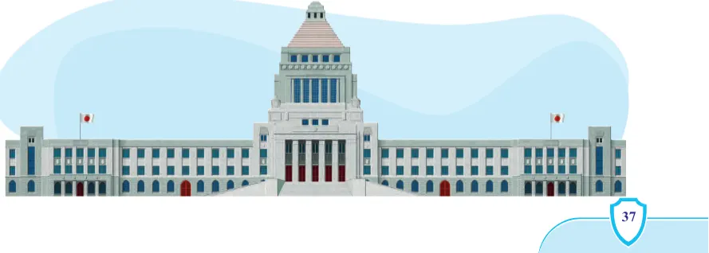

## 9-dars. Ijodiy faoliyat

Vertikal

1. Shaxs ishsiz qolganda, davlat tomonidan vaqtinchalik toʻlab turiladigan moddiy yordam

2. Ish beruvchilar tomonidan taʼminlanadigan mehnat muhofazasi talablaridan biri

3. Mehnatga haq toʻlashning cheklangan shakli

4. Mamlakatimizda mehnatga haq toʻlashning eng kam miqdorini belgilovchi davlat mansabdor shaxsi

5. 2023-yilda kuchga kirgan mehnat munosabatlarini tartibga soluvchi asosiy hujjat

8. Xodimga intizomiy jazo chorasini qoʻllash boʻyicha ish beruvchining hujjati

Gorizontal

6. Ish beruvchi va xodim oʻrtasida tuziladigan huquqiy hujjat

7. Xodimlar mehnatiga vaqt birligidan kelib chiqib haq toʻlash

9. Xodimlarning huquqlari va xavfsizligi taʼminlanishini tekshiruvchi davlat mansabdor shaxsi IO. Xodimlar mehnatiga haq toʻlash mezonlaridan biri

Tasavvur qiling. Siz huquqshunossiz. Quyidagi shaxslarga huquqiy maslahat bering.

1-vaziyat. Javohir maktabni bitirgach, ishga joylashmoqchi edi. Avval, internet orqali ish qidirdi. Malakasi yetarli darajada emasligi tufayli koʻplab tashkilotlardan rad javobini oldi. Javohir qaysi davlat tashkilotiga murojaat etib oʻz malakasini hech qanday toʻlovlarsiz oshirishi mumkin?

2-vaziyat. Akobirjon maktabdan boʻsh vaqtlarida onlayn mehnat qilar edi. Bu bilan ota-onasiga moddiy koʻmak berib, tayyorlov kurslari uchun mablag' toʻplar edi. Uning onlayn ish boshqaruvchisi Akobirjonning yoshi kichikligi tufayli boshqalardan koʻra kamroq maosh tayinladi. Akobirjon bu haqida qaysi davlat organiga shikoyat qilish mumkinligini oʻylay boshladi.

3-vaziyat. Bilol qurilish tashkilotida ishlar edi. Korxona rahbariyati xavfsizlik holatidan kelib chiqib, har bir xodim maxsus bosh kiyim sotib olishi majburiy ekanligini eʼlon qildi. Bilol maxsus bosh kiyim unga qimmatlik qilishini aytib, korxona talabini bajarmadi. Korxona rahbari Bilol bilan tuzilgan mehnat shartnomasini bekor qildi. Bilo/ buzilgan huquqlarini qanday qilib tiklashi mumkin?

Madina 2023-yil dekabrdan boshlab "EduSoft" MChJda masofaviy grafik dizayner sifatida ishlay boshladi. Mehnat shartnomasida uning ish vaqti, ish haqi miqdori, vazifalari va topshiriqlarni topshirish tartibi aniq belgilangan edi. U har hafta oʻz ishini elektron pochta orqali taqdim etardi.

2024-yil may oyida kompaniya ichki siyosatini oʻzgartirib, barcha xodimlar ofisda ishlashi kerakligini eʼlon qildi. Madina bu qarorni notoʻgʻri deb hisoblab, mehnat shartnomasida faqat masofaviy ish shakli koʻrsatilganini bildirdi. Oradan bir hafta oʻtib, ish beruvchi unga "ishga kelmagani" sababli mehnat shartnomasini bekor qilish toʻgʻrisida buyruq chiqardi.

Madina esa bu qaror ustidan sudga murojaat qildi.

Sudga yoʻllagan daʼvo arizasida huquqlari buzilganini asoslab berdi.

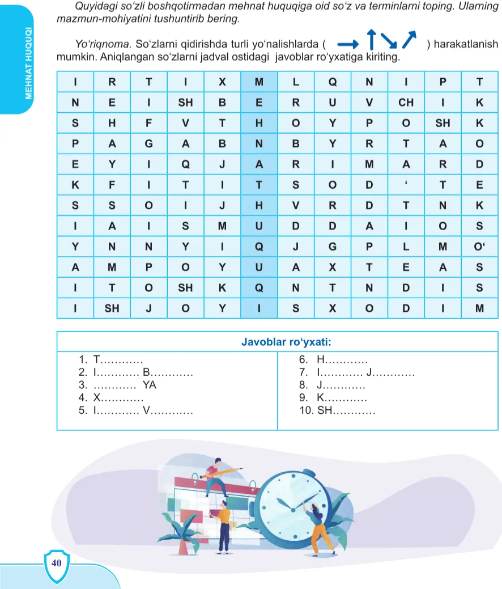

# II bob. Maʼmuriy huquq

## 10-dars. Maʼmuriy huquq tushunchasi

### Faollashtiruvchi savollar

Quyidagi vaziyatlar bilan tanishib chiqing. Savollarga javob bering.

1-vaziyat. Husnida haydovchilik guvohnomasini olish uchun imtihon topshirdi. Biroq haydovchilik koʻnikmalarini baholash imtihonidan oʻta olmadi. Uning fikricha, avtomashinani boshqarish imtihonini olgan nazoratchi mashinani boshqarish davomida ayrim notoʻgʻri yoʻriqnomalar bergan. Oqibatda imtihon natijasi salbiy boʻlgan. Bunday vaziyatlarda qaysi davlat organiga murojaat etish lozim?

2-vaziyat. Ulugʻbek shaxsiy avtomashinasini belgilanmagan joyda qoldirganligi uchun davlat yoʻl harakati xavfsizligi xodimi tomonidan jarima belgilandi. Lekin Ulugʻbekning fikricha, bu qaror noqonuniy. Chunki xodim jarimani tayinlashdan oldin oʻzini tanishtirmagan va Ulugʻbekning huquq va majburiyatlarini tushuntirib bermagan. Ulugʻbek qarorni bekor qilishga harakat qilmoqchi.

Buning uchun qaysi sudga murojaat etish kerak?

Tegishli jinoyat ishlari boʻyicha sudgami yoki maʼmuriy sudgami? Nima uchun?

3-vaziyat. Umida farzandli boʻldi. Onalik baxtidan u juda ham mamnun. Uning turmush oʻrtogʻi farzandiga tugʻilganlik toʻgʻrisidagi guvohnoma olish uchun tugʻuruqxonaga murojaat qildi. Tugʻuruqxona mutasaddilari bunday harakatlarni amalga oshirmasliklarini bildirdi.

Bu vaziyatda Umidaga huquqshunos rolida huquqiy maslahat bering.

> Maʼmuriy huquq — bu davlat boshqaruvi faoliyatida yuzaga keluvchi munosabatlarni tartibga soluvchi huquq sohasi hisoblanadi. Shu jumladan, davlat organlari va fuqarolar oʻrtasidagi munosabatlar ham maʼmuriy huquq bilan tartibga solinadi.

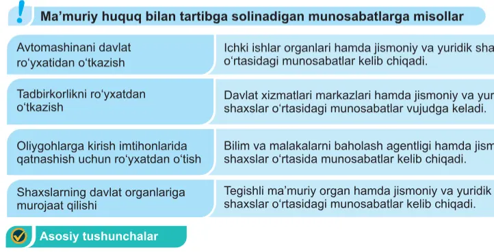

### Asosiy tushunchalar

> Maʼmuriy-huquqiy munosabatlar — bu davlat organlari va fuqarolar yoki tashkilotlar oʻrtasida yuzaga keladigan munosabatlar boʻlib, ular maʼmuriy huquq normalari asosida tartibga solinadi.

Boshqacha qilib aytganda, bu davlat boshqaruviga oid qonun-qoidalarga asoslangan munosabatlar boʻlib, bir tomon davlat organlari (maʼmuriy organ) boʻlgan holatda yuzaga keladi.

Maʼmuriy huquqiy munosabatllar doirasida shaxslar Oʻzbekistondagi Maʼmuriy sudlarga murojaat etishlari mumkin. Masalan, roʻyxatdan oʻtkazishni rad etganlik yoki ijro organlarining qarorlari ustidan sudga murojaat qilishlari mumkin.

### Ijodiy faoliyat

Siz maʼmuriy sudda advokat sifatida ishtirok etyapsiz. Tadbirkorlik faoliyatini olib borish uchun mijozingizning ruxsatnomasi asossiz ravishda bekor qilingan. Siz u shaxsni sudda himoya qilishingiz kerak. Himoya nutqini tayyorlang va chiqish qiling.

Quyidagilarni hisobga olgan holda nutqingizni tuzing: holatning tasavvuriy bayoni, mijozning huquqlari, masʼul xodim xatti-harakatlarining bahosi (qonuniy yoki noqonuniy), asoslangan huquq manbasining bayoni.

Maʼmuriy sud nima?

Maʼmuriy sud — fuqarolar va yuridik shaxslarning davlat organlari, mansabdor shaxslarning noqonuniy qaror yoki harakatlariga nisbatan shikoyatlarini koʻrib chiqadigan sudlov organidir.

### Xulosa qiling

Maʼmuriy sudlarning asosiy vazifalari bilan tanishib chiqing. Maʼmuriy sudlarning faoliyat yoʻnalishlari boʻyicha xulosa chiqaring. 2017-yildan boshlab Oʻzbekiston Respublikasida maʼmuriy sudlar tizimi joriy qilindi.

Quyidagilar maʼmuriy sudlarning asosiy vazifalari hisoblanadi:

davlat organlari va fuqarolar oʻrtasidagi maʼmuriy nizolarni hal qilish; mansabdor shaxslarning noqonuniy qaror va harakatlarini bekor qilish; davlat hokimiyati bilan bogʻliq maʼmuriy-huquqiy nizolarni hal qilish.

### Yodda tuting

Bugungi kunda oʻquvchilar orasida maʼmuriy huquqni tushunish borasida notoʻgʻri qarash keng tarqalgan. Yaʼni "maʼmuriy huquq" deganda, "maʼmuriy javobgarlik"ni tushunadilar.

Afsuski, bu notoʻgʻri tushuncha!

"Maʼmuriy huquq" va "maʼmuriy javobgarlik" butunlay farqli tushunchalardir

Maʼmuriy huquqning aniq bitta manbasi mavjud emas. Bunga asosiy sabab maʼmuriy huquqiy munosabatlar doirasining juda kengligidir.

Maʼmuriy huquq litsenziya, ruxsat berish, roʻyxatdan oʻtkazish tartib-taomillari, davlat xizmatlarini koʻrsatish bilan bogʻliq turli maʼmuriy-huquqiy faoliyatga nisbatan tatbiq etiladi. Bunday davlat xizmatlarini koʻrsatish rad etilganda yuqori turuvchi organga yoki maʼmuriy sudlarga murojaat qilish mumkin boʻladi.

### Maʼmuriy javobgarlikning asosiy huquqiy

manbasi Oʻzbekiston Respublikasining Maʼmuriy javobgarlik toʻgʻrisidagi kodeksi hisoblanadi.

Shaxs maʼmuriy huquqbuzarlik sodir etganda maʼmuriy javobgarlik yuzaga keladi. Masalan, yoʻl harakati qoidalariga rioya etmaslik maʼmuriy javobgarlikni keltirib chiqaradi. Bunday huquqbuzarlik jinoyat ishlari boʻyicha sudlarda koʻrib chiqiladi.

### Hamkorlikda bajaramiz

Maʼmuriy organ tushunchasiga berilgan taʼrifni oʻqing. Kichik guruhlar tuzib, maʼmuriy organlarga misol keltiring.

Maʼmuriy organ — maʼmuriy boshqaruv vakolati berilgan ijro etuvchi hokimiyat organlari, fuqarolarning oʻzini oʻzi boshqarish organlari, shuningdek ushbu faoliyatni amalga oshirishga vakolatli boʻlgan boshqa tashkilotlardir.

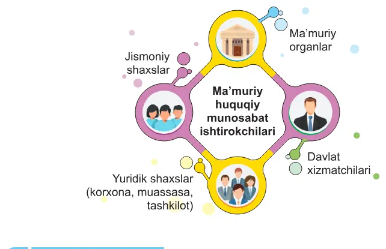

### Izlanishda davom eting

Quyidagi vaziyatlar "ma 'muriy huquq" yoki "maʼmuriy javobgarlik" tushunchalariga aloqadorligi boʻyicha qaror qabul qiling. Fikringizni asoslang.

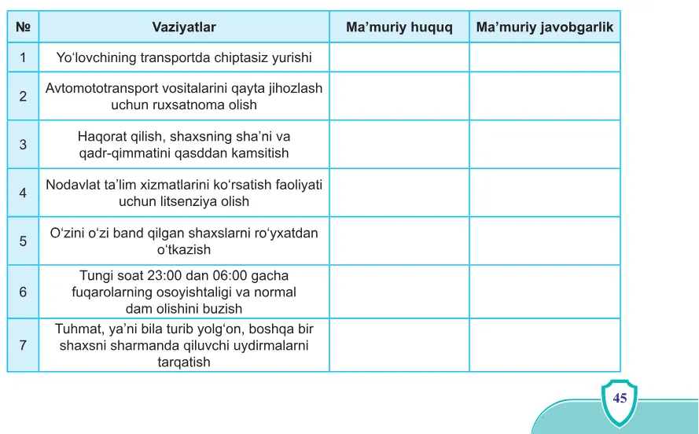

## 11-dars. Davlat xizmatlaridan foydalanish

### Faollashtiruvchi savollar

Tasavvur qiling, siz quyidagi vaziyatlarga duch keldingiz. Yagona interaktiv davlat xizmatlari portalidan (https://my.gov.uz) foydalanib, vaziyatlar uchun eng maqbul huquqiy yechimlarni taklif eting.

1-vaziyat. Siz Xalqaro ingliz tili testi tizimi (IELTS) imtihonida eng yuqori natijani qoʻlga kiritdingiz. Endi imtihon uchun amalga oshirilgan toʻlovni qaytarib olmoqchisiz.

Qanday qilib bu ishni uddalash mumkin?

Tushuntirib bering.

2-vaziyat. Sizning ukangiz ijtimoiy tarmoqlarda faoliyat olib boradi. Turli materiallar tayyorlab ularning sotuvini tashkil etadi. Lekin u biror-bir davlat roʻyxatidan oʻtmagan.

Ukangiz oʻzini oʻzi band qilgan shaxs sifatida roʻyxatdan oʻtmoqchi. Chunki bu borada soliqdan chegirmalar mavjud.

Qanday qilib, oʻzini oʻzi band qilgan shaxs sifatida roʻyxatdan oʻtish mumkin. Tushuntirib bering.

3-vaziyat. Otangiz yaqin doʻstidan "Tracker" rusumli mashinani ijaraga oldi. Otangiz mashinaning boshqaruvi uchun jismoniy shaxslarga beriladigan elektron ishonchnoma olish imkoniyati borligini bilib qoldi. Shu kabi ishonchnomani rasmiylashtirishda otangizga yordam bering.

4-vaziyat. Ukangiz chet tilini bilish darajasini aniqlash boʻyicha milliy imtihonlarda ishtirok etmoqchi. Bu uchun roʻyxatdan oʻtish majburiy ekan.

Roʻyxatdan oʻtish ketma-ketligini tushuntirib bering.

### Asosiy tushunchalar

> Davlat xizmatlari — bu davlat organlari tomonidan jismoniy va yuridik shaxslarga koʻrsatiladigan rasmiy xizmatlar.

Bu xizmatlar odatda davlat organlari yoki maxsus markazlar orqali amalga oshiriladi. Koʻplab xizmatlarni hozir onlayn ham olish mumkin.

Har qanday vaqtda davlat xizmatlaridan masofadan turib foydalanish qulay boʻlib, Yagona interaktiv davlat xizmatlari portali (my.gov.uz) 24/7 rejimida ish olib boradi.

Jismoniy va yuridik shaxslar foydalanishi mumkin boʻlgan davlat xizmatlarining turlari

Uy-joy kommunal xoʻjaligi Uy-joy kommunal xoʻjaligi xizmatlariga ulanish, tariflar, balansni tekshirish Koʻchmas mulk mulkni rasmiylashtirish va mulk huquqi, kadastr va qurilish transport Sugʻurta polisi, haydovchilik guvohnomalarini almashtirish Taʼlim Maktabgacha taʼlim, oʻrta va Oliy taʼlim, nostrifikatsiya axborot va aloqa axborot texnologiyalari, ommaviy axborot vositalari va aloqa itsenziyalash Litsenziya va ruxsatnomalarni rasmiylashtirish Sogʻliqni saqlash tibbiyot, farmatsevtika va salomatlik

aʼlumotnomala Har qanday hayotiy vaziyatlar uchun maʼlumotnomalar Investitsiya va savdo ishlab chiqarish, savdo va isteʼmolchilar huquqi Bojxona Ruxsat beruvchi hujjatlar, bojxona toʻlovlari Adliya Yuridik xizmatlar, notarial harakatlar Ekologiya Tabiatdan foydalanish, ekologiya va atrof-muhit muhofazasi fuqarolik Fuqarolarni roʻyxatga qoʻyish, pasport xizmatlari adbirkorli Tadbirkorlik subyektini roʻyxatdan oʻtkazish

Internetda Yagona interaktiv davlat xizmatlari portalining (YIDXP) veb-sayti hisoblangan my.gov.uz saytida mustaqil tarzda davlat xizmatlaridan foydalanish mumkin. Davlat xizmatlari onlayn koʻrsatilsa, pulli xizmatlar uchun chegirma beriladi.

Yagona interaktiv davlat xizmatlari portalidan internet tarmogʻida my.gov.uz sayti orqali davlat xizmatlaridan foydalanish mumkin. Bunda jahon internet tarmogʻidan foydalanish boʻyicha koʻnikma yetarlidir.

Davlat xizmatlari markazi davlat xizmatlarini oflayn shaklda koʻrsatadi. Qayerda doimiy roʻyxatda turishingizdan qatʼi nazar, eng yaqin davlat xizmatlari markaziga borish orqali davlat xizmatlaridan foydalanishingiz mumkin.

Bundan tashqari, davlat xizmatlari markazlari tomonidan olis hududlarga maxsus transportlarda sayyor davlat xizmatlarini koʻrsatish ham yoʻlga qoʻyilgan.

### Yodda tuting

Yagona interaktiv davlat xizmatlari portali (my.gov.uz) 2013-yilda ishga tushirilgan. Portalni yaratishdan koʻzlangan asosiy maqsad shaxslarga davlat xizmatlaridan tez va qulay foydalanishlari uchun sharoit yaratish hisoblanadi.

Sayt uchun bu sohani tartibga soluvchi vazirlik masʼul boʻlsa-da, xizmatlarni turli vazirliklar va tashkilotlar taqdim etadi. Yaʼni barcha davlat xizmatlari "yagona darcha" prinsipi asosida portal orqali taqdim etiladi.

### Hamkorlikda bajaramiz

Yagona interaktiv davlat xizmatlari portalidan (my.gov.uz) foydalanish koʻnikmasini oshiramiz!

Dars mashgʻulotlaridan tashqari vaqtda eng yaqin sinfdoshingiz bilan hamkorlikda quyidagi davlat xizmatlaridan foydalaning:

ishga joylashish uchun kerakli hujjatlar toʻplamini aniqlash;

jismoniy shaxsning shaxsiy identifikatsiya raqami haqida maʼlumotnoma olish; oʻzingiz uchun doimiy yashash joyi boʻyicha maʼlumotnoma olish;

ota-onangizdan birida soliqdan qarzi mavjud emasligi haqida maʼlumotnoma olish; talaba qarindoshingizning Oliy taʼlim muassasasida oʻqiganlik haqida arxiv maʼlumotnoma olish;

otangiz yoki onangizning mehnat daftarchasidan koʻchirma olish.

### Izlanishda davom eting

BMT Elektron hukumat bilim bazasi (E-Government knowledge base) butun dunyo davlatlaridagi fuqarolarga koʻrsatiladigan davlat xizmatlarini raqamlashtirish boʻyicha eng muhim maʼlumotlar tizimidir.

Elektron hukumat bilim bazasiga tashrif buyuring.

Mamlakatimizning jahondagi oʻrnini aniqlang.

Yagona interaktiv davlat xizmatlari portali uchun (my.gov.uz) yana qanday elektron xizmatlar yaratish mumkinligi boʻyicha takliflar ishlab chiqing.

## 12-dars. Maʼmuriy-huquqiy nizolar

### Faollashtiruvchi savollar

Quyida tasvirlangan vaziyatlarga e 'tibor bering. Aks ettirilgan maʼmuriy-huquqiy nizolarga munosabat bildiring. Savollarga javob berishga harakat qiling.

1-vaziyat. Ichki ishlar xodimi sizdan shaxsni tasdiqlovchi hujjatingizni soʻradi. Sizning yoningizda hech qanday hujjat mavjud emasligi bois, organ xodimi sizni yaqin oradagi ichki ishlar idorasiga borishingizni talab qildi. Huquqni muhofaza qilish organlari qanday holatda shaxslarni majburan olib ketishi mumkin?

2-vaziyat. Yoʻlni kengaytirish zarurati kelib chiqdi. Sizning yoʻl boʻyidagi uyingizni ommaviy ehtiyojlardan kelib chiqib, bu- Zish ishlari boshlandi. Biroq uy uchun kompensatsiya toʻlovlari toʻlab berilmasdan, yoʻl quruvchilari uyingizni buzish ishlarini boshlab yuborishdi.

Bunday holatda mulkdor oʻz huquqlarini qanday himoya qilishi mumkin?

3-vaziyat. Akobirjon II-sinfni tugatgach, kichik shirinlik doʻkoni ochmoqchi boʻldi. U yakka tartibdagi tadbirkor sifatida roʻyxatdan oʻtish uchun davlat xizmatlari markaziga murojaat qildi. Ammo arizasi rad etildi, sababi esa aniq aytilmadi.

Akobirjon bu qarorga rozi emas. Endi u qanday yoʻl tutishi mumkin?

4-vaziyat. Madina Oliy taʼlim muassasasiga kirish uchun imtihon topshirdi. U oʻz hisobiga koʻra 180 ball toʻpladi, lekin rasmiy natijalarda 160 ball deb yozilgan edi. Madina bu holatdan norozi boʻlib, bilim va malakani baholash agentligiga apellyatsiya arizasini yozdi. Arizasida u aniq test savollarini koʻrsatib, baholashda xato boʻlganini isbotlashga harakat qildi.

Bilim va malakani baholash agentligi Madinaning vajlarini asossiz deb hisoblab, rad etsa, u qanday yoʻl tutishi mumkin?

5-vaziyat. Ismoil II-sinfni tugatgach, Turkiyadagi oliygohga oʻqishga kirish uchun xorijga chiqish pasportiga ariza berdi. Oradan 25 kun oʻtdi, ammo u hali ham javob olmadi. U pasport beruvchi tashkilotga bordi, lekin "sabr qiling" degan javob oldi.

Ismoil bu holatda oʻz huquqini qanday himoya qilishi mumkin?

### Asosiy tushunchalar

Har bir shaxs davlat idoralari bilan har xil munosabatlarga kirishadi. Masalan, pasport olish, tadbirkorlik faoliyatini yuritish yoki davlat mansabdor shaxslarining qarorlari, harakati yoki harakatsizligidan norozi boʻlish kabi holatlar davlat bilan bogʻliq boʻlgan huquqiy munosabatlar hisoblanadi.

Agar shaxs davlat organining harakati, qarori yoki harakatsizligidan norozi boʻlsa va bu masala qonun doirasida hal qilinmasa, maʼmuriy-huquqiy nizo yuzaga keladi.

> Maʼmuriy-huquqiy nizo — bu shaxslar bilan davlat organlari oʻrtasida, davlat xizmatlari yoki maʼmuriy choralar boʻyicha kelib chiqqan kelishmovchilikdir.

### Xulosa qiling

Fuqarolar davlat organlarining qarori, harakati yoki harakatsizligidan norozi boʻlsa, quyidagilarni amalga oshirishi mumkin:

avval murojaat qilgan tashkilotning oʻziga shikoyat qilish soʻng, yuqori turuvchi tashkilotga shikoyat qilish;

oxirgi chora — maʼmuriy sudga shikoyat qilish.

Oʻzbekiston qonunchiligida bunday nizolarni hal qilish uchun alohida tartiblar va sud tizimi mavjud.

### Yodda tuting

Jismoniy va yuridik shaxslar davlat organlarining noqonuniy qarorlari, harakatlari (harakatsizligi) boʻyicha yuqori turuvchi organlarga murojaat qilishi mumkin. Masalan, tuman ichki ishlar organi rahbari ustidan viloyat ichki ishlar organiga murojaat qilish mumkin. Qonunchilikda murojaatlarni koʻrib chiqish muddatlari qatʼiy belgilangan.

Ariza yoki shikoyat masalani mazmunan hal etishi shart boʻlgan davlat organiga, tashkilotiga yoki ularning mansabdor shaxsiga kelib tushgan kundan eʼtiboran oʻn besh kun ichida, qoʻshimcha oʻrganish va (yoki) tekshirish, qoʻshimcha hujjatlarni soʻrab olish talab etilganda esa, bir oygacha boʻlgan muddatda koʻrib chiqiladi.

Oʻzbekiston Respublikasining Maʼmuriy sud ishlarini yuritish toʻgʻrisidagi kodeksi maʼmuriy huquqiy nizolarni sud tartibida hal etishni tartibga soluvchi asosiy huquq manbasi hisoblanadi.

### Fikrimizni tasdiqlaymiz

Maʼmuriy sudlar tomonidan hal etiladigan ishlar:

davlat boshqaruvi organlarining jismoniy va yuridik shaxslarning huquqlarini va qonun bilan qoʻriqlanadigan manfaatlarini buzadigan qarorlari, harakat yoki harakatsizligi yuzasidan kelib chiqadigan nizolar;

notarial harakatni amalga oshirish yoki boshqacha shakldagi davlat roʻyxatiga olishni rad etilganlikka oid nizolar;

saylov komissiyalarining xatti-harakatlari yuzasidan kelib chiqadigan nizolar.

### Hamkorlikda bajaramiz

2023-yil 1-yanvardan boshlab ichki ishlar organlari faoliyatiga bosqichma-bosqich "E-patrul" tizimi joriy etilib, fuqaroning shaxsini aniqlash uchun ichki ishlar boʻlimiga olib borish amaliyotidan voz kechildi. Barcha maʼlumotlar joyida planshet orqali tekshirilib, ichki ishlar organlari patrul-post xizmati xodimlarining faoliyati "bodikamera"dan foydalangan holda amalga oshirilishi yoʻlga qoʻyildi.

Patrul-post xizmati saf boʻlinmalari xodimlari shaxsni sodir etilgan jinoyat yoki maʼmuriy huquqbuzarlik haqida maʼlumotga ega deb hisoblash mumkin boʻlgan hollarda fuqarolarni toʻxtatishi va shaxsini tasdiqlovchi hujjatlar yoki "E-patrul" tizimi orqali ularning shaxsini aniqlashi mumkin.

Huquqbuzarlik yoki jinoyat sodir etilishida umuman aloqador boʻlmagan fuqaroni patrul-post xizmati xodimi ichki ishlar idorasiga majburan olib ketishi mumkinmi?

Partadoshingiz bilan muhokama qiling.

### Izlanishda davom eting

"Hech kim sudning qarorisiz va qonunga zid tarzda uy-joyidan mahrum etilishi mumkin emas. Uy-joyidan mahrum etilgan mulkdorga uy-joyning qiymati hamda u koʻrgan zararlarning oʻrni qonunda nazarda tutilgan hollarda va tartibda oldindan hamda teng qiymatda qoplanishi taʼminlanadi".

Yuqoridagi huquq normasi qaysi hujjatda keltirilgan, deb oʻylaysiz?

Mulk huquqini himoya qilish uchun mulkdorlar qaysi organlarga murojaat etishlari mumkin?

## 13–14-dars. Maʼmuriy huquqbuzarlik va maʼmuriy javobgarlik

### Faollashtiruvchi savollar

Quyidagi rasmlarga eʼtibor qarating va savollarga javob bering.

1. Mazkur rasmlarda qanday huquqbuzarlik turlari aks ettirilgan? Ularni jinoyat yoki maʼmuriy huquqbuzarlik ekanligini aniqlang.

2. Nima uchun huquqbuzarlarni jazolash lozim deb oʻylaysiz?

3. Huquqbuzarlarni jazolashdan qanday maqsad koʻzlanishi mumkin?

4. Shaxs faqat jazodan qoʻrqishi tufayli huquqbuzarlik sodir etmasligi mumkinmi? Yoki oiladagi tarbiya, maktabdagi taʼlim ham muhim deb hisoblaysizmi? Nima uchun?

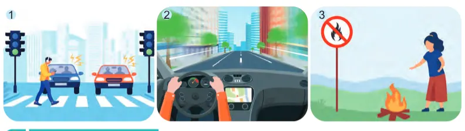

### Asosiy tushunchalar

Jamiyatning barcha aʼzolari har doim ham munosib huquqiy xulq-atvorda boʻlavermaydi. Ayrim shaxslar huquqqa zid xatti-harakatlar ham sodir etib turadi. Shu sababli, huquqshunoslik fanida huquqbuzarlik tushunchasi va uning xususiyatlari alohida oʻrganiladi.

Maʼmuriy huquqbuzarlik — maʼmuriy javobgarlikka tortish nazarda tutilgan, shaxsga, fuqarolarning huquqlari va erkinliklariga, mulkchilikka, davlat va jamoat tartibiga, tabiiy muhitga tajovuz qiluvchi gʻayriqonuniy, aybli harakat yoki harakatsizlikdir.

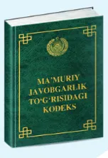

Mamlakatimizda Maʼmuriy javobgarlik toʻgʻrisidagi kodeks amalda boʻlib, mazkur kodeks bilan taqiqlangan qilmishni sodir etish maʼmuriy huquqbuzarlik sifatida baholanadi va javobgarlikni keltirib chiqaradi.

Maʼmuriy huquqbuzarlikka misol sifatida mayda bezorilik, yoʻl harakati va transport vositalaridan foydalanish qoidalarini buzish, pasport tizimi va turar-joyni qayd etish qoidalarini buzish, elektr energiyasidan foydalanish qoidalarini buzish, atrof-muhit, tarixiy va madaniy yodgorliklarni muhofaza qilish sohasidagi huquqbuzarliklarni keltirib oʻtish mumkin.

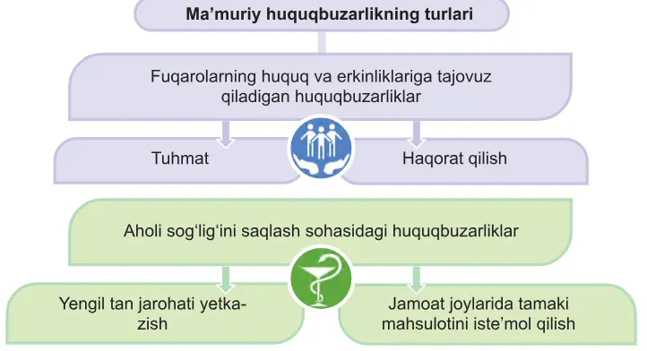

### Tabiatdan foydalanish sohasidagi huquqbuzarliklar

### Asosiy tushunchalar

Agar biror shaxs maʼmuriy huquqbuzarlik sodir etsa, maʼmuriy javobgarlik yuzaga keladi. Albatta, maʼmuriy huquqbuzarlik sodir etgan paytda oʻn olti yoshga toʻlgan aqli raso shaxslar maʼmuriy javobgarlikka tortiladi.

Maʼmuriy javobgarlik — shaxslarning maʼmuriy huquqbuzarlik toʻgʻrisidagi qonun hujjatlarini buzishga qaratilgan qilmishi uchun huquqiy taʼsir chorasi qoʻllanilishida ifodalanadigan huquqiy oqibatdir. Maʼmuriy huquqbuzarlik uchun jazo tegishli sudlar va boshqa vakolatli davlat organlari tomonidan belgilanadi.

Maʼmuriy jazoning maqsadi jazolash emas!

### Xulosa qiling

Demak, maʼmuriy jazo maʼmuriy huquqbuzarlik sodir etgan shaxsni qonunlarni hurmat qilish va ularga rioya etish ruhida tarbiyalash, yangi huquqbuzarlik sodir etilishining oldini olish maqsadida qoʻllaniladi.

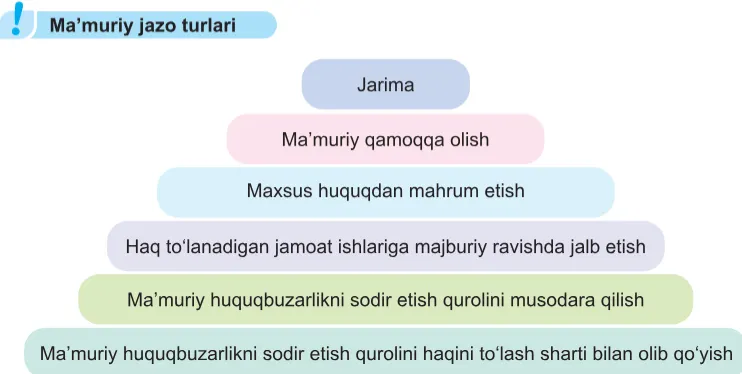

Chet el fuqarolarini va fuqaroligi boʻlmagan shaxslarni Oʻzbekiston Respublikasi hududidan maʼmuriy tarzda chiqarib yuborish

### Voyaga yetmaganlar huquqbuzarligi uchun javobgarlikning oʻziga xosligi

Voyaga yetmaganlarga maʼmuriy qamoqqa olish jazosi qoʻllanilmaydi.

Voyaga yetmaganlarni haq toʻlanadigan jamoat ishlariga majburiy ravishda jalb etish mumkin emas.

Maʼmuriy huquqbuzarlik sodir etgan voyaga yetmagan shaxs ushlab turilgani haqida uning ota-onasi yoki ular oʻrnini bosuvchi shaxslarga darhol xabar beriladi.

Voyaga yetmaganlarning qonuniy vakillari (masalan, ota-onalari) ularning qonuniy manfaatlarini ifodalashga haqli.

Voyaga yetmaganlar oʻzini himoya qilish huquqiga ega.

Shuningdek, advokat yoki qonuniy vakili ularning qonuniy manfaatlarini himoya qilishi mumkin.

Agar huquqni muhofaza qiluvchi organ xodimlari tomonidan voyaga yetmagan boladan biror masalada izoh soʻralayotgan boʻlsa, u oʻz fikrini erkin aytishi mumkin. Shuningdek, javob bermaslik huquqidan foydalanishi ham mumkin.

On olti yoshdan oʻn sakkiz yoshgacha boʻlgan shaxslarning mustaqil ish haqi boʻlmagan taqdirda, jarima ularning ota-onalari yoki ular oʻrnini bosuvchi shaxslardan undirib olinadi.

### Hamkorlikda bajaramiz

Quyidagi vaziyat bilan tanishib chiqing. Bunday vaziyatda qanday javobgarlik kelib chiqishini kichik guruhlarda tahlil qiling.

Mahalla ichidagi koʻchalardan birida ikki nafar oʻsmir bola koʻchada oʻynab yurgan itga duch kelishdi. Boshida ular itni chaqirib, goʻyoki u bilan oʻynagandek boʻlishdi. Biroq keyinroq ulardan biri itga tosh Ota boshladi. Ikkinchisi esa telefonini olib, bu holatni kulib videoga oldi.

It qoʻrqib, qochmoqchi boʻldi, lekin bolalar uni yana quvib, tosh otishda davom etishdi. Shu vaqtda yon-atrofda yashovchi Kamronbek bu holatni koʻrib, itni himoya qilishga harakat qildi. Bolalar qochib ketishdi.

Kamronbek itni veterinarga olib borib, birinchi yordam koʻrsatdi. Shundan soʻng mahalla faollariga xabar berdi.

Bolalarning shaxsi aniqlanib, ularning ota-onalari chaqirtirildi.

Ularga bolalarning harakati hayvonlarga shafqatsiz munosabatda boʻlish ekanligi tushuntirildi.

Bu kabi harakatlar jinoiy yoki maʼmuriy javobgarlikka olib kelishi mumkinligi haqida tushuntirish ishlari olib borildi. It esa mahalladagi hayvonlarni asrash bi- Ian shugʻullanuvchi koʻngilli fuqaroga topshirildi.

### Izlanishda davom eting

Oʻzbekiston Respublikasi qonunchilik maʼlumotlari milliy bazasidan (lex.uz) Jinoyat kodeksi va Maʼmuriy javobgarlik toʻgʻrisidagi kodekslardagi bir xil huquqbuzarlik va jinoyat turlarini aniqlang. Ularning oʻzaro qanday farqlari mavjud ekanligini tahlil eting.

## 15-dars. Huquqbuzarlikning oldini olish

### Faollashtiruvchi savollar

Quyidagi rasmlarga eʼtibor qarating va savollarga javob bering.

1. Huquqbuzarlikning oldini olishda qanday davlat tashkilotlari faoliyat olib boradi?

2. Keltirilgan ramzlar qaysi davlat organlariga taalluqli, deb oʻylaysiz?

3. Mazkur davlat organlari qanday huquqbuzarliklarning oldini olish bilan shugʻullanadi? Nima uchun?

4. Bu davlat organlarini umumiy maʼnoda qanday nomlash mumkin?

5. Siz kelajakda qaysi huquqni muhofaza qiluvchi organda ishlashni xohlaysiz? Nima uchun bunday qarorga keldingiz?

6. Siz qaysi davlat organi xodimlari bilan huquqbuzarlikning oldini olish yoki aniqlash borasida duch kelgansiz?

### Yodda tuting

Hayotimiz osuda, fayz-barakali boʻlishi, vatandoshlarimizning ertangi kunga ishonchi, hayotga muhabbati yuksalishi uchun huquqbuzarlikning oldini olish chora-tadbirlarini samarali olib borish talab etiladi. Shunda yurtimizda tinchlik, osoyishtalik, barqarorlik hukm suradi. Huquqbuzarlikning oldini olish faqat davlat, xususan ichki ishlar oganlari emas, balki har bir Oʻzbekiston fuqarosining muqaddas burchidir. Huquqbuzarlikning oldini olishdagi eng muhim chora-tadbirlar tizimi huquqbuzarliklar profilaktikasidir.

Huquqbuzarliklar profilaktikasi — huquq-tartibotni saqlash, huquqbuzarliklarni aniqlash, bartaraf etish, huquqbuzarliklarning sodir etilishi sabablari va shart-sharoitlarini oʻrganishga qaratilgan chora-tadbirlar tizimi.

Profilaktika soʻzi yunonchadan kelib chiqqan boʻlib, "oldini olish" maʼnosini bildiradi. Huquqshunoslik fanida huquqbuzarliklarning oldini olishga qaratilgan chora-tadbirlar tizimi sifatida qaraladi.

### Asosiy tushunchalar

"Huquqbuzarliklar profilaktikasi kuni" — har haftaning payshanba kuni etib belgilangan. Bu kunda huquqbuzarlikning oldini olish ishlari sarhisob qilinadi. Aholi oʻrtasida tushuntirish ishlari olib boriladi.

### Qonun belgilaydi

Mamlakatimizda 2014-yilda "Huquqbuzarliklar profilaktikasi toʻgʻrisida"gi qonun kuchga kirdi. Mazkur qonunning qabul qilinishi tufayli, yurtimizda huquqbuzarliklarning oldini olish chora-tadbirlari tizimlashtirildi. Bu borada vakolatli davlat organlari belgilandi.

### Xulosa qiling

Huquqbuzarliklar profilaktikasini bevosita amalga oshiruvchi organlar va muassasalarning asosiy vazifasi — shaxslarning huquqlari, erkinliklari va qonuniy manfaatlari himoya qilinishini taʼminlashdan iborat.

Shuningdek, jismoniy shaxslarning huquqbuzarlikdan jabrlanuvchiga aylanishi xavfini kamaytirish ham bu boradagi asosiy vazifa hisoblanadi.

Bu kabi organ va muassasalar jazolovchi emas.

Aksincha sizning huquq va erkinliklaringizning himoyachilaridir.

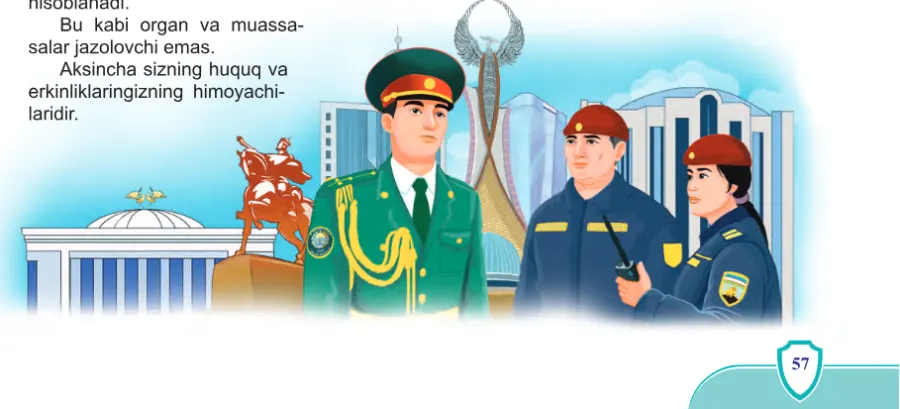

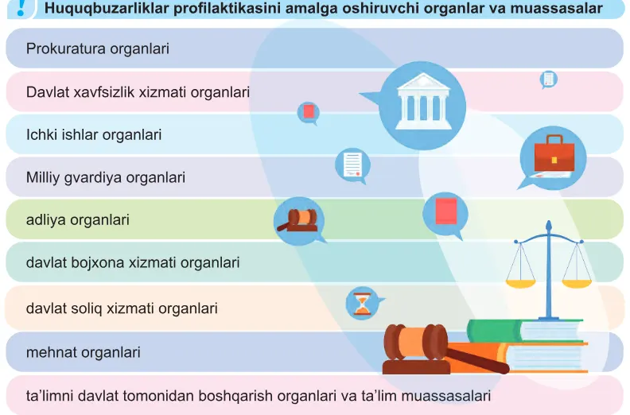

sogʻliqni saqlash tizimini boshqarish organlari va sogʻliqni saqlash muassasalari va boshqalar

### Yodda tuting

Huquqbuzarliklar profilaktikasini amalga oshirishda shaxslarning huquqlari, erkinliklari va qonuniy manfaatlari cheklanishiga, shafqatsiz yoki inson qadr-qimmatini kamsituvchi muomalada boʻlishga yoʻl qoʻyilmaydi.

Shuningdek, shaxsiy hayot, yozishmalar, telefonda soʻzlashuvlar, pochta, telegraf xabarlari va boshqa xabarlar sir saqlanishi, bir joydan ikkinchi joyga erkin koʻchish va yashash joyini tanlash, shuningdek shaxsiy daxlsizlik, uy-joy daxlsizligi buzilishi tegishli javobgarlikni keltirib chiqaradi.

### Qonun belgilaydi

Huquqbuzarliklardan jabrlanganlarning huquqlari qonun bilan muhofaza qilinadi. Davlat jabrlanganlarga himoyalanishni va Odil sudlovdan foydalanishni taʼminlaydi, ularga yetkazilgan zararning oʻrni qoplanishi uchun shart-sharoitlar yaratadi.

### Tarixga nazar

Huquqbuzarlikning oldini olish boʻyicha Temuriylar davlati va joriy milliy qonunchiligimizni qiyosiy tahlil qiling. Fikringizni asoslab bering.

"Hukm qildimki, bir kishini arzbegi qilib tayinlasinlar. U sipoh, raiyat va arz-dod qilib keluvchilarning ahvolini, mamlakatning obod yoki xarobligini, muhim ishlardan qaysi biri bitgan-bitmaganligini mening arzimga yetkazib tursin. Har bir shahar va qishloqqa qutvol tayinlasinlarki, sipoh-u raiyatga soqchilik qilsin, kimning biron narsasi oʻgʻirlansa, buning masʼuliyati uning zimmasida boʻlsin. Va yana buyurdimki, yoʻl ustiga kuzatuvchilar, zobitlar tayinlasinlarki, yoʻllarni qoʻriqlab, yoʻlovchilar, savdogarlar, musofirlarni kuzatib, mol-mulki va boshqa narsalarini manzildan manzilga yetkazib qoʻysinlar. Yoʻl ustida birortasining narsasi yoʻqolsa, oʻzi oʻldirilsa yoki boshqa kor-hol yuz bersa, bular uchun javobgarlik ularning zimmasida boʻlsin".

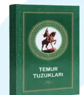

### Izlanishda davom eting

Quyidagi huquqbuzarlikning oldini olish choralaridan qay biri samaraliroq? Ularni tegishli tartibda joylashtiring va oʻz fikringizni asoslab bering. Huquqbuzarlikning oldini olish boʻyicha siz yangi chora taklif eta olasizmi? Taklifingizni asoslab bering.

Profilaktik suhbat — shaxsni jamiyatda qabul qilingan xulq-atvor normalari va qoidalariga rioya etishga ishontirish, gʻayriijtimoiy xulq-atvorning ijtimoiy va huquqiy oqibatlarini hamda huquqbuzarlik sodir etganlik uchun qonunda belgilangan javobgarlikni tushuntirish.

Rasmiy ogohlantirish — shaxsga uning gʻayriijtimoiy xulq-atvorni davom ettirishiga yoʻl qoʻyib boʻlmasligi toʻgʻrisida yozma ravishda tushuntirish.

Profilaktik hisobga olish — huquqbuzarlik sodir etgan shaxslarga nisbatan ularning tuzalishi va takroran huquqbuzarlik sodir etishining oldini olish maqsadida ichki ishlar organlari tomonidan roʻyxatga olish.

## 16-dars. Ijodiy faoliyat

Quyidagi jadvalda keltirilgan holatlar maʼmuriy huquqiy munosabat yoki maʼmuriy huquqbuzarlikka oid ekanligini tahlil eting.

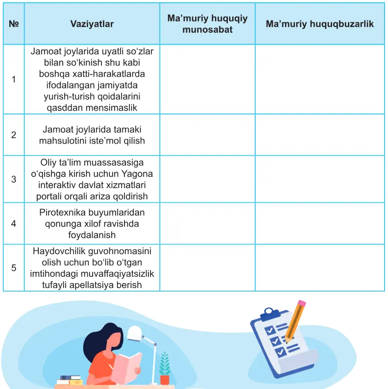

Quyidagi rasmlarda tasvirlangan holatlardan qaysilari maʼmuriy huquqiy munosabatlarga taalluqli emas. Fikringizni asoslab bering.

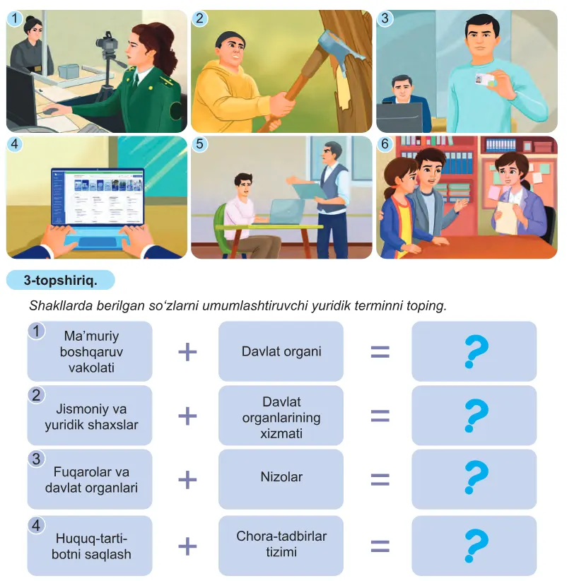

4-topshiriq.

Quyidagi vaziyatlar bilan tanishib chiqing. Ularga huquqiy yechim bering. Fikrlaringizni asoslab bering 1-vaziyat. Kamronbek "Tracker" rusumli mashinasini boshqarib ketayotganida yoʻl patrul xizmati xodimi tomonidan toʻxtatildi.

Xodim oʻzini tanishtirgach, Kamronbek transport vositasini boshqarish vaqtida telefondan foydalanganligini bildirib, maʼmuriy huquqbuzarlik bayonnomasini tuza boshladi.

Kamronbek telefonda gaplashib kelayotganligini tan oldi. Biroq u Oʻzbekiston Respublikasining Maʼmuriy javobgarlik toʻgʻrisidagi kodeksini yaxshi bilishini aytib, mashinani boshqarayotganda quloqchinlar orqali va qoʻllarni ishlatmasdan turib foydalanish mumkin ekanligini bildirdi.

Vaziyatga huquqiy yechim bering.

2-vaziyat. Maktabda Alisher oʻzidan kichik yoshli Akobirjonga qasddan yengil tan jarohati yetkazdi. Akobirjonning onasi Alisherning ota-onasini chaqirib, ularning farzandlari ishtirokida profilaktik suhbat oʻtkazish boʻyicha mahalla noziriga ariza bilan murojaat qildi. Shuningdek, ularga maʼmuriy jarima qoʻllash kerakligini bildirdi.

Lekin mahalla noziri Alisher oʻn olti yoshga kirmaganligini aytib, jarima yoki boshqa maʼmuriy jazolarni qoʻllab boʻlmasligini bildirdi.

Vaziyatga huquqiy yechim bering.

5-topshiriq.

"Berlin Rent Control Case" — ijara narxlarini cheklash ishi Berlin shahri uzoq vaqtlar davomida ijaraga olingan uylar bilan bogʻliq muammolarga duch kelgan. Shaharga yangi odamlar kelishi va talabning oshishi natijasida ijara narxlari tez koʻtarilib ketar edi. Shu sababli Berlin Xalq vakillari palatasi "Mietendeckel" nomli qonunni qabul qildi. Bu bilan shahardagi ijara haqining chegarasi belgilandi. Mulkdorlarga ijara haqini oshirish taqiqlandi.

Koʻplab uy egalari bu qonundan norozi boʻlib, maʼmuriy sudlarga murojaat etishdi. Hattoki, bu masala Germaniya Federal Konstitutsiyaviy sudida ham koʻrib chiqildi.

Federal Konstitutsiyaviy sud 2021 -yilda mazkur qonunni konstitutsiyaga zid va haqiqiy emas deb topdi. Uy egalari uchun bu qaror ijobiy boʻldi, chunki ular bozordagi erkin narx belgilash huquqini qaytarib oldi.

Tasavvur qiling, siz uy ijarasi bilan shugʻullanasiz. Siz faoliyat olib boradigan shaharda ijara haqi hokimiyat organlarining qarori bilan cheklab qoʻyildi. Siz qaysi organga murojaat qilasiz?

# III bob. Jinoyat huquqi. Kriminologiya

## 17-dars. Jinoyat huquqi

### Faollashtiruvchi savollar

Quyidagi rasmlarga eʼtibor qarating va savollarga javob bering.

1. Jinoyat deganda nimani tushunasiz? Jinoyatga qanday misollar keltira olasiz?

2. Quyidagi rasmlarda nimalar tasvirlangan?

3. Rasmlarning qay birida jinoyat huquqining asosiy manbasi keltirilgan?

4. Jinoyat sodir etgan shaxslarni tergov qilish bilan shugʻullanuvchi qanday davlat idoralarini bilasiz?

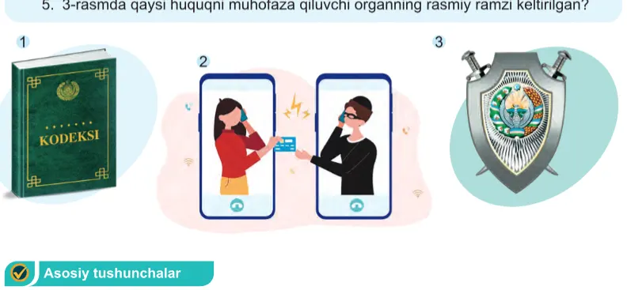

Jinoyat huquqi — davlat tomonidan belgilangan huquqiy normalar tizimi boʻlib, u jinoyat deb hisoblanadigan harakatlarni, ularga nisbatan qoʻllaniladigan jazolarni va jinoyat sodir etgan shaxslarning javobgarligini tartibga soladi.

Ozbekiston Respublikasining Jinoyat kodeksi bilan taqiqlangan, aybli ijtimoiy xavfli qilmish (harakat yoki harakatsizlik) jazo qoʻllash tahdidi bilan jinoyat deb topiladi.

### Yodda tuting

Har qanday huquq sohasi oʻz vazifalariga ega boʻladi. Jinoyat huquqi ham bundan mustasno emas.

Jinoyat huquqining vazifalari shaxsni, uning huquq va erkinliklarini, jamiyat va davlat manfaatlarini, mulkni, tabiiy muhitni, tinchlikni, insoniyat xavfsizligini jinoiy tajovuzlardan qoʻriqlash, shuningdek jinoyatlarning oldini olish, fuqarolarni respublika Konstitutsiyasi va qonunlariga rioya qilish ruhida tarbiyalashdan iboratdir.

(v/' Asosiy tushunchalar Jinoyat huquqining prinsiplari — bu ushbu huquq sohasining asosiy yoʻnalishlarini belgilovchi muhim tushunchalardir.

Jinoyat huquqining asosiy prinsiplari oʻzaro teng qimmatlidir. Ularning har biri mustaqil mohiyatga ega boʻlib, davlatning jinoyat huquqiga oid siyosatini amalga oshirish uchun zarur boʻlgan bir qator vazifalarni bajaradi.

### Jinoyat huquqining asosiy prinsiplari

Sodir etilgan qilmishning jinoiyligi, jazoga sazovorligi va boshqa huquqiy oqibatlari faqat Oʻzbekiston Respublikasining Jinoyat kodeksi bilan belgilanadi.

Jinoyat sodir etgan shaxslar jinsi, irqi, millati, tili, dini, eʼtiqodi, ijtimoiy kelib chiqishi, ijtimoiy mavqeyidan qatʼi nazar, bir xil huquq va majburiyatlarga ega boʻlib, qonun oldida tengdirlar.

Jamoat birlashmalari, fuqarolarning oʻzini oʻzi boshqarish organlari yoki jamoalar jinoyat sodir etgan shaxslar axloqini tuzatish ishiga qonunda nazarda tutilgan hollarda jalb qilinishlari mumkin.

Jazo va boshqa huquqiy taʼsir choralari jismoniy azob berish yoki inson qadr-qimmatini kamsitish maqsadini koʻzlamaydi.

Jinoyat sodir etishda aybdor boʻlgan shaxsga nisbatan qoʻllaniladigan jazo yoki boshqa huquqiy taʼsir chorasi odilona boʻlishi, yaʼni jinoyatning ogʻir-yengilligiga, aybning va shaxsning ijtimoiy xavflilik darajasiga muvofiq boʻlishi kerak.

### Ayb uchun javobgarlik

Shaxs qonunda belgilangan tartibda aybi isbotlangan ijtimoiy xavfli qilmishlari uchungina javobgar boʻladi.

### Javobgarlikning muqarrarligi

Qilmishida jinoyat tarkibining mavjudligi aniqlangan har bir shaxs javobgarlikka tortilishi shart.

### Tarixga nazar

"Temur tuzuklari"dan keltirilgan quyidagi parchani oʻqing. Jinoyat huquqining qaysi prinsipi haqida soʻz yuritilayotganligini aniqlang.

"Qishloq oqsoqoli va shahar ulugʻlari kichikroq darajadagi odamga zulm qilsalar, oʻsha zulmga yarasha, har kimning koʻtarishicha jarima solsinlar. Agar darugʻalar va hokimlar xalqqa jabr-zulm etib, ularni xarob qilgan boʻlsalar, ishlariga loyiq jazo berilsin. Biror kimsaning gunohi isbotlangandan keyin undan jarima olsalar, soʻng yana darra bilan urmasinlar. Agar darra urish bilan jazolasalar, undan jarima olmasinlar".

### Yodda tuting

> Maʼmuriy huquqbuzarlik — bu yengilroq shakldagi qilmish boʻlib, uning ijtimoiy xavflilik darajasi yuqori boʻlmaydi. Masalan, yoʻl harakati qoidalariga rioya qilmaslik.

> Jinoyat — bu jamiyat uchun xavfli qilmish hisoblanadi. Masalan, oʻgʻrilik, pora olish, odam oʻldirish kabi jinoyatlar fuqarolarning xavfsizligiga bevosita zarar yetkazadi.

Jinoyat sodir etgan shaxs jinoiy javobgarlikka tortiladi. Bunda jazolar nisbatan oʻgʻir shaklda boʻladi. Masalan, sud tomonidan shaxsga ozodlikdan mahrum qilish jazosini qoʻllash.

Maʼmuriy huquqbuzarlik sodir etgan shaxs maʼmuriy javobgarlikka tortiladi. Bu holatda jarima yoki maʼmuriy qamoq kabi yengilroq jazolar tayinlanadi.

Maʼmuriy huquqbuzarliklar uchun jazo nafaqat jinoyat ishlari boʻyicha sud balki ichki ishlar organlari yoki boshqa maʼmuriy organlar tomonidan beriladi.

Jinoyat ishlarini sud koʻrib chiqadi.

Jinoyat uchun jazo faqat sud tomonidan belgilanadi.

Jinoyat uchun jazo Oʻzbekiston Respublikasining Jinoyat kodeksi bilan belgilanadi.

Maʼmuriy huquqbuzarlik uchun jazo Maʼmuriy javobgarlik toʻgʻrisidagi kodeks asosida tayinlanadi.

### Hamkorlikda bajaramiz

Kichik guruhlarga boʻlining. Quyidagi vaziyatlar bilan tanishib chiqing. Ularning qay biri jinoyat yoki maʼmuriy huquqbuzarlik ekanligini aniqlang.

1. Mehrnoza bozordagi sotuvchiga baqirib, doʻkon buyumlarini otib yubordi. Atrofdagilar bu holatdan norozi boʻlib, ichki ishlar boʻlimiga murojaat qilishdi.

2. Oʻn olti yoshli Botirshoh besh-olti yoshdagi bogʻcha tarbiyalanuvchilarini aldab, qoʻshnilarning velosipedlarini oʻgʻirlab kelishni tashkil etdi.

3. Sanjar shoshilinch ish bilan svetoforning qizil chirogʻiga qaramay, harakatlanib ketdi. Videoqayd qurilmasi bu holatni yozib oldi va unga jarima belgilandi.

4. Shohrud oʻz uyida katta miqdordagi giyohvandlik moddalarini tijorat maqsadida saqlab kelayotgan edi.

5. Ikki oʻquvchi sinf xonasida oʻzaro janjallashib qoldi. Biri boshqasining yuziga musht tushirdi. Maktab hamshirasi bu yengil tan jarohati ekanligini aytdi.

6. Elshod kechasi parkda yolgʻiz ketayotgan yigitni toʻxtatib, sovuq qurol bilan qoʻrqitdi. U yigitning telefonini va pulini olib qochdi.

7. Sotuvchi voyaga yetmagan shaxslarga tamaki mahsulotlarini sotdi.

8. Nurshod kechasi koʻchada qarovsiz qolgan avtomashinaning eshigini buzib ochdi. Mashinadan telefon va pullarni olib, qochib ketdi.

### Qonun belgilaydi

Jinoyat sodir etganlikda ayblanayotgan shaxs uning aybi qonunda nazarda tutilgan tartibda oshkora sud muhokamasi yoʻli bilan isbotlanmaguncha va sudning qonuniy kuchga kirgan hukmi bilan aniqlanmaguncha aybsiz deb hisoblanadi. Ayblanuvchiga oʻzini himoya qilish uchun barcha imkoniyatlar taʼminlanadi.

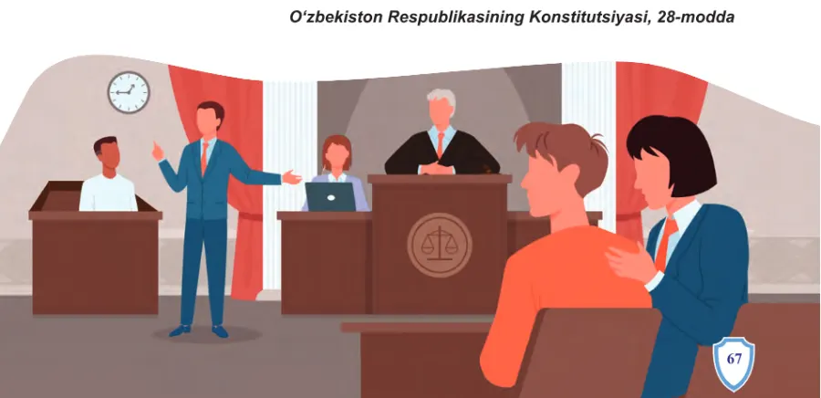

## 18-dars. Jinoiy javobgarlik va jazo tizimi

### Faollashtiruvchi savollar

Quyidagi huquq normalaridan keltirilgan parchalarga eʼtibor bering. Ularni qonunchilikda belgilashdan koʻzlangan maqsadni aniqlang.

1-vaziyat. Majburiy jamoat ishlari pensiya yoshiga yetgan shaxslarga, oʻn olti yoshga toʻlmagan shaxslarga, homilador ayollarga, uch yoshga toʻlmagan bolalari bor ayollarga, birinchi va ikkinchi guruh nogironligi boʻlgan shaxslarga nisbatan qoʻllanilmaydi.

2-vaziyat. Tadbirkorlik faoliyati bilan shugʻullanayotgan shaxslarga nisbatan tadbirkorlik faoliyati bilan shugʻullanish huquqidan mahrum qilish tarzidagi jazo tayinlanmaydi bundan odam oʻlishiga yoki boshqa ogʻir oqibatlarga sabab boʻlgan hollar mustasno.

3-vaziyat. Mudofaalanuvchi yoxud boshqa kishining shaxsi yoki huquqlarini, jamiyat yoki davlat manfaatlarini qonunga xilof tajovuzlardan tajovuzchiga zarar yetkazgan holda himoya qilish chogʻida qilingan harakat, agar zaruriy mudofaa chegarasidan chetga chiqilmagan boʻlsa, jinoyat deb topilmaydi. Tajovuzning xususiyati va xavfliligi darajasiga butunlay muvofiq kelmaydigan mudofaa, zaruriy mudofaa chegarasidan chetga chiqish deb topiladi.

Jinoyat uchun javobgarlik — jinoyat sodir etishda aybdor boʻlgan shaxsga nisbatan sud tomonidan hukm qilish, jazo yoki boshqa huquqiy taʼsir chorasi qoʻllanilishida ifodalanadigan jinoyat sodir etishning huquqiy oqibatidir.

> Jazo — bu jinoyat sodir etgan shaxsga sud tomonidan tayinlanadigan huquqiy taʼsir chorasidir. Uning asosiy maqsadi jinoyatchini jazolash emas.

Jazo mahkumni axloqan tuzatish, uning jinoiy faoliyatni davom ettirishiga toʻsqinlik qilish hamda boshqa shaxslar yangi jinoyat sodir etishining oldini olish maqsadida qoʻllaniladi.

Jazoning turi, miqdori va muddati jinoyatning ogʻirligi, shaxsning aybi, jinoyat sodir etilgan sharoitlar va yengillashtiruvchi yoki ogʻirlashtiruvchi holatlarga qarab belgilanadi.

### Xulosa qiling

Jazo jinoyat sodir etishda aybli deb topilgan shaxsga nisbatan davlat nomidan sud hukmi bilan qoʻllanadigan va mahkumni qonunda nazarda tutilgan muayyan huquq va erkinliklardan mahrum qilish yoki ularni cheklashdan iborat majburiy choradir. Jazo mahkumni axloqan tuzatish, uning jinoiy faoliyatni davom ettirishiga toʻsqinlik qilish hamda mahkum, shuningdek, boshqa shaxslar yangi jinoyat sodir etishining oldini olish maqsadida qoʻllaniladi.

### Asosiy tushunchalar

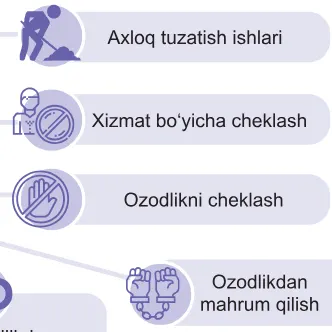

### Yodda tuting

> Jarima — aybdordan davlat daromadiga Jinoyat kodeksida belgilangan miqdorda pul undirishdir.

Muayyan huquqdan mahrum qilish — sud tayinlagan muddat davomida aybdorning korxonalar, muassasalar yoki tashkilotlarda u yoki bu mansabni egallashini yoxud u yoki bu faoliyat bilan shugʻullanishini taqiqlashdan iboratdir. Ana shunday mansab yoki faoliyat turi sud tomonidan ayblov hukmida koʻrsatiladi.

Muayyan huquqdan mahrum qilish aybdorning mansabi yoki ish faoliyati bi- Ian bevosita bogʻliq boʻlgan jinoyatni sodir etganligi uchun asosiy jazo tariqasida tayinlanganda — bir yildan besh yilgacha muddatga, qoʻshimcha jazo tariqasida tayinlanganda — bir yildan uch yilgacha muddatga belgilanadi.

Majburiy jamoat ishlari — mahkumni haq toʻlanmaydigan foydali jamoat ishlarini bajarishga majburiy tarzda jalb qilishdan iboratdir. Mahkum ishlayotgan yoki oʻqiyotgan boʻlsa, majburiy jamoat ishlari ishdan yoki oʻqishdan boʻsh vaqtda oʻtaladi.

Mahkumlar majburiy jamoat ishlarini oʻtashi mumkin boʻlgan joylar va majburiy jamoat ishlarining turi mazkur jazoning ijrosini nazorat qiluvchi organlar tomonidan belgilanadi.

Axloq tuzatish ishlari — shaxs ish haqining osn foizidan oʻttiz foizigacha miqdorini davlat daromadi hisobiga ushlab qolgan holda uni mehnatga majburan jalb qilishdan iborat boʻlib, jazo sudning hukmiga muvofiq mahkumning oʻz ish joyi yoki mazkur jazo ijrosini nazorat qiluvchi organlar belgilab beradigan boshqa joylarda oʻtaladi.

Xizmat boʻyicha cheklash — harbiy xizmatni shartnoma boʻyicha oʻtayotgan harbiy xizmatchini sud hukmida koʻrsatilgan muddat davomida muayyan huquq va imtiyozlardan mahrum qilib, pul taʼminotining oʻn foizidan oʻttiz foizigacha boʻlgan miqdorini davlat daromadi hisobiga ushlab qolishdan iboratdir.

Ozodlikni cheklash — sud tomonidan mahkumga nisbatan uy-joyini u yoki bu sabab bilan tark etishni butunlay taqiqlashdan yoxud ishlash yoki oʻqish vaqtidan, shuningdek ish yoki oʻqish joyigacha borishi va uy-joyiga qaytib kelishi uchun zarur boʻlgan vaqtdan tashqari qolgan vaqtda uy-joyidan chiqishni cheklashdan iborat.

Intizomiy qismga joʻnatish — muddatli harbiy xizmat harbiy xizmatchisini sud tomonidan belgilangan muddat mobaynida ichki tartibi ancha qattiq boʻlgan maxsus harbiy qismga joylashtirish orqali, muayyan huquq va imtiyozlardan mahrum etishdir.

Ozodlikdan mahrum qilish — mahkumni jamiyatdan ajratib, jazoni ijro etish koloniyasi yoki turmaga joylashtirishdan iboratdir.

Ozodlikdan mahrum qilish bir oydan yigirma yilgacha muddatga belgilanadi.

Umrbod ozodlikdan mahrum qilish — favqulodda jazo chorasi boʻlib, mahkumni maxsus tartibli jazoni ijro etish koloniyasiga joylashtirish orqali jamiyatdan muddatsiz ajratib qoʻyishdan iboratdir.

Umrbod ozodlikdan mahrum qilish jazosi javobgarlikni ogʻirlashtiradigan holatlarda qasddan odam oʻldirish va terrorizm uchun belgilanadi.

Umrbod ozodlikdan mahrum qilish jazosi ayollarga, oʻn sakkiz yoshga toʻlmasdan jinoyat sodir etgan shaxsga va oltmish yoshdan oshgan erkaklarga nisbatan tayinlanishi mumkin emas.

### Yodda tuting

Harbiy yoki maxsus unvonga ega boʻlgan shaxs ogʻir yoki oʻta ogʻir jinoyat uchun hukm qilinganida sud hukmi bilan mazkur unvondan mahrum qilinishi mumkin.

Oliy harbiy yoki maxsus unvonga yoxud Oʻzbekiston Respublikasining davlat mukofotiga ega boʻlgan shaxs ogʻir yoki oʻta ogʻir jinoyati uchun hukm qilinganida sudning hukmi asosidagi taqdimnomaga binoan mazkur unvon yoki mukofotdan mahrum qilinishi mumkin.

### Tarixga nazar

"Hammurapi qonunlari"ga e 'tibor qarating. Oʻzbekiston Jinoyat kodeksining 257—258-moddalari va quyidagi tarixiy manbadan keltirilgan parchani qiyosiy-huquqiy tahlil qiling.

"Hammurapi qonunlari" — miloddan avvalgi XVIII asrda Bobil shohi Hammurapi tomonidan tuzilgan yozma qonunlar toʻplamidir. Bu qonunlar tosh ustiga mixxat yozuvida yozilgan va jamiyatda tartib, adolat hamda javobgarlikni taʼminlashga qaratilgan.

Qonunlar "koʻzga koʻz, tishga tish" prinsipiga asoslangan boʻlib, jinoyat qilgan shaxs aynan qilgan ishi miqdorida jazoga tortilgan. Misol uchun, agar bir kishi boshqasining qoʻlini sindirsa — uning ham qoʻli sindirilgan.

"Hammurapi qonunlari"ning 229-bandiga koʻra, agar quruvchi bir kishiga uy qurib bersa, lekin u mustahkam boʻlmasa va qulab tushib, uy egasini oʻldirsa — quruvchiga oʻlim jazosi berilgan.

### Hamkorlikda bajaramiz

Quyidagi detektiv jumboq bilan tanishib chiqing. Kichik guruhlarga boʻlingan holda jumboqning yechimini aniqlang.

Yakshanba kuni tongda ichki ishlar boʻlimiga qotillik boʻyicha xabar kelib tushdi. Xolmurod uyidagi shaxsiy xonasida oʻlik holda topilgan edi.

Janob Sinchkov va ichki ishlar xodimlari darhol voqea joyiga yetib borishdi. Janob Sinchkov qotillik yuz bergan vaqtda uyda boʻlgan barcha shaxslarni soʻroq qildi. Xolmurodning turmush oʻrtogʻi Mohigul mahzun holda quyidagi fikrlarni bildirdi: — "U erta sahar turib, har doimgidek, oʻzining xonasiga kirib ketgandi. Keyin xonasiga kirsam, u qonga belangan holda yotgan ekan", — deb yigʻlab yubordi.

Janob Sinchkov uydagi xodimlarni ham birma-bir soʻroq qildi. Uy bekasi erta tongdan birinchi qavatda tozalash ishlari bilan band boʻlganini taʼkidladi. Bogʻbon esa daraxt va koʻchatlarni sugʻorganligini, xizmatkor pochta boʻlimiga xatlarni tashlash uchun chiqib ketganligini, oshpaz esa nonushta tayyorlash ishlari bilan shugʻullanganligini aytdi.

Savol. Sizningcha, jinoyatni kim sodir etgan?

## 19–20-dars. Shaxsga qarshi jinoyatlar

### Faollashtiruvchi savollar

Quyidagi rasmlarga eʼtibor qarating va savollarga javob bering.

1. Shaxsga qarshi jinoyatlar deganda nimani tushunasiz? Bunday jinoyatlarga qanday misollar keltira olasiz?

2. Shaxsga qarshi jinoyatlarni boshqa jinoyatlardan qanday farqlash mumkin? Fikringizni asoslab bering.

3. Quyidagi rasmlarda qanday jinoyatlar tasvirlangan?

4. 1-rasmda qanday harakatlar amalga oshirilmoqda? Fikringizni asoslab bering.

5. Qasddan badanga ogʻir shikast yetkazish qanday javobgarlikni keltirib chiqaradi?

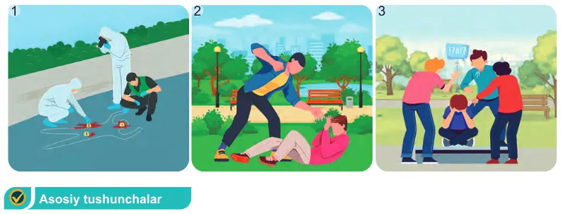

> Shaxsga qarshi jinoyatlar — bu insonning hayoti, sogʻligʻi, erkinligi, shaʼni, qadr-qimmati va jinsiy daxlsizligiga qarshi sodir etiladigan jinoyatlardir. Bunday jinoyatlar odamning eng muhim, konstitutsiyaviy huquqlarini buzadi. Har bir inson tugʻilganidan boshlab yashash va daxlsizlik huquqiga ega. Davlat bu huquqlarni himoya qilish majburiyatini oladi. Shuning uchun ham shaxsga qarshi jinoyatlar eng ogʻir jinoyatlar sirasiga kiradi.

Masalan, odam oʻldirish, qasddan badanga ogʻir yoki oʻrtacha oʻgʻir shikast yetkazish, qiynash, odam oʻgʻirlash, nomusga tegish kabi harakatlar shaxsga qarshi jinoyatlar hisoblanadi.

Ularning barchasi odamga jismoniy yoki ruhiy zarar yetkazadi. Bu jinoyatlar sodir etilganda nafaqat jabrlanuvchi, balki jamiyat ham zarar koʻradi. Chunki bunday harakatlar jamiyatda qoʻrquv, befarqlik va adolatsizlik hissini uygʻotadi.

Internet jahon tarmogʻida boshqa kishining ruxsatisiz uning suratini ulashish shaxsga qarshi jinoyat tarkibiga kiradigan harakatni sodir etish hisoblanadi. Bunda shunday harakatlar uchun maʼmuriy jazo qoʻllanilganidan keyin sodir etish jinoiy javobgarlikni keltirib chiqaradi.

### Sogʻliqqa qarshi jinoyatlar

Masalan, qasddan odam oʻldirish, oʻzini oʻzi oʻldirishga undash

Masalan, qasddan badanga ogʻir yoki oʻrtacha ogʻir shikast yetkazish

Masalan, pornografik mahsulotni tayyorlash va tarqatish, oilaviy zoʻravonlik, voyaga yetmagan shaxsni gʻayriijtimoiy xatti-harakatlarga jalb qilish

Masalan, oʻldirish yoki zoʻrlik ishlatish bilan qoʻrqitish, tanosil yoki OIV kasalligi/ OITSni tarqatish

Shaxsning ozodligi, shaʼni va qadr-qimmatiga qarshi jinoyatlar

Masalan, haqorat qilish, tuhmat, odam oʻgʻirlash, odam savdosi

### Xulosa qiling

Afsuski, haqorat qilish shaxsga qarshi jinoyatlar ichida keng tarqalib bormoqda. Haqorat qilish — bu boshqa shaxsning shaʼni va qadr-qimmatini ataylab, omma oldida yoki u bilan toʻgʻridan toʻgʻri haqoratli soʻzlar, ifodalar yoki kinoyalar bilan tahqirlashdir. Bu harakat insonning ruhiy holatiga salbiy taʼsir koʻrsatadi. Haqorat aniq shaxsga yoʻnaltirilgan boʻlishi lozim.

Haqorat qilish, avval maʼmuriy javobgarlikni keltirib chiqaradi. Qayta sodir etilsa, soʻngra jinoiy javobgarlikni keltirib chiqaradi.

Internet jahon axborot tarmogʻi yoki turli ommaviy axborot vositalari orqali haqorat qilish bevosita jinoiy javobgarlikni keltirib chiqaradi.

### Qonun belgilaydi

Har kim erkinlik va shaxsiy daxlsizlik huquqiga ega.

Hech kim qonunga asoslanmagan holda hibsga olinishi, ushlab turilishi, qamoqqa olini- Shi, qamoqda saqlanishi yoki uning ozodligi boshqacha tarzda cheklanishi mumkin emas.

Hibsga olishga, qamoqqa olishga va qamoqda saqlashga faqat sudning qaroriga koʻra yoʻl qoʻyiladi. Shaxs sudning qarorisiz qirq sakkiz soatdan ortiq muddat ushlab turilishi mumkin emas.

Shaxsni ushlash chogʻida unga tushunarli tilda uning huquqlari va ushlab turilishi asoslari tushuntirilishi shart.

Shaxsga qarshi jinoyatlarning oldini olish uchun jamiyatda bir qator muhim choralar koʻrilishi kerak. Eng avvalo, har bir shaxs oʻz huquqlarini va majburiyatlarini bilishi lozim. Bu esa huquqiy tarbiya orqali amalga oshadi. Ayniqsa, maktab oʻquvchilari jinoyat tushunchasi, jinoyat sodir etish oqibatlari va qonuniy javobgarlik haqida aniq tushunchaga ega boʻlishlari zarur.

Oilada sogʻlom muhit boʻlishi ham jinoyatlarning oldini olishda muhim omil hisoblanadi. Ota-onalar farzandlariga mehr bilan munosabatda boʻlishi, muammolarni urish yoki bosim bilan emas, balki muloqot orqali hal qilishni oʻrgatishi kerak. Maktab, mahalla va jamoalarda ham nazorat kuchaytirilishi, zoʻravonlik holatlari erta aniqlanib, tegishli choralar koʻrilishi zarur.

### Tarixga nazar

1. Mazkur sheʼriy parcha qanday maʼno anglatishini tahlil qiling.

2. Shaxsga qarshijinoyatlarning oldini olish uchun uchun qanday chora-tadbirlarni amalga oshirish kerak, deb oʻylaysiz?

### Izlanishda davom eting

Quyidagi savollarga javob bering. Fikringizni asoslab bering.

1. Ommaviy axborot vositalari orqali boshqa shaxsni haqorat qilish qanday javobgarlikni keltirib chiqarishi mumkin?

2. Boshqa shaxslarning suratlarini ruxsatsiz eʼlon qilish yoki ularga ishlov berish qanday javobgarlikni keltirib chiqarishi mumkin?

3. Ijtimoiy tarmoqlar orqali tuhmat qilib, keyin shaxsiy profilni oʻchirib yuborish javobgarlikdan ozod qilishi mumkinmi? Nima uchun?

### Ijodiy faoliyat

Quyidagi xorij tajribasi bilan tanishib chiqing.

Shaxsiy suratlarni noqonuniy tarzda eʼlon qilish qanday turdagi jinoyat ekanligini asoslab bering.

Ayrim davlatlarda shaxsiy daxlsizlik jinoyat qonunchiligi bilan qatʼiy qoʻriqlanadi. Hattoki, shaxslarni ruxsatsiz suratga olish jinoiy javobgarlikka sabab boʻladi.

Turkiyada, agar shaxsni ruxsatsiz suratga olish shaxsiy hayot daxlsizligini buzsa, bu jinoiy javobgarlikka sabab boʻladi. Turkiya Jinoyat kodeksiga koʻra, boshqalarning shaxsiy hayoti bilan bogʻliq rasmlarini ruxsatsiz oshkor qilgan shaxsga nisbatan tur- Ii jazolar, hattoki ozodlikdan mahrum etish jazosi ham qoʻllanilishi mumkin.

## 21–22-dars. Zoʻravonlik va uning oldini olish

### Faollashtiruvchi savollar

Quyidagi maʼlumot bilan tanishib chiqing. Savollarga javob bering.

> "Bulling" — bu bir kishining boshqa kishini doimiy ravishda tahqirlashi, qoʻrqitishi yoki kamsitishidir. U ogʻzaki, jismoniy yoki ijtimoiy tarmoqlar orqali amalga oshirilishi mumkin. Bulling maktabda, koʻchada yoki ijtimoiy tarmoqlarda uchraydi. Bu holat bolalarning ruhiy holatiga salbiy taʼsir qiladi, ularni yolgʻiz, qoʻrqoq yoki tajovuzkor qilib qoʻyadi.

1. "Bulling" tushunchasini ona tilingizga qanday tarjima qilgan boʻlar edingiz?

2. Quyidagi rasmlarda qanday holatlar aks ettirilgan?

### Asosiy tushunchalar

Zoʻravonlik bu — insonning hayoti, sogʻligʻi, shaʼni, qadr-qimmati, erkinligi yoki daxlsizligiga qarshi qasddan qaratilgan har qanday jismoniy, ruhiy, jinsiy, iqtisodiy yoki boshqa koʻrinishdagi zarar yetkazuvchi harakat yoki harakatsizlikdir.

Bunday harakatlar shaxsga ogʻriq yetkazadi, uni qoʻrqitadi, jamiyatdan ajratadi yoki ixtiyoriga zid ravishda majburiy oʻzi xohlamagan holatga soladi. Zoʻravonlik nafaqat harakat (masalan, urish, haqorat qilish, zoʻrlash), balki harakatsizlik (masalan, yordam koʻrsatmaslik, gʻamxoʻrlikdan mahrum qilish) orqali ham sodir etilishi mumkin.

Zoʻravonlik turli shakllarda namoyon boʻladi. Jismoniy zoʻravonlik bu — odamga tan jarohati yetkazish, uni urish yoki tanasiga boshqa yoʻllar bilan ogʻriq berish orqali roʻy beradi. Bu holatda jabrlanuvchining sogʻligʻi xavf ostida qoladi.

Ruhiy zoʻravonlikka doimiy haqorat qilish, kamsitish, tahdid qilish, qoʻrqitish, yolgʻon maʼlumotlar tarqatish yoki atrofidagilardan ajratib qoʻyish kabi holatlar kiradi. Ruhiy zoʻravonlik ayniqsa yaqin munosabatlarda masalan, oila, doʻstlik yoki ish muhitida tez-tez uchraydi.

Bunday zoʻravonlik muntazam ravishda davom etsa, insonning ruhiy holatini izdan chiqaradi, uning normal yashashiga toʻsqinlik qiladi. Shuning uchun ruhiy zoʻravonlikni aniqlash, unga qarshi kurashish va jabrlanuvchini qoʻllab-quvvatlash juda muhim hisoblanadi.

### Inson qadrini ulugʻlash taraqqiyotga yetaklaydi

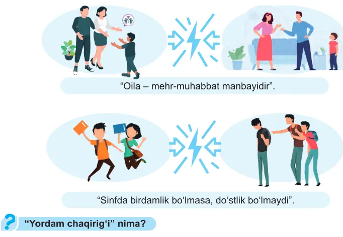

> Yordam chaqirigʻi — bu bitta qoʻl bilan bajariladigan imo-ishora boʻlib, shaxs videoqoʻngʻiroqda yoki shaxsan boshqalarga oʻzini tahdid ostida his qilayotganini va yordamga muhtojligini bildirish uchun foydalaniladi.

Yordam chaqirigʻi COVID—19 pandemiyasi bilan bogʻliq oʻz-oʻzini izolyatsiya qilish choralari sababli dunyo boʻylab uyda zoʻravonlik holatlarining koʻpayishiga qarshi kurashish vositasi sifatida ommalashgan.

Agar biror shaxs zoʻravonlikka uchrayotganligi haqida boshqalarga ogʻzaki yoki boshqa vositalar bilan bayon eta olmasa, yordam chaqirigʻidan foydalanishi mumkin.

Quyidagi harakatlar ketma-ketligi orqali shaxs boshqalarga zoʻravonlik qurboni boʻlayotganligi haqida xabar berishi mumkin.

Harakatlar ketma-ketligi:

1. Kaftni ochiq holda koʻtarish;

2. Bosh barmoqni kaft ichiga bukish;

3. Toʻrtta barmoq bilan bosh barmoqni yopish.

Shu qoʻl harakatini bir necha bor takrorlash orqali yordam chaqirigʻi beriladi.

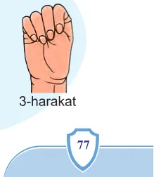

Tazyiq va zoʻravonlikdan jabrlanuvchi quyidagi huquqlarga ega:

oʻziga nisbatan tazyiq va zoʻravonlik sodir etilganligi yoki ularni sodir etish tahdidi toʻgʻrisidagi ariza bilan tegishli vakolatli organlarga hamda tashkilotlarga yoxud sudga murojaat etish;

maxsus markazlarda, shuningdek bepul telefon liniyasi orqali tekin huquqiy maslahat, iqtisodiy, ijtimoiy, psixologik, tibbiy va boshqa yordam olish, ichki ishlar organlariga himoya orderi berish toʻgʻrisidagi talab bilan murojaat qilish, himoya orderi shartlari buzilgan taqdirda esa ularni bu haqda xabardor qilish;

sodir etilgan tazyiq va zoʻravonlik natijasida oʻziga yetkazilgan moddiy zararning oʻrni qoplanishi hamda maʼnaviy ziyon kompensatsiya qilinishi toʻgʻrisidagi talab bilan sudga murojaat etish.

Tazyiq va zoʻravonlikdan jabrlanuvchi yetkazilgan moddiy zararning oʻrnini qoplash hamda maʼnaviy ziyonni kompensatsiya qilish toʻgʻrisidagi ariza bilan sudga murojaat etganda davlat boji toʻlashdan ozod qilinadi.

Ishonch telefoni nima?

Xotin-qizlarga nisbatan tazyiq va zoʻravonlik holatlarining oldini olish toʻgʻrisida axborot olishni taʼminlash maqsadida Oʻzbekiston Respublikasining butun hududida tun-u kun ishlaydigan, bepul telefon liniyasi tarmogʻi (ishonch telefoni) ishga tushirilgan.

Ishonch telefoniga qoʻngʻiroq qilgan shaxslar darhol huquqni muhofaza qiluvchi organlarning himoyasiga olinadi. Zoʻravonlikni sodir etgan shaxslar javobgarlikka tortiladi.

Himoya orderi nima?

Tazyiq va zoʻravonlikdan jabrlangan xotin-qizlarga davlat himoyasini taqdim etuvchi, ularga tazyiq oʻtkazayotgan yoki ularga nisbatan zoʻravonlik sodir etgan shaxslarga nisbatan qonunchilikda belgilangan taʼsir choralarini qoʻllashga sabab boʻladigan hujjat.

Tazyiq va zoʻravonlikdan jabrlangan fuqaroning oʻrniga, uning yaqinlari, qoʻshni yoki qarindoshlari ham himoya orderini jabrlanuvchiga berish uchun murojaat qilishi mumkin.

Holat haqida xabar bergan shaxslar hamda tazyiq va zoʻravonlikka uchragan xotin-qizlarning shaxsiga doir maʼlumotlari sir saqlanadi.

### Ijodiy faoliyat

Zoʻravonlikdan saqlanish uchun shaxsiy reja Quyida zoʻravonlikdan saqlanish uchun shaxsiy rejangizni ishlab chiqing.

1. Qanday holatlarda oʻzingizni zoʻravonlik qurboni deb his qilasiz? (Masalan: kimdir sizni...?) javob:

2. Bunday paytda kimdan yordam soʻrash mumkin deb oʻylaysiz? (Oilada? Maktabda?) javob:

3. Zoʻravonlik sodir boʻlsa, qaysi davlat organiga murojaat qilish mumkin? Javob:

4. Boshqalarga nisbatan zoʻravonlik sodir etilsa, qanday yordam bera olasiz? Javob:

Kimdir sizga notoʻgʻri munosabatda boʻlsa, bu haqda ota-onangizga, sinf rahbaringizga yoki katta yoshli qarindoshingizga ayting. Bu — emas, bu — oʻzingizni himoya qilishdir.

Tazyiq yoki zoʻravonlik sizga qarshi qaratilsa, yolgʻiz qolmang. Doʻstlaringiz bilan boʻling, guruhdan ajralmang. Bu tajovuzkorlarni biroz toʻxtatishi mumkin.

Oʻz shaxsiy maʼlumotlaringizni (telefon raqamingiz, uy manzilingiz, maktabingiz, rasmlaringiz) begona shaxslarga bermang. Bemaʼni xat yoki izohlar kelib tushsa, ularni saqlab qoʻying va kattalarga koʻrsating.

Sizning huquqlaringizni himoya qiluvchi ishonch telefonlari mavjud.

Favqulodda yoki zarur hollarda ishonch telefoni, masalan, 102 — 11B ga telefon orqali xabar bering.

Agar sinfdoshingiz, qoʻshningiz yoki ukangiz, opangiz zoʻravonlikka uchrayotganini koʻrsangiz — qolmang. Unga yordam bering.

## 23-dars. Tinchlik va xavfsizlikka qarshi jinoyatlar

### Faollashtiruvchi savollar

Quyidagi rasmlarga eʼtibor qarating va savollarga javob bering.

1. Tinchlik va xavfsizlikka qarshi jinoyatlarga qanday misollar keltira olasiz?

2. Sizningcha, bu kabi jinoyatlar boshqa jinoyatlardan qanday farqlanadi? Nima uchun?

3. Quyidagi rasmlarda qanday jinoyatlar aks ettirilgan? Nima uchun?

4. Ozbekiston Respublikasiga qarshi jinoyatlarga misol keltiring. Fikringizni asoslab bering.

5. 2-rasmda keltirilgan huquqni muhofaza qiluvchi organ shu kabi jinoyatlarga qarshi kurashda qanday faoliyat bilan shugʻullanadi?

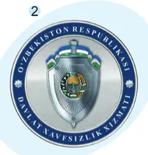

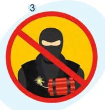

### Asosiy tushunchalar

> Tinchlik va xavfsizlikka qarshi jinoyatlar — bu davlatning ichki yoki tashqi osoyishtaligini buzadigan, ijtimoiy tartibsizliklar yoki xavfli harakatlarga olib keladigan jinoyatlardir. Bunday jinoyatlar jamiyatdagi barqarorlikka, tinch hayotga va xavfsizlikka tahdid soladi.

Oʻzbekiston Respublikasi Jinoyat kodeksi boʻyicha bu turdagi jinoyatlarga urushni targʻib qilish, terrorizm, terrorizmni moliyalashtirish va yollanishni misol tariqasida keltirish mumkin.

> Masalan, terrorchilik — bu aholiga qoʻrquv solish yoki davlat siyosatiga taʼsir koʻrsatish maqsadida portlash, otishma yoki boshqa zoʻravonlik harakatlarini sodir etishdir. Bunday jinoyatlar ogʻir oqibatlarga olib keladi va jiddiy jazoga sabab boʻladi.

Tinchlik va xavfsizlikni taʼminlash uchun har bir fuqaro hushyor, qonunga itoatkor va masʼuliyatli boʻlishi kerak. Bunday jinoyatlarning oldini olish uchun yosh avlodga tinchlikning qadri, murosaning ahamiyati va zoʻravonlikka qarshi turish haqida doimiy tarbiya berish muhim hisoblanadi.

### Yodda tuting

> Yollanish — bu boshqa davlatlarning qurolli kuchlari tarkibida moddiy manfaatdorlik yoki boshqa biron shaxsiy manfaatni koʻzlab, oʻzga davlat hududida yoki uning tarafini olib qurolli toʻqnashuvda yoxud harbiy harakatlarda qatnashish.

### Agressiya qanday jinoyat?

> Agressiya — bu bir davlat tomonidan boshqa davlatga qarshi kuch ishlatishdir. Agressiya xalqaro jinoyat hisoblanadi va buning uchun jinoiy javobgarlik belgilanadi.

Agressiya turli shakllarda boʻlishi mumkin: qurolli bosqinchilik, boshqa davlat hududini egallash, harbiy kuch bilan tahdid qilish, mustaqillikka raxna solish yoki hukumatini zoʻrlik bilan almashtirishga urinish.

1945-yilda qabul qilingan BMT Nizomida kuch ishlatish taqiqlangan va tinchlikni buzgan har qanday hujum agressiya deb baholanadi.

Genotsid qanday jinoyat?

> Genotsid — bu biror milliy, etnik, irqiy yoki diniy guruhni butunlay yoʻq qilish maqsadida qasddan amalga oshiriladigan jinoyatdir. Bu harakatlar odatda guruh aʼzolarini oʻldirish, ularga ogʻir tan jarohati yetkazish, yashash uchun yaroqsiz sharoitlarga majburlash, guruh ichida tugʻilishlarning oldini olish yoki bolalarni majburan boshqa guruhga topshirish shaklida boʻladi. Genotsid xalqaro huquqda insoniyatga qarshi eng ogʻir jinoyatlardan biri deb tan olingan. BMT 1948-yilda "Genotsid jinoyatining oldini olish va jazolash toʻgʻrisida"gi Konvensiyani qabul qilgan boʻlib, unga koʻra bunday jinoyatlar xalqaro jinoiy javobgarlikka sabab boʻladi.

### Xulosa qiling

Oʻzbekiston Respublikasining Jinoyat kodeksiga koʻra, terrorchilik harakatlari haqida maʼlumotni yashirish yoki xabar qilmaslik jinoiy javobgarlikka sabab boʻladi.

Agar kimdir tayyorlanayotgan yoki sodir etilgan terrorchilik harakati haqida bilsa, lekin bu toʻgʻrisida tegishli organlarga xabar bermasa, u jinoyat sodir etgan deb hisoblanadi.

### Qonun belgilaydi

Qoʻporuvchilik, yaʼni Oʻzbekiston Respublikasining davlat organlari faoliyati yoki ijtimoiy-siyosiy vaziyatning barqarorligiga yoki iqtisodiyotiga putur yetkazish maqsadida odamlarni qirib yuborish, ularning sogʻligʻiga ziyon, mulkka shikast yetkazish yoki uni nobud qilishga qaratilgan harakatlar — oʻn yildan yigirma yilgacha ozodlikdan mahrum qilish bilan jazolanadi.

### Hamkorlikda bajaramiz

Kichik guruhlarga boʻlingan holda quyidagi detektiv jumboqni muhokama qiling. Bunday vaziyatlarda jinoyatchi shaxslar bilan muzokara olib borishda nimalarga eʼtibor berish kerakligi haqida fikr bildiring.

Favqulodda holat yuz berdi. Janob Sinchkov nomaʼlum shaxs tomonidan egallab olingan samolyot ishi boʻyicha shahar aeroportiga yetib keldi. Jinoyatchi shaxs fuqarolik samolyotidagi 16 nafar yoʻlovchi va 3 nafar ekipaj aʼzosini garovga olgan edi.

U ichki ishlar xodimlaridan ikkita parashut va bir milliard soʻm talab qildi.

Jinoyatchi shaxs ikkita parashut soʻraganligi uchun tezkor guruh aʼzolari samolyot bortida jinoyatchining sherigi bor degan xulosaga kelishdi.

Janob Sinchkov esa bu chalgʻituvchi usullardan biri ekanligini isbotlab berdi. Savol. Janob Sinchkov nega bunday xulosaga keldi?

### Yodda tuting

Oʻzbekiston Respublikasi terrorizmga qarshi kurash sohasida bir nechta muhim yoʻnalishlarda tizimli ishlarni amalga oshirmoqda.

Avvalo, milliy qonunchilik bazasi kuchaytirildi. Jinoyat kodeksiga terrorizm, ekstremizm va diniy adovatga oid normalar kiritildi. 2000-yilda "Terrorizmga qarshi kurash toʻgʻrisida"gi qonun qabul qilindi.

Davlat xavfsizlik xizmati, ichki ishlar vazirligi hamda boshqa huquqni muhofaza qiluvchi organlar tarkibida terrorizmga qarshi kurash boʻlinmalari faoliyat olib bormoqda.

Shuningdek, mazkur organlar tomonidan chegara hududlarda xavfsizlik choralari qatʼiylashtirilib, kuchli nazorat ishlari doimiy asosda olib borilmoqda.

Maʼnaviy-maʼrifiy sohada ham turli tushuntirish va targʻibot ishlari muntazam oʻtkazilmoqda. Ommaviy axborot vositalari yordamida yoshlar orasida ekstremistik gʻoyalarning oldini olishga qaratilgan turli dasturlar yoʻlga qoʻyilgan.

Shuningdek, Oʻzbekiston Respublikasi Prezidentining tashabbusi bilan bir necha marta "MehN' operatsiyalari olib borildi. Bu orqali ekstremistik guruhlarga qoʻshilib qolgan Oʻzbekiston fuqarolari yaqin Sharqdan yurtimizga qaytarib olib kelindi.

Bundan tashqari, ekstremistik gʻoyalarga ergashgan shaxslarga doimiy ravishda psixologik, huquqiy va ijtimoiy yordam koʻrsatilmoqda. Bunday shaxslarni sogʻlom turmush tarziga qaytarish ishlari uzluksiz davom etmoqda.

Ekstremizm qanday jinoyat?

Ekstremizm — ijtimoiy-siyosiy vaziyatni beqarorlashtirishga, Oʻzbekiston Respublikasining konstitutsiyaviy tuzumini zoʻrlik bilan oʻzgartirishga, hokimiyatni zoʻrlik ishlatib egallashga va uning vakolatlarini oʻzlashtirib olishga, milliy, irqiy, etnik yoki diniy adovat qoʻzgʻatishga qaratilgan harakatlarning ashaddiy shakllaridan biri.

### Izlanishda davom eting

Quyidagi xorijiy davlatning terrorizmga qarshi kurash siyosati bilan tanishib chiqing. Terrorizmga qarshi kurash bo 'Yicha milliy qonunchilikni rivojlantirishga qaratilgan qanday chora-tadbirlarni taklif etgan boʻlar edingiz?

Singapurda terrorizmga qarshi kurash kuchli nazorat va profilaktik yondashuv asosida olib boriladi. Bu davlatda "Ichki xavfsizlik toʻgʻrisida"gi qonun mavjud boʻlib, unga koʻra terrorchilikda gumon qilingan shaxslar sud qarorisiz ikki yilgacha hibsda saqlanishi mumkin.

Shuningdek, ekstremistik gʻoyalarga qarshi kurashish uchun maxsus diniy maslahat guruhi tashkil etilgan. Guruh tarkibidagi diniy ulamolar va mutaxassislar ekstremistik fikrlarga ega boʻlgan shaxslar bilan suhbat oʻtkazib, ularni tinchlik, ijtimoiy totuvlik gʻoyalariga qaytarishga harakat qilishadi.

## 24-dars. Iqtisodiyot sohasidagi jinoyatlar

### Faollashtiruvchi savollar

Quyidagi rasmlarga eʼtibor qarating va savollarga javob bering.

1. Quyidagi rasmlarda qanday jinoyatlar aks ettirilgan deb oʻylaysiz?

2. Oʻgʻrilik va talonchilik jinoyatlari bir-biridan qanday farq qiladi?

3. Nima deb oʻylaysiz, nima sababdan bugungi kunda firibgarlik jinoyati keng tarqalmoqda?

4. Soliqlarlarni toʻlashdan boʻyin tovlash jinoyati qanday oqibatlarni keltirib chiqaradi?

### Asosiy tushunchalar

> Iqtisodiyot sohasidagi jinoyatlar — bu moddiy manfaat orttirish maqsadida iqtisodiy tartiblarni buzish bilan bogʻliq jinoiy qilmishlar boʻlib, ular davlat, tadbirkorlar yoki boshqa shaxslarning iqtisodiy manfaatlariga zarar yetkazadi.

Bunday jinoyatlarga firibgarlik, oʻgʻrilik, soliq toʻlashdan boʻyin tovlash, bosqinchilik, oʻzganing mulkini oʻzlashtirish kabilarni misol sifatida keltirish mumkin.

Bu jinoyatlar iqtisodiy barqarorlikka tahdid soladi, shaxslarning oʻzaro ishonch muhitini buzadi. Shu bois bunday huquqbuzarliklarga qarshi kurashish har bir davlat uchun muhim vazifa hisoblanadi.

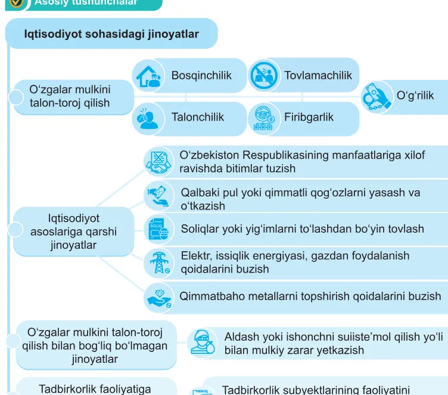

Tadbirkorlik faoliyatiga toʻsqinlik qilishga oid boshqa jinoyatlar

Tadbirkorlik subyektlarining faoliyatini tekshirish va moliya-xoʻjalik faoliyatini taftish qilish tartibini buzish

### Yodda tuting

Iqtisodiyot sohasidagi jinoyatlar ichida shaxslarning hayoti va sogʻligʻiga jiddiy zarar yetkazishi mumkin boʻlgan jinoyat bosqinchilik hisoblanadi.

Bosqinchilik jinoyati boshqa shaxslarning mol-mulkini talon-toroj qilish maqsadida, hayot yoki sogʻliq uchun xavfli boʻlgan zoʻrlik ishlatish yoki shunday zoʻrlik ishlatish orqali qoʻrqitish yoʻli bilan sodir etiladi.

Masalan, shaxslarning uy-joyi yoki ishxonalariga bostirib kirib, qurol bilan tahdid qilish orqali mol-mulkni talon-toroj qilish bosqinchilik jinoyati hisoblanadi.

Tovlamachilik boshqa shu kabi jinoyatlardek mulkiy manfaatdorlik maqsadida amalga oshiriladi. Mazkur jinoyat turli vositalardan foydalangan holda va turli koʻrinishlarda boʻlishi mumkin.

Masalan: jabrlanuvchi yoki uning yaqin kishilariga zoʻrlik ishlatish;

jabrlanuvchi uchun sir saqlanishi lozim boʻlgan maʼlumotlarni oshkor qilish misol uchun, boshqalarning shaxsiy rasm va videolarini tarqatish bilan qoʻrqitib, jabrlanuvchilardan pul talab qilish tovlamachilik jinoyati hisoblanadi.

Talonchilik jinoyatida oʻzganing mulki ochiqdan ochiq talon-toroj qilinadi. Masalan, maktab hovlisida yuqori sinf oʻquvchisi Fayzbek kichik yoshdagi maktab oʻquvchisining shaxsiy qoʻl telefonini ochiqchasiga olib qoʻydi. Bu qilmish oqibatida Fayzbek maktab oʻquvchisining mulkiga zarar yetkazdi.

Firibgarlik jinoyatida aldash yoki ishonchni suiisteʼmol qilish yoʻli bilan oʻzganing mulki yoki oʻzganing mulkiga boʻlgan huquqi qoʻlga kiritiladi.

Misol uchun, Mirfayz ijtimoiy tarmoqlarda "Arzon telefon sotaman" deb eʼlon beradi. Pulni oldindan yuborgan mijozga telefonni yubormaydi va aloqani uzadi.

> Oʻgʻrilik — bu mol-mulkni yashirincha oʻzlashtirish jinoyatidir. Bunda jinoyatchi boshqalarning mulkini noqonuniy ravishda egallab oladi. Bu jinoyat oqibatida ham mulkiy zarar yetkaziladi.

Masalan, Fayzbek doʻkonga xaridor sifatida kirib, sotuvchining eʼtiborsizligidan foydalanib stol ustidagi telefonni yashirincha olib qochdi.

Ozbekiston Respublikasining manfaatlariga xilof ravishda bitimlar tuzish jinoyati odatda mansabdor shaxslar tomonidan sodir etiladi. Bu jinoyatda naf keltirmasligi ayon boʻlgan shartnomalar tuzish, masalan, Oʻzbekiston hududiga maʼnaviy eskirgan yoki zamon talablariga javob bermaydigan asbob-uskunani yoxud texnologiyalarni olib kirishga qaratilgan bitimlar misol boʻla oladi. Bu jinoyat oqibatida davlat va jamoat manfaatlariga koʻp miqdorda zarar yetkaziladi.

Qalbaki pul yasash va oʻtkazish jinoyatida qalbaki banknotlar (qogʻoz pullar), metall tangalar, shuningdek, qimmatli qogʻozlar yoxud chet el valyutasi yasash yoki ularni oʻtkazish bilan bogʻliq jinoiy qilmish nazarda tutiladi.

Soliqlar yoki yigʻimlarni toʻlashdan boʻyin tovlash jinoyati foyda (daromad) yoki soliq solinadigan boshqa obyektlarni qasddan yashirish hamda kamaytirib koʻrsatishda aks etadi.

Asosan, bu jinoyat uchun avval maʼmuriy jazo qoʻllaniladi. Maʼmuriy jazo qoʻllanilgach, shaxs oʻz qilmishini takroran sodir etsa, soʻng jinoiy javobgarlikka tortiladi.

Elektr, issiqlik energiyasi, gazdan foydalanish qoidalarini buzish jinoyati hisobga olish asboblariga, shu jumladan ularning plombalariga qasddan shikast yetkazish kabi harakatlarni oʻz ichiga oladi. Bu qilmish uchun ham avval maʼmuriy jazo qoʻllaniladi. Shaxs mazkur qilmishini takroran sodir etsa, jinoiy javobgarlikka tortiladi

Yer ostidan qazib olingan qimmatbaho metall yoki toshlar davlatga topshirilishi lozim.

Aks holda, bu qimmatbaho metallarni topshirish qoidalarini buzish jinoyati sifatida baholanadi. Bunday harakatlar uchun jinoiy javobgarlik kelib chiqadi.

Tadbirkorlik subyektlarining faoliyatini tekshirish va moliya-xoʻjalik faoliyatini taftish qilish tartibini buzish jinoyati asosan mansabdor shaxslar tomonidan sodir etiladi. Shuningdek, tadbirkorlik subyektlari faoliyatini qonunga xilof ravishda tekshirish tashabbusi bilan chiqish ham jinoiy javobgarlikka sabab boʻladi. Bu jinoyat ham avvalo, maʼmuriy javobgarlikka sabab boʻladi. Qilmishni takroran sodir etish jinoiy javobgarlikni keltirib chiqaradi.

Aldash yoki ishonchni suiisteʼmol qilish yoʻli bilan mulkiy zarar yetkazishda mulkdorda ancha miqdordagi ziyon kelib chiqadi. Bunday holat jinoyat deb topiladi.

### Hamkorlikda bajaramiz

Kichik guruhlarga boʻlingan holda qimmatbaho durbinni oʻgʻirlagan shaxsni aniqlang? Janob Sinchkov kemada sayohatga chiqqan edi. Bir kuni kema kapitani Janob Sinchkovni favqulodda vaziyat yuzasidan chaqirib qoldi. Kapitanning qimmatbaho durbini yoʻqolgan edi. Kapitan boshqaruv kabinasidan chiqayotib, durbinni stol ustida qoldirganligini, ammo u qaytib kelganida, durbini joyida yoʻq ekanligini aytib berdi.

Kapitan janob Sinchkov ishtirokida darhol gumonlanuvchi ekipaj aʼzolarini chaqirdi. Ularning har biridan jinoyat sodir boʻlgan vaqtda nima bilan band boʻlganligini soʻradi.

Oshpaz dedi: — "Men oshxonada ovqat pishirish bilan band edim. Yordamchilarimdan soʻrashingiz mumkin. Boshqaruv xonasiga kirishimdan maqsad kapitandan qanday ovqat xohlashini soʻrash uchun kirgandim, xolos", — dedi.

Michman: — "Men kema motori boʻyicha kapitandan qoʻshimcha topshiriq olish uchun xonaga kirgandim. U yoʻq ekan. Qaytib chiqib ketdim"

Dengizchi: — "Men kemadagi davlat bayrogʻini toʻgʻrilab qoʻyayotgan edim. Shundan soʻng, kapitanni oldiga kirmoqchi boʻldim. Qoʻshimcha dam olish haqida soʻramoqchi edim. Lekin boshqaruv xonasida yoʻq ekanligini oynadan koʻrib, xonaga kirganim ham yoʻq".

Janob Sinchkov hamma gumonlanuvchilarni diqqat bilan eshitib, ulardan qay biri oʻgʻrilikni sodir etganligini aniqladi.

Savol. Sizningcha, janob Sinchkov buni qanday aniqladi?

## 25-dars. Boshqaruv tartibiga qarshi jinoyatlar

### Faollashtiruvchi savollar

Quyidagi vaziyatlar bilan tanishib chiqing va savollarga javob bering. 1-vaziyat. Dilnavoz haydovchilik guvohnomasini imtihonsiz olishni rejalashtirdi. qarindoshi Safarmurod ismli shaxsdan yordam soʻradi. Safarmurod imtihon markazida ishlovchi Xusrav ismli shaxsga 5 million soʻm evaziga iltimosni yetkazishini aytdi. Dilnavoz pulni Safarmurodga berdi. Safarmurod esa markazdagi xodimga uchrashib, "imtihondan oʻtkazib yubor" deb 4 million soʻm pora berdi. Shundan soʻng huquq-tartibot organlari bu holatni aniqlab, har uchala shaxsni javobgarlikka tortdi.

Nima uchun bu holatda uchala shaxs ham jinoiy javobgarlikka tortiladi?

2-vaziyat. Xurrambek maktabni aʼlo baholar bilan tamomlab, Oliy taʼlim uchun kirish imtihonlarida ishtirok etdi. U imtihondan yuqori ball olishiga aniq ishonar edi. Biroq imtihon natijalari buning aksini koʻrsatdi. Xurrambek oʻz bilimiga ishonganligi sababli bilim va malakani baholash agentligiga shikoyat bilan murojaat qildi. Olib borilgan xizmat tekshiruvi natijasida ayrim mutasaddilar maʼlumotlar bazasiga noqonuniy oʻzgartirish kiritgani aniqlanib, ularning ishi huquqni muhofaza qiluvchi organlarga topshirildi.

Mazkur vaziyatda qanday jinoyat sodir etilgan?

### Yodda tuting

Boshqaruv tartibiga qarshi jinoyatlar ichida pora olish, pora berish va pora olish-berishda vositachilik qilish jinoyatlari keng tarqalgan. Bunday jinoyatlar asosan davlat organi, davlat ishtirokidagi tashkilot yoki fuqarolarning oʻzini oʻzi boshqarish organlarining mansabdor shaxslari ishtirokida sodir etiladi.

Bunday jinoyatlar mansabdor shaxslar tomonidan qasddan vakolatlarini suiisteʼmol qilishi yoki xizmat vazifalaridan chetga chiqishdan kelib chiqadi.

Bu jinoyatlar oqibatida xalqning davlat organlariga boʻlgan ishonchiga putur yetadi.

Davlat ishtirokidagi tashkilot nima?

Davlat ishtirokidagi tashkilotga ikki xil taʼrif berish mumkin. Birinchidan, davlat ulushi miqdori ellik foizdan ortiq boʻlgan yoxud davlat ulushi miqdori xoʻjalik jamiyatining boshqa har bir aksiyadori (ishtirokchisi) ulushiga nisbatan koʻp boʻlgan tijorat tashkiloti. Masalan, davlat ulushi boʻlgan ishlab chiqarish korxonasi.

Ikkinchidan, toʻliq yoki qisman davlat organi yoki davlat tashkiloti tomonidan tashkil etilgan notijorat tashkiloti. Masalan, davlat budjeti mablagʻlari hisobidan tashkil etilgan universitet yoki kasalxona.

### Qonun belgilaydi

Davlat xalq irodasini ifoda etib, uning manfaatlariga xizmat qiladi. Davlat organlari va mansabdor shaxslarjamiyat va fuqarolar oldida masʼuldirlar.

### Yodda tuting

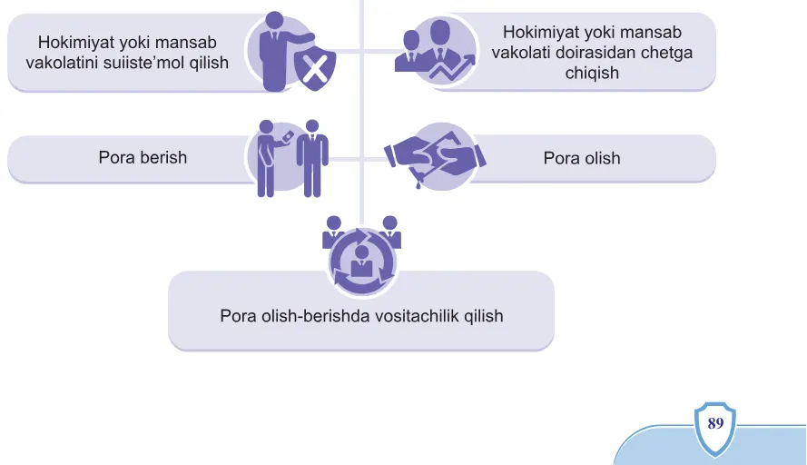

### Yodda tuting

Hokimiyatni yoki mansab vakolatini suiisteʼmol qilish jinoyatida davlat yoki jamoat manfaatlariga koʻp miqdorda zarar yetkaziladi.

Bu jinoyat davlat organi, davlat ishtirokidagi tashkilot yoki fuqarolarning oʻzini oʻzi boshqarish organi mansabdor shaxsining oʻz mansab vakolatlaridan qasddan noqonuniy foydalanishida aks etadi.

Misol uchun, davlat mansabdor shaxsi hech qanday tanlov yoki tender savdolarisiz davlat idorasini taʼmirlash ishlariga oʻzining qarindoshini jalb etib, budjet mablagʻlariga koʻp miqdorda zarar yetkazadi.

Hokimiyat yoki mansab vakolati doirasidan chetga chiqish jinoyatida ham davlat yoki jamoat manfaatlariga koʻp miqdorda zarar yetkaziladi.

Bunda mansabdor shaxs oʻziga qonun bilan berilgan vakolatlar doirasidan chetga chiqadigan harakatlarni qasddan sodir etadi.

Masalan, shahar hokimining oʻz vakolati doirasiga kirmaydigan binolarni ijaraga qoʻyish yoki tashqi koʻrinishini oʻzgartirish boʻyicha qarorlar chiqarishi.

Oʻzbekiston Respublikasi Jinoyat kodeksi boʻyicha pora olish, pora berish yoki pora olish-berishda vositachilik qilish ham jinoyat hisoblanadi.

> Pora olish — bu mansabdor shaxsning oʻz xizmat mavqeyidan foydalanib, biron-bir ishni bajarish yoki bajarmaslik evaziga pul, qimmatbaho buyum, xizmat yoki boshqa moddiy manfaat olishidir.

> Pora berish — bu shaxsning mansabdor shaxsga oʻz xizmat vazifasini noqonuniy tarzda bajarishi yoki bajarmasligi evaziga pul, qimmatbaho buyum, xizmat yoki boshqa moddiy manfaatni berishida aks etadi. Bu harakat orqali shaxs oʻz foydasini koʻzlab, qonuniy tartibni buzishga urinadi.

> Pora olish-berishda vositachilik qilish — bu ikki tomon, yaʼni pora oluvchi va pora beruvchi oʻrtasida aloqani taʼminlab berishdir. Vositachi shaxs porani pora beruvchidan olib, pora oluvchiga taqdim etadi.

### Hamkorlikda bajaramiz

Quyidagi detektiv jumboq bilan tanishib chiqing. Kichik guruhlarda masalaning yechimini bering.

Janob Sinchkov pora olish jinoyati boʻyicha tezkor tadbir tashkil etishda ishtirok etayotgan edi. Maqsad — pora olish jinoyatini sodir etishni rejalashtirgan uddaburon korxona direktori Javlonbekni qoʻlga olish edi. Tezkor tadbir rejasi boʻyicha Samandar ismli fuqaro korxona direktori Javlonbekka 1000 AQSH dollari miqdorida pora berishi kerak edi.

Dastlab, hammasi rejadagidek amalga oshirildi. Samandar porani berdi, Javlonbek uni oldi. Samandar maxsus belgi berishi bilan direktor xonasiga Janob Sinchkov va ichki ishlar xodimlari kirib keldi.

Direktor oʻzini vazmin tutgan holda, kotibasini chaqirib, stoldagi choynakka achchiq qilib koʻk choy damlashni buyurdi.

Janob Sinchkov va ichki ishlar xodimlari berilgan porani, yaʼni jinoyat izini qidira boshlashdi. Ammo Javlonbekdan ham, hattoki uning xonasidan ham pul topilmadi.

Javlonbek kulimsirab, — "Bekorga urinyapsizlar. Men hech qachon pora olmaganman",

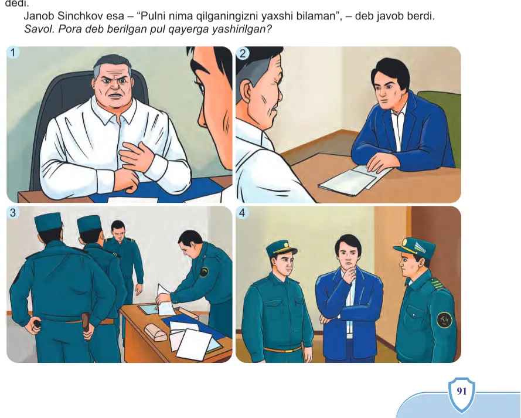

## 26–27-dars. Jinoyat-protsessual huquqi

### Faollashtiruvchi savollar

Quyidagi vaziyatlarda jinoyat-protsessual huquqining qaysi qoidalari aks ettirilgan? Fikringizni asoslab bering.

1-vaziyat. Tergovchi jinoyat ishi bilan shugʻullanmoqda. U tergov jarayonida Oʻzbekiston Respublikasi Jinoyat-protsessual kodeksi talablariga qatʼiy amal qiladi. Hech bir protsessual harakat tegishli hujjatlarsiz bajarilmaydi. Har bir protsessual qaror qonun asosida chiqariladi.

2-vaziyat. Ayblanuvchining oʻgʻrilik sodir etishi kuzatuv kameralarida aniq tasvirga olingan. Uning ishi sudda koʻrib chiqilmoqda. Sudya, sud kotibi, prokuror hamda boshqa sud ishtirokchilari uning ayblni isbotlab berish uchun dalil koʻrsatishdi.

3-vaziyat. Oʻzbekiston qonunchiligiga koʻra, prokuror va advokatga sud jarayonida teng imkoniyatlar yaratilgan. Har ikki shaxs ham jinoyat ishi boʻyicha dalillarni toʻplash, ish yuzasidan fikr-mulohazalar bildirish, sud jarayonida faol qatnashish huquqiga ega.

4-vaziyat. Barcha sudlarda jinoyat ishlari oshkora koʻriladi, bundan davlat sirlarini qoʻriqlash manfaatlariga zid keladigan hollar, shuningdek jinsiy jinoyatlar toʻgʻrisidagi ishlar koʻrilayotgan hollar mustasno. Sud jarayoni videokonferensaloqa rejimida oʻtkazilishi mumkin.

5-vaziyat. Jinoyat ishlarini koʻrib chiqayotgan sudyaning faoliyatiga nisbatan aralashuvlar qonun bilan taqiqlanadi. Sud majlisida barcha tomonlar tinglanadi, dalillar tekshiriladi. Sudya turli siyosiy yoki maʼmuriy bosimlarsiz mustaqil ravishda qaror qabul qiladi. Hech bir shaxs sud faoliyatiga aralashishi mumkin emas.

6-vaziyat. Moddiy jihatdan ehtiyojmand shaxs jinoyat sodir etdi. Unga nisbatan jinoyat ishi qoʻzgʻatildi. U dastlabki tergov paytida aybni tan olmadi va oʻzining aybsizligini isbotlash uchun advokat yollashni soʻradi. Tergov organlari uning bu huquqini taʼminlab berishdi. Unga davlat hisobidan advokatlik xizmati taqdim etildi.

(v/' Asosiy tushunchalar Jinoyat protsessual huquqi — bu jinoyat ishlarini yuritish tartibini oʻrnatuvchi huquq sohasi boʻlib, jinoyat sodir etilgan holatda davlat organlari qanday harakatlar qilishi kerakligini belgilab beradi. Bu soha dastlabki tergov, surishtiruv, jinoyat ishlari boʻyicha sudda ish yuritish jarayonlarini qamrab oladi. Jinoyat protsessual huquqi jinoyat ishining boshlanishidan tortib, hukm chiqarish va uni ijroga qaratishgacha boʻlgan barcha bosqichlarni nazarda tutadi.

### Yodda tuting

> Jinoyat huquqi va jinoyat protsessual huquqi — jinoyat ishlarini yuritishda bir-biri bilan chambarchas bogʻliq boʻlgan, biroq mazmunan va vazifasi jihatidan farq qiladigan ikki mustaqil huquq sohalaridir. Ular bir-biridan quyidagi umumiy xususiyatlar bilan farq qiladi.

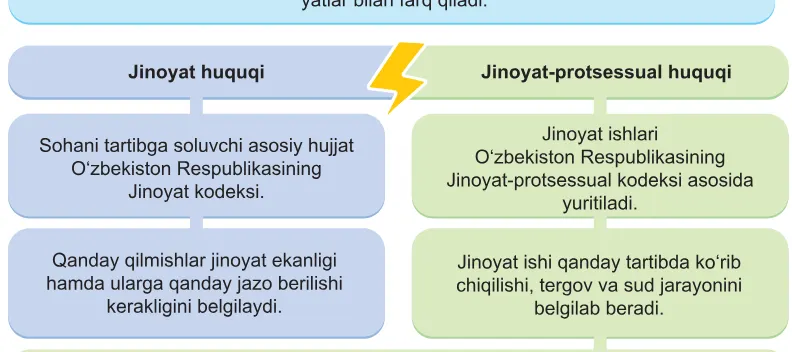

Jinoyat-protsessual qonunchiligining vazifalari jinoyatlarni tez va toʻla ochishdan, jinoyat sodir etgan har bir shaxsga adolatli jazo berilishi hamda aybi boʻlmagan hech bir shaxs javobgarlikka tortilmasligi va hukm qilinmasligi uchun aybdorlarni fosh etishdan hamda qonunning toʻgʻri tatbiq etilishini taʼminlashdan iboratdir.

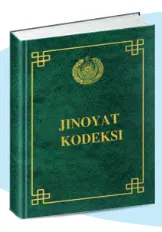

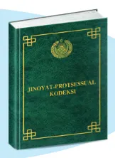

### Xulosa qiling

Jinoyat protsessining barcha prinsiplari oʻziga xos umumiy xususiyatlarga ega. Avvalo, bu prinsiplar Oʻzbekiston Respublikasi Konstitutsiyasiga va Jinoyat-protsessual kodeksiga asoslanadi. Ular fuqaroning huquq va erkinliklarini himoya qilishga xizmat qiladi. Har bir prinsip sud, prokuratura va tergov organlari uchun majburiy hisoblanadi. Ularning buzilishi protsess qonuniyligini shubha ostida qoldiradi.

Prinsiplar oʻzaro bogʻlangan boʻlib, bir-birini toʻldiradi va mustahkamlaydi. Biri ikkinchisini taqozo etadi. Masalan, sud mustaqilligi prinsipi qonuniylik prinsipini taʼminlashga yordam beradi. Shuningdek, prinsiplar ish yuritishning barcha bosqichlariga: dastlabki tergovdan tortib sud qarorigacha tatbiq etiladi.

Bundan tashqari, barcha prinsiplar demokratik qadriyatlarga, insonparvarlik va ado- Iat tamoyillariga asoslanadi. Ular shaxsni asossiz javobgarlikka tortmaslikni, Odil sudlovni va qonuniy tartibda ish yuritishni kafolatlaydi. Har bir protsessual harakat qonunga va prinsiplarga muvofiq amalga oshirilishi shart, aks holda protsess natijalari bekor qilinishi mumkin.

Jinoyat protsessining barcha prinsiplari shaxslarning huquq va erkinliklari hamda qonuniy manfaatlarini taʼminlashda ustuvor gʻoya hisoblanadi.

### Yodda tuting

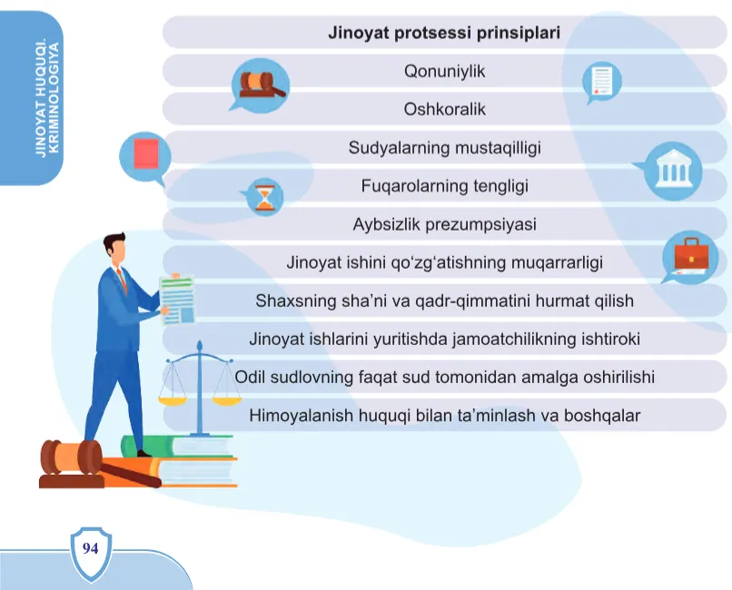

### Asosiy tushunchalar

Sudya, prokuror, tergovchi, surishtiruvchi, himoyachi, shuningdek jinoyat ishini yuritishda ishtirok etuvchi barcha shaxslar Oʻzbekiston Respublikasining qonun hujjatlariga aniq rioya etishlari va ularning talablarini bajarishlari shart.

Barcha sudlarda jinoyat ishlari oshkora koʻriladi, bundan davlat sirlarini qoʻriqlash manfaatlariga zid keladigan hollar, shuningdek jinsiy erkinlikka qarshi jinoyatlar koʻrilayotgan hollar mustasno.

Odil sudlovni amalga oshirishda sudyalar mustaqildirlar hamda faqat qonunga boʻysunadilar.

Jinoyat ishlari boʻyicha Odil sudlov fuqarolarning jinsi, irqi, millati, tili, dini, eʼtiqodi, ijtimoiy kelib chiqishi, ijtimoiy mavqeyidan qatʼi nazar, qonun va sud oldida tengligi asosida amalga oshiriladi.

Shaxsning jinoyat sodir etishda aybdorligi qonunda nazarda tutilgan tartibda isbotlangunga va qonuniy kuchga kirgan sud hukmi bilan aniqlangunga qadar aybsiz hisoblanadi.

Prokuror, tergovchi va surishtiruvchi jinoyat alomatlari topilganda jinoyat ishini qoʻzgʻatishlari, jinoyat sodir etishda aybdor boʻlgan shaxslarni aniqlash uchun qonunda nazarda tutilgan barcha choralarni koʻrishlari shart.

Sudya, prokuror, tergovchi va surishtiruvchi ishda qatnashayotgan shaxslarning shaʼni va qadr-qimmatini hurmat qilishlari shart. Hech kim qiynoqqa solinishi, tazyiqqa duchor etilishi mumkin emas.

Jinoyat ishi boʻyicha tergov olib borish va ishni sudda koʻrish chogʻida surishtiruvchi, tergovchi, prokuror va sud jinoyat sodir etilgan holatlarni aniqlab olish, aybdorlarni qidirish va fosh etishda jamoatchilik yordamidan foydalanishga haqlidir.

Oʻzbekiston Respublikasining Konstitutsiyasiga muvofiq jinoyat ishlari boʻyicha Odil sudlovni faqat sud amalga oshiradi.

Shaxslar himoyalanish huquqiga ega boʻlib, ularga oʻzini himoya qilish uchun barcha imkoniyatlar taʼminlanadi.

### Yodda tuting

Oʻzbekiston Respublikasining Jinoyat-protsessual kodeksi surishtiruv, dastlabki tergov va sudning protsessual harakatlarini ham qatʼiy tartibga soladi. Bunday harakatlarga ushlab turish, olib qoʻyish, tintuv oʻtkazish va soʻroq qilish kabilarni misol tariqasida keltirish mumkin.

Protsessual harakatlarga quyidagilarni ham misol qilish mumkin:

Shaxslar qanday holatlarda ushlab turilishi mumkin?

Shaxslarni ushlab turish asoslari Oʻzbekiston Respublikasining Jinoyat-protsessual kodeksi bilan qatʼiy tartibga solinadi. Jinoyatni sodir etishda gumon qilingan shaxs quyidagi asoslar mavjud boʻlganda ushlab turilishi mumkin:

I) shaxs jinoyat ustida yoki bevosita uni sodir etganidan keyin qoʻlga tushsa;

2) jinoyat shohidlari, shu jumladan jabrlanuvchilar uni jinoyat sodir etgan shaxs tariqasida toʻgʻridan toʻgʻri koʻrsatsalar;

3) uning oʻzida yoki kiyimida, yonida yoxud uyida sodir etilgan jinoyatning yaqqol izlari topilsa;

4) shaxsni jinoyat sodir etishda gumon qilish uchun asos boʻladigan maʼlumotlar mavjud boʻlib, u qochmoqchi boʻlsa yoki doimiy yashaydigan joyi mavjud boʻlmagan yoxud shaxsi aniqlanmagan boʻlsa.

Soʻroq qilish qanday tartibda amalga oshiriladi?

Surishtiruvchi yoki tergovchi tomonidan shaxslarni soʻroq qilish quyidagi ketma-ketlikda olib boriladi.

I) soʻroq qilinuvchining shaxsini aniqlash;

2) soʻroq qilinuvchining qaysi tilda koʻrsatma bera olishini aniqlash,

3) soʻroq qilinuvchining huquq va majburiyatlarini tushuntirish;

4) soʻroq qilinuvchiga ishning unga maʼlum boʻlgan holatlari toʻgʻrisida soʻzlab berishni taklif etish;

5) qoʻshimcha savollar berish.

Tintuv oʻtkazish qanday asoslarga koʻra amalga oshiriladi?

Surishtiruvchi va tergovchi biror turar joy, xizmat, ishlab chiqarish binosida yoki oʻzga joyda yoxud biror shaxsda ish uchun ahamiyatli boʻlgan narsalar yoki hujjatlar yoxud elektron maʼlumotlar bor deb oʻylash uchun yetarli maʼlumotga ega boʻlgan taqdirda tintuv oʻtkazishga asos boʻlishi mumkin. Tintuv oʻtkazish sudning qarori asosida amalga oshiriladi.

### Qonun belgilaydi

Hech kim uy-joyga unda yashovchi shaxslarning xohishiga qarshi kirishi mumkin emas. Uy-joyga kirishga, shuningdek unda olib qoʻyishni va koʻzdan kechirishni oʻtkazishga faqat qonunda nazarda tutilgan hollarda va tartibda yoʻl qoʻyiladi. Uy-joyda tintuv oʻtkazishga faqat qonunga muvofiq va sudning qaroriga asosan yoʻl qoʻyiladi.

Oʻzbekiston Respublikasining Konstitutsiyasi, 31-modda

Olib qoʻyish tergov harakati uchun qanday asos mavjud?

Jinoyat ishi uchun ahamiyatga molik narsalarning, hujjatlarning va elektron maʼlumotlarning aynan kimda va qayerda ekanligi maʼlum boʻlib, ularni qidirishning hojati boʻlmasa, surishtiruvchi, tergovchi va sud ularni olib qoʻyishga haqlidir.

### Yodda tuting

Dalillarni toʻplash, tekshirish va baholash jarayonida fuqarolarning, shuningdek korxonalar, muassasalar va tashkilotlarning huquqlari va qonuniy manfaatlarini qoʻriqlash taʼminlanishi kerak.

Isbot qilishda quyidagilar taqiqlanadi:

I) shaxslarning hayoti va sogʻligʻi uchun xavfli boʻlgan yoki ularning shaʼni va qadr-qimmatini kamsituvchi xatti-harakatlar sodir etish;

2) zoʻrlik, poʻpisa qilish, aldash va qonunga xilof boshqa yoʻllar bilan koʻrsatuv, tushuntirish, xulosalar olishga, eksperimental harakatlarni bajarishga, hujjatlar yoki buyumlar tayyorlanishiga va berilishiga erishish;

3) tungi vaqtda, yaʼni kech soat 22:00 dan ertalab soat 6:00 gacha tergov harakatlari olib borish.

### Xulosa qiling

Jinoyat protsessual huquqi bilan bir qatorda jinoyatlarni ochish va fosh etishda muhim rol oʻynaydigan soha kriminologiya hisoblanadi.

> Kriminologiya — bu jinoyatlarning kelib chiqish sabablari, ularni sodir etayotgan shaxslarning xususiyatlari, jinoyatchilik darajasining oʻsishi yoki kamayishi kabi holatlarni oʻrganuvchi fandir. U jinoyatlarning faqat natijasini emas, balki ularning ildizini, yaʼni nima sababdan jinoyat sodir boʻlayotganini aniqlashga intiladi. Kriminologiya jinoyatchilikni kamaytirish, unga qarshi kurashish, profilaktika choralarini ishlab chiqish va jamoatchilikni jalb etish yoʻllarini ham izlaydi. Bu fan jinoyatchilar portretini aniqlash, ularning yoshi, jinsi, taʼlim darajasi, oila- Viy holati kabi belgilar asosida tahlil qilish orqali jinoyatlarning oldini olishga qaratilgan ilmiy tavsiyalar ishlab chiqadi. Kriminologiya jinoyatchilikka qarshi kurashda ilmiy asoslangan yondashuvni taʼminlaydi. Bu fanning asosiy maqsadi jamiyat xavfsizligini taʼminlashga hissa qoʻshishdir.

### Ijodiy faoliyat

Quyidagi jadvalni daftaringizga chizing. Keltirib oʻtilgan jinoyatlarni sodir etilish sabablarini aniqlashga harakat qiling.

Oʻgʻrilik Firibgarlik Pora olish Pora berish qasddan odam oʻldirish

## 28-dars. Ijodiy faoliyat

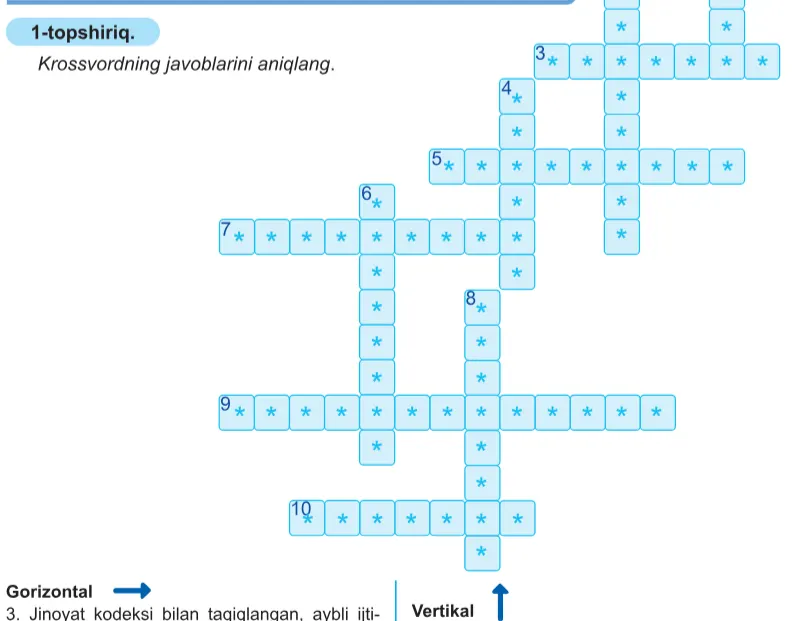

Gorizontal

3. Jinoyat kodeksi bilan taqiqlangan, aybli ijtimoiy xavfli qilmish

5. Bir davlat boshqa davlatga qarshi kuch ishlatishi

7. Bunday harakatlari haqida maʼlumotni yashirish yoki xabar qilmaslik jinoiy javobgarlikka sabab boʻladi

9. Bu fan jinoyatlarning kelib chiqish sabablari, ularni sodir etayotgan shaxslarning xususiyatlarini oʻrganadi IO. Jinoyat huquqining qaysi prinsipiga koʻra jinoyat sodir etishda aybdor boʻlgan shaxsga nisbatan qoʻllaniladigan jazo chorasi odilona boʻli- Shi lozim?

Vertikal

1. Mansabdor shaxsga, oʻz lavozimidan foydalanib, biror ishni bajarishi evaziga beriladigan pul yoki boshqa moddiy boylik

2. Biror milliy, etnik, irqiy yoki diniy guruhni butunlay yoʻq qilish maqsadida qasddan amalga oshiriladigan jinoyat

4. Aybdordan davlat daromadiga undiriladigan pul summasi

6. Oʻzbekiston Respublikasiga qarshi jinoyatlardan biri

8. Boshqa biron shaxsiy manfaatni koʻzlab, oʻzga davlat hududida yoki uning tarafini olib harbiy harakatlarda qatnashish jinoyati

Quyidagi detektivjumboq bilan tanishib chiqing. Kichik guruhlarda muhokama qilib, uning javobini toping. Fikringizni asoslab bering.

Janob Sinchkov sahroda arxeologik tadqiqot olib borayotgan professor Rashidov va uning jamoasi bilan qadimiy shahar xarobalarini oʻrganayotgan edi. Arxeologlar jamoasi bir necha kundan buyon qazishma ishlarini olib borar, kundan kunga topilmalar soni ham ortib borar edi. Kunlarning birida arxeolog yordamchisi Kamronbek "Oltin, tilla" deb qichqirib yubordi. Barcha jamoa vakillari voqea joyiga yetib kelishdi. Ogʻir sandiq oltin tangalarga toʻla edi. Hamma hayratda qoldi.

Barcha topilmalar singari bu sandiq ham professor Rashidovning chodiriga olib borib qoʻyildi. Tunda jamoa aʼzolari katta yutuqqa erishganliklarini nishonlashdi. Katta gulxan yoqib, uning atrofida raqsga tushishdi. Lekin tongda hammasi aksincha boʻldi. Ertalab taʼminotchi Dostonning qichqirigʻidan hamma uygʻonib ketdi. Professor Rashidov oʻz chodirida jonsiz holatda topilgan edi. Barcha topilmalar, jumladan sandiq ham yoʻq edi. Chodir atrofida bir necha tuyalarning izlari qolgan edi, xolos.

Janob Sinchkov barcha jamoa aʼzolarini birma-bir soʻroq qildi. Ular quyidagilarni bildirib oʻtishdi.

Arxeolog yordamchisi Kamronbek: — "Men tunda hech qanday shubhali harakatlarni sezmadim. Chodirimga kirdim-u, qattiq uxlab qoldim. Mana, Ulugʻbek buni tasdiqlashi mumkin. U ham mening chodirimdan joy olgan".

Taʼminotchi Doston: — "Men emas. Yoʻq. Jinoyatni ichimizdagilar qilgan. Qotil ichimizda. Men kechasi ketmon va chopqi ovozlarini eshitdim".

Ilmiy tadqiqotchi Ulugʻbek: — "Kechagi qattiq charchoqdan keyin men ham Kamronbekning chodirida qattiq uxlab qolgandim. Tuyalar ham shu yerda, mana. Men ham tunda hech qanday shubhali narsani sezmadim".

Dotsent Baxtiyor: — "Balki mahalliy aholi tuyalarda kelib, ham qotillikni, ham oʻgʻrilikni sodir etishgandir? Har holda bu yerning aholisi juda yovvoyi ekan".

Savol. Sizningcha, jinoyatni kim sodir etgan? Fikringizni asoslab bering.

3-topshiriq.

Quyidagi vaziyatlar bilan tanishib chiqing. Ularda jinoyat huquqining qaysi prinsiplari buzilganligini asoslab bering.

1-vaziyat. Mahalla faoli ijtimoiy tarmoqdagi oʻz sahifasida mahalla raisi va mahalla noziri kasb faoliyatiga sustkashlik bilan yondashishini yozib chiqdi. Unda biror haqorat yoki tuhmatga oid maʼlumotlarni qoʻllamadi. Biroq mahalla noziri fuqaroning jinoyat sodir etganligini aytdi 2-vaziyat. Korxona direktori va martabali mansabdor shaxs pora olish jinoyati boʻyicha sudlanayotgan edi. Har ikki jinoyatning ijtimoiy xavflilik darajasi teng edi. Biroq sudya ularning har ikkisiga ikki xil jazo tayinladi. Martabali mansabdorga ozodlikni cheklash, korxona direktoriga esa ozodlikdan mahrum qilish jazosi tayinlandi.

3-vaziyat. Maktab oʻquvchisi sinfdoshining shaxsiy rasmlarini internet jahon tarmogʻida eʼlon qilish bilan qoʻrqitib, undan pul talab qildi. Jabrlanuvchi huquqni muhofaza qiluvchi organlarga murojaat qildi. Ichki ishlar xodimi vaziyatni oʻrganib, gumonlanuvchining harakatlari qonunchilik bilan taqiqlanmaganligini aytdi.

4-vaziyat. Bir yigit ogʻir ijtimoiy ahvolda edi. Juda nochor vaziyatda qolganligidan koʻchada ketayotgan bir ayolning hamyonini oʻgʻirlamoqchi boʻldi. Ayol kishi jinoyatni darhol sezib qoldi. Yigitni toʻxtatib qolib, ichki ishlar xodimlariga topshirdi. Yigitga nisbatan jinoyat ishi ochilib, sud tomonidan uch yilga ozodlikdan mahrum etildi.

5-vaziyat. Fermer xoʻjaligining omborxonasida yongʻin chiqdi. Yongʻin sababli katta miqdordagi mahsulot yonib ketdi. Fermer xoʻjaligining rahbari hech qanday aniq dalillar boʻlmasa-da, ombor qoʻriqchisiga barcha aybni "yukladi". Uning jinoyat sodir qilganiga oid hech qanday guvoh, video yoki boshqa ishonchli dalil yoʻq. Qoʻriqchi ayblovni inkor qildi.

6-vaziyat. Yoʻl qurilishi boʻlimi boshligʻi yirik davlat mablagʻlarini talon-toroj qildi. Tergov harakatlari ham buni tasdiqladi. Biroq u yuqori lavozimli qarindoshlari orqali tergov ishini toʻxtatdi. Jinoyat ishini noqonuniy yoʻl bilan "yopdi". Oqibatda u hech qanday javobgarlikka tortilmadi.

7-vaziyat. II-sinf oʻquvchisi oʻzining shaxsiy blogini yuritar edi. Bir kuni ijtimoiy tarmoqlarda masʼul mansabdor shaxsning faoliyatini tanqid qilib chiqdi. Ertasi kuni mansabdor shaxsning yordamchisi oʻquvchi bilan gaplashib, unga nisbatan jinoyat ishi ochilishi bilan tahdid qildi. Oquvchini sud qilib, sudlov ishida birorta ham jurnalist va jamoatchilik vakillari qatnashmasligini aytdi.

Oʻzbekiston Respublikasi Jinoyat kodeksi 144-moddasining bir qismi bilan tanishib chiqing. Quyidagi savollarga javob bering.

Jismoniy shaxsni, uning vakilini, ularning oila aʼzolarini, yuridik shaxsni, uning vakilini va yuridik shaxs vakilining oila aʼzolarini ular davlat organiga, davlat muassasasiga yoki fuqarolarning oʻzini oʻzi boshqarish organlariga murojaat qilganligi munosabati bilan yoxud bildirilgan fikri va murojaatidagi tanqid uchun, xuddi shuningdek boshqacha shaklda tanqid qilganligi uchun mansabdor shaxs tomonidan taʼqib etish — bazaviy hisoblash miqdorining yigirma besh baravaridan ellik baravarigacha miqdorda jarima yoki uch yuz soatdan uch yuz oltmish soatgacha majburiy jamoat ishlari yoki ikki yildan uch yilgacha axloq tuzatish ishlari yoxud bir yildan uch yilgacha ozodlikni cheklash yoki uch yilgacha ozodlikdan mahrum qilish bilan jazolanadi.

Tanqid qilish tushunchasini muhokama eting. Tanqidning huquqiy "chegarasini" belgilab bering.

5-topshiriq.

Surishtiruvchi, tergovchi yoki sud tomonidan soʻroq qilishning toʻgʻri ketma-ketligini aniqlang.

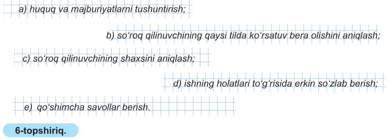

### Quyidagilardan qaysi vaziyat jinoyat huquqi yoki jinoyat protsessual huquqiga aloqador

ekanligini aniqlang. Jadvalni daftaringizga chizing va javobingizni kiriting.

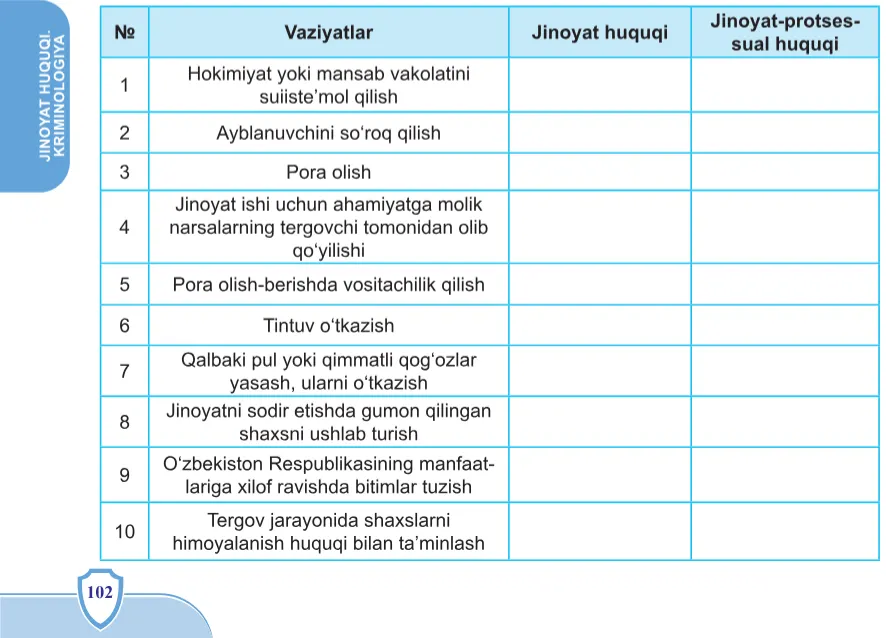

# IV bob. Ekologiya huquqi

## 29-dars. Ekologiya huquqi tushunchasi

### Faollashtiruvchi savollar

1. Siz yashaydigan hududda qanday ekologik muammolar mavjud? Ularning vujudga kelish sabablarini tushuntirib bering.

2. "Barqaror rivojlanish" deganda nimani tushunasiz? Sizningcha, nega bugun butun dunyoda barqaror rivojlanishga katta eʼtibor qaratilmoqda?

3. Tabiatni muhofaza qilish uchun davlat qanday huquqiy choralarni koʻrishi lozim?

4. Orol dengizi qurishi bilan bogʻliq muammo haqida nimalarni bilasiz?

### Asosiy tushunchalar

> Ekologiya huquqi — bu atrof-muhitni muhofaza qilish, tabiiy boyliklardan oqilona foydalanish va ekologik xavfsizlikni taʼminlashga qaratilgan huquqiy normalar tizimidir. Ushbu huquq sohasi inson va tabiat oʻrtasidagi huquqiy munosabatlarni tartibga soladi hamda davlat va fuqarolarning ekologik masʼuliyatini belgilaydi.

### Yodda tuting

Atrof-muhit barqarorligi deganda tabiatning sogʻlom holatda saqlanishi, havoning toza, suvlarning ifloslanmagan boʻlishi, odamlarning esa toza va xavfsiz muhitda yashashi tushuniladi.

Atrof-muhit barqarorligiga erishish uchun davlat Konstitutsiyada muayyan normalar belgilaydi va bu haqida alohida qonunlar qabul qiladi.

### Qonun belgilaydi

Har kim qulay atrof-muhitga, uning holati toʻgʻrisidagi ishonchli axborotga ega boʻlish huquqiga ega.

Oʻzbekiston Respublikasining Konstitutsiyasi, 49-modda

Fuqarolar atrof tabiiy muhitga ehtiyotkorona munosabatda boʻlishga majburdirlar.

Oʻzbekiston Respublikasining Konstitutsiyasi, 62-modda

### Yodda tuting

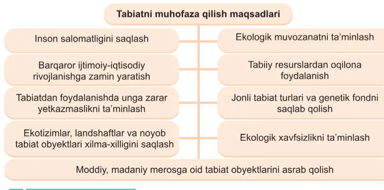

### Ijodiy faoliyat

Xalqaro tashkilot haqidagi maʼlumot bilan tanishib chiqing. Yurtimizdagi mavjud ekologik muammoni bartaraf etish haqidagi takliflaringizni ishlab chiqing.

Y UNEP (United Nations Environment Programme) — BMTning atrof-muhit boʻyicha maxsus dasturi boʻlib, Stokgolmda 1972-yilda tashkil etilgan. Uning bosh qarorgohi Keniya poytaxti Nayrobi shahrida joylashgan. YUNEPning asosiy vazifasi — global ekologik muammolarni aniqlash, hal qilish va barqaror rivojlanishni qoʻllab-quvvatlashdir. Tashkilot davlatlarga ekologik siyosat yuritishda yordam beradi, ekologik bitimlar loyihasini ishlab chiqadi va ekologik taʼlimni rivojlantiradi. YUNEP tashabbusi bilan har Yili 5-iyun "Butunjahon atrof-muhit kuni" sifatida nishonlanadi.

### Yodda tuting

> "Yashi' makon" — Oʻzbekiston Respublikasida amalga oshirilayotgan ekologik loyiha boʻlib, uning asosiy maqsadi — mamlakat hududida daraxt ekish orqali yashil maydonlarni kengaytirish va ekologik muhitni yaxshilashdir.

Mazkur umummilliy loyiha asosida quyidagilar amalga oshirilmoqda:

"Yashil bogʻlar" va "yashil jamoat parklari" barpo etilmoqda;

transchegaraviy chang-qum boʻronlari taʼsirini kamaytirish uchun "yashil qalqon"lar yaratilmoqda;

"Yashil toʻlov" platformasi va "Yashil xayriya jamgʻarmasi" joriy qilinmoqda;

daraxtlarni pasportlashtirish ishlari yoʻlga qoʻyilmoqda.

### Yodda tuting

Oʻzbekistonda atrof-muhit muhofazasiga oid asosiy qonun hujjatlari tizimi quyidagilardan iborat:

### Izlanishda davom eting

Tabiatni muhofaza qilish boʻyicha Keniya tajribasini oʻrganing. Bunday tartibni joriy etish masalasini kichik guruhlarda muhokama eting.

2017-yildan boshlab Keniyada bir martalik plastik paketlardan foydalanish toʻliq taqiqlandi. Ushbu qaror dunyodagi eng qatʼiy "plastik taqiqlardan" biri hisoblanadi. Taqiq nafaqat plastik paketlarning ishlab chiqarilishi, balki ularning importi, savdosi va kundalik hayotda ishlatilishiga ham tegishlidir.

Mazkur tartibga rioya qilmagan fuqarolar katta miqdordagi jarimaga tortilishi yoki toʻrt yilgacha ozodlikdan mahrum qilinishi mumkin. Plastik paket bilan mamlakatga kirgan sayyohlardan ham bunday paketlar olib qoʻyiladi.

Taqiqning asosiy maqsadi — atrof-muhitni, ayniqsa yer va suv resurslarini plastik chiqindilardan himoya qilishdir. Ilgari Keniyada koʻchalarda plastik ifloslanish keng tarqalgan. Bu esa hayvonlar hayoti, suv tizimlari va umumiy ekologik muvozanatga jiddiy zarar yetkazgan.

Taqiq kuchga kirgach, koʻchalarda tozalik ancha yaxshilandi. Fuqarolar mato, qogʻoz, oʻsimlik barglari va boshqa ekologik xavfsiz muqobil mahsulotlardan foydalanishga oʻtdilar. Keniya bugungi kunda Afrika qitʼasidagi eng ilgʻor ekologik siyosatga ega davlat hisoblanadi.

### Tarixga nazar

Abu Rayhon Beruniy — mashhur qomusiy olim, geograf, tarixchi va tabiatshunos. U Xorazmda tugʻilgan va birinchi Renessans davrida yashagan. Beruniy turli fanlarga oid koplab asarlar yozgan. Uning eng mashhur kitoblari — "Hindiston" va "Qadimgi xalqlardan qolgan yodgorliklar" boʻlib, bu asarlar tarix, dinlar, geografiya va tabiatga oid chuqur bilimlarni oʻz ichiga oladi.

Beruniy qimmatbaho toshlar va minerallar haqida "Mineralogiya" asarini ("Kitob al jamohir fi maʼrifat aljavohir" — "Qimmatbaho toshlarni bilib olish boʻyicha maʼlumotlar toʻplami") yozgan. Bu asar hozirga qadar oʻzining amaliy ahamiyatini yoʻqotmagan. Bu asarda muallif 300 dan ziyod minerallarning fizik va kimyoviy xususiyatlarini tushuntirib bergan.

### Xulosa qiling

Tabiat — kelajak avlod uchun bizdagi omonatdir.

Inson bugun foydalanayotgan havo, suv, yer, oʻrmon, hayvonot va oʻsimlik dunyosi faqat bugungi avlodniki emas. Bu boyliklar bizga vaqtincha ishonib topshirilgan. Har bir odam bu omonatga xiyonat qilmasligi, uni asrab-avaylashi shart.

Kelajak avlod sogʻlom hayot kechirishi uchun biz bugun masʼulmiz.

> Tabiatni asrash — bu nafaqat qonun talabigina emas, balki insoniylik burchidir.

### Hamkorlikda bajaramiz

Kichik guruhlarga boʻlining. Quyidagi jadvalni daftaringizga tushiring. Keltirilgan ekologik muammolarni muhokama eting. Ularning kelib chiqish sabablarini aniqlang. Bunday muammolarni bartaraf etish choralarini ishlab chiqing.

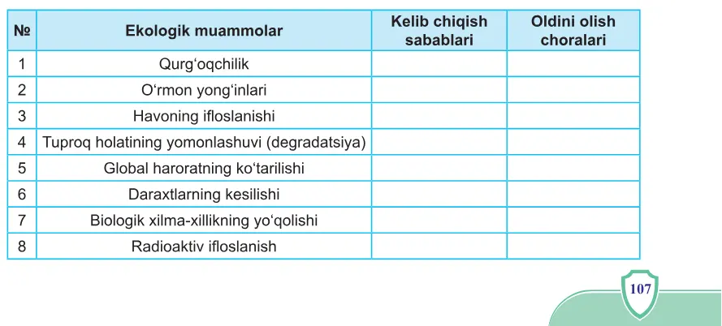

## 30–31-dars. Ekologik-huquqiy javobgarlik

### Faollashtiruvchi savollar

Quyidagi rasmlarga eʼtibor qarating va savollarga javob bering.

I. Sizningcha, bu keltirilganlar orasida qaysi biri eng ogʻir huquqbuzarlik hisoblanadi?

2. Ushbu huquqbuzarliklarga ogʻirlik darajasiga qarab I dan 5 gacha baho bering.

3. Sizningcha, uchinchi va toʻrtinchi holatlar oʻrtasidagi asosiy farq nimada? Ular qanday huquqiy oqibatlarni keltirib chiqaradi?

4. Bu holatlar ichida inson salomatligiga bevosita xavf tugʻdiradigani aynan qaysi biri? Nima uchun?

5. Siz yashaydigan hududda ushbu huquqbuzarliklardan qaysi biri tez-tez uchraydi? Uni bartaraf etish uchun qanday choralar koʻrilmoqda yoki koʻrilishi kerak deb oʻylaysiz?

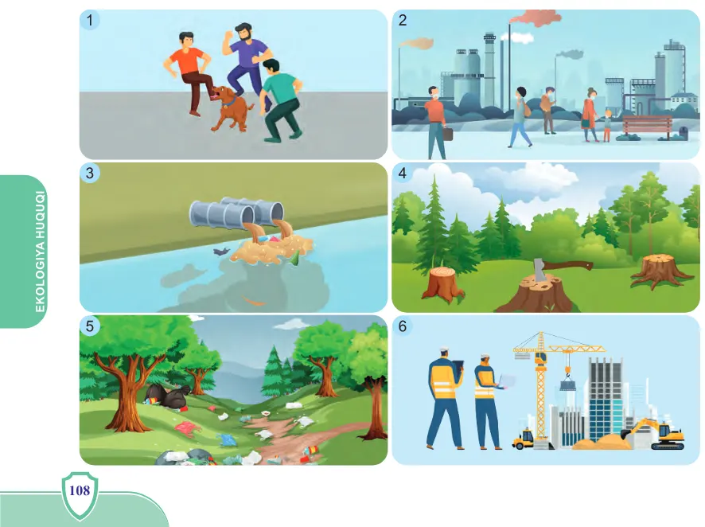

> Ekologik huquqiy javobgarlik — bu atrof-muhitga zarar yetkazgan shaxslarga nisbatan qonun asosida qoʻllaniladigan javobgarlik shaklidir. U ekologiya sohasidagi qonun buzilishlarining oldini olish, tabiatni muhofaza qilish va yetkazilgan zararni tiklashga qaratiladi.

### Yodda tuting

Ekologik huquqiy javobgarlik toʻrt shaklda boʻlishi mumkin: intizomiy, maʼmuriy, fuqaroviy-huquqiy va jinoiy. Ular orasida maʼmuriy javobgarlik eng koʻp uchraydigan shakldir. Masalan, chiqindilarni ruxsatsiz tashlagan yoki daraxtni noqonuniy kesgan shaxsga nisbatan jarima choralari qoʻllaniladi.

Fuqaroviy-huquqiy javobgarlik esa zarar koʻrgan shaxs yoki tashkilot foydasiga moddiy yoki maʼnaviy zarar qoplab berishni nazarda tutadi. Misol uchun, korxona ifloslantirgan hududni tozalash yoki suv manbayiga yetkazilgan zarar oʻrnini qoplash majburiyati yuklatilishi mumkin.

Jinoiy javobgarlik esa atrof-muhitga ogʻir zarar yetkazgan hollarda qoʻllanadi. Bunda aybdorga nisbatan jarima, hattoki ozodlikdan mahrum qilish kabi jazo choralari belgilanishi mumkin.

Ekologik huquqiy javobgarlik fuqarolarning tabiatga nisbatan masʼuliyatini oshirish, qonunlarga rioya qilishni taʼminlash va ekologik barqarorlikni saqlashda muhim oʻrin tutadi.

### Xulosa qiling

Oʻzbekiston Respublikasi Maʼmuriy javobgarlik toʻgʻrisidagi kodeksining sakkizinchi bobi ekologiyaga oid huquqbuzarliklarga bagʻishlangan. Mazkur bob "Ekologiya, atrof-muhitni muhofaza qilish va tabiatdan foydalanish sohasidagi huquqbuzarliklar uchun maʼmuriy javobgarlik" deb nomlanadi. Bu bobda shaxslar tomonidan atrof-muhitga, tabiiy resurslarga zarar yetkazish yoki ekologik qonunlarni buzganlik uchun belgilanadigan maʼmuriy javobgarlik turlari keltirib oʻtiladi.

Unda keltirilgan har bir moddada huquqbuzarlikning aniq turi, unga nisbatan qoʻllaniladigan jazo choralari aniq belgilangan. Bundan koʻzlangan asosiy maqsad shaxslarni ekologiyaga oid qonunchilik hujjatlariga rioya qilish ruhida tarbiyalash va tabiatga yetkazilgan zararning oldini olishdir.

### Yodda tuting

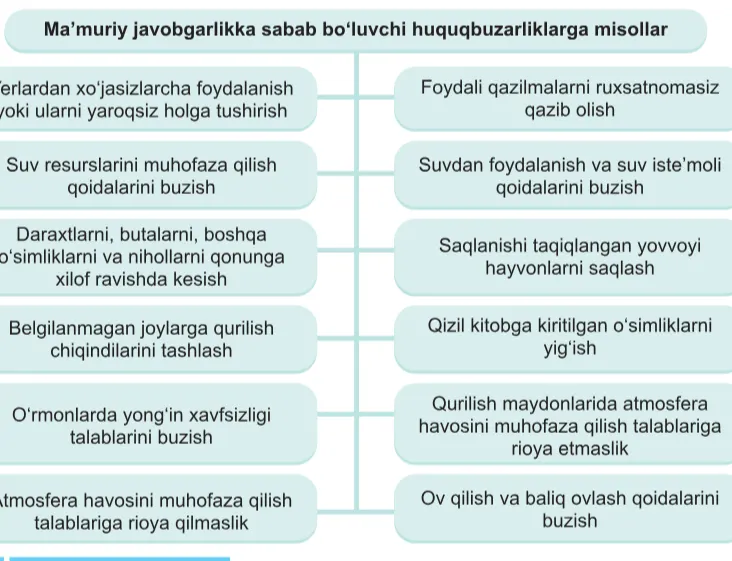

### Xulosa qiling

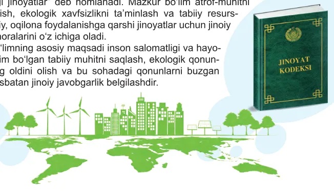

### Ekologiya sohasidagi jinoyatlarga misollar

Ekinzorlarni, oʻrmonlarni, daraxtlarni shikastlantirish yoxud nobud qilish

Olovga ehtiyotsizlik bilan munosabatda boʻlish natijasida ekinzorlarni, daraxtlarni nobud qilish bilan koʻp miqdorda zarar yetkazish

Suv yoki suv havzalaridan foydalanish shartlarini buzish orqali ogʻir oqibatlar kelib chiqishiga sabab boʻlish

### Xulosa qiling

Oʻzbekiston Respublikasi Maʼmuriy javobgarlik toʻgʻrisidagi kodeksining sakkizinchi bobi va Jinoyat kodeksining toʻrtinchi boʻlimi ekologiya sohasidagi huquqbuzarliklarni tartibga soladi. Ular har ikkisi tabiatni muhofaza qilish, atrof-muhitni asrash va ekologik qonunlarga rioya etilishini taʼminlashga xizmat qiladi. Biroq ular oʻrtasida javobgarlik darajasi jihatidan sezilarli farqlar mavjud.

Maʼmuriy javobgarlik toʻgʻrisidagi kodeks maʼmuriy huquqbuzarliklarni oʻz ichiga oladi. Bu huquqbuzarliklar, odatda, yengil yoki oʻrta darajadagi qoidabuzarliklar hisoblanadi. Masalan, chiqindilarni belgilangan joydan tashqariga tashlash, daraxtlarni ruxsatsiz kesish, suv havzalarini yengil darajada ifloslantirish kabilar. Bu holatlarda jazo sifatida koʻp hollarda jarima jazosi qoʻllaniladi. Bunday huquqbuzarliklar maʼmuriy organlar yoki ekologiya nazorati boʻyicha vakolatli idoralar tomonidan aniqlanadi va jazolash ham ularning vakolatiga kiradi.

Jinoyat kodeksi esa ekologiya sohasidagi jinoyatlarni oʻz ichiga oladi. Bu boʻlimda ogʻir va xavfli harakatlar, yaʼni atrof-muhitni ogʻir darajada ifloslantirish, yoʻqolib borayotgan hayvonlar yoki oʻsimlik turlarini yoʻq qilish kabi holatlar jinoyat sifatida baholanadi. Bu holatlarda jinoyat ishi tergov qilinadi va faqat sud tomonidan jinoyat jazosi belgilanadi. Jazolar esa ogʻirroq boʻlib, hattoki ozodlikdan mahrum qilish jazosi ham qoʻllanilishi mumkin.

Shuningdek, Maʼmuriy javobgarlik toʻgʻrisidagi kodeks doirasidagi huquqbuzarliklar uchun javobgar shaxs sudlangan hisoblanmaydi. Jinoyat kodeksiga muvofiq javobgarlik esa sudlanganlik holatini keltirib chiqaradi. Shu sababli, bu ikki hujjat ekologik xavfsizlikni taʼminlashda turli darajadagi huquqiy vositalar sifatida xizmat qiladi.

### Qonun belgilaydi

Atrof tabiiy muhitga zarar yetkazgan korxonalar, muassasalar, tashkilotlar va ayrim shaxslar yetkazgan zararni, shu jumladan boy berilgan foyda oʻrnini qonunchilikka muvofiq qoplashlari shart.

Ekologiya talablarini buzganlikda ayblanayotganlarning maʼmuriy yoki jinoiyjavobgarlikka tortilishi ularni atrof tabiiy muhitga yetkazilgan zararni qoplash majburiyatidan ozod etmaydi.

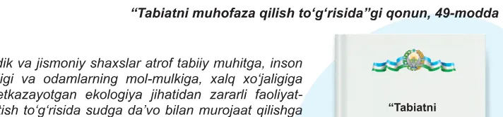

### Izlanishda davom eting

Oʻzbekiston Respublikasining Maʼmuriy javobgarlik toʻgʻrisidagi kodeksidan quyidagi vaziyatlar uchun qanday jazo choralari qoʻllanilishini aniqlang.

1-vaziyat. Xudoyor ismli fuqaro hovlisida sher bolalarini saqlab kelayotgan edi. U bu hayvonlarni noqonuniy yoʻl bilan olib kelgan va ularni farzandlariga koʻrsatish, keyinchalik esa pullik xizmatlarni yoʻlga qoʻyish uchun foydalanmoqchi edi.

Tuman ekologiya inspeksiyasi xodimlari bu holatni aniqlab, hayvonlarni olib qoʻydi hamda Xudoyorga nisbatan maʼmuriy javobgarlik ishi qoʻzgʻatildi.

2-vaziyat. Sherdor oʻz uyida taʼmirlash ishlarini yakunlagach, qurilish chiqindilarini oʻz hovlisiga yaqin boʻlgan boʻsh yerga olib borib tashladi. Chiqindilarni olib ketish uchun moʻljallangan maxsus xizmatdan ham foydalanishni paysalga sola boshladi. Natijada mazkur hududda toʻplangan chiqindilar atrof-muhitga zarar yetkaza boshladi.

Mahalla aholisi bu holatdan norozi boʻlib, ichki ishlar organiga murojaat qildi.

3-vaziyat. Amriddin va uning doʻsti Alibek dam olish kunlari tog' yonbagʻrida ov qilishga qaror qilishdi. Ular taqiqlangan uskunalar va qurol-yaroq yordamida ayiq ovlashni reja qilishdi. Ular ov qilish xavfsiz deb oʻylashdi va atrof-muhitga salbiy taʼsirini hisobga olishmadi. Alibek togʻdagi archazorlar ichidan yurib kelayotgan qoʻngʻir ayiqni moʻljalga oldi.

4-vaziyat. Koʻp qavatli uy qurilishi olib borilayotgan hududda quruvchi korxona tomonidan changni bartaraf etish choralariga rioya qilinmayapti. Qurilish maydonida yuk mashinalari tez-tez qatnashi, qurilish materiallarini joyida kesish, maydalash ishlari havoni ifloslantirmoqda. Maydon atrofida himoya toʻsiqlari oʻrnatilmagan va suv bilan namlash ishlari amalga oshirilmagan. Natijada qurilishga yaqin joyda yashovchi fuqarolar tez-tez changdan shikoyat qila boshladi.

## 32–33-dars. Biologik xilma-xillikni muhofaza qilish

### Faollashtiruvchi savollar

Quyidagi vaziyatlar bilan tanishib chiqing. Ularda qanday huquqiy masalalar aks ettirilganligini muhokama qiling.

1-vaziyat. Guljahon togʻda sayr qilib yurib, yoʻl-yoʻlakay turli gullarni terib keldi. Pastga tushganida ekologiya inspektorlari terib olingan gullar ichida noyob turlar mavjudliigini, bu qonunga zid ekanligini tushuntirishdi. Guljahonga nisbatan maʼmuriy huquqbuzarlik bayonnomasi rasmiylashtirildi. Guljahon "gullarga "noyob" deb yozib qoʻyilmagan-ku" deb shikoyat bildirdi.

Nima deb oʻylaysiz, oʻsimliklarga ehtiyotsizlikdan zarar yetkazish javobgarlikdan ozod etadimi? Nima uchun?

2-vaziyat. "Chaqqon" fermer xoʻjaligi oʻz ehtiyoji uchun quduq qazib, yerosti suvidan ikki yildan buyon foydalanib keladi. Ular bu ishni hech qanday ruxsatnomasiz amalga oshirgan. Natijada yaqin atrofdagi aholi quduqlarida suv sathi pasayib ketdi. Aholining eʼtirozlari ortidan ekologiya inspektorlari fermer xoʻjaligini koʻzdan kechirishdi. Fermer xoʻjaligi rahbari — "Axir, suv hammaniki, nega menga jarima solasiz?", — deb raddiya bildirdi.

Yerosti suvlaridan foydalanish uchun ruxsatnoma olish kerakmi? Nima uchun?

3-vaziyat. Yirik sanoat korxonasi shahar chekkasida joylashgan boʻlib, uzoq yillar davomida atmosfera havosiga zararli gazlar chiqarib kelar edi. Ayniqsa, qish oylarida shamol yoʻnalishi sababli tutun va gazlar yaqin atrofdagi aholi punktlariga tarqaladi. Bir necha oy ichida mahalla poliklinikasiga nafas olish yoʻllari bilan bogʻliq kasalliklar va allergik holatlar bi- Ian murojaat qiluvchilar soni keskin oshib ketdi. Ekologik nazorat organlari tomonidan oʻtkazilgan tekshiruvda korxona atrof-muhitga zarar yetkazayotganini tasdiqlovchi dalillar aniqlanadi. Natijada korxonaga nisbatan huquqiy chora koʻriladi, faoliyati vaqtincha toʻxtatiladi va havoni tozalash qurilmalari oʻrnatish majburiyati yuklatiladi.

Havoga zararli gazlar chiqaruvchi korxonalarga qanday taʼsir choralarini qoʻllash mum-

> Biologik xilma-xillik — bu Yer yuzida mavjud boʻlgan barcha tirik organizmlar: oʻsimliklar, hayvonlar, zamburugʻlar va mikroorganizmlar hamda ularning yashash muhitlari va ekotizimlaridagi turli shakllar yigʻindisidir.

### Xulosa qiling

Biologik xilma-xillik inson va tabiat uchun juda muhim. U quyidagi sabablar tufayli muhim hisoblanadi:

Birinchidan, ekotizimlarning barqarorligini taʼminlaydi. Har bir tur oʻz vazifasini bajaradi: baʼzilari tuproqni boyitadi, boshqalari changlatadi, ayrimlari zararkunandalarni nazorat qiladi. Shu orqali tabiat oʻzini muvozanatda saqlaydi;

Ikkinchidan, biologik xilma-xillik inson hayoti uchun zarur boʻlgan resurslarni beradi. Oziqovqat, dori-darmon, qurilish materiallari va boshqa koʻplab mahsulotlar aynan turfa xil biologik turlardan olinadi;

Uchinchidan, u ilm-fan va texnologiyalar rivoji uchun imkon yaratadi. Koʻplab dori vositalari, yangi qishloq xoʻjaligi mahsulotlari tabiiy turlarga asoslanib yaratiladi.

Shuningdek, biologik xilma-xillik madaniy va estetik ahamiyatga ega. Tabiat goʻzalligi, sayyohlik imkoniyatlari va koʻplab xalq urf-odatlari shu turli-tumanlik bilan bogʻliq.

Agar biologik xilma-xillik yoʻqolsa, tabiatdagi muvozanat buziladi, ekologik inqirozlar yuzaga keladi va insoniyat yashash sharoitlaridan mahrum boʻladi. Shu sababli uni asrash butun jamiyatning muhim vazifasidir.

### Yodda tuting

Oʻzbekiston hududi tabiiy ekotizimlarning nihoyatda xilma-xilligi bilan tavsiflanadi. Tekis mintaqalarda choʻl ekotizimlari, tog' ekotizimlarida esa balandliklar, oʻrmonzorlar mavjud.

Biologik xilma-xillikning eng markazini Oʻzbekiston hududi uchun tabiiy ekotizimlar (yer, suv), hayvonot va oʻsimlik dunyosi tashkil etadi.

Oʻzbekiston hududida tabiiy ekotizimlarning beshta asosiy turi mavjud

### Xulosa qiling

Mamlakatimizda yer, suv, hayvonot va oʻsimlik dunyosini asrab-avaylash boʻyicha qonunchilik qatʼiy ishlab chiqilgan boʻlib, qonun normalarini buzganlik uchun javobgarlik choralari belgilangan.

Yer, yerosti boyliklari, suv, oʻsimlik va hayvonot dunyosi va boshqa tabiiy resurslar umummilliy boylik hisoblanadi. Bu boyliklar bir kishiga emas, balki butun jamiyatga xizmat qiladi va kelajak avlodlarga oʻtishi kerak boʻlgan umumiy meros hisoblanadi.

### Qonun belgilaydi

Yer, yerosti boyliklari, suv, oʻsimlik va hayvonot dunyosi hamda boshqa tabiiy resurslar umummilliy boylikdir, ulardan oqilona foydalanish zarur va ular davlat muhofazasidadir.

Yer qonunda nazarda tutilgan hamda undan oqilona foydalanishni va uni umummilliy boylik sifatida muhofaza qilishni taʼminlovchi shartlar asosida va tartibda xususiy mulk boʻlishi mumkin.

### Izlanishda davom eting

Tabiiy boyliklardan olingan daromadlarni yoʻnaltirishga oid xorij tajribasi bilan tanishib chiqing. Tahlil eting.

Birlashgan Arab Amirliklarida ham tabiiy resurslar milliy boylik sifatida qaraladi. Neft va gazdan tushgan daromad fuqarolar oʻrtasida bevosita pul tarzida taqsimlanmaydi. Biroq ushbu daromad mamlakat budjetiga tushib, bilvosita yoʻllar orqali aholining farovonligini oshirishga xizmat qiladi. Misol uchun, amirliklarning barcha fuqarolari uchun bepul tibbiy xizmat, boshlangʻich va Oliy taʼlim mamlakat budjetidan moliyalashtiriladi. Aholi tibbiy va taʼlim xizmatlari uchun mablag' sarflamaydi. Shuningdek, Abu Dabi investitsiya jamgʻarmasi ham tashkil etilgan boʻlib, neftdan va boshqa moliyalashtirish resurslaridan tushgan daromadlar kelajak avlodlar uchun iqtisodiy barqarorlikni saqlash manbasi vazifasini bajaradi.

### Yodda tuting

> Ozbekistonda yerni muhofaza qilish boʻyicha asosiy huquqiy hujjat — Yer kodeksi hisoblanadi. Kodeksda yerdan oqilona va samarali foydalanish, uni muhofaza qilish va tiklash tartiblari belgilangan. Yer xalqning umummilliy boyligi sifatida qaraladi. Yerni ifloslantirish, buzish, ero- Ziya va shoʻrlanish kabi holatlarga yoʻl qoʻyilmaydi.

Har bir shaxs yerdan foydalanishda ekologik xavfsizlik, barqarorlik va tabiatga zarar yetkazmaslik talablariga amal qilishi kerak. Yer resurslarini asrash davlatning, fuqarolarning va tashkilotlarning umumiy majburiyatidir.

Shuningdek, "Tabiatni muhofaza qilish toʻgʻrisida"gi qonun, Maʼmuriy javobgarlik toʻgʻrisidagi kodeks va Jinoyat kodekslarida yerni muhofaza qilishga oid qoʻshimcha normalar mavjud.

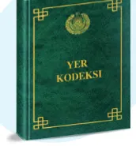

### Asosiy tushunchalar

> Yer haqidagi barcha maʼlumotlar — yerning oʻlchami, joylashuvi, egasi, qanday maqsadda ishlatilayotgani — davlat kadastrida saqlanadi.

Bu ish Kadastr agentligi tomonidan amalga oshiriladi.

> Kadastr — bu yerni hisobga olish, baholash va qonuniy nazorat qilishga xizmat qiladigan maxsus hujjatlar tizimi hisoblanadi.

### Tarixga nazar

Sohibqiron Amir Temurning "Temur tuzuklari"da yozilishicha, daraxt ekish va bogʻlar barpo etish davlat siyosatining muhim yoʻnalishlaridan biri boʻlgan. Harbiy yurishlar oraligʻida ham bogʻlar tashkil etilgan. Temur bir shaharga kirar ekan, eng avvalo, "yoʻl, suv va daraxtlar" holatini tekshirtirgan.

Jumladan, "Temur tuzuklari"da quyidagilar qayd etilgan:

"Yana amr etdimki, kimki biron sahroni obod qilsa, yoki koriz qursa, yoki biron bog' koʻkartirsa, yoxud biron xarob bo 'Iib yotgan yerni obod qilsa, birinchi Yili undan hech narsa olmasinlar, ikkinchi Yili oʻz roziligi bi- Ian berganini olsinlar, uchinchi Yili esa soliq qonun-qoidasiga muvofiq xiroj yigʻilsin".

### Hamkorlikda bajaramiz

Kichik guruhlarga boʻlingan holda, elektron davlat xizmatlari portali orqali yerga oid qanday davlat xizmatlaridan foydalanish mumkin ekanligini muhokama qiling.

Yer uchastkasiga boʻlgan huquqni davlat roʻyxatidan oʻtkazish uchun Yagona interaktiv davlat xizmatlari portaliga elektron shaklda murojaat qilinadi.

Natijada yer uchastkasi uchun kadastr hujjati va mulk huquqi guvohnomasi beriladi. Jismoniy va yuridik shaxslar tomonidan yer uchastkalaridan foydalanganlik uchun yer soligʻi toʻlanadi.

### Tarixga nazar

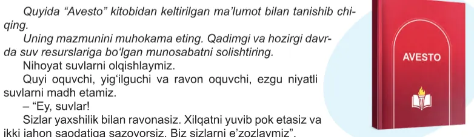

Yerosti suvlaridan foydalanish uchun ruxsatnoma qanday olinadi?

Agar siz yerosti suvlaridan foydalanmoqchi boʻlsangiz, "yerosti suvidan foydalanish uchun ruxsatnoma" olishingiz kerak.

Bunda ortiqcha ovoragarchilik talab etilmaydi. Barcha harakatlar onlayn bajariladi. Arizani elektron shaklda Yagona interaktiv davlat xizmatlari portali — my.gov.uz yoki "Litsenziya" axborot tizimi — license.gov.uz orqali topshirishingiz mumkin. Arizaga yerosti suvidan foydalanishning joylashuv manzili, maqsadi, texnik talablar ilova qilinadi. Ruxsatsiz suv olish qonunbuzarlik hisoblanadi. Faqat ruxsatnoma asosida yerosti suvlaridan foydalanishga ruxsat etiladi.

### Xulosa qiling

Atmosfera havosini muhofaza qilish huquqshunoslik nuqtayi nazaridan ekologik xavfsizlikni taʼminlashning muhim boʻgʻinidir. Toza havo biologik xilma-xillikni saqlash, oʻsimliklar va hayvonlar yashashi uchun zarur. Huquqiy normalar orqali sanoat chiqindilari meʼyorlashtiriladi, ifloslanishga qarshi choralar belgilanadi. Bu orqali hayvonot va oʻsimlik dunyosi huquqiy jihatdan himoya qilinadi.

Ekologiya sohasidagi qonunlar, masalan, "Atmosfera havosini muhofaza qilish toʻgʻrisida"gi qonun davlat va fuqarolar zimmasiga aniq majburiyatlar yuklaydi. Shunday qilib, atmosfera muhofazasi huquqshunoslik va biologik xilma-xillik oʻrtasidagi bevosita bogʻliqlikni koʻrsatadi.

### Qonun belgilaydi

Fuqarolar quyidagi huquqlarga ega:

oʻz hayoti va sogʻligʻi uchun qulay atmosfera havosidan foydalanish;

atmosfera havosining holati hamda uni muhofaza qilish boʻyicha koʻrilayotgan chora-tadbirlar toʻgʻrisida tegishli davlat organlaridan oʻz vaqtida va ishonchli axborot olish;

atmosfera havosiga ifloslantiruvchi moddalar va biologik organizmlar chiqarilishi hamda unga fizikaviy omillarning zararli taʼsir koʻrsatishi tufayli oʻz sogʻligʻiga va mol-mulkiga ziyon yetkazilgan hollarda zararning oʻrni qoplanishi;

atmosfera havosini muhofaza qilish masalalari boʻyicha jamoatchilik fikrini oʻrganish va jamoatchilik ekologik ekspertizasini amalga oshirishda ishtirok etish.

### Xulosa qiling

Hayvonot va oʻsimlik dunyosi biologik xilma-xillikning asosiy qismini tashkil etadi. Ularning mavjudligi ekotizim barqarorligini saqlaydi. Oʻzbekistonda bu boylikni huquqiy jihatdan muhofaza qilish "Hayvonot dunyosini muhofaza qilish va undan foydalanish toʻgʻrisida" va "Oʻsimlik dunyosini muhofaza qilish va undan foydalanish toʻgʻrisida"gi qonunlar orqali tartibga solinadi. Shuningdek, biologik xilma-xillikni asrash "Qizil kitob" asosida amalga oshiriladi. Bu huquqiy asoslar orqali kamyob va yoʻqolib borayotgan turlar himoya qilinadi. Biologik resurslar milliy boylik sanaladi va ularni saqlash har bir fuqaroning huquqiy va ekologik burchidir.

### Izlanishda davom eting

> "Qizil kitob" — bu yoʻqolib ketish xavfi ostida turgan yovvoyi hayvonlar va oʻsimliklar turlari roʻyxati kiritilgan rasmiy nashrdir.

Mamlakatimizda bu kitob birinchi marta 1984-yilda nashr etilgan.

Bugungi kunda qizil kitob elektron shaklda eʼlon qilinib boriladi.

Oʻzbekiston Respublikasi Ekologiya, atrof-muhitni muhofaza qilish va iqlim oʻzgarishi vazirligi tomonidan "Qizil kitob" vaqti-vaqti bilan yangilanib boriladi. Unda noyob va yoʻqolib borayotgan turlar haqida maʼlumotlar beriladi.

"Qizil kitob"ga kiritilgan turlar biologik xilma-xillikni saqlash va muhofaza qilish maqsadida alohida nazorat ostiga olinadi. Har bir tur haqida uning tarqalgan hududi, yashash muhitiga tahdidlar, sonining kamayish sabablari va uni asrash choralari haqida maʼlumot beriladi. Oʻzbekiston qizil kitobiga kiritilgan hayvon yoki oʻsimliklarni ovlash, yoʻq qilish, toʻplash yoki savdoga chiqarish taqiqlanadi.

Oʻzbekiston Respublikasining "Qizil kitob"iga 314 0'simlik va 206 hayvon turi kiritilgan. Masalan, qor qoploni, saygʻoq, jayron, Buxoro bugʻusi kabilarni misol tariqasida keltirish mumkin. "Qizil kitob" ekologik xavfsizlikni taʼminlash, tabiatni muhofaza qilish siyosatini samarali olib borish uchun muhim qoʻllanma hisoblanadi.

"Qizil kitob" vaqti-vaqti bilan yangilanib boriladigan maʼlumotlar bazasi sifatida elektron shaklda yuritiladi va ilmiy-ommabop nashr sifatida chop etiladi.

## 34-dars. Ijodiy faoliyat

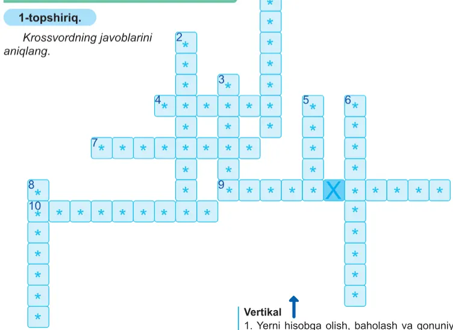

Vertikal

1. Yerni hisobga olish, baholash va qonuniy nazorat qilishga xizmat qiladigan maxsus hujjatlar tizimi

2. Ekologiya sohasida zarar koʻrgan shaxs foydasiga moddiy yoki maʼnaviy zarar qoplab berishni nazarda tutuvchi javobgarlik turi

3. Hayvonlarga nisbatan shafqatsiz munosabatda boʻlish harakati maʼmuriy jazo qoʻllanilganidan keyin sodir etilsa, qanday javobgarlik kelib chiqadi?

5. Qaysi kitobga yoʻqolib ketish xavfi ostida turgan yovvoyi hayvonlar va oʻsimliklar turlari roʻyxati kiritiladi?

6. Yer, yerosti boyliklari, suv, oʻsimlik va hayvonot dunyosi hamda boshqa tabiiy resurslar qanday boylik hisoblanadi?

8. "Mineralogiya" asarining muallifi

Gorizontal

4. Kelajak avlod uchun bizdagi omonat nima?

7. Biologik xilma-xillikka kiruvchi olam

9. Oʻzbekistonda amalga oshirilayotgan ekologik loyiha IO. Qaysi huquq sohasi atrof-muhitni muhofaza qilish, tabiiy boyliklardan oqilona foydalanish va ekologik xavfsizlikni taʼminlashga qaratilgan huquq normalarini oʻz ichiga oladi?

2-topshiriq.

Quyida taqdim etilgan vaziyat asosida rolli oʻyin tashkillashtiring.

BMT bosh qarorgohida navbatdagi "Atrof-muhit va xavfsizlik" mavzusidagi xalqaro sammit boʻlib oʻtmoqda. Unda ishtirok etayotgan har bir davlat global ekologik muammolar boʻyicha oʻz pozitsiyasini bildiradi.

Siz — Oʻzbekiston delegatsiyasi aʼzosisiz. Sizning vazifangiz mamlakatning ekologik holati, muammolari va xalqaro hamkorlikdagi ishtiroki haqida soʻz yuritish hamda takliflar bildirish hisoblanadi.

Vazifani amalga oshirish bosqichlari:

1. Tayyorgarlik koʻrish.

Delegatsiya aʼzolari guruhlarga boʻlinadi (3—4 kishidan). Har bir guruh:

Oʻzbekistonning bitta muhim ekologik yoʻnalishini tanlaydi: (masalan: suv tanqisligi, Orol muammosi, iqlim oʻzgarishi, chiqindilar, havo sifati, qayta tiklanuvchi energiya va boshqalar);

tanlangan yoʻnalishda asosiy muammo, milliy chora-tadbirlar va xalqaro tashabbuslar haqida 3-4 ta muhim fikr tayyorlaydi.

2. Chiqish qilish.

Har bir guruhdan bitta vakil sammitda chiqish qiladi (2—3 daqiqa). Chiqishda quyidagilar boʻlishi shart:

delegatsiya vakili sifatida oʻzini tanishtirish;

Oʻzbekistondagi ekologik muammo haqida qisqacha maʼlumot berish;

rætadbirlar.amalg

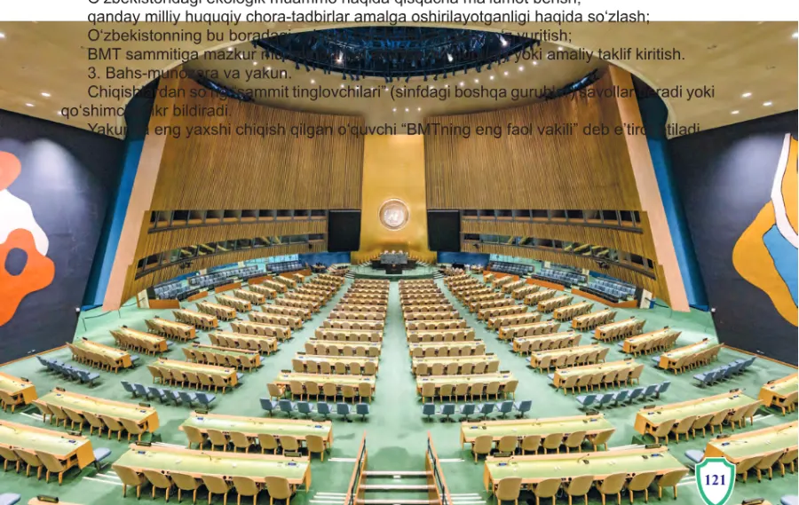

Quyida keltirilgan vaziyatlar Oʻzbekiston Respublikasi qonunchiligiga muvofiq yoki muvofiq emasligi toʻgʻrisida fikr yuriting. Mazkurjadvalning javoblar qismini (toʻgʻri, notoʻgʻri) daftaringizda toʻldiring. Fikringizni asoslab bering.

### Qishloq xoʻjalik yerlarini istagan

paytda qurilish uchun topshirish mumkin.

Har bir ishlab chiqaruvchi korxona ekologik ekspertizadan oʻtmasdan ham faoliyat yuritishi mumkin. Qayta tiklanuvchi energiya manbalaridan foydalanish faqat yirik sanoat uchun moʻljallangan.

Fuqarolar atrof tabiiy muhitga ehtiyotkorona munosabatda boʻlishga majburdirlar.

### Noyob hayvonlar shaxsiy uylarda

boqilayotgan boʻlsa, ovlash mumkin.

Qurilish ishlari olib borilayotgan joydagi daraxtlarni kesish mumkin.

Korxona rahbariyati zaharli kimyoviy moddalarni daryoga oqizishi mumkin.

Korxonalar tungi vaqtda zaharli gazlarni havoga chiqarib yuborishi mumkin.

4-topshiriq.

Quyida keltirilgan muammoli vaziyat bilan tanishib chiqing. Savollarga javob bering

Lutfiya opa juda ham uddaburon fermer edi. Onlayn-auksion orqali 5 gektar sugʻoriladigan qishloq xoʻjaligi yer uchastkasi unga ijara asosida ajratildi.

Ijara shartnomasida bu yer faqat qishloq xoʻjaligi ekinlarini yetishtirish uchun moʻljallanganligi koʻrsatilgan edi.

Oradan bir Yil oʻtib, Lutfiya opa ushbu yerning bir gektar qismini zamonaviy issiqxona qurish uchun ijaraga berib yubordi. Bu issiqxonada gidroponika usuli, yaʼni tuproqsiz oʻsimlik yetishtirish texnologiyasi qoʻllanildi. Ijara biznesini yoʻlga qoʻyib Lutfiya opa ham, ijarachi xoʻjalik ham, koʻp daromad qilib keldi.

Biroq mahalliy hokimiyat organlari tomonidan navbatdagi tekshiruv oʻtkazilishi hammasiga yakun yasadi.

Tekshiruvlar davomida bu holat tuman prokuraturasi tomonidan aniqlandi va mazkur yer boʻyicha qonunbuzilish holati qayd etildi.

### Quyidagi savollarga javob bering

1. Lutfiya opaning harakatida qanday qonunbuzilishlari mavjud? U qandayjavobgarlikka tortilishi mumkin?

2. Ushbu holat qaysi normativ-huquqiy hujjatlarga zid hisoblanadi?

3. Sugʻoriladigan yerlarni boshqa toifadagi yerlar tasnifiga otkazish qanday tartibda amalga oshirilishi mumkin?

4. Fermer tomonidan yerning bir qismini boshqa shaxsga ijaraga berish huquqini muhokama qiling.

5. Mazkur holatda yer uchastkasi fermerdan olib qoʻyilishi mumkinmi? Nima uchun?

6. Vaziyatga huquqiy yechim bering.

5-topshiriq.

Quyida keltirilgan Oʻzbekiston xaritasiga eʼtibor bering. Unda har bir maʼmuriy-hududiy birliklar ajratib koʻrsatilgan. Har bir hududning oʻziga muvofiq ekologik muammolari mavjud.

Darslikning IV bobida oʻrganganlaringiz va Geografiya faniga oid bilimlaringizga tayanib, xaritada ekologik muammolarni aks ettiring. Bu muammolarni hal etishda qanday huquqiy choralar koʻrish mumkin? Fikringizni asoslab bering.

Ekologik muammolarni qayd etish uchun quyidagi shartli belgilardan foydalaning: Toza ichimlik suvining tanqisligi kuzatiladigan hududlar — "tomchi" belgisi; havo ifloslanishi yuqori boʻlgan hududlar — "shabboda" belgisi;

Daraxtlarning kesilishi koʻproq kuzatiladigan hududlar — "daraxt" belgisi.

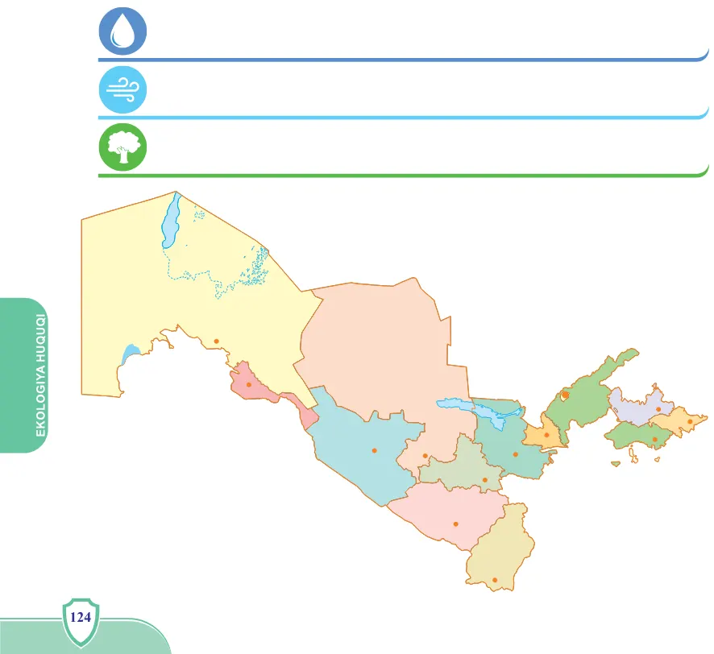

6-topshiriq.

Quyidagi vaziyatlar bilan tanishib chiqing. Ularda qanday huquqiy masalalar aks ettirilganligini muhokama qiling.

1-vaziyat. Bir viloyatda joylashgan dasht hududida yirik qurilish ishlari boshlandi. Qurilish kompaniyasi hech qanday ekologik ekspertizalarsiz ish olib bordi. Natijada bu hududda yashovchi noyob va himoya ostidagi hayvon turlari yashash joylaridan mahrum boʻldi.

Ogʻir texnika, chang, shovqin va ozuqa bazasining yoʻqolishi tufayli hayvonlar ommaviy ravishda nobud boʻldi. Atrof-muhitni muhofaza qilish organlari holatni oʻrganib, qurilish ishlarining ekologik qonunlarga zid tarzda olib borilganini aniqladi. Qurilish toʻxtatildi. Javobgar shaxslarga nisbatan huquqiy choralar qoʻllanildi va hayvonot dunyosini tiklash boʻyicha choralar belgilandi.

2-vaziyat. Asliya oilasi bilan mashinada sayohatdan qaytayotgan edi. Ular mashinada shaharning chekka hududidan oʻtayotganda, orqa oʻrindiqda oʻtirgan ukasi ichimlik suvi idishini mashinadan tashqariga uloqtirib yubordi. Otasi esa:

— "Yoʻlda axlat qutisi yoʻq-ku, baribir bu yerda hech kim yashamaydi", — deb oʻgʻliga tanbeh bermadi.

Oradan biroz vaqt oʻtib, yoʻl yoqasidagi chiqindi qoplari yonidan oʻtishdi.

Asliyaning otasi mashinani toʻxtatdi. Mashinadagi eski buyumlarni olib chiqib, ularni chiqindilarning yoniga qoʻyib, yoʻlida davom etdi.

Asliya esa bu holatdan ich-ichidan bezovta boʻldi. U maktabda atrof-muhitni muhofaza qilish boʻyicha ekofaol edi.

7-topshiriq.

Quyida keltirilgan topshiriq boʻyicha kichik guruhlarga boʻlingan holda taqdimot tayyorlang. Taqdimotni tayyorlab boʻlgach, sinfdoshlaringiz uchun chiqish qilib bering.

Taqdimot mavzusi: "Mening mahallamdagi ekologik muammo".

Quyida taqdimotning tarkibi keltirib oʻtiladi:

1. Oʻzingiz yashayotgan hududdagi tabiiy resurslar (suv, havo, oʻsimliklar, hayvonlar) va ularning hozirgi holati haqida qisqacha maʼlumot bering;

2. Hududdagi ekologik muammolarni tushuntirib bering. Ularni chindan ham muammo ekanligini asoslab bering;

3. Mazkur muammoning kelib chiqishiga sabab boʻlgan omillarni tushuntirib bering;

4. Insonlarning tabiatga salbiy taʼsir etishiga misollar keltiring;

5. Hududdagi ekologik muammolarni hal etish uchun chora-tadbirlar rejasini yarating;

6. Atrof-muhitni muhofaza qilish va ekologik muammolarni hal etishda "birdamlik kuchi" haqida soʻz yuriting;

7. Taqdimot uchun xulosa qiling.

Taqdimot tayyorlash boʻyicha qoʻshimcha koʻrsatmalar:

taqdimotingizni tushunarli va aniq qilishga harakat qiling;

maʼlumotlarni vizual tarzda (rasm, diagramma, graflklar) taqdim eting; ishonchli va rasmiy manbalardan foydalaning.

### DAVLAT VA HUQIJQ

Muharrir Musahhih texnik muharrir Badiiy muharrir Rassom Sahifalovchi-dizayner

Nodir Ramazonov Asliddin Almardanov Alimardon Aqilov Sarvar Farmonov Umid Sulaymonov Dilmurod Mulla-Axunov

Nashriyot Iitsensiyasi NQ 140295. 04.10.2023-yilda berilgan. Bosishga 15.08.2025-yiida ruxsat etildi. Bichimi 84X108 1/16.

Arial garniturasi. Kegli 12. Ofset bosma.

Shartli bosma tabogʻi 10,4. Nashriyot-hisob tabogʻi II,15. Adadi 566139 nusxa. Buyurtma NQ 000.

Gʻafur Gʻulom nomidagi nashriyot-matbaa ijodiy uyida chop etildi.

100128. Toshkent. Labzak koʻchasi, 86.

Telefon: (371) 241-35-47, 241-48-62, 241-83-29 Faks: (371) 241-82-69 www.gglit.uz info@gglit.uz

Darslik ijaraga berilib, oʻquv Yili yakunida qaytarib olinganda yuqoridagi jadval sinf rahbarlari tomonidan quyidagi baholash mezonlariga asosan toʻldiriladi:

Darslikning birinchi marta foydalanishga berilgandagi holati.

Muqova butun, darslikning asosiy qismidan ajralmagan. Barcha varaqlari bor, yirtilmagan, koʻchmagan, betlarida yozuv va chiziqlar yoʻq.

Muqova ezilgan, birmuncha chizilib, chetlari yedirilgan, darslikning asosiy qismidan ajralish holati bor, lekin qoniqarli taʼmirlangan. Koʻchgan varaqlari qayta joylangan, ayrim betlariga chizilgan.

Muqova yirtilgan, ustiga chizilgan, asosiy qismidan ajralgan yoki butunlay yoʻq, qoniqarsiz taʼmirlangan. Betlari yirtilgan, varaqlari yetishmaydi, chizib, boʻyab tashlangan. Darslikni tiklab boʻlmaydi.
