# Основы государства и права. 9 класс (2024)

# Глава I. Конституция и правовое государство

## Урок 1. Конституция – Основной закон государства

> Конституция – это мой проводник, от которого я никогда не откажусь.

**Джордж Вашингтон**

### Вы узнаете

Понятие конституции.

Конституция – основа законодательства.

Виды конституций.

Структура и задачи Конституции Республики Узбекистан.

### Понятие конституции

Трудно представить современное демократическое государство без основного закона – конституции. Конституция до сих пор служит одним из важнейших исторических открытий человечества, направленных на регулирование жизни общества. Конституция определяет основные права и обязанности граждан, отношения между личностью, обществом и государством, структуру общества и государства, порядок образования органов государственной власти и управления, а также основные принципы и полномочия их деятельности. Конституция появилась гораздо позже, чем сами государства. Следовательно, государства исторически функционировали без конституции. На появление конституций повлиял ряд факторов. Закрепление прав и свобод человека в законах и правовое регулирование отношений между государством и человеком вызвали необходимость их определения отдельными законами. Первой конституцией в мировой истории стала Конституция США 1787 года. Впервые в ней было закреплено разделение властей: принципы и порядок организации законодательной, исполнительной, судебной власти, права субъектов федерации. Позже были внесены дополнения касательно прав человека и гражданина. После этого были приняты конституции в Польше и Франции. Сегодня в более чем 200 странах мира действуют свои конституции.

Все законы, кодексы, постановления и указы принимаются на основе и в соответствии с конституцией. Это означает, что каждый нормативный документ государства должен ей соответствовать. Конституция влияет на все сферы жизни общества, политическую, экономическую, духовно-нравственную, бытовую, трудовую деятельность, частную жизнь и т. д.

### Запомните!

Термин «конституция» происходит от латинского constitutio, что означает «устройство», «устав», «определение», «установление порядка». Этот термин впервые был использован в законодательстве Древнего Рима. Конституция представляет собой важный документ, в котором собраны основополагающие законы государства.

### Конституция – основа законодательства

Конституция служит основой всей правовой системы. Поскольку развитие права начинается с конституции, именно она даёт жизнь всем другим законам и нормативным правовым актам. В этом и проявляется высшая юридическая сила конституции. Все

остальные правовые акты проистекают из этого основного закона и должны соответствовать ему.

Представьте себе правовую систему в виде пирамиды. Если вообразить, что конституция находится на вершине этой пирамиды, то можно увидеть, что от её вершины до самого основания располагаются законы, кодексы, указы, постановления и все прочие нормативные документы. Знания о конституции, её содержании, истории развития, видах конституций изучаются в конституционном праве.

Нормы конституционного права являются фундаментом всех остальных юридических норм, каждой отрасли права, каждого закона и подзаконного акта. Поэтому конституционное право занимает ведущее положение в национальной правовой системе каждой страны. Основным источником конституционного права является конституция. Однако конституционное право не состоит исключительно из конституции. Источниками этой отрасли права являются также другие законодательные и нормативно-правовые акты.

### Виды конституций

В современном мире существует более 200 государств, и почти каждое из них имеет свою конституцию. Конституции разных государств отличаются друг от друга по ряду причин. Поскольку конституции возникли в разные периоды и в разных условиях, их виды также разнообразны.

Существуют следующие виды конституций по таким аспектам, как форма выражения, порядку принятие, действие, порядок внесения изменений и др.

**По форме выражения** конституции делятся на «писаные» и «неписаные». Писаная конституция признаётся единым документом, принятым в особом порядке (США, Франция). В некоторых странах конституции не принимаются в виде единого документа, а представляют собой совокупность законов, регулирующих различные отношения, которая также считается конституцией (Великобритания, Новая Зеландия).

**По порядку принятия** различают дарованную конституцию, которая предоставляется монархом своему государству. При этом конституция вступает в силу актом главы государства (высшего органа исполнительной власти) (Катар и Япония). Народная конституция может быть принята референдумом (новая редакция Конституции Узбекистана), парламентом или высшим органом власти, созданным специально для принятия конституции.

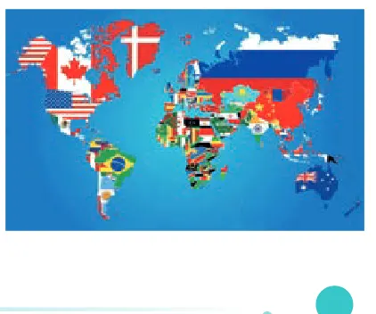

### По порядку внесения изменений

«гибкая» и «жёсткая» конституция

### По форме государственного правления

монархическая и республиканская конституция

### По форме государственного устройства

федеральная и унитарная конституция

**По порядку внесения изменений** конституции делятся на «гибкие» и «жёсткие». «Гибкая» конституция – это основной закон, который принимается и изменяется так же, как и обычные законы государства. «Жёсткая» конституция – это основной закон, который принимается и изменяется гораздо сложнее, чем обычные законы соответствующей страны. Например, несмотря на то что с момента принятия Конституции США прошло более 200 лет, в неё внесено всего 27 поправок.

**По форме государственного правления** конституции делятся на монархические и республиканские. Монархические конституции устанавливаются в странах с конституционно ограниченной монархической формой правления (Испания, Япония, Швеция). Республиканские конституции действуют в странах с республиканской формой правления (Франция, Германия, США).

**По форме государственного устройства** конституции делятся на федеральные и унитарные. Федеральная конституция определяет принципы формирования федеративного государства, регулирует объединение отдельных субъектов федерации в единый союз, определяет правовой статус субъектов федерации, а также формирование и деятельность органов законодательной, исполнительной и судебной власти (США, Индия, Германия, Россия). В качестве примера унитарных государственных конституций можно привести единые конституции для всего государства (Франция, Италия).

Конституция как Основной закон государства имеет своеобразную структуру, которая, в отличие от других законов, выстраивается в логической последовательности в зависимости от целей, задач и значения норм конституции.

Конституция Республики Узбекистан по форме выражения является «писаной», по порядку принятия – народной, по порядку внесения изменений – «жёсткой», по форме государственного правления – республиканской, по форме государственного устройства – унитарной.

### Структура и задачи Конституции Республики Узбекистан

**Преамбула** является идеологической вводной частью нашей Конституции. Преамбула конституции отражает мечты и устремления народа, общечеловеческие и национальные ценности. Положения и идеи в Преамбуле в той или иной форме впоследствии найдут своё место в конституционных нормах. Преамбула начинается с понятия «**Единый народ Узбекистана**», посредством кото рого подчёркивается единство и неделимость нашего народа.

**Первый раздел** Конституции называется «**Основные принципы**» и разделён на главы: «Государственный суверенитет», «Народовластие», «Верховенство Конституции и закона», «Внешняя политика». Принципы, содержащиеся в

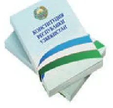

### Структура Конституции Республики Узбекистан

Административно-территориальное и государственное устройство

первом разделе Конституции, являются опорами государственной и общественной жизни, потому что в этом разделе определены форма управления и структура государства, особенности государственного суверенитета.

**Второй раздел** Конституции называется «**Основные права, свободы и обязанности человека и гражданина**». В данном разделе определены взаимосвязь государства и гражданина через права и обязанности друг к другу, личные права и свободы человека и гражданина (право на жизнь), гражданские вопросы, политические (право на выборы), экономические (право на собственность), социальные (образование, труд), культурные и экологические права и гарантии прав и свобод, обязанности граждан.

**Третий раздел** Конституции называется «**Общество и личность**». В нём закреплены экономические основы общества, институты гражданского общества, вопросы семьи, детей и молодёжи, а также правовые основы средств массовой информации.

**Четвёртый раздел** называется «**Административно-территориальное и государственное устройство**», в котором в отдельных главах определены административно-территориальное устройство Республики Узбекистан и правовое положение Республики Каракалпакстан.

Крупнейший **пятый раздел** Конституции, именуемый «**Организация государственной власти**», включает в себя такие главы, как «Олий Мажлис Республики Узбекистан», «Президент Республики Узбекистан», «Кабинет Министров Республики Узбекистан», «Основы государственной власти на местах. Органы самоуправления граждан», «Избирательная система», «Судебная власть», «Адвокатура», «Прокуратура», «Финансы, денежная и банковская система» и «Оборона и безопасность». Последний, **шестой раздел** посвящён порядку изменения Конституции.

### Запомните!

Конституция Республики Узбекистан состоит из Преамбулы, 6 разделов, 27 глав и 155 статей.

### Вопросы и задания

1. В чём заключалась необходимость создания единого Основного закона – конституции, несмотря на существование законов в древних государствах?

2. Каковы первые конституции, принятые в мире, и в чём их историческое значение?

3. Что определяет сущность и содержание конституции?

4. Почему конституция, в отличие от других законов, называется основным законом?

5. Какая связь существует между преамбулой и последующими нормами конституции?

### Задания для самостоятельной работы

Создайте таблицу по видам конституций. Напишите в левой части таблицы виды конституций, а в правой – соответствующие им государства.

## Урок 2. Принятие Конституции Республики Узбекистан

Невозможно создать общую и постоянную конституцию для всех обществ, каждое поколение имеет право создавать свою конституцию.

**Томас Джефферсон**

### Вы узнаете

Создание Конституции Республики Узбекистан.

Принятие Конституции Республики Узбекистан в новой редакции. Порядок внесения изменений и дополнений в Конституцию.

### Создание Конституции Республики Узбекистан

Декларация независимости Узбекистана, принятая 20 июня 1990 года и признанная основным шагом на пути к государственной независимости, стала основой для создания новой Конституции. На сессии Верховного Совета, на которой была принята Декларация, был сделан вывод о необходимости разработки новой Конституции и была создана комиссия из 64 человек для подготовки её проекта. В проекте Конституции, наряду с соблюдением общепризнанных в мире принципов и идей, особое внимание уделялось отражению в ней государственности узбекского народа, идей наших предков и ценностей.

Всенародное обсуждение проекта Конституции продолжалось три месяца. На основе 6000 предложений, поступивших в ходе всенародного обсуждения, в проект было внесено более 80 поправок.

Проект Конституции, подготовленный комиссией с учётом многочисленных предложений, высказанных в ходе широкого всенародного обсуждения, был вынесен на рассмотрение Верховного Совета.

Конституция независимого государства, как Основной закон государства, закрепила права и свободы граждан, определила основы деятельности органов законодательной, исполнительной и судебной власти.

### Запомните!

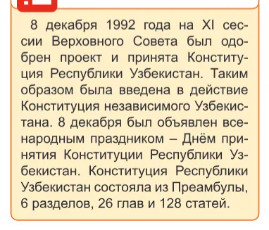

### Принятие Конституции Республики Узбекистан в новой редакции

Реформы, осуществляемые в нашей стране, обусловили необходимость приоритета чести, достоинства, прав и свобод человека во всех сферах. Важным аспектом этих изменений стало глубокое внедрение в суть и содержание Конституции основного принципа: «Человек – общество – государство», который является ключевым ориентиром текущих реформ.

Исходя из этого, 20 мая 2022 года совместным постановлением палат Олий Мажлиса была создана Конституционная комиссия по формированию предложений и реализации организационных мер по внесению изменений и дополнений в Конституцию Республики Узбекистан. Президент Республики Узбекистан Шавкат Мирзиёев, выступая на встрече с членами Конституционной комиссии, отметил: «Наша главная цель – вывести этот документ на совершенный уровень, которым гордится каждый наш соотечественник как своей Конституцией».

**30 апреля 2023 года** состоялся референдум Республики Узбекистан по проекту Конституционного закона «О Конституции Республики Узбекистан», и новая редакция Конституции была принята напрямую нашими гражданами.

В Статье 1 Конституции чётко определено, что **Узбекистан – суверенное, демократическое, правовое, социальное и светское государство.**

> **Правовое государство** – это государство, в котором обеспечивается верховенство права, гарантируются права и свободы человека и гражданина, все равны перед законом и никто не стоит выше закона.

> **Социальное государство** – это справедливое государство, которое обеспечивает достойный уровень жизни для каждого человека, в том числе качественное образование, гарантированное медицинское обслуживание, достойные условия труда, справедливую заработную плату, пенсии и пособия, а также жилищные условия, при которых ни один гражданин не остаётся один на один со своими проблемами.

> **Светское государство** – это государство, в котором религиозные организации и объединения отделены от государства, а управление осуществляется на основе Конституции и законодательства, а не религиозных правил. Одним из важнейших аспектов обновлённой Конституции является значительное увеличение норм, регулирующих личные права и свободы, экономические и социальные права – их количество **возросло почти в 3,5 раза.** Среди ключевых изменений выделяются нормы, касающиеся сферы образования. Например, усилена государственная защита чести и достоинства учителей, забота об их социальном и материальном благополучии, а также их профессиональном развитии (статья 52).

«Обновлённая Конституция – поистине народная Конституция»

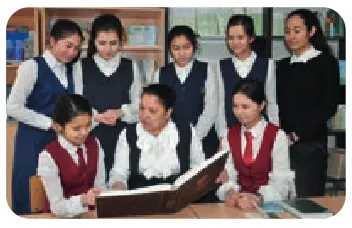

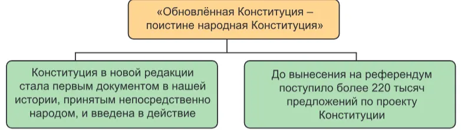

В Конституции в новой редакции количество статей увеличилось с 128 до 155.

Текст Основного закона обновлён почти на 65 %.

### Порядок внесения изменений и дополнений в Конституцию

В нашей Конституции предусмотрены защитные меры, направленные на обеспечение её стабильности и предотвращение частых изменений. Эти правила изложены в **шестом разделе** Конституции, где указаны порядок и условия внесения изменений.

Согласно **статье 154**, изменения и дополнения в Конституцию Республики Узбекистан вносятся конституционным законом, принятым большинством (не менее двух третей от общего числа) депутатов Законодательной палаты и членов Сената Олий Мажлиса Республики Узбекистан, либо путём референдума Республики Узбекистан.

Олий Мажлис Республики Узбекистан, **в течение 6 месяцев** после внесения соответствующего предложения, может принять конституционный закон о внесении изменений и дополнений в Конституцию с учётом широкого и всестороннего обсуждения.

Если Олий Мажлис отклонил предложение об изменении Конституции, оно **может быть повторно внесено только через 1 год.**

Из этого можно сделать вывод, что изменения и дополнения в Конституцию могут вноситься, во-первых, палатами Олий Мажлиса, и во-вторых, непосредственно народом через референдум.

До принятия Конституции в новой редакции **30 апреля 2023 года** в Конституцию Республики Узбекистан было внесено 16 изменений и дополнений, большинство из которых касались государственного управления, Президента, правительства и избирательной системы.

Впервые в истории **30 апреля 2023 года** наш народ сам принял Конституционный закон Республики Узбекистан **«О Конституции Республики Узбекистан»**. Основная часть новых положений и изменений в Конституции в новой редакции связана с правами человека.

Изменения и дополнения в Конституцию можно внести двумя способами

Конституционным законом, принятым большинством (не менее двух третей от общего числа) депутатов Законодательной палаты и членов Сената Олий Мажлиса Республики Узбекистан

### Вопросы и задания

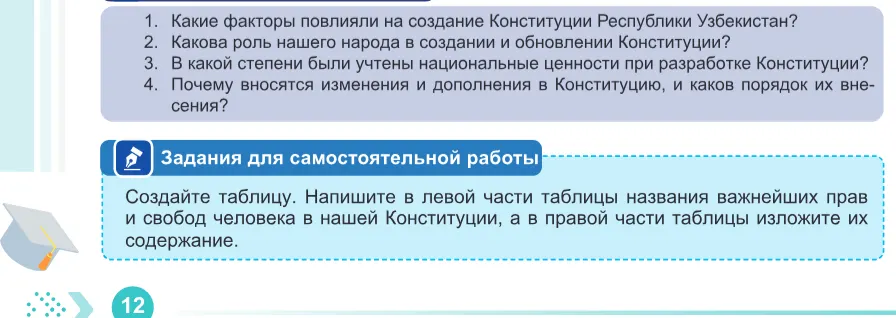

## Урок 3. Роль Конституции в правовом государстве

Задача государства заключается в том, чтобы вести людей к счастью, что достигается с помощью науки и хорошей морали. **Абу Наср Фараби**

### Вы узнаете

Правовое государство и его признаки.

Правовое государство и правовая культура.

Верховенство конституции в правовом государстве.

### Правовое государство и его признаки

> **Правовое государство** – это государство, в котором обеспечивается верховенство права, гарантируются права и свободы человека и гражданина, а также обеспечивается участие народа в осуществлении власти (непосредственно или через представителей).

В правовом государстве деятельность государственных органов и должностных лиц осуществляется исключительно на основе конституции и законодательных актов. Положения конституции имеют прямое действие и применяются как в работе государственных органов, так и в повседневной жизни граждан. Законы одинаково обязательны для всех: как для государственных органов и должностных лиц, так и для граждан и институтов гражданского общества. Теории правового государства служат ориентиром для всех демократических государств.

В правовом государстве человек и его интересы находятся в центре внимания. В отношениях между государством и человеком приоритет всегда отдаётся интересам человека.

### ПРИЗНАКИ ПРАВОВОГО ГОСУДАРСТВА

**Разделение системы власти на законодательную, исполнительную и судебную ветви**

### Верховенство закона

**Взаимозависимость и взаимная ответственность гражданина и государства через права и обязанности**

**Гарантирование прав и свобод человека, недопущение их нарушения**

### Правовое государство и правовая культура

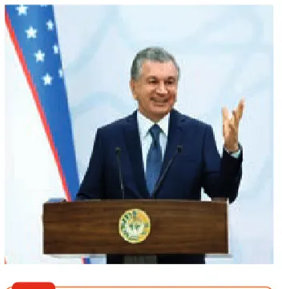

Одним из важных критериев правового государства и гражданского общества является высокий уровень правосознания и правовой культуры населения. В Узбекистане с первых лет независимости этому вопросу уделялось особое внимание. Повышение правосознания и правовой культуры населения стало приоритетным направлением государственной политики.

В этой связи целесообразно привести высказывание Президента Республики Узбекистан Шавката Мирзиёева: **«Мы должны сформировать в нашем обществе такую правовую культуру, в соответствии с которой соблюдение Конституции и законов, уважение прав и свобод, чести и достоинства других должно стать повседневной нормой и привычкой, а не обязательством».** Правосознание выражает различные отношения, такие как восприятие законодательства и его правовых норм, деятельность государственных органов, граждан и других субъектов по реализации правовых норм в определённых правоотношениях, а также борьбу с правонарушениями.

Незнание закона не освобождает от ответственности! Хотя граждане не обязаны знать все законы наизусть, незнание законодательства, касающегося их прав и интересов в повседневной жизни, свидетельствует о низком уровне правосознания. Таким образом, роль повышения правосознания и правовой культуры в построении правового государства в нашей стране крайне важна.

Однако в обществе встречаются негативные явления, такие как правовой нигилизм и правовая некультурность, которые приводят к нарушению или игнорированию законов. Без устранения этих явлений невозможно реализовать идею правового государства.

В Указе Президента Республики Узбекистан «О коренном совершенствовании системы повышения правосознания и правовой культуры в обществе» от 9 января 2019 года, принятом с целью формирования уважительного отношения к правам и свободам человека, повышения правосознания и правовой культуры населения, а также уровня правовой грамотности граждан, была утверждена Концепция повышения правовой культуры в обществе.

### Запомните!

> **Правовое сознание** – это совокупность знаний и представлений людей о законах и других правовых явлениях.

> **Правовая культура –** это уровень правовых знаний людей, их сознательное отношение к праву, его уважение и соблюдение.

> **Правовой нигилизм** – негативное, отрицающее, неуважительное отношение к праву и законам.

### Лицо с правовой культурой

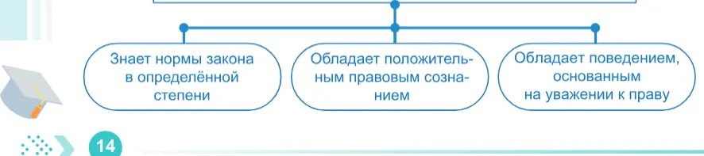

### Верховенство конституции в правовом государстве

Одним из важнейших признаков правового государства является верховенство конституции и закона.

В деятельности всех органов государственной власти конституция и законы обладают высшей юридической силой и имеют приоритет над другими законодательными актами, издаваемыми властью. Верховенство закона – это принцип, который

### Запомните!

> **Верховенство права (Rule of Law) –** это принцип, согласно которому деятельность государства, его должностных лиц, граждан и объединений осуществляется на основе права и в строгом соответствии с законом.

обеспечивает демократию и законность в обществе.

Главным критерием построения демократического правового государства в Узбекистане является обеспечение верховенства Конституции и закона. Однако для того, чтобы государство называлось правовым, необходимо не только верховенство закона, но и подлинное верховенство права. Этот принцип подразумевает, что все нормативно-правовые акты, включая Конституцию, а также деятельность органов государственной власти должны основываться на теории естественного права и обеспечивать защиту прав и интересов человека.

> Правовое государство – это государство, направленное на защиту человеческого достоинства, свобод и прав, в котором все равны перед законом и подотчётны ему и никто не стоит выше закона. Сегодня в Узбекистане поставлена цель создания гуманного, справедливого, свободного и народного правового государства. Президент Республики Узбекистан Шавкат Мир зиёев на встрече с членами Конституционной комиссии 20 июня 2022 года отметил: **«Только в условиях правового государства можно полностью обеспечить жизнь, свободу, честь и достоинство человека, а также сформировать поистине гуманную систему управления».**

В статье 1 обновлённой редакции Конституции указано: «Узбекистан – правовое государство». Это определение в Основном законе создаёт основу для того, чтобы государство, общество и повседневная жизнь граждан основывались исключительно на Конституции и законах.

Нормы обновлённой Конституции также закрепляют гарантии, направленные на реализацию принципа правового государства. Во-первых, установлено, что Конституция имеет высшую юридическую силу и прямое действие. Во-вторых, любые противоречия и неясности в законодательстве, возникающие в отношениях между гражданином и государственными органами, должны толковаться в пользу человека.

Признание Узбекистана правовым государством создаёт основу для обеспечения равенства всех перед законом и того факта, что никто не стоит выше закона, а также для формирования у граждан уважения к законам и необходимости их соблюдения.

### Вопросы и задания

1. В чём заключаются различия между правовым и неправовым государствами?

2. Какие качества характеризуют человека с высокой правовой культурой?

3. Какова разница между принципами верховенства закона и верховенства права?

4. В каких статьях Конституции закреплены положения о принципе правового государства?

### Задания для самостоятельной работы

Правовой нигилизм представляет собой одно из негативных явлений, которое создаёт серьёзную угрозу для развития общества и тормозит повышение уровня правосознания и правовой культуры. Обсудите с одноклассниками, какие меры можно предпринять для повышения правосознания и правовой культуры среди молодёжи, а также для улучшения правовой грамотности в обществе.

## Урок 4. Основные принципы Конституции. Государственный суверенитет

Суверенитет – абсолютная и постоянная власть государства.

**Жан Боден**

### Вы узнаете

Понятие государственного суверенитета.

Форма государственного управления и государственного устройства Республики Узбекистан.

Государственный язык и государственные символы Республики Узбекистан.

### Понятие государственного суверенитета

Первый раздел Конституции Республики Узбекистан называется «**Основные принципы**». В данном разделе определяются ключевые принципы государственного и конституционного строя. Первая глава этого раздела носит название «Государственный суверенитет» и включает в себя 6 статей.

Термин souveraineté, что означает «высшая власть». Впервые это понятие было введено французским учёным-правоведом Жаном Боденом. В международно-правовом контексте суверенитет означает независимость государственности всех народов. Государственный суверенитет подразумевает полную независимость государства как в его внутренних делах, так и на международной арене при осуществлении государственной власти и

### Жан Боден

разрешении возникающих вопросов.

Одним из основных признаков государства является его суверенитет. К основным принципам государственного суверени-

тета относятся:

– неприкосновенность и неделимость государственной территории и границ;

– проведение независимой внутренней и внешней политики;

– признание и соблюдение основных принципов международного права;

– наличие государственного языка;

– самостоятельность в выборе пути развития и установлении государственных символов.

31 августа 1991 года на VI внеочередной сессии Верховного Совета Узбекской ССР республика была провозглашена независимым государством. На этой сессии был принят Закон «Об основах государственной независимости Республики Узбекистан», который выполнял функции основного закона до принятия Конституции Республики Узбекистан 8 декабря 1992 года.

**Основные принципы**

– Государственный принцип

– Народовластие

– Верховенство Конституции и закона

– Независимая внешняя политика

### Запомните!

> Узбекистан – суверенное, демократическое, правовое, социальное и светское государство с республиканской формой правления.

Названия государства «Республика Узбекистан» и «Узбекистан» равнозначны.

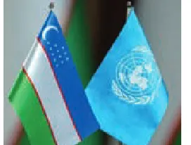

### Запомните!

Государство выражает волю народа, служит его интересам. Государственные органы и должностные лица ответственны перед обществом и гражданами.

**Статья 2 Конституции Республики Узбекистан** Достижение государственной независимости позволило Узбекистану стать на путь самостоятельного развития

международных отношений.

Обеспечение того, чтобы государство служило интересам народа, является важнейшим условием построения демократического общества. Главной задачей государства является выражение воли народа, защита его интересов и служение ему. Это означает, что все государственные органы и должностные лица несут ответственность перед обществом и гражданами.

**Форма государственного управления и государственного устройства Республики Узбекистан**

> **Республиканская форма правления** – это система организации высших органов государственной власти и взаимоотношений этих органов между собой и с населением. Термин «республика» происходит от латинского res publica и означает «общественное дело». Около 150 государств-членов ООН закрепили в своём названии республиканскую форму правления.

В статье 1 нашей Конституции определено, что **Узбекистан является государством с республиканской формой правления**. В Узбекистане республиканская форма правления проявляется в том, что все высшие органы власти формируются путём выборов или представительными органами. Согласно Конституции, и законодательный орган Олий Мажлис, и глава государства Президент избираются гражданами. Исполнительная власть – Кабинет Министров – формируется первичными представительными органами. При этом Президент Республики Узбекистан является главой государства и обеспечивает согласованную деятельность и взаимодействие органов государственной власти.

Можно сделать вывод, что республиканская форма государственного управления является выражением народовластия. Обеспечиваются гарантированные Конституцией естественные права граждан, создаются необходимые условия для их участия в управлении делами общества и государства непосредственно и через своих представителей, использования таких прав и свобод, как свобода слова, выборов, обжалования в суде, а также осуществления общественного контроля за деятельностью государственных органов.

**Признаки республиканской формы правления**

– Формирование главы государства и представителей высших органов власти посредством выборов.

– Ответственность избираемых органов перед избирателями, их избрание и назначение на определённый срок.

– Осуществление государственной власти от имени народа, а не от имени главы государства.

– Государственная защита прав граждан, наличие взаимной ответственности между государством и личностью.

Основным признаком любого государства является наличие территории, на которой проживает его население.

**Форма государственного устройства** представляет собой политическую и территориальную организацию, определяющую взаимоотношения местных органов власти с центральными органами власти. Большинство стран мира имеют унитарную форму государственного устройства. В этом случае территория государства делится на административные единицы (области, районы и т. д.), т. е. на части, не обладающие государственностью, а существующие для удобства управления.

**Унитарное государство** является единым государством, его отдельные административно-территориальные единицы обладают одинаковыми правами, на всей территории государства действуют единая конституция, единое правительство и единое законодательство. В Республике Узбекистан установлена унитарная форма государственного устройства. В нашей республике присутствуют все признаки, характерные для унитарной формы государства. Согласно Конституции (статья 83), Республика Узбекистан состоит из областей, районов, городов, посёлков, кишлаков, аулов, а также Республики Каракалпакстан.

Особенностью административно-территориального устройства Республики Узбекистан является наличие в её составе суверенной Республики Каракалпакстан, состоящей из районов, городов, посёлков и аулов.

Республика Каракалпакстан имеет свою Конституцию, не противоречащую Конституции Республики Узбекистан. Гражданин Республики Каракалпакстан одновременно является гражданином Республики Узбекистан.

### Запомните!

Республика Узбекистан определяет национально-государственное и административно-территориальное устройство, систему органов государственной власти, проводит свою внутреннюю и внешнюю политику.

Государственная граница и территория Узбекистана неприкосновенны и неделимы.

**Из статьи 3 Конституции Республики Узбекистан**

**Государственный язык и государственные символы Республики Узбекистан**

Язык является средством общения и основным признаком в определении нации. Государственный язык является официальным языком, на котором ведётся делопроизводство и обучение.

Одним из первых правовых шагов к обретению независимости стало придание узбекскому языку статуса государственного языка. 21 октября 1989 года был принят Закон «О государственном языке», который придал узбекскому языку статус государственного языка. Это было значительным шагом на пути к независимости и суверенитету страны. С этого времени начался новый этап развития узбекского языка. Таким образом, сначала в Законе Республики Узбекистан «О государственном языке», а затем в Конституции Республики Узбекистан были закреплены положения о государственном языке.

### Запомните!

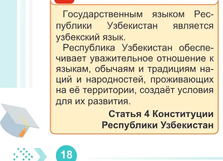

### Запомните!

> Республика Узбекистан имеет свои государственные символы – флаг, герб, гимн, утверждённым законом.

Государственные символы находятся под защитой государства.

**Статья 5 Конституции Республики Узбекистан**

### Закон «О государственном языке Республики Узбекистан» устанавливает, что

придание узбекскому языку статуса государственного не препятствует конституционным правам наций и народностей, проживающих на территории страны, на использование их родного языка. В Республике Узбекистан создаются условия для изучения государственного языка всеми гражданами и обеспечивается уважительное отношение к языкам наций и народностей, проживающих на её территории.

**Государственные символы**, как важнейшие признаки независимости каждого государства, наглядно подтверждают его суверенитет.

Республика Узбекистан имеет государственные символы – флаг, герб и гимн, установленные высшей государственной властью и закреплённые в Конституции.

В этих символах, являющихся гордостью нашего народа, отражены наша история, богатое духовно-культурное наследие, национальные обычаи и традиции, великие цели, благородные мечты и устремления.

18 ноября 1991 года был принят Закон «О Государственном флаге Республики Узбекистан», 2 июля 1992 года – Закон «О Государственном гербе Республики Узбекистан», 10 декабря 1992 года – Закон «О Государственном гимне Республики Узбекистан».

Существует ответственность за неуважение к государственным символам. Каждый человек обязан уважать государственные символы!

Государственные символы означают тот факт, что Узбекистан, как независимая республика, является равноправным субъектом международного права. В каждом из нас пробуждается чувство гордости, например, когда мы видим, как развевается наш флаг, или слышим, как звучит наши гимн в честь достижений наших соотечественников на международных спортивных соревнованиях.

### Вопросы и задания

1. Когда Узбекистан обрёл статус независимого суверенного государства?

2. Членом каких международных организаций является Республика Узбекистан как независимое суверенное государство?

3. Перечислите отличительные особенности монархической и республиканской форм правления. Приведите примеры стран.

4. Объясните государственное устройство Республики Узбекистан и его специфику.

5. Какая взаимосвязь существует между государственной независимостью и государственными символами?

### Задания для самостоятельной работы

Составьте таблицу форм государственного устройства. В левой части таблицы укажите признаки унитарного государства и перечислите страны с унитарной формой правления. В правой части таблицы опишите признаки формы государственного устройства Узбекистана и её специфику.

## Урок 5. Конституционные основы власти народа

Народ составляет большинство, и его голос имеет решающее значение. **Аристотель**

### Вы узнаете

> Демократия – это народовластие.

Принцип разделения государственной власти.

Демократические права и свободы под защитой Конституции.

### Демократия – это народовластие

Согласно статье 1 нашей Конституции, Узбекистан является демократической республикой.

> **Демократическая республика –** это государство, в котором народ является единственным источником государственной власти, государство выражает волю народа, а граждане имеют право непосредственно и через своих представителей участвовать в управлении делами общества и государства. Высшие органы государственной власти формируются путём выборов.

Норма о том, что **народ является единственным источником государственной власти**, чётко определяет, что не только высшая власть, но и органы власти всех уровней принадлежат народу. Их организация и функционирование, проще говоря, их существование возможно благодаря народу и служат они исключительно народу. Поэтому глава «Народовластие» включена в раздел основных принципов Конституции.

Непосредственное участие народа в решении вопросов государственного масштаба проявляется через участие в референдуме, то есть в общенародном обсуждении важнейших вопросов политической жизни страны и непосредственном голосовании.

От имени народа могут действовать только избранные им Президент и Олий Мажлис. При необходимости учёта общественного мнения для принятия государственных решений, касающихся жизни государства и общества, проекты Конституции и законов могут быть вынесены на всенародное обсуждение или может быть проведён референдум. Например, 30 апреля 2023 года в нашей стране состоялся референдум по проекту Конституционного закона Республики Узбекистан «**О Конституции Республики Узбекистан**». Большинство граждан страны (90,21 %) приняли участие в референдуме и проголосовали за внесение поправок в Конституцию.

> Термин «**народовластие»** является точным переводом слова «демократия» (от греческого demos – «народ», kratos – «власть»). Это понятие, впервые использованное в Древней Греции, получило широкое распространение по всему миру.

Равенство всех и каждого перед законом Государственная забота о благосостоянии и интересах человека

Наличие гарантированного механизма защиты прав и свобод человека

### ДВЕ ФОРМЫ ДЕМОКРАТИИ

**Прямая,** то есть непосредственная, демократия. Народ самостоятельно решает государственные дела без участия представителей (через выборы, референдумы, обращения граждан, обсуждение законопроектов и другие формы участия)

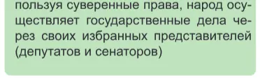

### Принцип разделения государственной власти

**Разделение властей** является основным принципом функционирования системы государственной власти, обеспечивающим предотвращение злоупотреблений властью посредством распределения полномочий государственной власти между независимыми друг от друга ветвями, их взаимодействия и баланса. Согласно этому принципу, государственная власть делится на органы законодательной, исполнительной и судебной власти.

Развитие научных основ теории разделения властей в мировом масштабе происходило в период перехода к новым формам госу-

дарственного управления в Европе и США, изменения политической системы и её закрепления в ранних конституциях.

Концепция разделения властей впервые была сформулирована английским мыслителем и учёным Джоном Локком.

Французский учёный **Шарль Луи де Монтескьё** признан автором исчерпывающего учения о разделении властей. Действительно, Джон Локк лишь разделил власть на законодательную и исполнительную ветви. Монтескьё подчёркивал необходимость независимости, равенства и баланса между законодательными и исполнительными органами власти. Монтескьё впервые выделил **судебную власть** как самостоятельную в принципе разделения властей для

### Шарль Луи де

установления свободы и справедливости и подчёркивал, что судебная власть должна существовать отдельно от законодательной и

исполнительной.

Практическое выражение теории разделения властей нашло отражение в принятой в 1787 году Конституции США.

В законодательстве нашей страны разделение властей закреплено в статье 11 Конституции Республики Узбекистан. В соответствии с ней система государственной власти основывается на принципе разделения власти на законодательную, исполнительную и судебную. Полномочия властей распределены между высшим представительным законодательным органом – **Олий Мажлисом**, высшим органом исполнительной власти – **Кабинетом Министров** и судебной властью – **Верховным судом** и **Конституционным судом,** осуществляющими правосудие.

### Запомните!

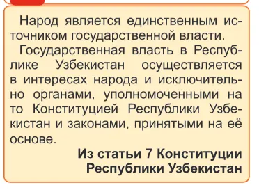

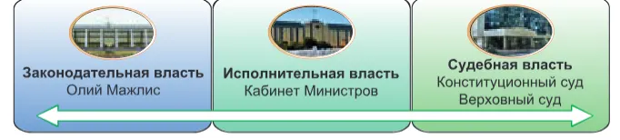

**Демократические права и свободы под защитой Конституции 23 bet** Демократические права и свободы в Узбекистане защищаются Конституцией и законами. Права и свободы человека охраняются также общепризнанными принципами и нормами международного права.

Одним словом, идея «Во имя чести и достоинства человека» и подход «Человек – общество – государство», являющийся главным принципом сегодняшних реформ, глубоко вошли в суть и содержание обновлённой Конституции. Наша Конституция разработана на основе международных документов о правах человека. Следует особо отметить, что наша Конституция в новой редакции была усовершенствована на основе норм международных правовых документов.

В статье 13 Конституции Республики Узбекистан закреплены общечеловеческие**27 bet** права, провозглашённые во Всеобщей декларации прав человека, на уровне высшей ценности. Всеобщая декларация прав человека определяет неотъемлемые и неприкосновенные права человека. Согласно статье 1: «Все люди рождаются свободными и равными в своём достоинстве и правах», а согласно статье 3: «Каждый человек имеет право на жизнь, свободу и личную неприкосновенность».

Важнейшие аспекты нашей Конституции связаны с обеспечением человека, его жизни, свободы, достоинства, неотъемлемых прав и интересов, развитием свободного и справедливого гражданского общества и построением демократического правового государства.

В соответствии со статьёй 19 Конституции в новой редакции права и свободы человека в Республике Узбекистан признаются и гарантируются в соответствии с общепризнанными нормами международного права и настоящей Конституцией. Права и свободы человека принадлежат каждому с рождения.

В правовом демократическом государстве, наряду с установлением человеческого достоинства, неприкосновенности и неразрывности основных прав и свобод, признаётся, что они принадлежат каждому с рождения.

Ijtimoiy munosabatlarning jamiyat, fuqaro va davlat manfaatlariga mos tarzda tartibga solinganini anglatib, mamlakat miqyosida barqarorlik, batartiblik va qonuniy tartibot muhiti o‘rnatilganida;

Huquq buzilishi hollarining oldini olish, shuningdek, huquqiy munosabat ishtirokchilari qonunni buzgan taqdirda qonunda belgilangan tartibda, javobgarlikka tortish uchun qonunlarning huquqiy asos vazifasini bajarishida namoyon bo‘ladi.

Jamiyat hayotining barcha jabhalarida qonunlarning qat’iy hukumronligini bildirib, yuqorida ta’kidlanganidek, barcha davlat organlari, mansabdor shahslar va qonunlarga so‘zsiz itoat etishida;

### Вопросы и задания

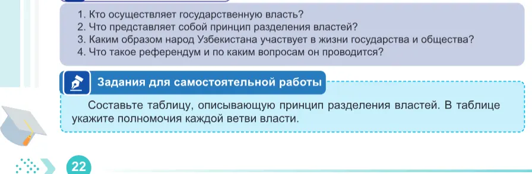

## Урок 6. Верховенство Конституции и законов в Республике Узбекистан

Если отсутствуют законы о воспитании и наказании, деятельность государства нарушается, а права человека попираются.

**Хусейн Ваиз Кашифи**

### Вы узнаете

Конституция и закон.

Обеспечение верховенства Конституции и законов.

### Конституция и закон

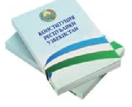

В Республике Узбекистан признаётся безусловное верховенство Конституции и законов Республики Узбекистан. Конституция Республики Узбекистан имеет высшую юридическую силу, прямое действие на всей территории страны и составляет основу единого правового пространства. Конституция узаконила становление независимой Республики Узбекистан и, как закон высшего уровня, определила цель нашего государства, его социальный, экономический, политический строй, демократические принципы управления и стратегические направления развития общества. В ней также закреплены независимость личности, разделение властей, разнообразие форм собственности, идеологическое разнообразие, демократические ценности в социальной, экономической и культурной сферах, как принципы конституционного строя. Гарантированы права и свободы граждан, закреплены основы наших духовных ценностей. Следовательно, Конституция является документом, занимающим важное место в жизни общества, государства и каждого гражданина, и является, одним словом, «алфавитом» всех законов.

Сахибкиран Амир Темур подчёркивал: «Пока государство не будет построено на основе законов, красота, мощь и структура такого государства будут утрачены». С этой точки зрения, обеспечение верховенства Конституции и закона является главным критерием создаваемого нами демократического правового государства.

Результаты любых демократических реформ, основная гарантия мира и развития также напрямую связаны с обеспечением верховенства Конституции и закона.

Верховенство закона означает, что акты, издаваемые органами государственной власти и управления, а также действия должностных лиц должны соответствовать исключительно Конституции и законам.

Прямое действие Конституции предусматривает применение её норм при принятии решений государственными органами и их должностными лицами, в том числе судами. А также оно предполагает прямое использование и соблюдение этих норм гражданами.

Верховенство закона, проще говоря, означает соблюдение законов. Эта точка зрения со-

### Запомните!

Одной из главных особенностей Конституции является то, что она обладает высшей юридической силой.

Конституция, обладающая высшей юридической силой, означает её верховенство в системе (иерархии) актов законодательства и её превосходство над всеми другими нормативно-правовыми актами.

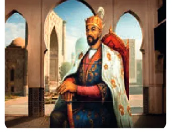

ставляет фундамент любого развитого государства. Сахибкиран Амир Темур подчёркивал, что его государство управлялось строгими правилами и законами, говоря: **«Я сохранил свой титул на основе правил и законов так, чтобы никто не мог вмешиваться в его дела».**

Тот факт, что Конституция обладает высшей юридической силой, проявляется в её статусе политико-правового документа, наличии особого порядка её принятия в парламенте или принятия на основе всенародного голосования (референдума), а также в определении основных стратегических направлений внутренней и внешней политики государства, основных прав и свобод человека.

В статье 16 нашей Конституции говорится: «Ни одно из положений настоящей Конституции не может толковаться в ущерб правам и интересам Республики Узбекистан, основным принципам и нормам, предусмотренным в первом разделе настоящей Конституции. Законы и иные нормативно-правовые акты Республики Узбекистан принимаются на основе и во исполнение Конституции Республики Узбекистан. Ни один закон или иной нормативно-правовой акт не может противоречить принципам и нормам Конституции». Кроме того, законы, постановления палат Олий Мажлиса, указы, постановления и распоряжения Президента, постановления Кабинета Министров, приказы и постановления министерств и ведомств, а также решения органов государственной власти на местах должны приниматься только на основе Конституции, в них не может быть ни одной антиконституционной нормы.

### Обеспечение верховенства Конституции и закона

> **Верховенство закона** – это принцип, непосредственно связанный с понятиями народовластия и прав человека. Народовластие предполагает право граждан на прямое или косвенное участие в процессе принятия решений. Законы, как выражение воли народа, принимаются через избранных в парламент представителей граждан или напрямую – посредством референдума. В этом смысле законы можно рассматривать как результат народовластия. Права и свободы человека реализуются через законы, и их конечная цель заключается в защите человека, его прав и свобод.

Под народовластием подразумевается право граждан на прямое или косвенное участие в процессе принятия решений

> Верховенство закона – это принцип, непосредственно связанный с понятиями народовластия и прав человека

Законы, являющиеся выражением воли народа, принятые либо через избранных гражданами представителей в парламент, либо непосредственно самими гражданами путём референдума, представляют собой результат народовластия, образно говоря, его плод

Права и свободы человека реализуются посредством законов, фактически конечная цель законов заключается именно в защите человека, его прав и свобод

Основой законотворчества и верховенства закона, как это закреплено в международных документах, являются следующие принципы:

– законность, включающая прозрачный, подотчётный и демократический процесс;

– правовая определённость;

запрет самовольных действий;

– независимость и беспристрастность правосудия;

– установление судебного контроля за административными актами;

– уважение прав человека, недискриминация и равенство перед законом. В нашей стране созданы все необходимые нормативно-правовые и организационные основы для обеспечения верховенства закона.

Глава III Конституции Республики Узбекистан называется «Верховенство Конституции и закона» и включена в раздел «Основные принципы» Конституции. В данном случае, под основными принципами понимаются руководящие положения. Если между другими разделами Конституции возникает недоразумение, вопрос должен решаться на основе основных принципов. Размещение верховенства закона в разделе «Основные принципы» подчёркивает его особое значение в нашей стране.

Анализ положений, закреплённых в этой главе и других нормах Конституции, позволяет сделать следующие выводы:

– во-первых, в Республике Узбекистан признаётся безусловное верховенство Конституции и законов Республики Узбекистан;

– во-вторых, государство, его органы, должностные лица, общественные объединения и граждане действуют в соответствии с Конституцией и законами;

– в-третьих, ни один закон или иной нормативно-правовой акт не может противоречить нормам и положениям Конституции.

### Запомните!

В Преамбуле Конституции Республики Узбекистан указано, что народ Узбекистана стремится построить правовое государство. Важным и неотъемлемым признаком правового государства считается верховенство закона.

### ПРИНЦИП ВЕРХОВЕНСТВА ЗАКОНА ПРОЯВЛЯЕТСЯ

В твёрдом верховенстве закона во всех сферах жизни общества, безусловном подчинении Конституции и законам всех государственных органов, должностных лиц и граждан, как отмечалось выше

В регулировании общественных отношений в соответствии с интересами общества, гражданина и государства, создании в масштабах страны атмосферы стабильности, порядка и законности

В предотвращении случаев правонарушений, а также выполнении функций правовой основы для привлечения участников правоотношений к ответственности в случае нарушения закона в порядке, установленном законом

Верховенство закона в деятельности всех органов государственной власти означает, что Конституция и законы обладают высшей юридической силой и имеют приоритет над всеми другими нормативными актами и инструкциями, издаваемыми властью. Верховенство закона – это принцип, который служит основой для обеспечения демократии и законности в обществе. Одной из основных юридических особенностей Конституции является то, что она имеет высшую юридическую силу. В статье 15 Конституции в новой редакции закреплено, что Конституция Республики Узбекистан обладает высшей юридической силой на всей территории страны.

Кроме того, говоря о высшей юридической силе Конституции, следует учитывать принцип, изложенный в её Преамбуле, заключающийся в том, что Конституция основывается на общепризнанных принципах и нормах международного права.

Тот факт, что Конституция имеет высшую юридическую силу, проявляется в том, что она является политико-правовым документом, имеет особый порядок принятия в парламенте или принимается на основе всенародного голосования (референдума), определяет основные стратегические направления внутренней и внешней политики государства, основные права и свободы человека.

Реализация принципа разделения властей в стране является важной гарантией обеспечения верховенства Конституции и закона в Узбекистане. Законодательная, исполнительная и судебная ветви власти осуществляют свою деятельность в рамках полномочий, определённых Конституцией и законом. Высшим арбитром в гармонизации отношений между ними является закон.

Верховенство закона позволяет человеку беспрепятственно осуществлять свои права и свободы, жить в мире, покое, спокойствии, не боясь никаких внешних воздействий,

### Запомните!

Согласно Конституции Республики Узбекистан, Президент страны выступает гарантом соблюдения прав и свобод граждан, Конституции и законов Республики Узбекистан, суверенитета, безопасности и территориальной целостности Республики Узбекистан, принимает необходимые меры по реализации решений по вопросам национально-государственного устройства (статья 109).

насилия и произвола, благодаря гарантированности законом своей жизни, свободы, чести, достоинства и других неотъемлемых прав.

Верховенство закона также обеспечивает право лица участвовать в процессе принятия обязательных для него актов, воздействовать на государственное управление, осуществлять общественный контроль за деятельностью государственных органов, защищать свои права и свободы в судебном порядке, оспаривать в суде неправомерные действия государственных органов, должностных лиц, общественных объединений.

Если в обществе не будет обеспечено верховенство закона, люди потеряют веру не только в сегодняшний, но и в завтрашний день, не будут соблюдаться справедливость, равенство, свобода. В обществе, где не обеспечено верховенство закона, не будут развиваться ни экономика, ни экономические реформы, потому что никто не хочет вкладывать свою собственность и капитал туда, где закон не работает.

В государстве с верховенством закона гарантируются свобода, справедливость, равенство, ограничивается влияние власти на человека, защищаются права человека, соблюдается право собственности, правосудие является независимым и эффективным.

Президент Республики Узбекистан 8 мая 2023 подписал Указ № УП-67 «О первоочередных мерах по реализации Конституции Республики Узбекистан в новой редакции». В данном указе закреплены безусловная и полная реализация Конституции Республики Узбекистан в новой редакции, соблюдение закреплённых в ней приоритетных принципов в гармонии с великой идеей «Новый Узбекистан», налаживание деятельности государственных органов в новых конституционно-правовых условиях, а также обеспечение того, чтобы граждане ощущали в своей жизни дух Конституции народа.

Безотказная и полная реализация Конституции в новой редакции определена первоочередной задачей государственных органов и организаций всех уровней.

Исходя из того, что новая Конституция имеет высшую юридическую силу, она будет непосредственно и безусловно применяться в деятельности государственных органов и организаций, в том числе судов и правоохранительных органов.

Отказ в применении норм настоящей Конституции по мотивам отсутствия иных актов законодательства для их реализации или необходимости внесения изменений и дополнений в законодательство в соответствии с Конституцией категорически запрещается.

Деятельность Президента в этом направлении имеет важное политико-правовое значение. Своими указами и постановлениями он прокладывает путь для полного пре-

**В Республике Узбекистан признаётся безусловное верховенство Конституции и закона**

**Ни один закон или иной нормативно-правовой акт не может противоречить нормам и правилам Конституции**

творения в жизнь конституционных принципов, закреплённых в законах положений, создавая соответствующие правовые механизмы.

Для обеспечения верховенства Конституции и закона в Узбекистане необходимо постоянно совершенствовать организационно-правовые гарантии и юридические механизмы, повышая их эффективность.

Эффективность проводимых в нашей стране широкомасштабных реформ, основная гарантия мира и развития, также напрямую связана с обеспечением верховенства Конституции и закона. Это обусловлено тем, что в основе стремительных изменений и преобразований, осуществляемых в нашей стране, прежде всего лежит благородная цель воплощения в жизнь нормы Конституции о том, что государственные органы должны служить интересам народа.

Верховенство закона является прочной гарантией формирования у предпринимателей и иностранных инвесторов надёжного доверия к свободе, справедливости, равенству в обществе, защите прав человека и устойчивому росту экономики страны.

### Вопросы и задания

1. В чём проявляется верховенство Конституции?

2. В какой статье Конституции Республики Узбекистан закреплено безоговорочное признание верховенства закона?

3. Что вы понимаете под верховенством Конституции и закона?

4. В соответствии с чем осуществляют свою деятельность государство и его органы, другие организации, должностные лица, институты гражданского общества и граждане?

### Задания для самостоятельной работы

**Дополните следующие предложения.**

… обладает высшей юридической силой на всей территории страны.

Ни одно из положений настоящей Конституции не может толковаться в … … не может противоречить принципам и нормам Конституции … – основной закон государства.

… является важной гарантией обеспечения верховенства Конституции и закона в Узбекистане.

**Напишите эссе, используя нижеприведённые предложения.**

В Республике Узбекистан признаётся безусловное верховенство Конституции и закона. Государство, его органы, должностные лица, общественные объединения, граждане действуют в соответствии с Конституцией и законами.

Ни один закон или иной нормативно-правовой акт не может противоречить принципам и нормам Конституции.

> Верховенство закона – это принцип, непосредственно связанный с понятиями народовластия и прав человека.

В обществе, где не обеспечено верховенство закона, не будут развиваться ни экономика, ни экономические реформы.

## Урок 7. Внешняя политика Республики Узбекистан

Внешняя политика нового Узбекистана будет осуществляться, прежде всего, с учётом интересов нашего народа, нашей Родины.

**Шавкат Мирзиёев**

### Вы узнаете

Концепция внешней политики Республики Узбекистан.

Приоритетные направления внешней политики Республики Узбекистан. Республика Узбекистан – полноправный субъект международных отношений.

### Концепция внешней политики Республики Узбекистан

Главная цель внешнеполитической деятельности Республики Узбекистан – укрепление независимости и суверенитета государства, его места и роли на международной арене, формирование вокруг него атмосферы безопасности, стабильности и добрососедства, а также активное продвижение внешнеэкономических интересов республики. Узбекистан заинтересован в расширении сотрудничества со всеми партнёрами во имя мира, прогресса и процветания, опираясь на такие ключевые принципы, как:

– суверенное равенство государств, неприменение силы или угрозы силой, неприкосновенность границ, невмешательство во внутренние дела других государств;

– добросовестное выполнение международных обязательств, уважение и защита прав человека, а также другие общепризнанные принципы и нормы международного права;

– неделимость безопасности, открытость и прагматизм, развитие всесторонних добрососедских отношений с соседними странами, укрепление регионального и международного сотрудничества.

Главным приоритетом нашей внешней политики является регион Центральной Азии. Политика Узбекистана в Центральной Азии направлена на обеспечение мира и стабильности в регионе, решение важных проблем региональной безопасности, в том числе содействие урегулированию ситуации в Афганистане.

Узбекистан заинтересован в укреплении дружественных и добрососедских отношений со странами региона, развитии научно-технического и культурно-гуманитарного сотрудничества, укреплении связей между парламентами, приграничными территориями, общественными организациями и простыми гражданами.

Сотрудничество со странами СНГ также является приоритетом внешней политики Узбекистана. С этими странами наша республика имеет исторически сложившиеся политические, экономические, транспортно-коммуникационные и другие связи. Узбекистан продолжит укреплять двусторонние отношения сотрудничества со странами Содружества на основе принципов равенства, взаимовыгодности, уважения и учёта интересов друг друга.

### Запомните!

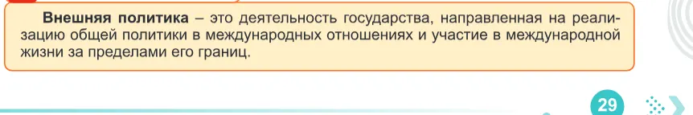

**Все государства-участники ООН обязуются соблюдать в своей деятельности следующие принципы**

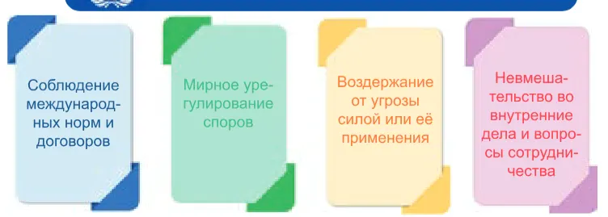

Субъектом международных отношений может стать только независимое государство, способное без какого-либо давления извне осуществлять свои права и обязанности во взаимоотношениях с другими государствами. Субъект международного права не признаёт власть одного государства над другим. Такое государство будет самостоятельным в осуществлении своей внутренней и внешней политики.

Узбекистан активно сотрудничает со странами СНГ, Европейским Союзом, Международным валютным фондом, Всемирным банком, Азиатским банком развития (АБР), Организацией исламского сотрудничества (ОИС) и другими международными организациями.

В настоящее время Узбекистан признан независимым государством более чем 150 странами мира. Таким образом, наше государство заняло достойное место в мировом сообществе как субъект международного права.

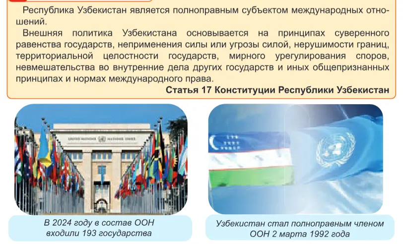

С первых дней провозглашения независимости Республика Узбекистан выбрала путь вступления в мировое сообщество.

**21 декабря 1991 года – вступила в СНГ (Содружество Независимых Государств)**

**30 января 1992 года присоединилась к ОБСЕ (Организация по безопасности и сотрудничеству в Европе)**

**26 октября 1993 года присоединилась к ЮНЕСКО (Специализированное учреждение Организации Объединённых Наций по вопросам образования, науки и культуры)**

**15 июня 2001 года была принята в ШОС (Шанхайская организация сотрудничества)**

**Приоритетные направления внешней политики Республики Узбекистан**

Современное внешнеполитическое положение Узбекистана формируется на основе стремительно меняющейся ситуации в мире и регионе, а также масштабных изменений внутри страны.

**Принцип суверенного равенства государств** является отправной точкой таких важнейших принципов международного права, как запрещение применения силы, недопустимость вмешательства во внутренние дела государств и право народов на самоопределение. Обеспечение международного права и порядка возможно только при полном уважении правового равенства участников. Каждое государство обязано уважать суверенитет других участников системы, то есть право осуществлять на своей территории законодательную, исполнительную, административную и судебную власть без вмешательства других государств, а также самостоятельно проводить свою внешнюю политику.

**Принцип неприменения силы или угрозы силой** означает воздержание сторон от любых действий, связанных с прямым или косвенным применением силы против других государств. Этот вопрос впервые возник в годы Второй мировой войны и отразил стремление и надежды народов на установление справедливых международных отношений после войны. Эта норма впервые стала принципом международного права и была закреплена в Уставе ООН.

**Принцип неприкосновенности границ** объясняется тремя правилами: во-первых, признание существующих границ, юридически определённых в соответствии с международными правовыми нормами; во-вторых, отказ от любых территориальных претензий в настоящее время или в будущем; в-третьих, отказ от любых агрессивных действий и угроз, включая применение силы или угрозу силой.

**Принцип территориальной целостности** государств был подтверждён принятием Устава ООН. В правовой литературе встречаются выражения «территориальная целостность», «территориальная неприкосновенность» и «территориальная неделимость». Устав ООН запрещает применение силы или угрозы силой против территориальной целостности (неприкосновенности) и политической независимости государства. Каждое государство должно: во-первых, воздерживаться от любых действий, направленных на частичное или полное нарушение национальной целостности и территориальной неприкосновенности другого государства; во-вторых, территория государства не должна быть объектом военной оккупации в результате применения силы, что нарушает положения устава.

### Принцип мирного урегулирования споров подразумевает, что все члены ООН

разрешают международные споры мирными путями, не угрожая международному миру, безопасности и справедливости. Этот принцип закреплён в ряде международных договоров и соглашений. В них ограничивается право на ведение войны, а также предусмотрены средства мирного урегулирования международных конфликтов. Государства могут самостоятельно выбирать средства разрешения международных споров.

**Принцип невмешательства во внутренние дела других государств,** как общий принцип международных отношений, сформировался в процессе борьбы наций за свою государственность. Ранее этот принцип применялся ограниченно, так как международное право допускало различные вмешательства во внутренние дела государств, вплоть до вооружённого. Принцип невмешательства во внутренние дела других государств в современной трактовке закреплён в пункте 7 статьи 2 Устава ООН и ряде международных документов. Согласно Уставу, ООН не имеет права вмешиваться в дела, входящие в коренную внутреннюю компетенцию какого-либо государства. Этот запрет распространяется не только на саму ООН, но и на всех участников международных отношений.

Приоритетные направления внешней политики Узбекистана не ограничиваются пятью или шестью принципами, а основываются также на других общепризнанных принципах и нормах международного права.

Например, **принцип самоопределения народов**, который подразумевает безусловное уважение права каждого народа на свободный выбор пути и форм своего развития, является одним из основных принципов международных отношений. Это отражено в принципе самоопределения народов. В пункте 2 статьи 1 Устава ООН говорится, что одним из важных положений в деятельности ООН является «развитие межнациональных дружественных связей на основе уважения к принципу равноправия и самоопределения народов». Сегодня этот принцип играет ключевую роль в решении проблем колониальных и зависимых стран.

### Запомните!

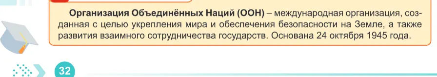

Вместе с тем, при проведении внешней политики основное внимание уделяется политической, торгово-экономической, социально-гуманитарной и другим сферам, а также формированию вокруг Узбекистана мирной, стабильной и безопасной среды.

Исходя из вышеизложенного, Президент Шавкат Мирзиёев определил развитие и укрепление дружественных, добрососедских и взаимовыгодных отношений со странами Центральной Азии – нашими непосредственными соседями – как один из основных приоритетов.

Статья 18 нашей Конституции гласит: «Республика Узбекистан осуществляет миролюбивую внешнюю политику, направленную на всемерное развитие двусторонних и многосторонних отношений с государствами и международными организациями. Республика Узбекистан может заключать союзы, входить в содружества и другие межгосударственные образования, а также выходить из них, исходя из высших интересов государства, народа, его благосостояния и безопасности».

> **Республика Узбекистан – полноправный субъект международных отношений**

Республика Узбекистан, получив государственный суверенитет, начала функционировать как полноправный субъект международных отношений. В Конституции Республики Узбекистан закреплено большинство из вышеуказанных принципов международного права (статья 17), где упоминается уважение иных общепризнанных принципов и норм международного права.

Республика Узбекистан последовательно придерживается этих принципов и норм международного сообщества, участвует в разработке и принятии международных договоров, выполняет их, а также активно участвует в деятельности международных организаций и в структурах коллективной безопасности. Наряду со странами мира, Узбекистан вносит свой вклад в обеспечение всеобщего и справедливого мира, установление взаимовыгодного сотрудничества, решение глобальных проблем, стоящих перед человечеством. Узбекистан заинтересован в развитии взаимовыгодных отношений со всеми зарубежными партнёрами и сосредоточил свои основные внешнеполитические усилия на наиболее важных сферах.

**В сфере внешней политики сформированы следующие важнейшие приоритетные направления:**

– укрепление государственной независимости и суверенитета, дальнейшее усиление места и роли страны как полноправного субъекта международных отношений, вхождение в число развитых демократических государств, создание вокруг Узбекистана зоны безопасности, стабильности и добрососедских отношений;

– укрепление международного авторитета Республики Узбекистан, донесение до мирового сообщества объективной информации о проводимых в стране реформах;

– совершенствование нормативно-правовой базы внешнеполитической и внешнеэкономической деятельности Узбекистана, а также договорно-правовых основ международного сотрудничества.

В целом приоритетные направления внешней политики Узбекистана направлены на построение стабильного, справедливого и демократического государства, продвижение международной открытости страны и развитие регионального и многостороннего взаимодействия.

### Вопросы и задания

1. В какой сфере общественной жизни и с какими целями осуществляется внешнеполитическая деятельность государства?

2. Какое государство является полноправным субъектом международных отношений?

3. В каких международных организациях участвует Республика Узбекистан?

4. В чём разница между внутренней и внешней политикой?

### Задания для самостоятельной работы

Напишите эссе на основе следующей информации.

Равноправный член международных отношений. Признание верховенства норм международного права.

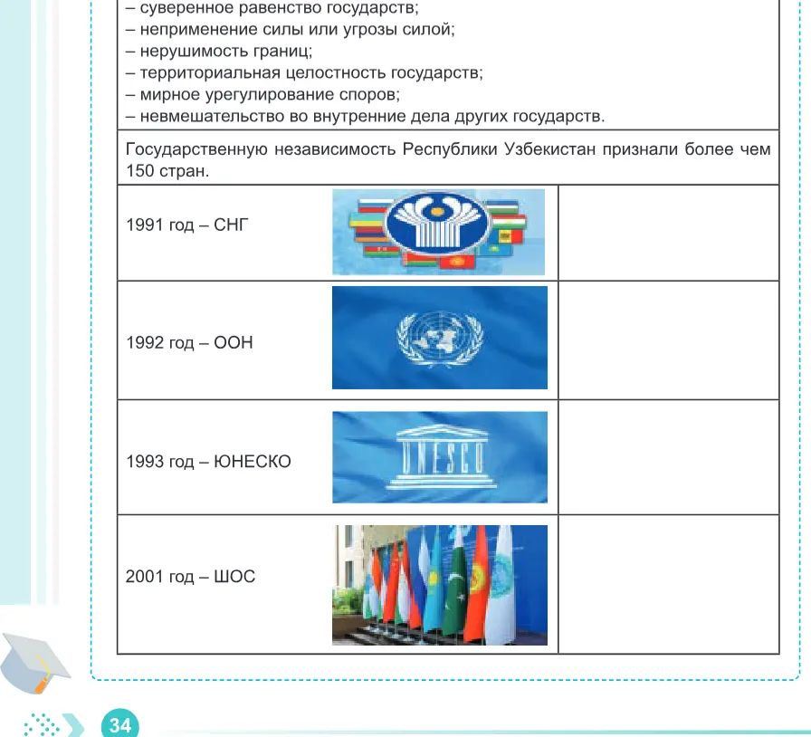

## Урок 8. Творческая деятельность

**Задание 1.** Изучите следующую ситуацию и ответьте на вопросы.

Конституция Республики Узбекистан имеет высшую юридическую силу и применяется на всей территории Узбекистана. Законы и иные нормативно-правовые акты Республики Узбекистан принимаются на основе и во исполнение Конституции и не могут противоречить её нормам и принципам.

Соотношение различных нормативно-правовых актов по юридической силе определяется в соответствии с Конституцией Республики Узбекистан, полномочиями и статусом органов, принявших нормативно-правовые акты, а также видами этих актов.

В некоторых случаях законы и иные нормативно-правовые акты могут противоречить Конституции.

Как, по вашему мнению, в таком случае обеспечивается принцип верховенства Конституции и каким образом защищаются основные законы и положения?

**Задание 2.** Для творческой деятельности.

Напишите 4 основных принципа Конституции Республики Узбекистан в левом столбце таблицы. В правом столбце таблицы проанализируйте эти принципы, выбрав одну норму из глав первого раздела Конституции. Объясните их содержание и значение с помощью примеров. Например, глава I Конституции называется «Государственный суверенитет». Статья 1 этой главы гласит: «Узбекистан – суверенное, демократическое, правовое, социальное и светское государство с республиканской формой правления». Затем объясните содержание указанной нормы.

### Основные принципы Конституции

## Урок 9. Контрольная работа

**Подберите к терминам соответствующие определения.**

Государство, в котором обеспечены верховенство права, гарантированы права и свободы человека и гражданина, все равны перед законом и никто не стоит выше закона Уровень правовых знаний людей, их уважение и соблюдение права Официальный документ, имеющий юридическую силу, в котором определяются права и свободы человека и гражданина, устанавливается государственное управление и территориальное устройство, а также полномочия государственных органов Религиозные организации и объединения отделены от государства, государственная власть отделена от религии, и управление регулируется Конституцией и законодательством Наличие высшей юридической силы законов в деятельности всех органов государственной власти Будучи единым государством, его отдельные административно-территориальные единицы обладают одинаковыми правами, а на всей территории государства действуют Конституция, единое правительство и единое законодательство Отрицательное, неуважительное отношение к праву и законам Является основным принципом функционирования сис темы государственной власти, подразумевает разделение государственной власти на законодательную, исполнительную и судебную ветви Управление государством посредством участия граждан в управлении. Это понятие возникло в Древней Греции Полная самостоятельность государства в осуществлении управления как внутри страны, так и за её пределами Избираемые в такой форме правления органы несут ответственность перед избирателями, избираются на определённый срок и осуществляют государственную власть от имени народа Форма принятия законов и решения важнейших вопросов государственного значения путём всенародного голосования

### ГЛАВА II

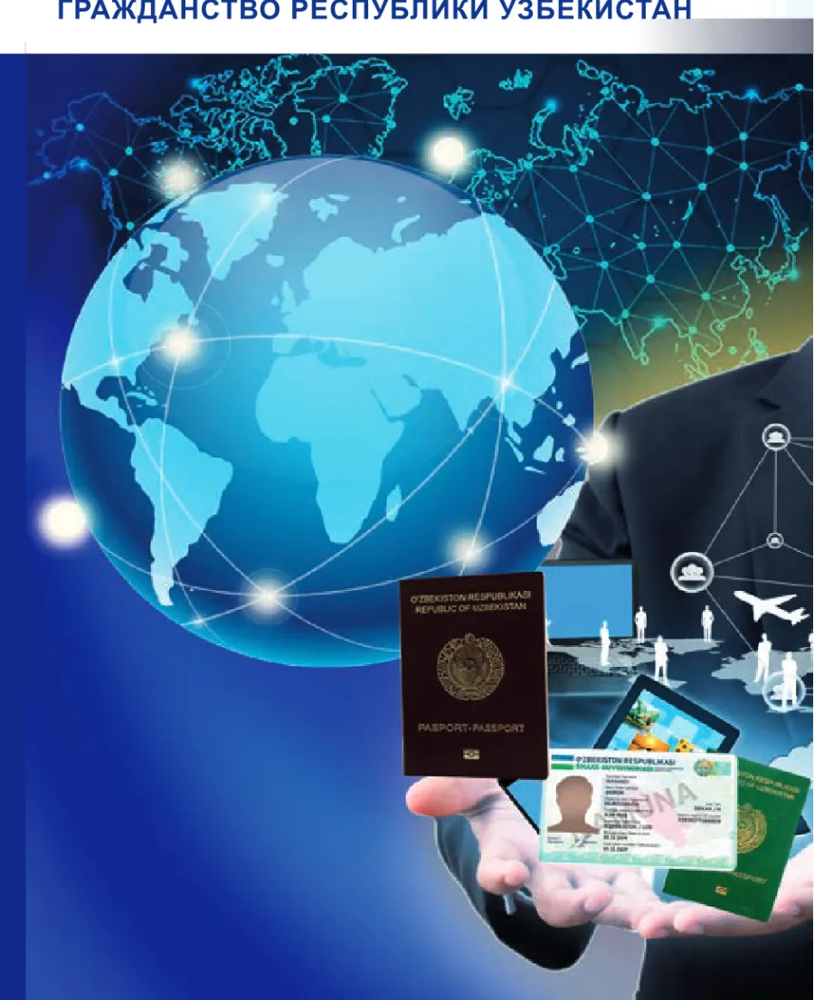

# Глава II. Гражданство Республики Узбекистан

## Урок 10. Общие положения о гражданстве в Республике Узбекистан

Люди склонны забывать о своих обязанностях, но помнят о своих правах. **Индира Ганди**

### Вы узнаете

Понятие гражданства.

Основания для приёма в гражданство Республики Узбекистан.

### Понятие гражданства

Гражданское право является одним из важнейших личных и политических прав человека. Лицо, имеющее гражданский статус, находится под покровительством и защитой государства. Правоотношения между гражданином и государством отражаются в их взаимных правах и обязанностях.

Лицо, получившее гражданство, находится под защитой и покровительством как на территории своего государства, так и за его пределами, и пользуется всеми правами, установленными для граждан. В свою очередь, граждане обязаны соблюдать законы государства и выполнять свои гражданские обязанности.

Гражданин имеет право не только избирать своего представителя в органы власти, но и может быть избранным в эти органы. Лицо без гражданства не обладает таким правом.

Если прохождение военной службы является гражданским долгом и обязанностью для граждан, то такая обязанность по закону не применяется к лицам без гражданства. Лица без гражданства не могут быть членами партий, занимать руководящие должности в государственных органах, а также участвовать в выборах.

Однако это не означает, что закон нарушает или ущемляет права лиц без гражданства. Такое различие в правах граждан и лиц без гражданства сложилось исторически и характерно для законов большинства государств.

Граждане иностранных государств и лица без гражданства (апатриды) пользуются всеми основными правами, предоставленными человеку международно-правовыми актами (за исключением права участвовать в выборах и служить в Вооружённых силах страны). Как и граждане, они обязаны соблюдать законы этого государства.

### Запомните!

> **Гражданство** – это постоянная правовая связь человека с конкретным государством, выражающаяся во взаимных правах и обязанностях личности и государства. Когда лицо приобретает гражданство, государство признаёт все его права и свободы, а также принимает меры по обеспечению их реализации. Государство защищает интересы граждан, в том числе во время их пребывания на территории других стран, и оказывает им покровительство.

Иностранным гражданам и лицам без гражданства, находящимся на территории Республики Узбекистан, обеспечиваются права и свободы в соответствии с нормами международного права. Они несут обязанности, установленные Конституцией, законами и международными договорами Республики Узбекистан.

**Из статьи 24 Конституции Республики Узбекистан**

### Основания для приёма в гражданство Республики Узбекистан

**Приобретение гражданства Республики Узбекистан возможно в следующих случаях**

По рождению, то есть независимо от места рождения ребёнка, если на момент его рождения родитель (или один из родителей) является гражданином Республики Узбекистан

Усыновление или удочерение ребёнка независимо от места его рождения

В результате приёма или восстановления в гражданстве Республики Узбекистан

### Виды приёма в гражданство Республики Узбекистан

Приём в гражданство Республики Узбекистан осуществляется:

– в общем порядке;

– в упрощённом порядке;

– в особом порядке.

### Запомните!

> **Лицо без гражданства** – это лицо, постоянно проживающее на территории Республики Узбекистан, не являющееся гражданином Республики Узбекистан и не имеющее доказательства своей принадлежности к гражданству иностранного государства.

> **Гражданин иностранного государства** – это лицо, не являющееся гражданином Республики Узбекистан, но имеющее гражданство другого государства и доказательство своей принадлежности к гражданству этого государства.

### Общий порядок приёма в гражданство Республики Узбекистан

Общий порядок приёма в гражданство Республики Узбекистан распространяется на гражданина иностранного государства или лицо без гражданства, если он:

– оформил выход из гражданства иностранного государства;

– постоянно проживает на территории Республики Узбекистан непрерывно в течение 5 лет со дня получения вида на жительство и до дня обращения с ходатайством о приёме в гражданство Республики Узбекистан. При этом срок пребывания на территории Республики Узбекистан считается непрерывным, если:

– лицо без гражданства выезжало за пределы Республики Узбекистан в течение года в общей сложности не более чем на 183 дня;

– имеет законный источник существования;

– берёт на себя обязательство соблюдать Конституцию Республики Узбекистан;

– владеет государственным языком на уровне, необходимом для общения.

### Запомните!

> **Вид на жительство** – это документ, удостоверяющий личность лица без гражданства или гражданина иностранного государства, выданный в качестве подтверждения разрешения на постоянное проживание на территории Республики Узбекистан.

> **Дискриминация** – это необоснованное ограничение или ущемление прав определённой категории граждан по признаку пола, национальности, религиозных или политических убеждений.

**Упрощённый порядок приёма в гражданство Республики Узбекистан осуществляется в отношении соотечественника, являющегося гражданином иностранного государства или лицом без гражданства, если он:**

– имеет хотя бы одного предка, проживающего на территории Республики Узбекистан и являющегося гражданином Республики Узбекистан, непосредственно связанного по родовой линии;

– имеет законный источник существования;

– берёт на себя обязательство соблюдать Конституцию Республики Узбекистан;

– владеет государственным языком на уровне, необходимом для общения, в порядке, установленном законодательством.

Приём в гражданство Республики Узбекистан осуществляется в соответствии с указом Президента Республики Узбекистан после представления заявителем документа о выходе из гражданства иностранного государства.

**Особый порядок приёма в гражданство Республики Узбекистан** Президент Республики Узбекистан, исходя из национальных интересов, может принимать в гражданство Республики Узбекистан граждан иностранных государств и лиц без гражданства (учёных, спортсменов, писателей и др.).

### Вопросы и задания

1. Что такое гражданство?

2. Кто, по вашему мнению, должен обеспечить необходимые условия для реализации прав граждан?

3. Какие отношения возникают между гражданином и государством?

4. Перечислите основания, предусмотренные законодательством, для получения гражданства в Узбекистане.

5. Имеют ли иностранные граждане и лица без гражданства те же права, что и граждане конкретного государства?

### Задания для самостоятельной работы

Найдите нормы, касающиеся гражданства в Конституции Республики Узбекистан, и проанализируйте их содержание.

## Урок 11. Документы, удостоверяющие личность граждан

Если народ чувствует потребность в законах и тщательно их изучает, это приносит пользу ему самому. Иначе нельзя добиться результатов, на достижение которых законы направлены. **Платон**

### Вы узнаете

Идентификационная карта (ID-карта) гражданина Республики Узбекистан и биометрический паспорт для выезда за границу.

Правовое положение иностранных граждан в Республике Узбекистан.

**Идентификационная карта (ID-карта) гражданина Республики Узбекистан и биометрический паспорт для выезда за границу**

> **Идентификационная гражданина Республики Узбекистан** – документ, удостоверяющий личность владельца и гражданство Республики Узбекистан на территории Республики Узбекистан. ID-карта содержит электронное носительное устройство (чип), в которое внесены персональные биографические и биометрические данные владельца.

ID-карта выдаётся пунктом сбора данных гражданам на следующие сроки:

– сроком на 2 года с момента рождения ребёнка до достижения им возраста одного года;

– от одного года до 16 лет – сроком на 5 лет;

– с 16 лет – сроком на 10 лет.

> **Биометрический паспорт гражданина Республики Узбекистан для выезда за границу** – документ, удостоверяющий личность владельца и гражданство Республики Узбекистан во время выезда за границу, въезда на территорию Республики Узбекистан, а также пребывания за границей. Паспорт имеет электронное устройство, носитель информации (чип) с биографическими и биометрическими данными владельца.

Биометрический паспорт для выезда за границу выдаётся гражданам на следующие сроки действия:

– до одного года со дня рождения – сроком на два года;

– от одного года до 25 лет – сроком на 5 лет;

– лицам старше 25 лет – сроком на 10 лет.

Документы, удостоверяющие личность, служат для установления личности, защиты её прав и обеспечения возможности активного участия в общественной жизни.

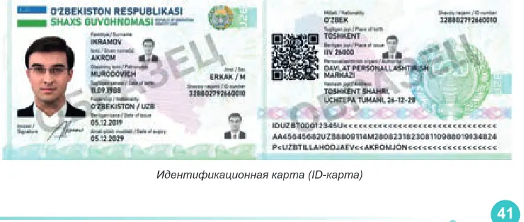

**Документы, подтверждающие гражданство Республики Узбекистан несовершеннолетних граждан**

Документом, подтверждающим гражданство Республики Узбекистан ребёнка в возрасте до 16 лет, являются:

– свидетельство или справка о рождении (независимо от места рождения ребёнка) – при предъявлении паспорта, идентификационной карты или иного документа одного из родителей, удостоверяющего наличие гражданства Республики Узбекистан;

– свидетельство или справка о рождении (в случае рождения ребёнка в Республике Узбекистан) – при предъявлении вида на жительство в Республике Узбекистан родителями (одиноким родителем), являющимися лицами без гражданства.

### Правовое положение иностранных граждан в Республике Узбекистан

Права и свободы иностранных граждан и лиц без гражданства, находящихся на территории Республики Узбекистан, обеспечиваются в соответствии с нормами международного права. Они обязаны соблюдать Конституцию, законы Республики Узбекистан и международные договоры Республики Узбекистан.

В соответствии с Законом Республики Узбекистан «О правовом положении иностранных граждан и лиц без гражданства в Республике Узбекистан» от 4 июня 2021 года, иностранные граждане, имеющие гражданство двух или более государств, в Республике Узбекистан считаются гражданами того государства, к гражданству которого они принадлежат согласно представленным документам.

Иностранные граждане и лица без гражданства, временно или постоянно проживающие в Республике Узбекистан, за нарушение правил пребывания и другие правонарушения, предусмотренные законодательством Республики Узбекистан, могут быть привлечены к административной или уголовной ответственности. В отношении них могут быть применены административное выдворение, запрет на въезд на территорию Республики Узбекистан, сокращение срока пребывания в порядке, установленном законодательством Республики Узбекистан.

**Документами, удостоверяющими личность иностранных граждан, могут быть:**

– ID-карта, удостоверяющая личность;

– вид на жительство;

– свидетельство о предоставлении политического убежища в Республике Узбекистан.

### Вопросы и задания

1. Перечислите особенности ID-карты и биометрического паспорта гражданина Республики Узбекистан для выезда за границу.

2. Какие документы подтверждают, что несовершеннолетние являются гражданами Республики Узбекистан?

3. Какие документы подтверждают личность лица без гражданства или гражданина иностранного государства?

4. Как называется лицо без гражданства?

### Задания для самостоятельной работы

Какие данные указываются на ID-карте? Просмотрите ID-карты родителей и узнайте, какая информация на них доступна.

## Урок 12. Основания для прекращения и восстановления гражданства Республики Узбекистан

Хороший человек созидает страну, а плохой её разрушает. **Амир Темур**

### Вы узнаете

Основания для прекращения гражданства Республики Узбекистан. Правовая защита граждан в Республике Узбекистан.

### Основания для прекращения гражданства Республики Узбекистан

**Гражданство Республики Узбекистан может быть утрачено по следующим причинам**

Вследствие поступления лица на военную службу, в органы безопасности, правоохранительные органы, органы государственной власти и управления иностранного государства

Если лицо, постоянно проживающее за границей, не встало на постоянный консульский учет без уважительных причин в течение семи лет

Если приём лица в гражданство Республики Узбекистан был осуществлён в результате представления заведомо ложных сведений или поддельных документов

Если лицо причинило существенный вред интересам общества и государства, осуществляя деятельность в пользу иностранного государства или путём совершения преступлений против мира и безопасности

Если лицо приобрело гражданство иностранного государства по рождению или по гражданству родителей в связи с несовершеннолетием и официально не вышло из гражданства иностранного государства по достижении возраста двадцати одного года

### Запомните!

В Республике Узбекистан устанавливается единое для всей территории республики гражданство. Гражданство Республики Узбекистан является равным для всех независимо от оснований его приобретения. Гражданин Республики Каракалпакстан является одновременно гражданином Республики Узбекистан. Основания и порядок приобретения и утраты гражданства устанавливаются законом.

**Статья 22 Конституции Республики Узбекистан**

**Основаниями для прекращения рассмотрения материалов по вопросам гражданства Республики Узбекистан являются:**

– наличие у лица неисполненных обязательств перед государством или имущественных обязательств, связанных с интересами граждан либо государственных органов и иных организаций;

– нахождение лица в розыске;

– привлечение лица к уголовной ответственности в качестве обвиняемого, осуждение и отбывание наказания;

– наличие в отношении лица вступившего в законную силу и подлежащего исполнению приговора суда;

– предоставление заведомо ложных сведений или поддельных документов;

– противоречие интересам государственной безопасности Республики Узбекистан;

– смерть лица.

Лицо, ранее имевшее гражданство Республики Узбекистан, вправе обратиться с ходатайством о восстановлении гражданства Республики Узбекистан. В ходатайстве указываются причины прекращения гражданства Республики Узбекистан. Восстановление гражданства Республики Узбекистан более одного раза не допускается.

Ходатайство о приёме в гражданство Республики Узбекистан составляется в письменной форме на имя Президента Республики Узбекистан.

Лицо, проживающее на территории Республики Узбекистан, для подачи ходатайства обращается в орган внутренних дел по месту своего постоянного жительства или временной регистрации, а лицо, проживающее за границей, – в консульское учреждение. При наличии уважительных причин (болезнь, отсутствие консульского учреждения) нотариально заверенное ходатайство может быть подано через доверенных лиц.

### Правовая защита граждан в Республике Узбекистан

В нашей стране осуществляются широкомасштабные демократические преобразования во всех сферах жизни общества, в том числе в обеспечении прав, свобод и законных интересов человека. Важным шагом в этом направлении стало открытие по инициативе Главы нашего государства **народных и виртуальных приёмных Президента**. Эти меры служат важным фактором в полной реализации гуманной идеи «**Не народ должен служить органам государственной власти, а органы государственной власти должны служить народу».**

В своём выступлении на 75-й сессии Генеральной Ассамблеи ООН (23 сентября 2020 года) Президент Шавкат Мирзиёев предложил принять специальную резолюцию Генеральной Ассамблеи ООН по повышению роли парламентов в достижении Целей устойчивого развития и обеспечении прав человека.

23 июня 2020 года была принята **Национальная стратегия Республики Узбекистан по правам человека**. В Национальной стратегии определено, что защита и соблюдение прав человека является одним из приоритетных направлений государственной политики.

Для граждан Республики Узбекистан запущена **онлайн-приёмная Омбудсмана страны**. Каждый гражданин имеет право войти в приёмную и подать заявление через Интернет. Это даёт возможность узбекистанцам незамедлительно сообщить представителю Олий Мажлиса о нарушении их прав.

Лица, виновные в нарушении законодательства о гражданстве Республики Узбекистан, несут ответственность в установленном порядке.

**Из статьи 54 Закона «О гражданстве Республики Узбекистан»**

**К ходатайству о восстановлении гражданства Республики Узбекистан прилагаются**

Анкета, паспорт или идентификационная карта (ID-карта) (вид на жительство)

Свидетельство о рождении ребёнка, если это указано в ходатайстве, и вид на жительство ребёнка, при его наличии

Документ, подтверждающий наличие законных источников средств к существованию

Документ, подтверждающий уплату государственной пошлины (консульского сбора)

### Ситуация из жизни

В. и К. – супруги. Они приехали по приглашению на работу в столицу государства М. С ними приехали двое несовершеннолетних детей. После трудоустройства В. и К. решили отправить детей в школу недалеко от места жительства. Однако не все одноклассники тепло встретили иностранных учеников.

Несмотря на то что дети хорошо знали государственный язык этой страны, их начали высмеивать за то, что они говорили с акцентом. Причиной тому были также их одежда и поведение, отличавшиеся от одежды и поведения местных детей. После очередных оскорблений дети пожаловались отцу, и он пришёл в школу, чтобы выяснить причину плохого отношения к своим детям. Но директор школы отказался его выслушать и дал указание отчислить его детей из школы за создание конфликтной ситуации.

Родители подали в суд на директора школы.

Выскажите своё мнение по данному вопросу. Правильно ли действует руководство школы? Как, по вашему мнению, должен поступить иностранный гражданин в этой ситуации?

### Вопросы и задания

1. Перечислите основания для лишения гражданства Республики Узбекистан.

2. По каким причинам государство имеет право запретить своим гражданам выход из гражданства?

3. Что может послужить основанием для восстановления гражданства Республики Узбекистан?

4. Каковы наиболее распространённые нарушения закона, влекущие за собой принудительное выдворение иностранных граждан из государства?

5. Какая ответственность предусмотрена за нарушение законодательства о гражданстве Республики Узбекистан?

### Задания для самостоятельной работы

Как вы думаете, в каких ситуациях могут потребоваться документы, удостоверяющие вашу личность?

## Урок 13. Поддержание и развитие отношений с соотечественниками, проживающими за рубежом

Я осведомлялся о положении подданных, их старейшин почитал как братьев, а младших лелеял как своих детей. **Амир Темур**

### Вы узнаете

Сохранение гражданства Республики Узбекистан лицами, проживающими за границей.

Гарантии покровительства Республики Узбекистан своим гражданам.

**Сохранение гражданства Республики Узбекистан лицами, проживающими за границей**

В настоящее время многие наши граждане обучаются в зарубежных вузах или работают за рубежом. Для диалога с ними действуют национально-культурные центры. В России, США, Турции и во всех республиках Центральной Азии – Таджикистане, Кыр гызстане, Казахстане, Туркменистане – проживает многочисленная узбекская диаспора.

Консульская деятельность за рубежом направлена на содействие развитию добрососедских и дружественных отношений Республики Узбекистан с другими государствами, а также на расширение экономических, торговых, научно-технических, культурных и иных связей.

Республика Узбекистан, её дипломатические представительства и консульские учреждения обязаны принимать необходимые меры для того, чтобы наши граждане имели возможность в полной мере пользоваться всеми правами, установленными законодательством государства пребывания и предусмотренными международными договорами, заключёнными между Республикой Узбекистан и этой страной.

**Соотечественниками, проживающими за рубежом, в соответствии с «Концепцией государственной политики Республики Узбекистан в сфере сотрудничества с соотечественниками, проживающими за рубежом», являются**

Граждане Республики Узбекистан, постоянно проживающие за пределами территории Узбекистана или временно пребывающие за границей в связи с получением образования, занятием трудовой деятельностью, семейными причинами и иными обстоятельствами

Лица, выехавшие за границу и получившие иностранное гражданство, испытывающие чувство духовной и культурной принадлежности к своей Родине и стремящиеся к развитию культурно-гуманитарных, социально-экономических и иных связей с Республикой Узбекистан, а также их потомки, выехавшие из Узбекистана

Проживающие за рубежом иностранные граждане и лица без гражданства, идентифицирующие себя с этнической, языковой и культурно-исторической точки зрения как узбеки или каракалпаки, и желающие иметь всесторонние связи с Узбекистаном

Народ Узбекистана составляют граждане Республики Узбекистан независимо от их национальности.

### Статья 8 Конституции Республики Узбекистан

Дипломатические представительства и консульские учреждения защищают права соотечественников в порядке, установленном законодательством. При необходимости, если это не противоречит законодательству Республики Узбекистан, они обязаны принимать меры по восстановлению нарушенных прав граждан Республики Узбекистан.

Консульское должностное лицо принимает и рассматривает заявления физических и юридических лиц в устной, письменной или электронной форме в порядке, установленном законодательством Республики Узбекистан. В случае нарушения прав, предусмотренных национальным законодательством государства пребывания, консул обязан принять меры по восстановлению нарушенных прав гражданина или юридического лица.

Проживание гражданина Республики Узбекистан за границей не влечёт за собой прекращение гражданства Республики Узбекистан.

**Из статьи 9 Закона «О гражданстве Республики Узбекистан»**

**Наши соотечественники, находящиеся за границей, должны знать и соблюдать следующее:**

– номера телефонов консульских учреждений и дипломатических представительств Республики Узбекистан;

– права и обязанности иностранного гражданина в государстве проживания;

– миграционное законодательство;

– национальные особенности и традиции государства пребывания;

– не нарушать общественный порядок.

**Если в отношении вас нарушено законодательство страны пребывания, вы можете:**

– обратиться с соответствующим заявлением в правоохранительные органы, прокуратуру или суд государства пребывания;

– подать второе заявление в консульское учреждение Республики Узбекистан по месту происшествия, что позволит вам использовать консульские ресурсы для отслеживания хода дальнейших процессов;

– от имени консульского учреждения поставить в официальных органах государства пребывания вопрос о нарушении прав гражданина и потребовать наказания виновных в надлежащем порядке;

– при личной встрече консульский работник обязан убедиться в соблюдении в отношении вас общепризнанных принципов и норм международного права;

– если права гражданина Республики Узбекистан нарушены в процессе задержания, содержания под стражей, административного ареста или лишения свободы, консульский работник в пределах своей компетенции обязан принять меры для их восстановления.

### Гарантии покровительства Республики Узбекистан своим гражданам

Основными целями государственной политики Республики Узбекистан в области сотрудничества с соотечественниками являются:

– оказание содействия в реализации прав и свобод соотечественников за рубежом в соответствии с общепризнанными принципами и нормами международного права, законодательством государства пребывания и международными договорами Республики Узбекистан;

– широкое распространение культурного, научного и духовного наследия Узбекистана, его изучение и популяризация в мире, поддержка деятельности, направленной на сохранение и развитие узбекского языка, культуры и традиций в странах проживания соотечественников;

– содействие соотечественникам, вносящим вклад в социально-экономическое развитие Республики Узбекистан, установление взаимовыгодных и дружественных отношений с зарубежными государствами и развитие связей с созданными ими организациями;

– создание благоприятных правовых, социальных и экономических условий для профессиональной, предпринимательской, инвестиционной, научной, образовательной и культурной деятельности соотечественников на территории Узбекистана;

– привлечение потенциала соотечественников для поддержки широкомасштабных социально-экономических и общественно-политических реформ в Узбекистане, а также содействие укреплению международного авторитета Республики Узбекистан.

Причины миграции: экономические, желание изменить ситуацию, реализация своих планов, получение образования и медицинских услуг, возвращение на родину предков.

Основной целью консульских учреждений Республики Узбекистан является содействие развитию добрососедских и дружественных отношений Республики Узбекистан с другими государствами, а также расширение экономических, торговых, научно-технических, культурных и иных связей.

### Интересная информация

Представьте, что вы идёте по улице и рассматриваете витрины магазинов и здания. Вдруг полиция решает вас арестовать. Если вы не чувствуете себя виноватым, не сопротивляйтесь сотрудникам правоохранительных органов. Дайте любые объяснения, которые потребуются, но не соглашайтесь на нарушение ваших прав.

Например, если беседа проводится без квалифицированного переводчика и вам предлагают подписать протокол на языке, который вы не знаете, вы вправе полностью отказаться от его подписания. Однако вы можете поступить иначе, оставив на подписанной странице следующее напоминание-предупреждение: «Текст не был мне переведён. Содержание его мне непонятно. Запрос о встрече с консульским работником не был учтён. Дата. Подпись».

В этом случае данный протокол может стать документом, подтверждающим нарушение прав иностранного гражданина.

### Вопросы и задания

1. Как лица, проживающие за границей, могут сохранить гражданство Республики Узбекистан?

2. Какую помощь могут оказать отделы консульских учреждений и дипломатических представительств Республики Узбекистан, если граждане Республики Узбекистан сталкиваются с проблемами за рубежом?

3. Как Конституция и законы Республики Узбекистан гарантируют, что Республика Узбекистан покровительствует своим гражданам?

4. Какие проблемы могут возникнуть у граждан Узбекистана, обучающихся или работающих за рубежом?

5. Какие национально-культурные организации соотечественников в нашей стране и за рубежом вы знаете?

## Уроки 14–15. Творческая деятельность

**На этом уроке, исходя из данного задания, вы будете инсценировать судебный процесс по случаям нарушения закона.**

**Задание 1.** Изучите следующую ситуацию и ответьте на вопросы.

В преддверии Нового года М., играя с соседом А. с использованием пиротехники, повредил автомобиль марки Damas, принадлежащий сыну Ихтиёра ака. Узнав об этом, Ихтиёр ака и его сын пришли к родителям М. и А., чтобы обсудить произошедшее.

Дайте правовую оценку этому событию.

1. Как вы оцениваете действия М. и А.?

2. Как должны поступить Ихтиёр ака и его сын в данной ситуации?

3. Что бы вы сделали в данном случае в качестве судьи?

Ознакомьтесь с материалами дела и решите, в каком качестве вы будете участвовать в судебном процессе: судья, потерпевший, свидетель, эксперт, сотрудник внутренних дел, адвокат или лицо, привлечённое к административной ответственности.

В ходе судебного процесса вы должны опираться на факты дела. Также необходимо продемонстрировать свои художественные способности и правовые знания в своём отношении к совершённому правонарушению, свидетелям и другим участникам процесса.

**Инструкции для участников гражданского судебного процесса**

Лица-участники имеют право:

– знакомиться с материалами дела, делать из них выписки, снимать копии, задавать вопросы другим участвующим лицам;

– представлять свои доказательства по всем возникающим в судебном процессе вопросам;

– обжаловать решение суда.

1. При входе судей в зал суда участники встают. Решение суда заслушивается стоя.

2. Лица, участвующие в деле, обращаются к суду и дают показания стоя.

3. Все присутствующие в зале безоговорочно подчиняются приказу председателя суда.

4. Каждый свидетель допрашивается отдельно, без участия других лиц.

5. Свидетель публично заявляет участникам гражданского процесса: «Клянусь сообщить суду всё, что мне известно по делу. Я буду говорить только правду, всю правду и ничего, кроме правды».

– даёт суду сведения о явке вызванных по данному делу;

– ведёт протокол судебного процесса.

– объявляет состав суда и разъясняет участвующим лицам право на предъявление возражений;

– разъясняет участвующим лицам их права и обязанности;

– устанавливает личность допрашиваемых в суде и предупреждает об ответственности за отказ от дачи показаний или за дачу ложных показаний (на основании расписки). Несовершеннолетние не предупреждаются о такой ответственности;

– решает возникшие в ходе судебного процесса вопросы и поддерживает порядок в зале суда.

**Истец:**

– даёт показания в защиту своих нарушенных или спорных прав.

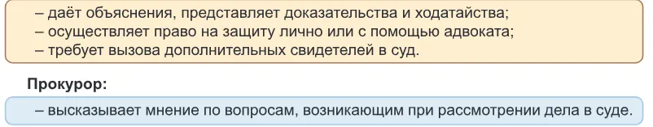

– высказывает мнение по вопросам, возникающим при рассмотрении дела в суде. **Эксперт:**

– представляет своё заключение в письменной форме;

– если суд сочтёт экспертизу некачественной, может быть назначена повторная экспертиза.

– каждое лицо допрашивается отдельно, допрошенные свидетели остаются в зале суда до окончания процесса;

– обязаны давать точную информацию обо всех обстоятельствах, исследуемых в ходе судебного разбирательства;

– если свидетелю не исполнилось 16 лет, в суде должны присутствовать учитель или родители.

### Этапы рассмотрения гражданского дела в суде

1. Открытие судебного процесса (судья).

2. Проверка явки участников процесса (секретарь).

3. Вывод свидетелей из зала судебного заседания (секретарь).

4. Разъяснение права на заявление возражений по составу суда (судья).

5. Разъяснение прав и обязанностей лицам, участвующим в деле (судья).

6. Изложение председательствующим сути дела (заканчивается обращением к истцу; он поддерживает свои требования; ответчику разъясняется, признаёт ли он требования истца и обеих сторон, желают ли они завершить иск мировым соглашением или нет).

7. Объяснения истца.

8. Выступление прокурора (с опровержением или обоснованием законности требований истца).

9. Допрос свидетелей.

10. Завершение рассмотрения дела. Запрос председательствующего у сторон о желании внести дополнения в материалы дела.

11. Судебные прения (речь прокурора, истца, ответчика).

12. Выход суда в совещательную комнату для принятия решения.

13. Объявление судебного решения (судья разъясняет порядок обжалования решения и объявляет судебное заседание по данному делу закрытым).

**Задание 2.** Для творческой деятельности.

Какие законы больше всего помогают вам в процессе общения в семье, школе и с друзьями, а также в понимании своих прав и уважении прав других? Обоснуйте своё мнение с помощью сайта www.lex.uz.

### Задания для самостоятельной работы

Составьте таблицу и запишите в ней законы и подзаконные акты, с которыми вы сталкиваетесь в жизни. (**Примечание**: наименование и сфера регулирования нормативно-правовых актов, дата их принятия).

Затем объясните содержание указанных норм.

### Подзаконные акты

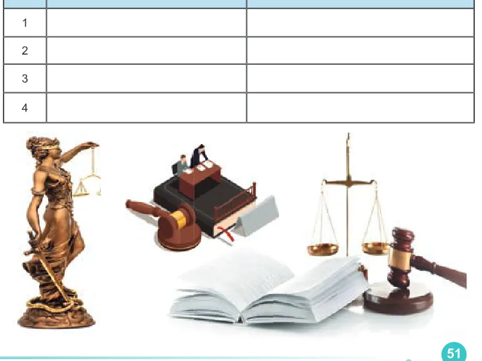

## Урок 16. Контрольная работа

**Подберите к терминам соответствующие определения.**

Лицо, постоянно проживающее на территории Республики Узбекистан, не являющееся гражданином Республики Узбекистан и не имеющее доказательства своей принадлежности к гражданству иностранного государства Документ, удостоверяющий личность и гражданство, а также постоянную регистрацию владельца идентификационной карты на территории Республики Узбекистан, имеющий электронный носитель (чип), содержащий биографические и биометрические данные о владельце, выдаваемый гражданину Республики Узбекистан, гражданину иностранного государства или лицу без гражданства Лицо, не имеющее гражданства Республики Узбекистан, родившееся или ранее проживавшее на территории Республики Узбекистан, проживающее за пределами территории Республики Узбекистан, и его родственники по прямой линии, если его родственники по прямой линии проживают на территории Республики Узбекистан и являются гражданами Республики Узбекистан Свидетельство или справка о рождении (независимо от места рождения ребёнка) – при предъявлении паспорта, идентификационной карты или иного документа одного из родителей, свидетельствующего о наличии гражданства Республики Узбекистан Лицо, не имеющее гражданства Республики Узбекистан, обладающее гражданством другого государства и доказательствами своей принадлежности к гражданству этого государства Документ, удостоверяющий личность лица без гражданства или гражданина иностранного государства, выданный в качестве подтверждения разрешения на постоянное проживание на территории Республики Узбекистан

### Вид на жительство

**Документ, подтверждающий гражданство Республики Узбекистан ребёнка в возрасте до шестнадцати лет**

Гражданство в Республике Узбекистан определяет постоянную политико-правовую связь личности с государством, выражающуюся в совокупности взаимных прав, обязанностей и ответственности, основанной на признании и уважении человеческого достоинства, основных прав и свобод

### ГЛАВА III

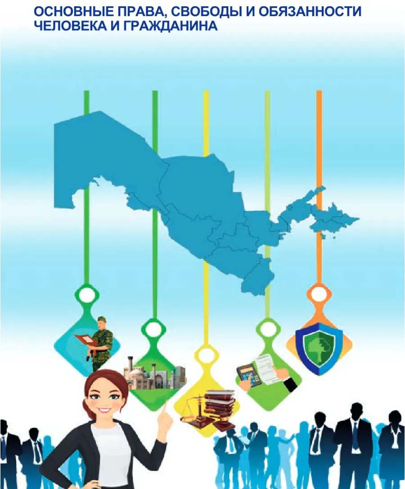

# Глава III. Основные права, свободы и обязанности человека и гражданина

## Урок 17. Основные права и свободы человека и гражданина

Не может быть мира без развития. И нет развития без мира.

Но ни развития, ни мира не может быть без прав человека. **Ян Элиассон**

### Вы узнаете

Понятие прав и свобод человека. Система прав и свобод человека.

### Понятие прав и свобод человека

> Права человека – это ценность, признанная человеческим мышлением и цивилизацией.

Права человека, являясь общим достижением исторического развития человечества, стали одной из актуальных проблем мирового сообщества. Защита личной неприкосновенности человека, создание среды, свободной от экологических угроз, избавление от бедствий войны – основных бедствий человечества – стали ключевыми целями международного масштаба.

Поэтому сегодня права и свободы человека составляют конституционную основу любого государства на пути демократического развития. В Конституции Республики Узбекистан большое внимание уделяется таким вопросам, как равенство всех перед законом, приоритет интересов личности перед государственными и обязанность государства служить благополучию человека и общества.

Свобода – высшее благо для человека, это его способность делать всё, что не запрещено законом. Права человека – это совокупность естественных и нерушимых свобод, юридических возможностей человека, определяемых его существованием в обществе и закреплённых в правовом отношении.

Второй раздел Конституции Республики Узбекистан посвящён вопросам основных прав, свобод и обязанностей человека и граждан.

**Конституция Республики Узбекистан основана на следующих важных положениях в области прав человека**

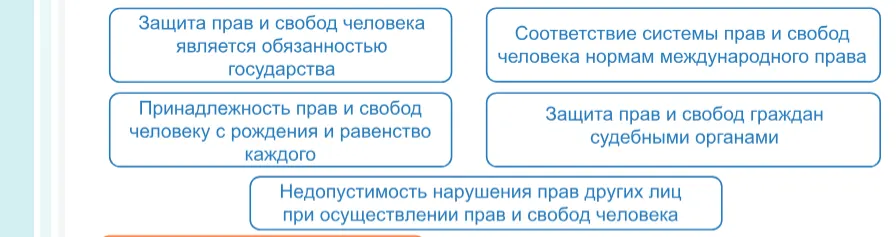

### Запомните!

Под правами и свободами человека и гражданина понимается использование возможностей, установленных государством и закреплённых в Конституции, предоставленных каждому гражданину для реализации в частной жизни и участия в общественных делах.

### Система прав и свобод человека

В основе идеи древнегреческого философа Протагора о том, что «мерой всех вещей является человек», лежит идея гуманизма. Многие учёные античности выдвигали идею равенства всех людей по природе и отрицательно относились к разделению людей на свободных людей и рабов. Хотя эти идеи в своё время оставались теоретическими, они послужили основой для создания прогрессивных взглядов и правовых систем, связанных с правами человека, которые были выдвинуты в Средние века и позднее.

Человек, независимо от того, гражданином какого государства он является, с рождением приобретает естественные права. Следовательно, права человека делятся на естественные, возникающие с рождением, и политические, экономические, социальные и культурные права, которые государство дополнительно предоставляет своим гражданам.

Для понимания вопросов, связанных с правами и свободами человека, важно их группировать и систематизировать. Права и свободы человека, выраженные во втором разделе Конституции Республики Узбекистан, также систематизированы по содержанию и сферам их реализации.

В Конституции Республики Узбекистан права и свободы человека подразделяются по содержанию и сферам их реализации в следующем порядке

3. Социальные, экономические, культурные и экологические права (глава IX, статьи 41–53)

Основные права и свободы, закреплённые в Конституции Республики Узбекистан, полностью соответствуют международным договорам по правам человека, таким как «Всеобщая декларация прав человека» (1948), «Международный пакт о гражданских и политических правах» (1966), «Международный пакт об экономических, социальных и культурных правах» (1966).

### Вопросы и задания

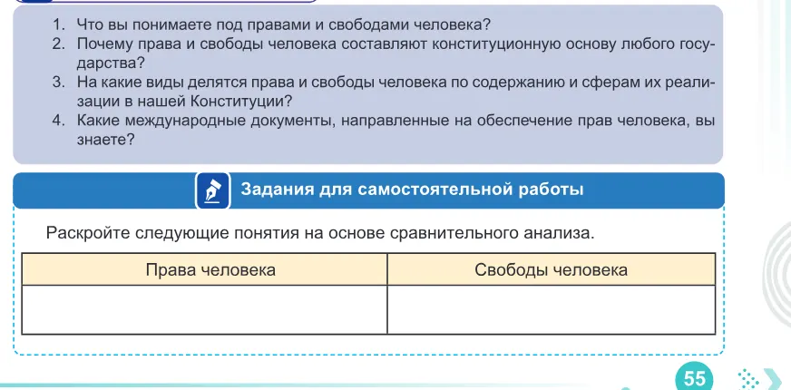

## Урок 18. Личные права и свободы

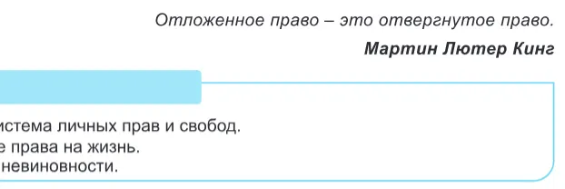

### Понятие и система личных прав и свобод

Идеи о праве человека на жизнь и свободу начали формироваться ещё в ранние периоды истории человечества. Борьба за такие права велась во все времена и в разных обществах. Личные права и свободы занимают важнейшее место в системе прав человека и обеспечивают свободу человека в личной жизни.

Личные права и свободы по своей сути являются правами любого человека и не зависят от его гражданства.

В соответствии со статьёй 26 Конституции Республики Узбекистан честь и достоинство человека неприкосновенны. Ничто не может служить основанием для их унижения. Никто не может подвергаться пыткам, насилию, иному жестокому, бесчеловечному или унижающему достоинство обращению или наказанию.

Над человеком не могут проводиться медицинские и научные эксперименты без его согласия.

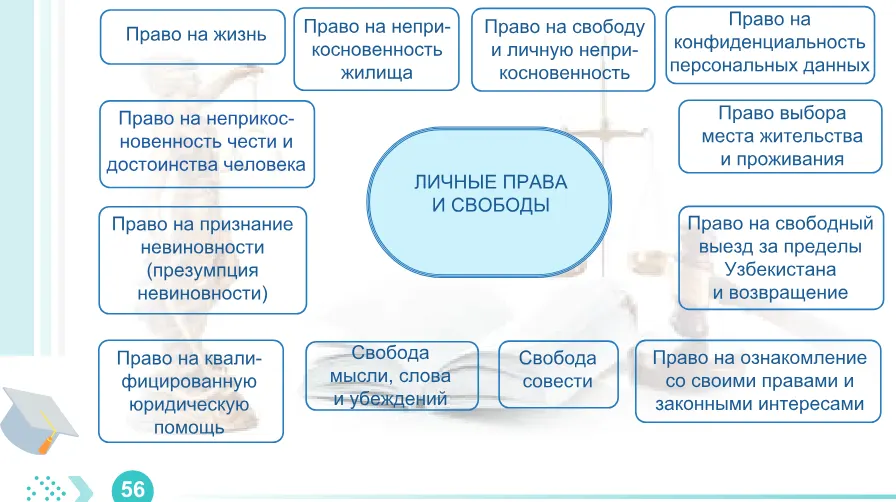

### Запомните!

Каждый, кто на законных основаниях находится на территории Республики Узбекистан, имеет право на свободное передвижение по стране, выбор места пребывания и жительства, за исключением ограничений, установленных законом.

Каждый имеет право на свободный выезд за пределы Узбекистана, за исключением ограничений, установленных законом. Гражданин Республики Узбекистан имеет право беспрепятственного возвращения в Узбекистан.

**Из статьи 32 Конституции Республики Узбекистан**

Статья 27, обеспечивающая каждому право на свободу и личную неприкосновенность, также устанавливает, что никто не может быть арестован, задержан, заключён под стражу или иным образом лишён свободы без законного основания. Арест, заключение под стражу и содержание под стражей допускаются только по решению суда. Законы предусматривают, что лицо не может быть задержано без решения суда более чем на 48 часов.

> **Хабеас корпус** – это правило английского уголовно-процессуального права, согласно которому арестованный или другой гражданин от его имени может обратиться в суд по поводу причины задержания или документа о заключении под стражу и потребовать специального судебного решения для проверки законности задержания. При отсутствии решения суда задержание лица не может продолжаться более 48 часов.

Акт «Хабеас корпус» был принят в 1679 году в Англии. В системе личных прав и свобод важное значение имеет право людей на свободное передвижение по стране, выбор места жительства и проживания.

Гарантия свободы совести для всех закреплена в статье 35 Конституции Республики Узбекистан, согласно которой каждый имеет право исповедовать любую религию или не исповедовать никакой.

Закон Республики Узбекистан «О свободе совести и религиозных организациях» устанавливает недопустимость использования религии в целях насильственного изменения конституционного строя Республики Узбекистан, подрыва её суверенитета и территориальной целостности, ущемления конституционных прав и свобод граждан, пропаганды войны, национальной, расовой, этнической или религиозной вражды, посягательства на здоровье и нравственность граждан, нарушения гражданского согласия, распространения клеветнических измышлений, дестабилизирующих обстановку, создания паники среди населения, а также совершения иных действий, направленных против личности, общества и государства.

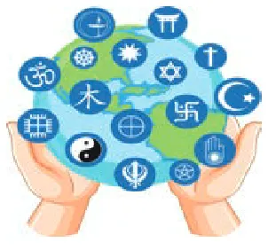

### Запомните!

Система образования в Республике Узбекистан отделена от религии.

Каждый имеет право на получение религиозного профессионального образования в религиозных образовательных учреждениях. **Из статьи 8 Закона Республики Узбекистан «О свободе совести и религиозных организациях»**

### Обеспечение права на жизнь

Основным и священным правом человека является право на жизнь. Обеспечение права на жизнь определяет состояние демократии в государстве. Конституция Республики Узбекистан гарантирует право на жизнь, и любое посягательство на него является наиболее тяжким преступлением.

Самым опасным из преступлений является убийство, лишающее человека права на жизнь. Согласно статье 97 Уголовного кодекса Республики Узбекистан, умышленное убийство наказывается лишением свободы на срок от 10 до 15 лет, а при отягчающих обстоятельствах – лишением свободы на срок от 15 до 25 лет или пожизненным лишением свободы.

Запрет смертной казни в Конституции Республики Узбекистан является прочной гарантией обеспечения прав человека и последовательным выражением принципов гуманизма и справедливости, закреплённых в Конституции.

Исходя из общепризнанных принципов и норм международного права, закрепляющих право человека на жизнь, а также положений Конституции Республики Узбекистан, с 1 января 2008 года в Узбекистане смертная казнь отменена.

Правовое обеспечение санитарно-гигиенической, лечебно-профилактической, социально-экономической системы, направленной на охрану здоровья и безопасность жизни человека, позволяет эффективно гарантировать право на жизнь в нашем государстве.

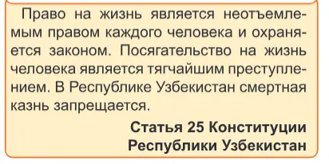

### Запомните!

Право на жизнь есть неотъемлемое право каждого человека. Это право охраняется законом. Никто не может быть произвольно лишён жизни.

**Международный пакт о гражданских и политических правах, статья 6**

### Презумпция невиновности

Презумпция невиновности является прочной гарантией прав и свобод личности, и этот принцип отражён в законодательстве практически всех стран мира. Хотя принцип презумпции невиновности впервые был введён во Франции в 1789 году в Декларации прав человека и гражданина, в средневековом исламском правоведении он был признан как юридическое правило в форме «Невиновность – основное правило».

Данное правило закреплено в статье 28 Конституции Республики Узбекистан, согласно которой лицо, обвиняемое в совершении преступления, считается невиновным до тех пор, пока его вина не будет доказана путём открытого судебного разбирательства в порядке, предусмотренном законом, и установлена вступившим в законную силу приговором суда. Обвиняемому предоставляются все возможности для самозащиты.

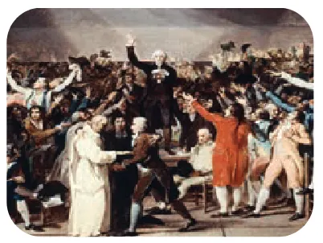

Данная статья нашей Конституции полностью соответствует нормам международного права в области прав человека.

Также в статье 28 закреплено, что все сомнения в виновности должны решаться в пользу подозреваемого, обвиняемого, подсудимого или осуждённого. Если возможности их устранения исчерпаны, подозреваемый, обвиняемый или подсудимый не обязан доказывать свою невиновность и может в любое время воспользоваться правом хранить молчание.

Преступление признаётся только при доказанности вины лица, которая подтверждается приговором суда. Следовательно, распространение информации в социальных сетях, где лицо называют «убийцей», «взяточником», «мошенником», «вором», «насильником» и другими оскорбительными словами, показывая его виновным до вступления приговора суда в законную силу, противоречит конституционным правам личности. Если в суде вина лица не будет доказана и он будет оправдан, его честь и достоинство окажутся ущемлёнными. К сожалению, подобные случаи нередко встречаются в нашей повседневной жизни. Конституция нашей страны полностью гарантирует право на презумпцию невиновности.

### Запомните!

Любые чрезмерно строгие меры, не желательные в тех случаях, когда арест лица считается необходимым, ввиду невиновности каждого лица до установления его вины, должны быть запрещены законом.

**Из статьи 9 Декларации прав человека и гражданина, принятой во Франции в 1789 году** Каждый человек, обвиняемый в совершении преступления, имеет право считаться невиновным до тех пор, пока его виновность не будет установлена законным порядком путём гласного судебного разбирательства, при котором ему обеспечиваются все возможности для защиты.

### Из статьи 11 Всеобщей декларации прав человека

Каждый обвиняемый в уголовном преступлении имеет право считаться невиновным, пока виновность его не будет доказана согласно закону.

**Из статьи 14, части 2 Международного пакта о гражданских и политических правах**

### Вопросы и задания

1. Объясните понятие личных прав и свобод.

2. Что вы понимаете под обеспечением права на жизнь?

3. В чём заключается сущность акта «Хабеас корпус»?

4. Какое значение имеет презумпция невиновности?

**Задания для самостоятельной работы** Объясните суть следующих личных прав и свобод.

## Урок 19. Политические права

Там, где царит равенство, нет места предательству, обманчивым страстям и печали. **Абу Райхан Беруни**

### Вы узнаете

Понятие и система политических прав. Равноправие граждан на выборах.

Право на свободу объединений и собраний. Право на обращение.

### Понятие и система политических прав

Политические права играют важную роль в активном участии граждан в жизни общества и государства. Они направлены на активное вовлечение человека в жизнь страны и создают условия для укрепления связей между личностью и обществом, гражданином и государством.

Большинство **политических прав** связано с гражданством лица, которое даёт возможность гражданам соответствующего государства управлять делами государства и общества. Эти права можно разделить на две группы: 1) право на участие в формировании и функционировании механизма государственной власти (право на выборы, право на участие в референдуме, право на обращение); 2) право на участие в обществе (право на объединение, право на демонстрацию).

Политические права, в отличие от личных, охватывают публичные интересы гражданина. Поскольку политические права, прежде всего, создают возможность участвовать в управлении государством и влиять на государственную деятельность, их количество и порядок реализации определяются государством.

Возможность осуществления государственной власти и участия в общественно-политической жизни государства посредством политических прав устанавливается законом и государством. Политические права могут быть индивидуальными или коллективными. В результате реализации этих прав гражданин может обладать властными полномочиями, а другие граждане имеют возможность контролировать границы осуществления этой власти.

Если обратить внимание на содержание политических прав, они отличаются от других видов прав рядом особенностей. Одной из ключевых особенностей является их связь с государством. Чем демократичнее государство, тем больше политических прав и шире возможности их использования. Напротив, в недемократическом государстве круг политических прав будет сужен, а существующие права – ограничены.

Ещё одной особенностью политических прав является возрастное ограничение для их использования. Например, в соответствии с законодательством Республики Узбекистан правом голоса могут пользоваться граждане, достигшие 18 лет.

### Запомните!

Граждане Республики Узбекистан имеют право участвовать в управлении делами общества и государства как непосредственно, так и через своих представителей. Такое участие осуществляется посредством самоуправления, проведения референдумов и демократического формирования государственных органов, а также общественного контроля над деятельностью государственных органов.

**Из статьи 36 Конституции Республики Узбекистан**

### Право избирать

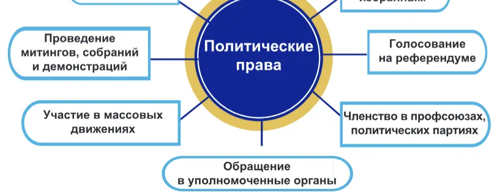

Также особенностью политических прав является то, что они могут быть реализованы только гражданами государства, с которыми возникло соответствующее правоотношение.

Поскольку политические права осуществляются гражданами конкретного государства, их система (виды) определяется национальным законодательством каждого государства.

В Конституции Республики Узбекистан закреплены следующие формы политических прав:

– право участвовать в выборах и референдумах;

– право проводить митинги, собрания и демонстрации;

– право на объединение в профессиональные союзы, политические партии и другие общественные объединения, участие в массовых движениях;

– право на обращение с заявлениями, предложениями и жалобами;

– право на поступление на государственную службу.

### Равноправие граждан на выборах

Участие в выборах даёт гражданам возможность участвовать в управлении страной. Граждане реализуют эту возможность непосредственно или через своих избираемых представителей. Это право гарантируется тем, что граждане имеют право избирать любые выборные органы или быть избранными в соответствующие органы. Таким образом, гражданин оказывает влияние на власть и принимаемые решения.

В Конституции Республики Узбекистан право на участие в выборах закреплено в виде непосредственного участия или через своих представителей в управлении де-

### Запомните!

Для осуществления права на обращение в государственные органы и организации, органы самоуправления граждан, к должностным лицам или народным представителям от лица не требуется наличие гражданства данного государства. Этот вид политического права также может быть использован иностранными гражданами и лицами без гражданства.

лами общества и государства, а также в демократическом формировании государственных органов.

В выборах, проводимых в нашей стране, могут участвовать только граждане Республики Узбекистан. На выборах граждане голосуют за одного из нескольких кандидатов. Для участия в голосовании (право голоса) граждане должны достичь 18-летнего возраста ко дню выборов.

Граждане независимо от пола, расовой и национальной принадлежности, языка, отношения к религии, социального происхождения, убеждений, личного и общественного положения, образования, рода и характера занятий имеют равное избирательное право. Это означает, что каждый гражданин, участвующий в выборах, имеет один голос.

Существует также право граждан Республики Узбекистан быть избранными в представительные органы государственной власти.

### Запомните!

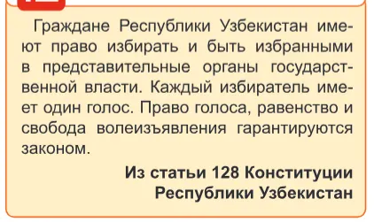

### Право на свободу объединений и собраний

Никто не может ущемлять права, свободы и достоинство лиц, составляющих оппозиционное меньшинство в политических партиях, массовых движениях, а также в представительных органах государственной власти.

**Из статьи 39 Конституции Республики Узбекистан**

Ещё одним политическим правом граждан является право на членство в политических партиях, профессиональных союзах и различных общественных объединениях. Это право позволяет гражданам совместно реализовывать и защищать свои интересы.

В организациях, на предприятиях и в учреждениях граждане объединяются для защиты своих экономических интересов, а в профсоюзы – для улучшения условий труда и защиты трудовых прав.

Членство в политических партиях занимает особое место среди прав на объединение. Граждане объединяются в политические партии на основе общности своих политических взглядов и интересов и через их деятельность участвуют в политической жизни страны.

### ПОЛИТИЧЕСКИЕ ПАРТИИ

Движение предпринимателей и деловых людей – Либеральнодемократическая партия Узбекистана

### Запомните!

> **Общественное объединение** – это добровольная структура, созданная в результате свободного волеизъявления граждан, объединённых для совместной реализации своих прав, свобод и законных интересов в области политики, экономики, социального развития, науки, культуры, экологии и других сфер жизни.

Граждане Республики Узбекистан имеют право на объединение в профсоюзы, политические партии и другие общественные объединения, а также участие в массовых движениях.

В Узбекистане действует пять политических партий. Большое количество партий позволяет гражданам стать членами соответствующей партии, основываясь на разнообразии взглядов и мнений. Граждане имеют право выдвигать кандидатов в президенты и представительные органы через членство в политической партии. В свою очередь, политические партии дают реальную возможность участвовать в делах общества и государства.

Кроме того, граждане могут объединяться в общественные объединения по признакам пола, возраста, профессии или интересов. Среди таких организаций – Государственный комитет по делам семьи и женщин Республики Узбекистан, Союз молодёжи Узбекистана, Республиканский центр изучения общественного мнения «Ижтимоий фикр», союзы писателей, композиторов, журналистов.

Каждое общественное объединение действует в соответствии с целями своей деятельности. Например, некоторые организации занимаются вопросами прав и свобод человека, а благотворительные организации оказывают материальную помощь нуждающимся.

Ещё одним проявлением политических прав является право на проведение собраний, митингов и демонстраций.

**Митинг** – мирное собрание граждан с целью публичного выражения их отношения к действиям определённых лиц и организаций или общественно-политическим событиям.

**Демонстрация** – массовое шествие с целью выдвижения определённых политических требований.

**Собрание** – участие граждан для совместного обсуждения какого-либо важного общественного вопроса.

Участие граждан в этих мероприятиях отражает их социальную активность в жизни общества и государства. Это право необходимо для того, чтобы информировать правительство о мнении народа и дать гражданам возможность не только участвовать в происходящих процессах, но и выражать своё отношение к ним. Такая деятельность помогает правительству обращать внимание на волнующие граждан вопросы и принимать соответствующие меры. Митинги, собрания и демонстрации должны организовываться и проводиться в соответствии с законодательством Республики Узбекистан.

Граждане имеют право осуществлять свою общественную активность в форме митингов, собраний и демонстраций в соответствии с законами Республики Узбекистан. Органы власти имеют право приостанавливать или запрещать проведение этих мероприятий только по обоснованным соображениям безопасности.

**Статья 38 Конституции Республики Узбекистан**

### Право на обращение

Право на обращение в уполномоченные органы является одной из форм участия граждан в государственных и общественных делах. Это право играет важную роль в защите прав и свобод личности, а также в устранении существующих социально-правовых проблем. Особенность этого политического права заключается в том, что им могут пользоваться не только граждане, но и иностранные граждане и лица без гражданства.

Обращения в уполномоченные органы и к должностным лицам могут быть в форме заявлений, предложений и жалоб.

Обращения регулируются Законом Республики Узбекистан «Об обращениях физических и юридических лиц» и могут быть поданы в устной, письменной или электронной форме.

Обращение должно содержать имя, фамилию, отчество гражданина, сведения о его месте жительства, а также изложение содержания заявления, предложения или жалобы. Письменное обращение заверяется подписью обратившегося. В случае невозможности заверения обращения личной подписью оно может быть подписано другим лицом. При этом дополнительно должны быть указаны фамилия, имя и отчество этого лица.

Сегодня в целях организации прямого диалога с населением, а также полноценной защиты прав, свобод и законных интересов граждан в нашей стране созданы народные приёмные и виртуальные приёмные.

**Заявление** – обращение граждан за содействием в реализации своих прав, свобод и законных интересов. Например, обращение гражданина в уполномоченный орган за помощью в лечении за рубежом.

**Предложение** – обращения, выражающие рекомендации граждан по совершенствованию государственной и общественной деятельности. Например, внесение гражданами предложений по совершенствованию законодательства Республики Узбекистан.

**Жалоба –** обращение граждан, требующее восстановления нару шенных прав, свобод и законных интересов. Например, жалоба в органы внутренних дел на нарушение ночного спокойствия в зоне отдыха, расположенной недалеко от места жительства граждан.

В день выборов гражданин Д. пришёл на избирательный участок и заявил, что хочет проголосовать. Когда участковая избирательная комиссия запросила документ, удостоверяющий личность избирателя, для выдачи бюллетеня, Д. сообщил, что документ остался дома. Тогда один из членов комиссии сказал, что Д. его сосед, и выдал ему бюллетень. Гражданин Д., войдя в кабину для голосования, заявил, что не знает, как заполнить бюллетень, и попросил помощи у знакомого, который являлся членом комиссии. В данном случае дайте правовую оценку деятельности участковой избирательной комиссии и прокомментируйте действия избирателя Д.

### Вопросы и задания

1. Что относится к политическим правам?

2. Какова роль ваших политических прав в улучшении условий жизни и благополучия?

3. Как осуществляется равноправие на выборах?

4. Какие права вы осуществляете, вступая в профсоюзы?

### Задания для самостоятельной работы

1. Подготовьте проект обращения в уполномоченный орган для устранения имеющихся проблем в вашей махалле.

2. Гражданин Т. явился в органы внутренних дел и заявил, что хочет признать свою вину. Он обратился с просьбой наказать его, сказав, что несколько раз крал товары у продавцов на дехканском рынке, и теперь его мучает совесть. Так как гражданин Т. признал свою вину, сотрудники органов внутренних дел без проведения расследования возбудили уголовное дело по факту кражи.

Дайте правовую оценку действиям сотрудников органов внутренних дел.

## Урок 20. Экономические и культурные права

Предприимчивый человек, обладающий мужеством и энтузиазмом, твёрдой решимостью, деловой хваткой и бдительностью, лучше тысячи беспечных, равнодушных людей. **Амир Темур**

### Вы узнаете

Понятие экономических прав.

Право собственности. Право наследования.

Понятие культурных прав и формы их использования.

### Понятие экономических прав

Экономические права играют важную роль в обеспечении благополучной жизни людей и достойного уровня жизни. Основные экономические права закреплены во Всеобщей декларации прав человека, принятой на международном уровне, и в Международном пакте об экономических, социальных и культурных правах. Конституция Республики Узбекистан определяет основные экономические права и свободы человека и гражданина, а их содержание и масштабы закреплены в других сферах права, таких как гражданство, труд и предпринимательство.

Экономические права устанавливаются государством и расширяются по мере увеличения экономической мощи и возможностей государства. Пользуясь этими правами, граждане сами обеспечивают свои условия жизни.

Экономические права охватывают свободу человеческой деятельности в области производства, обмена, распределения и потребления товаров и услуг, обеспечивая соответствующую активность населения и его рыночную свободу.

Экономические права часто способствуют реализации других прав и свобод. Хорошее экономическое положение людей также повышает возможность эффективного использования предоставленных им прав и свобод. Экономические возможности играют ключевую роль в достижении благополучного образа жизни.

Экономические права связаны с экономическими сферами общества.

Ещё одним проявлением экономических прав является конфиденциальность банковских операций, вкладов и счетов. В соответствии со статьёй 41 Конституции Республики Узбекистан такая конфиденциальность гарантируется законом.

Сведения, составляющие банковскую тайну, могут предоставляться уполномоченным органам только в исключительных случаях по их запросу. Однако эти обстоятельства не считаются разглашением банковской тайны и регулируются Законом Республики Узбекистан «О банковской тайне».

### Право наследования

Банк гарантирует защиту сведений, составляющих банковскую тайну.

**Из статьи 7 Закона Республики Узбекистан «О банковской тайне»**

### Право собственности. Право наследования

Право собственности составляет экономическую основу общества. В соответствии с Конституцией Республики Узбекистан каждое лицо имеет право на собственность. Имущество личности не может быть изъято ни правительством, ни другими лицами.

Укрепление права собственности на конституционном уровне придаёт человеку уверенность и чувство независимости. Неприкосновенность имущества является одним из основных средств, способствующих благополучной жизни.

В нашей республике право собственности закреплено не только в Конституции, но также во множестве правовых актов, реализующих это право и обеспечивающих защиту собственности граждан.

### Запомните!

> **Право собственности** – это совокупность правовых норм, определяющих, как владеть, пользоваться и распоряжаться имуществом, а также обеспечивающих защиту этих правомочий.

Право собственности включает три основных права, связанных с имуществом: право владения, право пользования и право распоряжения. Владелец имущества имеет право использовать своё имущество, а также продавать, дарить или обменивать его.

Собственник может также увеличивать своё имущество, занимаясь определённой деятельностью. Такой вид деятельности обязательно должен быть разрешён законом. Занятие влечёт за собой принятие мер в отношении собственника в порядке, установленном законом. Виды деятельности, связанные с собственностью, подробно регламентированы Гражданским кодексом Республики Узбекистан.

### Запомните!

Право собственности не является абсолютным и в некоторых случаях может быть ограничено законом. Например, в некоторых странах существуют законы, ограничивающие право собственности на землю в целях охраны окружающей среды или обеспечения правопорядка.

### Право наследования занимает особое

место в отношениях, связанных с собственностью. Наследственное право регулирует переход прав и обязанностей, принадлежащих определённому лицу, после его смерти к наследникам в соответствии с завещанием или по закону. Лица, получающие наслед-

Каждый имеет право на собственность.

Тайна банковских операций, вкладов и счетов, а также право наследования гарантируются законом.

**Статья 41 Конституции Республики Узбекистан**

ство, называются наследниками. Имущество гражданина, переходящее к его наследникам после его смерти, является наследством.

Наследование происходит двумя способами:

– наследование по завещанию;

– наследование по закону.

Завещанием признаётся воля гражданина распоряжаться принадлежащим ему имуществом или правом на это имущество в случае его смерти.

> **Завещание** – это документ, в котором завещатель определяет своих наследников и порядок передачи им наследства.

Гражданин может завещать всё принадлежащее ему имущество или его часть не только наследникам, но и лицам, не являющимся наследниками, организациям, государству или органам самоуправления граждан.

Приобретение наследства не обязательно, а является добровольным. Наследник имеет право отказаться от наследства с момента его открытия. Однако, отказавшись от наследства, он утрачивает право на него, если впоследствии пожелает его вернуть.

Если умерший не оставил завещания о разделе имущества между наследниками, то распределение наследства производится по закону государства, гражданином которого был наследодатель или в котором он постоянно проживал.

Завещание составляется в письменной форме с указанием места и времени и должно быть удостоверено нотариусом в установленном порядке. Одним из требований к завещанию является его тайна до момента открытия наследства.

### Запомните!

До открытия наследства нотариус, иное должностное лицо, удостоверяющее завещание, а также гражданин, подписавший завещание вместо завещателя, не вправе разглашать сведения, касающиеся содержания завещания, его составления, отмены или изменения.

### Понятие культурных прав и формы их использования

Для развития каждого человека, получения духовной пищи и достижения совершенства важно творчество и использование различных культурных достижений. Культурные права обеспечивают культурное разнообразие и развитие общества, а также способствуют сохранению культурного наследия.

> **Культурные права** – это права, обеспечивающие свободу личности пользоваться и создавать культурные ценности, участвовать в культурной жизни.

Согласно Конституции Республики Узбекистан, каждый имеет право на свободу научного, технического и художественного творчества, а также на использование достижений культуры. Творчество – это процесс создания качественно новых материальных и духовных ценностей. Оно свободно, и право гарантирует эту свободу. Человек может творить по своему желанию. Однако, как только результат творчества приобретает определённую форму, вступают в силу нормы, определяющие правовой статус этого результата и защищающие права и законные интересы автора. В Республике Узбекистан

### ФОРМЫ ОСУЩЕСТВЛЕНИЯ КУЛЬТУРНЫХ ПРАВ

творческие работы охраняются законами «Об авторском праве и смежных правах», «Об изобретениях, полезных моделях и промышленных образцах».

Право интеллектуальной собственности включает авторские права, патенты, товарные знаки, промышленные образцы и иные формы защиты интеллектуальной собственности. Интеллектуальная собственность авторам получать вознаграждение за свою работу и защищает их от незаконного использования.

Современная эпоха развития информационных технологий, с одной стороны, расширяет возможности защиты интеллектуальной собственности, а с другой – способствует увеличению количества её нелегальных пользователей. Примером может служить случай распространения нового творческого произве- **Всемирная органи**дения через социальные сети до официальной презентации.

Защита интеллектуальной собственности имеет мировое значение, и этими вопросами занимается Всемирная организация

Каждому гарантируется свобода научного, технического и художественного творчества, право на пользование достижениями культуры. Интеллектуальная собственность охраняется законом.

Государство заботится о культурном, научном и техническом развитии общества.

### Запомните!

Результаты творческой деятельности, такие как изобретения, научные открытия, литературные и музыкальные произведения, являются интеллектуальной собственностью.

### Ситуация из жизни

Гражданин Б., прибыв из-за границы, узнал, что ему по наследству от отца достался дом. Увидев дом, он отказался от наследства, заявив: «Он очень старый, мне не нужен». Его брат, Д., оформил дом на своё имя через нотариуса и оценил его. Поскольку дом был построен известным архитектором, его цена увеличилась.

Как должен поступить нотариус в данном случае?

### Вопросы и задания

1. Что относится к экономическим правам?

2. Право собственности состоит из владения, пользования и распоряжения. В чём их отличие?

3. Как осуществляется распределение наследства, если наследодатель не оставил письменного завещания?

4. Какая собственность подразумевается под интеллектуальной собственностью?

### Задания для самостоятельной работы

Приведите примеры пользования культурными правами и заполните следующую таблицу.

### Форма осуществления права

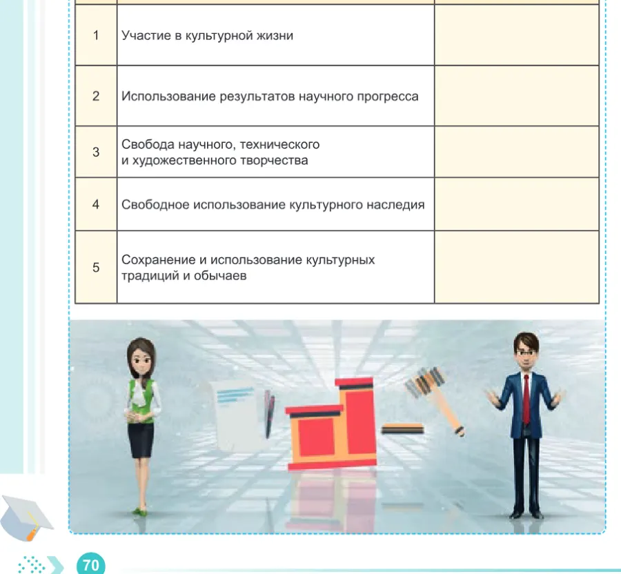

## Урок 21. Социальные права

Тот, кто использует знания как средство достижения власти, вводит в заблуждение и себя, и народ. **Алишер Навои**

### Вы узнаете

Понятие и система социальных прав.

Право на труд и занятость.

Право на социальное обеспечение и жильё. Право на образование.

### Понятие и система социальных прав

В Конституции Республики Узбекистан наша страна определена как социальное государство. Основным признаком социального государства является приоритет интересов личности над государственными. В социальном государстве должны быть созданы условия, направленные на обеспечение достойной жизни каждого человека, а также на поддержку в случае болезни, старости, безработицы или других обстоятельств, не зависящих от человека. Эти возможности и условия проявляются прежде всего в законодательном закреплении социальных прав личности и содействии их реализации.

> **Социальные права** – это права, обеспечивающие социальную защиту и благополучие граждан.

Социальные права являются неотъемлемой частью демократического общества и служат созданию равных возможностей для всех граждан. Такие права, как образование, здравоохранение, социальное обеспечение, жилище, труд и занятость, право на отдых, направлены на обеспечение достойной жизни, социального развития и заботы со стороны государства. Сфера социальных прав и порядок их применения, установленные в Конституции Узбекистана, соответствуют нормам международных документов и требованиям, содержащимся в них. Основные социальные права личности закреплены в Конституции Республики Узбекистан.

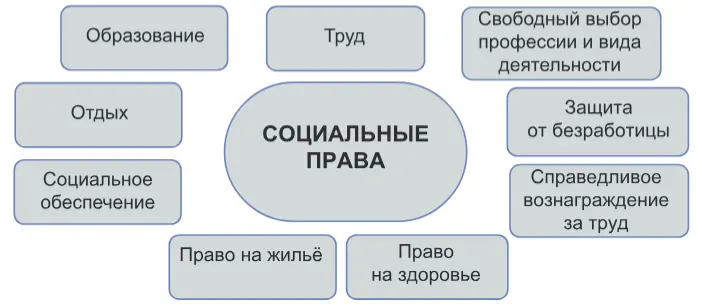

### Право на труд и занятость

Право на труд является правом каждого человека на получение дохода по выбранной профессии или роду деятельности. Труд, как источник дохода, иногда трактуется как одно из экономических прав личности.

Каждый имеет право на достойный труд, на свободный выбор профессии и рода деятельности, благоприятные условия труда, отвечающие требованиям безопасности и гигиены, на справедливое вознаграждение за труд без какой бы то ни было дискриминации и не ниже установленного минимального размера оплаты труда, а также на защиту от безработицы в порядке, установленном законом.

Каждый имеет равные возможности в реализации и защите трудовых прав. Лица могут свободно выбирать желаемую профессию и вид деятельности. Однако это не означает, что каждый может заниматься любой деятельностью по своему желанию, поскольку в некоторых видах деятельности существуют требования, связанные с возрастом, квалификацией и безопасностью. Также существуют виды работ, на которых запрещено использование труда лиц моложе 18 лет, поскольку они связаны с вредными для здоровья условиями труда.

Выбор места работы может осуществляться непосредственно путём обращения к работодателю или с использованием помощи органов по труду и частных агентств занятости.

Возраст и требования для приёма на работу Вид деятельности В общем порядке

– не носящие вреда здоровью и духовному развитию учащихся;

– не прерывающие процесс обучения;

– лёгкий труд

– театр;

– телевидение;

– радиовещание;

– занятие профессиональным спортом; – с разрешения органа опеки

– создание произведений;

– исполнение;

– выставочная деятельность

– в свободное от учёбы время;

– с письменного согласия одного из родителей

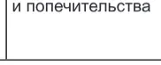

> **Принудительный труд** – это выполнение работы против воли физического лица под угрозой наказания.

Труд является свободным, и никто не может быть принуждён к выполнению работы вопреки своему желанию.

Однако существуют виды работ, которые, несмотря на схожесть с принудительным трудом, не считаются таковыми в соответствии с Конституцией и международными нормами:

– работы военного характера;

– работы, связанные с введением чрезвычайного или военного положения;

– работы, выполняемые в качестве наказания по вступившему в законную силу решению суда.

Одним из новшеств, внесённых в нашу Конституцию, является запрет детского труда. Под детским трудом понимается эксплуатация посредством любых форм труда, которые лишают детей детства, препятствуют их посещению школы и вредят их умственному, физическому, социальному и нравственному развитию.

Постановлением Кабинета Министров Республики Узбекистан составлен перечень работ, на которых запрещено использование труда лиц, не достигших 18 лет. Эти работы включены в список, поскольку связаны с тяжёлыми, вредными или опасными условиями труда. Например, маляр, кузнец, пекарь, горняк, мороженщик и другие.

Обеспечение граждан рабочими местами является одним из важнейших вопросов для каждого государства, поскольку каждый год тысячи выпускников выходят на рынок труда. Это ставит перед государством задачу создания новых рабочих мест. Однако обеспечить занятость всех невозможно, поэтому государство берёт на себя социальную защиту безработных граждан.

В результате действия трудового права возникает множество трудовых отношений, таких как поступление на работу, работа в нормальных условиях, охрана труда, увольнение и другие. Эти отношения регулируются Трудовым кодексом Республики Узбекистан.

Запрещаются любые формы детского труда, представляющие угрозу здоровью, безопасности, нравственности, умственному и физическому развитию ребёнка, в том числе препятствующие ему получать образование.

**Из статьи 44 Конституции Республики Узбекистан**

Государство принимает меры по обеспечению занятости граждан, защите их от безработицы, а также сокращению бедности.

Государство организует и поощряет профессиональную подготовку и переподготовку граждан.

### Право на социальное обеспечение и жильё

Право на социальное обеспечение является одним из основных социальных прав личности. С возрастом человек может утратить трудоспособность в результате заболевания или увечья. Лица, находящиеся на чьём-либо попечении, в случае смерти основного кормильца или по другим причинам, не могут самостоятельно обеспечивать себя и своих подопечных. В таких ситуациях государство принимает меры по их социальной защите. Социальное обеспечение осуществляется через пенсии, пособия или иную социальную материальную помощь. Существует три вида пенсий и пособий: по возрасту, по инвалидности, по случаю потери кормильца. Пенсия назначается гражданам, имеющим достаточный трудовой стаж, а пособие – тем, у кого нет достаточного стажа.

Каждый имеет право на социальное обеспечение в старости, в случае утраты трудоспособности, безработицы, а также потери кормильца и в других предусмотренных законом случаях.

Размеры пенсий, пособий и других видов социальной помощи, установленных законом, не могут быть ниже официально установленных минимальных потребительских расходов.

### Из статьи 46 Конституции Республики Узбекистан

Конституция устанавливает, что граждане имеют право на социальное обеспечение и в других случаях, предусмотренных законом. Это, например, пособия на время рождения ребёнка и ухода за ним до определённого возраста, пособия для тех, кто пострадал от стихийных бедствий или других чрезвычайных ситуаций, пособия для малообеспеченных граждан и т. д.

Обладание жильём обеспечивает каждому человеку свободу, неприкосновенность и возможность вести достойную жизнь.

Однако в последние годы слова «снос жилья», «снос» стали часто употребляться. Такие действия нередко приводили к грубым нарушениям прав собственности граждан. Для максимальной защиты права граждан на жильё в Конституцию введена специальная норма.

Эта норма тесно связана с идеей социального государства, закреплённой в обновлённой Конституции. В социальном государстве население должно обладать всеми необходимыми возможностями. Это включает два аспекта: судебную защиту права на жильё и вопрос возмещения.

Лишение граждан жилья возможно только при наличии достаточных оснований и по решению суда. Если собственник лишается жилья, то стоимость этого имущества и понесённый ущерб должны быть возмещены в полном объёме до сноса.

Права граждан на жильё регулируются такими документами, как Жилищный кодекс, Гражданский кодекс и Градостроительный кодекс.

Каждый имеет право на жилище. Никто не может быть лишён своего жилища иначе как по решению суда и в соответствии с законом. В случаях и порядке, предусмотренных законом, собственнику, лишённому своего жилища, обеспечивается предварительное и равноценное возмещение стоимости жилья и понесённых им убытков.

**Из статьи 47 Конституции Республики Узбекистан**

### Право на образование

Право на образование является одним из основных прав человека и гражданина, закреплённых в конституциях многих стран. Согласно этому праву, каждый имеет право на образование, независимо от социального, экономического и культурного статуса.

В соответствии с этим правом государство обязано обеспечивать доступность и качество образования для всех, а также гарантировать свободу выбора образовательных программ и учреждений.

Согласно Конституции Узбекистана, государство гарантирует бесплатное общее среднее и начальное профессиональное образование.

Дети обязаны получать общее среднее образование. Это означает, что отсутствие детей в школе без уважительной причины, а также препятствование родителям в по-

Каждый имеет право на образование.

Государство обеспечивает развитие непрерывной системы образования, его различных видов и форм, государственных и негосударственных образовательных организаций.

Государство создаёт условия для развития дошкольного образования и воспитания.

Государство гарантирует получение бесплатного общего среднего и начального профессионального образования. Общее среднее образование является обязательным.

Дошкольное образование и воспитание, общее среднее образование находятся под надзором государства.

Для детей с особыми образовательными потребностями в образовательных организациях обеспечиваются инклюзивное образование и воспитание.

**Статья 50 Конституции Республики Узбекистан** лучении образования могут стать основаниями для привлечения к ответственности в порядке, установленном законодательством.

Однако не во всех странах обеспечено одинаковое право на образование. Во многих странах до сих пор дети не полностью охвачены школьным образованием. Причинами могут быть различные факторы.

**Интересная информация**

Когда я был маленьким, мама говорила мне, что я не должен мечтать о невозможных вещах, например о школе. Однако сегодня Бог удивил меня, дав возможность держать книгу в руках, читать и писать. Теперь я не боюсь мечтать о невозможном.

### Бихар, Индия

Некоторые дети отличаются от других в усвоении и восприятии информации. Им могут понадобиться отдельные учебные материалы, учителя и учебные помещения. Согласно Конституции, для таких детей должно быть организовано инклюзивное образование.

> **Инклюзивное образование** – это образование, предоставляемое с учётом индивидуальных образовательных потребностей и возможностей, обеспечивающее равные возможности для всех.

Высшее образование (бакалавриат и магистратура) предоставляется на бесплатной и платно-контрактной основе. Студенты, которые набрали высокие баллы на вступительных экзаменах, получают бесплатное образование по квотам, установленным государством. Те, кто не набрали достаточного количества баллов, но достигли определённого уровня, могут обучаться на платной основе.

Одним из новшеств, внесённых в Конституцию, является укрепление статуса учителей.

В Республике Узбекистан труд учителя признаётся основой развития общества и государства, формирования и воспитания здорового, гармонично развитого поколения, а также сохранения и обогащения духовного и культурного потенциала народа.

Государство защищает честь и достоинство учителей, заботится об их социальном и материальном благополучии и профессиональном росте.

### Вопросы и задания

### Задания для самостоятельной работы

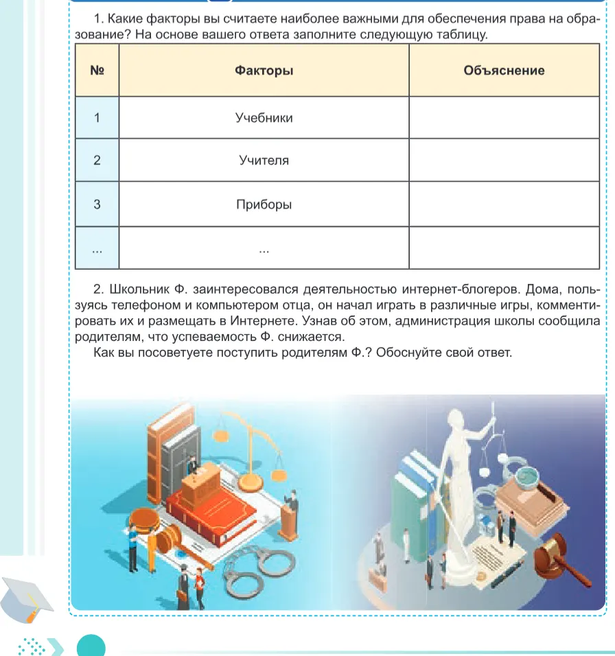

## Урок 22. Экологические права

Обострение ситуации, связанной с высыханием Аральского моря, превратило экологическую безопасность в чрезвычайно актуальный вопрос. **Шавкат Мирзиёев**

### Вы узнаете

Обеспечение экологических прав.

Улучшение, восстановление и охрана окружающей среды. Охрана экологической системы региона Приаралья.

### Обеспечение экологических прав

Хотя проблемы обеспечения прав человека уходят корнями в глубокую историю, обеспечение экологических прав человека стало актуальной проблемой международного масштаба к 70-м годам XX века, поскольку загрязнение окружающей среды привело к глобальным вызовам.

Право на здоровую окружающую среду впервые было затронуто на конференции ООН в Стокгольме в 1972 году. В декларации, принятой на конференции ООН в 1992 году в Рио-де-Жанейро, отмечено: «Человек имеет право на здоровую и продуктивную жизнь в гармонии с природой».

Статья 49 Конституции Республики Узбекистан гарантирует право каждого на благоприятную окружающую среду и достоверную информацию о её состоянии. Одной из целей Закона Республики Узбекистан «Об охране природы» является обеспечение права граждан на благоприятную окружающую среду. Основные направления государственной экологической политики включают сохранение стабильности биосферы и экологических систем, которые являются средой обитания человека, обеспечение экологической безопасности, заботу о генетическом фонде человека и будущих поколений, а также предотвращение вредных и необратимых последствий для окружающей среды и здоровья человека.

Население Республики Узбекистан имеет право жить в естественной среде, благоприятной для здоровья нынешнего и будущих поколений, защищать своё здоровье от вредного воздействия окружающей среды, объединяться в общественные организации по охране природы, требовать и получать информацию о состоянии окружающей среды и принимаемых мерах по её защите.

5 июня отмечается Всемирный день охраны окружающей среды. В этот день была основана программа ООН по охране окружающей среды – ЮНЕП (1972).

Основная цель Экологической партии Узбекистана заключается в содействии реализации государственной политики, направленной на устойчивое развитие, экологическую безопасность, сохранение природных ресурсов и создание благоприятной окружающей среды для нынешних и будущих поколений. Партия способствует тому, чтобы охрана окружающей среды и сохранение природных ресурсов стали обязанностью каждого гражданина, общества и государства.

Для обеспечения экологических прав граждан и предотвращения вредного воздействия на окружающую среду государство должно создать условия для общественного контроля в сфере градостроительной деятельности и обеспечить общественное обсуждение проектов градостроительной документации в установленном законом порядке.

### Основные принципы градостроительной деятельности

Устойчивое развитие территории Республики Узбекистан и её частей на основе планирования градостроительной сферы с учётом интересов граждан, общества и государства Осуществление градостроительной деятельности на основании утверждённой градостроительной документации с соблюдением требований к безопасности и надёжности конструкций зданий и сооружений, их сейсмостойкости, пожарной безопасности и энергоэффективности Создание благоприятной среды для жизнедеятельности, охрана здоровья граждан, бережное отношение к окружающей среде, природным ресурсам и культурному наследию Внедрение лучших практик в градостроительной деятельности и строительном производстве, повышение качества строительства

Обеспечение эффективного участия общественности в процессе градостроительного планирования развития территорий

Законодательство устанавливает, что юридические и физические лица при осуществлении градостроительной деятельности обязаны охранять благоприятную среду для жизнедеятельности населения.

### Улучшение, восстановление и охрана окружающей среды

Согласно Конституции Республики Узбекистан, государство, в соответствии с принципом устойчивого развития, осуществляет меры по улучшению, восстановлению и охране окружающей среды, а также сохранению экологического равновесия.

К объектам окружающей среды относятся земля, вода, атмосферный воздух, недра, растительный и животный мир.

На сегодняшний день в целях улучшения, восстановления и охраны окружающей среды государством определены следующие задачи:

– обеспечение сохранности и охраны объектов окружающей среды (земли, воды, атмосферного воздуха, недр, растительного и животного мира);

– расширение охраняемых природных территорий;

– приоритетное использование материалов, продукции, производственных и иных объектов, представляющих наименьшую экологическую опасность;

– совершенствование государственного контроля в области охраны окружающей среды и рационального природопользования;

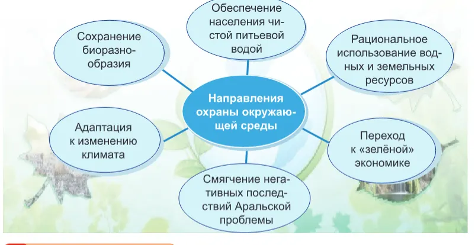

### Запомните!

> **Охрана окружающей среды** – комплекс мер, направленных на ограничение негативного воздействия деятельности человека на окружающую среду и предотвращение её разрушения.

– научное обеспечение охраны окружающей среды;

– совершенствование системы обращения с отходами;

– повышение экологической культуры населения;

– расширение международного сотрудничества в области охраны окружающей среды.

Также в рамках общенационального проекта «Яшил макон» разработаны и реализуются планы по охране и обеспечению качества объектов окружающей среды от воздействия человека и других негативных факторов, а также совершенствованию механизмов промышленного производства, резкому расширению масштабов урбанизации и снижению экологической нагрузки на населённые пункты.

### Охрана экологической системы региона Приаралья

В статье 49 Конституции Республики Узбекистан закреплено, что государство принимает меры по охране и восстановлению экологической системы региона Приаралья, а также по социальному и экономическому развитию этого региона.

Право народа на благоприятную окружающую среду в Приаралье является одним из фундаментальных прав человека и играет важную роль в реализации права на жизнь. Данная норма нашей Конституции создаёт конституционные гарантии сохранения экологически чистой территории для населения и будущих поколений, социально-экономической поддержки населения региона Приаралья, обеспечения благоприятной окружающей среды для их проживания и развития.

Аральское море на протяжении многих лет питало народы, населявшие его окрестности.

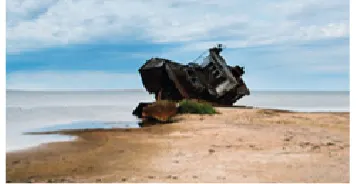

Однако ошибки, допущенные при использовании вод Амударьи и Сырдарьи, привели к его высыханию. Площадь Аральского моря уменьшилась в десятки раз, объём воды сократился в несколько раз.

С 1981 года было прекращено судоходство и паромное сообщение по Амударье. Муйнак, некогда портовый город с крупными производственными мощностями в Приаралье, превратился в кладбище кораблей на высохшем берегу моря. В результате отступления Аральского моря более чем на 100 километров корабли оказались на сухом песке.

> **Отрицательные последствия высыхания Аральского моря** Аралкум – пустыня, образовавшаяся на месте Аральского моря, покрыта мелкими частицами соли и почвы. При ветре они распространяются на большие расстояния, загрязняя воздух.

Климат стал более континентальным: зимняя температура понизилась, а летняя повысилась.

Это негативно сказалось на здоровье населения: увеличилось количество заболеваний сердечно-сосудистой, желудочно-кишечной и дыхательной систем (туберкулёз лёгких, астма, бронхит).

В результате сокращения запасов воды и засоления пастбищ уменьшились виды и качество растений, являющихся кормом для скота, площадь пастбищ сократилась почти втрое, что привело к сокращению животного мира.

Это также привело к резкому сокращению посевных площадей.

Сегодня вопрос развития региона Приаралья стал приоритетным направлением государственной политики. Проводится значительная работа по смягчению последствий Аральской трагедии.

**Меры по смягчению негативного воздействия экологического кризиса в Приаралье включают:**

– сохранение системы естественных водоёмов в акватории Аральского моря;

– проведение масштабных мероприятий по созданию лесных насаждений на высохшем дне Аральского моря и предотвращению опустынивания в регионе (создание двух миллионов гектаров новых растительных площадей и лесных насаждений);

– укрепление сотрудничества стран региона в рамках Международного фонда спасения Арала и активизация усилий по привлечению внимания мирового сообщества к решению проблем, связанных с Аральской катастрофой.

Эти меры имеют большое значение в борьбе с негативными последствиями высыхания Аральского моря для окружающей среды и здоровья населения, устранении возникших проблем, а также в обеспечении занятости населения, проживающего в регионе.

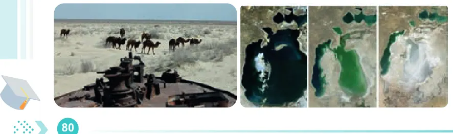

**Резолюции, принятые Генеральной Ассамблеей ООН по инициативе Президента Республики Узбекистан**

Резолюция от 27 ноября 2018 года, послужившая основанием для создания Многопартнёрского трастового фонда по человеческой безопасности для региона Приаралья

Резолюция «Об объявлении региона Приаралья зоной экологических инноваций и технологий», принятая 18 мая 2021 года на пленарном заседании 75-й сессии Генеральной Ассамблеи ООН

### Вопросы и задания

1. Какие международные правовые документы существуют в сфере обеспечения экологических прав?

2. Какие нормы содержатся в Конституции Республики Узбекистан по обеспечению экологических прав человека?

3. Каковы основные цели Экологической партии Узбекистана?

4. Какие принципы соблюдаются при осуществлении градостроительной деятельности?

5. Перечислите задачи нашего государства по улучшению, восстановлению и охране окружающей среды.

### Задания для самостоятельной работы

1. Объясните следующие понятия на основе сравнительного анализа.

### Экологическая культура

2. Найдите решение проблемной ситуации.

В населённом пункте появился медвежонок, вышедший из заповедника. Один из жителей этого района застрелил его из охотничьего ружья, чтобы предотвратить причинение вреда населению. Другой человек подчеркнул необходимость противостоять этому. Как, по вашему мнению, необходимо решить эту проблему?

## Урок 23. Гарантии прав и свобод человека

У того, кто решит изучить все законы, не останется времени их нарушать. **Иоганн Гёте**

### Понятие о гарантиях прав и свобод человека

Права и свободы человека в правовом отношении отражаются в конституции государства и других законодательных актах. Однако таких записей недостаточно. Необходимы гарантии для реализации прав и свобод, как это предусмотрено в основном законе и других нормах.

> **Гарантии прав и свобод человека** – это совокупность правовых средств, юридических методов и условий, направленных на обеспечение реализации прав и свобод личности.

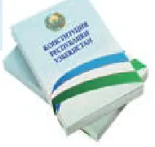

Основная цель гарантий заключается в устранении препятствий, возникающих в процессе их реализации. Гарантии прав и свобод человека обеспечиваются посредством определённых механизмов на международном и национальном уровнях. На международном уровне различные органы по защите прав человека оценивают, в какой степени государства соблюдают основные права и свободы человека.

### Защита прав человека

Государственное обеспечение прав и свобод на национальном уровне проявляется в деятельности соответствующих компетентных структур.

Тот факт, что в нашей Конституции глава «Гарантии прав и свобод человека и гражданина» выделена в отдельную категорию, показывает, что этому уделяется большое внимание.

Обеспечение прав и свобод человека – высшая цель государства.

Государство обеспечивает права и свободы человека и гражданина, закреплённые Конституцией и законами.

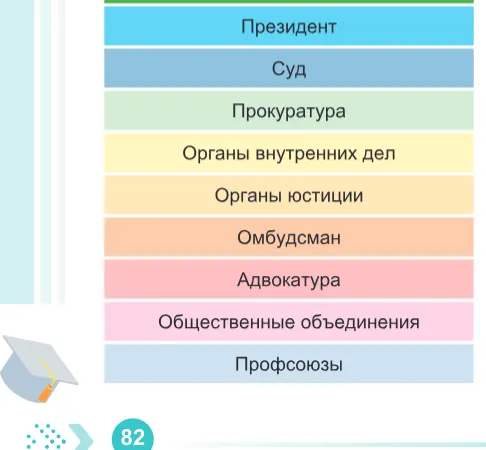

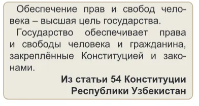

Согласно Конституции, каждый имеет право защищать свои права и свободы всеми способами, не запрещёнными законом. Граждане, которые считают, что их права и свободы нарушены или недостаточно защищены государственными органами, должностными лицами или другими лицами, могут обратиться в суд или другие государственные органы с просьбой о восстановлении своих прав.

В обеспечении прав и свобод важную роль играют адвокаты, выступающие в суде в качестве защитников прав граждан. Также значительную роль играют общественные организации и средства массовой информации, которые содействуют гражданам в восстановлении нарушенных прав. Эти структуры помогают привлекать внимание компетентных органов к правонарушениям и проблемным ситуациям, обеспечивая связь между гражданами и государственными органами.

Права и свободы предоставляются всем одинаково. Все равны в правах и свободах. Однако не все могут пользоваться этими правами одинаково. К таким категориям относятся нетрудоспособные, одинокие престарелые, лица с инвалидностью и другие люди, нуждающиеся в социальной защите. Хотя их права равны, возможности использования этих прав не всегда одинаковы. Поэтому государство берёт на себя обязанность по реализации их прав и свобод.

### Защита прав и свобод через суд

Главным органом в защите прав и свобод человека является суд. Именно суд может вынести решение о восстановлении и обеспечении прав и свобод личности, а также о принятии мер к ответчикам.

> **Судебная защита** – это деятельность судов, направленная на восстановление нарушенных прав и свобод лиц, осуществляемая в порядке, установленном процессуальным законодательством.

Судебная защита прав и свобод, обеспечение правосудия являются одними из основных обязательств государства в обеспечении прав человека.

Обжалование в суд осуществляется путём подачи заявления. В зависимости от содержания нарушенных прав и свобод лица обращаются в гражданский, уголовный, административный или экономический суд. При обращении необходимо подать заявление в районный суд. Граждане могут подать заявление в суд непосредственно сами или с помощью адвокатов. При обращении в суд уплачивается государственная пошлина, установленная законодательством. Отдельные категории лиц освобождены от её уплаты.

Каждому гарантируется судебная защита его прав и свобод, право обжалования в суд незаконных решений, действий и бездействия государственных органов и иных организаций, их должностных лиц.

Каждому для восстановления своих нарушенных прав и свобод гарантируется право на рассмотрение его дела компетентным, независимым и беспристрастным судом в установленные законом сроки.

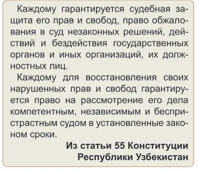

Рассмотрение жалоб лиц в судах осуществляется в порядке, установленном Законом «О судах», Гражданским процессуальным кодексом и Уголовно-процессуальным кодексом. Законодательство, определяющее порядок обжалования в суды, предусматривает, что в любых случаях можно обратиться в суд с просьбой восстановить нарушенные права, отменить незаконные акты соответствующего органа, должностного лица или общественных объединений. Постановление, вынесенное судом после рассмотрения дела, является обязательным для исполнения сторонами.

При защите прав человека особое внимание уделяется внедрению механизмов внесудебной деятельности. Одним из таких механизмов, действующих в Узбекистане, являются национальные институты по правам человека.

Национальные институты по правам человека оказывают содействие гражданам в восстановлении нарушенных прав и свобод, обращении к государственным органам и должностным лицам.

В Узбекистане в систему национальных институтов по правам человека входят: Уполномоченный Олий Мажлиса Республики Узбекистан по правам человека (омбудсман), Уполномоченный Олий Мажлиса Республики Узбекистан по правам ребёнка (детский омбудсман), Уполномоченный при Президенте по защите прав предпринимателей (бизнес-омбудсман), а также Национальный центр Республики Узбекистан по правам человека.

При обращении в национальные институты по правам человека, в отличие от судов, государственная пошлина не взимается.

Слово «омбудсман» происходит от шведского ombud, что означает «посредник» или «представитель других лиц».

Должностным лицом, занимающимся защитой прав человека, является Уполномоченный Олий Мажлиса Республики Узбекистан по правам человека (омбудсман).

К омбудсману могут обращаться не только граждане Узбекистана, но и иностранцы и лица без гражданства, находящиеся на территории Узбекистана. При этом заявитель обязан указать сведения о себе, в противном случае его заявление считается анонимным и не рассматривается омбудсманом.

Впервые институт омбудсмана был создан в Швеции в 1809 году. Однако, согласно некоторым взглядам, в Арабском халифате функцию омбудсмана выполнял мухтасиб, учреждённый при халифе Умаре. Он рассматривал жалобы граждан на действия должностных лиц.

### Защита прав человека на международном уровне

Лица порой не могут восстановить свои нарушенные права и свободы даже после того, как они воспользовались всеми государственными средствами защиты, включая судебные инстанции. В таких случаях возникает вопрос: кто восстановит права человека? Знание порядка защиты прав человека на международном уровне является важным для лиц, попавших в подобную ситуацию.

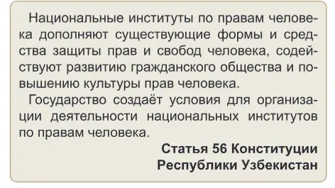

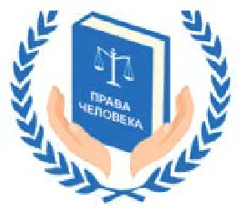

Каждый вправе в соответствии с законодательством и международными договорами Республики Узбекистан обращаться в международные органы по защите прав и свобод человека, если исчерпаны все имеющиеся внутригосударственные средства правовой защиты.

### Из статьи 55 Конституции Республики Узбекистан

Одним из новшеств, внесённых в Конституцию Республики Узбекистан, является установление права лиц на обращение в международные органы по защите прав и свобод человека.

Лицо не может напрямую обращаться в международные органы по правам человека, полагая, что его права и свободы нарушены. В первую очередь, необходимо использовать внутренние

сударственные суды являются основным инструментом внутренней защиты. Лицо, обратившееся к омбудсману с просьбой восстановить свои права, не может сразу подать заявление в международный орган, если не получило удовлетворительного решения на национальном уровне. Таким образом, лица, стремящиеся восстановить свои права, должны пройти все установленные законодательством стадии судебного разбирательства.

При обращении в международный орган по правам человека необходимо указать, что нарушены права лица, закреплённые не только в законах государства, но и в международных договорах, к которым присоединился Узбекистан.

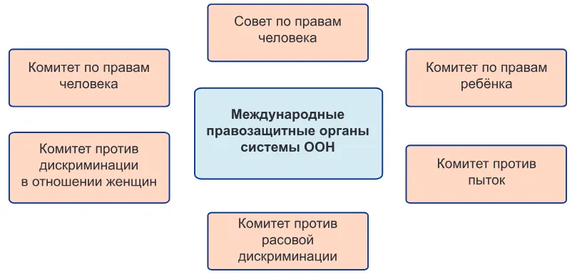

### Ситуация из жизни

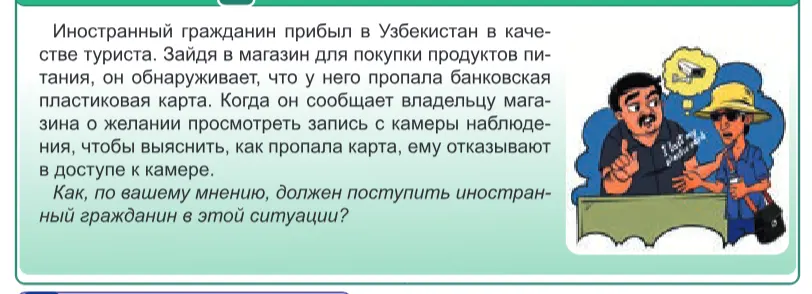

### Вопросы и задания

1. Как узнать, что в государстве гарантирована защита прав и свобод человека?

2. К каким органам можно обратиться для защиты прав и свобод человека?

3. В чём разница между обращением в суд и в национальные институты в защиту прав человека?

4. В каких случаях допускается защита лицом своих прав через международные органы?

### Задания для самостоятельной работы

В чём проявляются формы реализации следующих прав? Заполните таблицу.

### Форма реализации

## Урок 24. Конституционные обязанности граждан Республики Узбекистан

Старайся исполнить свой долг, и ты тотчас узнаешь, чего ты стоишь.

**Лев Толстой**

### Вы узнаете

Понятие обязанностей граждан.

Система обязанностей граждан.

Сохранение исторического, духовного, культурного, научного и природного наследия народа Узбекистана.

Долг защиты Родины.

### Понятие обязанностей граждан

В главе XI второго раздела Конституции Республики Узбекистан закреплены обязанности граждан.

Все граждане несут обязанности, закреплённые за ними в Конституции.

**Статья 59 Конституция Республики Узбекистан**

> Если право предоставляет человеку возможность выбирать вид и меру своего действия, то долг – это требования, установленные обществом и государством и отражённые в правовых нормах.

### Запомните!

Долг определяется государством и состоит из закреплённых в Конституции правил поведения и образа жизни, которые каждый гражданин обязан выполнять, а невыполнение влечёт ответственность.

Суть основных обязанностей граждан, закреплённых в Конституции и других законах, заключается в том, что граждане, наряду с соблюдением Конституции, должны предотвращать любые нарушения её положений и уважать достоинство других лиц.

### ОБЯЗАННОСТИ ГРАЖДАН

Все граждане выполняют обязанности, закреплённые в Конституции.

Граждане обязаны соблюдать Конституцию и законы, уважать права, свободы, честь и достоинство других людей.

Граждане обязаны беречь историческое, духовное, культурное, научное и природное наследие народа Узбекистана.

Граждане обязаны бережно относиться к окружающей природной среде. Граждане обязаны уплачивать установленные законом налоги и сборы. Налоги и сборы должны быть справедливыми и не препятствовать реализации гражданами своих конституционных прав.

Защита Республики Узбекистан является обязанностью каждого гражданина Республики Узбекистан. Граждане обязаны проходить военную или альтернативную службу в порядке, установленном законом.

Выполнение обязанностей гражданами необходимо в интересах общества. Уже на ранних этапах истории нашей государственности в источниках отмечалась обязанность членов общества бережно относиться к окружающей природной среде.

Чем лучше мы сохраним окружающую среду, тем больше будет возможностей для обеспечения нашего права на жизнь в чистой окружающей среде.

Поэтому каждый из нас должен соблюдать свой конституционный долг – бережно относиться к окружающей среде.

Важны также обязанности граждан, связанные с уплатой налогов и сборов. **Налог –** установленный обязательный безвозмездный платёж в Государственный бюджет Республики Узбекистан или Государственный целевой фонд.

**Сбор** – обязательный платёж в бюджетную систему, установленный законодательством.

Собранные государством налоги используются для обеспечения обороноспособности страны, безопасности граждан, а также для развития экономики, образования, науки и здравоохранения.

В Конституции Республики Узбекистан закреплено, что налоги и сборы должны быть справедливыми и не должны препятствовать реализации гражданами их конституционных прав.

**Сохранение исторического, духовного, культурного, научного и природного наследия народа Узбекистана**

Каждый гражданин Узбекистана должен считать священной задачей беречь и передавать будущим поколениям историческое, культурное, научное и природное наследие нашего народа.

Были такие исторические периоды: историко-культурные памятники, созданные узбекским народом, были растоптаны, уничтожены и увезены в зарубежные страны. Сегодня их возврат является одной из основных целей нашего государства.

Граждане обязаны оберегать историческое, духовное, культурное, научное и природное наследие народа Узбекистана.

Историческое, духовное, культурное, научное и природное наследие охраняется государством.

**Статья 61 Конституции Республики Узбекистан**

Меры по сохранению объектов материального культурного наследия включают в себя их консервацию, ремонт, реставрацию, приспособление для современного использования, а также связанные с ними научные и научно-технические исследования, проектные и производственные работы.

**Из закона Республики Узбекистан «Об охране и использовании объектов культурного наследия»**

В нашей стране разработаны законодательные основы всесторонней охраны исторических памятников, реализуются меры по их сохранению и реставрации на основе определённых программ.

Большое значение имеет сотрудничество с международной организацией ЮНЕСКО в охране исторического, духовного, культурного, научного и природного наследия.

### Объекты культурного наследия

Ансамбли, достопримечательности и памятники, имеющие историческую, научную, художественную или иную культурную ценность

Обычаи, народное творчество (словесное, танцевальное, музыкальное, зрелищное искусство), а также связанные с ним знания, навыки, инструменты, артефакты, культурные пространства, обладающие исторической, научной, художественной или иной культурной ценностью

Четыре древних города на территории Узбекистана – Самарканд, Бухара, Хива, Шахрисабз, а также праздник Навруз, Катта ашула (Большая возвышенная песня), шашмаком, аския (искусство остроумия) включены в список ЮНЕСКО как культурное наследие человечества.

Наряду с защитой нашего исторического и культурного наследия конституционными обязанностями граждан являются сохранение природного наследия Узбекистана и обеспечение его безвредной передачи будущим поколениям, снижение темпов деградации природных экологических систем и сохранение биоразнообразия.

### Долг защиты Родины

В целях обеспечения государственной независимости, её территориальной целостности, мирной жизни населения граждане проходят военную или альтернативную службу в установленном порядке.

Граждане, впервые призванные на военную службу или поступившие добровольно (по контракту), принимают присягу Родине перед Государственным флагом Республики Узбекистан. Содержание клятвы Родине изложено в статье 3 закона Республики Узбекистан «О всеобщей воинской обязанности и военной службе».

### Запомните!

> **Военная служба** – особый вид государственной службы граждан Республики Узбекистан по выполнению общей воинской обязанности в Вооружённых силах.

### Виды военной службы

Срочная военная служба Военная служба в мобилизационном призывном резерве Военная служба по контракту Служба резервистов, прошедших военную службу в Вооружённых силах Республики Узбекистан

Защита Республики Узбекистан – долг каждого гражданина Республики Узбекистан. Граждане обязаны нести военную или альтернативную службу в порядке, установленном законом.

**Статья 64 Конституции Республики Узбекистан**

В мирное время на срочную военную службу на должностях рядового и сержантского состава, а также на службу в мобилизационном призывном резерве призываются граждане мужского пола в возрасте от 18 до 27 лет, годные по состоянию здоровья для прохождения военной службы в Вооружённых Силах. Срочная военная служба устанавливается в календарном исчислении на 12 месяцев.

> **Альтернативная служба** – особый вид выполнения гражданами всеобщей воинской обязанности, связанный с выполнением малоквалифицированных (вспомогательных) работ в различных отраслях экономики, социальной сферы, а также работ по ликвидации последствий стихийных бедствий, катастроф, и других чрезвычайных ситуаций вместо военной службы по призыву.

Граждане в возрасте от 18 до 27 лет, состоящие на воинском учёте и подлежащие призыву на службу, имеют право на альтернативную службу, если их религиозное учение не допускает использования оружия и службы в Вооружённых силах и если они состоят на учёте в зарегистрированных религиозных организациях.

Срок альтернативной службы составляет 24 месяца, а для граждан с выс шим образованием – 18 месяцев.

Гражданам Республики Узбекистан запрещается поступать на военную службу, на службу в органы безопасности, полиции, военные, органы юстиции или другие аналогичные органы иностранных государств.

### Вопросы и задания

## Урок 25. Творческая деятельность

**Задание 1.** Изучите следующую ситуацию и ответьте на вопросы.

Представьте, что вы живёте в городе, где расположен завод по переработке отходов. Этот завод функционирует уже несколько лет. За прошедший период среди населения возросло количество сердечно-сосудистых и лёгочных заболеваний.

В результате проверки состояния здоровья населения было установлено, что рост заболеваемости связан с загрязнением окружающей среды. Администрация завода не выполняет своё обещание по установке очистных сооружений.

### Вопросы и задания

1. Как общественность может решить эту проблему?

2. Что относится к общественному контролю?

3. Какие механизмы защиты эффективны в данном случае?

**Задание 2.** Какие механизмы защиты прав человека можно использовать в следующих ситуациях?

## Урок 26. Контрольная работа

**1.** Когда человек приобретает личные права и свободы?

А) сразу после рождения;

Б) в возрасте 16 лет;

В) в возрасте 18 лет;

Г) по достижении школьного возраста.

**2.** В каком государстве первоначально был принят акт «Хабеас корпус»?

А) в США;

Б) в Англии;

В) во Франции;

Г) в Германии.

**3.** В какой статье Конституции Республики Узбекистан закреплено, что каждый имеет право на образование?

А) статья 49;

Б) статья 50;

В) статья 51;

Г) статья 52.

**4.** Каково словарное значение слова «омбудсман»?

А) защитник;

Б) должностное лицо;

В) посредник;

Г) обвинитель.

**5.** Согласно статье 27 Конституции Республики Узбекистан, в течение какого времени лицо не может быть задержано без решения суда?

А) более 24 часов;

Б) более 36 часов;

В) более 48 часов;

Г) более 54 часов.

**6.** В каком государстве впервые был введён принцип презумпции невиновности?

А) в США;

Б) в Англии;

В) во Франции;

Г) в Германии.

**7.** Какого возраста должны достичь граждане в день выборов, чтобы иметь право участвовать в голосовании (право избирать)?

А) 16 лет;

Б) 18 лет;

В) 24 года;

Г) 30 лет.

**8.** В каком порядке принимаются на работу дети, достигшие 15 лет?

А) с письменного согласия одного из родителей;

Б) с согласия обоих родителей;

В) с согласия лица, достигшего 15 лет; Г) лицо, достигшее 15-летнего возраста, на работу не принимается.

**9.** С какого возраста граждане принимаются на работу в общем порядке?

А) с 14 лет;

Б) с 15 лет;

В) с 16 лет;

Г) с 18 лет.

**10.** Для кого обеспечивается инклюзивное образование и воспитание?

А) для детей с особыми образовательными потребностями;

Б) для детей-сирот;

В) для всех детей школьного возраста; Г) для детей, проживающих в отдалённых районах.

### ГЛАВА IV

# Глава IV. Гражданское общество и государственная власть

## Урок 27. Общество и личность. Гражданское общество

Общество сильно государством, потому что по мере своего совершенствования оно берёт под защиту своих людей.

**Абу Наср Фараби**

### Вы узнаете

Понятие гражданского общества и его признаки. Институты гражданского общества.

Семья, дети и молодёжь и их права.

Средства массовой информации.

### Понятие гражданского общества и его признаки

Первые представления о гражданском обществе изложены в произведении Аристотеля «Политика», согласно которому, право человека на свободную жизнь должно быть обеспечено через организацию человеческого общества на основе справедливости и верховенства закона.

Гражданское общество является общественным строем, в котором гарантируется свободный выбор форм экономической, политической и культурной жизни, устанавливается верховенство закона, права и свободы человека, обеспечивается многопартийность, развитие политических институтов, плюрализм идеологий и мнений, а также высокий статус органов самоуправления. В гражданском обществе каждый человек удовлетворяет свои политические, социальные, экономические, духовные и правовые потребности, активно участвуя в работе общественных объединений и фондов, органов самоуправления, политических партий и негосударственных некоммерческих организаций.

В практическом возникновении гражданского общества важное значение имеет принятие Билля о правах (Англия, 1689 г.; США, 1791 г.) или Декларации прав человека и гражданина (Франция, 1789 г.). Гражданское общество опирается на три основы: экономическую, общественно-политическую и духовную.

**Экономическая основа** – разнообразие форм собственности, экономический плюрализм, наличие свободных рыночных отношений. Каждый член общества обладает некоторой собственностью, правом распоряжаться ей по своему усмотрению, обеспечивается неприкосновенность частной собственности и гарантированная государством свобода предпринимательской, трудовой и потребительской деятельности.

**Общественно-политическая основа** – объединение людей в организации для защиты своих интересов, разделение экономической и политической власти, политический плюрализм, постепенная передача функций государственной власти институтам гражданского общества.

**Духовная основа** заключается в том, что граждане должны знать своё достоинство, уметь защищать основные ценности общества, бороться за них при необходимости, обеспечивать свободу совести, соблюдать нравственные нормы, участвовать в государственном управлении и иметь гражданскую позицию.

### Институты гражданского общества

В целях развития участия граждан в управлении делами государства и общества, а также реализации и защиты прав и свобод граждан в гражданской, экономической, социальной и культурной сферах создаются **институты гражданского общества.**

К институтам гражданского общества относятся:

– общественные объединения;

– негосударственные некоммерческие организации;

– органы самоуправления граждан;

– средства массовой информации.

Для всех созданы равные возможности для участия в общественных объединениях. Членами (участниками) общественного объединения могут быть граждане Республики Узбекистан, иностранные граждане и лица без гражданства.

**Интересная информация** На сегодняшний день в Узбекистане действует около 10 тысяч негосударственных некоммерческих организаций, более 9 тысяч органов самоуправления.

### Запомните!

Общественным объединением является добровольное образование, возникшее в результате свободного волеизъявления граждан.

### Порядок создания общественного объединения

Общественное объединение создаётся по инициативе не менее десяти граждан. Инициаторы создания общественного объединения созывают учредительный съезд (конференцию) или общее собрание, на котором принимается устав (положение или иной основной акт) и создаются руководящие органы. Общественное объединение регистрируется в установленном порядке Министерством юстиции Республики Узбекистан и управлениями юстиции областей и города Ташкента.

**Виды общественных объединений**: профсоюзы, политические партии, общества учёных, женские организации, организации ветеранов, молодёжи и лиц с инвалидностью, творческие союзы, массовые движения и другие объединения граждан.

Например, Союз молодёжи Узбекистана, Федерация профсоюзов Узбекистана. **Запрещается создавать следующие общественные объединения**: общественные объединения, деятельность которых направлена на нарушение нравственных устоев общества, общечеловеческих гуманистических ценностей, а также преследующие цель незаконного изменения конституционного строя или нарушения единства территории Республики Узбекистан, разжигания социальной, в том числе классовой, расовой, национальной и религиозной вражды, а также иных запрещённых законодательством действий, ведущих к войне, насилию, жестокости и расколу общества.

Гражданин Республики Узбекистан **может быть одновременно членом только одной политической партии.** Однако некоторые категории лиц не могут быть членами политической партии. Например, судьи, должностные лица Счётной палаты, прокуроры и следователи прокуратуры, сотрудники органов внутренних дел, Национальной гвардии, Службы государственной безопасности и военнослужащие. Граждане иностранных государств и лица без гражданства также не могут быть членами политической партии.

### Этапы формирования политической партии

Сбор подписей не менее 20 тысяч граждан (лицам, проживающих как минимум в восьми территориальных субъектах (областях), Республике Каракалпакстан и городе Ташкенте, желающими объединиться в партию) Созданиеорганизационногокомитетаинициаторамисозданияполитической партии (не менее 50 человек) для подготовки учредительных документов партии, формирования состава членов, созыва учредительного съезда или конференции Предоставление организационным комитетом информации о комитете в Министерство юстиции Образование партии на учредительном съезде или конференции; Принятие устава и программы партии, формирование избирательных органов Регистрация политической партии Министерством юстиции

### Запомните!

> **Политическая партия** – это добровольное объединение граждан Республики Узбекистан, созданное на основе общности взглядов, интересов и целей, стремящееся реализовать политическую волю определённой части общества при формировании органов государственной власти и участвующее через своих представителей в управлении государственными и общественными делами.

### Семья, дети и молодёжь и их права

Семья является первичным звеном общества, опорным пунктом, устойчивой структурой гражданского общества. В семье человек не просто рождается, но и получает духовное и нравственное воспитание. Прочность семейных отношений определяет будущее развития общества и государства.

Семейные отношения, в частности, порядок заключения брака регулируются Конституцией Республики Узбекистан, законами, в том числе Семейным кодексом.

Все граждане имеют равные права в семейных отношениях. Отношения мужчины и женщины в семье строятся на принципах равенства личных и имущественных прав супругов, решения внутренних семейных вопросов по взаимному согласию, заботы о воспитании детей в семье, их благополучной жизни и совершенствовании, приоритетности защиты прав и интересов несовершеннолетних и нетрудоспособных членов семьи.

> **Брак** – это союз представителей обоих полов, заключённый на основе взаимного согласия. В Республике Узбекистан брак основывается на традиционных семейных ценностях народа Узбекистана (трудолюбие, верность, искренность, доверие, любовь к Родине, справедливость, чистота, правдивость).

Материнство и детство охраняются государством. Защита прав и интересов детей возлагается на их родителей. Родители обязаны содержать и воспитывать своих детей до их совершеннолетия. В частности, они несут ответственность за воспитание и развитие своих детей. Родители обязаны заботиться о здоровье, физическом, психическом, духовном и нравственном развитии своих детей. Также они должны обеспечить получение детьми образования на необходимом уровне, установленном законодательством. Невыполнение родителями или лицами, их заменяющими, обязанностей по воспитанию и образованию несовершеннолетних детей влечёт ответственность.

Совершеннолетние, трудоспособные дети, достигшие 18 лет, обязаны заботиться о своих родителях.

Ребёнком является лицо, не достигшее восемнадцатилетнего возраста (совершеннолетия). Лицо становится совершеннолетним, когда ему исполняется 18 лет. Права и свободы человека и гражданина принадлежат каждому ребёнку и гарантируются государством.

Молодёжью считаются лица, достигшие 14 лет и не старше 30 лет.

Семейные отношения осуществляются на основе добровольного брачного союза мужчины и женщины.

При отсутствии у ребёнка родителей или при лишении их родительских прав и в других случаях, когда ребенок лишён родительской опеки, его право на воспитание в семье обеспечивается органом опеки и попечительства.

В Республике Узбекистан дети и молодёжь в возрасте до 30 лет составляют 60 % населения. По данным на 2023 год, численность молодёжи превышает 19,6 миллиона человек. В 2008 году был принят Закон «О гарантиях прав ребёнка», в 2016 году – Закон «О государственной молодёжной политике», в 2020 году было создано Агентство по делам молодёжи, а 30 июня объявлено Днём молодёжи.

### Средства массовой информации

Средства массовой информации (СМИ) играют важную роль в обеспечении конституционных прав граждан в информационной сфере, а также в укреплении в обществе атмосферы открытости, гласности и законности. Гарантирование права СМИ на поиск, получение, использование и распространение информации способствует более полному удовлетворению потребностей общества в достоверной информации и развитию политической и правовой культуры населения. Поэтому государство гарантирует свободу деятельности средств массовой информации, а также реализацию их прав на поиск, получение, использование и распространение информации. Государство обеспечивает свободное функционирование СМИ и журналистов, защищая их от различных административных преследований, а также создаёт условия для развития в обществе атмосферы открытости и гласности. Воспрепятствование или вмешательство в деятельность средств массовой информации влечёт ответственность в соответствии с законом.

### Запомните!

> С**редство массовой информации** – форма массовой информации, имеющая постоянное наименование и публикуемая или передаваемая в эфир в печатном виде (газеты, журналы, информационные бюллетени и др.) или в электронном виде (теле-, радио-, видео-, кинохроникальные программы, веб-сайты во всемирной информационной сети Интернет) не реже одного раза в 6 месяцев.

Цензура средств массовой информации в Республике Узбекистан не допускается. Никто не вправе требовать предварительного согласования публикуемых сообщений и материалов, изменения их текста или полного изъятия из печати (передачи в эфир).

### Интересная информация

### Ситуация из жизни

1. Администратор Telegram-канала «Телеграм янгиликлари» Б. Холдоров с фото- и видеокамерами прибыл на территорию павильона, организованного на стадионе «Бунёдкор», в целях освещения вступительных экзаменов в высшие учебные заведения, проводимых в августе 2023 года.

Его остановили сотрудники Национальной гвардии, когда он пытался войти на территорию павильона. Сотрудник Агентства по оценке знаний и квалификаций спросил его, с какой целью он хочет попасть на эту территорию.

Гражданин Б. Холдоров представился журналистом. Сотрудники Национальной гвардии попросили его предъявить служебное удостоверение или разрешение. Он сказал, что у него нет такого документа. В результате сотрудники Национальной гвардии и Агентства по оценке знаний и квалификации не разрешили ему войти на территорию павильона.

Гражданин Б. Холдоров, возмущённый происходящим, разместив видеообращение на своём телеграм-канале, сообщил, что экзамены не проводятся честно, беспристрастно и прозрачно, потому что его не впустили на территорию павильона для освещения процесса.

Это видео вызвало негативную реакцию и протесты в интернете. После этого гражданина Б. Холдорова вызвали в отдел внутренних дел.

Выскажите своё мнение по данному вопросу.

2. Гражданин Акмалов – член Социал-демократической партии «Адолат». Он окончил университет и обратился в поисках работы в школу, расположенную по соседству с его домом. В беседе ему сообщили, что он не будет принят на работу, если не прекратит своё членство в политической партии. Гражданин Акмалов заявил, что в соответствии со статьёй 39 Конституции Республики Узбекистан он имеет право быть членом выбранной им политической партии. В результате возник конфликт между работодателями и гражданином Акмаловым.

Дайте правовую оценку ситуации.

Правильно ли действует руководство школы?

Может ли членство в политической партии служить основанием для отказа в приёме на работу?

### Вопросы и задания

1. Как вы думаете, что такое гражданское общество?

2. Что должны сделать люди для построения гражданского общества?

3. Как средства массовой информации, в том числе социальные сети (Facebook, Telegram, Instagram, YouTube) могут участвовать в организации гражданского общества?

4. Как вы думаете, для чего нужна политическая партия? Чего вы добьётесь, вступив в политическую партию? Какую пользу это вам принесёт?

## Урок 28. Олий Мажлис Республики Узбекистан

Политическая свобода не означает возможность действовать по своему усмотрению. Если гражданин совершает действие, запрещённое законом, он лишается свободы. **Шарль Луи де Монтескьё**

### Вы узнаете

Олий Мажлис Республики Узбекистан – высший государственный представительный орган.

Законодательная палата Олий Мажлиса.

Сенат Олий Мажлиса.

> **Олий Мажлис Республики Узбекистан – высший государственный представительный орган**

Олий Мажлис является парламентом Республики Узбекистан и представляет собой высшую представительную (состоящую из народных представителей) и законодательную власть.

Олий Мажлис как законодательный орган принимает законы, вносит в них изменения и при необходимости отменяет действующие законы.

В Узбекистане Олий Мажлис состоит из двух палат: нижняя палата – Законодательная палата – состоит из депутатов, непосредственно избранных народом, а верхняя палата – Сенат – состоит из сенаторов. Народ принимает непосредственное участие в выборах депутатов нижней палаты, а в формировании Сената участвует через своих представителей. Срок полномочий Олий Мажлиса Республики Узбекистан составляет 5 лет.

Одно и то же лицо не может быть одновременно депутатом Законодательной палаты и членом Сената.

Депутаты Законодательной палаты и сенаторы, работающие в Сенате на постоянной основе, в период своих полномочий не могут заниматься другими видами оплачиваемой деятельности, кроме научной и педагогической.

Депутаты Законодательной палаты и члены Сената Олий Мажлиса Республики Узбекистан пользуются правом неприкосновенности. Это означает, что они не могут быть привлечены к уголовной ответственности, задержаны, заключены под стражу или подвергнуты мерам административного взыскания в судебном порядке без согласия соответственно Законодательной палаты или Сената.

Олий Мажлис Республики Узбекистан

**Являясь высшим государственным представительным органом, осуществляет законодательную власть**

Сенат является палатой территориального представительства, где осуществляют свою деятельность сенаторы

Гражданин Узбекистана, достигший 25 лет и постоянно проживающий на территории Узбекистана не менее 5 лет

**Состоит из двух палат: Законодательной палаты (нижняя палата) и Сената (верхняя палата)**

может стать депутатом Законодательной палаты, а также членом Сената

### Запомните!

### СТРУКТУРА ОЛИЙ МАЖЛИСА РЕСПУБЛИКИ УЗБЕКИСТАН

Законодательная палата Олий Мажлиса (нижняя палата) 150 депутатов Спикер Законодательной палаты и его заместители **Кенгаш Законодательной палаты** (организует деятельность нижней палаты) **Комитеты Законодательной палаты** (создаются для подготовки законопроектов, контроля за исполнением решений) **Комиссии Законодательной палаты** (образуются для осуществления определённых задач) **Фракции** (образуются для представления интересов партий)

Сенат Олий Мажлиса (верхняя палата) 65 сенаторов Председатель Сената Олий Мажлиса и его заместители **Кенгаш Сената** (организует деятельность верхней палаты) **Комитеты Сената** (предварительное рассмотрение, подготовка вопросов, вносимых на обсуждение, а также контроль за исполнением законов и постановлений) **Комиссии Сената** (образуются для реализации определённых задач)

### Законодательная палата Олий Мажлиса

Законодательная палата (нижняя палата) состоит из 150 депутатов, избираемых на основе многопартийности, всеобщего, равного и прямого избирательного права путём тайного голосования. Половина депутатов (75 человек) Законодательной палаты избираются непосредственно по мажоритарной системе, то есть путём голосования избирателей за конкретных лиц, а остальные 75 избираются по смешанной избирательной системе на основе голосов, отданных политическим партиям по пропорциональной системе. Таким образом, избиратели голосуют на выборах в Законодательную палату двумя бюллетенями: в первом – за конкретного кандидата, во втором – за выбранную ими политическую партию.

> **Депутат** – это гражданин Республики Узбекистан, избранный в Законодательную палату Олий Мажлиса Республики Узбекистан и зарегистрированный Центральной избирательной комиссией Республики Узбекистан в соответствии с Избирательным кодексом Республики Узбекистан. Выдвижение кандидатов в депутаты осуществляется высшими органами политических партий.

Законодательная палата принимает решения по вопросам, отнесённым к её компетенции, а также по вопросам организации внутренней деятельности палаты. Решения принимаются в основном большинством голосов от общего числа депутатов.

Законодательная палата Олий Мажлиса Республики Узбекистан избирает из своего состава Спикера Законодательной палаты и его заместителей. Спикер Законодательной палаты осуществляет общее руководство, координирует деятельность, организует контроль за исполнением законов и постановлений.

К исключительным полномочиям Законодательной палаты Олий Мажлиса Республики Узбекистан относятся:

**Статья 94 Конституции Республики Узбекистан**

### Сенат Олий Мажлиса

Члены Сената Олий Мажлиса Республики Узбекистан избираются на соответствующих совместных заседаниях депутатов Жокаргы Кенеса Республики Каракалпакстан, представительных органов государственной власти областей, районов и городов из числа указанных депутатов в равных количествах – по четыре человека от Республики Каракалпакстан, областей и города Ташкента – путём тайного голосования.

Девять членов Сената Олий Мажлиса Республики Узбекистан назначаются Президентом Республики Узбекистан из числа наиболее авторитетных граждан, имеющих большой практический опыт и особые заслуги в области науки, искусства, литературы, производства и других сферах деятельности государства и общества.

**Совместные заседания Законодательной палаты и Сената Олий Мажлиса Республики Узбекистан проводятся в следующих случаях:**

Сенат по вопросам организации внутренней деятельности палаты и вопросам, отнесённым к его компетенции, принимает постановления, которые утверждаются большинством голосов от общего числа членов Сената.

Сенат также выступает с заявлениями и обращениями по общеполитическим, социально-экономическим и другим вопросам, которые оформляются соответствующими постановлениями.

На первом заседании после образования Сената по представлению Президента Республики Узбекистан из числа членов Сената тайным голосованием большинством голосов от общего числа сенаторов избирается Председатель Сената.

Председатель Сената осуществляет общее руководство, координирует деятельность комитетов и комиссий, организует контроль за исполнением законов.

### Запомните!

Один из заместителей Председателя Сената Олий Мажлиса Республики Узбекистан является представителем Республики Каракалпакстан.

Вопросы, входящие в совместные полномочия палат, рассматриваются, как правило, сначала в Законодательной палате, а затем в Сенате Олий Мажлиса Республики Узбекистан.

### Олий Мажлис может быть распущен в следующих случаях

При возникновении неразрешимых разногласий в составе Законодательной палаты или Сената, угрожающих их нормальной деятельности При неоднократном принятии Законодательной палатой или Сенатом решений, противоречащих Конституции Республики Узбекистан При возникновении неразрешимых разногласий между Законодательной 3 палатой и Сенатом, угрожающих нормальной деятельности Олий Мажлиса Республики Узбекистан **Примечание:** в таких случаях Президент принимает решение по согласованию с Конституционным судом

В случае трёхкратного отклонения Законодательной палатой Олий Мажлиса кандидатуры на должность Премьер-министра Президент Республики Узбекистан назначает Премьер-министра и распускает Законодательную палату Олий Мажлиса Республики Узбекистан Законодательная палата или Сенат могут принять решение о самороспуске 5 большинством не менее двух третей голосов от общего числа депутатов или сенаторов **Примечание:** в случае самороспуска Законодательной палаты новые выборы проводятся **в течение 2 месяцев**, в случае самороспуска Сената новый состав формируется **в течение 1 месяца**

### Запомните!

Сенат Олий Мажлиса Республики Узбекистан является палатой территориального представительства и состоит из членов Сената (сенаторов).

**Из статьи 92 Конституции Республики Узбекистан**

К совместному ведению Законодательной палаты и Сената Олий Мажлиса Республики Узбекистан относятся:

**Статья 93 Конституции Республики Узбекистан**

### Ситуация из жизни

1. После состоявшихся выборов в Законодательную палату Олий Мажлиса Республики Узбекистан кандидатура Премьер-министра Республики Узбекистан была представлена Президентом Республики Узбекистан для рассмотрения и одобрения Законодательной палатой. По результатам голосования кандидатура не была одобрена депутатами.

Оцените ситуацию и обоснуйте своё мнение.

2. Генеральный прокурор Республики Узбекистан, признав депутата Законодательной палаты Олий Мажлиса А. виновным по соответствующей статье Уголовного кодекса Республики Узбекистан, внёс в Сенат Олий Мажлиса представление с просьбой лишить его права неприкосновенности для привлечения к уголовной ответственности. Сенат Олий Мажлиса отклонил представление на том основании, что данный вопрос не входит в его компетенцию и необходимо обратиться в Законодательную палату Олий Мажлиса.

Проанализируйте ситуацию и объясните порядок лишения депутата или сенатора неприкосновенности.

### Вопросы и задания

## Урок 29. Президент Республики Узбекистан

Критический анализ, жёсткая дисциплина и персональная ответственность должны стать повседневной нормой в деятельности каждого руководителя.

**Шавкат Мирзиёев**

### Вы узнаете

Президент Республики Узбекистан – глава государства. Избрание Президента Республики Узбекистан.

Полномочия Президента Республики Узбекистан.

### Президент Республики Узбекистан – глава государства

В настоящее время 143 из 193 государств-членов ООН имеют пост президента. Должность президента широко используется в практике государственности.

Должность президента в Узбекистане была введена 24 марта 1990 года. Президент Узбекистана имеет статус главы государства, его полномочия определены Конституцией. Президент Республики Узбекистан на основании и во исполнение Конституции и законов издаёт указы, постановления и распоряжения, имеющие обязательную силу на всей территории республики.

**Право на неприкосновенность и иммунитет Президента** Президент Республики Узбекистан в период исполнения своих обязанностей не может занимать другую оплачиваемую должность, быть депутатом представительного органа или заниматься предпринимательской деятельностью.

Личность Президента Республики Узбекистан неприкосновенна и охраняется законом. Неприкосновенность Президента Республики Узбекистан распространяется на его жилые и служебные помещения, багаж, личные и служебные транспортные средства, переписку, используемые средства связи, а также на документы, относящиеся к нему. Президенту Республики Узбекистан и членам его семьи предоставляется **государственная охрана.**

Президенту Республики Узбекистан предоставляется ежегодный оплачиваемый отпуск продолжительностью 36 рабочих дней.

Президент Республики Узбекистан имеет знак и штандарт (флаг) Президента Республики Узбекистан.

**Интересная информация**

На правовой статус президента влияет то, каким путём он избирается (народом, представительными или специальными органами), является ли он только главой государства или также главой государственной и исполнительной власти. Президентские, парламентские и смешанные формы государственного управления также являются основным критерием определения места президента в системе власти.

### Запомните!

Президент Республики Узбекистан является главой государства и обеспечивает согласованное функционирование и взаимодействие органов государственной власти.

### Избрание Президента Республики Узбекистан

Во всех странах президент избирается на определённый срок. Выборы могут быть различными. Например, в некоторых странах (Италия, Чехия, Польша) президента избирает парламент – представители народа. В некоторых странах (Германия) созывается специальная конференция только для выборов президента. В некоторых странах (США) президента избирают представители избирателей. В некоторых странах (Франция, Россия, Казахстан) президента избирает непосредственно народ.

Президент, непосредственно избранный народом, обладает сильными полномочиями. При прямом избрании Президента граждане имеют возможность непосредственно ознакомиться с его предвыборной программой.

Кандидат в Президенты Республики Узбекистан выдвигается от политической партии. Граждане, ранее судимые за умышленные преступления, а также профессиональные служащие религиозных организаций и объединений не могут быть зарегистрированы в качестве кандидатов в Президенты Республики Узбекистан.

**Этапы избирательного процесса кандидата в Президенты Республики Узбекистан**

Политическая партия обращается в Центральную избирательную комиссию (не менее чем за 70 дней до выборов).

Центральная избирательная комиссия на основании представленных документов принимает решение о допуске партии к участию в выборах, выдаёт уполномоченному представителю политической партии свидетельство о регистрации и бланки подписных листов.

Список партий, участвующих в выборах, публикуется в печати.

Высший орган политической партии выдвигает кандидата в Президенты и оформляет протокол.

Руководитель политической партии обращается в Центральную избирательную комиссию с заявлением о регистрации кандидата в Президенты и соответствующими документами.

Центральная избирательная комиссия изучает соответствие документов и представляет заключение.

Центральная избирательная комиссия регистрирует кандидата в Президенты.

Происходит процесс избрания.

### Запомните!

Президент Республики Узбекистан избирается гражданами Республики Узбекистан на основе всеобщего, равного и прямого избирательного права путём тайного голосования сроком на 7 лет.

На должность Президента Республики Узбекистан может быть избран гражданин Республики Узбекистан не моложе 35 лет, хорошо владеющий государственным языком, постоянно проживающий на территории Узбекистана не менее 10 лет непосредственно до выборов.

### Интересная информация

Избрание президента путём тайного голосования на основе всеобщих, равных, прямых выборов является методом, принятым в 110 странах мира.

Президент Республики Узбекистан вступает в должность с момента принесения присяги на совместном заседании палат Олий Мажлиса Республики Узбекистан, которое должно состояться не позднее 2 месяцев со дня официального объявления Центральной избирательной комиссией результатов выборов Президента Республики Узбекистан.

Действующий Президент Республики Узбекистан исполняет свои полномочия до вступления в должность вновь избранного Президента.

Президент считается вступившим в должность с момента принесения присяги на заседании Олий Мажлиса Республики Узбекистан.

Одно и то же лицо не может быть Президентом Республики Узбекистан более двух сроков подряд.

В случае, если действующий Президент Республики Узбекистан не в состоянии исполнять свои обязанности, его обязанности и полномочия временно возлагаются на Председателя Сената, с проведением выборов Президента Республики Узбекистан в трёхмесячный срок.

### Полномочия Президента Республики Узбекистан

В статье 109 Конституции Республики Узбекистан определены задачи и полномочия Президента, а также работы, решаемые, выполняемые и осуществляемые Президентом.

Полномочия Президента, указанные в Конституции и законах, в зависимости от их цели и содержания можно разделить на следующие группы:

1. Полномочия Президента Республики Узбекистан по обеспечению соблюдения прав и свобод граждан, Конституции и законов Республики Узбекистан. Эти полномочия предусматривают, прежде всего, защиту интересов человека, обеспечение его свободы и благополучной жизни.

2. Задачи и полномочия Президента по вопросам защиты суверенитета, безопасности и территориальной целостности страны, а также национального государственного устройства.

3. Полномочия Президента в области внутренней и внешней политики.

4. Полномочия Президента в области создания различных государственных органов, учреждений и организаций, организации ветвей власти и обеспечения их совместной работы.

5. Полномочия Президента в области законодательства.

Президент принимает необходимые меры по защите суверенитета, безопасности и территориальной целостности Республики Узбекистан, а также по реализации решений по вопросам государственного устройства.

### Запомните!

### Статья 106

**Президент представляет Республику Узбекистан как внутри страны, так и за её пределами в международных отношениях.** В частности, он представляет в Сенат Олий Мажлиса кандидатуры для назначения дипломатических и иных представителей Республики Узбекистан в иностранных государствах, а также принимает верительные грамоты и отзывающие аккредитованных при нём дипломатических и иных представителей.

**Президент обеспечивает взаимодействие высших органов власти и управления республики;** образует и упраздняет министерства, государственные комитеты и другие органы государственного управления по представлению Кабинета Министров Республики Узбекистан с последующим внесением указов по этим вопросам на утверждение палат Олий Мажлиса.

**Одним из важных полномочий Президента является назначение на должность руководителей органов государственной власти и управления.** В том числе Президент:

– представляет в Сенат Олий Мажлиса кандидатуру на должность Председателя Сената;

– назначает на должность и освобождает от должности Премьер-министра Республики Узбекистан, членов Кабинета Министров после одобрения Законодательной палатой Олий Мажлиса;

– представляет в Сенат Олий Мажлиса кандидатуры в составы Конституционного суда, Верховного суда, Высшего судейского совета, а также кандидатуры на должности председателя правления Центрального банка, руководителя республиканского органа по противодействию коррупции и руководителя республиканского антимонопольного органа;

– по представлению Высшего судейского совета назначает и освобождает от должности председателей и заместителей председателей областных и Ташкентского городского судов, председателя Военного суда Республики Узбекистан;

– назначает и освобождает от должности хокимов областей и города Ташкента;

– после консультаций с Сенатом назначает на должность и освобождает от должности председателя Службы государственной безопасности Республики Узбекистан.

### Запомните!

Президент подписывает и объявляет законы Республики Узбекистан.

Президент вправе приложить свои возражения к закону, принятому палатами Олий Мажлиса, и возвратить его в Олий Мажлис Республики Узбекистан для повторного обсуждения и голосования.

Также Президент награждает орденами, медалями и грамотами Республики Узбекистан, присваивает квалификационные и почётные звания. Он вносит представление в Сенат Олий Мажлиса о принятии актов об амнистии и осуществляет помилование лиц, осуждённых судами Республики Узбекистан.

Президент, ушедший в отставку в связи с окончанием своих полномочий, пожизненно занимает должность члена Сената.

### Ситуация из жизни

1. Сенат направил Президенту Республики Узбекистан закон для подписания. Однако глава государства, выдвинув возражения, отклонил закон, не подписав его. Возвращённый закон был заново одобрен большинством (три четверти голосов от общего числа) депутатов Законодательной палаты и членов Сената в первоначальной редакции без изменений и вновь направлен Президенту для подписания.

Дайте правовую оценку ситуации.

Как будет решаться данная ситуация в рамках законодательства Республики Узбекистан?

2. Известно, что процесс выборов Президента Республики Узбекистан регулируется Конституцией и Избирательным кодексом. Исходя из этого, когда будут проводиться выборы Президента?

В каком месяце в Узбекистане пройдут выборы? Как они будут организованы? Подробно проанализируйте задачу.

### Вопросы и задания

1. На примерах изложите права Президента на неприкосновенность и иммунитет.

2. Изложите порядок избрания кандидата в Президенты Республики Узбекистан.

3. Расскажите о полномочиях Президента на примерах.

4. Президент имеет право обращаться в Олий Мажлис по важнейшим вопросам реализации внутренней и внешней политики страны. На основе этой информации расскажите о Послании Президента Олий Мажлису. Какие вопросы в нём излагаются?

## Урок 30. Кабинет Министров Республики Узбекистан

Истинное равенство людей проявляется в том, что все они одинаково подчиняются закону. **Жан Лерон Д'Аламбер**

### Вы узнаете

Кабинет Министров – высший орган исполнительной власти. Состав Кабинета Министров.

Полномочия Кабинета Министров.

### Кабинет Министров – высший орган исполнительной власти

Реформы, проводимые в нашей стране в сфере демократизации государственной власти и управления, основываются на принципе разделения государственной власти на законодательную, исполнительную и судебную, определённом в статье 11 Конституции Республики Узбекистан.

Вы уже узнали о законодательной власти Республики Узбекистан.

Исполнительную власть осуществляет Кабинет Министров Республики Узбекистан. Кабинет Министров является высшим органом исполнительной власти и руководит единой системой исполнительной власти Республики Узбекистан.

Кабинет Министров выступает коллегиальным органом в эффективном функционировании экономической, социальной и духовной сфер в стране.

**Кабинет Министров в своей деятельности:**

– обеспечивает верховенство Конституции и законов Республики Узбекистан и обладает правом законодательной инициативы;

– осуществляет деятельность в рамках основных направлений, определяемых Президентом Республики Узбекистан;

– несёт ответственность перед Олий Мажлисом и Президентом Республики Узбекистан;

– обеспечивает права и свободы человека и гражданина;

– обеспечивает разделение и взаимодействие ветвей власти;

– соблюдает принципы коллегиальности, открытости и прозрачности.

**Кабинет Министров Республики Узбекистан обеспечивает исполнение**

### Запомните!

> **Правительство –** высший коллегиальный исполнительный орган государства. В разных странах правительство называется по-разному: Совет Министров (Франция, Италия, Польша), Кабинет Министров (Великобритания, Узбекистан), Государственный Совет (КНР) и т. д.

### Состав Кабинета Министров

### Премьер-министр Республики Узбекистан

1. ОрганизуетдеятельностьКабинетаМинистров,несётперсональнуюответственность за эффективное функционирование Кабинета Министров.

2. Председательствует на заседаниях, подписывает постановления Кабинета Министров.

3. В международных отношениях представляет Кабинет Министров Республики Узбекистан.

4. Выполняет иные задачи, предусмотренные законами Республики Узбекистан. **Кандидатура Премьер-министра Республики Узбекистан** Законодательная палата Олий Мажлиса Республики Узбекистан рассматривает представленную Президентом Республики Узбекистан кандидатуру Премьер-министра Республики Узбекистан в течение 10 дней со дня её внесения.

**Представляется Президентом Республики Узбекистан для рассмотрения и одобрения Законодательной палатой**

### КАБИНЕТ МИНИСТРОВ

Состоит из Премьер-министра Республики Узбекистан, его заместителей и министров, а также главы правительства Республики Каракалпакстан

Издаёт постановления и распоряжения, обязательные к исполнению на всей территории Республики Узбекистан всеми органами, предприятиями, учреждениями, организациями, должностными лицами и гражданами

Считается одобренной, если за неё будет подано более половины голосов от общего числа депутатов Законодательной палаты Олий Мажлиса.

### Запомните!

Кабинет Министров Республики Узбекистан обеспечивает реализацию государственной молодёжной политики, принимает меры по поддержке, укреплению и защите семьи, а также сохранению традиционных семейных ценностей.

Члены Кабинета Министров Республики Узбекистан назначаются на должность Президентом Республики Узбекистан после одобрения их кандидатур Законодательной палатой Олий Мажлиса Республики Узбекистан.

### Полномочия Кабинета Министров

На основе Конституции Республики Узбекистан в новой редакции систематизированы и конкретизированы полномочия Кабинета Министров.

Полномочия Кабинета Министров четко сформулированы в 12 пунктах. Согласно Конституции Республики Узбекистан, всю деятельность Кабинета Министров можно разделить на 3 направления.

**Первое направление** – общие полномочия, относящиеся к экономической и социальной сферам (пункты 1, 2, 3, 4 статьи 115).

**Второе направление –** полномочия, касающиеся институтов гражданского общества и прав и свобод граждан (п.п. 5, 6, 7 ст. 115).

**Третье направление –** полномочия, связанные с осу ществлением исполнения (п.п. 8, 9, 10, 11 ст. 115).

### Вопросы и задания

1. Почему Кабинет Министров называется высшим органом исполнительной власти?

2. Какие документы издаёт Кабинет Министров? Приведите примеры.

3. Какие функции выполняет Премьер-министр Республики Узбекистан?

4. Что относится к полномочиям Кабинета Министров?

### Задания для самостоятельной работы

Заполните следующую таблицу на основании статей Конституции Республики Узбекистан.

**Вопрос** Кому Президент Республики Узбекистан представляет кандидатуру Премьер-министра Республики Узбекистан для одобрения?

Когда Президент Республики Узбекистан представляет кандидатуру Премьер-министра Республики Узбекистан?

В течение скольких дней Законодательная палата Олий Мажлиса рассматривает кандидатуру Премьер-министра, представленную Президентом Республики Узбекистан?

Как назначаются на должность члены Кабинета Министров Республики Узбекистан?

## Урок 31. Органы государственной власти на местах

Маленькая доброта, оказанная кому-то, лучше тысячи молитв. **Махатма Ганди**

### Вы узнаете

Понятие государственной власти на местах.

Органы исполнительной власти на местах и их полномочия. Органы самоуправления граждан.

### Понятие государственной власти на местах

В Республике Узбекистан органами государственной власти на местах являются органы государственного управления на территории (области, город Ташкент, города и районы), которые действуют как структурное звено единой системы государственной власти.

Они решают вопросы местного (областного, ташкентского городского, городского и районного) значения в пределах своей компетенции, сочетая интересы граждан, проживающих на своей территории, с государственными интересами.

Высшие государственные органы как структурное звено единой системы государственной власти обеспечивают реализацию принятых решений.

### Представительные органы государственной власти

Кенгаш народных депутатов возглавляет председатель, избираемый из числа его депутатов в соответствии с законом. Срок полномочий Кенгашей народных депутатов – 5 лет. Одно и то же лицо не может быть избрано председателем одного и того же областного, районного, городского Кенгаша народных депутатов более двух сроков подряд.

**Полномочия Кенгаша народных депутатов:**

1. Рассматривает и принимает соответствующий местный бюджет, осуществляет контроль за его исполнением.

2. Осуществляет социально-экономическое развитие территорий и утверждает программы социальной защиты населения.

3. Утверждает хокима в должности и заслушивает отчёты о его деятельности.

4. Осуществляет иные полномочия, предусмотренные Конституцией и законами Республики Узбекистан.

### Органы исполнительной власти на местах и их полномочия

Срок полномочий хокимов – 5 лет. Одно и то же лицо не может быть назначено хокимом одной и той же области, района или города более двух сроков подряд.

Полномочия хокимов областей, районов и городов:

1. Выполняют Конституцию и законы Республики Узбекистан, постановления палат Олий Мажлиса, указы, постановления и распоряжения Президента Республики Узбекистан, постановления Кабинета Министров, вышестоящих хокимов и соответствующих Кенгашей народных депутатов.

2. Осуществляют меры, направленные на обеспечение экономического, социального, культурного и экологического развития территорий.

3. Формируют и исполняют местный бюджет.

Хоким области и города Ташкента назначается и освобождается от должности Президентом Республики Узбекистан в соответствии с законом. Хокимы районов и городов назначаются и освобождаются от должности хокимом области или города Ташкента и утверждаются соответствующим Кенгашем народных депутатов. Хокимы городов районного подчинения назначаются и освобождаются от должности хокимом района и утверждаются районным Кенгашем народных депутатов.

### Запомните!

Исполнительную власть на соответствующей возглавляет хоким района и города.

### Органы самоуправления граждан

Под самоуправлением граждан понимается их самостоятельная деятельность по решению вопросов местного значения, исходя из своих интересов, а также с учётом исторических особенностей развития, национальных и духовных ценностей, местных обычаев и традиций. Данная деятельность гарантируется Конституцией и законами Республики Узбекистан.

Граждане, независимо от пола, расы, национальности, языка, религии, социального происхождения, убеждений, личного и общественного положения, имеют равные права на самоуправление непосредственно или через своих избираемых представителей.

### Запомните!

Сход граждан избирает председателя схода граждан.

Общественный контроль осуществляется органами самоуправления граждан. Он может проводиться в сотрудничестве со средствами массовой информации, негосударственными некоммерческими и другими организациями.

### Вопросы и задания

1. Что понимается под местной государственной властью?

2. Объясните конституционные основы государственной власти на местах.

3. Заполните следующую таблицу. Опишите особенности этих полномочий. Есть ли зависимость в полномочиях Кенгаша народных депутатов и хокимов? Объясните свой ответ.

### Задания для самостоятельной работы

Заполните пропуски, используя текст Закона Республики Узбекистан «О государственной власти на местах».

**1.** Областной, районный, городской Кенгаш народных депутатов состоит из народных депутатов, избираемых населением … Республики Узбекистан.

**2.** Исполнительную власть в области, районе, городе возглавляет....

**3.** Первый заместитель, заместители хокима области, города Ташкента назначаются и освобождаются от должности хокимом по согласованию с....

**4.** Решения областных, районных, городских Кенгашей народных депутатов, противоречащие Конституции и законам Республики Узбекистан, указам, постановлениям и распоряжениям Президента Республики Узбекистан, отменяются … в установленном порядке.

**5.** Решения вышестоящих органов государственной власти, принятые в пределах их компетенции, обязательны для исполнения … органами.

## Урок 32. Судебная власть Республики Узбекистан

Задача судьи не в том, чтобы даровать закон, а в том, чтобы правильно его истолковать. **Фрэнсис Бэкон**

### Вы узнаете

Понятие судебной власти.

Конституционный суд Республики Узбекистан. Верховный суд Республики Узбекистан. Независимость судей.

### Понятие судебной власти

В Республике Узбекистан судебная власть, как отдельная и независимая ветвь государственной власти, осуществляет правосудие.

Судебная власть осуществляется только судами. Никакие другие органы и лица не вправе присваивать полномочия судебной власти.

Сегодня у людей укрепилась вера в справедливое правосудие. Суд выступает не как карающий орган, а как очаг справедливости, действуя в интересах народа.

### Судебная система в Республике Узбекистан состоит из

– Конституционного суда Республики Узбекистан;

– Верховного суда Республики Узбекистан;

– военных судов;

– суда Республики Каракалпакстан, областных и Ташкентского городского судов;

– административного суда Республики Каракалпакстан, административных судов областей и города Ташкента;

– межрайонных, районных и городских судов по гражданским делам;

– районных и городских судов по уголовным делам;

– межрайонных, районных и городских экономических судов;

– межрайонных административных судов.

### Запомните!

Акты судебной власти обязательны для всех государственных органов, иных организаций, должностных лиц и граждан. Неисполнение судебного акта влечёт ответственность, установленную законом.

**Конституционный суд Республики Узбекистан Узбекистан.**

**Верховный суд Республики Узбекистан**

Теперь рассмотрим информацию о судах, входящих в состав судебной системы Республики Узбекистан. Конституционный суд Республики Узбекистан действует с момента обретения нашей страной независимости. Он рассматривает дела о конституционности актов законодательной и исполнительной власти и является постоянно действующим судебным органом.

Конституционный суд также обладает правом законодательной инициативы, которая реализуется путём внесения предложений в Законодательную палату Олий Мажлиса Республики Узбекистан.

Конституционный суд избирается Сенатом Олий Мажлиса Республики Узбекистан по представлению Президента Республики Узбекистан из числа специалистов в области политики и права, рекомендованных Высшим судейским советом Республики Узбекистан, включая представителя Республики Каракалпакстан.

Конституционный суд Республики Узбекистан избирает из своего состава председателя и заместителя председателя сроком на пять лет.

**Конституционный суд Республики Узбекистан определяет соответствие Конституции Республики Узбекистан следующих актов:**

### Конституционный суд Республики Узбекистан

– определяет соответствие законов, а также международных договоров Конституции Республики Узбекистан – до их подписания Президентом Республики Узбекистан;

– даёт заключение о соответствии вопросов, выносимых на референдум, Конституции Республики Узбекистан;

– даёт заключение о соответствии Конституции Республики Каракалпакстан Конституции Республики Узбекистан, а законов Республики Каракалпакстан – законам Республики Узбекистан;

– комментирует нормы Конституции и законов Республики Узбекистан;

– рассматривает обращение Верховного суда Республики Узбекистан о соответствии Конституции Республики Узбекистан нормативно-правовых актов, подлежащих применению в конкретном деле, внесённое по инициативе судов. Ежегодно представляет палатам Олий Мажлиса и Президенту Республики Узбекистан информацию о состоянии конституционной законности в стране.

Граждане и юридические лица вправе обратиться в Конституционный суд Республики Узбекистан с жалобой на конституционность закона, применённого к ним судом.

**Верховный суд Республики Узбекистан:**

– ведёт гражданское, уголовное, экономическое и административное судопроизводство;

– его решения являются обязательными для исполнения на всей территории Республики Узбекистан;

– осуществляет надзор за судебной деятельностью нижестоящих судов;

– председатель и его заместители избираются сроком на пять лет. Одно и то же лицо не может быть избрано председателем или заместителем председателя Верховного суда Республики Узбекистан более двух сроков подряд.

**Военные суды Республики Узбекистан занимают особое место в судебной системе.**

### Независимость судей

В Республике Узбекистан судебная власть действует независимо от законодательной и исполнительной власти, политических партий и других институтов гражданского общества. Независимость судебной власти служит защите прав и законных интересов физических и юридических лиц, а также развитию общества. Обеспечение законности судами способствует практическому воплощению принципа «От сильного государства к сильному гражданскому обществу».

### Запомните!

Судьи не могут быть сенаторами, депутатами представительных органов государственной власти.

Судьи также независимы и подчиняются только Конституции и закону. Органы законодательной и исполнительной власти не вправе оказывать давление на судей.

Судьи неприкосновенны. Честь и достоинство судьи охраняются. Соответственно, права и свободы судей защищены законом. Государство обеспечивает безопасность судьи и членов его семьи.

Судьи не могут быть членами политических партий, участвовать в политических движениях, а также заниматься другими видами оплачиваемой деятельности, кроме научной, творческой и педагогической.

Высший судейский совет Республики Узбекистан является самостоятельным органом судейского сообщества, обеспечивающим формирование судейского корпуса и соблюдение конституционного принципа независимости судебной власти.

### Вопросы и задания

1. Опишите судебную власть и судебную систему.

2. Что означает правосудие?

3. Обоснуйте неприкосновенность судей.

4. Опишите задачи судов на основе судебной системы Республики Узбекистан.

### Задания для самостоятельной работы

## Урок 33. Творческая деятельность

**Задание 3.** На основании текста Конституции Республики Узбекистан и Закона «О государственной молодёжной политике» дополните следующие правовые нормы.

Государство создаёт… для интеллектуального, творческого, физического и нравственного формирования и развития молодёжи, реализации её прав на образование, охрану здоровья, жильё, трудоустройство, занятость и отдых.

Какие-либо прямые или косвенные ограничения прав и свобод молодёжи по признакам пола, расы, национальности, языка, религии, убеждений, социального происхождения, общественного положения не допустимы и ….

Целью Закона «О государственной молодёжной политике» является регулирование....

## Урок 34. Контрольная работа

**На основании текста Конституции Республики Узбекистан найдите и исправьте ошибки в нижеприведённых нормах.**

1. Закон приобретает юридическую силу после его принятия Законодательной палатой и одобрения Сенатом.

2. Олий Мажлис Республики Узбекистан является высшим государственным представительным органом и выполняет функции законодательного органа.

3. Президент Республики Узбекистан на основании и во исполнение Конституции и законов издаёт указы, имеющие обязательную силу на всей территории республики.

4. Президент Республики Узбекистан, вышедший в отставку в связи с истечением своих полномочий, пожизненно занимает должность члена Конституционного суда Республики Узбекистан.

5. Кабинет Министров в своей деятельности несёт ответственность перед Олий Мажлисом Республики Узбекистан, Президентом Республики Узбекистан и Верховным судом.

6. Лицо, занимающее должность хокима области, района, города, может одновременно занимать должность председателя Кенгаша народных депутатов.

7. Хоким области и города Ташкента назначается и освобождается от должности Президентом Республики Узбекистан в соответствии с законом. Хокимы районов и городов утверждаются хокимом области, города Ташкента.

8. Органы самоуправления граждан входят в систему органов государственной власти.

9. Судебная система и порядок деятельности судов в Республике Узбекистан определяются законом. Допускается образование чрезвычайных судов.

10. Судьи Конституционного суда назначаются сроком на 15 лет без права переизбрания.

### Ситуация из жизни

# Словарь

## Толковый словарь некоторых юридических терминов

> **Верховенство закона** – принцип, согласно которому закон является главным руководящим принципом в деятельности всех органов государственной власти.

> **Внешняя политика** – деятельность государства за пределами своих границ, включающая отношения с другими государствами и международными организациями, а также общий курс государства в международных отношениях и участие в международной жизни.

> **Государственный суверенитет** – полная независимость в осуществлении власти внутри страны и за её пределами.

> **Гражданское общество** – общество, состоящее из людей с правовой и политической культурой, тесно связанных и опирающихся на нравственные ценности.

> **Демократия** – управление государством посредством участия граждан в управлении. Этот термин впервые появился в Древней Греции.

> **Депутат** – избранный член государственного представительного органа. В Республике Узбекистан – уполномоченный народный представитель в Олий Мажлисе, Жокаргы Кенесе Республики Каракалпакстан, областных, районных и городских Кенгашах народных депутатов.

> **Долг** – нравственное понятие, означающее обязанность человека перед семьёй, общиной, народом, Родиной. В правовом смысле – выполнение требований, установленных обществом и государством и отражённых в правовых нормах.

> **Жалоба** – обращение граждан, требующее восстановления нарушенных прав, свобод и законных интересов.

> **Завещание** – документ, в котором завещатель определяет своих наследников и порядок передачи им наследства.

> **Заявление** – обращение граждан за содействием в реализации своих прав, свобод и законных интересов.

> **Интеллектуальная собственность** – результаты творческой деятельности, такие как изобретения, научные открытия, создание литературных и музыкальных произведений.

> **Кабинет Министров Республики Узбекистан** – правительство Республики Узбекистан, центральный орган исполнительной власти.

> **Конституционное право** – самостоятельная отрасль права, состоящая из юридических норм, определяющих основы конституционного строя страны, структуру общества, систему государственной власти и управления, полномочия государственных органов, основные права и свободы граждан.

> **Культурные права –** права, обеспечивающие свободу личности пользоваться и создавать культурные ценности, участвовать в культурной жизни.

> **Личные права и свободы** – естественные, неотъемлемые права, которыми человек обладает с рождения, обеспечивающие его основные жизненные потребности.

> **Льгота** – предоставление различных преимуществ или привилегий.

> **Международное право** – совокупность юридических норм, регулирующих межгосударственные отношения в процессе международного общения.

> **Министр** – член правительства Республики Узбекистан и высшее должностное лицо, возглавляющее определённое министерство.

> **Митинг** – мирное собрание граждан с целью публичного выражения их отношения к действиям определённых лиц и организаций или к общественно-политическим событиям.

> **Негосударственная некоммерческая организация** – организация, созданная физическими и (или) юридическими лицами на добровольных началах, не ставящая основной целью своей деятельности получение дохода (прибыли) и не распределяющая полученные доходы (прибыль) между своими участниками (членами).

> **Неприкосновенность личности** (в Республике Узбекистан) – неотъемлемое право каждого человека, признаваемое с рождения. Неприкосновенность личности включает физический, моральный и духовный аспекты.

> **Общественное объединение** – добровольная структура, возникшая в результате свободного волеизъявления граждан, объединённых для совместной реализации своих прав, свобод и законных интересов в области политики, экономики, социального развития, науки, культуры, экологии и других сферах жизни.

> **Органы самоуправления граждан** – сходы граждан посёлков, кишлаков, аулов и махаллей городов.

> **Охрана окружающей среды** – комплекс мер, направленных на ограничение и предотвращение негативного воздействия деятельности человека на окружающую среду.

> **Политическая партия** – добровольное объединение граждан Республики Узбекистан, созданное на основе общности взглядов, интересов и целей. Стремясь к реализации политической воли определённой части общества при формировании органов государственной власти, участвует через своих представителей в управлении государственными и общественными делами.

> **Права человека** – полномочия и возможности человека в общественной жизни, закреплённые в законах.

> **Право** – система правил поведения, установленных государством и защищаемых им, обязательных для всех.

> **Право на собственность** – совокупность правовых норм, определяющих, как владеть, пользоваться и распоряжаться имуществом, а также обеспечивающих защиту этих полномочий.

> **Правовая культура** – уровень правовых знаний людей, их уважение и соблюдение права.

> **Правовое государство** – государство, в котором обеспечивается верховенство права, гарантируются права и свободы человека и граждан, все равны перед законом, и никто не стоит выше закона.

> **Правовой нигилизм** – отрицательное, неуважительное отношение к праву и законам.

> **Правовой порядок** – определённое состояние отношений в обществе, которое достигается благодаря обязательному соблюдению всех законов и правил, содержащихся в правовых нормах государства.

> **Правосудие** – определение реальной ситуации и разрешение разногласий и споров между людьми, обществом и государством, осуществляемое исключительно судом.

> **Преамбула Конституции** – введение, торжественное провозглашение от имени народа целей и принципов, принятых в Конституции. В Преамбуле указывается, что Конституция провозглашается от имени народа страны и воплощает его мечты, чаяния и обязанности.

> **Предложение** – обращения, содержащие рекомендации граждан по совершенствованию государственной и общественной деятельности.

> **Президент** – глава государства, избираемый на определённый срок во многих странах с республиканской формой правления.

> **Презумпция невиновности** – признание лица, обвиняемого в совершении преступления, невиновным до тех пор, пока его вина не будет доказана путём открытого судебного разбирательства в предусмотренном законом порядке и установлена вступившим в законную силу приговором суда.

> **Принцип разделения властей** – основной принцип функционирования системы государственной власти, согласно которому государственная власть делится на законодательную, исполнительную и судебную.

> **Регламент** – нормативно-правовой акт, определяющий внутренний порядок организации и деятельности конкретного государственного органа или подразделения, включая проведение заседаний, собраний, сессий и съездов представительных органов.

> **Республика** – форма государственного управления, при которой выборные органы несут ответственность перед избирателями, избираются на определённый срок и осуществляют государственную власть от имени народа.

> **Референдум** – форма принятия законов путём всенародного голосования для решения важнейших вопросов государственного значения. В отличие от выборов, референдум выдвигает на голосование не кандидатов, а вопросы, имеющие государственное и общественное значение, такие как законы, законопроекты или изменения в Конституции. Граждане голосуют по этим вопросам.

> **Самоуправление граждан** – самостоятельная деятельность граждан по решению вопросов местного значения, гарантируемая Конституцией и законами Республики Узбекистан, исходя из их интересов, исторических особенностей развития, а также национальных и духовных ценностей, местных обычаев и традиций.

> **Светское государство** – государство, в котором религиозные организации и объединения отделены от государства, а государственная власть – от религии; управление регулируется Конституцией и законодательством.

> **Свобода** – высшее благо для человека, его способность делать всё, что не запрещено законом.

> **Свобода совести** – право каждого человека исповедовать любую религию или не исповедовать никакой.

> **Сенат** – высший орган государственной власти, часто называемый верхней палатой законодательных собраний (парламента). В Узбекистане – верхняя палата Олий Мажлиса.

> **Собрание** – коллективное обсуждение гражданами важного общественного вопроса. **Судебная власть** – отдельная и независимая ветвь государственной власти, функционирующая по принципу разделения властей.

> **Унитарное государство** – единое государство, в котором отдельные административно-территориальные единицы имеют одинаковые права, а на всей территории действуют единая конституция, единое правительство и единое законодательство.

> **Фракция** – организационная группа, состоящая из представителей одной партии, представляющая политику политической партии в парламенте, а также имеющая свои органы в местном самоуправлении и общественных организациях.

> **Хоким** – высшее должностное лицо области, района или города в Республике Узбекистан, глава местной представительной и исполнительной власти.

> **ЮНЕП** – Программа ООН по охране окружающей среды.

### Информация о состоянии учебника

> **При получении и возврате учебника в конце учебного года вышеуказанная таблица заполняется классным руководителем по следующим критериям:**

> Состояние учебника отличное Обложка целая, не отделена от основной части книги. Все страницы целые, не порванные, не отклеившиеся Обложка смята, повреждена, частично отделена от основной части книги и восстановлена пользователем. Реставрационные работы удовлетворительные. Рваные страницы склеены, некоторые страницы порваны Обложка разрисована, частично или полностью оторвана от основной части книги и удовлетворительно отреставрирована. Страницы порваны, некоторые страницы отсутствуют, имеются пятна, загрязнения, восстановлению не подлежат
