# Davlat va huquq asoslari. 9-sinf (2024)

# I bob. Konstitutsiya va huquqiy davlat

## 1-dars. Konstitutsiya – davlatning asosiy qonuni

Konstitutsiya men hech qachon tark etmaydigan yoʻriqnomadir.

**Jorj Vashington**

### Bilib olasiz

Konstitutsiya tushunchasi.

Konstitutsiya – qonunchilik asosi.

Konstitutsiya turlari.

Oʻzbekiston Respublikasi Konstitutsiyasining tuzilishi va vazifalari.

### Yodda tuting!

kul. Konstitutsiya – insoniyatning jamiyat hayotini tartibga solishga qaratilgan eng muhim tarixiy kashfiyotlaridan biri sifatida hozirgi davrga qadar xizmat qilmoqda.

Konstitutsiya fuqarolarning asosiy huquqlari va burchlarini, shaxs, jamiyat va davlat oʻrtasidagi munosabatlarni, jamiyat va davlat tuzilishini, davlat hokimiyati va boshqaruv organlarini tuzish tartibi hamda ularning ish faoliyati asosiy prinsiplari va vakolatlarini belgilab beradi.

Konstitutsiya davlatlar vujudga kelgan davrlardan ancha kech paydo boʻldi. Demak, davlatlar tarixan konstitutsiyasiz faoliyat yuritgan. Konstitutsiyalarning paydo boʻlishiga bir qancha omillar oʻz taʼsirini oʻtkazgan. Insonlarning huquq va erkinliklarini qonunlarda mustahkamlash hamda davlat va inson oʻrtasidagi munosabatlarni huquqiy tartibga solish ularni alohida qonunlar orqali belgilash zaruratini vujudga keltirdi.

“Konstitutsiya” lotincha constitutio soʻzidan olingan boʻlib, tuzilish, tuzuk, belgilash, tartib oʻrnatish degan maʼnolarni anglatadi. “Konstitutsiya” atamasi ilk bor Qadimgi Rim davlati qonunchiligida ishlatilgan. Konstitutsiya davlatning eng asosiy qonunlari jam boʻlgan muhim hujjatdir.

Dunyo tarixidagi dastlabki konstitutsiya 1787-yilgi AQSH konstitutsiyasidir. Dastavval AQSH konstitutsiyasida hokimiyatlar boʻlinishi: qonunchilik, ijro, sud hokimiyatini tashkil etish prinsiplari va tartibi, federatsiya subyektlari huquqlari belgilangan edi. Keyinchalik inson va fuqaro huquqlariga oid qoʻshimchalar kiritildi. Shundan soʻng Polsha va Fransiyada ham konstitutsiyalar qabul qilindi. Bugungi kunda jahondagi 200 dan ortiq davlatlarda oʻz konstitutsiyasi amal qiladi.

Barcha qonunlar, kodekslar, qarorlar va farmonlar konstitutsiya negizida va unga muvofiq tarzda qabul qilinadi. Bu esa davlatning har bir meʼyoriy hujjati konstitutsiyaga mos kelishi shart ekanini anglatadi. Konstitutsiya jamiyat hayotining barcha sohalariga, siyosiy, iqtisodiy, maʼnaviy-axloqiy, maishiy, mehnat faoliyati, shaxsiy hayot va boshqalarga taʼsir oʻtkazadi.

da namoyon boʻladi. Qolgan barcha huquqiy hujjatlar asosiy qonun – konstitutsiyadan kelib chiqadi va unga muvofiq boʻlishi kerak.

Huquq tizimini piramida koʻrinishida tasavvur qilib koʻring. Konstitutsiya ana shu piramida choʻqqisida turadi, desak, uning choʻqqisidan eng quyi qismigacha qonunlar, kodekslar, farmonlar, qarorlar va boshqa barcha normativ hujjatlar joy olganini koʻrasiz. Konstitutsiyaga oid bilimlar, uning mazmuni, rivojlanish tarixi, konstitutsiya turlari haqidagi toʻliq maʼlumotlar Konstitutsiyaviy huquqda oʻrganiladi.

Konstitutsiyaviy huquq normalari qolgan barcha yuridik normalar, huquqning har bir tarmogʻi, har qaysi qonun va qonunosti hujjatining poydevori sanaladi. Shuning uchun ham konstitutsiyaviy huquq har bir mamlakat milliy huquq tizimida yetakchi mavqeyga ega. Konstitutsiyaviy huquqning asosiy manbayi – konstitutsiya. Ammo konstitutsiyaviy huquq faqat konstitutsiyadan iborat boʻlmaydi. Boshqa qonunchilik va meʼyoriy-huquqiy hujjatlar ham huquqning ana shu tarmogʻi manbalari hisoblanadi.

### Oliy Majlisi palatalarining qarorlari

**Oʻzbekiston Respublikasi Prezidentining farmonlari va qarorlari**

### Konstitutsiya turlari

Zamonaviy dunyoda 200 dan ortiq davlatlar mavjud va ularning deyarli har biri oʻz konstitutsiyasiga ega. Turli davlatlarning konstitutsiyalari bir qancha sabablarga koʻra bir-biridan farq qiladi. Konstitutsiyalar turli davr va sharoitlarda vujudga kelgani sababli ularning turlari ham xilma-xildir.

Konstitutsiyalarning shakli, qabul qilinishi, amal qilishi va oʻzgartirish tartibi kabi jihatlariga koʻra quyidagi turlari mavjud.

**Ifoda qilish shakliga** koʻra, konstitutsiyalar “yozilgan” va “yozilmagan” konstitutsiyalarga boʻlinadi. Yozilgan konstitutsiya alohida tartibda qabul qilingan, yagona hujjat sifatida eʼtirof etiladi **(AQSH, Fransiya).** Baʼzi davlatlarda konstitutsiyalar yagona hujjat shaklida qabul qilinmaydi, turli munosabatlarni tartibga soluvchi qonunlar qabul qilingan boʻlib, ularning yigʻindisi ham konstitutsiya hisoblanadi **(Buyuk Britaniya, Yangi Zelandiya).**

**Qabul qilinish tartibiga koʻra**, hadya qilingan konstitutsiya oʻz davlati uchun monarx tomonidan hadya qilinadi. Bunda konstitutsiya davlat rahbarining (yuqori ijro etuvchi hokimiyat organi) akti bilan kuchga kiradi (**Qatar** va **Yaponiya)**. Xalq konstitutsiyasi referendum **(Oʻzbekiston Konstitutsiyasining yangi tahriri),** parlament, faqat konstitutsiyani qabul qilish uchun tuzilgan oliy hokimiyat organi tomonidan qabul qilinishi mumkin.

**Oʻzgartirish kiritish tartibiga koʻra,** konstitutsiya “yumshoq” va “qattiq” kons titutsiyalarga boʻlinadi. “Yumshoq”

### Oʻzgartirish kiritish tartibiga koʻra

“Yumshoq” va “Qattiq” konstitutsiya

### Ifoda qilish shakliga koʻra

Yozilgan konstitutsiya va yozilmagan konstitutsiya

### Davlat boshqaruv shakliga koʻra

Monarxiya va respublika konstitutsiyalari

### Qabul qilinish tartibiga koʻra

Hadya qilingan konstitutsiya va xalq konstitutsiyasi

### Davlat tuzilishi shakliga koʻra

Federal va unitar konstitutsiyalar

konstitutsiya bu – davlatning oddiy qonunlari kabi qabul qilingan va oʻzgartiriladigan asosiy qonundir. “Qattiq” konstitutsiya bu – tegishli mamlakatning oddiy qonunlariga qaraganda ancha murakkab tarzda qabul qilinadigan va oʻzgartiriladigan asosiy qonun. Masalan, AQSH konstitutsiyasi qabul qilinganiga 200 yildan oshgan boʻlsa ham, unga 27 ta oʻzgartirish kiritilgan xolos.

**Davlat boshqaruv shakliga koʻra**, konstitutsiyalar monarxiya va respublika turlariga boʻlinadi. Monarxiya konstitutsiyalari – monarx hokimiyati konstitutsiya bilan cheklangan boshqaruv shakliga ega mamlakatlarda oʻrnatiladi **(Ispaniya, Yaponiya, Shvetsiya)**. Respublika konstitutsiyalari boshqaruvning respublika shakliga ega mamlakatlarda amal qiladi **(Fransiya, Germaniya, AQSH).**

**Davlat tuzilishi shakliga koʻra**, konstitutsiyalar federal va unitar turlarga boʻlinadi. Federal konstitutsiya federal davlatni shakllantirish tamoyillarini belgilaydi, federatsiyaning alohida subyektlarini yagona ittifoqqa birlashtirish, federatsiya subyektlari huquqiy maqomi, shuningdek, qonun chiqaruvchi, ijro etuvchi va sud hokimiyati organlarining shakllanishi va faoliyatini tartibga soladi **(AQSH, Hindiston, Germaniya, Rossiya)**. Unitar davlat konstitutsiyalari sifatida butun davlat uchun yagona konstitutsiyalarni misol qilish mumkin **(Fransiya, Italiya).**

Koʻrinib turibdiki, Oʻzbekiston Respublikasi Konstitutsiyasi ifoda qilish shakliga koʻra, yozilgan; qabul qilinish tartibiga koʻra, xalq tomonidan qabul qilingan; oʻzgartirish kiritish tartibiga koʻra “qattiq”; davlat boshqaruv shakliga koʻra, respublika; davlat tuzilishi shakliga koʻra, unitar davlat konstitutsiyasi hisoblanadi.

Davlatning asosiy qonuni sifatida Konstitutsiya oʻziga xos tuzilishga ega. Konstitutsiyaning tuzilishi boshqa qonunlardan farqli ravishda Konstitutsiya normalarining maqsad va vazifalariga hamda ahamiyatiga qarab mantiqiy ketma ketlikda joylashadi.

### Oʻzbekiston Respublikasi Konstitutsiyasining tuzilishi va vazifalari

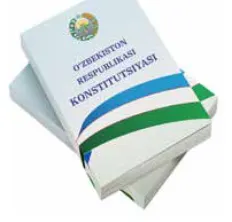

**Muqaddima** Konstitutsiyamizning mafkuraviy kirish qismidir. Konstitutsiya muqaddimasi xalqning orzu-intilishlarini ifodalaydi, umuminsoniy va milliy qadriyatlarni oʻzida aks ettiradi. Muqaddimadagi qoida va gʻoyalar keyinchalik konstitutsiya normalarida u yoki bu shaklda, koʻrinishda oʻz oʻrnini topadi. Muqaddima **“Oʻzbekistonning yagona xalqi”** tushunchasi bilan boshlanib, bu orqali xalqimizning yagona va boʻlinmasligiga urgʻu berilgan.

Konstitutsiyaning **birinchi boʻlimi “Asosiy prinsiplar”** deb nomlanib, “Davlat suvereniteti”, “Xalq hokimiyatchiligi”, “Kons titutsiya va qonunning ustunligi”, “Tashqi siyosat” boblariga ajratilgan. Konstitutsiyaning dastlabki boʻlimidagi prinsiplar

### Oʻzbekiston Respublikasi Konstitutsiyasining tuzilishi

Inson va fuqaroning asosiy huquqlari, erkinliklari va burchlari

davlat va jamiyat hayotining ustunlari hisoblanadi. Chunki ushbu boʻlimda davlatning boshqaruv va tuzilish shakli, davlat suvereniteti xususiyatlari belgilangan.

Konstitutsiyaning **ikkinchi boʻlimi “Inson va fuqaroning asosiy huquqlari, erkinliklari va burchlari”** deb nomlanadi. Mazkur boʻlimda davlat va fuqaro bir-biriga nisbatan huquq va burchlar orqali oʻzaro bogʻliqligi, inson va fuqarolarning shaxsiy huquq va erkinliklari (yashash huquqi), fuqarolik masalalari, siyosiy (saylov huquqi), iqtisodiy (mulkdor boʻlish huquqi), ijtimoiy (taʼlim olish, mehnat qilish), madaniy va ekologik huquqlar hamda huquq va erkinliklar kafolatlari, fuqarolarning burchlari belgilangan.

Konstitutsiyaning **uchinchi boʻlimi “Jamiyat va shaxs”** deb nomlangan. Unda jamiyatning iqtisodiy negizlari, fuqarolik jamiyati institutlari, oila, bolalar va yoshlarga oid masalalar hamda ommaviy axborot vositalarining huquqiy asoslari mustahkamlangan.

**Toʻrtinchi boʻlim “Maʼmuriy-hududiy va davlat tuzilishi”** deb nomlangan, unda Oʻzbekistonning maʼmuriy-hududiy tuzilishi hamda Qoraqalpogʻiston Respublikasining huquqiy holati alohida boblarda belgilangan.

**“Davlat hokimiyatining tashkil etilishi”** deb nomlangan Konstitutsiyaning eng katta **beshinchi boʻlimi** “Oʻzbekiston Respublikasining Oliy Majlisi”, “Oʻzbekiston Respublikasining Prezidenti”, “Oʻzbekiston Respublikasi Vazirlar Mahkamasi”, “Mahalliy davlat hokimiyati asoslari. Fuqarolarning oʻzini oʻzi boshqarish organlari”, “Say-

### Yodda tuting!

“Moliya, pul va bank tizimi” hamda “Mudofaa va xavfsizlik” kabi boblarni oʻz ichiga olgan.

Soʻnggi oltinchi boʻlim esa Konstitutsiyani oʻzgartirish tartibiga bagʻishlangan.

Oʻzbekiston Respublikasi Konstitutsiyasi muqaddima, 6 boʻlim, 27 bob va 155 moddadan iborat.

### Savol va topshiriqlar

1. Qadimgi davlatlarda qonunlar mavjud boʻlsa-da, yaxlit asosiy qonun – konstitutsiyaning yaratilishiga boʻlgan zarurat nimadan iborat edi?

2. Jahonda qabul qilingan dastlabki konstitutsiyalar va ularning tarixiy ahamiyati qanday?

3. Konstitutsiyaning mazmun-mohiyatini nimalar belgilaydi?

4. Konstitutsiyani boshqa qonunlardan farqli ravishda nima uchun asosiy qonun deyiladi?

5. Konstitutsiyaning muqaddimasi va uning keyingi normalari oʻrtasida qanday bogʻliqlik mavjud?

## 2-dars. Oʻzbekiston Respublikasi Konstitutsiyasining qabul qilinishi

Barcha jamoalar uchun umumiy va doimiy konstitutsiya yaratish imkonsiz, har bir avlod oʻz konstitutsiyasini yaratish huquqiga ega.

**Tomas Jefferson**

### Bilib olasiz

Oʻzbekiston Respublikasi Konstitutsiyasining yaratilishi.

Yangi tahrirdagi Oʻzbekiston Respublikasi Konstitutsiyasining qabul qilinishi. Konstitutsiyaga oʻzgartirish va qoʻshimchalar kiritish tartibi.

### Oʻzbekiston Respublikasi Konstitutsiyasining yaratilishi

Davlat mustaqilligi uchun qoʻyilgan asosiy qadam sifatida eʼtirof etiladigan, 1990-yil 20-iyunda qabul qilingan Mustaqillik deklaratsiyasi yangi konstitutsiyani yaratish uchun asos boʻldi. Deklaratsiya qabul qilingan Oliy Kengash sessiyasida yangi konstitutsiya ishlab chiqish zarurati haqida xulosaga kelindi hamda konstitutsiya loyihasini tayyorlash uchun 64 kishidan iborat komissiya tuzildi. Konstitutsiya loyihasida jahonda umumeʼtirof etilgan prinsiplar va gʻoyalarga amal qilish bilan birga, unda oʻzbek xalqining davlatchiligi, ajdodlarimiz gʻoyalari, qadriyatlarimiz оʼz ifodasini topishiga alohida eʼtibor berildi.

Konstitutsiya loyihasining umumxalq muhokamasi uch oy davom etdi. Umumxalq muhokamasi jarayonida kelib tushgan 6 000 ta taklif asosida loyihaga 80 dan ortiq tuzatishlar kiritildi.

Keng umumxalq muhokamasi davomida bildirilgan koʻplab takliflar inobatga olingan holda komissiya tomonidan tayyorlangan Konstitutsiya loyihasi Oliy Kengash muhokamasiga qoʻyildi.

Mustaqil davlatning Konstitutsiyasi – davlatning asosiy qonuni sifatida fuqarolarning huquq va erkinliklarini mustahkamlab, qonun chiqaruvchi, ijro etuvchi va sud hokimiyati organlari faoliyati asoslarini belgiladi.

### Yodda tuting!

1992-yil 8-dekabrda Oliy Kengashning XI sessiyasida loyiha maʼqullandi va Oʻzbekiston Respublikasining Konstitutsiyasi qabul qilindi. Mustaqil Oʻzbekistonning Konstitutsiyasi shu tarzda amalga kiritildi. 8-dekabr – Oʻzbekiston Respublikasining Konstitutsiyasi qabul qilingan kun, umumxalq bayrami deb eʼlon qilindi. 1992-yil 8-dekabrda qabul qilingan Oʻzbekiston Respublikasi Konstitutsiyasi muqaddima, 6 boʻlim, 26 bob va 128 moddadan iborat boʻlgan.

**Yangi tahrirdagi Oʻzbekiston Respublikasi Konstitutsiyasining qabul qilinishi**

Mamlakatimizda amalga oshirilayotgan islohotlar insonning shaʼni, qadr-qimmati, huquq va erkinliklari bundan buyon barcha sohalarda ustuvor ahamiyat kasb etishini qatʼi qoidaga aylantirish, bir soʻz bilan aytganda, bugungi islohotlarning bosh tamoyili boʻlgan “Inson – jamiyat – davlat” yondashuvini Konstitutsiyamizning mazmun-mohiyatiga chuqur singdirishni taqozo etdi.

Yuqoridagilardan kelib chiqib, 2022-yil 20-may kuni Oliy Majlis palatalarining qoʻshma qarori bilan Oʻzbekiston Respublikasi Konstitutsiyasiga oʻzgartish va qoʻshimchalar kiritish

yuzasidan takliflarni shakllantirish va tashkiliy chora-tadbirlarni amalga oshirish boʻyicha Konstitutsiyaviy komissiya tashkil etildi. Oʻzbekiston Respublikasi Prezidenti Shavkat Mirziyoyev Konstitutsiyaviy komissiya aʼzolari bilan uchrashuvdagi nutqida: “Bosh maqsadimiz – har bir yurtdoshimiz ushbu hujjatni mening Konstitutsiyam deb faxrlanadigan mukammal darajaga olib chiqishdir”, deb taʼkidlagan edi.

**2023-yilning 30-aprel kuni** “Oʻzbekiston Respublikasi Konstitutsiyasi toʻgʻrisida”gi Oʻzbekiston Respublikasi Konstitutsiyaviy qonuni loyihasi boʻyicha Oʻzbekiston Respublikasi referendumi oʻtkazildi va yangi tahrirdagi Konstitutsiyamiz bevosita fuqarolarimiz tomonidan qabul qilindi.

> Konstitutsiyaning dastlabki 1-moddasida **Oʻzbekiston – suveren, demokratik, huquqiy, ijtimoiy, dunyoviy davlat** ekani qatʼi belgilab qoʻyildi.

**Huquqiy davlat** huquq ustuvorligi taʼminlangan, inson va fuqarolarning huquq va erkinliklari kafolatlangan, qonunlar oldida barcha teng va hisobdor boʻlgan, hech kim qonundan ustun turmaydigan davlatdir.

**Ijtimoiy davlat** har bir inson uchun farovon turmush darajasi, xususan, sifatli taʼlim, kafolatli tibbiy xizmat, munosib mehnat sharoiti va adolatli ish haqi, pensiya va nafaqalar, uy-joyli boʻlish sharoiti mavjud boʻlgan, hech bir fuqaro oʻz muammolari bilan yolgʻiz qolmaydigan adolatli davlatdir.

**Dunyoviy davlat** diniy tashkilot va birlashmalar davlatdan hamda davlat hokimiyati dindan ajratilgan, davlat boshqaruvi diniy qoidalar bilan emas, balki Konstitutsiya va qonun hujjatlari bilan tartibga solinadigan davlat hisoblanadi.

Yangilangan Konstitutsiyamizning eng muhim jihatlari shaxsiy huquq va erkinliklar, iqtisodiy va ijtimoiy huquqlar borasidagi normalar qariyb **3,5 baravarga koʻpaydi.**

Eng muhim oʻzgarishlar qatorida taʼlim sohasiga oid normalar yanada koʻpaydi. Masalan, davlatning oʻqituvchilarning shaʼni va qadr-qimmatini himoya qilishi, ularning ijtimoiy va moddiy farovonligi, kasbiy jihatdan oʻsishi toʻgʻrisida gʻamxoʻrlik qilishi mustahkamlandi (52-modda).

Yangi tahrirdagi Konstitutsiya tariximizda bevosita xalq tomonidan qabul qilinib, toʻgʻridan toʻgʻri amalga kiritilgan birinchi hujjat boʻldi.

Referendumga chiqarilishidan oldin konstitutsiya loyihasi boʻyicha 220 mingdan ortiq takliflar kelib tushdi.

Yangi tahrirdagi konstitutsiyada moddalar soni 128 tadan 155 taga oshdi.

Asosiy qonun matni qariyb 65 foizga yangilandi.

### Konstitutsiyaga oʻzgartirish va qoʻshimchalar kiritish tartibi

Konstitutsiyamizda uning barqarorligini taʼminlash, unga tez-tez oʻzgartirishlar kiritilishining oldini olishga qaratilgan himoya choralari nazarda tutilgan. Mazkur qoidalar Konstitutsiyaning **VI boʻlimida** bayon etilgan boʻlib, unda oʻzgartirishlar kiritish tartibi va shartlari keltirilgan.

**154-moddaga** koʻra, Oʻzbekiston Respublikasining Konstitutsiyasiga oʻzgartirish va qoʻshimchalar tegishincha Oʻzbekiston Respublikasi Oliy Majlisining Qonunchilik palatasi deputatlari va Senati aʼzolari umumiy sonining kamida uchdan ikki qismidan iborat koʻpchiligi tomonidan qabul qilingan konstitutsiyaviy qonun yoki Oʻzbekiston Respublikasining referendumi bilan kiritiladi.

Shu bilan birga, Oʻzbekiston Respublikasi Oliy Majlisi tegishli taklif kiritilganidan keyin **olti oy mobaynida** Konstitutsiyaga oʻzgartirish va qoʻshimchalar kiritish toʻgʻrisida keng va har taraflama muhokamani hisobga olgan holda konstitutsiyaviy qonun qabul qilishi mumkin.

Agar Oʻzbekiston Respublikasi Oliy Majlisi Konstitutsiyani oʻzgartirish toʻgʻrisidagi taklifni rad etsa, taklif **bir yil oʻtganidan keyingina qayta kiritilishi mumkin.**

Xulosa qilish mumkinki, Konstitutsiyaga oʻzgartirish va qoʻshimchalar, birinchidan, Oliy Majlis palatalari tomonidan, ikkinchidan, referendum orqali bevosita xalqning oʻzi tomonidan kiritilishi mumkin.

2023-yilning 30-aprel kuni yangi tahrirdagi Konstitutsiya qabul qilingunga qadar Oʻzbekiston Respublikasi Konstitutsiyasiga 16 marta oʻzgartirish va qoʻshimchalar kiritilgan. Ularning asosiy qismi davlat boshqaruvi, Prezident, hukumat va saylov tizimi bilan bogʻliq oʻzgarishlar edi.

### Tariximizda birinchi marotaba 2023-yilning 30-aprel kuni “Oʻzbekiston Respublikasi

**Konstitutsiyasi toʻgʻrisida”gi** Oʻzbekiston Respublikasi Konstitutsiyaviy qonunini xalqimizning oʻzi qabul qildi. Yangi tahrirdagi Konstitutsiyamizdagi yangi qoidalar va oʻzgarishlarning asosiy qismi inson huquqlari bilan bogʻliq.

Qonunchilik palatasi deputatlari va Senati aʼzolari umumiy sonining kamida uchdan ikki qismidan iborat koʻpchiligi tomonidan qabul qilingan konstitutsiyaviy qonun orqali

### Savol va topshiriqlar

### Mustaqil ish uchun topshiriq

Jadval yarating. Jadvalning chap tomoniga Konstitutsiyamizdagi eng muhim inson huquqlari va erkinliklari nomlarini yozing, jadvalning oʻng tomonida esa ularning mazmunini bayon qiling.

## 3-dars. Huquqiy davlatda konstitutsiyaning oʻrni

Davlatning vazifasi insonlarni baxt-saodatga olib borishdir, bu esa ilm va yaxshi axloq yordamida qoʻlga kiritiladi. **Abu Nasr Forobiy**

### Bilib olasiz

Huquqiy davlat va uning belgilari.

Huquqiy davlat va huquqiy madaniyat.

Huquqiy davlatda konstitutsiyaning ustunligi.

### Huquqiy davlat va uning belgilari

**Huquqiy davlat** bu – huquq ustuvorligi taʼminlangan, inson va fuqarolarning huquq va erkinliklari kafolatlangan, hokimiyatni amalga oshirishda (bevosita yoki vakillar orqali) xalqning ishtiroki taʼminlanuvchi davlatdir.

Huquqiy davlatda davlat organlarining, mansabdor shaxslarning faoliyati faqat konstitutsiya hamda qonun hujjatlari asosida amalga oshiriladi. Konstitutsiya qoidalari davlat organlari faoliyati va insonlar hayotida toʻgʻridan toʻgʻri qoʻllanadi. Huquqiy davlatda qonun talablari barchaga birdek tatbiq etiladi. Barcha davlat organlari va mansabdor shaxslar, fuqarolar va fuqarolik jamiyati institutlari qonunlarga boʻysunadi. Huquqiy davlat toʻgʻrisidagi nazariyalar har qanday demokratik davlat intilishi kerak boʻlgan namuna vazifasini oʻtaydi.

Huquqiy davlatda inson va uning manfaatlari davlatning diqqat markazida turadi. Inson va davlat oʻrtasidagi munosabatlarda inson manfaatlari ustuvor boʻladi.

### HUQUQIY DAVLATNING BELGILARI

**Hokimiyat tizimining qonun chiqaruvchi, ijro etuvchi va sud hokimiyati tarmoqlariga boʻlinishi**

### Qonun ustuvorligi

**Hokimiyat tarmoqlarining oʻzaro muvozanati va bir-birini tiyib turishi**

**Fuqaro va davlatning huquq va burchlar orqali oʻzaro bogʻliqligi va masʼulligi**

**Inson huquq va erkinliklarining kafolatlanishi, ularni hech kim buzmasligi**

### Huquqiy davlat va huquqiy madaniyat

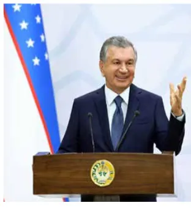

Huquqiy davlat va fuqarolik jamiyatining muhim mezonlaridan biri jamiyatda aholi huquqiy ongi va madaniyati darajasining yuksakligi hisoblanadi. Oʻzbekistonda mustaqillikning ilk yillaridan ushbu masalaga alohida eʼtibor qaratildi. Aholining huquqiy ongi va madaniyatini yuksaltirish masalalari davlat siyosatining ustuvor yoʻnalishiga aylandi. Shu oʻrinda Oʻzbekiston Respublikasi Prezidenti Shavkat Mirziyoyevning quyidagi fikrlarini keltirib oʻtish maqsadga muvofiq: **“Biz jamiyatimizda shunday huquqiy madaniyatni shakllantirishimiz kerakki, unga muvofiq konstitutsiya va qonunlarga amal qilish, boshqalarning huquq va erkinliklari, shaʼni va qadr-qimmatini hurmat qilish majburiyat emas, balki kundalik qoida va odatga aylanishi shart”.**

Huquqiy ong qonunchilik va undagi huquqiy normalar, muayyan huquqiy munosabatlarda huquqiy normalarni amalga oshirish boʻyicha davlat idoralari, fuqarolar va boshqa shaxslarning faoliyati, qonunni buzishga qarshi kurashish kabi turli munosabatlarni ifoda etadi.

Qonunni bilmaslik javobgarlikdan ozod etmaydi! Barcha fuqarolar mavjud qonunlarni yoddan bilmasligi mumkin, lekin oʻz huquq va manfaatlariga aloqador va kundalik hayotida har kuni foydalanadigan qonun hujjatlarini bilmaslik huquqiy ong yetarli darajada emasligidan dalolat beradi. Koʻrinib turibdiki, mamlakatimizda huquqiy davlatni barpo etishda huquqiy ong va huquqiy madaniyatni yuksaltirishning oʻrni beqiyos.

Biroq baʼzi holatlarda jamiyatda huquqiy nigilizm va huquqiy madaniyatsizlik kabi noxush holatlar uchrab turadi. Bunda qonunlar buziladi yoki ijro etilmaydi. Xulosa qilishimiz mumkinki, ularni bartaraf etmasdan turib huquqiy davlat gʻoyasini roʻyobga chiqarish mumkin emas.

Inson huquq va erkinliklariga hurmat munosabatini shakllantirish, aholining huquqiy ongi va huquqiy madaniyatini yuksaltirish, jamiyatda fuqarolarning huquqiy savodxonligi darajasini oshirish maqsadida qabul qilingan Oʻzbekiston Respublikasi Prezidentining 2019-yil 9-yanvardagi “Jamiyatda huquqiy ong va huquqiy madaniyatni yuksaltirish tizimini tubdan takomillashtirish chora-tadbirlari toʻgʻrisida”gi farmonida jamiyatda huquqiy madaniyatni yuksaltirish konsepsiyasi tasdiqlandi.

### Yodda tuting!

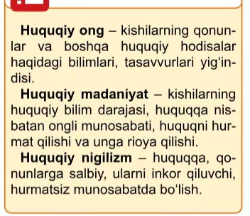

### Huquqiy madaniyatga ega shaxs

### Huquqiy davlatda konstitutsiyaning ustunligi

Huquqiy davlatning eng muhim belgilaridan biri konstitutsiya va qonun ustunligidir. **Konstitutsiya va qonun ustuvorligi** barcha davlat hokimiyati organlari faoliyatida konstitutsiya, qonunlar oliy yuridik kuchga egaligi, ularning hokimiyat chiqaradigan boshqa qonun hujjatlaridan ustunligi hisoblanadi. Qonun ustuvorligi jamiyatda demokratiya va qonunchilik taʼminlanishiga xizmat qiluvchi tamoyildir. Mamlakatimizda demokratik huquqiy davlat barpo etishning bosh mezoni konstitutsiya va qonun ustuvorligini taʼminlashdir. Davlatni huquqiy deb atash uchun qonun ustunligi bilan birga chinakam huquq ustuvorligi ham talab etiladi. Huquq ustuvorligi prinsipi barcha normativ-huquqiy hujjatlar (shu jumladan, konstitutsiya) va davlat hokimiyati organlari faoliyati tabiiy huquq nazariyasiga tayanadi, inson huquqlari va manfaatlarini taʼminlash va himoya qilishni talab qiladi.

Huquqiy davlat insonning qadr-qimmati, erkinligi va huquqlarini himoya qilishga qaratilgan, qonunlar oldida barcha teng va hisobdor boʻlgan, hech kim qonundan ustun turmaydigan davlatdir.

Bugun Oʻzbekistonda insonparvar, adolatli, erkin va xalqchil boʻlgan huquqiy davlat qurish maqsad qilingan. Oʻzbekiston Respublikasi Prezidenti Shavkat Mirziyoyev 2022-yil 20-iyunda Konstitutsiyaviy komissiya aʼzolari bilan uchrashuvda: **“Faqat huquqiy davlat sharoitidagina insonning hayoti, erkinligi, shaʼni, qadr-qimmatini toʻliq taʼminlash, tom maʼnoda xalqparvar boshqaruv tizimini shakllantirish mumkin”**, deb taʼkidlagan edi.

Yangi tahrirdagi konstitutsiyamizning 1-moddasida “Oʻzbekiston – huquqiy davlat” deb koʻrsatib qoʻyildi. Asosiy qonunda Oʻzbekiston huquqiy davlat ekanini alohida belgilash davlat oʻz faoliyatini, jamiyat va fuqarolar yashash tarzini faqat konstitutsiya va qonunlarga koʻra yoʻlga qoʻyishiga asos yaratadi.

Yangilangan konstitutsiyamizning normalarida ham huquqiy davlat prinsipini roʻyobga chiqarishga qaratilgan asoslar va kafolatlar mustahkamlandi. Birinchidan, konstitutsiyaning oliy yuridik kuchga egaligi hamda uning toʻgʻridan toʻgʻri amal qilishi belgilandi. Ikkinchidan, inson bilan davlat organlarining oʻzaro munosabatlarida yuzaga keladigan qonunchilikdagi barcha qaramaqarshiliklar va noaniqliklar inson foydasiga talqin qilinishi mustahkamlandi.

Oʻzbekiston huquqiy davlat deb belgilanishi barchaning qonun oldida tengligini va qonundan hech kim ustun emasligini taʼminlash, insonlar ongiga qonunlarga hurmat va itoat etib yashash lozimligini singdirishga asos boʻladi.

### Yodda tuting!

> **Huquq ustuvorligi (“Rule of law”) –** davlat va mansabdor shaxslarning, fuqarolar va birlashmalarining faoliyati huquq bilan bogʻliqligi, huquqqa mos holda amalga oshirilishidir.

### Savol va topshiriqlar

1. Huquqiy davlat va huquqiy boʻlmagan davlat oʻrtasida qanday farqlar mavjud?

2. Huquqiy madaniyatga ega shaxsda qanday sifatlar boʻlishi lozim?

3. Qonun ustunligi va huquq ustuvorligi tushunchalari oʻrtasida qanday farq bor?

4. Konstitutsiyamizning qaysi normalarida huquqiy davlat tamoyiliga oid qoidalar oʻz ifodasini topgan?

### Mustaqil ish uchun topshiriq

Huquqiy nigilizm jamiyat taraqqiyotiga jiddiy xavf tugʻdiruvchi hamda huquqiy ong va huquqiy madaniyatning yuksalishiga toʻsiq boʻluvchi salbiy hodisalardan biridir. Jamiyatda yoshlarning huquqiy ongi va huquqiy madaniyatini yuksaltirish, huquqiy savodxonlikni oshirishning qanday yoʻllari mavjudligini sinfdoshlaringiz bilan muhokama qiling.

## 4-dars. Konstitutsiyaning asosiy prinsiplari. Davlat suvereniteti

Suverenitet – davlatning mutlaq va doimiy hokimiyatidir.

**Jan Boden**

### Bilib olasiz

Davlat suvereniteti tushunchasi.

Oʻzbekiston Respublikasining davlat boshqaruvi va tuzilishi shakli. Oʻzbekistonning davlat tili, davlat ramzlari.

### Davlat suvereniteti tushunchasi

Oʻzbekiston Respublikasi Konstitutsiyasining birinchi boʻlimi **“Asosiy prinsiplar”** deb nomlanadi. Unda davlat va konstitutsiyaviy tuzumning bosh tamoyillari belgilangan. Mazkur boʻlimning dastlabki bobi “Davlat suvereniteti” deb nomlanadi hamda 6 ta moddani oʻz ichiga oladi.

Suverenitet soʻzi fransuzcha “souverainete” – “oliy hokimiyat” degan maʼnoni beradi. Suverenitet tushunchasi fransiyalik huquqshunos olim Jan Boden tomonidan kiritilgan hamda barcha xalqlar davlatchiligida mustaqillik maʼnosida ishlatiladi va xalqaro ahamiyat kasb etadi. Davlat suvereniteti hokimiyatni amalga oshirishda, bu borada yuzaga keluvchi muammolarni hal etishda nafaqat mamlakat ichkarisida, balki tashqarisida ham boshqa davlatlardan toʻla-toʻkis mustaqillikni anglatadi. Davlatning belgilaridan biri uning suvereniteti hisoblanadi. Davlat suverenitetining quyidagi asosiy prinsiplari mavjud: ✔ davlat hududi hamda chegaralarining daxlsizligi va boʻlinmasligi;

✔ mustaqil ichki va tashqi siyosat;

✔ xalqaro huquqning asosiy prinsiplarini eʼtirof etish va hurmat qilish;

✔ davlat tili;

✔ oʻz taraqqiyot yoʻlini, davlat ramzlarini tanlashdagi mustaqillik va hokazo.

1991-yil 31-avgustda Oʻzbekiston SSR Oliy Kengashining navbatdan tashqari VI sessiyasida respublikamiz mustaqil davlat deb eʼlon qilindi. Ushbu sessiyada “Oʻzbekiston Respublikasining davlat mustaqilligi asoslari toʻgʻrisida”gi qonun qabul qilindi. U Oʻzbekiston Respublikasining Konstitutsiyasi qabul qilingan 1992-yil 8-dekabrga qadar asosiy qonun vazifasini bajardi.

**Asosiy prinsiplar** ✔ Davlat suvereniteti ✔ Xalq hokimiyatchiligi ✔ Konstitutsiya va qonunning ustunligi ✔ Mustaqil tashqi siyosat

### Oʻzbekiston

respublika shakliga ega boʻlgan suveren, demokratik, ijtimoiy va dunyoviy davlat.

Davlatning “Oʻzbekiston Respublikasi” va “Oʻzbekiston” degan nomlari bir maʼnoni anglatadi.

### Oʻzbekiston Respublikasi

**Konstitutsiyasi, 1-modda**

### Yodda tuting!

Davlat xalq irodasini ifoda etib, uning manfaatlariga xizmat qiladi. Davlat organlari va mansabdor shaxslar jamiyat va fuqarolar oldida masʼuldirlar.

### Oʻzbekiston Respublikasi

**Konstitutsiyasi, 2-modda**

Davlat mustaqilligiga erishilishi Oʻzbekistonga mustaqil taraqqiyot yoʻliga qadam qoʻyish, jahon hamjamiyatiga xalqaro munosabatlarning toʻla huquqli subyekti sifatida kirish imkonini berdi. Davlatning xalq manfaatlariga xizmat qilishiga erishish demokratik jamiyat qurishda eng muhim shartdir. Davlatning eng birinchi vazifasi xalq irodasini ifoda etish, xalq manfaatlarini himoya qilish va unga xizmat qilishdir. Bu esa barcha davlat organlari va mansabdor shaxslar jamiyat va fuqarolar oldida masʼul ekanini bildiradi.

### Oʻzbekiston Respublikasining davlat boshqaruvi va tuzilishi shakli

**Respublika boshqaruv shakli** deganda davlat hokimiyatining oliy organlarini tashkil etish hamda ushbu organlarning oʻzaro va aholi bilan boʻlgan munosabatlari tizimi tushuniladi. “Respublika” atamasi lotinchadan olingan boʻlib, “umumxalq ishi” degan maʼnoni bildiradi. BMT aʼzolaridan 150 ga yaqin davlat oʻz nomida respublika boshqaruv shakliga egaligini mustahkamlagan.

Konstitutsiyamizning 1-moddasida **Oʻzbekiston respublika boshqaruv shaklidagi davlat** ekani belgilangan. Oʻzbekistonda respublika boshqaruv shakli hokimiyatning barcha oliy organlari saylovlar yoki vakillik organlari tomonidan shakllanishida namoyon boʻladi. Konstitutsiyamizga koʻra, qonun chiqaruvchi organ – Oliy Majlis ham, davlat boshligʻi Prezident ham fuqarolar tomonidan saylanadi. Ijro etuvchi hokimiyat – Vazirlar Mahkamasi esa birlamchi vakillik organlari tomonidan shakllantiriladi. Bunda Oʻzbekiston Respublikasining Prezidenti davlat boshligʻi hisoblanib, u davlat hokimiyati organlarining kelishilgan holda faoliyat yuritishini hamda hamkorligini taʼminlaydi.

Xulosa qilish mumkinki, davlat boshqaruvining respublika shakli xalq hokimiyatchiligining ifodasi boʻlib, fuqarolarning konstitutsiyada kafolatlangan tabiiy huquqlari taʼminlanadi, ularning jamiyat va davlat ishlarini boshqarishda bevosita hamda oʻz vakillari orqali ishtirok etish, soʻz erkinligi, saylov, sudga shikoyat qilish kabi huquq va erkinliklaridan foydalanishi, shuningdek, davlat organlarining faoliyati ustidan jamoatchilik nazoratini amalga oshirishi uchun zarur shart-sharoitlar yaratiladi.

Har qanday davlatning asosiy belgisi uning aholisi yashab turgan hudud mavjud ekanidir.

**Davlat tuzilishi shakli** joylardagi hokimiyat organlarining markaziy hokimiyat organlari bilan oʻzaro munosabatlarini belgilab beruvchi, siyosiy va hududiy jihatdan tashkil etilishidir. Jahondagi aksariyat mamlakatlar davlat tuzilishining unitar shakliga egadir. Bu holda davlat hududi maʼmuriy hududlarga (viloyatlar, tumanlar va hokazolarga), yaʼni davlatchilikka ega boʻlmagan, balki boshqaruv qulay boʻlishi uchun mavjud boʻlgan qismlarga taq-

**Unitar davlat** yagona davlat boʻlib, uning alohida maʼmuriy-hududiy birliklari bir xildagi huquqlarga ega, butun davlat hududida yagona konstitutsiya, yagona hukumat va yagona qonun hujjatlari amal qiladi.

Oʻzbekiston Respublikasida davlat tuzilishining unitar shakli oʻrnatilgan. Respublikamizda davlatning unitar shakliga xos barcha belgilar mavjud. Konstitutsiyaga muvofiq (83-modda), Oʻzbekiston Respublikasi viloyatlar, tumanlar, shaharlar, shaharchalar, qishloqlar, ovullar, shuningdek, Qoraqalpogʻiston Respublikasidan iborat.

Oʻzbekiston Respublikasi maʼmuriy-hududiy tuzilishining oʻziga xosligi uning tarkibida tumanlar, shaharlar, shaharchalar va ovullardan tashkil topgan suveren Qoraqalpogʻiston Respublikasining mavjud ekanidir.

Qoraqalpogʻiston Respublikasi Oʻzbekiston Respublikasining Konstitutsiyasiga zid boʻlmagan oʻz Konstitutsiyasiga egadir. Qoraqalpogʻiston Respublikasining fuqarosi ayni vaqtda Oʻzbekiston Respublikasining fuqarosi hisoblanadi.

### Yodda tuting!

Oʻzbekiston Respublikasi oʻzining milliy-davlat va maʼmuriy-hududiy tuzilishini, davlat hokimiyati organlarining tizimini belgilaydi, ichki va tashqi siyosatini amalga oshiradi.

Oʻzbekistonning davlat chegarasi va hududi daxlsiz va boʻlinmasdir.

### Oʻzbekiston Respublikasi

**Konstitutsiyasi, 3-modda**

### Oʻzbekistonning davlat tili, davlat ramzlari

Til muloqot vositasi hamda millatni aniqlashdagi asosiy belgi-xususiyatdir. Davlat tili rasmiy til boʻlib, ish yuritish, taʼlim olib borish shu tilda amalga oshiriladi.

Mustaqillik uchun birinchi huquqiy qadamlardan biri oʻzbek tiliga davlat tili maqomi berilishi hisoblanadi. 1989-yil 21-oktyabrda “Davlat tili toʻgʻrisida”gi qonun qabul qilinib, oʻzbek tiliga davlat tili maqomi berildi. Bu Sobiq Ittifoq davrida mustaqillik uchun, suverenitet uchun qilingan eng katta harakat edi. Shu paytdan boshlab oʻzbek tili rivojlanishining yangi bosqichi boshlandi.

Shu tariqa, dastlab Oʻzbekiston Respublikasining “Davlat tili haqida”gi qonun, keyinchalik Oʻzbekiston Respublikasi Konstitutsiyasida davlat tili haqidagi qoidalar mustahkamlangan.

**“Oʻzbekiston Respublikasining davlat tili haqida”gi qonuni**da belgilanganidek, oʻzbek tiliga davlat tili maqomining berilishi mamlakat hududida

### Yodda tuting!

Oʻzbekiston Respublikasining davlat tili oʻzbek tilidir.

### Oʻzbekiston Respublikasi

hududida istiqomat qiluvchi millat va elatlarning tillari, urf-odatlari va anʼanalari hurmat qilinishini taʼminlaydi, ularning rivojlanishi uchun sharoit yaratadi.

### Oʻzbekiston Respublikasi

**Konstitutsiyasi, 4-modda**

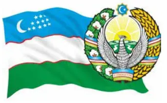

### Yodda tuting!

> Oʻzbekiston Respublikasi qonun bilan tasdiqlanadigan oʻz davlat ramzlari – bayrogʻi, gerbi va madhiyasiga ega.

Davlat ramzlari davlat himoyasidadir.

### Oʻzbekiston Respublikasi

**Konstitutsiyasi, 5-modda**

yashovchi millat va elatlarning oʻz ona tilini qoʻllashdan iborat konstitutsiyaviy huquqlariga monelik qilmaydi. Oʻzbekiston Respublikasida davlat tilini oʻrganish uchun barcha fuqarolarga shart-sharoit yaratiladi hamda uning hududida yashovchi millatlar va elatlarning tillariga izzat-hurmat bilan munosabatda boʻlish taʼminlanadi.

**Davlat ramzlari** har bir davlat mustaqilligining tarixan shakllangan, eng muhim belgilari sifatida uning suverenitetini yaqqol tasdiqlaydi.

Oʻzbekiston Respublikasi ham oʻz oliy davlat hokimiyati tomonidan belgilangan va konstitutsiyada mustahkamlangan davlat ramzlari – bayrogʻi, gerbi va madhiyasiga ega.

Xalqimizning gʻururi, iftixori boʻlgan bu ramzlarda tariximiz, boy maʼnaviy-madaniy merosimiz, milliy urf-odat hamda anʼanalarimiz, buyuk maqsad, ezgu orzu-intilishlarimiz oʻz ifodasini topgan.

1991-yil 18-noyabrda “Oʻzbekiston Respublikasining Davlat bayrogʻi toʻgʻrisida”gi qonun, 1992-yil 2-iyulda “Oʻzbekiston Respublikasining Davlat gerbi toʻgʻrisida”gi qonun, 1992-yil 10-dekabrda “Oʻzbekiston Respublikasining Davlat madhiyasi toʻgʻrisida”gi qonun qabul qilindi.

Davlat ramzlariga nisbatan hurmatsizlik qilganlik uchun javobgarlik mavjud. Har bir shaxs davlat ramzlarini hurmat qilishi shart!

Davlat ramzlari Oʻzbekiston mustaqil respublika sifatida xalqaro huquqning teng huquqli subyekti ekanini ifodalab turadi. Ayniqsa, BMT binosining oldida bayrogʻimizning hilpirashini koʻrganda yoki xalqaro sport musobaqalarida vatandoshlarimizning yutuqlari sharafiga bayrogʻimiz koʻtarilib, madhiyamiz yangraganda har birimizning qalbimizda gʻurur-iftixor uygʻonadi.

### Savol va topshiriqlar

1. Oʻzbekiston qachon mustaqil suveren davlat maqomiga ega boʻldi?

2. Oʻzbekiston Respublikasi mustaqil suveren davlat sifatida qanday xalqaro tashkilotlarga aʼzo hisoblanadi?

3. Jahon mamlakatlaridan misollar keltirgan holda monarxiya va respublika boshqaruv shaklining farqli jihatlarini sanang.

4. Oʻzbekiston Respublikasi davlat tuzilishi va uning oʻziga xosligini tushuntiring.

5. Davlat mustaqilligi va davlat ramzlari oʻrtasida qanday bogʻliqlik mavjud?

## 5-dars. Xalq hokimiyatchiligining konstitutsiyaviy asoslari

Xalq demokratiyada koʻpchilikni tashkil etishi sababli, koʻpchilikning qarori hal qiluvchi ahamiyat kasb etadi.

**Arastu**

### Bilib olasiz

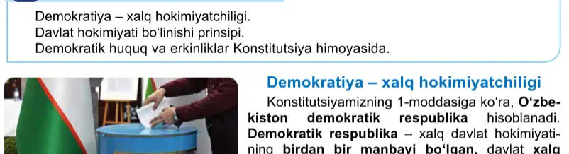

Konstitutsiyamizning 1-moddasiga koʻra, **Oʻzbekiston Demokratik respublika** – xalq davlat hokimiyatining **birdan bir manbayi boʻlgan,** davlat **xalq irodasini ifoda etadigan,** fuqarolar jamiyat va davlat ishlarini boshqarishda **bevosita hamda oʻz vakillari orqali ishtirok etish huquqi** bilan taʼminlangan, davlat hokimiyatining oliy organlari saylov yoʻli bilan shakllantiriladigan davlat hisoblanadi. **Xalq davlat hokimiyatining birdan bir manbayi** degan norma nafaqat oliy hokimiyat, balki barcha darajadagi hokimiyat organlari xalqqa tegishli ekanini, ularning tashkil etilishi va faoliyat yuritishi, sodda qilib aytganda, mavjudligi faqat va faqat xalqdan kelib chiqishi, xalqqa xizmat qilishini aniq belgilab bermoqda. Shuning uchun ham “Xalq hokimiyatchiligi” bobi konstitutsiyaning asosiy prinsiplari boʻlimida joylashtirilgan.

Davlat miqyosidagi muammolarni hal etishda xalqning bevosita ishtiroki referendumda, yaʼni mamlakat siyosiy hayotining eng muhim masalalari yuzasidan oʻtkaziladigan umumxalq muhokamasida va bevosita ovoz berishda qatnashishi orqali namoyon boʻladi.

Xalq nomidan faqat u saylagan Prezident, Oliy Majlis ish olib borishi mumkin. Dav - lat qaror qabul qilishi uchun jamoatchilik fikrini bilishi zarur boʻlib qolganda konstitutsiya, qonunlarning loyihalari umumxalq muhokamasiga qoʻyilishi yoki davlat va jamiyat hayotiga oid muhim qarorlar qabul qilish maqsadida referendum oʻtkazilishi mumkin. Masalan, 2023-yil 30-aprelda yurtimizda “**Oʻzbekiston Respublikasi Konstitutsiyasi toʻgʻrisida”**gi Oʻzbekiston Respublikasi konstitutsiyaviy qonuni loyihasi boʻyicha referendum oʻtkazildi. Referendumda ishtirok etgan fuqarolarning koʻpchiligi (referendumda ovoz berishda ishtirok etgan fuqarolarning 90,21 foizi) mazkur masalaga ijobiy javob berdilar.

> **Xalq hokimiyatchiligi** atamasi **demokratiya** (yunoncha demos – xalq, kratos – hokimiyat) soʻzining aynan tarjimasidir. Ilk bor Qadimgi Yunonistonda qoʻllangan bu tushuncha butun jahonga keng tarqaldi.

Inson huquq va erkinliklari muhofazasining kafolatlangan mexanizmi mavjudligi

**Bilvosita,** yaʼni vakillik demokratiyasi. Xalq suveren huquqlaridan foydalanib, oʻzi saylab qoʻygan vakillari (deputatlar va senatorlar) orqali davlat ishlarini amalga oshiradi.

**Bevosita**, yaʼni toʻgʻridan toʻgʻri demokratiya. Xalq davlat ishlarini vakillarsiz oʻzi hal qiladi (saylov, referendum, fuqarolar muro jaati, qonunlar loyihalari muhokamasi va boshqalar orqali).

### Davlat hokimiyati boʻlinishi prinsipi

**Hokimiyatlar boʻlinishi** davlat hokimiyati tizimi faoliyatining asosiy prinsipi boʻlib, davlat hokimiyati vakolatlari bir-biridan mustaqil boʻlgan tarmoqlar orasida taqsimlanishi, ularning oʻzaro hamkorlik va muvozanati orqali hokimiyatni suiisteʼmol qilishning oldini olishni taʼminlaydigan tamoyildir. Ushbu prinsipga muvofiq davlat hokimiyati qonunchilik, ijro etuvchi va sud hokimiyati organlariga boʻlinadi.

Dunyo miqyosida hokimiyatlar boʻlinishi nazariyasining ilmiy asoslari rivojlanishi Yevropa va AQSHda davlat boshqaruvining yangi shakllariga oʻtilishi, siyosiy tizimning oʻzgarishi hamda uning ilk konstitutsiyalarda mustahkamlanishi davrida sodir boʻlgan.

Hokimiyatlar boʻlinishi tarixiga oid adabiyotlarda angliyalik olim **Jon Lokk** zamonaviy hokimiyatlar boʻlinishi nazariyasining ilk muallifi sifatida eʼtirof etiladi.

Fransiyalik olim **Sharl Lui de Monteskyo** hokimiyatlar taqsimlanishining tugal taʼlimotini yaratgan muallif sifatida eʼtirof etiladi. Darhaqiqat, J. Lokk hoki miyatni qonun chiqa ruvchi va ijro etuvchi tarmoqlarga boʻlgan, xolos. Sh. Monteskyo esa hokimiyatning qonun chiqaruvchi va ijro etuvchi organlari oʻrtasida mustaqillik, tenglik hamda bir-birini muvozanatda ushlab turish tizimi zarurligini taʼkidlagan. Monteskyo erkinlik va adolat qaror topishi uchun hokimiyatlar boʻlinishi prinsipida **sud hokimiyatini** ilk bora alohida koʻrsatib oʻtadi hamda sud hokimiyati qonun chiqaruvchi va ijro hokimiyatidan ajratilgan holda mavjud boʻlishi kerakligini taʼkidlaydi.

Hokimiyatlar boʻlinishi nazariyasining amaliy ifodasi 1787-yilda qabul qilingan Amerika Qoʻshma Shtatlari konstitutsiyasida aks etdi.

Mamlakatimiz qonunchiligida hokimiyatning boʻlinishi Oʻzbekiston Respublikasi Konstitutsiyasining 11-moddasida mustahkamlangan. Unga muvofiq, davlat hokimiyati tizimi hokimiyatning qonun chiqaruvchi, ijro etuvchi va sud hokimiyatiga boʻlinishi prinsipiga asoslanadi. Hokimiyat vakolatlari qonun chiqaruvchi oliy vakillik organi – **Oliy Majlis**, ijro hokimiyatining oliy organi – **Vazirlar Mahkamasi** va sud hokimiyati – odil sudlovni amalga oshiruvchi **Oliy sud** va **Konstitutsiyaviy sud** oʻrtasida taqsimlangan.

### Yodda tuting!

Xalq davlat hokimiyatining birdan bir manbayidir. Oʻzbekiston Respublikasida davlat hokimiyati xalq manfaatlarini koʻzlab va Oʻzbekiston Respublikasi Konstitutsiyasi hamda uning asosida qabul qilingan qonunlar vakolat bergan organlar tomonidangina amalga oshiriladi.

### Oʻzbekiston Respublikasi

**Konstitutsiyasi, 7-modda**

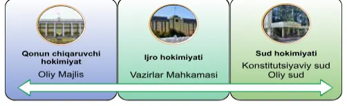

**Demokratik huquq va erkinliklar Konstitutsiya himoyasida 23 bet** Oʻzbekistonda demokratik huquq va erkinliklar konstitutsiya va qonunlar bilan himoya qilinadi. Inson huquqlari va erkinliklari tan olingan xalqaro huquqning umumeʼtirof etilgan prinsiplari va normalari bilan ham qoʻriqlanadi.

Insonning shaʼni, qadr-qimmati, huquq va erkinliklari bundan buyon barcha sohalarda ustuvor ahamiyat kasb etishini qatʼi qoidaga aylantirish, bir soʻz bilan aytganda, **“Inson qadri uchun”** gʻoyasi hamda bugungi islohotlarning bosh tamoyili boʻlgan **“Inson – jamiyat – davlat”** degan yondashuv yangilangan konstitutsiyamizning mazmun-mohiyatiga chuqur singdirildi. Konstitutsiyamiz inson huquqlari toʻgʻrisidagi xalqaro hujjatlar asosida ishlab chiqilgan. Alohida taʼkidlash lozimki, yangi tahrirdagi Konstitutsiyamiz xalqaro huquqiy hujjatlar normalari asosida yanada takomillashtirildi.**27 bet** Oʻzbekiston Respublikasi Konstitutsiyasining 13-moddasida ham Inson huquqlari umumjahon deklaratsiyasida eʼlon qilingan umuminsoniy huquqlar oliy qadriyat darajasida belgilangan. Inson huquqlari umumjahon deklaratsiyasida insonlarning ajralmas va daxl-siz huquqlari koʻrsatilgan. Uning 1-moddasiga muvofiq, “Hamma odamlar oʻz qadr-qimmati hamda huquqlarida erkin va teng boʻlib tugʻiladilar”, 3-moddasiga koʻra esa, “Har bir inson yashash, erkin boʻlish va shaxsiy daxlsizlik huquqlariga egadir”.

Konstitutsiyamizning eng muhim jihatlari inson, uning hayoti, erkinligi, qadr-qimmati, daxlsiz huquqlari va manfaatlarini taʼminlash, erkin va adolatli fuqarolik jamiyatini rivojlantirish hamda demokratik huquqiy davlat qurish bilan bogʻliqdir.

Yangi tahrirdagi Konstitutsiyamizning 19-moddasiga muvofiq, Oʻzbekiston Respublikasida insonning huquq va erkinliklari xalqaro huquqning umumeʼtirof etilgan normalariga binoan hamda ushbu Konstitutsiyaga muvofiq eʼtirof etiladi va kafolatlanadi. Inson huquq va erkinliklari har kimga tugʻilganidan boshlab tegishli boʻladi.

Huquqiy demokratik davlatda insonning qadr-qimmati, asosiy huquq va erkinliklarining daxlsizligi, ajralmasligi belgilanishi bilan bir qatorda, ular har kimga tugʻilganidan boshlab tegishli ekani tan olinadi.

### Savol va topshiriqlar

Ijtimoiy munosabatlarning jamiyat, fuqaro va davlat manfaatlariga mos tarzda tartibga solinganini anglatib, mamlakat miqyosida barqarorlik, batartiblik va qonuniy tartibot muhiti oʻrnatilganida;

Huquq buzilishi hollarining oldini olish, shuningdek, huquqiy munosabat ishtirokchilari qonunni buzgan taqdirda qonunda belgilangan tartibda, javobgarlikka tortish uchun qonunlarning huquqiy asos vazifasini bajarishida namoyon boʻladi.

Jamiyat hayotining barcha jabhalarida qonunlarning qatʼiy hukumronligini bildirib, yuqorida taʼkidlanganidek, barcha davlat organlari, mansabdor shahslar va qonunlarga soʻzsiz itoat etishida;

1. Davlat hokimiyatini kimlar amalga oshiradi?

2. Hokimiyatning boʻlinishi prinsipi nima?

3. Oʻzbekiston xalqi davlat va jamiyat hayotida qanday ishtirok etadi?

4. Referendum nima, u qanday masalalar yuzasidan tashkil qilinadi?

### Mustaqil ish uchun topshiriq

## 6-dars. Oʻzbekiston Respublikasida konstitutsiya va qonunning ustunligi

Agar tarbiya va jazo haqidagi qonunlar boʻlmasa, davlat faoliyati buziladi va inson huquqlari poymol boʻladi.

**Voiz Koshifiy**

### Bilib olasiz

Konstitutsiya va qonun.

Konstitutsiya va qonun ustuvorligini taʼminlash.

### Konstitutsiya va qonun

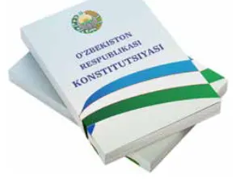

Oʻzbekiston Respublikasida Oʻzbekiston Respublikasi Konstitutsiyasi va qonunlarining ustunligi soʻzsiz tan olinadi. Oʻzbekiston Respublikasi Konstitutsiyasi mamlakatning butun hududida oliy yuridik kuchga ega, toʻgʻridan toʻgʻri amal qiladi va yagona huquqiy makonning asosini tashkil etadi.

Konstitutsiya mustaqil Oʻzbekiston Respublikasi qaror topganligini qonuniylashtirdi va oliy darajadagi qonun sifatida davlatimizning maqsadini, uning ijtimoiy, iqtisodiy, siyosiy tuzumini, boshqaruvning demokratik prinsiplarini, jamiyat rivojlanishining strategik yoʻnalishlarini belgilab berdi. Shuningdek, unda shaxsning mustaqilligi, hokimiyatlarning taqsimlanishi, mulkdorlik shakllarining xilma xilligi, mafkuraviy rang baranglik, ijtimoiy, iqtisodiy, madaniy sohalardagi demokratik qadriyatlar konstitutsiyaviy tuzumning prinsiplari sifatida tasdiqlangan hamda fuqarolar huquq va erkinliklari kafolatlangan, maʼnaviy qadriyatlarimiz asoslari mustahkamlab qoʻyilgan. Shunday ekan, konstitutsiya jamiyat, davlat, har bir fuqaro hayotida muhim oʻrin tutadigan hujjat hisoblanib, barcha qonunlarning qonuni, bir soʻz bilan aytganda, alifbosidir.

Sohibqiron Amir Temur bobomiz: “Davlat qonunlar asosida qurilmas ekan, unday saltanatning shukuhi, qudrati va tarkibi yoʻqoladi”, deb taʼkidlagan edilar. Shu nuqtayi nazardan, konstitutsiya va qonun ustuvorligini taʼminlash biz bunyod etayotgan demokratik-huquqiy davlatning bosh mezoni hisoblanadi.

Har qanday demokratik islohotlar samarasi, tinchlik va taraqqiyotning asosiy garovi ham konstitutsiya va qonun ustuvorligi taʼminlanishi bilan bevosita bogʻliq.

Qonun ustuvorligi bu – davlat hokimiyati va boshqaruvi organlari chiqarayotgan hujjatlar, mansabdor shaxslarning xatti-harakatlari faqat va faqat konstitutsiya hamda qonunlarga muvofiq boʻlishi shart, deganidir.

Konstitutsiyaning toʻgʻridan toʻgʻri amal qilishi – davlat organlari, ularning mansabdor shaxslari, shu jumladan, sudlar tomonidan konstitutsiya normalarini huquqni qoʻllash amaliyotida bevosita qoʻllagan holda qarorlar qabul qilish, fuqarolarning konstitutsiya normalaridan toʻgʻridan toʻgʻri foydalanishi va rioya etishini koʻzda tutadi.

### Yodda tuting!

Konstitutsiyaning eng asosiy xususiyatlaridan biri uning oliy yuridik kuchga ega ekanidir.

Konstitutsiya oliy yuridik kuchga ega deganda qonunchilik hujjatlari tizimida (iyerarxiyasida) eng yuqori oʻrinda turishi hamda uning boshqa har qanday normativ-huquqiy hujjatlardan ustunligi tushuniladi.

Qonun ustuvorligi, sodda qilib aytganda, qonunlarga rioya etishni anglatadi. Mazkur qarash har qanday rivojlangan davlatning poydevorini tashkil etadi.

Sohibqiron Amir Temur: **“Saltanatim martabasini toʻra va tuzuklar asosida shunday saqladimki, uning ishlariga aralashishga hech bir kimsaning qurbi yetmasdi”,** deb oʻz davlatini qatʼi qoidalar, qonunlar orqali boshqarilganini taʼkidlaydi.

Konstitutsiyaning oliy yuridik kuchga ega ekani uning siyosiy-huquqiy hujjatligi, parlamentda qabul qilinishining alohida tartibi mavjudligi yoki umumxalq ovozi (referendum) asosida qabul qilinishi, davlatning ichki va tashqi siyosatining asosiy strategik yoʻnalishlarini, insonning asosiy huquq va erkinliklarini belgilashida ham namoyon boʻladi.

Konstitutsiyamizning 16-moddasida “Ushbu Konstitutsiyaning birorta qoidasi Oʻzbekiston Respublikasining huquq va manfaatlariga, ushbu Konstitutsiyaning birinchi boʻlimida nazarda tutilgan asosiy prinsip va normalarga zarar yetkazadigan tarzda talqin etilishi mumkin emas. Oʻzbekiston Respublikasining qonunlari va boshqa normativ-huquqiy hujjatlari Oʻzbekiston Respublikasining Konstitutsiyasi asosida va uni ijro etish yuzasidan qabul qilinadi. Birorta qonun yoki boshqa normativ-huquqiy hujjat Konstitutsiyaning prinsip va normalariga zid boʻlishi mumkin emas” deb belgilangan. Shuningdek, qonunlar, Oliy Majlis palatalari qarorlari, Prezident farmon, qaror va farmoyishlari, Vazirlar Mahkamasi qarorlari, vazirlik va idoralar buyruqlari hamda qarorlari, qolaversa, mahalliy davlat hokimiyati organlari qarorlari faqat konstitutsiyaga asosan qabul qilinishi kerak, ularda konstitutsiyaga zid birorta norma boʻlishi mumkin emas.

### Konstitutsiya va qonun ustuvorligini taʼminlash

Qonun ustuvorligi xalq hokimiyati va inson huquqlari tushunchalari bilan bevosita bogʻliq prinsipdir. Chunki xalq hokimiyati deganda fuqarolarning qarorlar qabul qilish jarayonida bevo sita yoki bilvosita ishtirok etish huquqi tushuniladi. Shu maʼnoda xalq irodasining ifodasi boʻlgan, fuqarolarning parlamentga saylab qoʻygan vakillari orqali yoki oʻzlari tomonidan bevo sita referendum orqali qabul qilingan qonunlar xalq hokimiyatchiligining natijasi, majoziy qilib aytganda, mevasi hisoblanadi. Inson huquq va erkinliklari qonunlar vositasida hayotga joriy etiladi, aslida qonunlarning pirovard maqsadi ham inson, uning huquq va erkinliklarini himoya qilishdan iboratdir.

Chunki xalq hokimiyati deganda fuqarolarning qarorlar qabul qilish jarayonida bevosita yoki bilvosita ishtirok etish huquqi tushuniladi.

**Qonun ustuvorligi xalq hokimiyati va inson huquqlari tushunchalari bilan bevosita bogʻliq prinsipdir.**

Xalq irodasining ifodasi boʻlgan, fuqarolarning parlamentga saylab qoʻygan vakillari orqali yoki oʻzlari tomonidan bevosita referendum orqali qabul qilingan qonunlar xalq hokimiyatchiligining natijasi, majoziy qilib aytganda, mevasi hisoblanadi.

Inson huquq va erkinliklari qonunlar vositasida hayotga joriy etiladi, aslida qonunlarning pirovard maqsadi ham inson, uning huquq va erkinliklarini himoya qilishdan iboratdir.

Xalqaro hujjatlarda qonun ustuvorligining asosiy elementlari quyidagilar:

qonun ijodkorligining shaffof, hisobdorlik va demokratik jarayonni qamrab olgan qonuniylikka asoslanishi;

huquqiy aniqlik;

oʻzboshimchalikning taqiqlanganligi;

mustaqil va xolis, odil sudlovning ochiqligi;

maʼmuriy hujjatlar ustidan sud nazoratining oʻrnatilganligi;

inson huquqlarini hurmat qilish va kamsitmaslik hamda qonun oldida tenglik. Mamlakatimizda qonun ustuvorligini taʼminlashning zarur normativ-huquqiy va tashkiliy institutsional asoslari shakllantirilgan.

Oʻzbekiston Respublikasi Konstitutsiyasining III bobi “Konstitutsiya va qonunning ustunligi” deb nomlanib, mazkur bob Konstitutsiyamizning “Asosiy prinsiplar” boʻlimida joylashgan. Nazariyadan maʼlumki, prinsip deganda rahbariy qoidalar nazarda tutiladi. Agar konstitutsiyaning boshqa boʻlimlari oʻrtasida qandaydir tushunmovchilik kelib chiqadigan boʻlsa, masala nazariyaga koʻra, asosiy prinsiplarga tayanib hal qilinishi kerak. Shu maʼnoda qonun ustuvorligining “Asosiy prinsiplar” boʻlimida joylashtirilgani mamlakatimizda mazkur prinsipga alohida ahamiyat berilganidan dalolatdir.

Konstitutsiyaning mazkur bobidagi hamda boshqa normalarida mustahkamlangan qoidalarni tahlil qilish quyidagi fikrlarni keltirib chiqaradi:

birinchidan, Oʻzbekiston Respublikasida Oʻzbekiston Respublikasining Konstitutsiyasi va qonunlarining ustunligi soʻzsiz tan olinadi.

Ikkinchidan, davlat, uning organlari, mansabdor shaxslar, jamoat birlashmalari, fuqarolar Konstitutsiya va qonunlarga muvofiq ish koʻradilar.

Uchinchidan, birorta ham qonun yoki boshqa normativ-huquqiy hujjat Konstitutsiya normalari va qoidalariga zid kelishi mumkin emas. Qonun ustuvorligi barcha davlat hokimiyati organlari faoliyatida konstitutsiya, qonunlar oliy yuridik kuchga ega boʻlib, ularning hokimiyat chiqaradigan boshqa hamma meʼyoriy hujjatlar va yoʻriqnomalardan ustun turishi hisoblanadi.

### Yodda tuting!

Oʻzbekiston Respublikasi Konstitutsiyasining muqaddimasida Oʻzbekiston xalqi huquqiy davlat barpo etishni koʻzlagani qayd qilingan. Huquqiy davlatning muhim va ajralmas belgisi qonun ustuvorligi hisoblanadi.

### QONUN USTUVORLIGI TAMOYILI

Jamiyat hayotining barcha jabhalarida qonunlarning qatʼiy hukmronligini bildirib, yuqorida taʼkidlanganidek, barcha davlat organlari, mansabdor shaxslar va fuqarolarning konstitutsiya va qonunlarga soʻzsiz itoat etishida

Huquq buzilishi hollarining oldini olish, shuningdek, huquqiy munosabat ishtirokchilari qonunni buzgan taqdirda qonunda belgilangan tartibda, javobgarlikka tortish uchun qonunlarning huquqiy asos vazifasini bajarishida namoyon boʻladi

Ijtimoiy munosabatlarning jamiyat, fuqaro va davlat manfaatlariga mos tarzda tartibga solinganini anglatib, mamlakat miqyosida barqarorlik, batartiblik va qonuniy tartibot muhiti oʻrnatilganida

Qonun ustuvorligi jamiyatda demokratiya va qonunchilik taʼminlanishiga xizmat qiluvchi tamoyildir. Konstitutsiyaning eng asosiy yuridik xususiyatlaridan biri – uning oliy yuridik kuchga ega ekanidir. Shu bois yangi tahrirdagi Konstitutsiyaning 15-moddasida Oʻzbekiston Res publikasining Konstitutsiyasi mamlakatning butun hududida oliy yuridik kuchga ega, degan ustuvor qoida belgilandi.

Shu bilan birga, Konstitutsiyaning oliy yuridik kuchi haqida soʻz yuritilganda uning “Muqaddima”sidagi “xalqaro huquqning umumeʼtirof etilgan prinsip va normalariga asoslangan” degan tamoyilini ham nazarda tutish lozim.

Qonunchilik hujjatlariga Konstitutsiya, qonunlar, Oliy Majlis palatalari qarorlari, Oʻzbekiston Respublikasi Prezidentining farmon, qarorlari, Vazirlar Mahkamasi qarorlari, vazirlik va idoralar buyruqlari hamda qarorlari, shuningdek, mahalliy davlat hokimiyati organlari qarorlari kiradi.

Konstitutsiyaning oliy yuridik kuchga ega ekani uning siyosiy-huquqiy hujjatligi, parlamentda qabul qilinishining alohida tartibiga ega ekani yoki umumxalq ovozi (referendum) asosida qabul qilinishi, davlatning ichki va tashqi siyosatining asosiy strategik yoʻnalishlarini, insonning asosiy huquq va erkinliklarini belgilashida ham namoyon boʻladi.

Mamlakatda hokimiyatlar boʻlinishi prinsipining real joriy etilgani Oʻzbekistonda konstitutsiya va qonunlar ustunligini taʼminlashning muhim kafolatidir. Unga koʻra, qonun chiqaruvchi, ijro etuvchi va sud hokimiyati boʻgʻinlari konstitutsiya va qonunda belgilangan vakolatlari doirasida faoliyat yuritadi. Ular oʻrtasidagi munosabatlarni uygʻunlashtirishda eng oliy hakam qonundir.

Qonun ustuvorligi shaxsga oʻz huquq va erkinliklarini moneliksiz amalga oshirish, oʻz hayoti, erkinligi, shaʼni, qadr-qimmati va boshqa daxlsiz huquqlari qonunan kafolatlanganligi tufayli tinch, osoyishta, xotirjam, hech qanday tashqi taʼsirlardan, zoʻravonlik va oʻzboshimchalikdan qoʻrqmay yashash imkoniyatini beradi.

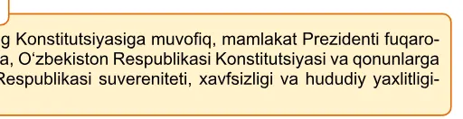

Qonun ustuvorligi, shuningdek, shaxsga uning uchun majburiy boʻlgan mazkur hujjatlarni qabul qilish jarayonida uning oʻzi yoki saylab qoʻygan vakillari orqali ishtirok etish, davlat boshqaruviga taʼsir oʻtkazish, davlat organlarining faoliyati ustidan jamoatchilik nazoratini amalga oshirish, oʻz huquq va erkinliklarini sud orqali himoya qilish, davlat organlari, mansabdor shaxslar, jamoat birlashmalarining gʻayriqonuniy xatti-harakatlari ustidan sudga shikoyat qilish huquqini taʼminlaydi.

Agar jamiyatda qonun ustuvorligi taʼminlanmasa, odamlarda nafaqat bugungi, balki ertangi kuniga ham ishonch yoʻqoladi, adolat, tenglik, erkinlikka rioya qilinmaydi. Qonun ustuvorligi taʼminlanmagan jamiyatda iqtisod ham rivojlanmaydi, iqtisodiy islohotlar ham samara bermaydi. Chunki hech kim qonun ishlamagan joyga oʻz mulkini, sarmoyasini kiritishni xohlamaydi.

Qonun ustuvor boʻlgan davlatda erkinlik, adolat, tenglik kafolatlanadi, hokimiyatning shaxsga taʼsiri chegaralanadi, inson huquqlari himoyalanadi, mulk huquqiga rioya qilinadi, odil sudlov mustaqil boʻlib, samarali amalga oshiriladi.

Oʻzbekiston Respublikasi Prezidentining 2023-yildagi PF-67-sonli “Yangi tahrirdagi Oʻzbekiston Respublikasi Konstitutsiyasini amalga oshirish boʻyicha birinchi navbatdagi chora-tadbirlar toʻgʻrisida”gi farmoni qabul qilindi. Mazkur farmonda yangi tahrirdagi Oʻzbekiston Respublikasi Konstitutsiyasini soʻzsiz va toʻliq amalga oshirish, unda mustahkamlangan ustuvor prinsiplarni Yangi Oʻzbekiston ulugʻvor gʻoyasiga hamohang tarzda roʻyobga chiqarish, davlat organlarining faoliyatini yangicha konstitutsiyaviy-huquqiy sharoitlarda yoʻlga qoʻyish, fuqarolar oʻz hayotida xalq Konstitutsiyasi ruhini yaqqol his etib turishini taʼminlash mustahkamlandi.

Yangi tahrirdagi Konstitutsiyani soʻzsiz va toʻliq amalga oshirish barcha darajadagi davlat organlari va tashkilotlarining birinchi navbatdagi ustuvor vazifasi etib belgilandi.

Yangi Konstitutsiya oliy yuridik kuchga ega ekanidan kelib chiqib, davlat organlari va tashkilotlari, shu jumladan, sud va huquqni muhofaza qiluvchi organlar faoliyatida toʻgʻridan toʻgʻri va soʻzsiz qoʻllanadi.

Mazkur Konstitutsiya normalarini ularni amalga oshirish uchun boshqa qonunchilik hujjatlarining mavjud emasligi yoki qonunchilikka Konstitutsiyaga muvofiq oʻzgartirish va qoʻshimchalar kiritilmaganligi vaji bilan qoʻllashni rad etish qatʼian taqiqlanadi.

**Oʻzbekiston Respublikasida konstitutsiya va qonunlarining ustunligi soʻzsiz tan olinadi**

### RESPUBLIKASI

**KONSTITUTSIYASI**

**Birorta ham qonun yoki boshqa normativ-huquqiy hujjat konstitutsiya normalari va qoidalariga zid kelishi mumkin emas**

Prezidentning bu boradagi faoliyati muhim siyosiy-yuridik ahamiyatga ega. U oʻz farmonlari, qarorlari bilan konstitutsiyaviy tamoyillarning, qonunlarda mustahkamlangan qoidalarning hayotga toʻla joriy etilishi uchun yoʻl ochadi, tegishli huquqiy mexanizmlarni yaratadi.

Oʻzbekistonda konstitutsiya va qonunlarning ustunligini taʼminlash uchun tashkiliy-huquqiy kafolatlar va yuridik mexanizmlar muttasil takomillashtirilib, ularning samaradorligini oshirib borish lozim.

Yurtimizda amalga oshirilayotgan keng koʻlamli islohotlarning samarasi, tinchlik va taraqqiyotning asosiy garovi ham konstitutsiya va qonun ustuvorligini taʼminlash bilan bevosita bogʻliqdir. Mamlakatimizda jadal surʼatlar bilan olib borilayotgan oʻzgarish va yangilanishlar negizida, avvalambor, Konstitutsiyamizda belgilangan davlat organlarining xalq manfaatlariga xizmat qilishi lozimligi haqidagi qoidani amalda tatbiq etishdek ezgu maqsad mujassam ekani ham aynan shuni taqozo etmoqda.

Qonun ustuvorligi jamiyatda erkinlik, adolat, tenglik kafolatlanishi, inson huquqlari himoyalanishi, mamlakat iqtisodi barqaror oʻsishi uchun tadbirkorlarda, chet ellik investorlarda mustahkam ishonchni shakllanishining mustahkam garovidir.

### Savol va topshiriqlar

1. Konstitutsiya ustuvorligi nimalarda namoyon boʻladi?

2. Oʻzbekiston Respublikasi Konstitutsiyasining qaysi moddasida qonunlarning ustunligi soʻzsiz tan olinadi deya belgilab qoʻyilgan?

3. Konstitutsiya va qonunning ustunligi deganda nimani tushunasiz?

4. Davlat va uning organlari, boshqa tashkilotlar, mansabdor shaxslar, fuqarolik jamiyati institutlari hamda fuqarolar nimaga muvofiq ish yuritadilar?

### Quyidagi gaplarni toʻldiring

Mamlakatning butun hududida oliy yuridik kuchga ega ….

Konstitutsiyaning birorta qoidasi … talqin etilishi mumkin emas.

... konstitutsiyaning prinsip va normalariga zid boʻlishi mumkin emas.

Davlatning asosiy qonuni –....

Oʻzbekistonda konstitutsiya va qonunlar ustunligini taʼminlashning muhim kafolati –....

**Quyida berilgan gaplar ishtirokida esse yozing.**

Oʻzbekiston Respublikasida konstitutsiya va qonunlarning ustunligi soʻzsiz tan olinadi. Davlat, uning organlari, mansabdor shaxslar, jamoat birlashmalari, fuqarolar konstitutsiya va qonunlarga muvofiq ish koʻradilar.

Birorta ham qonun yoki boshqa normativ-huquqiy hujjat konstitutsiya normalari va qoidalariga zid kelishi mumkin emas.

Qonun ustuvorligi xalq hokimiyati va inson huquqlari tushunchalari bilan bevosita bogʻliq prinsipdir.

Qonun ustuvorligi taʼminlanmagan jamiyatda iqtisod ham rivojlanmaydi, iqtisodiy islohotlar ham samara bermaydi.

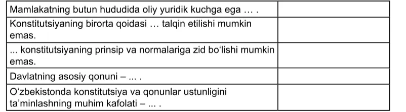

## 7-dars. Oʻzbekiston Respublikasining tashqi siyosati

Yangi Oʻzbekistonning tashqi siyosati, avvalo, xalqimiz, Vatanimiz manfaatlarini har tomonlama hisobga olgan holda amalga oshiriladi.

**Shavkat Mirziyoyev**

### Bilib olasiz

Oʻzbekiston Respublikasi tashqi siyosati tushunchasi.

Yangi Oʻzbekiston tashqi siyosatining ustuvor yoʻnalishlari.

Oʻzbekiston Respublikasi xalqaro munosabatlarning toʻla huquqli subyekti.

### Oʻzbekiston Respublikasi tashqi siyosati tushunchasi

Oʻzbekiston Respublikasi tashqi siyosiy faoliyatining bosh maqsadi – davlat mustaqilligi va suverenitetini, xalqaro maydondagi oʻrni va rolini mustahkamlash, yon-atrofida xavfsizlik, barqarorlik va ahil qoʻshnichilik muhitini shakllantirish, respublikaning tashqi iqtisodiy manfaatlarini faol tarzda ilgari surish. Oʻzbekiston davlatlarning suveren tengligi, kuch ishlatmaslik yoki kuch bilan tahdid qilmaslik, chegaralarning daxlsizligi, boshqa davlatlarning ichki ishlariga aralashmaslik;

xalqaro majburiyatlarni vijdonan bajarish, inson huquqlarini hurmat qilish va himoya qilish va xalqaro huquqning boshqa umumeʼtirof etilgan tamoyillari va normalari;

xavfsizlikning boʻlinmasligi, ochiqlik va pragmatizm, qoʻshni mamlakatlar bilan har tomonlama yaxshi qoʻshnichilik munosabatlarini rivojlantirish, mintaqaviy va xalqaro hamkorlikni mustahkamlash kabi asosiy tamoyillarga tayangan holda tinchlik, taraqqiyot va farovonlik yoʻlida barcha sheriklar bilan hamkorlikni kengaytirishdan manfaatdor.

Tashqi siyosatimizning bosh ustuvor yoʻnalishi Markaziy Osiyo mintaqasidir. Oʻzbekistonning Markaziy Osiyodagi siyosati mintaqada tinchlik va barqarorlikni taʼminlashga, mintaqaviy xavfsizlikning muhim muammolarini hal etishga, shu jumladan, Afgʻonistondagi vaziyatni hal qilishga koʻmaklashishga qaratilgan.

Oʻzbekiston mintaqa davlatlari bilan doʻstona va ahil qoʻshnichilik munosabatlarini mustahkamlashdan, ilmiy-texnikaviy va madaniy-gumanitar hamkorlikni rivojlantirishdan, parlamentlar, chegara hududlari, jamoat tashkilotlari va oddiy fuqarolar oʻrtasidagi aloqalarni kuchaytirishdan manfaatdor.

MDH mamlakatlari bilan hamkorlik ham Oʻzbekiston tashqi siyosatining ustuvor yoʻnalishi hisoblanadi. Mazkur davlatlar bilan respublikamiz tarixan shakllangan siyosiy, iqtisodiy, transport-kommunikatsion va boshqa aloqalarga ega. Oʻzbekiston Hamdoʻstlik mamlakatlari bilan tenglik, oʻzaro foydalilik, bir-birining manfaatlarini hurmat qilish va eʼtiborga olish tamoyillari asosida ikki tomonlama hamkorlik munosabatlarini mustahkamlashni davom ettiradi.

> **Barcha davlatlar – BMT ishtirokchilari oʻz faoliyatlarida quyidagi prinsiplarga rioya qilish majburiyatini oladilar**

Boshqa davlatlar bilan oʻzaro munosabatlardagi oʻz huquq va burchlarini tashqaridan qandaydir tazyiqsiz amalga oshirishga qodir boʻlgan mustaqil davlatgina xalqaro munosabatlar subyektiga aylanishi mumkin. Xalqaro huquq subyekti bir davlatning boshqa bir davlat ustidan hokimligini tan olmaydi. Bunday davlat oʻzining ichki va tashqi siyosatini amalga oshirish borasida mustaqil boʻladi.

Oʻzbekiston MDH mamlakatlari, Yevropa Ittifoqi, Xalqaro valyuta jamgʻarmasi, Butunjahon banki, Osiyo taraqqiyot banki (OTV), Islom hamkorlik tashkiloti (IHT) va boshqa xalqaro tashkilotlar bilan faol hamkorlik olib bormoqda.

Hozir dunyoning 150 ga yaqin mamlakati Oʻzbekistonni mustaqil davlat sifatida tan olgan. Shunday qilib, davlatimiz dunyo hamjamiyatida xalqaro huquq subyekti sifatida oʻzining munosib oʻrnini egalladi.

### Yodda tuting!

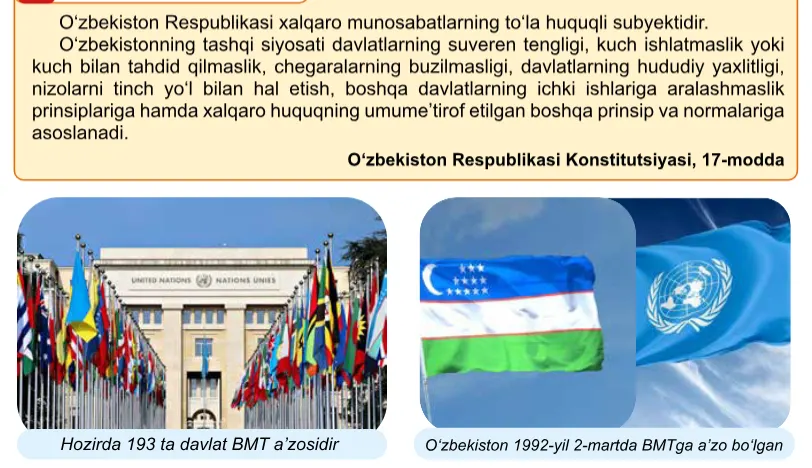

Mustaqillik eʼlon qilingan dastlabki kunlardanoq Oʻzbekiston Respublikasi dunyo hamjamiyatiga kirish yoʻlini tanladi:

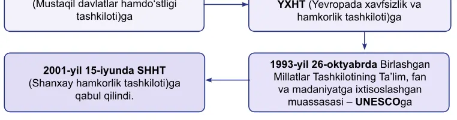

### Yangi Oʻzbekiston tashqi siyosatining ustuvor yoʻnalishlari

Yangi Oʻzbekistonning zamonaviy tashqi siyosiy holati dunyoda va mintaqada shiddat bilan oʻzgarayotgan vaziyat hamda mamlakat ichidagi keng koʻlamli oʻzgarishlarga asoslanib shakllanmoqda.

> **Davlatlarning suveren tengligi tamoyili** bu – xalqaro huquqning kuch ishlatishni taqiqlash, davlatlarning ichki ishlariga aralashishga yoʻl qoʻyilmasligi, xalqlarning oʻz taqdirini oʻzi belgilash huquqi kabi eng muhim tamoyillarning boshlangʻich nuqtasidir. Xalqaro huquq va tartibni taʼminlash faqat ishtirokchilarning huquqiy tengligi toʻliq hurmat qilingan holda taʼminlanishi mumkin. Har bir davlat tizimning boshqa ishtirokchilari suverenitetini, yaʼni oʻz hududida qonun chiqaruvchi, ijro etuvchi, maʼmuriy va sud hokimiyatini boshqa davlatlarning aralashuvisiz amalga oshirish, shuningdek, oʻz tashqi siyosatini mustaqil ravishda amalga oshirish huquqini hurmat qilishga majburdir.

> **Kuch ishlatmaslik yoki kuch bilan tahdid qilmaslik tamoyili** – tomonlarning boshqa davlatlarga qarshi bevosita yoki bilvosita kuch ishlatishni ifodalovchi har qanday harakatlardan oʻzini tiyib turishini anglatadi. Bu masala ilk bor Ikkinchi jahon urushi yillarida yuzaga keldi va xalqlarning urushdan keyin xalqaro munosabatlarni adolatli asosda oʻrnatishga boʻlgan intilishlari va umidlarini aks ettirdi. Bu qonuniyat birinchi marta xalqaro huquq prinsipiga aylandi va BMT nizomida mustahkamlab qoʻyildi.

**Chegaralar daxlsizligi tamoyili** uch qoida asosida izohlanadi: birinchidan, xalqaro huquqiy meʼyorlarga muvofiq, yuridik jihatdan belgilangan mavjud chegaralarning tan olinishi; ikkinchidan, ayni vaqtda yoki kelajakda har qanday hududiy daʼvolardan voz kechish; uchinchidan, har qanday bosqinchilik harakatlari va tahdidlardan, jumladan, kuch ishlatish yoki kuch bilan tahdid solishdan voz kechish hisoblanadi.

**Davlatlarning hududiy yaxlitligi tamoyili** BMT nizomi qabul qilinishi bilan oʻz tasdigʻini topgan. Huquqiy adabiyotlarda hududiy yaxlitlik, hududiy daxlsizlik, hududiy butunlik iboralarini uchratish mumkin. BMT nizomi kuch ishlatish yoki kuch bilan tahdid solish davlatning hududiy yaxlitligi (daxlsizlik) va har qanday davlatning siyosiy mustaqilligiga qarshi qoʻllanishini taqiqlab qoʻygan. Xususan, har bir davlat: birinchidan, boshqa davlatning milliy butunligi va hududiy daxlsizligini qisman yoki toʻla buzilishiga qaratilgan har qanday xatti-harakatdan oʻzini tiyib turishi kerak; ikkinchidan, davlatning hududi nizom qoidalarini buzish orqali kuch ishlatish natijasida harbiy bosib olish obyekti boʻlmasligi lozim.

**Nizolarni tinch yoʻl bilan hal etish tamoyili** BMTning barcha aʼzolari xalqaro nizolarni xalqaro tinchlik, xavfsizlik hamda adolatga xavf solmaydigan holda tinch yoʻllar bilan hal qiladilar. Ushbu prinsip qator xalqaro shartnoma va bitimlarda belgilab qoʻyilgan. Ularda urush

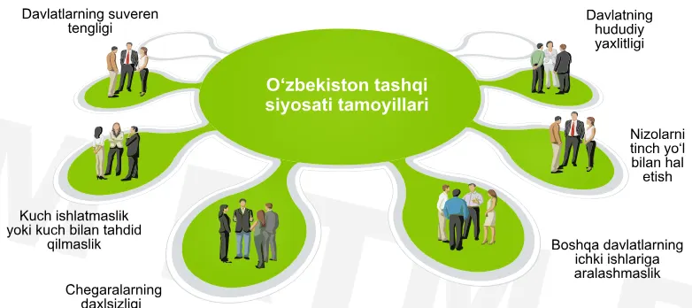

Xalqaro huquqning umumeʼtirof etilgan boshqa prinsip va normalariga amal qiladi

usuliga murojaat qilish huquqda chegaralanib, xalqaro nizolarni tinch yoʻl bilan hal etish vositalari rivojlantirilgan va davlatlar zimmasiga bunday vositalarni qoʻllash majburiyati yuklangan.

**Boshqa davlatlarning ichki ishlariga aralashmaslik tamoyili** xalqaro munosabatlarda umumiy tamoyil sifatida millatlarning oʻz davlatchiligi uchun kurashishlari jarayonida shakllandi. Ilgarigi davrlarda ushbu tamoyil bir oz cheklangan ravishda qoʻllanardi, chunki xalqaro huquq koʻp holatlarda davlatning ichki ishlariga turli xil aralashuvlar, hattoki qurolli aralashuvlarga ham yoʻl qoʻya olar edi. Boshqa davlatlarning ichki ishlariga aralashmaslik tamoyili hozirgi nuqtayi nazardan umumiy shaklda BMT nizomining 2-moddasi, 7-bandida qayd etilgan boʻlib, yuqorida tilga olingan xalqaro hujjatlarda koʻrsatib oʻtilgan. BMT nizomiga muvofiq, BMT hech bir davlatning tub ichki vakolatiga kiruvchi ishlarga aralashish huquqiga ega emas. Bunday taqiqlash nafaqat BMTning oʻziga, balki xalqaro munosabatlarning barcha ishtirokchilariga ham taalluqlidir.

Yangi Oʻzbekiston tashqi siyosatining ustuvor yoʻnalishlari besh yoki oltita tamoyildan iborat emas, yaʼni xalqaro huquqning umumeʼtirof etilgan boshqa prinsip va normalariga ham asoslanadi.

Masalan, **xalqlarning oʻz taqdirini oʻzi belgilashi tamoyili** har bir xalqning oʻz taraqqiyot yoʻli va shakllarini erkin tanlay olish huquqining soʻzsiz hurmat qilinishi xalqaro munosabatlardagi asosiy tamoyillardan biri hisoblanadi. Bu xalqlarning oʻz taqdirini oʻzi belgilashi tamoyilida oʻz aksini topgan. BMT nizomining 1-moddasi 2-bandida BMT faoliyatidagi muhim qoidalardan biri “Xalqlarning teng huquqliligi va oʻz taqdirini oʻzi belgilashi tamoyiliga hurmat asosida millatlararo doʻstlik aloqalarini rivojlantirishdir”, deyilgan. Bugungi kunda ushbu tamoyil mustamlaka va qaram mamlakatlardagi muammolarni hal etish chogʻida asosiy qoida hisoblanadi.

### Yodda tuting!

Shu bilan birga, tashqi siyosatni olib borishdagi asosiy eʼtibor siyosiy, savdo-iqtisodiy, ijtimoiy-gumanitar va boshqa sohalarga, shuningdek, Oʻzbekiston atrofida tinch, barqaror hamda xavfsiz muhitni shakllantirishga qaratilmoqda.

Yuqoridagilardan kelib chiqib, Prezident Shavkat Mirziyoyev Markaziy Osiyo davlatlari – bizning bevosita qoʻshnilarimiz bilan doʻstona, yaqin qoʻshnichilik va oʻzaro manfaatli aloqalarni rivojlantirish hamda mustahkamlashni asosiy ustuvor vazifa sifatida belgilab berdi.

Konstitutsiyamizning 18-moddasida “Oʻzbekiston Respublikasi davlatlar va xalqaro tashkilotlar bilan ikki va koʻp tomonlama munosabatlarni har taraflama rivojlantirishga qaratilgan tinchliksevar tashqi siyosatni amalga oshiradi. Oʻzbekiston Respublikasi davlatning, xalqning oliy manfaatlaridan, uning farovonligi va xavfsizligidan kelib chiqqan holda ittifoqlar tuzishi, hamdoʻstliklarga va boshqa davlatlararo tuzilmalarga kirishi hamda ulardan chiqishi mumkin”, deb belgilangan.

**Oʻzbekiston Respublikasi xalqaro munosabatlarning toʻla huquqli subyekti**

Oʻzbekiston Respublikasi davlat suverenitetini qoʻlga kiritgach, xalqaro munosabatlarning toʻla huquqli subyekti sifatida faoliyat yurita boshladi. Oʻzbekiston Respublikasining Konstitutsiyasida yuqorida koʻrsatilgan xalqaro huquq tamoyillarining aksariyati belgilab qoʻyilib (17-modda), “xalqaro huquqning boshqa umum tan olingan tamoyil va meʼyorlari”ni hurmatlash aytib oʻtilgan.

Oʻzbekiston Respublikasi xalqaro hamjamiyatning ana shu tamoyil va meʼyorlariga izchil rioya qilmoqda, xalqaro shartnomalarni ishlab chiqish va qabul qilishda ishtirok etmoqda, ularni bajarmoqda, xalqaro tashkilotlar faoliyatida, jamoa xavfsizligi tuzilmalarida qatnashib kelmoqda. Dunyo davlatlari bilan bir qatorda, yalpi va adolatli tinchlikni taʼminlash, oʻzaro manfaatli hamkorlikni oʻrnatish, insoniyat oldida turgan umumbashariy muammolarni hal etishda oʻz hissasini qoʻshmoqda.

Oʻzbekiston barcha xorijiy hamkorlar bilan oʻzaro foydali munosabatlarni rivojlantirishdan manfaatdor boʻlib, asosiy tashqi siyosiy harakatlarini eng muhim sohalarga qaratgan.

**Tashqi siyosat sohasida quyidagi eng muhim ustuvor yoʻnalishlar shakllantirildi:**

– davlat mustaqilligi va suverenitetini mustahkamlash, mamlakatning xalqaro munosabatlarning toʻlaqonli subyekti sifatida oʻrnini, rolini yanada mustahkamlash, rivojlangan demokratik davlatlar qatoriga kirish, Oʻzbekiston atrofida xavfsizlik, barqarorlik va doʻstona qoʻshnichilik munosabatlari mintaqasini yaratish;

– Oʻzbekiston Respublikasining xalqaro nufuzini mustahkamlash, dunyo hamjamiyatiga mamlakatda amalga oshirilayotgan islohotlar toʻgʻrisida obyektiv axborotni yetkazish;

– Oʻzbekiston tashqi siyosiy va tashqi iqtisodiy faoliyatining meʼyoriy-huquqiy bazasini, shunindek, xalqaro hamkorlikning shartnoma-huquqiy asoslarini takomillashtirish.

Umuman, Oʻzbekistonning tashqi siyosat sohasidagi ustuvor yoʻnalishlari barqaror, adolatli va demokratik davlat qurishga, mamlakatning tashqi oshkoraligini ilgari surishga hamda hududiy va koʻp tomonlama oʻzaro hamkorlikni rivojlantirishga qaratilgan.

### Savol va topshiriqlar

1. Davlatning tashqi siyosiy faoliyati jamiyat hayotining qaysi sohasida va qanday maqsadlarda amalga oshiriladi?

2. Qanday davlat xalqaro munosabatlarning toʻla huquqli subyekti hisoblanadi?

3. Oʻzbekiston Respublikasi qaysi xalqaro tashkilotlar bilan hamkorlik olib bormoqda?

4. Ichki va tashqi siyosatning bir-biridan farqi nimada?

### Mustaqil ish uchun topshiriq

Xalqaro munosabatlarning teng huquqli aʼzosi. Xalqaro huquq meʼyorlari ustuvorligining eʼtirof etilishi.

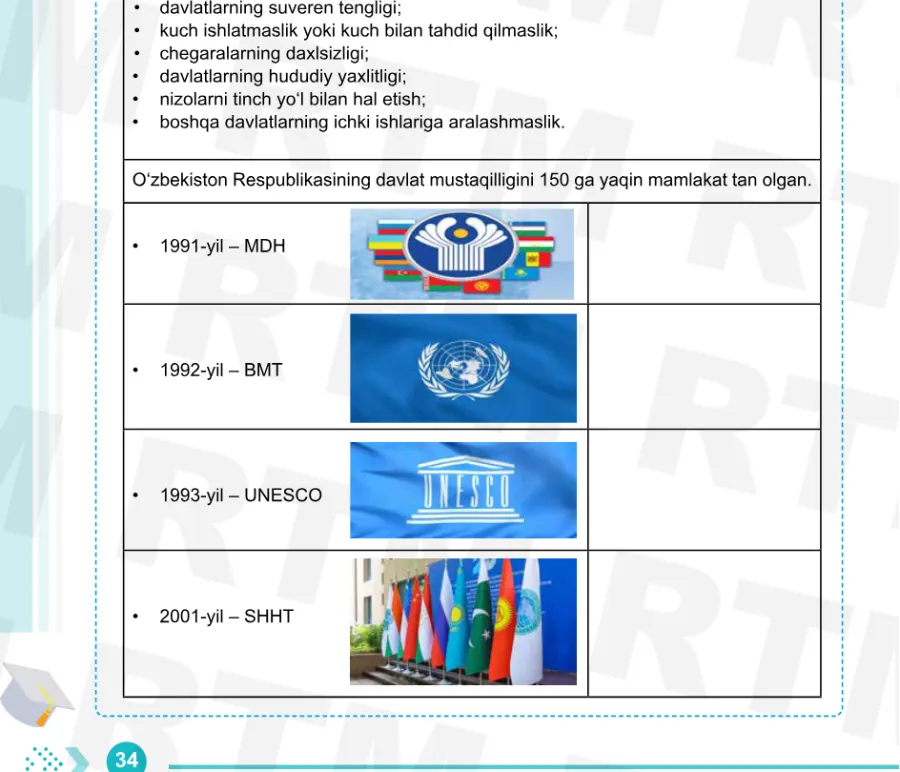

## 8-dars. Ijodiy faoliyat

**1-topshiriq. Quyidagi vaziyatni oʻrganing va savollarga javob bering.**

Oʻzbekiston Respublikasi Konstitutsiyasi oliy yuridik kuchga ega va Oʻzbekistonning butun hududida qoʻllanadi. Oʻzbekiston Respublikasining qonunlari va boshqa normativ-huquqiy hujjatlar Konstitutsiya asosida va uni ijro etish uchun qabul qilinadi hamda uning normalari va prinsiplariga zid boʻlishi mumkin emas.

Turli normativ-huquqiy hujjatlarning yuridik kuchi boʻyicha oʻzaro nisbati Oʻzbekiston Respublikasi Konstitutsiyasiga, normativ-huquqiy hujjatlarni qabul qilgan organlarning vakolatlariga va maqomiga, ushbu hujjatlarning turlariga muvofiq belgilanadi.

Baʼzi vaziyatlarda qonunlar va boshqa normativ-huquqiy hujjatlar konstitutsiyaga zid boʻlishi mumkinmi?

**Sizningcha, bunday holatda konstitutsiyaning ustunligi tamoyili qanday taʼminlanadi hamda asosiy qonun-qoidalari qay usulda himoya qilinadi?**

**2-topshiriq. Ijodiy faoliyat.**

Oʻzbekiston Respublikasi Konstitutsiyasining 4 ta asosiy prinsipini jadvalning chap tomoniga yozing. Jadvalning oʻng tomonida esa Konstitutsiyaning birinchi boʻlimidagi boblardan bittadan moddani tanlab olish orqali ushbu prinsiplarni tahlil qiling. Bunda ularning mazmuni va ahamiyatini misollar yordamida bayon qiling. Masalan, Konstitutsiyaning 1-bobi “Davlat suvereniteti” deb nomlangan. Mazkur bobning 1-moddasida: “Oʻzbekiston – boshqaruvning respublika shakliga ega boʻlgan suveren, demokratik, huquqiy, ijtimoiy va dunyoviy davlat”, deyilgan. Shundan soʻng koʻrsatilgan normaning mazmunini izohlang.

### Konstitutsiyaning asosiy prinsiplari

## 9-dars. Nazorat ishi

### Jadvalli test

Huquq ustuvorligi taʼminlangan, inson va fuqarolarning huquq va erkinliklari kafolatlangan, qonunlar oldida barcha teng boʻlgan, hech kim qonundan ustun turmaydigan davlat. Kishilarning huquqiy bilim darajasi, huquqni hurmat qilishi va unga rioya etishi.

Yuridik kuchga ega boʻlgan rasmiy hujjat boʻlib, unda inson va fuqaroning huquq va erkinliklari belgilanadi, davlat boshqaruvi va hududiy tuzilishi, davlat organlarining vakolatlari bеlgilab qoʻyiladi.

Diniy tashkilotlar va birlashmalar davlatdan hamda davlat hokimiyati dindan ajratilgan, boshqaruv konstitutsiya va qonun hujjatlari bilan tartibga solinadigan davlat.

Barcha davlat hokimiyati organlari faoliyatida qonunlarning oliy yuridik kuchga ega boʻlishi.

Yagona davlat boʻlib, uning alohida maʼmuriy-hududiy birliklari bir xildagi huquqlarga ega, butun davlat hududida ya gona konstitutsiya, yagona hukumat va yagona qonun hujjatlari amal qiladi.

Huquqqa, qonunlarga salbiy, ularni inkor qiluvchi, hurmatsiz munosabatda boʻlish.

### Huquqiy nigilizm

Davlat hokimiyati tizimi faoliyatining asosiy prinsipi boʻlib, unga koʻra, davlat hokimiyati qonunchilik, ijro etuvchi va sud hokimiyati organlariga boʻlinadi.

Fuqarolarning davlatni boshqarishda ishtirok etish usullari orqali davlatni boshqarish. Bu tushuncha ilk bor Qadimgi Yunonistonda vujudga kelgan.

Boshqaruvni amalga oshirishda mamlakat ichkarisida va tashqarisida toʻla-toʻkis mustaqillik.

### Unitar davlat

Bunday boshqaruv shaklida saylab qoʻyiladigan organlar saylovchilar oldida javobgar boʻladi, ular muayyan muddatga saylanadi va davlat hokimiyatini xalq nomidan amalga oshiradi.

Umumxalq ovoz berish yoʻli bilan qonunlar qabul qilish va davlat ahamiyatiga molik eng muhim masalalarni hal qilish shakli.

### Dunyoviy davlat

### OʻZBEKISTON RESPUBLIKASI FUQAROLIGI

# II bob. Oʻzbekiston Respublikasi fuqaroligi

## 10-dars. Oʻzbekiston Respublikasida fuqarolikning umumiy qoidalari

Odamlar burchlarini unutishga, huquqlarini eslashga moyil boʻladilar.

**Indira Gandi**

### Bilib olasiz

Fuqarolik tushunchasi.

Oʻzbekiston Respublikasi fuqaroligiga qabul qilish asoslari.

### Fuqarolik tushunchasi

Fuqarolik huquqi insonning eng muhim shaxsiy va siyosiy huquqlaridan biridir. Fuqarolik maqomidagi shaxs davlat homiyligi va himoyasida boʻladi. Fuqaro va davlat oʻrtasidagi huquqiy munosabatlar ularning oʻzaro huquq va majburiyatlarida aks etadi.

Fuqarolikni olgan shaxs oʻz davlati hududida ham, uning chegarasidan tashqarida ham himoya va homiylik ostida boʻladi, fuqarolar uchun belgilangan barcha huquqlardan toʻliq foydalanadi. Oʻz navbatida, fuqarolar davlatining qonunlariga rioya qilishi, fuqarolik burch va majburiyatlarini bajarishi shart.

Fuqaro nafaqat hokimiyat organlariga oʻz vakilini saylash, balki ushbu organlarga oʻzi saylanish huquqiga ham ega boʻlishi mumkin. Fuqaroligi

boʻlmagan shaxs bunday huquqqa ega emas.

Agar harbiy xizmatni oʻtash fuqarolar uchun fuqarolik burchi va majburiyati boʻlsa, bunday majburiyat fuqaroligi boʻlmagan shaxslarga nisbatan qonunan qoʻllanmaydi. Fuqaroligi boʻlmagan shaxslar partiyalarga aʼzo boʻlishi, davlat organlarida rahbarlik lavozimlarini egallashi, saylovlarda qatnashishi mumkin emas.

Ammo bu qonun fuqaroligi boʻlmagan shaxslarning huquqlarini buzadi va ularni kamsitadi degani emas. Fuqarolar va fuqaroligi boʻlmagan shaxslarning huquqlaridagi bunday tafovut tarixan rivojlangan boʻlib, u barcha davlatlar qonunlariga xosdir.

Chet davlat fuqarolari va fuqaroligi boʻlmagan shaxslar (apatridlar) xalqaro-huquqiy hujjatlarda shaxsga berilgan barcha asosiy huquqlardan foydalanadilar (saylovlarda ishtirok etish va mamlakat qurolli kuchlarida xizmat qilish huquqi bundan mustasno). Fuqarolar kabi ular ham ushbu davlatning qonunlariga rioya qilishga majburdirlar.

### Yodda tuting!

> **Fuqarolik** – shaxsning muayyan davlat bilan doimiy huquqiy aloqasi. Bu shaxs va davlatning oʻzaro huquq va majburiyatlarida ifodalanadi. Shaxs fuqarolikka ega boʻlgach, davlat uning hamma huquq va erkinliklarini eʼtirof etadi, ularning amalga oshishini taʼminlash choralarini koʻradi. Fuqarolarning manfaatlarini davlat, fuqarolar boshqa mamlakatlar hududida turgan vaqtda ham himoya qiladi, ularga homiylik koʻrsatadi.

Oʻzbekiston Respublikasi hududidagi chet el fuqarolarining va fuqaroligi boʻlmagan shaxslarning huquq va erkinliklari xalqaro huquq normalariga muvofiq taʼminlanadi. Ular Oʻzbekiston Respublikasining Konstitutsiyasi, qonunlari va xalqaro shartnomalarida belgilangan burchlarni ado etadilar.

### Oʻzbekiston Respublikasi

**Konstitutsiyasi, 24-modda**

### Oʻzbekiston Respublikasi fuqaroligiga qabul qilish asoslari

**Oʻzbekiston Respublikasi fuqaroligiga quyidagi hollarda ega boʻlish mumkin:**

tugʻilishi boʻyicha, yaʼni bola qayerda tugʻilishidan qatʼi nazar, agar bola tugʻilgan vaqtda ota-onasi (yoki ota-onasidan biri) Oʻzbekiston Respublikasi fuqarosi boʻlsa;

Oʻzbekiston Respublikasi fuqaroligiga qabul qilinishi va tiklanishi natijasida.

**Oʻzbekiston Respublikasi fuqaroligiga qabul qilish turlari.**

Oʻzbekiston Respublikasi fuqaroligiga qabul qilish quyidagicha amalga oshiriladi:

– umumiy tartibda;

– soddalashtirilgan tartibda;

– alohida tartibda.

**Oʻzbekiston Respublikasi fuqaroligiga qabul qilishning umumiy tartibi.** Oʻzbekiston Respublikasi fuqaroligiga qabul qilishning umumiy tartibi chet davlat fuqarosiga yoki fuqaroligi boʻlmagan shaxsga nisbatan quyidagi hollarda amalga oshiriladi, agar u:

a) chet davlat fuqaroligidan chiqishni rasmiylashtirgan boʻlsa;

b) fuqaroligi boʻlmagan shaxsga yashash guvohnomasi olingan kundan eʼtiboran va Oʻzbekiston Respublikasining fuqaroligiga qabul qilish toʻgʻrisidagi iltimosnoma bilan murojaat qilgan kunga qadar Oʻzbekiston Respublikasi hududida uzluksiz besh yil davomida doimiy yashab kelayotgan boʻlsa Bunda, agar fuqaroligi boʻlmagan shaxs bir yil

### Yodda tuting!

> **Yashash guvohnomasi** – fuqaroligi boʻlmagan shaxsning yoki chet davlat fuqarosining shaxsini tasdiqlaydigan, Oʻzbekiston Respublikasi hududida doimiy yashashga ruxsat etilganligining tasdigʻi sifatida berilgan hujjat.

**Diskriminatsiya** maʼlum bir toifadagi fuqarolarning huquqi jinsi, millati, diniy yoki siyosiy eʼtiqodi sabab asossiz ravishda cheklanishi yoki kamsitilishidir.

davomida jami bir yuz sakson uch kundan koʻp boʻlmagan muddatda Oʻzbekiston Respublikasidan tashqariga chiqqan boʻlsa, Oʻzbekiston Respublikasi hududida boʻlish muddati uzluksiz hisoblanadi;

c) tirikchilikning qonuniy manbayiga ega boʻlsa;

d) Oʻzbekiston Respublikasi Konstitutsiyasiga rioya etish majburiyatini oʻz zimmasiga olsa; e) davlat tilini muloqot qilish uchun zarur darajada bilsa.

**Oʻzbekiston Respublikasi fuqaroligiga qabul qilishning soddalashtirilgan tartibi chet davlat fuqarosi yoki fuqaroligi boʻlmagan shaxs hisoblangan vatandoshga nisbatan quyidagi hollarda amalga oshiriladi, agar u:**

a) Oʻzbekiston Respublikasi hududida yashaydigan va Oʻzbekiston Respublikasi fuqarosi boʻlgan, nasl-nasab shajarasi boʻyicha toʻgʻridan toʻgʻri tutashgan loaqal bitta oʻzidan oldingi qarindoshga ega boʻlsa;

b) tirikchilikning qonuniy manbayiga ega boʻlsa;

d) Oʻzbekiston Respublikasi Konstitutsiyasiga rioya etish majburiyatini oʻz zimmasiga olsa; e) davlat tilini qonunchilikda belgilangan tartibda muloqot qilish uchun zarur darajada bilsa. Oʻzbekiston Respublikasi fuqaroligiga qabul qilish ariza beruvchi chet davlat fuqaroligidan chiqqanligi haqida hujjat taqdim etganidan keyin, Oʻzbekiston Respublikasi Prezidentining farmoniga muvofiq amalga oshiriladi.

**Oʻzbekiston Respublikasi fuqaroligiga qabul qilishning alohida tartibi** Oʻzbekiston Respublikasi Prezidenti milliy manfaatlardan kelib chiqib, chet davlatlarning fuqarolari va fuqaroligi boʻlmagan shaxslar (olimlar, sportchilar, yozuvchilar va boshqalar)ni Oʻzbekiston Respublikasi fuqaroligiga qabul qilishi mumkin.

### Savol va topshiriqlar

1. Fuqarolik nima?

2. Sizningcha, fuqarolarning huquqlarini amalga oshirish uchun zarur shart-sharoitlarni kim taʼminlashi kerak?

3. Fuqaro va davlat oʻrtasida qanday munosabatlar paydo boʻladi?

4. Oʻzbekistonda fuqarolikni olish uchun nazarda tutilgan qonuniy asoslarni sanab oʻting.

5. Chet davlat fuqarolari va fuqaroligi boʻlmagan shaxslar muayyan davlat fuqarolari bilan bir xil huquqlarga egami?

### Mustaqil ish uchun topshiriq

## 11-dars. Fuqarolarning shaxsini tasdiqlovchi hujjatlar

Xаlq qonunlаrgа ehtiyoj sezib, ulаrni puxtа oʻrgаnsа, bu fаqаt uning oʻzigа foydа keltirаdi. Аks holdа qonundаn koʻzlаngаn mаqsаdgа erishib boʻlmаyd i. **Aflotun**

### Bilib olasiz

Oʻzbekiston Respublikasi fuqarosining identifikatsiyalovchi ID-kartasi va chet elga chiqish biometrik pasporti.

Chet el fuqarolarining Oʻzbekiston Respublikasidagi huquqiy holati.

**Oʻzbekiston Respublikasi fuqarosining identifikatsiyalovchi ID-kartasi va chet elga chiqish biometrik pasporti**

> **Oʻzbekiston Respublikasi fuqarosining identifikatsiya ID-kartasi** – Oʻzbekiston Respublikasi hududida egasining shaxsini va Oʻzbekiston Respublikasining fuqaroligini tasdiqlaydigan, ID-karta egasining shaxsiy biografik va biometrik maʼlumotlari kiritilgan elektron tashuvchi qurilma (chip)ga ega boʻlgan hujjat.

ID-karta maʼlumotlarni yigʻish punkti tomonidan fuqarolarga quyidagi muddatlarga beriladi:

– bola tugʻilgan paytdan boshlab bir yoshga toʻlgunga qadar – 2 yil muddatga;

– bir yoshdan 16 yoshgacha – 5 yil muddatga;

– 16 yoshdan – 10 yil muddatga.

> **Oʻzbekiston Respublikasi fuqarosining xorijga chiqish biometrik pasporti** – xorijga chiqish hamda Oʻzbekiston Respublikasi hududiga kirish, shuningdek, xorijda turish vaqtida egasining shaxsini va Oʻzbekiston Respublikasining fuqaroligini tasdiqlaydigan, pasport egasining shaxsiy biografik va biometrik maʼlumotlari saqlangan elektron axborot tashuvchiga (chipga) ega boʻlgan hujjat.

Xorijga chiqish biometrik pasporti fuqarolarga quyidagi amal qilish muddatlariga beriladi:

– tugʻilgan kunidan boshlab bir yoshgacha – ikki yil muddatga;

– bir yoshdan 25 yoshgacha – 5 yil muddatga;

– 25 yoshdan oshgan shaxslarga – 10 yil muddatga.

Shaxsni tasdiqlovchi hujjatlar shaxsning kimligini aniqlash, uning huquqlarini himoya qilish va ijtimoiy hayotda faol ishtirok etish imkoniyatini taʼminlashga xizmat qiladi.

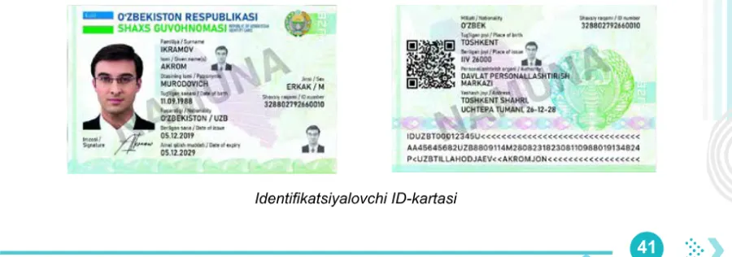

**Voyaga yetmagan fuqarolar uchun Oʻzbekiston Respublikasi fuqaroligini tasdiqlovchi hujjatlar**

16 yoshgacha boʻlgan bolaning Oʻzbekiston Respublikasi fuqaroligini tasdiqlovchi hujjati quyidagilar:

a) tugʻilganlik toʻgʻrisidagi guvohnoma yoki maʼlumotnoma (bolaning tugʻilgan joyidan qatʼi nazar) – ota-onasidan birining Oʻzbekiston Respublikasi fuqaroligi mavjud ekanligini koʻrsatuvchi pasporti, identifikatsiyalovchi kartasi yoki boshqa hujjati koʻrsatilganda;

b) tugʻilganlik toʻgʻrisidagi guvohnoma yoki maʼlumotnoma (bola Oʻzbekiston Respublikasida tugʻilgan taqdirda) – fuqaroligi boʻlmagan shaxslar boʻlgan ota-onaning (yolgʻiz otaning yoki onaning) Oʻzbekiston Respublikasida yashash guvohnomasi koʻrsatilganda.

### Chet el fuqarolarining Oʻzbekiston Respublikasidagi huquqiy hol ati

Oʻzbekiston Respublikasi hududidagi chet el fuqarolari va fuqaroligi boʻlmagan shaxslarning huquq va erkinliklari xalqaro huquq normalariga muvofiq taʼminlanadi. Ular Oʻzbekiston Respublikasining Konstitutsiyasi, qonunlari va Oʻzbekiston Respublikasining xalqaro shartnomalarida belgilangan majburiyatlarni oʻz zimmasiga oladilar.

Oʻzbekiston Respublikasining 2021-yil 4-iyundagi “Oʻzbekiston Respublikasida chet el fuqarolari va fuqaroligi boʻlmagan shaxslarning huquqiy holati toʻgʻrisida”gi qonuniga muvofiq ikki yoki undan ortiq davlat fuqaroligiga ega boʻlgan chet el fuqarolari qaysi davlat fuqaroligiga mansubligi toʻgʻrisidagi hujjatlar boʻyicha Oʻzbekiston Respublikasiga kirgan boʻlsa, Oʻzbekiston Respublikasida oʻsha davlatning fuqarolari hisoblanadi.

Oʻzbekiston Respublikasida vaqtincha yoki doimiy yashovchi chet el fuqarolari va fuqaroligi boʻlmagan shaxslar boʻlish qoidalarini buzganliklari va Oʻzbekiston Respublikasi qonun hujjatlarida nazarda tutilgan boshqa huquqbuzarliklar uchun maʼmuriy yoki jinoiy javobgarlikka tortilishi mumkin. Ularga nisbatan Oʻzbekiston Respublikasi qonun hujjatlarida belgilangan tartibda maʼmuriy chiqarib yuborish ham qoʻllanishi, Oʻzbekiston Respublikasi hududiga kirishiga taqiq qoʻyilishi, boʻlish muddati qisqartirilishi mumkin.

**Quyidagilar chet el fuqarolarining shaxsini tasdiqlovchi hujjatlar boʻlishi mumkin:** a) identifikatsiyalovchi ID-kartasi;

b) yashash guvohnomasi;

c) Oʻzbekiston Respublikasida siyosiy boshpana berish toʻgʻrisida guvohnoma.

### Savol va topshiriqlar

1. Oʻzbekiston Respublikasi fuqarosining identifikatsiyalovchi ID-kartasi va chet elga chiqish biometrik pasportining xususiyatlarini sanab oʻting.

2. Voyaga yetmagan fuqarolarning Oʻzbekiston Respublikasi fuqarosi ekanini qanday hujjatlar tasdiqlaydi?

3. Fuqaroligi boʻlmagan shaxs yoki chet davlat fuqarosining shaxsini qanday hujjatlar tasdiqlaydi?

4. Fuqaroligi boʻlmagan shaxs nima deb ataladi?

### Mustaqil ish uchun topshiriq

## 12-dars. Oʻzbekiston Respublikasi fuqaroligini tugatish va tiklash asoslari

### Bilib olasiz

Oʻzbekiston Respublikasi fuqaroligini tugatish asoslari. Oʻzbekiston Respublikasida fuqarolarning huquqiy himoyasi.

### Oʻzbekiston Respublikasi fuqaroligi quyidagi sabablarga koʻra yoʻqotilishi mumkin

a) shaxs chet davlatning harbiy xizmatiga, xavfsizlik organlariga, huquqni muhofaza qiluvchi organlariga, davlat hokimiyati va boshqaruvi organlariga xizmatga kirganligi oqibatida;

b) xorijda doimiy yashovchi shaxs yetti yil mobaynida uzrli sabablarsiz doimiy konsullik hisobiga turmagan boʻlsa;

d) shaxs Oʻzbekiston Respublikasi fuqaroligiga qabul qilish bila turib yolgʻon maʼlumotlar yoki soxta hujjatlarni taqdim etish natijasida amalga oshirilgan boʻlsa;

e) shaxs chet davlatning foydasini koʻzlab faoliyat koʻrsatgan holda yoki tinchlik va xavfsizlikka qarshi jinoyatlar sodir etish yoʻli bilan jamiyat hamda davlat manfaatlariga jiddiy zarar yetkazgan boʻlsa;

g) agar shaxs voyaga yetmaganligi sababli xorijiy davlat fuqaroligini tugʻilishi yoki ota-onasining fuqaroligi boʻyicha olgan boʻlsa va yigirma bir yoshga toʻlganida xorijiy davlat fuqaroligidan rasman chiqmagan boʻlsa.

### Yodda tuting!

Oʻzbekiston Respublikasining butun hududida yagona fuqarolik oʻrnatiladi. Oʻzbekiston Respublikasining fuqaroligi, unga qanday asoslarda ega boʻlganlikdan qatʼi nazar, hamma uchun tengdir. Qoraqalpogʻiston Respublikasining fuqarosi ayni vaqtda Oʻzbekiston Respublikasining fuqarosi hisoblanadi. Fuqarolikka ega boʻlish va uni yoʻqotish asoslari hamda tartibi qonun bilan belgilanadi.

### Oʻzbekiston Respublikasi Konstitutsiyasi, 22-modda

**Quyidagi holatlar Oʻzbekiston Respublikasining fuqaroligi masalalariga oid materiallarni koʻrib chiqishni tugatish asoslari hisoblanadi:**

– shaxsning davlat oldida bajarilmagan majburiyatlari yoki fuqarolar yoxud davlat organlari va boshqa tashkilotlar manfaatlari bilan bogʻliq boʻlgan uning mulkiy majburiyatlari mavjudligi;

– shaxsning qidiruvda ekanligi;

– agar shaxs ayblanuvchi sifatida jinoiy javobgarlikka tortilgan, sudlangan va jazoni oʻtayotgan boʻlsa;

– shaxsga nisbatan qonuniy kuchga kirgan va ijro etilishi lozim boʻlgan sud hukmining mavjudligi;

– bila turib yolgʻon maʼlumotlar yoki soxta hujjatlar taqdim etganlik;

– Oʻzbekiston Respublikasining davlat xavfsizligi manfaatlariga zidlik;

– shaxsning vafot etganligi.

Ilgari Oʻzbekiston Respublikasi fuqaroligiga ega boʻlgan shaxs Oʻzbekiston Respublikasi fuqaroligini tiklash toʻgʻrisida iltimosnoma bilan murojaat qilishga haqli. Iltimosnomada Oʻzbekiston Respublikasi fuqaroligini tugatish sabablari koʻrsatiladi. Oʻzbekiston Respublikasi fuqaroligini bir martadan ortiq qayta tiklashga yoʻl qoʻyilmaydi.

Oʻzbekiston Respublikasi fuqaroligiga qabul qilish toʻgʻrisidagi iltimosnoma yozma shaklda Oʻzbekiston Respublikasi Prezidenti nomiga yoziladi.

Oʻzbekiston Respublikasi hududida yashovchi shaxs iltimosnoma yuborish uchun oʻzining doimiy yashaydigan yoki vaqtincha roʻyxatda turgan joyidagi ichki ishlar organiga, chet elda yashovchi shaxs esa konsullik muassasasiga murojaat qiladi. Uzrli sabablar (kasallik, konsullik muassasasining yoʻqligi) boʻlsa, notarial tasdiqlangan iltimosnoma ishonchli shaxslar orqali berilishi mumkin.

### Oʻzbekiston Respublikasida fuqarolarning huquqiy himoyasi

Mamlakatimizda jamiyat hayotining barcha jabhalarida, jumladan, inson huquqlari, erkinliklari va qonuniy manfaatlarini taʼminlashda keng koʻlamli demokratik oʻzgarishlar amalga oshirilmoqda. Davlatimiz rahbari tashabbusi bilan **Prezidentning xalq va virtual qabulxonalarining** ishga tushirilishi bu borada muhim qadam boʻldi. Bu chora-tadbirlar **“Xalq davlat hokimiyati organlariga emas, davlat hokimiyati organlari xalqqa xizmat qilishi kerak”,** degan insonparvar gʻoya hayotga toʻliq tatbiq etilishida muhim omil boʻlmoqda.

BMT Bosh Assambleyasining 75-sessiyasidagi nutqida (2020-yil 23-sentyabr), Prezident Shavkat Mirziyoyev BMT Bosh Assambleyasining barqaror rivojlanish maqsadlariga erishish va inson huquqlarini taʼminlashda parlamentlarning rolini oshirish boʻyicha maxsus rezolyutsiya qabul qilishni taklif qildi.

2020-yil 23-iyunda **Inson huquqlari boʻyicha Oʻzbekiston Respublikasining Milliy strategiyasi** qabul qilingan edi. Milliy strategiyada inson huquqlarini himoya qilish va ularga rioya etish davlat siyosatining ustuvor yoʻnalishlaridan biri ekanligi belgilab qoʻyilgan.

Oʻzbekiston Respublikasi fuqarolari uchun **mamlakat Ombudsmanining onlayn qabulxonasi** ishga tushirildi. Qabulxonaga har bir fuqaro internet orqali kirish va ariza berish huquqiga ega. Bu oʻzbekistonliklarga oʻz huquqlari buzilayotgani toʻgʻrisida Oliy Majlis vakiliga zudlik bilan xabar qilish imkoniyatini beradi.

**Oʻzbekiston Respublikasi fuqaroligini tiklash toʻgʻrisidagi iltimosnomaga quyidagilar ilova qilinadi:**

d) agar iltimosnomada koʻrsatilgan boʻlsa, bolaning tugʻilganligi haqidagi guvohnoma va agar mavjud boʻlsa, bolaning yashash guvohnomasi

e) tirikchilikning qonuniy manbalari mavjudligini tasdiqlovchi hujjat; davlat boji (konsullik yigʻimi) toʻlanganligini tasdiqlovchi hujjat.

### Hayotiy vaziyat

V. va K. – er-xotin. Ular taklifnoma bilan A. davlat poytaxtiga ishlashga keldi. Voyaga yetmagan ikki nafar farzandi ham ular bilan birga keldi. Ishga joylashgandan soʻng ular farzandlarini yashash joyidan uncha uzoq boʻlmagan maktabga yuborishga qaror qilishdi. Biroq sinfdoshlarning hammasi ham chetellik oʻquvchilarni samimiy kutib olishmadi.

Bolalar ushbu davlat tilini yaxshi bilishlariga qaramay, farqli talaffuz bilan gapirganlari uchun ularni masxara qila boshlashdi. Bunga ularning mahalliy bolalarnikidan ajralib turadigan kiyimi va xatti-harakati ham sabab boʻldi. Navbatdagi haqoratlardan soʻng bolalar otasiga shikoyat qildi va u oʻz farzandlariga nisbatan yomon munosabat sababini aniqlash uchun maktabga keldi. Ammo maktab direktori uni tinglashdan bosh tortdi va maktabda ziddiyatli vaziyatni yuzaga keltirgani uchun farzandlarini maktabdan chetlatish toʻgʻrisida koʻrsatma berdi.

Ota-ona maktab direktori ustidan sudga murojaat qildi.

Mazkur masala yuzasidan fikringizni bildiring. Maktab rahbariyatining harakati toʻgʻrimi? Sizningcha, chet el fuqarosi ushbu vaziyatda qanday yoʻl tutishi kerak?

### Savol va topshiriqlar

1. Oʻzbekiston Respublikasi fuqaroligidan mahrum qilish asoslarini sanab oʻting.

2. Qanday sabablarga koʻra davlat oʻz mamlakati fuqarolarining fuqarolikdan chiqishini taqiqlash huquqiga ega?

3. Oʻzbekiston Respublikasi fuqaroligini tiklash uchun nima asos boʻlishi mumkin?

4. Chet el fuqarolarini davlatdan majburan chiqarib yuborishga sabab boʻladigan eng keng tarqalgan qonun buzilish holatlari qaysi?

5. Oʻzbekiston Respublikasi fuqaroligi toʻgʻrisidagi qonun hujjatlarini buzganlik uchun qanday javobgarlik belgilangan?

## 13-dars. Chet elda yashovchi vatandoshlar bilan munosabatlarni saqlash va rivojlantirish

Raiyat ahvolidan ogoh bo‘ ldim, ulug‘ larni og‘ a qatorida, kichiklarni farzand o‘ rnida ko‘ rdim. **Amir Temur**

### Bilib olasiz

Chet elda yashovchi shaxslarning Oʻzbekiston Respublikasi fuqaroligini saqlab qolishi. Oʻzbekiston Respublikasining oʻz fuqarolariga homiylik qilish kafolati.

**Chet elda yashovchi shaxslarning Oʻzbekiston Respublikasi fuqaroligini saqlab qolishi** Hozirgi kunda fuqarolarimiz chet eldagi oliy oʻquv yurtlarida tahsil olmoqda yoki chet elda ishlamoqda. Ular bilan muloqot qilish uchun milliy-madaniy markazlar faoliyat yuritmoqda. Rossiya, AQSH, Turkiya va Markaziy Osiyoning barcha respublikalarida: Afgʻoniston, Tojikiston, Qirgʻiziston, Qozogʻiston, Turkmanistonda koʻp sonli oʻzbeklar yashaydi.

Xorijdagi konsullik faoliyati Oʻzbekiston Respublikasining boshqa davlatlar bilan yaxshi qoʻshnichilik va doʻstona munosabatlarini rivojlantirishga koʻmaklashish, iqtisodiy, savdo, ilmiy-texnik, madaniy va boshqa aloqalarini kengaytirishga qaratilgan.

Oʻzbekiston Respublikasi, uning diplomatik vakolatxonalari va konsullik muassasalari Oʻzbekiston Respublikasi fuqarolarini qabul qiluvchi davlat qonunchiligida belgilangan hamda Oʻzbekiston Respublikasi va ushbu mamlakat oʻrtasida tuzilgan xalqaro shartnomalarda nazarda tutilgan barcha huquqlardan fuqarolarimiz toʻliq foydalanish imkoniyatiga ega boʻlishlari uchun kerakli choralarni koʻrishlari shart.

**“Oʻzbekiston Respublikasining xorijda istiqomat qilayotgan vatandoshlar bilan hamkorlik qilish sohasidagi davlat siyosati konsepsiyasi”ga muvofiq quyidagilar chet elda yashovchi vatandoshlar hisoblanadi:**

a) Oʻzbekiston hududidan tashqarida doimo istiqomat qiladigan yoki taʼlim olish, mehnat faoliyati bilan shugʻullanish, oilaviy sabablar va boshqa sharoitlardan kelib chiqib vaqtinchalik chet elda yurgan Oʻzbekiston Respublikasi fuqarolari;

b) xorijga chiqqan va chet el fuqaroligini olgan, Vataniga maʼnaviy va madaniy nuqtayi nazardan mansublikni his qilgan hamda Oʻzbekiston Respublikasi bilan madaniy-gumanitar, ijtimoiy-iqtisodiy va boshqa aloqalarni rivojlantirishga harakat qilayotgan Oʻzbekistondan chiqib ketgan shaxslar va ularning avlodlari;

d) etnik, til va madaniy-tarixiy nuqtayi nazardan oʻzini oʻzbeklar yoki qoraqalpoqlar sifatida identifikatsiya qilgan hamda Oʻzbekiston bilan har tomonlama aloqada boʻlish xohishida boʻlgan xorijda istiqomat qilayotgan chet el fuqarolari va fuqaroligi boʻlmagan shaxslar.

Oʻzbekiston xalqini millatidan qatʼi nazar, Oʻzbekiston Respublikasining fuqarolari tashkil etadi.

### Oʻzbekiston Respublikasi Konstitutsiyasi, 8-modda

Diplomatik vakolatxonalar va konsullik muassasalari qonun hujjatlarida belgilangan tartibda vatandoshlarning huquqlarini himoya qiladi. Zarur hollarda esa, agar bu Oʻzbekiston Respublikasi qonunchiligiga zid boʻlmasa, Oʻzbekiston Respublikasi fuqarolarining buzilgan huquqlarini tiklash choralarini koʻrishga majburdirlar.

Konsullik mansabdor shaxsi Oʻzbekiston Respublikasi qonun hujjatlarida belgilangan tartibda jismoniy va yuridik shaxslarning ogʻzaki, yozma yoki elektron shakldagi arizalarini qabul qiladi va koʻrib chiqadi. Bunda qabul qiluvchi davlatning milliy qonunchiligida nazarda tutilgan huquqlar buzilgan boʻlsa, konsul fuqaro yoki yuridik shaxsning buzilgan huquqlarini tiklash choralarini koʻrishi shart.

Oʻzbekiston Respublikasi fuqarosining xorijda yashashi Oʻzbekiston Respublikasi fuqaroligining tugatilishiga sabab boʻlmaydi.

**“Oʻzbekiston Respublikasi fuqaroligi toʻgʻrisida”gi qonun, 9-modda**

### Chet elda boʻlgan vatandoshlarimiz quyidagilarga rioya qilishlari va bilishlari kerak

– Oʻzbekiston Respublikasining Konsullik muassasalari, diplomatik vakolatxonalari telefon raqamlarini;

– oʻzi yashayotgan davlatdagi chet el fuqarosining huquq va majburiyatlarini;

– migratsiya qonunchiligini;

– qabul qiluvchi davlatning milliy xususiyatlari va anʼanalarini;

– jamoat tartibini.

**Agar sizga nisbatan qabul qiluvchi mamlakat qonunlari buzilgan boʻlsa, unda quyidagicha yoʻl tutishingiz mumkin:**

– qabul qiluvchi davlatning huquqni muhofaza qilish organlariga, prokuratura yoki sudga tegishli ariza bilan murojaat qilish;

– ikkinchi ariza voqea sodir boʻlgan joydagi Oʻzbekiston Respublikasining konsullik muassasasiga yuboriladi. Bu sizga keyingi jarayonlarning borishini kuzatish uchun konsullik resurslaridan foydalanish imkoniyatini beradi;

– konsullik davlat nomidan qabul qiluvchi davlatning rasmiy organlariga oʻz fuqarosining huquqlari buzilganligi toʻgʻrisidagi masalani qoʻyishga va uni koʻrib chiqib, aybdorlarni tegishli tartibda jazolashni talab qilishga haqli;

– konsullik xodimi siz bilan shaxsan uchrashganda sizga nisbatan xalqaro huquqning umumeʼtirof etilgan tamoyillari va normalariga rioya etilganiga ishonch hosil qilishi shart;

– agar Oʻzbekiston Respublikasi fuqarosini ushlash, hibsda saqlash, maʼmuriy qamoqqa olish yoki ozodlikdan mahrum qilish jarayonlarida huquqlari buzilgan boʻlsa, konsullik xodimi ularni tiklash uchun oʻz vakolatlari doirasida kerakli choralarni koʻradi.

**Oʻzbekiston Respublikasining oʻz fuqarolariga homiylik qilish kafolati** Oʻzbekiston Respublikasining vatandoshlar bilan hamkorlik qilish sohasidagi davlat siyosatining asosiy maqsadlari quyidagilardan iborat:

– chet eldagi vatandoshlarning huquq va erkinliklarini xalqaro huquqning umumeʼtirof etilgan tamoyillari va meʼyorlariga, istiqomat qilayotgan davlat qonunchiligiga hamda Oʻzbekiston Respublikasining xalqaro shartnomalariga muvofiq amalga oshirishga yordam koʻrsatish;

– Oʻzbekistonning madaniy, ilmiy va maʼnaviy merosini keng tarqatish, uni oʻrganish va jahonda targʻib etish, vatandoshlar istiqomat qilayotgan mamlakatlarda oʻzbek tili, madaniyati va anʼanalarini saqlash va rivojlantirishga qaratilgan faoliyatni qoʻllab-quvvatlash;

– Oʻzbekiston Respublikasining ijtimoiy-iqtisodiy rivojlanishiga, xorijiy davlatlar bilan oʻzaro

manfaatli va doʻstona munosabatlarini oʻrnatishiga va ular tomonidan tashkil etilgan tashkilotlar bilan aloqalarni rivojlantirish va mustahkamlashga hissa qoʻshayotgan vatandoshlarga koʻmaklashish;

– vatandoshlarning Oʻzbekiston hududida kasbiy, shu jumladan, tadbirkorlik, sarmoyaviy, ilmiy, taʼlim va madaniy faoliyat bilan shugʻullanishi uchun qulay huquqiy, ijtimoiy va iqtisodiy sharoitlar yaratish;

– Oʻzbekistonda amalga oshirilayotgan keng koʻlamli ijtimoiy-iqtisodiy va ijtimoiy-siyosiy islohotlarni qoʻllab-quvvatlashga, Oʻzbekiston Respublikasining xalqaro nufuzini yanada mustahkamlashga koʻmaklashish uchun vatandoshlar salohiyatini jalb qilish.

Migratsiya sabablari: iqtisodiy, vaziyatni oʻzgartirish istagi, oʻz rejalarini amalga oshirish, taʼlim va tibbiyot, ajdodlar yurtiga qaytish.

Oʻzbekiston Respublikasi Konsullik muassasalarining asosiy maqsadi Oʻzbekiston Respublikasining boshqa davlatlar bilan yaxshi qoʻshnichilik va doʻstona munosabatlarini rivojlantirishga, iqtisodiy, savdo, ilmiy-texnikaviy, madaniy va boshqa aloqalarni kengaytirishga koʻmaklashishdan iborat.

### Qiziqarli maʼlumot

Tasavvur qiling, koʻchada ketyapsiz, doʻkon oynalari va binolarga tikilib qarayapsiz. Toʻsatdan politsiya sizni hibsga olmoqchi boʻldi. Oʻzingizni aybdor his qilmayotgan boʻlsangiz, huquqni muhofaza qilish organlari xodimlariga qarshilik koʻrsatmang. Sizdan talab qilinadigan har qanday izoh yoki tushuntirishni bering, lekin huquqlaringiz buzilishiga rozi boʻlmang.

Masalan, agar suhbat malakali tarjimonsiz amalga oshirilsa va bayonnomani oʻzingiz bilmagan tilda imzolashga majbur boʻlsangiz, uni imzolashdan butunlay voz kechishga haqlisiz. Ammo boshqacha yoʻl tutishingiz, yaʼni imzolangan sahifada quyidagicha eslatma-ogohlantirish qoldirishingiz mumkin:

“Matn menga tarjima qilib berilmadi. Uning mazmuni menga tushunarsiz. Konsullik xodimi bilan uchrashish haqidagi soʻrov inobatga olinmadi. Sana. Imzo”.

Bunday holda ushbu bayonnoma chet el fuqarosining huquqlari buzilganligini tasdiqlovchi hujjatga aylanishi mumkin.

### Savol va topshiriqlar

1. Chet elda yashovchi shaxslar Oʻzbekiston Respublikasi fuqaroligini qanday saqlab qolishi mumkin?

2. Oʻzbekiston Respublikasi fuqarolari chet elda muammolarga duch kelsa, Oʻzbekiston Respublikasining Konsullik muassasalari va diplomatik vakolatxonalarining konsullik boʻlimlari qanday yordam koʻrsatishi mumkin?

3. Oʻzbekiston Respublikasi Konstitutsiyasi va qonunlarida Oʻzbekiston Respublikasi oʻz fuqarolariga homiylik qilishi qanday kafolatlangan?

4. Chet elda oʻqiyotgan yoki ishlayotgan Oʻzbekiston fuqarolari uchun qanday muammolar paydo boʻlishi mumkin?

5. Yurtimizdagi va chet eldagi vatandoshlarning qanday milliy-madaniy tashkilotlarini bilasiz?

## 14–15-dars. Ijodiy faoliyat

Bu darsda berilgan topshiriqdan kelib chiqib, qonun buzilishi holatlari boʻyicha boʻlib oʻtadigan sud jarayonini sahnalashtirasiz.

**1-topshiriq.** Quyidagi vaziyatni oʻrganing va savollarga javob bering.

Yangi yil arafasida M. pirotexnika vositalari foydalanib, qoʻshnisi A. bilan oʻynab qoʻshnisi Ixtiyor akaning oʻgʻliga tegishli “DAMAS” rusumidagi avtomobiliga zarar yetkazdi. Ixtiyor aka va uning oʻgʻli bundan xabar topib, M. va A.ning ota-onasi bilan bilan gaplashish maqsadida ularning uyiga kelishdi.

Mazkur voqeaga huquqiy baho bering.

1. M. va A.ning qilgan ishiga qanday baho berasiz?

2. Ixtiyor aka va uning oʻgʻli mazkur vaziyatda aslida qanday yoʻl tutishi kerak?

3. Yuqoridagi holatda siz sudya sifatida nima qilgan boʻlardingiz?

Ish materiallari bilan tanishib chiqing va sud jarayonida sudya, jabrlanuvchi, guvoh, ekspert, ichki ishlar xodimi, advokat yoki maʼmuriy javobgarlikka tortilgan shaxs kabilardan qaysi biri sifatida ishtirok etishingizni hal qiling.

Sud jarayoni davomida siz ishga doir faktlarga tayanishingiz kerak. Shuningdek, sodir etilgan huquqbuzarlikka, guvohlarga va jarayonning boshqa ishtirokchilariga boʻlgan munosabatingizda oʻzingizning badiiy isteʼdodingiz va huquqiy bilimingizni koʻrsatishingiz zarur.

**Sud jarayoni ishtirokchilari uchun koʻrsatmalar**

Ishtirokchi shaxslar quyidagi huquqlarga ega:

– ish materiallari bilan tanishish, ulardan koʻchirma olish, nusxa koʻchirish, ishtirok etuvchi boshqa shaxslarga savollar berish;

– sud jarayonida yuzaga keladigan barcha masalalar boʻyicha oʻz dalillarini taqdim etish;

– sud qarori ustidan shikoyat qilish.

### Sud majlisini oʻtkazish tartibi

1. Sudyalar sud zaliga kirganda ishtirok etuvchilar oʻrnidan turadi. Sudning hal qiluv qarori tik turgan holda eshitiladi.

2. Ishtirok etuvchi shaxslar tik turgan holda sudga murojaat qiladilar va guvohlik beradi-

3. Zaldagilarning barchasi sud raisining buyrugʻiga soʻzsiz boʻysunadilar.

4. Har bir guvoh boshqa shaxslar ishtirok etmagan holda, alohida soʻroq qilinadi.

5. Raislik qiluvchi fuqarolik protsessi ishtirokchilariga ommaviy ravishda: “Ish boʻyicha oʻzimga maʼlum barcha maʼlumotlarni sudda aytishga qasamyod qilaman. Faqat haqiqatni, barcha haqiqatni gapiraman, haqiqatdan oʻzga narsani gapirmayman”, deb oshkora qasamyod qilishni taklif etadi.

### Sud ishtirokchilari

– ushbu ish boʻyicha chaqirilganlarning kelgan-kelmagani toʻgʻrisida sudga maʼlumotlar beradi;

– sud jarayoni bayonnomasini yuritadi.

– sud tarkibini eʼlon qiladi va ishtirok etuvchi shaxslarga eʼtiroz bildirish huquqini tushuntiradi;

– ishtirok etuvchi shaxslarga huquq va majburiyatlarini tushuntiradi;

– sudda soʻroq qilinayotganlarning shaxsini aniqlaydi va koʻrsatma berishdan bosh tortganlik yoki boʻyin tovlaganlik uchun javobgarlik toʻgʻrisida ogohlantiradi (tilxat asosida). Voyaga yetmaganlar bunday javobgarlik haqida ogohlantirilmaydi;

– sud jarayoni davomida yuzaga kelgan muammolarni hal qiladi, sud zalida tartibni saqlaydi.

– buzilgan yoki bahsli huquqlarini himoya qilish uchun guvohlik beradi. **Javobgar:**

– tushuntirishlar beradi, dalillarni taqdim etadi, iltimosnomalar beradi;

– himoya qilish huquqini shaxsan yoki advokat yordamida amalga oshiradi;

– sudga qoʻshimcha guvohlarni chaqirishni talab qilishga haqli.

– har bir shaxs alohida soʻroq qilinadi, soʻroq qilinayotgan guvohlar jarayon tugaguniga qadar sud zalida qoladilar;

– sud jarayonida tekshirilayotgan barcha holatlar toʻgʻrisida aniq maʼlumot berishga majburdirlar;

– agar ular 16 yoshga toʻlmagan boʻlsa, sudda oʻqituvchisi yoki ota-onasi ham ishtirok etishi kerak.

### Fuqarolik ishini sudda koʻrib chiqish bosqichlari

1. Sud jarayonining ochilishi (sudya).

2. Jarayon ishtirokchilarining davomatini tekshirish (kotib).

3. Guvohlarni sud majlisi zalidan chiqarish (kotib).

4. Sud tarkibini eʼlon qilish va eʼtiroz bildirish huquqini tushuntirish (sudya).

5. Ishda ishtirok etuvchi shaxslarga ularning huquq va majburiyatlarini tushuntirish (sudya).

6. Raislik qiluvchi tomonidan ish mohiyatining bayon etilishi (daʼvogarga murojaat qilish bilan tugashi; u oʻz talablarini qoʻllab-quvvatlashi; javobgarga daʼvogarning va har ikki tarafning talablarini tan olishi yoki olmasligi, ular daʼvoni oʻzaro kelishuv bitimi bilan yakunlashni xohlashi yoki xohlamasligi tushuntiriladi).

7. Daʼvogarning tushuntirishi.

8. Prokurorning nutqi (daʼvogar talablarining qonuniyligini rad etish yoki asoslash bilan).

9. Guvohlarni soʻroq qilish.

10. Ishni tugatish.

Raislik qiluvchi ishtirok etuvchi shaxslardan ish materiallariga biror qoʻshimcha qoʻshishni xohlash yoki xohlamasliklarini soʻraydi.

11. Sud jarayoni (prokuror, daʼvogar, sudlanuvchining nutqi).

12. Hal qiluv qarorini qabul qilish uchun sudning maslahat xonasiga chiqishi.

13. Sud qarorini eʼlon qilish (raislik qiluvchi qaror ustidan shikoyat qilish tartibini tushuntiradi va ushbu ish boʻyicha sud majlisini yopiq deb eʼlon qiladi).

### 2-topshiriq. Ijodiy faoliyat uchun

Oilada, maktabda va doʻstlaringiz bilan munosabatga kirishish jarayonida, oʻz haq-huquqlaringizni bilishda va oʻzgalar huquqlarini hurmat qilishingizda koʻproq qaysi qonunlarning mavjudligi qoʻl keladi. Fikringizni www.lex.uz sayti maʼlumotlari bilan asoslang.

**Mustaqil ish topshirigʻi**. Hayotda duch keladigan qonun va qonunosti hujjatlarini jadval koʻrinishiga keltiring.(**Izoh:** normativ-huquqiy hujjatlarning nomi va tartibga solish sohasi, qabul qilingan sanasi).

Shundan soʻng koʻrsatilgan normaning mazmunini izohlang.

### Qonunosti hujjatlar

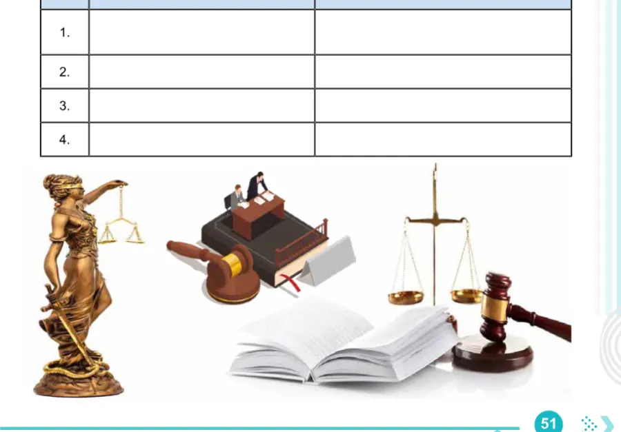

## 16-dars. Nazorat ishi

### Jadvalli test

Oʻzbekiston Respublikasi hududida doimiy yashab turgan, Oʻzbekiston Respublikasining fuqarosi boʻlmagan va oʻzining chet davlat fuqaroligiga mansubligiga doir dalilga ega boʻlmagan shaxs.

Oʻzbekiston Respublikasi hududida identifikatsiyalovchi karta egasining shaxsini va fuqaroligini, shuningdek, doimiy roʻyxatga olinganligini tasdiqlaydigan, egasining shaxsiga doir biografik va biometrik maʼlumotlar kiritilgan elektron jismga (chipga) ega boʻlgan, Oʻzbekiston Respublikasi fuqarosiga yoki chet davlat fuqarosiga yoxud fuqaroligi boʻlmagan shaxsga beriladigan hujjat. Oʻzbekiston Respublikasi hududida tugʻilgan yoki ilgari uning hududida yashagan, Oʻzbekiston Respublikasining fuqaroligiga ega boʻlmagan, Oʻzbekiston Respublikasi hududidan tashqarida yashaydigan shaxs va uning nasl-nasab shajarasi boʻyicha toʻgʻri tutashgan oʻzidan keyingi qarindoshlari, basharti, agar ularning nasl-nasab shajarasi boʻyicha toʻgʻri tutashgan oʻzidan oldingi qarindoshlari Oʻzbekiston Respublikasi hududida yashayotgan boʻlsa hamda Oʻzbekiston Respublikasining fuqarolari boʻlsa.

Tugʻilganlik toʻgʻrisidagi guvohnoma yoki maʼlumotnoma (bolaning tugʻilgan joyidan qatʼi nazar) – ota-onasidan birining Oʻzbekiston Respublikasi fuqaroligi mavjud ekanligini koʻrsatuvchi pasporti, identifikatsiyalovchi kartasi yoki boshqa hujjati koʻrsatilganda.

Oʻzbekiston Respublikasining fuqaroligiga ega boʻlmagan, boshqa davlat fuqaroligiga va oʻzining boshqa davlat fuqaroligiga mansubligiga doir dalilga ega boʻlgan shaxs.

Fuqaroligi boʻlmagan shaxsning yoki chet davlat fuqarosining shaxsini tasdiqlaydigan, Oʻzbekiston Respublikasi hududida doimiy yashashga ruxsat etilganligining tasdigʻi sifatida berilgan hujjat.

Oʻzbekiston Respublikasida fuqarolik shaxsning davlat bilan oʻzaro huquqlari, majburiyatlari va javobgarligi yigʻindisida ifodalanadigan hamda inson qadr-qimmati, asosiy huquqlari va erkinliklarini eʼtirof etish hamda hurmat qilishga asoslanadigan doimiy siyosiy-huquqiy aloqasini belgilaydi.

**Oʻn olti yoshga toʻlmagan bolaning**

### Respublikasi

**fuqaroligini tasdiqlovchi hujjat**

**INSON VA FUQAROLARNING ASOSIY HUQUQLARI, ERKINLIKLARI VA BURCHLARI**

# III bob. Inson va fuqarolarning asosiy huquqlari, erkinliklari va burchlari

## 17-dars. Inson va fuqarolarning asosiy huquq va erkinliklari

Inson huquqlari va qonun ustuvorligi hurmat qilinmasa, barqaror tinchlik va rivojlanish boʻlmaydi. **Jan Eliasson**

### Bilib olasiz

Inson huquq va erkinliklari tushunchasi. Inson huquq va erkinliklari tizimi.

### Inson huquq va erkinliklari tushunchasi

Inson huquqlari insoniyat tafakkuri va sivilizatsiyasi eʼtirof etgan qadriyatdir.

Inson huquqlari insoniyat tarixiy taraqqiyotining umumiy yutugʻi boʻlish bilan birga, jahon hamjamiyatining dolzarb muammolaridan biriga aylanib qoldi. Insonning shaxsiy daxlsizligini himoya qilish, ekologik xavflardan xoli muhit yaratish, insoniyatga kulfatlar keltiruvchi urush ofatlaridan xalos qilish xalqaro miqyosdagi asosiy maqsadga aylangan.

Shu bois bugun demokratik rivojlanish yoʻlidagi har qanday davlatning konstitutsiyaviy asosini inson huquqlari va erkinliklari tashkil qiladi. Oʻzbekiston Respublikasi Konstitutsiyasida ham barchaning qonun oldida tengligi, shaxs manfaatlarining davlat manfaatlariga nisbatan ustuvorligi, davlatning inson va jamiyat farovonligi uchun xizmat qilish majburiyati kabi masalalarga katta eʼtibor qaratilgan.

Erkinlik inson uchun oliy neʼmat boʻlib, uning qonunda taqiqlanmagan har qanday ishni qila olishidir. Inson huquqlari insonning jamiyatda mavjudligi bilan belgilanadigan hamda huquqiy jihatdan mustahkamlab qoʻyilgan tabiiy va buzilmas erkinliklari, yuridik imkoniyatlari yigʻindisi hisoblanadi.

Oʻzbekiston Respublikasi Konstitutsiyasining ikkinchi boʻlimi inson va fuqarolarning asosiy huquqlari, erkinliklari va burchlari masalalariga bagʻishlangan.

Oʻzbekiston Respublikasi Konstitutsiyasi inson huquqlariga oid quyidagi muhim qoidalarga asoslangan

Inson huquqlari va erkinliklarini himoya qilish – davlatning majburiyati ekani

Inson huquqlari va erkinliklari tizimi xalqaro huquq normalariga mos kelishi

Inson huquqlari va erkinliklari unga tugʻilganidan boshlab tegishli boʻlishi va har kimning tengligi

Fuqarolarning huquq va erkinliklari sud organlari tomonidan himoya qilinishi

Inson huquqlari va erkinliklarini amalga oshirishda boshqa shaxslarning huquqlarini poymol qilmaslik

### Yodda tuting!

Inson va fuqarolarning huquq va erkinliklari deganda davlat tomonidan oʻrnatilib, konstitutsiyada belgilangan, har bir fuqaroga berilgan imkoniyatlardan shaxsiy hayotda, jamoat ishlarida qatnashishda foydalanish tushuniladi.

### Inson huquq va erkinliklari tizimi

Qadimgi yunon faylasufi Protagorning “Barcha ashyolarning mezoni insondir” degan fikrining zamirida insonparvarlik gʻoyasi yotadi. Antik davrning koʻplab olimlari barcha kishilarning tabiatan tengligi gʻoyasini ilgari surganlar, insonlarning ozod kishilar va qullarga boʻlinishiga salbiy munosabatda boʻlganlar. Bu gʻoyalar oʻz davrida gʻoyaligicha qolib ketgan boʻlsa-da, oʻrta asrlarda va keyinchalik ilgari surilgan ilgʻor qarashlar, inson huquqlariga oid huquqiy tizimlarning yaratilishiga asos boʻlib xizmat qildi.

Inson qaysi davlat fuqarosi boʻlishidan qatʼi nazar, dunyoga kelishi bilan tabiiy huquqlarga ega boʻladi. Shunday ekan, inson huquqlari tugʻilish bilan vujudga keladigan tabiiy huquqlarga va davlat tomonidan oʻz fuqarolariga qoʻshimcha ravishda beriladigan siyosiy, iqtisodiy, ijtimoiy va madaniy huquqlarga boʻlinadi.

Inson huquq va erkinliklari masalasini tushunishimiz uchun ularni guruhlash, tizimlashtirish muhim ahamiyat kasb etadi. Oʻzbekiston Respublikasi Konstitutsiyasining ikkinchi boʻlimida ifodalangan inson huquq va erkinliklari ham mazmuni va bajarilish sohalari boʻyicha tizimlashtirilgan.

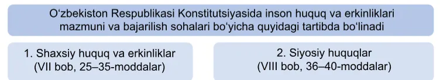

3. Iqtisodiy, ijtimoiy, madaniy va ekologik huquqlar (IX bob, 41–53-moddalar)

Oʻzbekiston Respublikasi Konstitutsiyasida mustahkamlab qoʻyilgan asosiy huquq va erkinliklar “Inson huquqlari umumjahon deklaratsiyasi” (1948-yil), “Fuqaroviy va siyosiy huquqlar toʻgʻrisidagi xalqaro pakt” (1966-yil), “Iqtisodiy, ijtimoiy va madaniy huquqlar toʻgʻrisidagi xalqaro pakt” (1966-yil) kabi inson huquqlari boʻyicha xalqaro shartnomalarga toʻliq mos keladi.

### Savol va topshiriqlar

1. Inson huquqlari va erkinliklari deganda nimani tushunasiz?

2. Nima uchun har qanday davlatning konstitutsiyaviy asosini inson huquq va erkinliklari tashkil etadi?

3. Konstitutsiyamizda inson huquq va erkinliklari mazmuni hamda bajarilish sohalari boʻyicha qanday turlarga boʻlinadi?

4. Inson huquqlarini taʼminlashga qaratilgan qanday xalqaro hujjatlarni bilasiz?

### Mustaqil ish uchun topshiriq

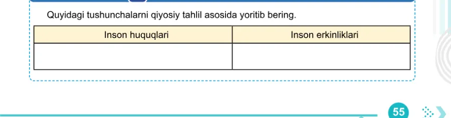

## 18-dars. Shaxsiy huquq va erkinliklar

Kechiktirilgan huquq – rad etilgan huquqdir.

**Martin Lyuter King**

### Bilib olasiz

Shaxsiy huquq va erkinliklar tushunchasi hamda tizimi. Yashash huquqining taʼminlanishi.

Aybsizlik prezumpsiyasi.

### Shaxsiy huquq va erkinliklar tushunchasi hamda tizimi

Insonning yashash huquqi, erkinlik huquqi borasidagi gʻoyalar insoniyat tarixining ilk davrlaridayoq shakllana boshlagan. Bunday huquqlar uchun hamma davrlarda, turli jamiyatlarda kurashlar boʻlgan. Shaxsiy huquq va erkinliklar inson huquqlari tizimida eng muhim oʻrinni egallab, insonning shaxsiy hayotidagi erkinligini taʼminlaydi.

Shaxsiy huquq va erkinliklar oʻz mohiyati bilan har qanday insonning huquqlari hisoblanib, uning qaysi davlat fuqaroligiga mansub ekaniga bogʻliq boʻlmaydi.

Oʻzbekiston Respublikasi Konstitutsiyasining 26-moddasiga koʻra, insonning shaʼni va qadr -qimmati daxlsizdir. Hech narsa ularni kamsitish uchun asos boʻlishi mumkin emas. Hech kim qiynoqqa solinishi, zoʻravonlikka, boshqa shafqatsiz, gʻayriinsoniy yoki inson qadr-qimmatini kamsituvchi muomalaga yoxud jazoga duchor etilishi mumkin emas. Hech kim ustida uning roziligisiz tibbiy va ilmiy tajribalar oʻtkazilishi mumkin emas.

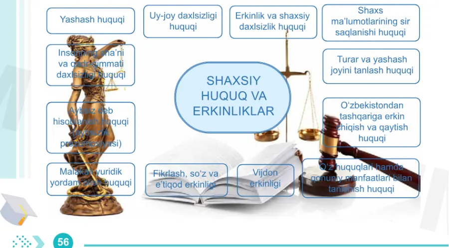

### Yodda tuting!

Qonuniy asoslarda Oʻzbekiston Respublikasi hududida boʻlib turgan har kim mamlakat boʻylab erkin harakatlanish, turar va yashash joyini tanlash huquqiga ega, bundan qonunda belgilangan cheklovlar mustasno.

Har kim Oʻzbekistondan tashqariga erkin chiqish huquqiga ega, bundan qonunda belgilangan cheklovlar mustasno. Oʻzbekiston Respublikasi fuqarosi Oʻzbekistonga toʻsqinliksiz qaytish huquqiga ega.

### Oʻzbekiston Respublikasi Konstitutsiyasi, 32-modda

Shaxsiy huquq va erkinliklar inson tugʻilgan zahoti ega boʻladigan, uning asosiy hayotiy ehtiyojlarini taʼminlaydigan, tabiiy, ajralmas huquqlaridir.

Har kim erkinlik va shaxsiy daxlsizlik huquqiga ega ekanini taʼminlovchi 27-moddada, shuningdek, hech kim qonunga asoslanmagan holda hibsga olinishi, ushlab turilishi, qamoqqa olinishi, qamoqda saqlanishi yoki uning ozodligi boshqacha tarzda cheklanishi mumkin emasligi, hibsga olishga, qamoqqa olishga va qamoqda saqlashga faqat sudning qaroriga koʻra yoʻl qoʻyilishi belgilangan. Shaxs sudning qarorisiz qirq sakkiz soatdan ortiq muddat ushlab turilishi mumkin emasligi qonunlarda mustahkamlab qoʻyilgan. Mazkur normaning mazmuni 1679-yil Angliyada qabul qilingan Xabeas korpus aktiga muvofiq keladi.

**Xabeas korpus** ingliz jinoyat-protsessual huquqiga tegishli qoida boʻlib, unga koʻra, qamoqqa olingan shaxs yoki uning nomidan boshqa bir fuqaro nima sababdan hibsga olinayotgani yoki qamoqqa olish toʻgʻrisidagi hujjat boʻyicha sudga murojaat qilishi va hibsga olish yoki ushlab turishning qonuniyligini tekshirish uchun maxsus sud qarorini talab qilishi mumkin. Sudning qarori boʻlmagan taqdirda shaxsni 48 soatdan ortiq ushlab turish mumkin emas.

Shaxsiy huquq va erkinliklar tizimida insonlarning mamlakat boʻylab erkin harakatlanishi, turar va yashash joyini tanlash huquqi muhim ahamiyatga ega.

Hamma uchun vijdon erkinligi kafolatlanishi Oʻzbekiston Respublikasi Konstitutsiyasining 35-moddasida mustahkamlangan boʻlib, har kim xohlagan diniga eʼtiqod qilish yoki hech qaysi dinga eʼtiqod qilmaslik huquqiga ega.

“Oʻzbekiston Respublikasining vijdon erkinligi va diniy tashkilotlar toʻgʻrisida”gi qonunida Oʻzbekiston Respublikasining konstitutsiyaviy tuzumini zoʻrlik bilan oʻzgartirish, uning suvereniteti va hududiy yaxlitligiga putur yetkazish, fuqarolarning konstitutsiyaviy huquq va erkinliklarini kamsitish, urushni, milliy, irqiy, etnik yoki diniy adovatni targʻib qilish, fuqarolarning sogʻligʻi va axloqiga tajovuz qilish, fuqarolar totuvligini buzish, vaziyatni beqarorlashtiruvchi tuhmatdan iborat uydirmalarni tarqatish, aholi oʻrtasida sarosima uygʻotish hamda shaxs, jamiyat va davlatga qarshi qaratilgan boshqa harakatlar sodir etish maqsadida dindan foydalanishga yoʻl qoʻyilmasligi belgilangan.

### Yashash huquqining taʼminlanishi

Shaxsning yashash huquqi inson tugʻilishi bilan vujudga keluvchi, uning biologik mavjudligini taʼminlaydigan va davlat tomonidan muhofaza etiladigan huquqdir.

Insonning eng asosiy va muqaddas huquqi yashash huquqidir. Yashash huquqining taʼminlanishi davlatda demokratiyaning qanday holatda ekanini belgilab beradi. Oʻzbekiston Respublikasi Konstitutsiyasi yashash huquqini kafolatlaydi, unga nisbatan har qanday tajovuz eng ogʻir jinoyat hisoblanadi.

Jinoyatlar ichida eng xavflisi insonni yashash huquqidan mahrum etadigan odam oʻldirish jinoyati hisoblanadi. Oʻzbekiston Respublikasi Jinoyat kodeksining 97-moddasiga koʻra, qasddan odam oʻldirish oʻn yildan oʻn besh yilgacha ozodlikdan mahrum qilish bilan, javobgarlikni ogʻirlashtiruvchi holatlarda qasddan odam oʻldirish oʻn besh yildan yigirma besh yilgacha ozodlikdan mahrum qilish yoki umrbod ozodlikdan mahrum qilish bilan jazolanadi.

Oʻzbekiston Respublikasi Konstitutsiyasida oʻlim jazosining taqiqlanishi inson huquqlarini taʼminlashning mustahkam kafolati hisoblanib, konstitutsiyada nazarda tutilgan insonparvarlik va odillik tamoyillarining izchil ifodasidir.

### Yodda tuting!

Yashash huquqi har bir insonning ajralmas huquqidir va u qonun bilan muhofaza qilinadi. Inson hayotiga suiqasd qilish eng ogʻir jinoyatdir.

Oʻzbekiston Respublikasida oʻlim jazosi taqiqlanadi.

### Oʻzbekiston Respublikasi

**Konstitutsiyasi, 25-modda**

Insonning yashash huquqini mustahkamlovchi xalqaro huquqning umumeʼtirof etilgan prinsiplari va normalaridan, shuningdek, Oʻzbekiston Respublikasi Konstitutsiyasi qoidalaridan kelib chiqqan holda Oʻzbekistonda 2008-yilning 1-yanvaridan oʻlim jazosini bekor qilingan.

Inson hayotida sogʻliqni saqlash, xavfsizlikni taʼminlashga qaratilgan sanitar-gigiyenik, davolash-profilaktik, ijtimoiy-iqtisodiy tizimning huquqiy taʼminlanishi davlatimizda yashash huquqini samarali kafolatlash imkonini beradi.

### Yodda tuting!

Yashash huquqi har bir insonning ajralmas huquqidir. Bu huquq qonun bilan himoyalanadi.

Hech kim oʻzboshimchalik bilan insonni yashashdan mahrum qila olmaydi.

**Fuqaroviy va siyosiy huquqlar toʻgʻrisidagi xalqaro pakt, 6-modda**

### Aybsizlik prezumpsiyasi

**Aybsizlik prezumpsiyasi** bu – asossiz ayblash va jazolashning oldini oluvchi tamoyil boʻlib, aybdorning jinoyati qonuniy tartibda isbot qilinmaguncha u aybsiz hisoblanadi va aybsizligini isbotlab berishga majbur emas. Shaxsning aybsizlik prezumpsiyasi shaxs huquq va erkinliklarining mustahkam kafolati boʻlib, mazkur tartib jahon tajribasida deyarli barcha mamlakatlar qonunchiligida ifoda etilgan. Aybsizlik prezumpsiyasi tamoyili ilk bor 1789-yilda Fransiyada qabul qilingan Inson va fuqaro huquqlari deklaratsiyasida amalga kiritilgan boʻlsa-da, Oʻrta asrlar islom huquqshunosligida mazkur tamoyil “Aybsizlik – asosiy qoidadir” shaklidagi fiqhiy qoida sifatida eʼtirof etilgan.

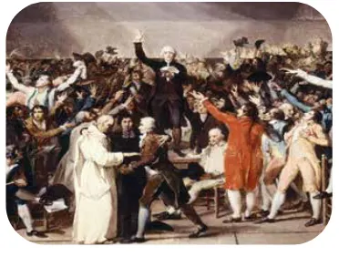

Mazkur qoida Oʻzbekiston Respublikasi Konstitutsiyasining 28-moddasida mustahkamlangan boʻlib, unga koʻra, jinoyat sodir etganlikda ayblanayotgan shaxs uning aybi qonunda nazarda tutilgan tartibda oshkora sud muhokamasi yoʻli bilan isbotlanmaguncha va sudning qonuniy kuchga kirgan hukmi bilan aniqlanmaguncha aybsiz deb hisoblanadi. Ayblanuvchi oʻzini himoya qilishi uchun barcha imkoniyatlar taʼminlanadi.

Konstitutsiyamizning mazkur moddasi inson huquqlari boʻyicha xalqaro huquq normalariga toʻliq mos keladi. Shuningdek, 28-moddada aybdorlikka oid barcha shubhalar, agar ularni bartaraf etish imkoniyatlari tugagan boʻlsa, gumon qilinuvchining, ayblanuvchining, sudlanuvchining yoki mahkumning foydasiga hal qilinishi kerak ekanligi, gumon qilinuvchi, ayblanuvchi yoki sudlanuvchi oʻzining aybsizligini isbotlashi shart emasligi va istalgan vaqtda sukut saqlash huquqidan foydalanishi mumkinligi mustahkamlab qoʻyilgan.

Shaxsning aybi isbotlanishi bilan jinoyat eʼtirof etiladi. Keyin esa sud hukmi bilan tasdiqlanadi. Demak, sud hukmi qonuniy kuchga kirmay turib shaxsni “qotil”, “poraxoʻr”, “firibgar”, “oʻgʻri”, “zoʻravon” va boshqa iboralar bilan atab, uni aybdor shaxs sifatida koʻrsatib, ijtimoiy tarmoqlarda maʼlumot tarqatish shaxsning konstitutsiyaviy huquqlariga zid hisoblanadi. Agar sudda shaxsning aybi isbotlanmay, u oqlansa, shaʼni, qadr-qimmati kamsitilgan boʻladi. Taassufki, bunday holatlar kundalik hayotimizda uchrab turadi. Davlatimiz konstitutsiyasida shaxs ning aybsizlik huquqi toʻliq kafolatlangan.

### Yodda tuting!

Har bir shaxsning aybi aniqlanmaguncha aybsiz hisoblangani sababli shaxsni hibsga olish zarur deb topilgan hollarda kerak boʻlmagan har qanday haddan tashqari qattiq choralar qonun bilan taqiqlanishi zarur.

**1789-yili Fransiyada qabul qilingan Inson va fuqaro huquqlari deklaratsiyasi, 9-modda** Jinoyat sodir etganlikda ayblangan har bir inson himoya uchun barcha imkoniyatlar taʼminlangan holda, ochiq sud majlisi yoʻli bilan uning aybi qonuniy tartibda aniqlanmaguncha aybsiz deb hisoblanishga haqlidir.

### Inson huquqlari umumjahon deklaratsiyasi, 11-modda

Jinoyat sodir etganlikda ayblangan har qanday kishi qonunga muvofiq aybi isbotlanmaguncha begunoh deb sanalish huquqiga ega.

**Fuqaroviy va siyosiy huquqlar toʻgʻrisidagi xalqaro pakt, 14-modda, 2-band**

### Savol va topshiriqlar

1. Shaxsiy huquq va erkinliklar tushunchasini yoritib bering.

2. Yashash huquqining taʼminlanishi deganda nimani tushunasiz?

3. Xabeas korpus aktining mohiyati nimadan iborat?

4. Aybsizlik prezumpsiyasining qanday ahamiyati bor?

### Mustaqil ish uchun topshiriq

Quyidagi shaxsiy huquq va erkinliklarning mohiyatini yoritib bering.

## 19-dars. Siyosiy huquqlar

Tenglik hukm surgan joyda sotqin, aldamchi ehtiroslar, gʻam-gʻussa boʻlmaydi.

**Abu Rayhon Beruniy**

### Bilib olasiz

Siyosiy huquqlar tushunchasi va tizimi. Fuqarolarning saylovda teng huquqliligi. Uyushish va yigʻilishlar erkinligi huquqi. Murojaat qilish huquqi.

### Siyosiy huquqlar tushunchasi va tizimi

Fuqarolarning jamiyat va davlat hayotida faol boʻlishida siyosiy huquqlar muhim oʻrin tutadi. Siyosiy huquqlar insonni mamlakat hayotiga faol kiritishga qaratilgan. Siyosiy huquqlar shaxs va jamiyat, fuqaro va jamiyat oʻrtasidagi aloqalarni mustahkamlash uchun sharoit yaratadi.

**Siyosiy huquqlar** fuqarolarning jamiyat va davlat boshqaruvida, siyosiy hayotida ishtirok etish imkoniyatini taʼminlovchi huquqlardir.

Siyosiy huquqlarning aksariyati shaxsning fuqaroligi bilan bogʻliq boʻlib, u tegishli davlatning fuqarolariga davlat va jamiyat ishlarini boshqarish imkoniyatini beradi. Shuning uchun ularni ikkita guruhga boʻlish mumkin: 1) davlat hokimiyati mexanizmining shakllanishi va faoliyatida ishtirok etish huquqlari (saylov huquqi, referendumda ishtirok etish huquqi, murojaat qilish huquqi); 2) jamiyatda ishtirok etish huquqi (birlashish huquqi, namoyish oʻtkazish huquqi).

Siyosiy huquqlar shaxsiy huquqlardan farqli ravishda fuqaroning ommaviy manfaatlarini qamrab oladi. Siyosiy huquqlar eng avvalo davlatni boshqarishda qatnashish, davlat faoliyatiga taʼsir etish imkoniyatini yaratuvchi huquqlar boʻlgani uchun ularning miqdori, amalga oshirish tartiblari qanday boʻlishini davlat belgilaydi.

Siyosiy huquqlar orqali davlat hokimiyatini amalga oshirish va davlatning ijtimoiy-siyosiy hayotida ishtirok etish imkoniyati qonun va davlat tomonidan oʻrnatiladi. Siyosiy huquqlar individual yoki jamoaviy boʻlishi mumkin. Mazkur huquqlarni amalga oshirish natijasida fuqaro hokimiyat vakolatiga ega boʻlishi mumkin, boshqa fuqarolar esa mazkur hokimiyatni amalga oshirish chegarasini nazorat qilish imkoniyatiga ega boʻladi.

Siyosiy huquqlarning mazmuniga eʼtibor qaratilsa, ular boshqa turdagi huquqlardan qator xususiyatlari bilan ajralib turadi.

Siyosiy huquqlarning xususiyatlaridan biri uning davlat bilan bogʻliqligidir. Davlat qanchalik demokratik boʻlsa, siyosiy huquqlar koʻproq va ulardan foydalanish kengroq boʻladi. Aksincha, davlat nodemokratik boʻlsa, siyosiy huquqlar doirasi torroq boʻladi va mavjud huquqlar ham turli vositalar bilan cheklanadi.

Siyosiy huquqlarning yana bir xususiyati ulardan foydalanish uchun fuqaro muayyan yoshga yetgan boʻlishi kerakligidir. Misol uchun, Oʻzbekiston Respublikasi qonunchiligiga koʻra, saylash huquqidan 18 yoshga yetgan fuqarolar foydalanishi mumkin.

### Yodda tuting!

Oʻzbekiston Respublikasining fuqarolari jamiyat va davlat ishlarini boshqarishda bevosita hamda oʻz vakillari orqali ishtirok etish huquqiga ega. Bunday ishtirok etish oʻzini oʻzi boshqarish, referendumlar oʻtkazish va davlat organlarini demokratik tarzda shakllantirish, shuningdek, davlat organlarining faoliyati ustidan jamoatchilik nazorati vositasida amalga oshiriladi.

### Oʻzbekiston Respublikasi

**Konstitutsiyasi, 36-modda**

Siyosiy huquqlarning boshqa bir xususiyati shundaki, ulardan tegishli huquqiy munosabat yuzaga kelgan davlatning fuqarolari foydalanishi mumkin.

Siyosiy huquqlar muayyan davlat fuqarolari tomonidan amalga oshiriladigan huquq boʻlgani sababli ularning tizimi (turlari) har bir davlatning milliy qonunchiligi bilan belgilanadi.

Oʻzbekiston Respublikasining Konstitutsiyasida siyosiy huquqlarning quyidagi koʻrinishlari mustahkamlangan:

– saylov va referendumda ishtirok etish huquqi;

– mitinglar, yigʻilishlar va namoyishlar oʻtkazish huquqi;

– kasaba uyushmalariga, siyosiy partiyalarga va boshqa jamoat birlashmalariga uyushish, ommaviy harakatlarda ishtirok etish huquqi;

– arizalar, takliflar va shikoyatlar bilan murojaat qilish huquqi;

– davlat xizmatiga kirish huquqi.

### Fuqarolarning saylovda teng huquqliligi

Saylovda qatnashish fuqarolarga mamlakatni boshqarishda ishtirok etish imkonini beradi. Fuqarolar bevosita yoki saylanadigan vakillari orqali ushbu imkoniyatni amalga oshiradi. Bu huquq fuqarolar har qanday saylab qoʻyiladigan organlarni saylash yoki tegishli organlarga saylanish huquqiga ega ekani bilan kafolatlangan. Fuqaro shu tariqa hokimiyatga va qabul qilinadigan qarorlarga taʼsir oʻtkazadi. Oʻzbekiston Respublikasining Konstitutsiyasida saylovda qatnashish huquqi jamiyat va davlat ishlarini boshqarishda bevosita hamda oʻz vakillari orqali ishtirok etish, davlat organlarini demokratik tarzda shakllantirish tarzida keltirilgan.

Mamlakatimizda oʻtkaziladigan saylovda faqatgina Oʻzbekiston Respublikasi fuqarolari ishtirok etishlari mumkin. Fuqarolar saylovda bir necha nomzod orasidan faqat bittasini yoqlab ovoz beradilar. Ovoz berishda qatnashish uchun (saylash huquqi) fuqarolar saylov kuni 18 yoshga toʻlgan boʻlishlari lozim.

Fuqarolar jinsi, irqiy va milliy mansubligi, tili, dinga munosabati, ijtimoiy kelib chiqishi, eʼtiqodi, shaxsiy va ijtimoiy mavqeyi, maʼlumoti, mashgʻulotining turi va xususiyatidan qatʼi nazar, teng saylov huquqiga egadir. Bu saylovda ishtirok etuvchi har bir fuqaro bir ovozga ega boʻlishini anglatadi.

Oʻzbekiston Respublikasi fuqarolarining davlat hokimiyati vakillik organlariga saylanish huquqi ham mavjud.

### Yodda tuting!

Oʻzbekiston Respublikasining fuqarolari davlat hokimiyati vakillik organlariga saylash va saylanish huquqiga egadirlar. Har bir saylovchi bir ovozga ega. Ovoz berish huquqi, oʻz xohish-irodasini bildirish tengligi va erkinligi qonun bilan kafolatlanadi.

### Oʻzbekiston Respublikasi

**Konstitutsiyasi, 128-modda**

### Uyushish va yigʻilishlar erkinligi huquqi

Fuqarolarning siyosiy huquqlaridan yana biri bu siyosiy partiyalar, kasaba uyushmalari, turli jamoat birlashmalariga aʼzo boʻlib kirish huquqidir. Mazkur huquq fuqarolarga oʻz qiziqishlari, manfaatlarini birgalikda amalga oshirish, himoya qilish imkonini beradi.

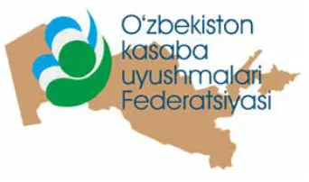

Siyosiy partiyalarda, jamoat birlashmalarida, ommaviy harakatlarda, shuningdek, davlat hokimiyati vakillik organlarida ozchilikni tashkil etuvchi muxolifatchi shaxslarning huquqlari, erkinliklari va qadr-qimmatini hech kim kamsitishi mumkin emas.

### Oʻzbekiston Respublikasi

**Konstitutsiyasi, 39-modda**

Tashkilot, korxona, muassasalarda fuqarolar oʻzlarining iqtisodiy manfaatlarini himoya qilish, kasaba uyushmalariga esa mehnat sharoitlarini yaxshilashni yoʻlga qoʻyish, mehnat huquqlarini himoya qilish maqsadida birlashadi.

Siyosiy partiyalarga aʼzo boʻlish uyushish huquqlari orasida alohida oʻrin tutadi. Chunki fuqarolar oʻz siyosiy qarashlari, manfaatlaridagi umumiylik asosida siyosiy partiyalarga birlashadi va ularning faoliyati orqali mamlakat siyosiy hayotida ishtirok etadi.

Oʻzbekiston Respublikasi fuqarolari kasaba uyushmalariga, siyosiy partiyalarga va boshqa jamoat birlashmalariga uyushish, ommaviy harakatlarda ishtirok etish huquqiga egadirlar.

### Oʻzbekiston Xalq demokratik partiyasi

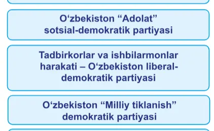

### Yodda tuting!

Jamoat birlashmasi oʻz huquqlari, erkinliklarini hamda siyosat, iqtisodiyot, ijtimoiy rivojlanish, fan, madaniyat, ekologiya va hayotning boshqa sohalaridagi qonuniy manfaatlarini birgalikda roʻyobga chiqarish uchun birlashgan fuqarolarning xohish-irodalarini erkin bildirishlari natijasida vujudga kelgan ixtiyoriy tuzilmadir.

Oʻzbekistonda 5 ta siyosiy partiya oʻz faoliyatini olib bormoqda. Partiyalarning koʻpligi qarashlar, fikrlar xilmaxilligi asosida fuqarolarning oʻziga mos partiyaga aʼzo boʻlish imkonini yaratadi. Fuqarolar siyosiy partiyaga aʼzo boʻlish orqali prezidentlikka, vakillik organlariga nomzod koʻrsatish huquqiga ega boʻladi. Oʻz navbatida, siyosiy partiyalar jamiyat va davlat ishlarida real ishtirok etish imkoniyatini beradi.

Bundan tashqari, fuqarolar jinsi, yoshi, kasbi, qobiliyatiga qarab ham jamoat birlashmalariga uyushishi mumkin. Bular Oʻzbekiston Respublikasi Oila va xotin-qizlar davlat qoʻmitasi, Oʻzbekiston yoshlar ittifoqi, “Ijtimoiy fikr” respublika jamoatchilik fikrini oʻrganish markazi, yozuvchilar, bastakorlar, jurnalistlar uyushmalaridir.

Har bir jamoat birlashmasi oʻz faoliyat maqsadlaridan kelib chiqqan holda ish yuritadi. Masalan, ayrimlari inson huquq va erkinliklari masalalari bilan, xayriya tashkilotlari esa eng ehtiyojmand kishilarga moddiy yordam koʻrsatish bilan shugʻullanishi mumkin.

Siyosiy huquqlarning yana bir koʻrinishi yigʻilishlar, mitinglar va namoyishlar oʻtkazish huquqi hisoblanadi.

**Miting** – maʼlum bir shaxslar va tashkilotlarning xatti-harakatlari, ijtimoiy-siyosiy voqealarga nisbatan munosabatini oshkora ifodalash maqsadidagi fuqarolarning tinch yigʻini.

**Namoyish** – maʼlum bir siyosiy talablarni bildirish maqsadidagi ommaviy yurish. **Yigʻilish** – biror-bir muhim jamoatchilik masalasini birgalikda muhokama qilish uchun fuqarolar ishtiroki.

Fuqarolarning mana shulardagi ishtiroki ularning jamiyat va davlat hayotidagi ijtimoiy faolliklarini namoyon etadi. Bu huquq hukumatga xalqning fikri haqida axborot yetkazib turish, mamlakatda boʻlayotgan jarayonlarda fuqarolar kuzatuvchi sifatidagina ishtirok etmasdan, ularga oʻz munosabatini bildirishi uchun ham zarurdir. Mazkur faoliyat fuqarolarni tashvishlantirayotgan muammolarga hukumat eʼtibor qaratishi va tegishli choralarni koʻrishiga xizmat qiladi. Mitinglar, yigʻilishlar va namoyishlar Oʻzbekiston Respublikasi qonunlariga muvofiq tash kil etilishi va oʻtkazilishi lozim.

### Murojaat qilish huquqi

Vakolatli organlarga murojaat qilish huquqi shaxslarning davlat va jamiyat ishlarida ishtirok etish shakllaridan biri hisoblanadi. Shaxslarning oʻz huquq va erkinliklarini himoya qilish, mavjud ijtimoiy-huquqiy muammolarni bartaraf etishda murojaat qilish huquqi katta ahamiyatga ega. Mazkur siyosiy huquqning boshqalaridan farqi shundaki, undan nafaqat fuqarolar, balki chet el fuqarolari hamda fuqaroligi boʻlmagan shaxslar ham foydalanishi mumkin.

Vakolatli organlarga, shaxslarga murojaatlar arizalar, takliflar va shikoyatlar koʻrinishida boʻlishi mumkin.

Fuqarolar oʻz ijtimoiy faolliklarini Oʻzbekiston Respublikasi qonunlariga muvofiq miting lar, yigʻilishlar va namoyishlar shaklida amalga oshirish huquqiga ega. Hokimiyat organlari faqat xavfsizlik nuqtayi nazaridangina bunday tadbirlar oʻtkazilishini toʻxtatish yoki taqiqlash huquqiga ega.

### Oʻzbekiston Respublikasi

**Konstitutsiyasi, 38-modda**

Murojaatlar Oʻzbekiston Respublikasining “Jismoniy va yuridik shaxslarning murojaatlari toʻgʻrisida”gi qonuni bilan tartibga solinib, ogʻzaki, yozma yoki elektron shaklda boʻlishi mumkin.

Murojaatnomada fuqaroning ismi, familiyasi, otasining ismi koʻrsatilishi, turarjoyi haqida maʼlumot boʻlishi, ariza, taklif yoki shikoyat mazmuni bayon etilishi kerak. Yozma murojaatnoma murojaat qiluvchining imzosi bilan tasdiqlanadi. Murojaatnomani shaxsiy imzo bilan tasdiqlash imkoni boʻlmaganda, u boshqa shaxsning imzosi bilan tasdiqlanishi mumkin. Bunda qoʻshimcha ravishda imzo qoʻyuvchi shaxsning familiyasi, ismi va otasi ismi koʻrsatilgan boʻlishi kerak.

Bugun mamlakatimizda aholi bilan toʻgʻridan toʻgʻri muloqotni tashkil etish, shaxslarning huquqlari, erkinliklari va qonuniy manfaatlarini toʻlaqonli himoya qilish maqsadida xalq qabulxonalari hamda virtual qabulxonalar tashkil etilgan.

**Ariza** – fuqarolarning oʻz huquqlari, erkinliklari va qonuniy manfaatlarini amalga oshirish uchun koʻmak soʻrab qilgan murojaatlari. Masalan, fuqaroning xorijda davolanish uchun vakolatli organga yordam soʻrab qilgan murojaati.

**Taklif –** fuqarolarning davlat va jamoatchilik faoliyatini takomillashtirish boʻyicha tavsiyalarini ifodalovchi murojaatlar. Masalan, Oʻzbekiston Respublikasi qonunchiligini takomillashtirish yuzasidan fuqarolar tomonidan takliflar berilishi.

**Shikoyat** – fuqarolarning buzilgan huquqlari, erkinliklari va qonuniy manfaatlarini tiklashni talab qiluvchi murojaatlari. Masalan, fuqarolar turarjoyiga yaqin joylashgan dam olish maskanining aholi tungi osoyishtaligini buzayotgani yuzasidan ichki ishlar organlariga berilgan shikoyat.

### Hayotiy vaziyat

Saylov kuni fuqaro D. saylov uchastkasiga keldi va ovoz bermoqchiligini aytadi. Uchastka saylov komissiyasi byulleten berish uchun saylovchining shaxsini tasdiqlovchi hujjatni soʻraganda D. hujjati uyda qolib ketganini bildiradi. Shunda komissiya aʼzolaridan biri D. uning qoʻshnisi ekanini aytib, unga byulleten beradi. Fuqaro D. ovoz berish kabinasiga kirganidan soʻng byulletenni qanday toʻldirishni bilmasligini aytib, komissiya aʼzosi boʻlgan tanishidan yordam soʻraydi.

Ushbu holatda uchastka saylov komissiyasi faoliyatiga huquqiy jihatidan baho bering va saylovchi D.ning harakatlarini izohlang.

### Savol va topshiriqlar

1. Siyosiy huquqlarga nimalar kiradi?

2. Turmush sharoitingizni yaxshilash, farovon hayot kechirishda siyosiy huquqlaringizning oʻrni qanday?

3. Saylovda teng huquqlilik qanday amalga oshiriladi?

4. Kasaba uyushmalariga aʼzo boʻlish orqali siz qanday huquqlaringizni amalga oshirasiz?

### Mustaqil ish uchun topshiriq

1. Oʻz mahallangizdagi mavjud muammolarni bartaraf etish uchun vakolatli organga murojaat loyihasini tayyorlang.

2. Fuqaro T. ichki ishlar idorasiga kelib, oʻz aybini tan olmoqchi ekanini bildiradi. U dehqon bozorida bir necha marta sotuvchilarning mahsulotlarini oʻgʻirlaganini, endi bundan vijdoni qiynalayotganini aytib, uni jazolashlarini soʻrab murojaat qiladi. Ichki ishlar xodimlari fuqaro T. oʻz aybini tan olgani uchun hech qanday surishtiruv oʻtkazmasdan unga oʻgʻirlik boʻyicha jinoyat ishi qoʻzgʻatishadi.

Ichki ishlar organi xodimlarining harakatlariga huquqiy baho bering.

## 20-dars. Iqtisodiy va madaniy huquqlar

Ishbilarmon mardlik va shijoat sohibi, azmi qatʼi, tadbirkor va hushyor bir kishi minglab tadbirsiz, loqayd kishilardan yaxshidir. **Amir Temur**

### Bilib olasiz

Iqtisodiy huquqlar tushunchasi.

Mulkdor boʻlish huquqi. Meros huquqi.

Madaniy huquqlar tushunchasi va ulardan foydalanish shakllari.

### Iqtisodiy huquqlar tushunchasi

Insonlarning farovon hayot kechirishi, munosib turmush tarziga ega boʻlishida iqtisodiy huquqlar muhim oʻrin tutadi. Iqtisodiy huquqlarning eng asosiylari xalqaro darajada qabul qilingan Inson huquqlari umumjahon deklaratsiyasi, Iqtisodiy, ijtimoiy va madaniy huquqlar toʻgʻrisidagi xalqaro paktda qayd etilgan. Oʻzbekiston Respublikasining Konstitutsiyasi inson va fuqaroning asosiy iqtisodiy huquq va erkinliklarini belgilaydi. Ularning mazmuni va koʻlami esa huquqning boshqa, masalan, fuqarolik, mehnat, tadbirkorlik kabi sohalarida mustahkamlangan.

Iqtisodiy huquqlar davlat tomonidan oʻrnatilib, davlatning iqtisodiy qudrati oshib borishi, imkoniyatlarining ortishi natijasida yanada kengayib boradi. Bu huquqlardan foydalanish orqali fuqarolar oʻz yashash sharoitini oʻzi taʼminlaydi.

Iqtisodiy huquqlar tovarlar va xizmatlarni ishlab chiqarish, ayirboshlash, taqsimlash va isteʼmol qilish sohasidagi inson faoliyati erkinligini qamrab oladi, aholining tegishli faolligini va uning bozor erkinligini taʼminlaydi.

Iqtisodiy huquqlar koʻpincha boshqa huquq va erkinliklarning amalga oshirilishini taʼminlashga xizmat qiladi. Shaxslarning iqtisodiy holatining yaxshiligi ularga berilgan huquq va erkinliklardan samarali foydalanish imkoniyatini ham oshiradi. Iqtisodiy imkoniyatlar farovon turmush tarziga erishishda asosiy oʻrin tutadi.

Iqtisodiy huquqlar jamiyatning iqtisodiy sohalari bilan bogʻliq huquqlar hisoblanadi. Iqtisodiy huquqlarning yana bir koʻrinishi bank operatsiyalarining, omonatlar va hisob varaqlarning sir tutilishidir. Oʻzbekiston Respublikasi Konstitutsiyasining 41-moddasiga muvofiq, mana shunday sir tutilish qonun bilan kafolatlangan.

Bank siri hisoblanuvchi maʼlumotlar ayrim hollardagina vakolatli organlarning soʻroviga koʻra ularga taqdim etilishi mumkin. Lekin ushbu holatlar bank sirini oshkor qilish hisoblanmaydi va ular Oʻzbekiston Respublikasining “Bank siri toʻgʻrisida”gi qonuni bilan tartibga solingan.

### Meros huquqi

Bank sirini tashkil etuvchi maʼlumotlarning muhofaza qilinishi bank tomonidan kafolatlanadi.

**Oʻzbekiston Respublikasining “Bank siri toʻgʻrisida”gi qonuni, 7-modda**

### Mulkdor boʻlish huquqi. Meros huquqi

Mulkdor boʻlish huquqi jamiyatning iqtisodiy asosini tashkil etadi. Oʻzbekiston Respublikasi Konstitutsiyasiga muvofiq, har bir shaxs mulkdor boʻlish huquqiga ega hisoblanadi. Shaxsning mol-mulkini hukumat ham, odamlar ham tortib olishi mumkin emas.

Mulk huquqi konstitutsiya darajasida mustahkamlangani insonga ishonch hamda mustaqillik hissini baxsh etadi.

Mol-mulkning daxlsizligi farovon hayot kechirishga xizmat qiluvchi asosiy vositalardandir.

Respublikamizda mulkdor boʻlish huquqi konstitutsiyadagina belgilanmagan, shu huquqni roʻyobga chiqaruvchi, aniqrogʻi, kishilarning mulkdor boʻlishini taʼminlovchi koʻplab huquqiy hujjatlar qabul qilingan.

### Yodda tuting!

Mulkdor boʻlish huquqi mulkka qanday egalik qilish, undan foydalanish va uni tasarruf etishni belgilovchi, shuningdek, ushbu vakolatlarni himoya qilishni taʼminlaydigan huquqiy normalar yigʻindisidir.

Mulkdor boʻlish huquqi mulk bilan bogʻliq uchta huquqni oʻz ichiga oladi. Bular – mulkka egalik qilish, undan foydalanish va uni tasarruf etish huquqi. Mulk egasi oʻz mol-mulkidan qanday foydalanish, shuningdek, uni sotish, hadya qilish yoki almashtirish huquqiga ega.

Mulkdor oʻz mulkini muayyan faoliyat bilan shugʻullangan holda koʻpaytirishi ham mumkin. Bunday qoʻshimcha ravishda olib boriladigan faoliyat turi albatta qonun bilan ruxsat etilgan boʻlishi lozim. Taqiqlangan faoliyat turlari bilan shugʻullanish mulkdorga nisbatan qonunda belgilangan tartibda chora koʻrilishiga sabab boʻladi.

### Yodda tuting!

Mulk huquqi mutlaq emas va baʼzi hollarda qonun bilan cheklanishi mumkin. Masalan, ayrim mamlakatlarda atrof-muhitni muhofaza qilish yoki qonuniylikni taʼminlash maqsadida yerga egalik huquqini cheklovchi qonunlar mavjud.

Shaxslarning mulk bilan bogʻliq faoliyat turlari Oʻzbekiston Respublikasining Fuqarolik kodeksi Har bir shaxs mulkdor boʻlishga haqli.

Bank operatsiyalarining, omonatlarning va hisobvaraqlarning sir tutilishi, shuningdek, meros huquqi qonun bilan kafolatlanadi.

bilan batafsil tartibga solingan.

Insonlarning mulk bilan bogʻliq munosabatlarida meros huquqi alohida oʻringa ega. Meros huquqi muayyan shaxsning vafotidan soʻng unga tegishli boʻlgan huquq va majburiyatlar merosxoʻrlariga uning vasiyatiga yoki qonunga

### Oʻzbekiston Respublikasi

**Konstitutsiyasi, 41-modda**

muvofiq oʻtkazilishini tartibga soladi. Merosga ega chiqadiganlar “merosxoʻrlar” deb ataladi.

Fuqaroning vafotidan keyin vorislariga oʻtadigan mol-mulki “meros” mulki hisoblanadi.

Demak, merosga nisbatan vorislik ikki xil usulda vujudga keladi:

– vasiyatnoma boʻyicha vorislik;

– qonun boʻyicha vorislik.

Fuqaroning oʻziga tegishli mol-mulkni yoki bu mol-mulkka nisbatan huquqini vafot etgan taqdirda tasarruf etish xususidagi xohish-irodasi vasiyat deb eʼtirof qilinadi.

Vasiyatnoma vasiyat qiluvchi oʻz merosxoʻrlarini va ularga merosni berish tartibini belgilaydigan hujjatdir.

Fuqaro oʻziga tegishli boʻlgan barcha mol-mulkini yoki uning bir qismini nafaqat merosxoʻrlarga, balki merosxoʻr hisoblanmaydigan shaxslarga, tashkilotlarga, davlatga yoki fuqarolarning oʻzini oʻzi boshqarish organlariga ham vasiyat qilib qoldirishi mumkin.

Merosni olish majburiy emas, balki ixtiyoriydir. Merosxoʻr meros ochilgan kundan eʼtiboran istalgan vaqtda unga qoldirilgan merosdan voz kechishga haqli. Biroq merosdan voz kechganidan soʻng keyinchalik merosni olmoqchi boʻlsa, u bunga haqli boʻlmaydi.

Agar vafot etgan shaxs oʻziga tegishli mol-mulkni merosxoʻrlarga taqsimlash boʻyicha vasiyatnoma qoldirmagan boʻlsa, merosni taqsimlash meros qoldiruvchi fuqarosi boʻlgan yoki doimiy yashagan davlat qonuni bilan taqsimlanadi.

Vasiyatnoma joyi va vaqti koʻrsatilgan holda albatta yozma ravishda tuziladi hamda notarius tomonidan belgilangan tartibda tasdiqlangan boʻlishi lozim. Vasiyatnomaga qoʻyiladigan talablardan biri uning meros ochilgunga qadar sir saqlanishi lozimligidir.

### Yodda tuting!

Notarius, vasiyatnomani tasdiqlovchi boshqa mansabdor shaxs, shuningdek, vasiyat qiluvchining oʻrniga vasiyatnomani imzolagan fuqaro meros ochilgunga qadar vasiyatnomaning mazmuniga, uning tuzilishi, bekor qilinishi yoki oʻzgartirilishiga daxldor maʼlumotlarni oshkor qilishga haqli emas.

### Madaniy huquqlar tushunchasi va ulardan foydalanish shakllari

Har bir inson rivojlanishi, maʼnaviy ozuqa olishi, barkamollikka erishishida ijod qilish, turli madaniy yutuqlardan foydalanish muhim hisoblanadi.

Madaniy huquqlar madaniy xilmaxillikni va jamiyat rivojlanishini taʼminlaydi, shuningdek, madaniy merosni saqlashga yordam beradi.

**Madaniy huquqlar** shaxsning madaniy boyliklardan foydalanish va yaratish, madaniy hayotda ishtirok etish erkinligini taʼminlaydigan huquqlardir.

Oʻzbekiston Respublikasi Konstitutsiyasiga koʻra, har kim ilmiy, texnikaviy va badiiy ijod erkinligi, madaniyat yutuqlaridan foydalanish huquqiga egadir. Ijod – sifat jihatidan yangi moddiy va maʼnaviy qadriyatlarni yaratish jarayoni. U erkin boʻlib, huquq mazkur erkinlikni kafolatlaydi. Inson oʻzi istagancha ijod qilishi mumkin. Ammo ijodkorlik natijasi muayyan shaklga ega boʻlishi bilanoq ushbu ijod natijasining huquqiy maqomini belgilaydigan, muallifining huquq va qonuniy manfaatlarini himoya qiladigan normalar ishga tushadi. Oʻzbekiston Respublikasida shaxslarning ijodiy ishlari “Mualliflik huquqi va turdosh huquqlar toʻgʻrisida”gi, “Ixtirolar, foydali

### MADANIY HUQUQLARNI AMALGA OSHIRISH SHAKLLARI

modellar va sanoat namunalari toʻgʻrisida”gi qonunlar bilan muhofaza qilinadi. Intellektual mulk huquqi mualliflik huquqlari, patentlar, nalari va intellektual mulkni himoya qilishning boshqa shakllarini oʻz ichiga oladi. Intellektual mulk mualliflarga oʻz ishlari uchun mukofot olish imkonini beradi va ularni noqonuniy foydalanishdan himoya qiladi. Hozirgi texnologiyalari rivojlangan davr bir tomondan intellektual mulkni himoya qilishi imkoniyatlarini oshirsa, ikkinchi tomondan undan noqonuniy foydalanuvchilar sonining ortishiga ham yordam beradi. Bunga ijtimoiy tarmoqlar orqali yangi yaratilgan ijod namunasining hali taqdimoti boʻlmasdan tarqalib ketish holatini misol qilib keltirish mumkin. Intellektual mulkni himoya qilish jahon miqyosida ahamiyatga ega boʻlib, mazkur masalalar bilan Jahon intellektual mulk tashkiloti shugʻullanadi.

Har kimga ilmiy, texnikaviy va badiiy ijod erkinligi, madaniyat yutuqlaridan foydalanish huquqi kafolatlanadi. Intellektual mulk qonun bilan muhofaza qilinadi.

Davlat jamiyatning madaniy, ilmiy va texnikaviy rivojlanishi haqida gʻamxoʻrlik qiladi.

### Oʻzbekiston Respublikasi

**Konstitutsiyasi, 53-modda**

### Yodda tuting!

Ixtirolar, ilmiy kashfiyotlar, adabiy asarlar, musiqiy asarlarni yaratish kabi ijodiy faoliyat natijalari intellektual mulk hisoblanadi.

### Hayotiy vaziyat

### Savol va topshiriqlar

1. Iqtisodiy huquqlarga nimalar kiradi?

2. Mulk huquqi egalik qilish, foydalanish va tasarruf qilishdan iborat. Ularning farqlari nimada?

3. Meros qoldiruvchi yozma ravishda vasiyat qoldirmagan boʻlsa, meros taqsimoti qanday amalga oshiriladi?

4. Intellektual mulk deganda qanday mulklar nazarda tutiladi?

### Mustaqil ish uchun topshiriq

1. Madaniy huquqlardan foydalanishga misollar keltirib, quyidagi jadvalni toʻldiring.

### Huquqni amalga oshirish shakli

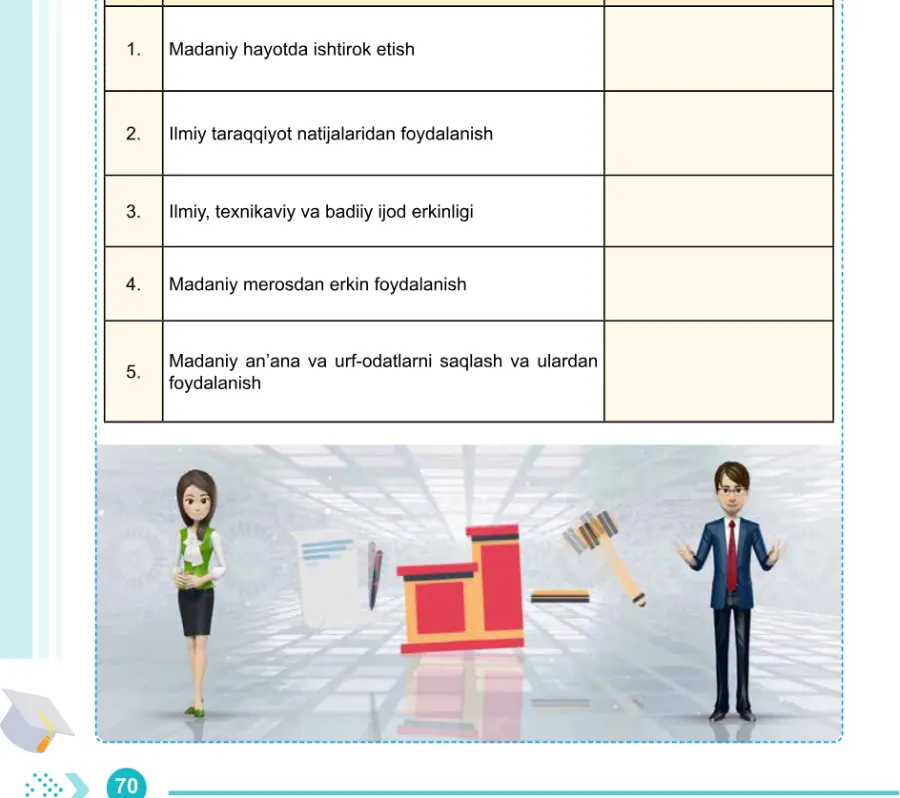

## 21-dars. Ijtimoiy huquqlar

Ilmni kim vositayi joh etar, Oʻzini-yu xalqni gumroh etar.

**Alisher Navoiy**

### Bilib olasiz

Ijtimoiy huquqlar tushunchasi va tizimi.

Mehnat qilish huquqi va bandlik.

Ijtimoiy taʼminot olish va uy-joyga boʻlgan huquq. Taʼlim olish huquqi.

### Ijtimoiy huquqlar tushunchasi va tizimi

Konstitutsiyamizda Oʻzbekiston Respublikasi ijtimoiy davlat sifatida belgilangan. Ijtimoiy davlatning asosiy belgisi shaxs manfaatlari davlat manfaatlaridan ustun boʻlishidir. Ijtimoiy davlatda har bir insonning munosib hayot kechirishini taʼminlash, betoblik, qarilik, ishsizlik yoki insonga bogʻliq boʻlmagan boshqa turli holatlarda ularni qoʻllab-quvvatlashga qaratilgan sharoit yaratilishi lozim. Mana shunday imkoniyat va sharoitlar avvalo shaxslarning ijtimoiy huquqlarini qonunchilikda mustahkamlash va ularni amalga oshirishga koʻmaklashishda namoyon boʻladi.

**Ijtimoiy huquqlar** – fuqarolarning ijtimoiy himoyasi va farovonligini taʼminlaydigan huquqlar.

Ijtimoiy huquqlar demokratik jamiyatning ajralmas qismi boʻlib, barcha fuqarolar uchun teng imkoniyatlar yaratilishiga xizmat qiladi. Taʼlim, sogʻliqni saqlash, ijtimoiy taʼminot, uy-joy, mehnat va ish bilan taʼminlanish, dam olish huquqi kabilar shaxslarning munosib hayot kechirish, ijtimoiy jihatdan rivojlanish, davlat gʻamxoʻrligi ostida boʻlishiga qaratilgan huquqlardir. Oʻzbekiston Konstitutsiyasidagi ijtimoiy huquqlar doirasi, qoʻllanish tarzi, belgilangan qoidalar xalqaro hujjat normalariga va ulardagi talablarga mosdir. Shaxslarning asosiy ijtimoiy huquqlari doirasi Oʻzbekiston Respublikasining Konstitutsiyasida keltirib oʻtilgan.

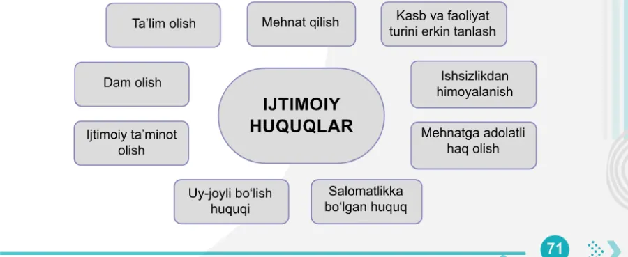

### Mehnat qilish huquqi va bandlik

Mehnat qilish huquqi har bir shaxsning tanlagan kasbi, faoliyat turi boʻyicha daromad ishlab topishga boʻlgan huquqi hisoblanadi. Eʼtibor qaratiladigan boʻlsa, mehnat daromadlar manbayidir. Shu bois ham baʼzida mehnat qilish huquqi shaxslarning iqtisodiy huquqlaridan biri sifatida ham tushuntiriladi.

Har kim munosib mehnat qilish, kasb va faoliyat turini erkin tanlash, xavfsizlik va gigiyena talablariga javob beradigan qulay mehnat sharoitlarida ishlash, mehnati uchun hech qanday kamsitishlarsiz hamda mehnatga haq toʻlashning belgilangan eng kam miqdoridan kam boʻlmagan tarzda adolatli haq olish, shuningdek, ishsizlikdan qonunda belgilangan tartibda himoyalanish huquqiga ega.

Har kim mehnat huquqlarini amalga oshirish va himoya qilishda teng imkoniyatlarga ega. Shaxslar oʻzlari xohlagan kasb va faoliyat turini erkin tanlashlari mumkin. Lekin bu degani barcha oʻzi istagan faoliyat turi bilan shugʻullanishini anglatmaydi. Chunki ayrim faoliyat turlarida yosh, malaka, xavfsizlik bilan bogʻliq talablar mavjud. Bundan tashqari, 18 yoshga toʻlmagan shaxslarning mehnatidan foydalanish taqiqlangan ish turlari mavjud. Ular sogʻliq uchun zararli boʻlgan mehnat sharoitiga ega.

Ish joyini tanlash ish beruvchiga bevosita murojaat qilish yoki mehnat organlarining, xususiy bandlik agentliklarining yordamidan foydalangan holda amalga oshirilishi mumkin.

### Oʻzbekiston Respublikasi

**Konstitutsiyasi, 42-modda**

Ishga qabul qilish yoshi va talablar Faoliyat turi Umumiy tartibda

– oʻquvchilarning sogʻligʻiga hamda maʼnaviy kamol topishiga ziyon yetkazmaydigan;

– oʻqitish jarayonini buzmaydigan;

– yengil mehnat.

– teatr;

– televideniye;

– radioeshittirish;

– professional sport bilan shugʻullanish;

– asarlar yaratish;

– ijro etish;

– koʻrgazmaga qoʻyish.

– oʻqishdan boʻsh vaqtida;

– ota-onadan birining yozma roziligi bilan.

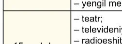

– ota-onaning har ikkisi roziligi;

– vasiylik va homiylik organining ruxsati bilan.

**Majburiy mehnat** – biror-bir jismoniy shaxsga jazoni qoʻllash tahdidi ostida, uning ixtiyoriga qarshi ravishda muayyan ishni bajartirish.

Mehnat qilish erkin boʻlib, hech kim oʻz xohishiga qarshi muayyan bir ishni qilishga majburlanishi mumkin emas.

Koʻrinishidan majburiy mehnatni eslatuvchi ishlar ham borki, ular muayyan mezonlardan kelib chiqqan holda Konstitutsiyamiz va xalqaro qoidalarga koʻra majburiy mehnat deb hisoblanmaydi:

– harbiy xususiyatga ega boʻlgan ishlar;

– bajarilishiga favqulodda yoki harbiy holat joriy etilishi sabab boʻladigan ishlar;

– sudning qonuniy kuchga kirgan qarori boʻyicha jazo sifatida bajariladigan ishlar. Konstitutsiyamizga kiritilgan yangiliklardan biri bu bolalar mehnatining taqiqlanishidir. Bolalar mehnati deganda bolalarni bolalikdan mahrum etadigan, ularning maktabga borishlariga toʻsqinlik qiladigan hamda ularni aqliy, jismoniy, ijtimoiy va axloqiy jihatdan zararli boʻlgan har qanday mehnat shakli orqali ekspluatatsiya qilish tushuniladi.

Oʻzbekiston Respublikasi Vazirlar Mahkamasining qarori bilan, 18 yoshga toʻlmagan shaxslar mehnatidan foydalanish taqiqlangan ishlarning roʻyxati tuzilgan. Ushbu ishlar bolalar uchun ogʻir hamda zararli yoki xavfli mehnat sharoitlariga ega boʻlgani uchun roʻyxatga kiritilgan. Masalan, boʻyoqchi, temirchi, novvoy, kon ish chisi, muzqaymoq tayyorlovchi va boshqalar.

Fuqarolarni ish oʻrinlari bilan taʼminlash har bir davlatdagi muhim masalalardan biri hisoblanadi. Chunki har yili minglab bitiruvchilar mehnat bozoriga kirib boradi. Bu esa davlat oldiga yangi ish oʻrinlarini yaratish vazifasini qoʻyadi. Biroq hammani ish bilan toʻliq band qilishning imkoni yoʻq. Shu sabab davlat ishsiz fuqarolarni ijtimoiy jihatdan himoya qilishni oʻz zimmasiga oladi.

Mehnat huquqining amal qilishi natijasida koʻplab mehnat munosabatlari vujudga keladi, yaʼni ishga kirish, normal tartiblarda ishlash, mehnatni muhofaza qilish, ishdan boʻshash yoki boʻshatish va boshqalar. Mazkur munosabatlar Oʻzbekiston Respublikasining Mehnat kodeksi bilan tartibga solinadi.

Bolalar mehnatining bolaning sog‘- ligʻiga, xavfsizligiga, axloqiga, aqliy va jismoniy rivojlanishiga xavf soluvchi, shu jumladan, uning taʼlim olishiga toʻsqinlik qiluvchi har qanday shakllari taqiqlanadi.

### Oʻzbekiston Respublikasi

**Konstitutsiyasi, 44-modda**

Davlat fuqarolarning bandligini taʼminlash, ularni ishsizlikdan himoya qilish, shuningdek, kambagʻallikni qisqartirish choralarini koʻradi. Davlat fuqarolarning kasbiy tayyorgarligini va qayta tayyorlanishini tashkil etadi hamda ragʻbatlantiradi.

### Oʻzbekiston Respublikasi

**Konstitutsiyasi, 43-modda**

### Ijtimoiy taʼminot olish va uy-joyga boʻlgan huquq

Ijtimoiy taʼminot olish huquqi shaxslarning asosiy ijtimoiy huquqlaridan biri hisoblanadi. Shaxs yosh oʻtishi bilan muayyan kasallik, mayib boʻlish natijasida mehnat qobiliyatini yoʻqotishi mumkin. Muayyan bir shaxs kimningdir qaramogʻida boʻlib, asosiy boquvchi vafot etishi natijasida yoki boshqa sabablar bilan qaramogʻidagi shaxslarni taʼminlay olmay qoladi. Mana shunday vaqtlarda davlat ularni ijtimoiy jihatdan himoya qilish choralarini koʻradi.

Shaxslarning ijtimoiy taʼminoti pensiyalar, nafaqalar yoki boshqa ijtimoiy moddiy yordam orqali amalga oshiriladi. Pensiya va nafaqalarning 3 turi mavjud: yoshga doir, nogironlik, boquvchisini yoʻqotganlik. Pensiya yetarli ish stajiga ega boʻlgan fuqarolar uchun, nafaqa esa yetarli ish stajiga ega boʻlmagan fuqarolarga belgilanadi.

Har kim qariganda, mehnat qobiliyatini yoʻqotganda, ishsizlikda, shuningdek, boquvchisini yoʻqotganda va qonunda nazarda tutilgan boshqa hollarda ijtimoiy taʼminot huquqiga ega.

Qonunda belgilangan pensiyalar, nafaqalar va boshqa turdagi ijtimoiy yordamning miqdorlari rasman belgilangan eng kam isteʼmol xarajatlaridan oz boʻlishi mumkin emas.

**Oʻzbekiston Respublikasi Konstitutsiyasi, 46-modda**

Konstitutsiyada qonunda koʻzda tutilgan boshqa hollarda ham fuqarolar ijtimoiy taʼminot olish huquqiga egaligi belgilangan. Bu farzand tugʻish va uni maʼlum yoshigacha parvarish qilish muddatidagi nafaqa; tabiiy ofat yoki boshqa falokatlar tufayli jiddiy iqtisodiy va boshqa zarar koʻrganlarga beriladigan nafaqalar; kam taʼminlanganlarga beriladigan nafaqalar va boshqalar.

Uy-joyli boʻlish har bir shaxsga erkinlik, daxlsizlik, munosib turmush kechirish imkoniyatini yaratadi. Biroq oʻtgan yillarda “uy-joyni buzish”, “snos” degan soʻzlar tez-tez quloqqa chalindi. Bunday harakatlar fuqarolarning mulk huquqlari qoʻpol ravishda buzilishiga olib keldi. Shaxslarning uy-joyga boʻlgan huquqlarini eng yuqori darajada himoya qilish maqsadida Konstitutsiyamizga maxsus norma kiritildi.

Mazkur norma yangilangan Konstitutsiyada oʻz aksini topgan ijtimoiy davlat gʻoyasi bilan chambarchas bogʻliqdir. Ijtimoiy davlatda aholi oʻzining barcha imkoniyatlariga ega boʻlishi zarur. Buning ikki xil xususiyati bor. Birinchisi, shaxsning uy-joyga boʻlgan huquqi sud orqali himoya qilinishidir. Ikkinchisi esa oʻrnini qoplash bilan bogʻliq masalani oʻz ichiga oladi.

Shaxslar uy-joydan mahrum qilish yetarlicha asos boʻlgandagina va faqatgina sudning qarori bilan amalga oshiriladi. Agarda mulkdor uy-joydan mahrum etiladigan boʻlsa, unga mazkur mulkining qiymati va u koʻrgan zarar uy-joyi buzilishidan oldin toʻla ravishda qoplab berilishi lozim.

Shaxsning uy-joyga boʻlgan huquqlari Uy-joy kodeksi, Fuqarolik kodeksi, Shaharsozlik kodeksi kabi hujjatlar bilan tartibga solinadi.

Har kim uy-joyli boʻlish huquqiga ega. Hech kim sudning qarorisiz va qonunga zid tarzda uy-joyidan mahrum etilishi mumkin emas. Uy-joyidan mahrum etilgan mulkdorga uy-joyning qiymati hamda u koʻrgan zararlarning oʻrni qonunda nazarda tutilgan hollarda va tartibda oldindan hamda teng qiymatda qoplanishi taʼminlanadi.

### Oʻzbekiston Respublikasi

**Konstitutsiyasi, 47-modda**

### Taʼlim olish huquqi

Taʼlim olish huquqi koʻplab mamlakatlar konstitutsiyasida mustahkamlangan inson va fuqaroning asosiy huquqlaridan biridir. Unga koʻra, har kim ijtimoiy, iqtisodiy va madaniy mavqeyidan qatʼi nazar, taʼlim olish huquqiga ega.

Ushbu huquqqa muvofiq davlat barcha shaxslar uchun taʼlim olish imkoniyati va sifatini taʼminlashi, shuningdek, taʼlim dasturlari va muassasalarini tanlash erkinligini kafolatlashi zarur.

Konstitutsiyamizda bepul umumiy oʻrta taʼlim va boshlangʻich professional taʼlim davlat tomonidan kafolatlanishi mustahkamlangan.

Har kim taʼlim olish huquqiga ega.

Davlat uzluksiz taʼlim tizimi, uning har xil turlari va shakllari, davlat va nodavlat taʼlim tashkilotlari rivojlanishini taʼminlaydi.

Davlat maktabgacha taʼlim va tarbiyani rivojlantirish uchun shart-sharoitlar yaratadi. Davlat bepul umumiy oʻrta taʼlim va boshlangʻich professional taʼlim olishni kafolatlaydi. Umumiy oʻrta taʼlim majburiydir.

Maktabgacha taʼlim va tarbiya, umumiy oʻrta taʼlim davlat nazoratidadir.

Taʼlim tashkilotlarida alohida taʼlim ehtiyojlariga ega boʻlgan bolalar uchun inklyuziv taʼlim va tarbiya taʼminlanadi.

### Oʻzbekiston Respublikasi Konstitutsiyasi, 50-modda

Bolalar umumiy oʻrta taʼlimni olishga majbur hisoblanadi. Bu shuni anglatadiki, bolalarning sababsiz maktabga bormasligi, ota-ona bolalarining taʼlim olishiga toʻsqinlik qilishi qonunchilikda belgilangan tartibda javobgarlikka tortilishga sabab boʻladi.

Barcha davlatlarda taʼlim olish huquqi birdek taʼminlangan deb boʻlmaydi. Koʻplab mamlakatlarda haligacha bolalar toʻliq ravishda maktab taʼlimi bilan qamrab olinmagan. Bunga turli omillarni sabab sifatida keltirish mumkin.

### Qiziqarli maʼlumot

“Kichikligimda onam menga imkonsiz narsalarni, masalan, maktabni orzu qilmasligim kerakligini aytardi. Biroq bugun xudo menga kitobni qoʻlimda tutish, oʻqish va yozish imkoniyatini berib, meni hayratda qoldirdi. Endi imkonsiz narsani orzu qilishdan qoʻrqmayman”.

### Bixar, Hindiston

Ayrim bolalar taʼlim olishda, oʻzlashtirishda, maʼlumotlarni qabul qilishda boshqa bolalardan ajralib turadi. Bunday bolalarga alohida kitoblar, oʻqituvchilar, xonalar kerak boʻlishi mumkin. Konstitutsiyamizga koʻra, shunday hollarda ularga inklyuziv taʼlim va tarbiya tashkil etiladi.

**Inklyuziv taʼlim** – alohida taʼlim ehtiyojlari va individual imkoniyatlarning xilmaxilligini hisobga olgan holda barcha uchun teng imkoniyatlarni taʼminlagan holda beriladigan taʼlim.

Oliy maʼlumot olishda (bakalavr va magistratura) bepul va toʻlov-shartnoma asosida taʼlim olish birga olib boriladi. Yaʼni oliy oʻquv yurtlariga qabul qilinadigan talabalar belgilangan kvotalar boʻyicha davlat hisobidan bepul taʼlim oladi. Ular kirish sinovlarida yuqori natijaga erishgan talabgorlardir. Davlat byudjeti doirasida aniqlangan miqdor uchun yetarli ball toʻplay olmagan talabgorlar orasidan yuqori koʻrsatkichlarga erishganlari oʻz ixtiyori bilan toʻlov-kontrakt asosida oliy oʻquv yurtiga qabul qilinishi mumkin.

Konstitutsiyaga kiritilgan yangiliklardan biri oʻqituvchilar maqomining mustahkamlanishidir.

Oʻzbekiston Respublikasida oʻqituvchining mehnati jamiyat va davlatni rivojlantirish, sogʻlom, barkamol avlodni shakllantirish va tarbiyalash, xalqning maʼnaviy va madaniy salohiyatini saqlash hamda boyitishning asosi sifatida eʼtirof etiladi.

Davlat oʻqituvchilarning shaʼni va qadr-qimmatini himoyalaydi, ularning ijtimoiy va moddiy farovonligi, kasbiy jihatdan oʻsishi toʻgʻrisida gʻamxoʻrlik qiladi.

### Savol va topshiriqlar

1. Ijtimoiy huquqlar tizimiga qaysi huquqlar kiradi?

2. Nima uchun mehnat qilish huquqi baʼzida iqtisodiy huquqlarga kiritiladi?

3. Bolalar mehnatini taqiqlash degani bolalarning mehnat qilish huquqi yoʻqligini anglatadimi?

4. Inklyuziv taʼlimning mohiyati nimada? Misollar keltiring.

### Mustaqil ish uchun topshiriq

1. Taʼlim olish huquqi taʼminlanishi uchun eng zarur omillarga nimalarni kiritasiz? Javobingiz asosida quyidagi jadvalni toʻldiring.

**2.** F. ismli maktab oʻquvchisi internet blogerlari faoliyatini koʻrib, qiziqib qoladi. Uyda dadasining telefoni va kompyuteridan foydalangan holda turli oʻyinlarni oʻynab, ularni sharhlab, internetga joylashni boshlaydi. Bundan xabar topgan maktab maʼmuriyati F.ning oʻzlashtirishi pasayib ketayotganligini ota-onasiga aytadi.

F.ning ota-onasiga qanday yoʻl tutishni maslahat berasiz? Javobingizni asoslang.

## 22-dars. Ekologik huquqlar

Orol dengizining qurishi bilan bogʻliq vaziyatning tobora keskin tus olayotgani ekologik xavfsizlikni gʻoyat dolzarb masalaga aylantirdi. **Shavkat Mirziyoyev**

### Bilib olasiz

Ekologik huquqlarning taʼminlanishi.

Atrof-muhitni yaxshilash, tiklash va muhofaza qilish. Orolboʻyi mintaqasining ekologik tizimini muhofaza qilish.

### Ekologik huquqlarning taʼminlanishi

Inson huquqlarining taʼminlanishi muammolari uzoq tarixiy davrlarga borib taqalsa-da, insonlarning ekologik huquqlarini taʼminlash XX asrning 70-yillariga kelib, atrof-muhitning ifloslanishi global muammolarni keltirib chiqargani bois xalqaro miqyosdagi dolzarb masalaga aylandi.

Sogʻlom atrof-muhitga ega boʻlish huquqi Birlashgan Millatlar Tashkiloti tomonidan 1972-yili Stokgolm shahrida oʻtkazilgan konferensiyada ilk bor tilga olingan.

1992-yili Rio de Janeyroda oʻtkazilgan BMT anjumanida qabul qilingan Rio de Janeyro deklaratsiyasida “Odamlar tabiat bilan uygʻunlikda sogʻlom va samarali hayot kechirish huquqiga ega” deb belgilangan.

Oʻzbekiston Respublikasi Konstitutsiyasining 49-moddasida har kim qulay atrof-muhitga, uning holati toʻgʻrisida ishonchli axborot olish huquqiga ega ekani kafolatlangan.

Oʻzbekiston Respublikasi “Tabiatni muhofaza qilish toʻgʻrisida”gi qonunining maqsadlaridan biri fuqarolarning qulay atrof-muhitga ega boʻlish huquqini taʼminlashdan iborat. Insonning yashash muhiti boʻlmish biosfera va ekologiya tizimlari barqarorligini saqlab qolish, odamlarning ekologik jihatdan xavfsizligi, inson va uning kelgusi avlodlari genetik fondi haqida gʻamxoʻrlik qilish, atrof tabiiy muhit va inson sihat-salomatligi uchun zararli, tiklab boʻlmas oqibatlarga yoʻl qoʻymaslik davlat ekologik siyosatining asosiy yoʻnalishlari hisoblanadi.

Oʻzbekiston Respublikasi aholisi oʻzi va kelajak avlodning salomatligi uchun qulay tabiiy muhitda yashash, oʻz salomatligini atrof-muhitning zararli taʼsiridan muhofaza qilish huquqiga ega boʻlib, ana shu maqsadda Oʻzbekiston Respublikasi aholisi tabiatni muhofaza qilish boʻyicha jamoat tashkilotlariga birlashish, atrof tabiiy muhitning ahvoli hamda uni muhofaza qilish yuzasidan koʻrilayotgan chora-tadbirlarga doir axborotlarni talab qilish va olish huquqiga ega.

Oʻzbekiston Ekologik partiyasining asosiy maqsadi barqaror rivojlanishga, ekologik xavfsizlikka erishish, hozirgi va kelajak avlod uchun tabiiy resurslarni saqlash va qulay atrof-muhitni yaratishga yoʻnaltirilgan davlat siyosatini roʻyobga chiqarishni taʼminlash, atrof-muhitni muhofaza qilish va tabiiy resurslarni saqlash davlat, jamiyat va mamlakat har bir fuqarosining vazifasi boʻlishiga erishish yoʻlida koʻmaklashishdir.

Davlat fuqarolarning ekologik huquqlarini taʼminlash va atrof-muhitga zararli taʼsir koʻrsatilishi ga yoʻl qoʻymaslik maqsadida shaharsozlik faoliyati sohasida jamoatchilik nazoratini amalga oshirish uchun shart-sharoitlar yaratishi va shaharsozlik hujjatlarining loyihalari qonunda belgilangan tartibda jamoatchilik muhokamasidan oʻtkazilishi masalasi ham Konstitutsiyamizda oʻz ifodasini topgan.

Yuridik va jismoniy shaxslar shaharsozlik faoliyatini amalga oshirish chogʻida aholining qulay hayot faoliyati muhitini asrashi shart ekani qonun hujjatlarida mustahkamlab qoʻyilgan.

### Shaharsozlik faoliyatining asosiy prinsiplari

– shaharsozlik sohasini fuqarolar, jamiyat va davlat manfaatlarini hisobga olgan holda rejalashtirish asosida Oʻzbekiston Respublikasi hududini va uning qismlarini barqaror rivojlantirish;

– binolar va inshootlar konstruksiyalarining xavfsizligi va ishonchliligi, ularning seysmik chidamliligi, yongʻin xavfsizligi va energiya samaradorligiga qoʻyiladigan talablarga rioya qilgan holda tasdiqlangan shaharsozlik hujjatlari asosida shaharsozlik faoliyatini amalga oshirish;

– hayotiy faoliyat uchun qulay muhit yaratish, fuqarolar salomatligini muhofaza qilish, atrof-muhitga, tabiiy resurslarga va madaniy merosga ehtiyotkorlik bilan munosabatda boʻlish;

– shaharsozlik faoliyati va qurilish ishlab chiqarishida eng yaxshi amaliyotlarni joriy etish, qurilish sifatini oshirish;

– hududlarni rivojlantirishni shaharsozlik jihatidan rejalashtirish jarayonida jamoatchilikning samarali ishtirokini taʼminlash.

### Atrof-muhitnı yaxshilash, tiklash va muhofaza qilish

Oʻzbekiston Respublikasi Konstitutsiyasiga koʻra, davlat barqaror rivojlanish prinsipiga muvofiq, atrof-muhitni yaxshilash, tiklash va muhofaza qilish, ekologik muvozanatni saqlash boʻyicha chora-tadbirlarni amalga oshiradi.

Atrof-muhit obyektlariga yer, suv, atmosfera havosi, yer qaʼri, oʻsimlik va hayvonot dunyosi kiradi.

Bugungi kunda davlatimiz tomonidan atrof-muhitni yaxshilash, tiklash va muhofaza qilish maqsadida quyidagi vazifalar belgilab olindi:

– atrof-muhit obyektlarini (yer, suv, atmosfera havosi, yer qaʼri, oʻsimlik va hayvonot dunyosi) saqlash va qoʻriqlanishini taʼminlash;

– qoʻriqlanadigan tabiiy hududlarni kengaytirish;

– ekologik jihatdan eng kam xavf tugʻdiruvchi materiallar, mahsulotlardan, ishlab chiqarish obyektlari va boshqa obyektlardan ustuvor darajada foydalanish;

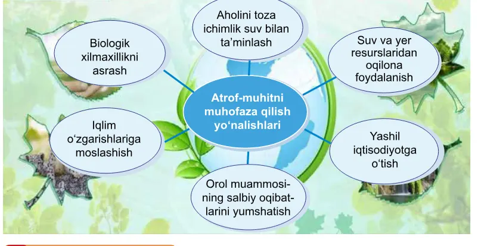

### Yodda tuting!

> Atrof-muhitni muhofaza qilish – inson faoliyatining atrof-muhitga salbiy taʼsirini cheklash va uning buzilishining oldini olishga qaratilgan chora-tadbirlar majmuyi.

– atrof-muhitni muhofaza qilish va tabiatdan oqilona foydalanish sohasida davlat nazoratini takomillashtirish;

– atrof-muhitni muhofaza qilishni ilmiy jihatdan taʼminlash;

– chiqindilar bilan bogʻliq ishlar tizimini takomillashtirish;

– aholining ekologik madaniyatini oshirish;

– atrof-muhitni muhofaza qilish sohasida xalqaro hamkorlikni kengaytirish.

Shuningdek, “Yashil makon” umummilliy loyihasi dasturlarida atrof-muhit obyektlarini inson taʼsiri hamda boshqa salbiy omillardan saqlash va sifatini taʼminlash hamda sanoat ishlab chiqarishi, urbanizatsiya koʻlami keskin kengayishi va aholi punktlariga tushayotgan ekologik yukni kamaytirish mexanizmlarini takomillashtirish rejalari ishlab chiqilgan va amalga oshirilmoqda.

### Orolboʻyi mintaqasining ekologik tizimini muhofaza qilish

Oʻzbekiston Respublikasi Konstitutsiyasining 49-moddasi beshinchi qismida davlat Orolboʻyi mintaqasining ekologik tizimini muhofaza qilish hamda tiklash, mintaqani ijtimoiy va iqtisodiy jihatdan rivojlantirish yuzasidan choralar koʻrishi mustahkamlab qoʻyilgan.

Orolboʻyi hududidagi xalqning qulay atrof-muhitga boʻlgan huquqi insonning asosiy fundamental huquqlaridan boʻlib, yashash huquqini amalga oshirish uchun juda muhimdir. Konstitutsiyamizdagi mazkur norma aholi va kelajak avlod uchun ekologik toza hududni saqlab qolish, Orolboʻyi mintaqasida yashovchi aholini ijtimoiy-iqtisodiy qoʻllab-quvvatlash, ularning yashashi va rivojlanishi uchun qulay atrof-muhitni taʼminlashning konstitutsiyaviy kafolatlarini yaratadi.

Orol dengizi uzoq yillardan buyon barhayot boʻlib, atrofida yashovchi xalqlarga rizqnasiba berib kelgan.

Amudaryo va Sirdaryo suvidan foydalanishda yoʻl qoʻyilgan xatolar uning qurishiga sabab boʻlgan. Orol dengizining maydoni oʻn, suv hajmi bir necha barobarga kamayib ketgan. Suv tarkibidagi tuzning koʻrsatkichi koʻtarilishi natijasida baliq va jonivorlar yasholmay, biologik jihatdan oʻlik dengizga aylangan.1981-yildan Amudaryoda kema va parom qatnovi toʻxtatildi. Orolboʻyidagi ilgari yirik ishlab chiqarish quvvatlariga ega port shahar boʻlgan Moʻynoq keyinchalik dengizning oʻlik qirgʻoqlaridagi kemalar qabristoniga aylandi. Orol dengizining yuz kilometrdan koʻproq ichkariga chekinishi natijasida kemalar quruq qum ustida qolib ketdi.

### Orol dengizi qurishining salbiy oqibatlari

Orol dengizi oʻrnida paydo boʻlgan Orolqum mayda tuz va tuproq zarrachalari bilan qoplangan. Shamol esganida uzoq masofalarga tarqalib, havoni ifloslantiradi.

Iqlim yanada kontinentallashib, qishki harorat pasaydi, yozgi harorat esa koʻtarildi.

Aholi salomatligiga salbiy taʼsir koʻrsatdi, yurak-qontomir, oshqozon-ichak, nafas olish organlari kasalliklari (oʻpka sili, astma, bronxit) koʻpaydi.

Suv zaxiralarining kamayishi va shoʻrlanishi natijasida yaylovlarda chorva uchun oziq boʻladigan oʻsimliklar turi va sifati kamayib, oʻtloqlar maydoni deyarli uch martaga qisqardi va bu hayvonot dunyosining ham qisqarishiga sabab boʻldi.

Ekin maydonlarining keskin qisqarishiga olib keldi.

Bugun Orolboʻyi mintaqasini rivojlantirish masalasi davlat siyosatining ustuvor yoʻnalishiga aylanib, Orol fojiasi oqibatlarini yumshatish boʻyicha salmoqli ishlar qilinmoqda.

**Orolboʻyidagi ekologik inqirozning salbiy taʼsirini yumshatish choralari:**

– Orol dengizi akvatoriyasidagi tabiiy suv havzalari tizimini saqlash;

– Orol dengizining qurigan tubida daraxtzorlar barpo qilish va mintaqada choʻllanishning oldini olish boʻyicha keng koʻlamli tadbirlarni amalga oshirish (ikki million gektar yangi oʻsimlik maydonlari va daraxtzorlar yaratish);

– Orolni qutqarish xalqaro jamgʻarmasi doirasida mintaqa mamlakatlarining hamkorligini mustahkamlash, Orol falokati bilan bogʻliq muammolarni hal etishga jahon hamjamiyati eʼtiborini qaratish boʻyicha harakatlarni faollashtirish.

Bu rezolyutsiyalar Orol dengizi qurishining atrof-muhit va aholi salomatligiga salbiy oqibatlariga qarshi kurashish, yuzaga kelgan muammolarni bartaraf etish, mintaqada yashovchi aholi bandligini taʼminlash orqali ularning turmush sharoiti yaxshilanishida katta ahamiyat kasb etmoqda.

**Oʻzbekiston Respublikasi Prezidenti tashabbusi bilan BMT Bosh Assambleyasi tomonidan qabul qilingan rezolyutsiyalar:**

### Savol va topshiriqlar

1. Ekologik huquqlarni taʼminlash borasida qanday xalqaro huquqiy hujjatlar mavjud?

2. Insonlarning ekologik huquqlarini taʼminlash borasida Oʻzbekiston Respublikasi Konstitutsiyasida qanday normalar mavjud?

3. Oʻzbekiston Ekologik partiyasining asosiy maqsadlari nimalardan iborat?

4. Shaharsozlik faoliyatini amalga oshirishda qanday prinsiplarga amal qilinadi?

5. Davlatimizning atrof-muhitni yaxshilash, tiklash va muhofaza qilish borasidagi vazifalarini sanab bering.

### Mustaqil ish uchun topshiriq

1. Quyidagi tushunchalarni qiyosiy tahlil asosida yoritib bering.

### Ekologik madaniyat

## 23-dars. Inson huquq va erkinliklarining kafolatlanishi

Agar kimda-kim barcha qonunlarni oʻrganishni xohlasa, uning qonunlarni buzishga vaqti boʻlmaydi. **Gyote**

### Inson huquq va erkinliklarining kafolatlanishi tushunchasi

Inson huquq va erkinliklari huquqiy jihatdan davlat konstitutsiyasi va boshqa qonun hujjatlarida aks ettiriladi. Biroq ularni mana shunday yozib qoʻyishning oʻzi yetarli emas. Huquq va erkinliklar asosiy qonun va boshqa normalarda qanday yozilgan boʻlsa, shunday amalga oshirilishi uchun kafolatlar zarur hisoblanadi.

**Inson huquq va erkinliklarining kafolatlari** shaxs huquq va erkinliklarini amalga oshirishni taʼminlashga qaratilgan huquqiy vositalar, yuridik usullar va shart-sharoitlar majmuyidir.

Kafolatlashning asosiy maqsadi shaxslarning huquq va erkinliklarini amalga oshirish jarayonida vujudga keladigan toʻsiqlarni bartaraf etish bilan bogʻliq. Inson huquq va erkinliklarining kafolatlari xalqaro va milliy darajada muayyan mexanizmlar yordamida amalga oshiriladi.

Xalqaro darajada inson huquqlarini himoya qiluvchi turli organlar davlatlar insonlarning asosiy huquq va erkinliklariga qay darajada rioya qilayotganini oʻrganib boradi.

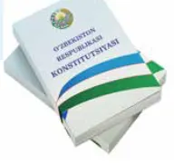

### Inson huquqlari himoyasi

Milliy darajada huquq va erkinliklarning davlat tomonidan taʼminlanishi tegishli vakolatli tuzilmalar faoliyat koʻrsatishida namoyon boʻladi.

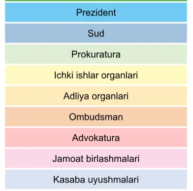

Konstitutsiyamizda “Inson hamda fuqaroning huquq va erkinliklari kafolatlari” alohida bob sifatida ajratilganining oʻzi bunga eʼtiborning kuchli ekanini koʻrsatadi.

Konstitutsiyaga koʻra, har kim oʻz huquq va erkinliklarini qonunda taqiqlanmagan barcha usullar bilan himoya qilishga haqli. Fuqarolar oʻz huquq va erkinliklari davlat organlari, mansabdor shaxslar, boshqa shaxslar tomonidan buzilyapti yoki yetarli darajada taʼminlamayapti deb hisoblasa, huquqlari tiklanishini soʻrab sudga, boshqa davlat organlariga murojaat qilishlari mumkin.

Huquq va erkinliklarning taʼminlanishida advokatlarning ham oʻrni katta. Ular fuqarolar huquqining himoyachisi sifatida sudda ishtirok etadilar.

Huquq va erkinliklarning taʼminlanishida jamoat tashkilotlari, ommaviy axborot vositalari ham muhim rol oʻynaydi. Ular shaxslarning buzilgan huquqlari tiklanishida fuqarolarga koʻmak beradi. Bunda mazkur tuzilmalar huquq buzilishlari va muammoli holatlarga vakolatli organlarning eʼtiborini qaratishga, fuqarolar bilan davlat organlari oʻrtasidagi aloqani taʼminlashga xizmat qiladi.

Huquq va erkinliklar barchaga bir xilda beriladi. Barcha huquq va erkinliklarda teng hisoblanadi. Biroq hamma ham mazkur huquqlaridan boshqalar qatori bir xilda foydalana olmaydi. Bularga mehnatga layoqatsizlar, yolgʻiz keksalar, nogironligi boʻlgan shaxslar, ijtimoiy himoyaga muhtoj boʻlgan boshqa insonlarni misol qilib keltirish mumkin. Ularning huquqlari teng boʻlsa-da, undan foydalanish imkoniyatlari teng emas. Mana shuning uchun davlat ularning huquq va erkinliklarini amalga oshirishni oʻz zimmasiga oladi.

### Huquq va erkinliklarni sud orqali himoya qilish

Inson huquq va erkinliklarini himoya qilishda asosiy organ suddir. Aynan sud shaxs huquq va erkinliklarini tiklash, taʼminlash, javobgar shaxslarga chora koʻrish haqida qaror chiqara oladi.

**Sud orqali himoya qilish** sudlarning shaxslarning buzilgan huquq va erkinliklarini tiklashga qaratilgan, protsessual qonunlarda belgilangan tartibda amalga oshiriladigan faoliyatidir.

Huquq va erkinliklarni sud orqali himoya qilish, odil sudlovni taʼminlash davlatlarning inson huquqlarini taʼminlashdagi asosiy majburiyatlaridan hisoblanadi.

Sudga shikoyat qilish ariza topshirish orqali amalga oshiriladi. Shaxslar buzilgan huquq va erkinliklari mazmuniga qarab fuqarolik, jinoyat, maʼmuriy yoki iqtisodiy sudga murojaat qiladi. Murojaat qilishda avvalo tuman sudiga ariza topshirish kerak. Fuqarolar bevosita oʻzlari yoki advokatlar yordamidan foydalangan holda ham sudga ariza topshira oladi. Sudga murojaat qilishda shaxslar qonunchilikda belgilangan davlat bojini toʻlaydilar. Ayrim toifa shaxslar davlat boji toʻlashdan ozod etilgan.

Sudlarda shaxslarning shikoyatlarini koʻrib chiqish “Sudlar toʻgʻrisida”gi qonun, Fuqarolik protsessual kodeksi, Jinoyat protsessual kodeksi kabi hujjatlarda belgilangan tartibda amalga oshiriladi. Sudlarga shikoyat qilish tartibini belgilovchi ushbu qonunchilik har qanday hollarda sudga buzilgan huquqlarni tiklashni, tegishli organ, mansabdor shaxs, jamoat birlashmalarining noqonuniy hujjatlarini bekor qilishni soʻrab murojaat qilish mumkinligini belgilagan. Sudda ish koʻrib chiqilganidan soʻng sud tomonidan chiqarilgan qaror ishdagi tomonlar uchun bajarilishi majburiy boʻladi.

Har kimga oʻz huquq va erkinliklarini sud orqali himoya qilish, davlat organlarining hamda boshqa tashkilotlarning, ular mansabdor shaxslarining qonunga xilof qaror lari, harakatlari va harakatsizligi ustidan sudga shikoyat qilish huquqi kafolatlanadi.

Har kimga buzilgan huquq va erkinliklarini tiklash uchun uning ishi qonunda belgilangan muddatlarda vakolatli, mustaqil hamda xolis sud tomonidan koʻrib chiqilishi huquqi kafolatlanadi.

### Oʻzbekiston Respublikasi

**Konstitutsiyasi, 55-modda**

### Inson huquqlari boʻyicha milliy institutlar

Inson huquqlarini himoya qilishda suddan tashqari faoliyat koʻrsatadigan mexanizmlarni joriy qilishga eʼtibor qaratilmoqda. Oʻzbekistonda faoliyat yuritayotgan mana shunday mexanizmlardan biri bu inson huquqlari boʻyicha milliy institutlardir.

Inson huquqlari boʻyicha milliy institutlar shaxslarning buzilgan huquq va erkinliklarini tiklash, davlat organlari, mansabdor shaxslarga murojaat qilishda fuqarolarga koʻmaklashadilar.

Oʻzbekistonda inson huquqlari boʻyicha milliy institutlar tizimi tarkibiga Oʻzbekiston Respublikasi Oliy Majlisining Inson huquqlari boʻyicha vakili (ombudsman), Oʻzbekiston Respublikasi Oliy Majlisining Bola huquqlari boʻyicha vakili (Bolalar ombudsmani), Prezident huzuridagi tadbirkorlar huquqlarini himoya qilish boʻyicha vakil (biznes ombudsman), Inson huquqlari boʻyicha Oʻzbekiston Respublikasi Milliy markazi kiradi.

Inson huquqlari boʻyicha milliy institutlarga murojaat

Ombudsman instituti birinchi marta 1809-yilda Shvetsiyada tashkil etilgan. Biroq qarashlarga koʻra, Arab xalifaligida xalifa Umar davrida taʼsis etilgan muxtasib ombudsman vazifasini bajargan. U fuqarolarning qilishda sudlardan farqli ravishda davlat boji undirilmaydi. mansabdor shaxslar faoliyatiga “Ombudsman” shved tilidagi “ombud” soʻzidan kelib oid shikoyatlarini koʻrib chiqqan. chiqqan boʻlib, “vositachi” yoki “boshqa shaxslarning vakili” tushunchasini ifodalagan.

Oʻzbekiston Respublikasi Oliy Majlisining Inson huquqlari boʻyicha vakili (ombudsman) mansabdor shaxs hisoblanadi.

Ombudsmanga nafaqat Oʻzbekiston fuqarolari, balki Oʻzbekistondagi chetelliklar va fuqaroligi boʻlmagan shaxslar ham murojaat qilishi mumkin. Bunda murojaat qiluvchi oʻzi haqidagi maʼlumotlarni koʻrsatishi lozim, aks holda uning arizasi anonim hisoblanib, ombudsman tomonidan koʻrib chiqilmaydi.

### Inson huquqlarini xalqaro darajada himoya qilish

Shaxslar baʼzida oʻz buzilgan huquq va erkinliklarini davlatning barcha himoya vositalaridan, sudning barcha bosqichlaridan foydalanib boʻlgandan keyin ham tiklay olmasliklari mumkin. Mana shunday vaqtlarda endi kim inson huquqlarini tiklab beradi degan savol yuzaga keladi. Inson huquqlarini xalqaro darajada himoya qilish tartibini bilish yuqoridagi kabi holatga tushgan shaxslar uchun muhim hisoblanadi

Inson huquqlari boʻyicha milliy institutlar inson huquqlari va erkinliklarini himoya qilishning mavjud shakllari hamda vositalarini toʻldiradi, fuqarolik jamiyatini rivojlantirishga va inson huquqlari madaniyatini yuksaltirishga koʻmaklashadi.

Davlat inson huquqlari boʻyicha milliy institutlar faoliyatini tashkil etish uchun shart-sharoitlar yaratadi.

### Oʻzbekiston Respublikasi

**Konstitutsiyasi, 56-modda**

Har kim Oʻzbekiston Respublikasining qonunchiligiga va xalqaro shartnomalariga muvofiq, agar davlatning huquqiy himoyaga doir barcha ichki vositalaridan foydalanib boʻlingan boʻlsa, insonning huquq va erkinliklarini himoya qiluvchi xalqaro organlarga murojaat etishga haqli.

### Oʻzbekiston Respublikasi Konstitutsiyasi, 55-modda

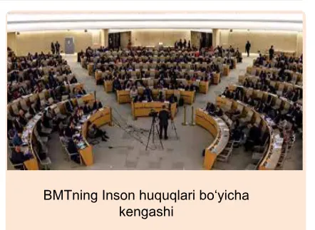

Oʻzbekiston Respublikasining Konstitutsiyasiga kiritilgan yangiliklardan biri shaxs larning insonning huquq va erkinliklarini himoya qiluvchi xalqaro organlarga murojaat etish huquqining belgilanganidir.

Shaxs oʻzining huquq va erkinliklari buzildi deb hisoblab toʻgʻridan toʻgʻri inson huquqlari boʻyicha xalqaro organlarga murojaat qila olmaydi. Murojaat qiluvchi shaxs avvalo davlatning ichki milliy mexa nizmlaridan foydalanishi Davlat sudlari asosiy ichki himoya mexanizmi hisoblanadi. Shaxs oʻz huquqlarini tiklash uchun ombudsmanga murojaat qilgandan soʻng ijobiy natijaga erisha olmasa, darhol xalqaro organga ariza topshira olmaydi. Shu bois oʻz huquqlarini tiklamoqchi boʻlgan shaxslar sudning qonunchilikda belgilangan bosqichlaridan oʻtgan boʻlishlari lozim.

Inson huquqlari boʻyicha xalqaro organga murojaat qilinayotganda shaxsning davlatning qonunlaridagi emas, balki Oʻzbekiston qoʻshilgan xalqaro shartnomalarda belgilangan huquqlari buzilganini koʻrsatishi lozim.

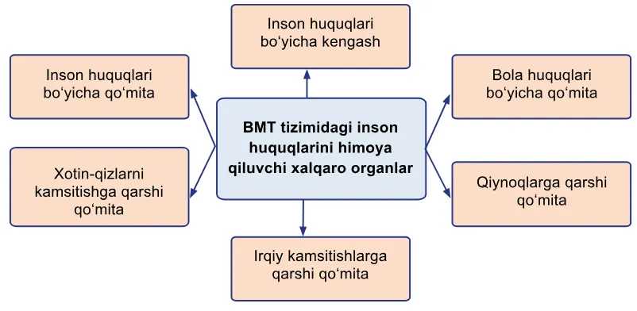

### Hayotiy vaziyat

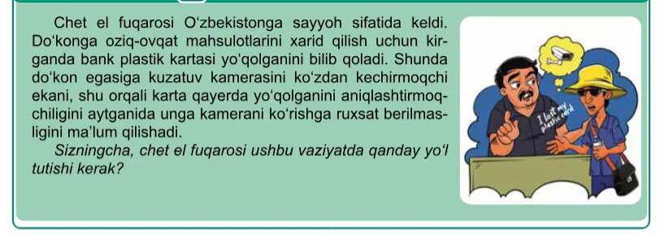

### Savol va topshiriqlar

1. Davlatda inson huquq va erkinliklari himoyasi kafolatlanganini qanday bilish mumkin?

2. Inson huquq va erkinliklarini himoya qilishda qaysi organlarga murojaat qilish mumkin?

3. Inson huquqlarini himoya qilishda sud va milliy institutlarga murojaat qilishning farqlari nimada?

4. Shaxs oʻz huquqlarini xalqaro organlar orqali himoya qilishiga qanday hollarda yoʻl qoʻyiladi?

### Mustaqil ish uchun topshiriq

1. Quyidagi huquqlarni amalga oshirish shakllari nimalarda namoyon boʻladi? Jadvalni toʻldiring.

### Amalga oshirish shakli

## 24-dars. Oʻzbekiston Respublikasi fuqarolarining konstitutsiyaviy burchlari

Burchingni ado etishga harakat qil, shunda darhol oʻzingning kimligingni bilib olasan.

**Lev Tolstoy**

### Bilib olasiz

Fuqarolarning burchlari tushunchasi.

Fuqarolarining burchlari tizimi.

Oʻzbekiston xalqining tarixiy, maʼnaviy, madaniy, ilmiy va tabiiy merosini asrab-avaylash. Vatanni himoya qilish burchi.

### Fuqarolarning burchlari tushunchasi

Oʻzbekiston Respublikasi Konstitutsiyasi 2-boʻlim, XI bobida fuqarolarning burchlari mustahkamlab qoʻyilgan.

Huquq shaxsga oʻz harakatining turi va meʼyorini tanlash imkoniyati boʻlsa, burch jamiyat va davlat tomonidan belgilangan va huquqiy normalarda oʻz aksini topgan talablardir.

Barcha fuqarolar Konstitutsiyada belgilab qoʻyilgan burchlarini bajaradilar.

### Oʻzbekiston Respublikasi

**Konstitutsiyasi, 59-modda**

### Yodda tuting!

Burch davlat tomonidan belgilanib, Konstitutsiyada mustahkamlangan, har bir fuqaro bajarishi shart boʻlgan, bajarmaslik esa javobgarlikni keltirib chiqaradigan xatti-harakatlar va yashash tarzi qoidalaridan iborat.

Konstitutsiya va boshqa qonunlarda mustahkamlangan fuqarolarning asosiy burchlari mohiyati shundaki, fuqarolar Konstitutsiyaga rioya qilish bilan birga, undagi har qanday qoidalar buzilishining oldini olishi, boshqa shaxslarning qadr-qimmatini hurmat qilishi zarur.

Barcha fuqarolar konstitutsiyada belgilab qoʻyilgan burchlarini bajaradilar.

Fuqarolar konstitutsiya va qonunlarga rioya etishga, boshqa insonlarning huquqlari, erkinliklari, shaʼni va qadr-qimmatini hurmat qilishga majburdirlar.

Fuqarolar Oʻzbekiston xalqining tarixiy, maʼnaviy, madaniy, ilmiy va tabiiy merosini asrab-avaylashi shart.

Fuqarolar atrof tabiiy muhitga ehtiyotkorona munosabatda boʻlishga majburdirlar.

Fuqarolar qonun bilan belgilangan soliqlar va yigʻimlarni toʻlashi shart.

Soliq va yigʻimlar adolatli boʻlishi hamda fuqarolar konstitutsiyaviy huquqlarini amalga oshirishiga toʻsqinlik qilmasligi kerak.

Oʻzbekiston Respublikasini himoya qilish Oʻzbekiston Respublikasi har bir fuqarosining burchidir. Fuqarolar qonunda belgilangan tartibda harbiy yoki muqobil xizmatni oʻtashga majburdirlar.

Fuqarolar tomonidan burchlarning bajarilishi jamiyat manfaatlari uchun zarurdir. Davlatchiligimiz tarixining ilk davrlaridayoq jamiyat aʼzolarining atrof tabiiy muhitga ehtiyotkorona munosabatda boʻlish borasidagi burchlari manbalarda qayd etilgan.

Tabiiy muhitni qanchalik asray olsak, sof atrof-muhitda yashash huquqimizni taʼminlash imkoniyati kuchayadi. Shu bois har birimiz konstitutsiyaviy burchimizga rioya etishimiz – atrof-muhitga ehtiyotkorona munosabatda boʻlishimiz zarur.

Fuqarolarning soliqlar va yigʻimlarni toʻlash bilan bogʻliq burchlari ham muhimdir. **Soliq** deganda belgilangan, Oʻzbekiston Respublikasining Davlat byudjetiga yoki davlat maqsadli jamgʻarmasiga toʻlanadigan majburiy begʻaraz toʻlov tushuniladi.

**Yigʻim** deganda byudjet tizimiga qonun hujjatlarida belgilangan majburiy toʻlov tushuni-

ladi.

Davlat toʻplangan soliqlarni mamlakatning mudofaa qobiliyatini, fuqarolarning xavfsizligini taʼminlash, iqtisod, maorif, fan, sogʻliqni saqlashni rivojlantirish maqsadlarida sarflaydi.

Oʻzbekiston Respublikasi Konstitutsiyasida soliq va yigʻimlar adolatli boʻlishi hamda fuqarolarning konstitutsiyaviy huquqlarini amalga oshirishiga toʻsqinlik qilmasligi kerak ekani mustahkamlab qoʻyilgan.

**Oʻzbekiston xalqining tarixiy, maʼnaviy, madaniy, ilmiy va tabiiy merosini asrab-avaylash**

Oʻzbekistonning har bir fuqarosi xalqimizning tarixiy, madaniy, ilmiy va tabiiy merosini asrab-avaylab, kelgusi avlodlarga yetkazishni oʻzi uchun muqaddas vazifa deb bilishi zarur.

Shunday tarixiy davrlar boʻlgan: oʻzbek xalqi yaratgan tarixiy-madaniy yodgorliklar toptalgan, yoʻq qilingan va xorijiy davlatlarga olib ketilgan. Bugungi kunda ularni qaytarish davlatimizning asosiy maqsadlaridan biri hisoblanadi.

Yurtimizda tarixiy yodgorliklarni har taraflama himoya qilishning qonuniy asoslari ishlab chiqildi, ularni saqlash va taʼmirlash boʻyicha muayyan dasturlar **Oʻzbekiston Respublikasi** asosida chora-tadbirlar amalga oshirib kelinmoqda. **Konstitutsiyasi, 61-modda**

Fuqarolar Oʻzbekiston xalqining tarixiy, maʼnaviy, madaniy, ilmiy va tabiiy merosini asrab-avaylashi shart.

Tarixiy, maʼnaviy, madaniy, ilmiy va tabiiy meros davlat tomonidan muhofaza qilinadi.

Moddiy madaniy meros obyektlarini asrash chora-tadbirlari ularni konservatsiyalash, tuzatish, taʼmirlash, hozirgi zamonda foydalanishga moslashtirishni, shuningdek, ular bilan bogʻliq ilmiy va ilmiy-texnik tadqiqotlar, loyihalash hamda ishlab chiqarish ishlarini oʻz ichiga oladi.

**“Madaniy meros obyektlarini muhofaza qilish va ulardan foydalanish toʻgʻrisida”gi Oʻzbekiston Respublikasining qonuni**

Tarixiy, maʼnaviy, madaniy, ilmiy va tabiiy merosni muhofaza qilishda YUNESKO xalqaro tashkiloti bilan hamkorlik ham katta ahamiyat kasb etib kelmoqda.

Oʻzbekiston hududidagi toʻrt qadimiy shahar – Samarqand, Buxoro, Xiva, Shahrisabz, shuningdek, Navroʻz bayrami, Katta ashula, “Shashmaqom”, askiya insoniyatning madaniy merosi sifatida YUNESKO roʻyxatiga kiritilgan.

Tarixiy va madaniy merosimizni muhofaza qilish bilan birga Oʻzbekistonning tabiiy merosini saqlash va uning kelgusi avlodlarga bezavol yetkazilishini taʼminlash, tabiiy ekologik tizimlarning tanazzulga uchrashi surʼatlarini pasaytirish va bioxilmaxillikni saqlab qolish ham fuqarolarning konstitutsiyaviy burchlari hisoblanadi.

### Vatanni himoya qilish burchi

Davlat mustaqilligini, uning hududiy yaxlitligini, aholining tinch hayot kechirishini taʼminlash maqsadida fuqarolar belgilangan tartibda harbiy yoki muqobil xizmatni oʻtaydilar.

Harbiy xizmatga birinchi marta chaqirilgan yoki ixtiyoriy ravishda (kontrakt boʻyicha) kirgan fuqarolar Oʻzbekiston Respublikasi davlat bayrogʻi oldida Vatanga qasamyod qabul qiladilar. Vatanga qasamyodning mazmuni Umumiy harbiy majburiyat va harbiy xizmat toʻgʻrisidagi Oʻzbekiston Respublikasi qonunining 3-moddasida bayon etilgan.

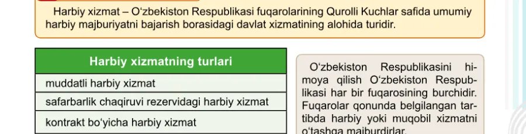

Oʻzbekiston Respublikasi Qurolli Kuchlari safida harbiy xizmatni oʻtagan rezervchilar xizmati

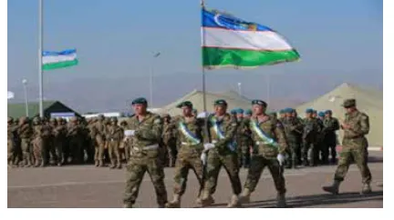

Tinchlik davrida oddiy askarlar va serjantlar tarkibi lavozimlarida muddatli harbiy xizmatga, shuningdek, safarbarlik chaqiruvi rezervidagi xizmatga oʻn sakkiz yoshdan yigirma yetti yoshgacha boʻlgan, salomatligiga koʻra Qurolli Kuchlar safida harbiy xizmatni oʻtashga yaroqli erkak fuqarolar chaqiriladi. Muddatli harbiy xizmat kalendar hisobida oʻn ikki oy etib belgilanadi.

**Muqobil xizmat** fuqarolarning umumiy harbiy majburiyatni bajarishining chaqiruv boʻyicha harbiy xizmat oʻrniga iqtisodiyot, ijtimoiy sohaning turli tarmoqlarida kam malaka talab etiladigan (yordamchi) ishlarni, shuningdek, falokatlar, halokatlar, tabiiy ofatlar va boshqa favqulodda vaziyatlar oqibatlarini bartaraf etish ishlarini bajarish bilan bogʻliq boʻlgan alohida turidir.

Oʻn sakkiz yoshdan yigirma yetti yoshgacha boʻlgan, harbiy roʻyxatda turuvchi va xizmatga chaqirilishi lozim boʻlgan fuqarolar, agar ularning diniy taʼlimoti qurol-yarogʻdan foydalanish va Qurolli Kuchlarda xizmat qilishga yoʻl qoʻymasa, roʻyxatga olingan diniy tashkilotlar hisobida tursalar, muqobil xizmat huquqiga ega.

Muqobil xizmatning muddati yigirma toʻrt oyni, oliy maʼlumotli fuqarolar uchun esa oʻn sakkiz oyni tashkil etadi. Oʻzbekiston Respublikasi fuqarolariga chet davlatlarning harbiy xizmatiga, xavfsizlik, politsiya, harbiy, adliya organlari yoki shu kabi boshqa organlariga xizmatga kirish taqiqlanadi.

### Savol va topshiriqlar

1. Fuqarolarning burchlarini sanab bering.

2. Moddiy va madaniy meros obyektlarini asrash chora-tadbirlari deganda nimani tushunasiz?

3. Davlat toʻplangan soliqlarni qanday maqsadlarda sarflaydi?

4. Tarixiy, madaniy, ilmiy va tabiiy merosini asrab-avaylashda Oʻzbekistonning YUNESKO tashkiloti bilan hamkorligi ahamiyatini tushuntirib bering.

### Mustaqil ish uchun topshiriq

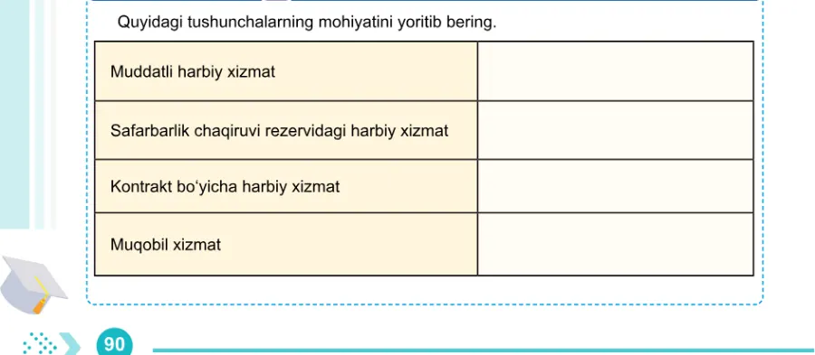

## 25-dars. Ijodiy faoliyat

**1-topshiriq.** Quyidagi vaziyatni oʻrganing va savollarga javob bering.

Tasavvur qiling, siz chiqindini qayta ishlaydigan zavod joylashgan shaharda yashaysiz. Mazkur zavod bir necha yillardan beri ishlab kelmoqda. Oʻtgan davr davomida aholi oʻrtasida yurak-qontomir va oʻpka kasalliklari koʻpaydi.

Aholi salomatligini tekshirish natijasida kasallikning koʻpayib borishi atrof-muhitning ifloslantirilishi bilan bogʻliq ekani aniqlandi. Zavod maʼmuriyati tozalash inshootlarini oʻrnatish borasidagi vaʼdasini bajarmayapti.

1. Jamoatchilik ushbu muammoni qanday hal qilishi mumkin?

2. Jamoatchilik nazoratiga nimalar kiradi?

3. Ushbu holatda qanday himoya mexanizmlariga murojaat qilish samarali boʻladi?

**2-topshiriq.** Quyidagi vaziyatlarda inson huquqlarini himoya qilishning qaysi mexanizmlaridan foydalanish mumkin?

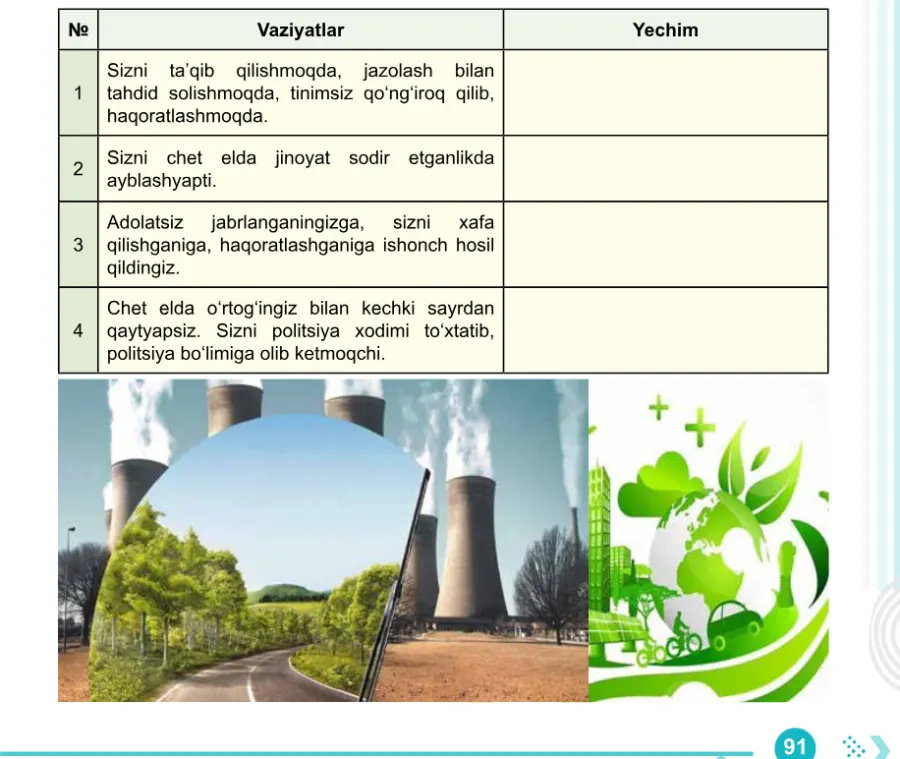

## 26-dars. Nazorat ishi

**1.** Inson shaxsiy huquq va erkinliklarga qachon ega boʻladi?

A) tugʻilgan zahoti B) 16 yoshga toʻlganda D) 18 yoshga toʻlganda E) maktab yoshiga yetganda

**2.** Xabeas korpus akti dastlab qaysi davlatda qabul qilingan?

A) AQSHda B) Angliyada D) Fransiyada E) Germaniyada

**3.** Har kim bilim olish huquqiga ega ekani Oʻzbekiston Respublikasi Konstitutsiyasining nechanchi moddasida mustahkamlangan?

A) 49-modda B) 50-modda D) 51-modda E) 52-modda

**4.** “Ombudsman” soʻzining lugʻaviy maʼnosi nima?

A) himoyachi B) mansabdor shaxs D) vositachi E) ayblovchi

**5.** Oʻzbekiston Respublikasi Konstitutsiyasining 27-moddasiga koʻra, shaxs sudning qarorisiz necha soatdan ortiq ushlab turilishi mumkin emas?

A) 24 soatdan B) 36 soatdan D) 48 soatdan E) 54 soatdan

**6.** Aybsizlik prezumpsiyasi tamoyili ilk bor qaysi davlatda amalga kiritilgan?

A) AQSHda B) Angliyada D) Fransiyada E) Germaniyada

**7.** Ovoz berishda qatnashish uchun (saylash huquqi) fuqarolar saylov kuni necha yoshga toʻlgan boʻlishlari lozim?

A) 16 yoshga B) 18 yoshga D) 24 yoshga E) 30 yoshga

**8.** 15 yoshga toʻlgan bolalar qanday tartibda ishga qabul qilinadi?

A) ota-onadan birining yozma roziligi bilan B) ota-onaning har ikkisining roziligi bilan D) 15 yoshga toʻlgan shaxsning roziligi bilan E) 15 yoshga toʻlgan shaxs ishga qabul qilinmaydi

**9.** Fuqarolar necha yoshdan umumiy tartibda ishga qabul qilinadilar?

A) 14 yoshdan B) 15 yoshdan D) 16 yoshdan E) 18 yoshdan

**10.** Kimlar uchun inklyuziv taʼlim va tarbiya taʼminlanadi?

A) alohida taʼlim ehtiyojlariga ega boʻlgan bolalar uchun B) yetim bolalar uchun D) maktab yoshidagi barcha bolalar uchun E) chekka hududlarda yashaydigan bolalar uchun

### FUQAROLIK JAMIYATI VA DAVLAT HOKIMIYATI

# IV bob. Fuqarolik jamiyati va davlat hokimiyati

## 27-dars. Jamiyat va shaxs. Fuqarolik jamiyati

Jamiyat davlat bilan kuchlidir, chunki u yetuklashgani sayin oʻz aʼzolarini himoya ostiga oladi. **Abu Nasr Forobiy**

### Bilib olasiz

Fuqarolik jamiyati tushunchasi va uning belgilari. Fuqarolik jamiyati institutlari.

Oila, bolalar va yoshlar hamda ularning huquqlari. Ommaviy axborot vositalari.

### Fuqarolik jamiyati tushunchasi va uning belgilari

Fuqarolik jamiyati haqida ilk tasavvurlar Aristotelning “Siyosat” asarida bayon etilgan. Unga koʻra, insonning erkin yashash huquqi kishilik jamiyatining adolat va qonun ustuvorligi asosida tashkil etilishi orqali taʼminlanishi lozim.

Fuqarolik jamiyati iqtisodiy, siyosiy va madaniy hayot shakl larini erkin tanlash kafolatlanadigan, qonun ustuvorligi va inson huquqlari hamda erkinliklari qaror topadigan, koʻp partiyaviylik, siyosiy institutlar, mafkura va fikrlarning xilmaxilligi taʼminlanadigan hamda oʻzini oʻzi boshqarish organlarining mavqeyi baland boʻlgan ijtimoiy tuzum hisoblanadi. Fuqarolik jamiyatida har bir shaxs siyosiy, ijtimoiy, iqtisodiy, maʼnaviy va huquqiy jihatdan oʻz ehtiyojlarini jamoat birlashmalari va fondlari, oʻzini oʻzi boshqarish organlari, siyosiy partiyalar va nodavlat notijorat tashkilotlar ishida faol ishtirok etib qondiradilar.

Fuqarolik jamiyatining amalda yuzaga kelishida Huquqlar haqidagi bill (Angliya, 1689-y.; AQSH, 1791-y.) yoki Inson va fuqaro huquqlari deklaratsiyasi (Fransiya, 1789-y.)ning qabul qilinishi muhim ahamiyat kasb etadi.

Fuqarolik jamiyati uchta asosga tayanadi: iqtisodiy asos, ijtimoiy-siyosiy asos, maʼnaviy asos.

**Iqtisodiy asos** – mulk shakllarining xilmaxilligi, iqtisodiy plyuralizm, erkin bozor munosabatlarining mavjudligi. Bunda jamiyatda uning har bir aʼzosi qandaydir mulkka, sarflash huquqiga ega boʻladi, mulkni oʻz xohishi bilan tasarruf etadi, xususiy mulk daxlsizligi, davlat tomonidan kafolatlangan tadbirkorlik, mehnat va isteʼmol faoliyati erkinligi taʼminlanadi.

**Ijtimoiy-siyosiy asos** – oʻz manfaatlarini himoya qilish uchun insonlarning maʼlum tashkilotlarga birlashishi, iqtisodiy va siyosiy hokimiyatning ajratilishi. Siyosiy plyuralizm, davlat hokimiyati funksiyalarining sekin-asta fuqarolik jamiyati institutlariga berib borilishi.

**Maʼnaviy asos** – fuqarolar oʻz qadr-qimmatini biladigan, jamiyatning asosiy qadriyatlarini himoyalay oladigan, zarurat tugʻilganda ular uchun kurasha oladigan boʻlishi, vijdon erkinligining taʼminlanishi, axloqiy normalarga rioya qilinishi, fuqarolar davlat boshqaruvi sohasida bevosita va bilvosita ishtirok etishi, fuqarolik pozitsiyasiga ega ekani.

### Yodda tuting!

Fuqarolik jamiyatida mulkchilik shakllarining xilma-xil va teng boʻlishi, mehnat va tadbirkorlikning erkinligiga yoʻl qoʻyilishi, mafkuraviy xilmaxillik va axborot erkinligi, inson huquq va erkinliklarining daxlsizligi, rivojlangan oʻzini oʻzi boshqarish hamda jamiyat hayotining barcha sohalarida qonun ustuvorligi taʼminlanishi muhim hisoblanadi.

### Iqtisodiy erkinlik

### Fuqarolik jamiyati institutlari

Fuqarolarning davlat va jamiyat ishlarini boshqarishda ishtirok etishini rivojlantirish, kishilarning fuqarolik, iqtisodiy, ijtimoiy va madaniy sohalardagi huquq hamda erkinliklarini amalga oshirish va himoya qilish maqsadida **fuqarolik jamiyati institutlari** tashkil etiladi.

Fuqarolik jamiyati institutlariga quyidagilar kiradi:

– jamoat birlashmalari;

– nodavlat notijorat tashkilotlari;

– fuqarolarning oʻzini oʻzi boshqarish organlari;

– ommaviy axborot vositalari.

### Qiziqarli maʼlumot

Bugungi kunda Oʻzbekistonda 10 mingga yaqin nodavlat notijorat tashkilotlari, 9 mingdan ortiq oʻzini oʻzi boshqarish organlari faoliyat yuritmoqda.

### Yodda tuting!

Fuqarolarning xohish irodalarini erkin bildirishlari natijasida vujudga kelgan ixtiyoriy tuzilma jamoat birlashmasi boʻlib hisoblanadi.

Jamoat birlashmalarida ishtirok etish uchun barchaga teng imkoniyatlar yaratiladi. Oʻzbekiston Respublikasi fuqarolari, chet el fuqarolari va fuqaroligi boʻlmagan shaxslar jamoat birlashmasi aʼzolari (qatnashchilari) boʻlishi mumkin.

**Jamoat birlashmasini tuzish tartibi:**

jamoat birlashmasi kamida oʻn nafar fuqaroning tashabbusi bilan tuziladi. Jamoat birlashmasini tuzish tashabbuskorlari taʼsis syezdini (konferensiyasini) yoki umumiy yigʻilishini chaqiradilar, unda ustav (nizom, oʻzga asosiy hujjat) qabul qilinadi va rahbar idoralar tuziladi. Jamoat birlashmasi belgilangan tartibda Oʻzbekiston Respublikasi Adliya vazirligi va viloyatlar, Toshkent shahar adliya boshqarmalari tomonidan roʻyxatdan oʻtkaziladi.

**Jamoat birlashmalarining turlari:**

kasaba uyushmalari, siyosiy partiyalar, olimlarning jamiyatlari, xotin-qizlar tashkilotlari, faxriylar, yoshlar va nogironligi boʻlgan shaxslar tashkilotlari, ijodiy uyushmalar, ommaviy harakatlar hamda fuqarolarning boshqa birlashmalari.

Masalan, Oʻzbekiston yoshlar ittifoqi, Oʻzbekiston kasaba uyushmalari federatsiyasi. **Quyidagi jamoat birlashmalarini tuzish taqiqlanadi:**

faoliyati jamiyatning axloqiy negizlarini, umumbashariy insonparvarlik qadriyatlarini buzishga qaratilgan, shuningdek, konstitutsion tuzumni gʻayriqonuniy yoʻl bilan oʻzgartirish yoki Oʻzbekiston Respublikasi hududining birligini buzish, urushni, zoʻravonlikni va shafqatsizlikni, jamiyatni parchalashga olib boradigan ijtimoiy, shu jumladan, sinfiy, shuningdek, irqiy, milliy va diniy adovatni avj oldirish, qonunchilik bilan taqiqlangan boshqa xatti-harakatlar qilish maqsadini koʻzlaydigan jamoat birlashmalari.

Oʻzbekiston Respublikasi fuqarosi bir paytning oʻzida **faqat bitta siyosiy partiyaga aʼzo boʻlishi mumkin.** Biroq ayrim toifadagi shaxslar siyosiy partiyaga aʼzo boʻla olmaydilar. Masalan, sudyalar, Hisob palatasining mansabdor shaxslari, prokurorlar va prokuratura tergovchilari, ichki ishlar, milliy gvardiya, davlat xavfsizlik xizmati xodimlari, harbiy xizmatchilar; xorijiy davlatlarning fuqarolari va fuqaroligi boʻlmagan shaxslar.

### Siyosiy partiyani tuzish bosqichlari

Kamida yigirma ming fuqaroning imzosi toʻplanishi (kamida sakkizta hududiy **1-bosqich** subyektda (viloyatda), Qoraqalpogʻiston Respublikasi va Toshkent shahrida yashayotgan hamda partiyaga birlashish istagida boʻlgan shaxslar tomonidan);

Siyosiy partiya tuzish tashabbuskorlari (kamida ellik kishidan iborat) tomonidan **2-bosqich** partiya taʼsis hujjatlarini tayyorlash, aʼzolar tarkibini shakllantirish, taʼsis syezdi yoki konferensiyasini chaqirish boʻyicha tashkiliy qoʻmitani tuzish;

**6 bosqich** Siyosiy partiyaning Adliya vazirligi tomonidan roʻyxatga olinishi.

### Oila, bolalar va yoshlar hamda ularning huquqlari

Oila jamiyatning birlamchi boʻgʻini hisoblanadi, fuqarolik jamiyatining tayanch nuqtasi, barqaror tuzilmasidir. Bu muqaddas dargohda inson nafaqat dunyoga keladi, balki maʼnan va axloqan tarbiya topadi. Oilaviy munosabatlarning mustahkamligi jamiyat va davlat taraqqiyotining kelajagini belgilab beradi.

Oilaviy munosabatlar, xususan, nikoh tuzish tartibi Oʻzbekiston Respublikasi Konstitutsiyasi, qonunlar, shu jumladan, Oila kodeksi bilan tartibga solinadi.

Barcha fuqarolar oilaviy munosabatlarda teng huquqlarga egadir. Oiladagi erkak va ayol munosabatlari er va xotinning shaxsiy hamda mulkiy huquqlari tengligi, ichki oilaviy masalalarning oʻzaro kelishuv yoʻli bilan hal qilinishi, oilada bolalar tarbiyasi, ularning farovon hayot kechirishi va kamoloti haqida gʻamxoʻrlik qilish, voyaga yetmagan va mehnatga layoqatsiz oila aʼzolarining huquq va manfaatlarini himoya qilish ustuvorligi tamoyillari asosiga quriladi.

**Nikoh** – ikki jins vakillarining oʻzaro rozilik asosida tuzilgan ittifoqi hisoblanadi. Oʻzbekiston Respublikasida nikoh Oʻzbekiston xalqining anʼanaviy oilaviy qadriyatlariga asoslanadi (mehnatsevarlik, sadoqat, samimiyat, ishonch, vatanni sevish, adolat, poklik, toʻgʻrilik).

Onalik va bolalik davlat tomonidan muhofaza qilinadi. Bolalarning huquq va manfaatlarini himoya qilish ularning ota-onasi zimmasiga yuklatiladi.

Ota-onalar oʻz farzandlarini voyaga yetgunlariga qadar boqish va tarbiyalashga majburdirlar. Xususan, ota-ona oʻz bolalarining tarbiyasi va kamoloti uchun javobgardir. Ular oʻz bolalarining sogʻligʻi, jismoniy, ruhiy, maʼnaviy va axloqiy kamoloti haqida gʻamxoʻrlik qilishlari shart. Shuningdek, ota-ona bolalarining qonun hujjatlarida belgilangan zarur darajada taʼlim olishini taʼminlashi shart. Ota-onalar yoki ularning oʻrnini bosuvchi shaxslar tomonidan voyaga yet magan bolalarni tarbiyalash va ularga taʼlim berish borasidagi majburiyatlarni bajarmaslik javobgarlikka sabab boʻladi.

Oʻn sakkiz yoshga toʻlgan voyaga yetgan, mehnatga layoqatli farzandlar oʻz ota-onalari haqida gʻamxoʻrlik qilishga majburdirlar.

Oʻn sakkiz yoshga toʻlgunga (voyaga yetgunga) qadar boʻlgan shaxs (shaxslar) bola hisoblanadi. Shaxs oʻn sakkiz yoshga yetsa, voyaga yetgan shaxs boʻladi. Har bir bolaga inson hamda fuqaro huquq va erkinliklari tegishli boʻladi hamda davlat tomonidan kafolatlanadi.

14 yoshga toʻlgan va 30 yoshdan oshmagan shaxslar yosh sanaladi.

Oilaviy munosabatlar erkak va ayolning ixtiyoriy ravishda nikohlanib tuzgan ittifoqi asosida amalga oshiriladi.

Bolaning ota-onasi boʻlmaganda yoki ular ota-onalik huquqidan mahrum qilinganda va bola ota-ona qaramogʻidan mahrum boʻlgan boshqa hollarda uning oilada tarbiyalanish huquqi vasiylik va homiylik organi tomonidan taʼminlanadi.

Oʻzbekiston Respublikasida 30 yoshgacha boʻlgan yoshlar va bolalar aholining 60% ini tashkil qiladi (20 milliondan ortiq). Yurtimizda 14–30 yoshdagi jami doimiy aholi soni 9,5 milliondan ortiq (2024-yil 1-yanvar holatiga koʻra). 2008-yilda “Bola huquqlarining kafolatlari toʻgʻrisida”, 2016-yilda “Yoshlarga oid davlat siyosati toʻgʻrisida”gi qonun qabul qilindi, 2020-yilda Yoshlar ishlari agentligi tashkil etildi hamda 30-iyun “Yoshlar kuni” deb belgilandi.

### Ommaviy axborot vositalari

Fuqarolarning axborot sohasidagi konstitutsiyaviy huquqlarini taʼminlash, jamiyatda ochiqlik va oshkoralik, qonuniylik muhitini mustahkamlashda ommaviy axborot vositalari (OAV) katta ahamiyatga ega.

OAVning axborotni izlash, olish, foydalanish va uni tarqatish huquqi kafolatlanishi jamiyatning ishonchli axborotga boʻlgan ehtiyojlarini toʻlaroq qondirishga, aholining siyosiy va huquqiy madaniyati rivojlanishiga xizmat qiladi. Shuning uchun davlat ommaviy axborot vositalari faoliyatining erkinligini, ularning axborotni izlash, olish, undan foydalanish va tarqatishga boʻlgan huquqlari amalga oshirilishini kafolatlaydi. Davlat OAV va jurnalistlar emin-erkin, turli maʼmuriy bosimlardan qoʻrqmasdan faoliyat yuritishini taʼminlaydi hamda jamiyatda ochiqlik va oshkoralik muhitining rivojlanishiga sharoit yaratadi. Ommaviy axborot vositalarining faoliyatiga toʻsqinlik qilish yoki aralashish qonunga muvofiq javobgarlikka sabab boʻladi.

### Yodda tuting!

Ommaviy axborot vositasi deganda, doimiy nomga ega boʻlgan hamda bosma tarzda (gazetalar, jurnallar, axborotnomalar, byulletenlar va boshqalar) va elektron tarzda (tele-, radio-, video-, kinoxronikal dasturlar, internet jahon axborot tarmogʻidagi vebsaytlar) kamida olti oyda bir marta nashr etiladigan yoki efirga beriladigan ommaviy axborot shakli tushuniladi.

Oʻzbekiston Respublikasida ommaviy axborot vositalarini senzura qilishga yoʻl qoʻyilmaydi. Eʼlon qilinayotgan xabarlar va materiallar oldindan kelishib olinishini, shuningdek, ularning matni oʻzgartirilishini yoki butunlay nashrdan olib qolinishini (efirga berilmasligini) talab qilishga hech kimning haqqi yoʻq.

### Qiziqarli maʼlumot

### Hayotiy vaziyat

1. Telegramda 400 ming obunachiga ega “Telegram yangiliklari” kanali admini B. Xoldorov 2024-yil avgust oyida oʻtkazilgan oliy taʼlim muassasalariga kirish imtihonlarini yoritish maqsadida “Bunyodkor” stadionida tashkil etilgan pavilyon hududiga foto-, videokameralari bilan keldi.

U imtihon oʻtkaziluvchi hududga kirmoqchi boʻlganda milliy gvardiya xodimlari tomonidan toʻxtatildi. BMBA xodimi undan nima maqsadda ushbu hududga kirmoqchiligini soʻradi.

Fuqaro B. Xoldorov oʻzini jurnalist deb tanishtirdi. Milliy gvardiya xodimlari undan xizmat guvohnomasi yoki ruxsatnoma koʻrsatishni soʻradi. U bunday hujjat yonida yoʻqligini aytdi. Natijada milliy gvardiya va BMBA xodimlari uning imtihon hududiga kirishiga ruxsat berishmadi.

Bundan jahli chiqqan fuqaro B. Xoldorov imtihonlar halol, xolis va shaffof oʻtkazilmayotgani, masalan, oʻzining imtihon hududiga jarayonlarni yoritish uchun kiritilmaganini aytib, telegram kanalida videomurojaat va fotolarni joyladi.

Ushbu video internetda turli shov-shuvlar va noroziliklarga sabab boʻldi. Shundan soʻng fuqaro B. Xoldorovni ichki ishlar boʻlimiga chaqirishdi.

Mazkur masala yuzasidan fikringizni bildiring.

2. Fuqaro Akmalov “Adolat” sotsial-demokratik partiyasi aʼzosi. U universitetni tamomlab, uyiga yaqin joylashgan maktabga ishga kirish uchun murojaat qildi. Unga suhbatda siyosiy partiyaga aʼzoligini toʻxtatmasa, ishga qabul qilinmasligini maʼlum qilishdi. Fuqaro Akmalov esa Oʻzbekiston Respublikasi Konstitutsiyasining 39-moddasiga koʻra, siyosiy partiyalarga birlashish huquqi borligini aytdi. Natijada ishga qabul qiluvchilar hamda fuqaro Akmalov oʻrtasida nizo yuzaga keldi.

Vaziyatga huquqiy baho bering.

Maktab rahbariyatining harakati toʻgʻrimi?

Siyosiy partiyaga aʼzolik ishga qabul qilmaslikka asos boʻla oladimi?

### Savol va topshiriqlar

1. Sizningcha, fuqarolik jamiyati qanday jamiyat?

2. Fuqarolik jamiyatini qurish uchun insonlar nimalarni amalga oshirishlari lozim?

3. Ommaviy axborot vositalari, shu jumladan, ijtimoiy tarmoqlar (Facebook, Telegram, Instagram, Youtube) fuqarolik jamiyatini tashkil etishda qanday ishtirok etishlari mumkin?

4. Fikringizcha, siyosiy partiya nega kerak? Siyosiy partiyaga aʼzo boʻlsangiz, nimaga erishasiz? Bu sizga qanday naf keltiradi?

## 28-dars. Oʻzbekiston Respublikasi Oliy Majlisi

Siyosiy erkinlik xohlagancha ish tutish degani emas. Agar fuqaro qonunda taqiqlangan ishga qoʻl ursa, erkinlikdan mahrum boʻladi.

**Sharl Lui de Monteskyo**

### Bilib olasiz

Oʻzbekiston Respublikasi Oliy Majlisi oliy davlat vakillik organi. Oliy Majlis Qonunchilik palatasi.

Oliy Majlis Senati.

### Oʻzbekiston Respublikasi Oliy Majlisi oliy davlat vakillik organi

Oliy Majlis Oʻzbekiston Respublikasi parlamenti boʻlib, oliy vakillik (xalq vakillaridan iborat) va qonun chiqaruvchi hokimiyatni amalga oshiradi.

Oliy Majlis qonunchilik organi sifatida qonunlarni qabul qiladi, ularga oʻzgartirish kiritadi va zarur hollarda amaldagi qonunlarni bekor qiladi.

Oʻzbekistonda Oliy Majlis ikki palatadan iborat boʻlib, quyi palata – Qonunchilik Palatasi xalq tomonidan bevosita saylangan deputatlardan, yuqori palata – Senat senatorlardan iborat. Quyi palata deputatlarini saylashda xalq bevosita ishtirok etsa, Senatni shakllantirishda esa vakillari orqali qatnashadi. Oʻzbekiston Respublikasi Oliy Majlisining vakolat muddati besh yil hisoblanadi.

Ayni bir shaxs bir paytning oʻzida Qonunchilik palatasi deputati va Senat aʼzosi boʻlishi mumkin emas.

Qonunchilik palatasi deputatlari hamda Senatda doimiy asosda ishlovchi senator oʻz vakolatlari davrida ilmiy va pedagogik faoliyatdan tashqari haq toʻlanadigan boshqa turdagi faoliyat bilan shugʻullanishlari mumkin emas.

Oʻzbekiston Respublikasi Oliy Majlisining Qonunchilik palatasi deputati va Senati aʼzosi daxlsizlik huquqidan foydalanadi. Buning maʼnosi shuki, tegishincha Qonunchilik palatasi yoki Senatning roziligisiz jinoiy javobgarlikka tortilishi, ushlab turilishi, qamoqqa olinishi yoki sud tartibida maʼmuriy jazo choralariga tortilishi mumkin emas.

### Respublikasi

Oliy Majlisi

**Oliy davlat vakillik organi boʻlib, qonun chiqaruvchi hokimiyatni amalga oshiradi**

Senat hududiy vakillik palatasi hisoblanadi va u yerda senatorlar faoliyat yuritadi

25 yoshga toʻlgan, kamida 5 yil Oʻzbekiston hududida muqim yashayotgan Oʻzbekiston fuqarosi

**Ikki palatadan iborat:**

**Qonunchilik palatasi (quyi palata) va Senat (yuqori palata)**

– 91-modda –

Qonunchilik palatasi deputati, shuningdek, Senat aʼzosi boʻlishi mumkin

### Yodda tuting!

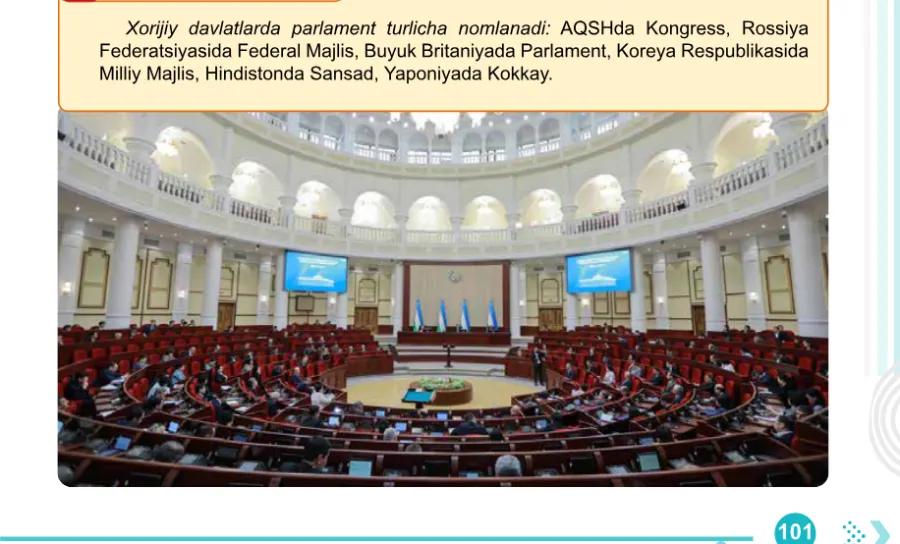

### OʻZBEKISTON RESPUBLIKASI OLIY MAJLISI TUZILISHI

Oliy Majlis Qonunchilik Palatasi (quyi palata) 150 nafar deputat Qonunchilik palatasi Spikeri va uning oʻrinbosarlari **Qonunchilik palatasi kengashi** (quyi palataning faoliyatini tashkillashtiradi)

Oliy Majlis Senati (yuqori palata) 65 nafar senator Oliy Majlis Senat Raisi va uning oʻrinbosarlari

### Senat kengashi

(yuqori palataning faoliyatini tashkillashtiradi)

### Senatning qoʻmitalari

(muhokamaga kiritiladigan masalalarni dastlabki tarzda koʻrib chiqish, tayyorlash hamda qonun va qarorlar ijrosini nazorat qilish) **Senat komissiyalari** (muayyan vazifalarni amalga oshirish uchun tuziladi)

### Qonunchilik palatasining qoʻmitalari

(qonun loyihalarini tayyorlash, qarorlar ijrosini nazorat qilish uchun tuziladi)

### Qonunchilik palatasi komissiyalari

(muayyan vazifalarni amalga oshirish uchun tuziladi) **Fraksiyalar** (partiyalar manfaatlarini ifodalash uchun tuziladi)

### Oliy Majlis Qonunchilik palatasi

Qonunchilik palatasi (quyi palata) koʻppartiyaviylik, umumiy, teng va toʻgʻridan toʻgʻri saylov huquqi asosida yashirin ovoz berish yoʻli bilan saylanadigan bir yuz ellik nafar deputatdan iborat. Qonunchilik palatasi deputatlarning 75 nafari bevosita majoritar tizim asosida, yaʼni saylovchilar aniq shaxslarga ovoz berishi yoʻli bilan, qolgan 75 nafari esa, proporsional tizim boʻyicha siyosiy partiyalarga berilgan ovozlar asosida aralash saylov tizimida saylanadi.Yaʼni saylovchilar Qonunchilik palatasi deputatligiga saylovda ikkita byulleten orqali ovoz beradi: birinchisida aniq nomzodga, ikkinchisida esa oʻzlari tanlagan siyosiy partiyaga ovoz beradi.

**Deputat** – Oʻzbekiston Respublikasi Oliy Majlisining Qonunchilik palatasiga saylangan va Oʻzbekiston Respublikasining Saylov kodeksiga muvofiq Oʻzbekiston Respublikasi Markaziy saylov komissiyasi tomonidan roʻyxatga olingan Oʻzbekiston Respublikasi fuqarosi. Deputatlikka nomzodlar koʻrsatish siyosiy partiyalarning yuqori organlari tomonidan amalga oshiriladi.

Qonunchilik palatasi oʻzining vakolatlariga kiritilgan masalalar yuzasidan, shuningdek, palataning ichki faoliyatini tashkil etish masalalari yuzasidan qarorlar qabul qiladi. Qarorlar asosan deputatlar umumiy sonining koʻpchilik ovozi bilan qabul qilinadi.

Oʻzbekiston Respublikasi Oliy Majlisining Qonunchilik palatasi oʻz tarkibidan Qonunchilik palatasining Spikeri va uning oʻrinbosarlarini saylaydi. Qonunchilik Palatasi Spikeri umumiy rahbarlik qiladi, faoliyatni muvofiqlashtirib boradi, qonunlar va qarorlar ijrosi ustidan nazoratni tashkil etadi.

Oʻzbekiston Respublikasi Oliy Majlisining Qonunchilik palatasi mutlaq vakolatlari.

**Oʻzbekiston Respublikasi Konstitutsiyasi, 94-modda**

### Oliy Majlis Senati

Oʻzbekiston Respublikasi Oliy Majlisining Senati aʼzolari Qoraqalpogʻiston Respublikasi Joʻqorgʻi Kengesi, viloyatlar, tumanlar va shaharlar davlat hokimiyati vakillik organlari deputatlarining tegishli qoʻshma majlislarida mazkur deputatlar orasidan yashirin ovoz berish yoʻli bilan Qoraqalpogʻiston Respublikasi, viloyatlar va Toshkent shahridan teng miqdorda – toʻrt kishidan saylanadi.

Oʻzbekiston Respublikasi Oliy Majlisi Senatining toʻqqiz nafar aʼzosi fan, sanʼat, adabiyot, ishlab chiqarish sohasida hamda davlat va jamiyat faoliyatining boshqa tarmoqlarida katta amaliy tajribaga ega boʻlgan hamda alohida xizmat koʻrsatgan eng obroʻli fuqarolar orasidan Oʻzbekiston Respublikasi Prezidenti tomonidan tayinlanadi.

**Oʻzbekiston Respublikasi Oliy Majlisi Qonunchilik palatasi va Senatining qoʻshma majlislari quyidagi hollarda oʻtkaziladi**

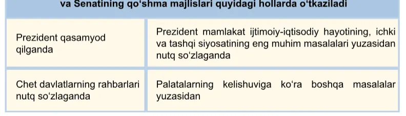

Senat palataning ichki faoliyatini tashkil etish va oʻzining vakolatlariga kiritilgan masalalar yuzasidan qarorlar qabul qiladi, mazkur qarorlar Senat aʼzolari umumiy sonining koʻpchilik ovozi bilan qabul qilinadi.

Umumsiyosiy, ijtimoiy-iqtisodiy va boshqa masalalar yuzasidan bayonotlar va murojaatlar bilan chiqishi mumkin va bu qaror bilan rasmiylashtiriladi.

Senat tarkib topganidan keyingi birinchi majlisda Oʻzbekiston Respublikasi Prezidentining taqdimiga binoan, Senat aʼzolari orasidan yashirin ovoz berish orqali senatorlar umumiy sonining koʻpchilik ovozi bilan Senat Raisi saylanadi.

Senat Raisi umumiy rahbarlikni amalga oshiradi, qoʻmita, komissiyalar faoliyatini muvofiqlashtirib boradi, qonunlar ijrosi ustidan nazoratni tashkil etadi.

### Yodda tuting!

Oliy Majlis Senati aʼzolari Qoraqalpogʻiston Respublikasi, viloyatlar va Toshkent shahridan teng miqdorda – 4 kishidan saylanadi.

9 nafar aʼzosi Oʻzbekiston Respublikasi Prezidenti tomonidan tayinlanadi.

Oʻzbekiston Respublikasi Oliy Majlisining Senati mutlaq vakolatlari.

**Oʻzbekiston Respublikasi Konstitutsiyasi, 95-modda**

Oʻzbekiston Respublikasi Oliy Majlisining Senati Raisi oʻrinbosarlaridan biri Qoraqalpogʻiston Respublikasining vakili boʻladi.

Palatalarning birgalikdagi vakolatlariga kiradigan masalalar, qoida tariqasida, avval Oʻzbekiston Respublikasi Oliy Majlisining Qonunchilik palatasida, soʻngra Senatida koʻrib chiqiladi.

### Oliy Majlis quyidagi hollarda tarqatib yuborilishi mumkin

Qonunchilik palatasi yoki Senat tarkibida ularning normal faoliyatiga tahdid soluvchi hal qilib boʻlmaydigan ixtiloflar yuz berganda.

Qonunchilik palatasi yoki Senat bir necha marta Oʻzbekiston Respublikasi Konstitutsiyasiga zid qarorlar qabul qilgan taqdirda.

Qonunchilik palatasi bilan Senat oʻrtasida Oʻzbekiston Respublikasi Oliy Majlisining normal faoliyatiga tahdid soluvchi hal qilib boʻlmaydigan ixtiloflar yuz berganda. **Izoh:** bunday hollarda Prezident Konstitutsiyaviy sud bilan bamaslahat qaror qabul qiladi.

Oliy Majlis Qonunchilik palatasi tomonidan Bosh vazir lavozimiga nomzod uch marta rad etilgan taqdirda Oʻzbekiston Respublikasi Prezidenti Bosh vazirni tayin laydi va Oʻzbekiston Respublikasi Oliy Majlisi Qonunchilik palatasini tarqatib yuboradi.

Qonunchilik palatasi yoki Senat oʻzini oʻzi tarqatib yuborish toʻgʻrisida deputatlar 5-holat yoki senatorlar umumiy sonining kamida uchdan ikki qismidan iborat koʻpchilik ovozi bilan qaror qabul qilishi mumkin.

**Izoh:** Qonunchilik palatasi oʻzini oʻzi tarqatib yuborgan hollarda yangi saylov **ikki oy ichida** oʻtkaziladi, Senat oʻzini oʻzi tarqatib yuborgan taqdirda **bir oy mobaynida** uning yangi tarkibi shakllantiriladi.

### Yodda tuting!

Oʻzbekiston Respublikasi Oliy Majlisining Senati hududiy vakillik palatasi boʻlib, Senat aʼzolaridan (senatorlardan) iborat.

**Oʻzbekiston Respublikasi Konstitutsiyasi, 92-modda**

Oʻzbekiston Respublikasi Oliy Majlisi Qonunchilik palatasi va Senatining birgalikdagi vakolatlari.

### Hayotiy vaziyat

**1.** Oʻzbekiston Respublikasi Oliy Majlisi Qonunchilik palatasiga boʻlib oʻtgan saylovlardan keyin Oʻzbekiston Respublikasi Bosh vaziri nomzodi Qonunchilik palatasi koʻrib chiqishi va maʼqullashi uchun Oʻzbekiston Respublikasi Prezidenti tomonidan taqdim etildi. Bosh vazir nomzodi uchun ovoz berish natijasiga koʻra Bosh vazir nomzodi deputatlar tomonidan maʼqullanmadi.

Vaziyatga baho bering va oʻz fikringizni asoslang.

**2.** Oʻzbekiston Respublikasi Bosh prokurori Oliy Majlis Qonunchilik palatasi deputati A.ni Oʻzbekiston Respublikasi Jinoyat kodeksining tegishli moddasi bilan aybdor deb topib, uni jinoiy javobgarlikka tortish uchun daxlsizlik huquqidan mahrum etishni soʻrab, Oliy Majlis Senatiga taqdimnoma kiritdi. Oliy Majlis Senati mazkur masala uning vakolatiga kirmasligi va Oliy Majlis Qonunchilik palatasiga murojaat qilish kerakligi vaji bilan taqdimnomani rad etdi.

Vaziyatni tahlil qiling va deputat yoki senatorni daxlsizlik huquqidan mahrum qilish tartibini tushuntirib bering.

### Savol va topshiriqlar

1. Davlat hokimiyatining asosiy vazifalarini tushuntirib bering.

2. Davlat hokimiyatining qonun chiqaruvchi, ijro etuvchi va sud hokimiyatiga boʻlinishining ahamiyati va zarurati haqida fikringizni bayon eting.

3. Xalq hokimiyatchiligi deganda nimani tushunasiz?

4. Nima uchun Oʻzbekiston Respublikasi Oliy Majlisi oliy vakillik va yagona qonunchilik organi hisoblanadi? Fikringizni asoslab bering.

5. Oʻzbekiston Respublikasi Senatini shakllantirish tartibini bayon eting.

6. Deputat soʻrovi va senator soʻrovining maqsadi, tartibini bayon eting.

## 29-dars. Oʻzbekiston Respublikasi Prezidenti

Tanqidiy tahlil, qatʼiy tartib-intizom va shaxsiy javobgarlik – har bir rahbar faoliyatining kundalik qoidasi boʻlishi kerak.

**Shavkat Mirziyoyev**

### Bilib olasiz

Oʻzbekiston Respublikasi Prezidenti – davlat boshligʻi. Oʻzbekiston Respublikasi Prezidentini saylash. Oʻzbekiston Respublikasi Prezidentining vakolatlari.

### Oʻzbekiston Respublikasi Prezidenti – davlat boshligʻi

Hozirgi vaqtda BMTga aʼzo boʻlgan 193 ta davlatning 143 tasida prezident lavozimi mavjud. Davlatchilik tajribasida prezident lavozimi keng qoʻllanadi.

Oʻzbekistonda prezident lavozimi 1990-yil 24-martda joriy qilingan. Oʻzbekiston Prezidenti davlat boshligʻi maqomiga ega boʻlib, Konstitutsiyada uning vakolatlar belgilangan. Oʻzbekiston Respublikasining Prezidenti Konstitutsiyaga va qonunlarga asoslanib hamda ularni ijro etish yuzasidan respublikaning butun hududida majburiy kuchga ega boʻlgan farmonlar, qarorlar va farmoyishlar chiqaradi.

**Prezidentning daxlsizlik va immunitet huquqi.**

Oʻzbekiston Respublikasi Prezidenti oʻz vazifasini bajarib turgan davrda boshqa haq toʻlanadigan lavozimni egallashi, vakillik organining deputati boʻlishi, tadbirkorlik faoliyati bilan shugʻullanishi mumkin emas.

Oʻzbekiston Respublikasi Prezidentining shaxsi daxlsizdir va qonun bilan muhofaza etiladi. Oʻzbekiston Respublikasi Prezidentining daxlsizligi uning turarjoy va xizmat xonalariga, bagajiga, shaxsiy va xizmat transport vositalariga, yozishmalariga, foydalanadigan aloqa vositalariga, shuningdek, unga tegishli hujjatlarga tatbiq etiladi. Oʻzbekiston Respublikasi Prezidenti va uning oila aʼzolariga **davlat muhofazasi** beriladi.

Oʻzbekiston Respublikasi Prezidentiga muddati oʻttiz olti ish kunidan iborat yillik haq toʻlanadigan taʼtil beriladi. Oʻzbekiston Respublikasi Prezidenti Oʻzbekiston Respublikasi Prezidentining belgisi va shtandartiga (bayrogʻiga) ega boʻladi.

### Qiziqarli maʼlumot

Prezidentning huquqiy maqomiga uning qaysi yoʻl bilan saylanishi (xalq tomonidanmi, vakillik organlari yoki maxsus organlar tomonidanmi), faqat davlat boshligʻi yoki davlat va ijro hokimiyati boshligʻi ekani, davlat boshqaruvining prezidentlik, parlamentar, aralash shakllari taʼsir qiladi va bular prezidentning hokimiyat tizimidagi oʻrnini aniqlashda ham asosiy mezon boʻladi.

### Oʻzbekiston Respublikasi Prezidentini saylash

Barcha mamlakatlarda prezident maʼlum muddatga saylab qoʻyiladi. Saylov har xil boʻlishi mumkin. Masalan, ayrim davlatlarda prezidentni parlament (xalq vakillari) saylaydi (Italiya, Chexiya, Polshada); ayrim mamlakatlarda faqat prezident saylash uchun maxsus anjuman chaqiriladi (Germaniyada); ayrim mamlakatlarda prezidentni saylovchilar vakillari saylaydi (AQSHda); ayrim mamlakatlarda prezidentni bevosita xalq saylaydi (Fransiya, Rossiya, Qozogʻistonda).

Bevosita xalq tomonidan toʻgʻridan toʻgʻri saylangan prezident kuchli vakolatlarga ega boʻladi. Prezident toʻgʻridan toʻgʻri saylanganda fuqarolarda uning saylovoldi dasturi bilan bevosita tanishish imkoniyati mavjud.

Oʻzbekiston Respublikasi Prezidentligiga nomzod siyosiy partiyadan koʻrsatiladi. Qasddan sodir etilgan jinoyati uchun ilgari sudlangan fuqarolar hamda diniy tashkilotlar va birlashmalarning professional xizmatchilari Oʻzbekiston Respublikasi Prezidentligiga nomzod sifatida roʻyxatga olinmaydi.

**Oʻzbekiston Respublikasi Prezidentligiga nomzodning saylov jarayoni bosqichlari** Oʻzbekiston Respublikasi Prezidentligi saylovida ishtirok etish uchun siyosiy partiya Markaziy saylov komissiyasiga murojaat qiladi (saylovga kamida yetmish kun qolganida);

Markaziy saylov komissiyasi taqdim qilingan hujjatlar asosida partiyaning saylovda ishtirok etishiga ijozat berish toʻgʻrisidagi qaror, siyosiy partiya vakolatli vakiliga roʻyxatga olinganlik guvohnomasi, imzo varaqalarining blankalarini taqdim qiladi;

Saylovda ishtirok etuvchi partiyalarning roʻyxati matbuotda eʼlon qilinadi; Siyosiy partiyaning yuqori organi tomonidan prezidentlikka nomzod koʻrsatiladi va bayonnomani rasmiylashtiriladi;

Siyosiy partiyaning rahbari prezidentlikka nomzodni roʻyxatga olish toʻgʻrisida Markaziy saylov komissiyasiga ariza va tegishli hujjatlar bilan murojaat etadi;

Markaziy saylov komissiyasi hujjatlar muvofiqligini oʻrganadi va xulosa taqdim qiladi;

Markaziy saylov komissiyasi prezidentlikka nomzodni roʻyxatga oladi; Saylov jarayoni;

### Qiziqarli maʼlumot

Oʻzbekiston Respublikasi Prezidenti Markaziy saylov komissiyasi tomonidan Oʻzbekiston Respublikasi Prezidenti saylovi natijalari rasmiy ravishda eʼlon qilingan kundan eʼtiboran, kechi bilan **ikki oy ichida Oʻzbekiston Respublikasi Oliy Majlisi palatalarining qoʻshma majlisida qasamyod qilgan** paytdan eʼtiboran oʻz lavozimiga kirishadi.

Amaldagi Oʻzbekiston Respublikasi Prezidenti oʻz vakolatlarini yangi saylangan Oʻzbekiston Respublikasi

Prezidenti lavozimga kirishguniga qadar bajaradi.

Prezident Oʻzbekiston Respublikasi Oliy Majlisi yigʻilishida qasamyodni qabul qilgan paytdan boshlab oʻz lavozimiga kirishgan hisoblanadi.

Ayni bir shaxs surunkasiga ikki muddatdan ortiq Oʻzbekiston Respublikasining Prezidenti boʻlishi mumkin emas.

Oʻzbekiston Respublikasining amaldagi Prezidenti oʻz vazifalarini bajara olmaydigan holatlarda uning vazifa va vakolatlari vaqtincha Senat Raisining zimmasiga yuklatiladi, bunda uch oy muddat ichida Oʻzbekiston Respublikasi Prezidenti saylovi oʻtkaziladi.

### Oʻzbekiston Respublikasi Prezidentining vakolatlari

Oʻzbekiston Respublikasi Konstitutsiyasining 109-moddasida Prezidentning vazifa va vakolatlari, Prezident hal qiladigan, bajaradigan, amalga oshiradigan ishlar belgilangan.

Konstitutsiya va qonunlarda koʻrsatilgan Prezident vakolatlarini maqsad va mazmuniga qarab quyidagi guruhlarga ajratish mumkin:

1. Oʻzbekiston Respublikasi Prezidentining fuqarolarning huquq va erkinliklariga, Oʻzbekiston Respublikasining Konstitutsiyasi va qonunlariga rioya etilishini taʼminlash borasidagi vakolatlari. Bu vakolatlar eng avvalo inson manfaatlarini himoya qilish, ularning erkini, farovon yashashini taʼminlashni nazarda tutadi.

2. Prezidentning mamlakat suvereniteti, xavfsizligi va hududiy yaxlitligini muhofaza qilish, milliy davlat tuzilishi masalalariga doir vazifa va vakolatlari.

3. Prezidentning ichki va tashqi siyosat sohasidagi vakolatlari.

4. Prezidentning turli davlat organlari, muassasa va tashkilotlarni tuzish, hokimiyat tarmoqlarini tashkil qilish, ularning bahamjihat ishlashini taʼminlash sohasidagi vakolatlari.

5. Prezidentning qonunchilik sohasidagi vakolatlari.

Prezident Oʻzbekiston Respublikasining suvereniteti, xavfsizligi va hududiy yaxlitligini muhofaza etish, davlat tuzilishi masalalariga doir qarorlarni amalga oshirish yuzasidan zarur chora-tadbirlar koʻradi.

### Yodda tuting!

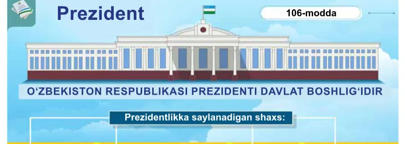

**saylovgacha kamida 10 yil Oʻzbekiston hududida muqim yashayotgan boʻlishi**

### Respublikasi

**fuqarosi boʻlishi kerak**

**Prezident mamlakat ichkarisida va xalqaro munosabatlarda Oʻzbekiston Respublikasi nomidan ish koʻradi.** Jumladan, Oʻzbekiston Respublikasining chet davlatlardagi diplomatik va boshqa vakillarini tayinlash uchun nomzodlarni Oliy Majlisining Senatiga taqdim etadi hamda oʻz huzurida akkreditatsiyadan oʻtgan diplomatik hamda boshqa vakillarning ishonch va chaqiruv yorliqlarini qabul qiladi.

**Prezident respublika oliy hokimiyat va boshqaruv organlarining bahamjihat ishlashini taʼminlaydi;** vazirliklar, davlat qoʻmitalari hamda davlat boshqaruvining boshqa organlarini Oʻzbekiston Respublikasi Vazirlar Mahkamasining taqdimiga binoan tuzadi va tugatadi, shu masalalarga doir farmonlarni keyinchalik Oliy Majlisning palatalari tasdigʻiga kiritadi.

**Prezidentning muhim vakolatlaridan biri davlat hokimiyati va boshqaruv organlari rahbarlarini lavozimga tayinlash hisoblanadi. Jumladan:**

– Senat Raisi lavozimiga nomzodni Oliy Majlis Senatiga taqdim etadi;

– Oʻzbekiston Respublikasi Bosh vazirini, Oʻzbekiston Respublikasi Vazirlar Mahkamasi aʼzolarini Oʻzbekiston Respublikasi Oliy Majlisining Qonunchilik palatasi maʼqullaganidan keyin lavozimga tayinlaydi va ularni lavozimidan ozod etadi;

– Oʻzbekiston Respublikasi Oliy Majlisining Senatiga Oʻzbekiston Respublikasi Konstitutsiyaviy sudi, Oʻzbekiston Respublikasi Oliy sudi, Oʻzbekiston Respublikasi Sudyalar oliy kengashi tarkiblariga nomzodlarni, shuningdek, Oʻzbekiston Respublikasi Markaziy banki boshqaruvining raisi, respublika korrupsiyaga qarshi kurashish organining rahbari va respublika monopoliyaga qarshi organining rahbari lavozimlariga nomzodlarni taqdim etadi;

– Oʻzbekiston Respublikasi Sudyalar oliy kengashining taqdimiga binoan viloyatlar va Toshkent shahar sudlari raislarini va rais oʻrinbosarlarini, Oʻzbekiston Respublikasi Harbiy sudi raisini tayinlaydi va lavozimidan ozod etadi;

– viloyatlar hokimlarini va Toshkent shahar hokimini tayinlaydi hamda lavozimidan ozod etadi.

– Oʻzbekiston Respublikasi Oliy Majlisining Senati bilan maslahatlashuvlardan keyin Oʻzbekiston Respublikasi Davlat xavfsizlik xizmati raisini lavozimga tayinlaydi va uni lavozimidan ozod etadi.

### Yodda tuting!

Prezident Oʻzbekiston Respublikasining qonunlarini imzolaydi va eʼlon qiladi.

Prezident Oliy Majlis palatalari tomonidan qabul qilingan qonunga oʻz eʼtirozlarini ilova etib, uni takroran muhokama qilish va ovozga qoʻyish uchun Oʻzbekiston Respublikasi Oliy Majlisiga qaytarishga haqli.

Shuningdek, prezident Oʻzbekiston Respublikasining ordenlari, medallari va yorligʻi bilan mukofotlaydi, Oʻzbekiston Respublikasining malakaviy va faxriy unvonlarini beradi.

Amnistiya toʻgʻrisidagi hujjatlarni qabul qilish haqida Oʻzbekiston Respublikasi Oliy Majlisining Senatiga taqdimnoma kiritadi va Oʻzbekiston Respublikasining sudlari tomonidan hukm qilingan shaxslarni afv etadi.

Oʻzbekiston Respublikasining amaldagi Prezidenti oʻz vazifalarini bajara olmaydigan holatlarda uning vazifa va vakolatlari vaqtincha Oʻzbekiston Respublikasi Oliy Majlisi Senati Raisining zimmasiga yuklatiladi, bunda uch oy muddat ichida, qonunga toʻliq muvofiq holda mamlakat Prezidenti saylovi oʻtkaziladi.

Vakolati tugashi munosabati bilan isteʼfoga chiqqan Prezident umrbod Senat aʼzosi lavozimini egallaydi.

### Hayotiy vaziyat

**1.** Oʻzbekiston Respublikasi Prezidentiga imzolash uchun Senat tomonidan qonun yuborildi. Biroq davlat boshligʻi oʻz eʼtirozlari bilan qonunni imzolamasdan qaytardi. Qonunchilik palatasi deputatlari va Senati aʼzolari umumiy sonining toʻrtdan uch qismidan iborat koʻpchilik ovozi bilan qaytarilgan qonun oʻzgartirish kiritilmasdan ayni tahrirda maʼqullandi. Qonunni imzolash uchun yana Prezidentga yuborildi.

Vaziyatga huquqiy baho bering.

Ushbu holat Oʻzbekiston Respublikasi qonunchiligi doirasida qanday hal qilinadi?

**2.** Maʼlumki, Oʻzbekiston Respublikasi Prezidenti saylovi jarayoni Konstitutsiya va Saylov kodeksi bilan tartibga solinadi. Shu nuqtayi nazardan Prezident saylovi qachon oʻtkaziladi?

Oʻzbekistonda saylovlar qaysi oyda oʻtkaziladi? Saylov qanday tashkil etiladi? Masalani atroflicha tahlil qiling.

### Savol va topshiriqlar

1. Prezidentning daxlsizlik va immunitet huquqlarini misollar orqali bayon eting.

2. Oʻzbekiston Respublikasi Prezidentligiga nomzodni saylash tartibini bayon eting.

3. Prezident vakolatlarini misollar orqali bayon eting.

4. Prezident Oliy Majlisga mamlakat ichki va tashqi siyosatini amalga oshirishning eng muhim masalalari yuzasidan murojaat qilish huquqiga ega. Mana shu maʼlumot asosida Prezidentning Oliy Majlisga Murojaatnomasi haqida gapirib bering. Unda qaysi masalalar bayon etiladi?

## 30-dars. Oʻzbekiston Respublikasi Vazirlar Mahkamasi

Insonlarning haqiqiy tengligi ularning barchasi bir xilda qonunga boʻysunishida namoyon boʻladi.

**Jan Le Ron Alamber**

### Bilib olasiz

Vazirlar Mahkamasi – ijro etuvchi hokimiyatning oliy organi. Vazirlar Mahkamasining tarkibi va vakolatlari.

### Vazirlar Mahkamasi – ijro etuvchi hokimiyatning oliy organi

Mamlakatimizda davlat hokimiyati va boshqaruvini demokratlashtirish sohasida olib borilayotgan islohotlar Oʻzbekiston Respublikasi Konstitutsiyasining 11-moddasida belgilangan davlat hokimiyatining qonun chiqaruvchi, ijro etuvchi va sud hokimiyatiga boʻlinishi prinsipiga asoslanadi.

Siz yuqorida Oʻzbekiston Respublikasining qonun chiqaruvchi hokimiyati haqida bilib oldingiz.

Oʻzbekiston Respublikasi Vazirlar Mahkamasi ijro etuvchi hokimiyatni amalga oshiradi. Vazirlar Mahkamasi Oʻzbekiston Respublikasi Hukumati ijro etuvchi hokimiyatning oliy organi hisoblanadi va ijro etuvchi hokimiyatning yagona tizimiga rahbarlik qiladi.

Vazirlar Mahkamasi mamlakatda iqtisodiy, ijtimoiy va maʼnaviy sohalarning samarali faoliyat koʻrsatishida kollegial organ sifatida ish olib boradi.

**Vazirlar Mahkamasi oʻz faoliyatida:**

– Oʻzbekiston Respublikasi Konstitutsiya va qonunlarining ustunligini taʼminlaydi va qonunchilik tashabbusi huquqiga ega;

– Oʻzbekiston Respublikasi Prezidenti tomonidan belgilanadigan asosiy yoʻnalishlar doirasida ish olib boradi;

– Oʻzbekiston Respublikasi Oliy Majlisi va Oʻzbekiston Respublikasi Prezidenti oldida javobgar hisoblanadi;

– inson hamda fuqaroning huquq va erkinliklarini taʼminlaydi;

– hokimiyat tarmoqlarining boʻlinishi va hamkorligini taʼminlaydi;

– kollegiallik, ochiqlik va shaffoflik prinsiplariga amal qiladi.

### Respublikasi

Oliy Majlis palatalari qarorlari

### Oʻzbekiston

Respublikasi Prezidenti farmonlari, qarorlari va farmoyishlari ijrosini taʼminlaydi

### Respublikasi

Konstitutsiyasi va qonunlari

### Respublikasi

Bosh vaziri

### Oʻzbekiston

Respublikasi Bosh vaziri oʻrinbosarlari

### Oʻzbekiston Respublikasi Bosh vaziri

1) Vazirlar Mahkamasi faoliyatini tashkil etadi va unga rahbarlik qiladi, uning samarali ishlashi uchun shaxsan javobgar boʻladi;

2) Vazirlar Mahkamasining majlislarida raislik qiladi, uning qarorlarini imzolaydi;

3) xalqaro munosabatlarda Oʻzbekiston Respublikasi Vazirlar Mahkamasi nomidan ish koʻradi;

4) Oʻzbekiston Respublikasi qonunlarida nazarda tutilgan boshqa vazifalarni bajaradi.

### Oʻzbekiston

**Respublikasi Bosh vaziri nomzodi**

**Qonunchilik palatasi koʻrib chiqishi va maʼqullashi uchun Oʻzbekiston Respublikasi Prezidenti tomonidan taqdim etiladi**

Oʻzbekiston Respublikasi Oliy Majlisining Qonunchilik palatasi Oʻzbekiston Respublikasi Prezidenti tomonidan taqdim etilgan Oʻzbekiston Respublikasi Bosh vaziri nomzodini taqdimnoma kiritilgan kundan eʼtiboran oʻn kun ichida koʻrib chiqadi.

### VAZIRLAR MAHKAMASI

Bosh vazir, uning oʻrinbosarlari, vazirlar va Qoraqalpogʻiston Respublikasi hukumatining boshligʻidan iborat.

Oʻzbekistonning butun hududidagi barcha organlar, korxonalar, muassasalar, tashkilotlar, mansabdor shaxslar va fuqarolar tomonidan bajarilishi majburiy boʻlgan qarorlar va farmoyishlar chiqaradi.

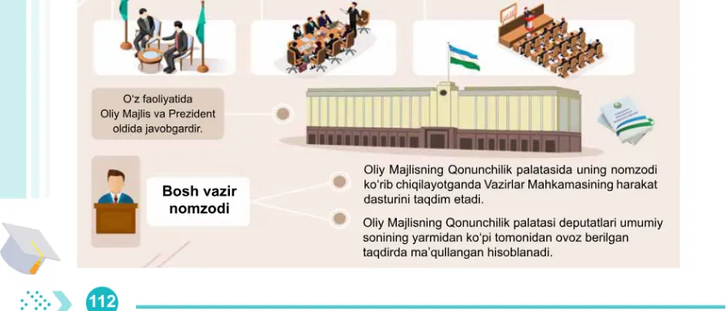

### Yodda tuting!

Oʻzbekiston Respublikasi Vazirlar Mahkamasi yoshlarga oid davlat siyosatining amalga oshirilishini taʼminlaydi, oilani qoʻllab-quvvatlash, mustahkamlash va himoya qilish, anʼanaviy oilaviy qadriyatlarni saqlash boʻyicha choralar koʻradi.

Oʻzbekiston Respublikasi Vazirlar Mahkamasining aʼzolari ularning nomzodlari Oʻzbekiston Respublikasi Oliy Majlisining Qonunchilik palatasi tomonidan maʼqullanganidan keyin Oʻzbekiston Respublikasi Prezidenti tomonidan lavozimga tayinlanadi.

**Vazirlar Mahkamasining vakolatlari** Oʻzbekiston Respublikasi Konstitutsiyasining yangi tahriri asosida Vazirlar Mahkamasi vakolatlari tizimlashtirildi va aniqlashtirildi.

Vazirlar Mahkamasining vakolatlari 12 bandda aniq-ravshan etib ifodalandi. Oʻzbekiston Respublikasi Konstitutsiyasiga koʻra, Vazirlar Mahkamasining butun faoliyatini 3 ta yoʻnalishga ajratish mumkin.

**Birinchi yoʻnalish** iqtisodiy va ijtimoiy sohalarga tegishli umumiy vakolatlar (115-moddaning 1-, 2-, 3-, 4-bandlari)

**Ikkinchi yoʻnalish** fuqarolik jamiyati institutlari va fuqarolarning huquq va erkinliklariga tegishli vakolatlar (115-moddaning 5-, 6-, 7-bandlari)

**Uchinchi yoʻnalish** ijroni amalga oshirishga tegishli vakolatlar (115-moddaning 8-, 9-, 10-,11-bandlari)

### Savol va topshiriqlar

1. Nima uchun Vazirlar Mahkamasi ijro etuvchi hokimiyatning oliy organi deb ataladi?

2. Vazirlar Mahkamasi qanday hujjatlar chiqaradi? Misollar keltiring.

3. Oʻzbekiston Respublikasi Bosh vaziri qanday vazifalarni bajaradi?

4. Vazirlar Mahkamasining vakolatlariga nimalar kiradi?

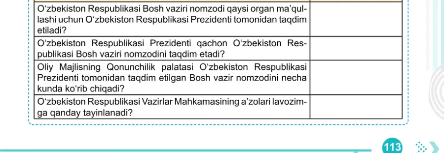

## 31-dars. Mahalliy davlat hokimiyati

Birovga koʻrsatilgan kichik bir mehribonlik ming martalik ibodatdan koʻra afzaldir. **Mahatma Gandi**

### Bilib olasiz

Mahalliy davlat hokimiyati tushunchasi.

Mahalliy ijro hokimiyati organlari va ularning vakolatlari. Fuqarolarning oʻzini oʻzi boshqarish organlari.

### Mahalliy davlat hokimiyati tushunchasi

Oʻzbekiston Respublikasida mahalliy davlat hokimiyati hududdagi (viloyat, Toshkent shahri, shahar va tumanlarda) davlat boshqaruv organlari hisoblanadi hamda u yagona davlat hokimiyati organlarining tarkibiy boʻgʻini sifatida faoliyat yuritadi.

Ular mahalliy (viloyat, Toshkent shahri, shahar va tumanlar) ahamiyatga molik masalalarni oʻz vakolatlari doirasida hal etadilar. Oʻz hududlarida yashayotgan fuqarolarning manfaatlarini davlat manfaatlari bilan birga uygʻunlashtiradilar.

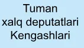

Yagona davlat hokimiyati organlarining tarkibiy boʻgʻini sifatida yuqori davlat organlari qarorlarining amalga oshirilishini taʼminlaydilar.

Xalq deputatlari Kengashiga uning deputatlari orasidan qonunga muvofiq saylanadigan rais boshchilik qiladi. Xalq deputatlari Kengashlarining vakolat muddati – besh yil. Ayni bir shaxs surunkasiga ikki muddatdan ortiq ayni bir viloyat, tuman, shahar xalq deputatlari Kengashining raisi etib saylanishi mumkin emas.

**Xalq deputatlari Kengashining vakolatlari:**

1) tegishli mahalliy byudjetni koʻrib chiqadi va qabul qiladi, ularning ijro etilishi ustidan nazoratni amalga oshiradi;

2) hududlarni ijtimoiy-iqtisodiy rivojlantiradi va aholini ijtimoiy himoya qilish dasturlarini tasdiqlaydi;

3) hokimni lavozimga tasdiqlaydi, uning faoliyati toʻgʻrisidagi hisobotlarni eshitadi;

4) Oʻzbekiston Respublikasi Konstitutsiyasi va qonunlarida nazarda tutilgan boshqa vakolatlarni amalga oshiradi.

### Yodda tuting!

viloyat, tuman, shaharning hokimi etib tayinlanishi mumkin emas.

Viloyat, tuman, shahar hokimlarining vakolatlari:

1) Oʻzbekiston Respublikasining Konstitutsiyasi va qonunlarini, Oliy Majlis palatalarining qarorlarini, Oʻzbekiston Respublikasi Prezidentining farmonlari, qarorlari hamda farmoyishlarini, Vazirlar Mahkamasining, yuqori turuvchi hokimlarning va tegishli xalq deputatlari Kengashlarining qarorlarini bajaradi;

2) hududlarni iqtisodiy, ijtimoiy, madaniy va ekologik jihatdan rivojlantirishni taʼminlashga qaratilgan chora-tadbirlarni amalga oshiradi;

3) mahalliy byudjetni shakllantiradi va ijro etadi.

Viloyat va Toshkent shahri hokimi Oʻzbekiston Respublikasi Prezidenti tomonidan qonunga muvofiq tayinlanadi va lavozimidan ozod etiladi. Tuman va shaharlarning hokimlari viloyat, Toshkent shahri hokimi tomonidan tayinlanadi va lavozimidan ozod etiladi hamda tegishli xalq deputatlari Kengashi tomonidan tasdiqlanadi. Tumanga boʻysunadigan shaharlarning hokimlari tuman hokimi tomonidan tayinlanadi va lavozimidan ozod etiladi hamda xalq deputatlari tuman Kengashi tomonidan tasdiqlanadi.

Tegishli hududdagi ijro etuvchi hokimiyatga viloyat, tuman va shahar hokimi boshchilik qiladi.

### Fuqarolarning oʻzini oʻzi boshqarish organlari

Fuqarolarning oʻzini oʻzi boshqarishi deganda, ularning mahalliy ahamiyatga molik masalalarni oʻz manfaatlaridan kelib chiqib hal etishi, shuningdek, rivojlanishning tarixiy xususiyatlari, milliy va maʼnaviy qadriyatlar, mahalliy urf-odatlar va anʼanalardan kelib chiqib olib boradigan mustaqil faoliyati tushuniladi. Ushbu faoliyat Oʻzbekiston Respublikasining Konstitutsiyasi va qonunlari bilan kafolatlanadi.

Fuqarolar jinsi, irqi, millati, tili, dini, ijtimoiy kelib chiqishi, eʼtiqodi, shaxsiy va ijtimoiy mavqeyidan qatʼi nazar, bevosita yoki oʻzlarining saylanadigan vakillari orqali oʻzini oʻzi boshqarishda teng huquqlarga ega.

### OʻZINI OʻZI BOSHQARISH ORGANLARI

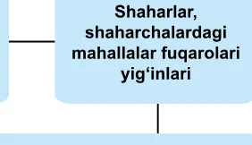

### Yodda tuting!

Fuqarolar yigʻini fuqarolar yigʻini raisini saylaydi.

Fuqarolarning oʻzini oʻzi boshqarish organlari tomonidan jamoatchilik nazorati amalga oshiriladi. Jamoatchilik nazorati ommaviy axborot vositalari, nodavlat notijorat tashkilotlari va boshqa tashkilotlar bilan hamkorlikda amalga oshirilishi mumkin.

### Savol va topshiriqlar

1. Mahalliy davlat hokimiyati deganda nima tushuniladi?

2. Mahalliy davlat hokimiyatining konstitutsiyaviy asoslarini izohlab bering.

3. Quyidagi jadvalni toʻldiring. Ushbu vakolatlarning xususiyatlarini yoriting. Xalq deputatlari Kengashi va hokimlarning vakolatida bogʻliqlik bormi? Javobingizni izohlang.

### Mustaqil ish uchun topshiriq

Quyidagilarni Oʻzbekiston Respublikasining “Mahalliy davlat hokimiyati toʻgʻrisida”gi qonuniga koʻra toʻldiring:

**1.** Xalq deputatlari viloyat, tuman, shahar Kengashi Oʻzbekiston Respublikasining............

saylanadigan xalq deputatlaridan iborat boʻladi.

**2.** Viloyat, tuman, shahar ijroiya hokimiyatiga........... boshchilik qiladi.

**3.** Viloyat va Toshkent shahri hokimining birinchi oʻrinbosari hamda oʻrinbosarlari hokim tomonidan........ kelishilgan holda lavozimga tayinlanadi va lavozimidan ozod etiladi.

**4.** Xalq deputatlari viloyat, tuman, shahar Kengashlarining Oʻzbekiston Respublikasi Konstitutsiyasi va qonunlariga, Oʻzbekiston Respublikasi Prezidentining farmonlari, qarorlari va farmoyishlariga zid keladigan qarorlari belgilangan tartibda........... bekor qilinadi.

**5.** Yuqori turuvchi davlat hokimiyati organlari oʻz vakolatlari doirasida qabul qilgan qarorlar........ uchun majburiydir.

## 32-dars. Oʻzbekiston Respublikasining sud hokimiyati

Sudyaning ishi qonunni hadya etish emas, balki uni toʻgʻri talqin qilishdir. **Frensis Bekon**

### Bilib olasiz

Sud hokimiyati tushunchasi.

Oʻzbekiston Respublikasi Konstitutsiyaviy sudi va Oliy sudi. Sudyalar mustaqilligi.

### Sud hokimiyati tushunchasi

Oʻzbekiston Respublikasida davlat hokimiyatining yana bir alohida va mustaqil organi sifatida sud hokimiyati odil sudlovni amalga oshiradi.

Sud hokimiyati faqat sudlar tomonidan amalga oshiriladi. Hech qaysi boshqa organ va shaxslar sud hokimiyati vakolatlarini oʻzlashtirib olishga haqli emas.

Bugun odamlarning odil sudlovga boʻlgan ishonchi mustahkamlandi. Sud jazolovchi organ emas, balki adolat qoʻrgʻoni sifatida namoyon boʻlib, xalq bilan hamnafas boʻlib kelmoqda.

### Oʻzbekiston Respublikasida sud tizimi quyidagilardan iborat

– Oʻzbekiston Respublikasi Konstitutsiyaviy sudi;

– Oʻzbekiston Respublikasi Oliy sudi;

– harbiy sudlar;

– Qoraqalpogʻiston Respublikasi sudi, viloyatlar va Toshkent shahri sudlari;

– Qoraqalpogʻiston Respublikasi maʼmuriy sudi, viloyatlar va Toshkent shahri maʼmuriy sudlari;

– fuqarolik ishlari boʻyicha tumanlararo, tuman, shahar sudlari;

– jinoyat ishlari boʻyicha tuman, shahar sudlari;

– tumanlararo, tuman, shahar iqtisodiy sudlari;

– tumanlararo maʼmuriy sudlar.

### Oʻzbekiston Respublikasi Konstitutsiyaviy sudi va Oliy sudi

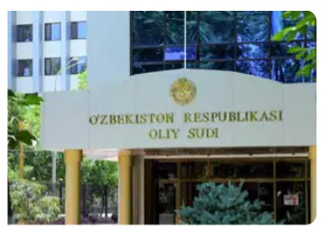

Endi Oʻzbekiston Respublikasi sud tizimi tarkibidagi sudlar haqida maʼlumotlarni koʻrib chiqamiz. Oʻzbekiston Respublikasining Konstitutsiyaviy sudi davlatimiz mustaqillikni qoʻlga kiritgan davrdan boshlab faoliyat yuritib kelmoqda. Konstitutsiyaviy sud qonun chiqaruvchi va ijro etuvchi hokimiyat hujjatlarining konstitutsiyaga muvofiqligi toʻgʻrisidagi ishlarni koʻradi. Konstitutsiyaviy sud doimiy faoliyat yurituvchi sud organi hisoblanadi.

Konstitutsiyaviy sud qonunchilik tashabbusi huquqiga ega. Konstitutsiyaviy sudning qonunchilik tashabbusi huquqi Oʻzbekiston Respublikasi Oliy Majlisining Qonunchilik palatasiga kiritish orqali amalga oshiriladi.

Konstitutsiyaviy sud Oʻzbekiston Respublikasi Prezidentining taqdimiga binoan, Oʻzbekiston Respublikasi Oliy Majlisining Senati tomonidan Oʻzbekiston Respublikasi Sudyalar oliy kengashi tavsiya etgan siyosat va huquq sohasidagi mutaxassislar orasidan, Qoraqalpogʻiston Respublikasi vakilini qoʻshgan holda saylanadi.

Oʻzbekiston Respublikasi Konstitutsiyaviy sudi oʻz tarkibidan Oʻzbekiston Respublikasi Konstitutsiyaviy sudining raisini va uning oʻrinbosarini besh yillik muddatga saylaydi.

**Oʻzbekiston Respublikasi Konstitutsiyaviy sudi quyidagi hujjatlarning Oʻzbekiston Respublikasining Konstitutsiyasiga muvofiqligini aniqlaydi:**

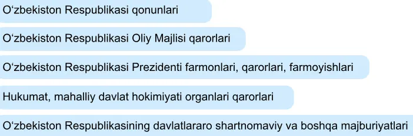

### Oʻzbekiston Respublikasi Konstitutsiyaviy sudi

– Oʻzbekiston Respublikasining Prezidenti tomonidan imzolanguniga qadar Oʻzbekiston Respublikasi konstitutsiyaviy qonunlarining, ratifikatsiya qilish toʻgʻrisidagi Oʻzbekiston Respublikasi qonunlari va Oʻzbekiston Respublikasi xalqaro shartnomalarining Oʻzbekiston Respublikasi Konstitutsiyasiga muvofiqligini aniqlaydi.

– Referendumga chiqarilayotgan masalalarning Oʻzbekiston Respublikasi Konstitutsiyasiga muvofiqligi toʻgʻrisida xulosa beradi.

– Qoraqalpogʻiston Respublikasi Konstitutsiyasining Oʻzbekiston Respublikasi Konstitutsiyasiga, Qoraqalpogʻiston Respublikasi qonunlarining Oʻzbekiston Respublikasining qonunlariga muvofiqligi toʻgʻrisida xulosa beradi.

– Oʻzbekiston Respublikasi Konstitutsiyasi va qonunlari normalariga sharh beradi.

– Oʻzbekiston Respublikasi Oliy sudining muayyan ishda qoʻllanishi lozim boʻlgan normativ-huquqiy hujjatlarning Oʻzbekiston Respublikasi Konstitutsiyasiga muvofiqligi toʻgʻrisida sudlar tashabbusi bilan kiritilgan murojaatini koʻrib chiqadi. Har yili Oʻzbekiston Respublikasi Oliy Majlisi palatalariga va Oʻzbekiston Respublikasi Prezidentiga mamlakatdagi konstitutsiyaviy qonuniylikning holati toʻgʻrisida axborot taqdim etadi.

Fuqarolar va yuridik shaxslar sud tomonidan oʻziga nisbatan qoʻllangan qonunning konstitutsiyaga muvofiqligi toʻgʻrisidagi shikoyat bilan Oʻzbekiston Respublikasi Konstitutsiyaviy sudiga murojaat qilishga haqli.

**Oʻzbekiston Respublikasi Oliy sudi:**

– Fuqarolik, jinoiy, iqtisodiy, maʼmuriy sud ishlarini yuritadi.

– Qabul qilgan hujjatlari qatʼiy hisoblanadi va Oʻzbekiston Respublikasining butun hududida majburiy bajariladi.

– Quyi sudlarning sudlov faoliyati ustidan nazorat olib borish huquqiga ega.

– Raisi va uning oʻrinbosarlari besh yillik muddatga saylanadi. Ayni bir shaxs surunkasiga ikki muddatdan ortiq Oʻzbekiston Respublikasi Oliy sudining raisi, rais oʻrinbosari etib saylanishi mumkin emas.

**Oʻzbekiston Respublikasining harbiy sudlari sud tizimida alohida oʻrin egallaydi.**

### Respublikasi

Harbiy sudi

### Sudyalar mustaqilligi

Oʻzbekiston Respublikasida sud hokimiyati qonun chiqaruvchi va ijro etuvchi hokimiyatdan, siyosiy partiyalardan, fuqarolik jamiyatining boshqa institutlaridan mustaqil holda ish yuritadi. Sud hokimiyati mustaqilligi jismoniy va yuridik shaxslar huquqlari va qonuniy manfaatlarini muhofaza etishga va jamiyat rivojlanishiga xizmat qiladi.

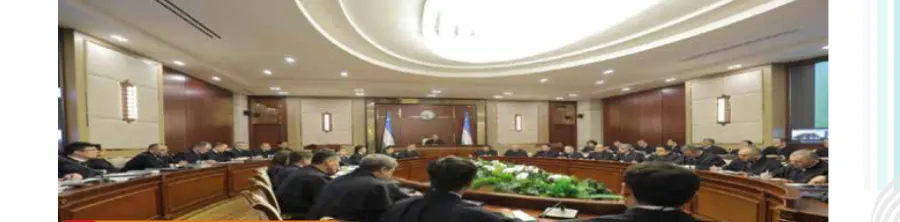

### Yodda tuting!

Sudyalar senator, davlat hokimiyati vakillik organlarining deputati boʻlishi mumkin emas.

Sudlar tomonidan qonuniylikning taʼminlanishi “Kuchli davlatdan kuchli fuqarolik jamiyati sari” tamoyilining amalda qaror topishini taʼminlaydi.

Oʻz navbatida sudyalar ham mustaqildirlar, ular faqat konstitutsiya va qonunga boʻysunadilar. Qonun chiqaruvchi va ijro etuvchi hokimiyat organlari sudyalarga tazyiq oʻtkazishga haqli emas.

Sudyalar daxlsizdir. Yaʼni sudyaning shaʼni, qadr-qimmati daxlsiz qadriyat sifatida ulugʻlanadi. Shunga koʻra, sudyalarning huquq va erkinliklari qonuniy muhofaza qilinadi. Davlat sudyaning va uning oila aʼzolarining xavfsizligini taʼminlaydi.

Sudyalar siyosiy partiyalarning aʼzosi boʻlishi, siyosiy harakatlarda ishtirok etishi, shuningdek, ilmiy, ijodiy va pedagogik faoliyatdan tashqari haq toʻlanadigan boshqa faoliyat turlari bilan shugʻullanishi mumkin emas.

Oʻzbekiston Respublikasi Sudyalar oliy kengashi sudyalar hamjamiyatining mustaqil organi boʻlib, u sudyalar korpusining shakllantirilishini, sud hokimiyati mustaqilligining konstitutsiyaviy prinsipiga rioya etilishini taʼminlaydi.

### Savol va topshiriqlar

1. Sud hokimiyati va sud tizimini tushuntiring.

2. Odil sudlovning maʼnosi nima?

3. Sudyalarning daxlsizligini asoslab bering.

4. Oʻzbekiston Respublikasi sud tizimi asosida sudlarning vazifalarini bayon eting.

### Respublikasi

**Konstitutsiyaviy sudi**

### Respublikasi

**Oliy sudi**

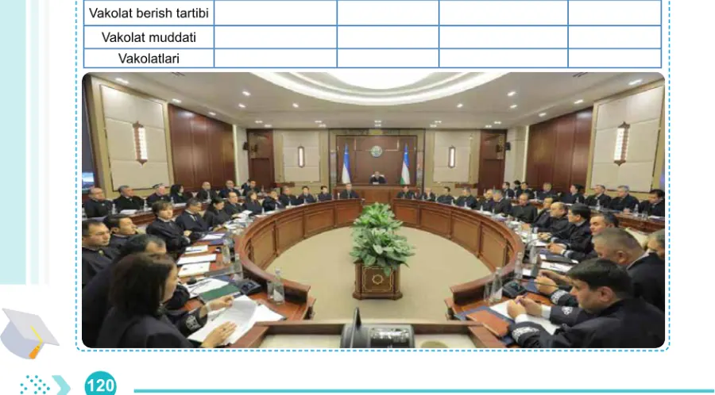

## 33-dars. Ijodiy faoliyat

### Fuqarolik jamiyati

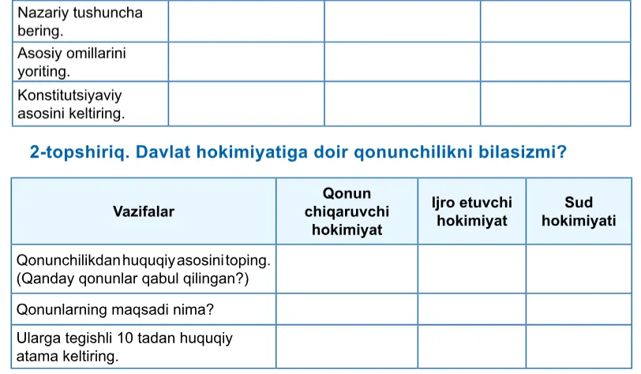

**3-topshiriq. Oʻzbekiston Respublikasi Konstitutsiyasi va “Yoshlarga oid davlat siyosati toʻgʻrisida”gi qonun asosida quyidagi huquqiy meʼyorlarni toʻldiring.**

Davlat yoshlarning intellektual, ijodiy, jismoniy va axloqiy jihatdan shakllanishi hamda rivojlanishi uchun, ularning taʼlim olishga, sogʻligʻini saqlashga, uy-joyga, ishga joylashishga, bandlik va dam olishga boʻlgan huquqlarini amalga oshirish uchun.........

Jinsi, irqi, millati, tili, dini, ijtimoiy kelib chiqishi, eʼtiqodi, shaxsi va ijtimoiy mavqeyidan qatʼi nazar, yoshlarning huquqlari va erkinliklarini biror-bir tarzda bevosita yoki bilvosita cheklashga yoʻl qoʻyilmaydi hamda bunday cheklash......

“Yoshlarga oid davlat siyosati toʻgʻrisida”gi qonunning maqsadi............... tartibga solishdan iborat.

## 34-dars. Nazorat ishi

1. Qonun Qonunchilik palatasi tomonidan qabul qilinib, Senat tomonidan maʼqullangach, yuridik kuchga ega boʻladi.

2. Oʻzbekiston Respublikasining Oliy Majlisi oliy davlat vakillik organi boʻlib, qonun chiqaruvchi organ vazifasini bajaradi.

3. Oʻzbekiston Respublikasining Prezidenti konstitutsiya va qonunlarga asoslanib hamda ularni ijro etish yuzasidan Respublikaning butun hududida majburiy kuchga ega boʻlgan farmonlar chiqaradi.

4. Vakolati tugashi munosabati bilan isteʼfoga chiqqan Oʻzbekiston Respublikasi Prezidenti umrbod Oʻzbekiston Respublikasi Konstitutsiyaviy sudi aʼzosi lavozimini egallaydi.

5. Vazirlar Mahkamasi oʻz faoliyatida Oʻzbekiston Respublikasi Oliy Majlisi, Oʻzbekiston Respublikasi Prezidenti va Oliy sud oldida javobgardir.

6. Viloyat, tuman, shahar hokimi lavozimini egallab turgan shaxs bir vaqtning oʻzida xalq deputatlari Kengashining raisi lavozimini egallashi mumkin.

7. Viloyat va Toshkent shahri hokimi Oʻzbekiston Respublikasi Prezidenti tomonidan qonunga muvofiq tayinlanadi va lavozimidan ozod etiladi. Tuman va shaharlarning hokimlari viloyat, Toshkent shahri hokimi tomonidan tasdiqlanadi.

8. Fuqarolarning oʻzini oʻzi boshqarish organlari davlat hokimiyati organlari tizimiga kiradi.

9. Oʻzbekiston Respublikasida sud tizimi va sudlar faoliyatining tartibi qonun bilan belgilanadi.

Favqulodda sudlar tuzishga yoʻl qoʻyiladi.

10. Konstitutsiyaviy sudning sudyalari qayta saylanish huquqisiz oʻn besh yillik muddatga tayinlanadi.

### Hayotiy vaziyat

# Lugʻat

## Ayrim yuridik atamalarning izohli lugʻati

> **Ariza** – fuqarolarning oʻz huquqlari, erkinliklari va qonuniy manfaatlarini amalga oshirish uchun koʻmak soʻrab qilgan murojaatlari.

> **Atrof-muhitni muhofaza qilish** – inson faoliyatining atrof-muhitga salbiy taʼsirini cheklash va uning oldini olishga qaratilgan chora-tadbirlar majmuyi.

> **Aybsizlik prezumpsiyasi** – jinoyat sodir etganlikda ayblanayotgan shaxs uning aybi qonunda nazarda tutilgan tartibda oshkora sud muhokamasi yoʻli bilan isbotlanmaguncha va sudning qonuniy kuchga kirgan hukmi bilan aniqlanmaguncha aybsiz deb hisoblanishi.

> **Burch** – kishining biror shaxs, oila, jamoa, el-yurt, vatan oldidagi majburiyatini anglatuvchi axloqiy tushuncha. Huquqiy holatda esa jamiyat va davlat tomonidan belgilangan va huquqiy normalarda oʻz aksini topgan talablarni bajarish.

> **Davlat suvereniteti** – hokimiyatni amalga oshirishda mamlakat ichkarisi va tashqarisida toʻla-toʻkis mustaqillik.

> **Demokratiya** – fuqarolarning davlatni boshqarishda ishtirok etish usullari orqali davlatni boshqarish. Bu tushuncha ilk marotaba Qadimgi Yunonistonda vujudga kelgan.

> **Deputat** – Davlat vakillik organining saylab qoʻyilgan aʼzosi. Oʻzbekiston Respublikasida – xalqning Oʻzbekiston Respublikasi Oliy Majlisi, Qoraqalpogʻiston Respublikasi Joʻqorgʻi Kengesi, xalq deputatlari viloyat, tuman va shahar kengashlaridagi vakolatli vakili.

> **Dunyoviy davlat** – diniy tashkilotlar va birlashmalar davlatdan hamda davlat hokimiyati dindan ajratilgan, davlat boshqaruvi Konstitutsiya va qonun hujjatlari bilan tartibga solinadigan davlat.

> **Erkinlik** – inson uchun oliy neʼmat boʻlib, uning qonunda taqiqlanmagan har qanday ishni qila olishi.

> **Fraksiya** – biror-bir siyosiy partiyaning siyosatini parlamentda ifoda etuvchi, mahalliy oʻzini oʻzi boshqaruvda, jamoat tashkilotlarida oʻz organlariga ega boʻlgan ayni partiya vakillaridan iborat tashkiliy guruh.

> Fuqarolarning oʻzini oʻzi boshqarish organlari – shaharchalar, qishloqlar va ovullar, shuningdek, shaharlardagi, shaharchalardagi, qishloqlardagi hamda ovullardagi mahallalar fuqarolar yigʻinlaridir.

> **Fuqarolarning oʻzini oʻzi boshqarishi** – fuqarolarning mahalliy ahamiyatga molik masalalarni oʻz manfaatlaridan, rivojlanishning tarixiy xususiyatlaridan, shuningdek, milliy va maʼnaviy qadriyatlardan, mahalliy urf-odatlar va anʼanalardan kelib chiqqan holda hal qilish borasidagi Oʻzbekiston Respublikasining Konstitutsiyasi va qonunlari bilan kafolatlanadigan mustaqil faoliyati.

> **Fuqarolik jamiyati** – uzviy bogʻliqlikda boʻlgan hamda axloqiy madaniyatga tayanadigan huquqiy va siyosiy madaniyatga ega odamlardan iborat jamiyat.

> **Hokim** – Oʻzbekiston Respublikasida viloyat, tuman, shaharda oliy mansabdor shaxs. Mahalliy vakillik va ijro etuvchi hokimiyat boshligʻi.

> **Hokimiyatlar boʻlinishi prinsipi** – davlat hokimiyati tizimi faoliyatining asosiy prinsipi boʻlib, unga koʻra, davlat hokimiyati qonunchilik, ijro etuvchi va sud hokimiyati organlariga boʻlinadi.

> **Huquq** – davlat tomonidan oʻrnatilgan va u tomonidan himoya qilinadigan barcha uchun majburiy boʻlgan xulq-atvor qoidalari tizimi.

> **Huquqiy davlat** – huquq ustuvorligi taʼminlangan, inson va fuqarolarning huquq va erkinliklari kafolatlangan, qonunlar oldida barcha teng boʻlgan, hech kim qonundan ustun turmaydigan davlat.

> **Huquqiy madaniyat** – kishilarning huquqiy bilim darajasi, huquqni hurmat qilishi va unga rioya qilishi.

> **Huquqiy nigilizm** – huquqqa, qonunlarga salbiy, ularni inkor qiluvchi, hurmatsiz munosabatda boʻlish.

> **Huquqiy tartibot** – jamiyatdagi munosabatlarning maʼlum bir holati, unga davlatning huquqiy meʼyorlarida mavjud boʻlgan barcha qonun-qoidalarga majburiy ravishda rioya qilinishi natijasida erishiladi.

> **Imtiyoz** – turli xil afzalliklar, yengilliklar berish.

> **Inson huquqlari** – insonning ijtimoiy hayotdagi, qonunlarda belgilab qoʻyilgan vakolatlari va imkoniyatlari.

> **Intellektual mulk** – ixtirolar, ilmiy kashfiyotlar, adabiy, musiqiy asarlarni yaratish kabi ijodiy faoliyat natijalari.

> **Jamoat birlashmasi** – oʻz huquqlari, erkinliklarini hamda siyosat, iqtisodiyot, ijtimoiy rivojlanish, fan, madaniyat, ekologiya va hayotning boshqa sohalaridagi qonuniy manfaatlarini birgalikda roʻyobga chiqarish uchun birlashgan fuqarolarning xohish-irodalarini erkin bildirishlari natijasida vujudga kelgan ixtiyoriy tuzilma.

> **Konstitutsiya** – yuridik kuchga ega boʻlgan rasmiy hujjat boʻlib, unda inson va fuqaroning huquq va erkinliklari belgilanadi, davlat boshqaruvi va hududiy tuzilishi, davlat organlarining vakolatlari bеlgilab qoʻyiladi.

> **Konstitutsiya muqaddimasi** – Konstitutsiyada qabul qilinayotgan maqsadlar va prinsiplarni xalq nomidan tantanali eʼlon qilish. Muqaddimada Konstitutsiya mamlakat xalqi nomidan eʼlon qilinayotgani va uning orzu-umidlari, niyatlari va majburiyatlarini oʻzida mujassamlashtirishi koʻrsatiladi.

> **Konstitutsiyaviy huquq** – huquqning mustaqil tarmogʻi sifatida mamlakatning konstitutsiyaviy tuzilishi asoslarini, jamiyat tuzilishini, davlat hokimiyati va boshqaruv tuzilishini, davlat organlari vakolatlarini, shu davlat hududida yashab turgan fuqarolarning asosiy huquq va erkinliklarini belgilovchi yuridik meʼyorlardan iborat.

> **Madaniy huquqlar** – shaxsning madaniy boyliklardan foydalanish va yaratish, madaniy hayotda ishtirok etish erkinligini taʼminlaydigan huquqlar.

> **Miting** – maʼlum bir shaxslar va tashkilotlarning xatti-harakatlari, ijtimoiy-siyosiy voqealarga nisbatan munosabatini oshkora ifodalash maqsadidagi fuqarolarning tinch yigʻini.

> **Mulkdor boʻlish huquqi –** mulkka qanday egalik qilish, undan foydalanish va uni tasarruf etishni belgilovchi, shuningdek, ushbu vakolatlarni himoya qilishni taʼminlaydigan huquqiy normalar yigʻindisi.

> **Nodavlat notijorat tashkiloti** – jismoniy va (yoki) yuridik shaxslar tomonidan ixtiyoriylik asosida tashkil etilgan, daromad (foyda) olishni oʻz faoliyatining asosiy maqsadi qilib olmagan hamda olingan daromadlarni (foydani) oʻz qatnashchilari (aʼzolari) oʻrtasida taqsimlamaydigan oʻzini oʻzi boshqarish tashkiloti.

> **Normativ-huquqiy hujjat** – vakolatli davlat organlari tomonidan qabul qilingan huquqiy normalarni belgilashga, oʻzgartirishga yoki bekor qilishga qaratilgan rasmiy hujjat.

> **Odil sudlov** – haqiqiy holatni aniqlab, odamlar orasidagi, ular bilan jamiyat va davlat oʻrtasidagi kelishmovchilik va nizolarni faqat sud tomonidan hal etilishi.

> **Ombudsman** – mansabdor shaxs boʻlib, davlat organlari, korxonalar, tashkilotlar va muassasalar, mansabdor shaxslar tomonidan inson huquqlari hamda erkinliklari toʻgʻrisidagi qonunchilikka rioya etilishi ustidan parlament nazoratini olib boradi.

> **Oʻzbekiston Respublikasi Vazirlar Mahkamasi** – Oʻzbekiston Respublikasi hukumati. Ijro etuvchi hokimiyatning markaziy organi.

> **Prezident** – respublika boshqaruv shaklidagi koʻplab mamlakatlarda maʼlum muddatga saylab qoʻyiladigan davlat boshligʻi.

> **Qonun ustuvorligi** – barcha davlat hokimiyati organlari faoliyatida qonunlar oliy yuridik kuchga ega boʻlishi.

> **Referendum** – umumxalq ovoz berish yoʻli bilan qonunlar qabul qilish va davlat ahamiyatiga molik eng muhim masalalarni hal qilish shakli. Referendumning saylovdan farqi shundaki, unda muayyan shaxslarning nomzodlari emas, davlat va jamiyat ahamiyatiga oid ishlar, qonun, qonun loyihasi, Konstitutsiyaga oʻzgartirish va qoʻshimcha kiritish kabi masalalar muhokamaga qoʻyiladi. Fuqarolar ushbu masalalar yuzasidan oʻz ovozlarini beradilar.

> **Reglament** – muayyan davlat organi yoki boʻlinmasining ichki tashkiliy hamda faoliyat tartibini belgilovchi normativ-huquqiy hujjat, yaʼni vakillik organlari majlis, yigʻilish, sessiya va syezdlarini olib borish tartibi.

> **Respublika** – bunday boshqaruv shaklida saylab qoʻyiladigan organlar saylovchilar oldida javobgar boʻladi, ular muayyan muddatga saylanadi va davlat hokimiyatini xalq nomidan amalga oshiradi.

> **Senat** – davlat hokimiyatining yuqori organi boʻlib, koʻpincha qonunchilik kengashlari (parlament)ning yuqori palatasi shunday nomlanadi. Oʻzbekiston Respublikasi Oliy Majlisining yuqori palatasi.

> **Siyosiy huquqlar** – fuqarolarning jamiyat va davlat boshqaruvida, siyosiy hayotida ishtirok etish imkoniyatini taʼminlovchi huquqlar.

> **Siyosiy partiya** – Oʻzbekiston Respublikasi fuqarolarining qarashlar, manfaatlar va maqsadlar mushtarakligi asosida tuzilgan, davlat hokimiyati organlarini shakllantirishda jamiyat muayyan qismining siyosiy irodasini roʻyobga chiqarishga intiluvchi hamda oʻz vakillari orqali davlat va jamoat ishlarini idora etishda qatnashuvchi koʻngilli birlashmasi.

> **Sud hokimiyati** – hokimiyatlar boʻlinishi qoidasiga koʻra, davlat hokimiyatining alohida va mustaqil tarmogʻi.

> **Taklif** – fuqarolarning davlat va jamoatchilik faoliyatini takomillashtirish boʻyicha tavsiyalarini ifodalovchi murojaatlar.

> **Тashqi siyosat** – хalqaro hayotda ishtirok etgan holda oʻz chеgarasidan tashqarisida davlatning boshqa davlatlar, хalqaro tashkilotlar bilan munosabatini, davlatning хalqaro munosabatlardagi umumiy yoʻnalishini amalga oshirishdan iborat.

> **Unitar davlat** – yagona davlat boʻlib, uning alohida maʼmuriy-hududiy birliklari bir xildagi huquqlarga ega, butun davlat hududida yagona konstitutsiya, yagona hukumat va yagona qonun hujjatlari amal qiladi.

> **Vasiyatnoma** – vasiyat qiluvchi oʻz merosxoʻrlarini va ularga merosni berish tartibini belgilaydigan hujjat.

> **Vazir** – Oʻzbekiston Respublikasida hukumat aʼzosi hamda maʼlum bir vazirlikni boshqaruvchi yuqori mansabdor shaxs.

> **Vijdon erkinligi** – har kimning xohlagan dinga eʼtiqod qilish yoki hech qaysi dinga eʼtiqod qilmaslik huquqi.

> **Xalqaro huquq** – xalqaro muloqot jarayonida davlatlararo munosabatlarni tartibga solib turuvchi yuridik qoidalar majmuyi.

> **Yigʻilish** – biror-bir muhim jamoatchilik masalasini jamoa boʻlib birgalikda muhokama qilish uchun fuqarolar ishtiroki.

> **YUNEP** – atrof-muhit muhofazasi boʻyicha BMT dasturi.

> **Shaxs daxlsizligi** (Oʻzbekiston Respublikasida) – har bir kimsaning tugʻilganidan boshlab tan olinadigan uzviy huquqi. Shaxs daxlsizligi jismoniy, axloqiy va maʼnaviy jihatlarga ega.

> **Shaxsiy huquq va erkinliklar** – inson tugʻilgan zahoti ega boʻladigan, uning asosiy hayotiy ehtiyojlarini taʼminlaydigan, tabiiy, ajralmas huquqlari.

> **Shikoyat** – fuqarolarning buzilgan huquqlari, erkinliklari va qonuniy manfaatlarini tiklashni talab qiluvchi murojaatlari.

### Ijaraga beriladigan darslik holatini koʻrsatuvchi jadval

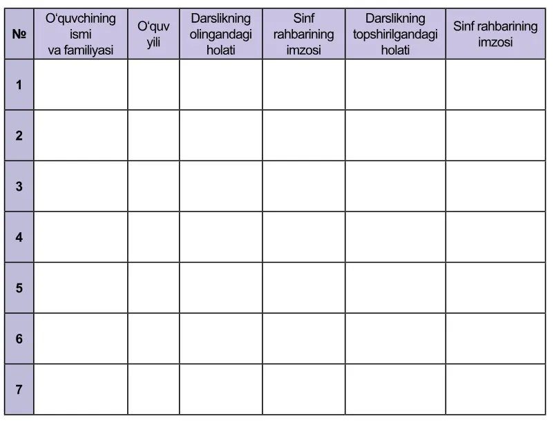

> **Darslik ijaraga berilib, oʻquv yili yakunida qaytarib olinganda yuqoridagi jadval sinf rahbarlari tomonidan quyidagi baholash mezonlariga asosan toʻldiriladi:**

> Darslikning birinchi marta foydalanishga berilgandagi holati.

> Muqova butun, darslikning asosiy qismidan ajralmagan. Barcha varaqlari bor, yirtilmagan, koʻchmagan, betlarida yozuv va chiziqlar yoʻq.

> Muqova ezilgan, birmuncha chizilib, chetlari yedirilgan, darslikning asosiy qismidan ajralish holati bor, lekin qoniqarli taʼmirlangan. Koʻchgan varaqlari qayta joylangan, ayrim betlariga chizilgan.

> Muqova yirtilgan, ustiga chizilgan, asosiy qismidan ajralgan yoki butunlay yoʻq, qoniqarsiz taʼmirlangan. Betlari yirtilgan, varaqlari yetishmaydi, chizib, boʻyab tashlangan. Darslikni tiklab boʻlmaydi.
